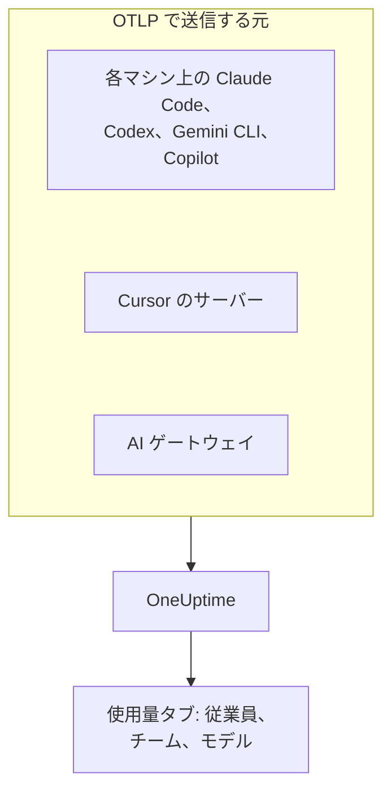

# AI コーディングアシスタント

エンジニアは Claude Code、Cursor、Codex、Gemini CLI、Copilot を使い、請求額は増え続けています。このページは、マネージャーが抱く疑問に答えます。 **誰がどのツールを、どのモデルで使い、各個人と各チームがいくら使っているか** です。

ほとんどのコーディングアシスタントは自分で OpenTelemetry をエクスポートするため、開発者のマシンに何かをインストールする必要はありません。エクスポート先を OneUptime に向ければ、トークン、コスト、ツールの使用状況が、自社アプリの AI 呼び出しと並んで届きます。ここで扱うものはすべて OpenTelemetry で届きます。OneUptime がベンダーの管理 API や請求 API をポーリングすることはありません。

:::cards
- [サポート状況](#サポート状況): 各ツールが何を送り、人を特定できるか。
- [従業員とチームへの帰属](#従業員とチームへの帰属): 支出に名前とチームを付けるキー。
- [使用量タブ](#使用量タブ): コーディングアシスタントについて、支出の表で表示できることとできないこと。
- [どこから始めるか](#どこから始めるか): 初日から成果が見える導入の順序。
:::

## 仕組み

各ツールは、取り込みキーを付けて OneUptime の OTLP エンドポイントにテレメトリを送ります。送信元は、各開発者のマシン、ベンダーのサーバー (Cursor)、またはモデルへのトラフィックが通るゲートウェイです。



## 始める前に

1. **プロジェクト設定 → テレメトリと APM → 取り込みキー** で、テレメトリの取り込みキーを作成します。
2. OTLP エンドポイントは `https://oneuptime.com/otlp` です。OneUptime をセルフホストしている場合は `https://YOUR-ONEUPTIME-HOST/otlp` です。
3. どのエクスポートも、キーを `x-oneuptime-token` ヘッダーで送ります。

取り込みキーはすべてのマシンで 1 つで構いません。キーは開発者のすべてのマシンに置かれるため、データの送信だけができる共有の資格情報として扱い、ほかの資格情報と同じようにローテーションしてください。

## サポート状況

ツールから何が得られるかは、3 つの点で決まります。そもそも OpenTelemetry を送るか、テレメトリがどう OneUptime に届くか、そしてその中に人を特定する情報があるかです。

| ツール | 送るもの | OneUptime への届き方 | 特定する人 | ガイド |
| --- | --- | --- | --- | --- |
| Claude Code | メトリクスとログ。トレースはベータ | 各マシンから。環境変数または管理設定ファイル | Claude アカウントでサインインしているときは `user.email` | [Claude Code](/docs/telemetry/claude-code) |
| Cursor | メトリクスとログ | Cursor のサーバーから。Cursor のダッシュボードで一度設定。Enterprise プランのみ | 整数の `cursor.user.id` | [Cursor](/docs/telemetry/cursor) |
| OpenAI Codex | トレース、メトリクス、ログ。それぞれ `~/.codex/config.toml` で有効化 | 各マシンから。シグナルごとに完全な URL | スパンとメトリクスでは誰も特定しない。`[otel.span_attributes]` で `user.id` と `user.email` を自分で設定 | [OpenAI Codex](/docs/telemetry/openai-codex) |
| Gemini CLI | トレース、メトリクス、ログ | 各マシンから。通常はローカルの Collector 経由 | サインインしているときは `user.email` | [Gemini CLI と GitHub Copilot](/docs/telemetry/gemini-cli-and-copilot) |
| GitHub Copilot | トレース、メトリクス、ログ。エージェント機能からのみ | エディターまたはエージェントホストから | 誰も特定しない。各マシンで `enduser.id` と `user.email` を自分で設定 | [Gemini CLI と GitHub Copilot](/docs/telemetry/gemini-cli-and-copilot) |
| Cline | メトリクスとログ | Cline の組織ダッシュボードで一元的に設定 | 匿名化された `user_id` | — |
| LiteLLM と Portkey | ゲートウェイを通るすべての呼び出しのトレース | ゲートウェイのプロセスから | LiteLLM では仮想キーの所有者 | [AI ゲートウェイ](/docs/telemetry/ai-gateways) |
| 自社のアプリ | GenAI インストルメンテーションが送るもの | アプリから | `user.id` に設定した人 | [AI / LLM オブザーバビリティ](/docs/telemetry/ai-llm-observability) |
| Windsurf、JetBrains AI、Amazon Bedrock、Azure OpenAI | 独自の OpenTelemetry はない | 前段に置いたゲートウェイ経由のみ | ゲートウェイが特定する人 | [AI ゲートウェイ](/docs/telemetry/ai-gateways) |

ダッシュは、OneUptime にそのツールのガイドがまだないことを示します。そのツールのテレメトリも、ほかの OpenTelemetry と同様に取り込まれます。

:::details GitHub Copilot が正確に何をエクスポートするか
Copilot が OpenTelemetry をエクスポートするのはエージェント機能からだけです。VS Code のチャットとエージェントモード、Copilot CLI の背後のエージェントホスト、Copilot SDK、Copilot プラグイン経由の JetBrains IDE のエージェントワークフローが該当します。インライン補完、github.com 上の Copilot、Copilot のコードレビューについては、GitHub はエクスポートを文書化していません。Copilot はユーザー属性を一切送らないため、`resourceAttributes` または `OTEL_RESOURCE_ATTRIBUTES` でマシンごとに `enduser.id` と `user.email` を設定してください。
:::

:::details Amazon Bedrock、Azure OpenAI、Windsurf、JetBrains AI
- **Amazon Bedrock**: `InvokeModel` と `Converse` の API は OpenTelemetry を送りません。Bedrock AgentCore は異なり、AWS はメトリクス、スパン、ログを文書化しており、既定では CloudWatch に送られます。`DISABLE_ADOT_OBSERVABILITY=true` を設定するとランタイムの既定の ADOT 構成がオフになり、ADOT SDK を OneUptime に向けられます。
- **Azure OpenAI**: サービスは何も送らず、Azure Monitor のメトリクスにはユーザーのディメンションがありません。クライアントをインストルメントするか、前段に API Management などのゲートウェイを置いてください。
- **Windsurf**: テレメトリのエクスポートは文書化されていません。ユーザーごとのデータは Windsurf の Enterprise API にありますが、OneUptime はポーリングしません。
- **JetBrains AI Assistant と Junie**: 使用状況をエクスポートしません。JetBrains の OpenTelemetry プラグインは IDE 内で自社アプリのテレメトリを受け取るもので、外部には何も送りません。
:::

## 従業員とチームへの帰属

OneUptime は、テレメトリが届いた時点で、呼び出しを行った人とそのチームを列にコピーします。そのため **使用量** タブでは、属性フィルターなしで人とチームをランキングできます。

### 従業員として読み取る属性

スパンでは、次の順で最初に見つかったキーが優先されます。

| 列 | キー (優先順) |
| --- | --- |
| 従業員 ID | `user.id`、`enduser.id`、`litellm.metadata.user_api_key_user_id`、`metadata.user_api_key_user_id`、`traceloop.association.properties.user_id`、`langfuse.user.id`、`user.account_uuid`、`user.account_id`、`cursor.user.id` |
| 従業員のメールアドレス | `user.email`、`litellm.metadata.user_api_key_user_email`、`metadata.user_api_key_user_email`、`traceloop.association.properties.user_email`、`enduser.email` |
| チーム / コストセンター | `team.id`、`team`、`cost_center`、`department`、`litellm.metadata.user_api_key_team_id`、`litellm.team.id`、`metadata.user_api_key_team_id`、`cursor.team.id` |

メトリクスのデータポイントでは、一覧が短くなり、メールアドレスから始まります。メトリクスを送るコーディングアシスタントは、自分で `user.email` を送るためです。

| 列 | キー (優先順) |
| --- | --- |
| 従業員 | `user.email`、`user.id`、`user.account_uuid`、`user.account_id`、`cursor.user.id` |
| チーム / コストセンター | `team.id`、`team`、`cost_center`、`department`、`cursor.team.id` |
| モデル | `gen_ai.request.model`、`model`、`cursor.model.name` |

これらのキーの読み取り方は次のとおりです。

- **どのキーも `resource.` プレフィックス付きでも読み取ります。** OTLP の取り込みはリソース属性をこのプレフィックスの下に保存するため、`OTEL_RESOURCE_ATTRIBUTES=team.id=platform` は `resource.team.id` として届きます。プレフィックスなしのキーが先に試されるため、スパン上の値がプロセス全体の値より優先されます。
- **使用量タブは、呼び出しにメールアドレスがあればそれを、なければ ID を表示します。** 同じメールアドレスの行は合算されるため、2 台のマシンを使う 1 人のエンジニアは 1 行になります。
- **ID は AI 呼び出しからのみ読み取ります。** `user.id`、`user.email`、`team.id` はブラウザーやバックエンドのスパンも持つ汎用的なキーです。列が設定されるのは、すでに AI 呼び出しと認識されたスパンだけです。
- **ログレコードからは ID を読み取りません。** これは、`user.email` をログにだけ付ける Codex にとって重要です。
- LiteLLM はこれらのキーを 2 通りに表記します。既定の `otel` コールバックは `metadata.` プレフィックスを使い、オプトインの OpenTelemetry v2 モード (`LITELLM_OTEL_V2=true`) は `litellm.` 名前空間を使います。OneUptime は両方を読み取るため、標準のプロキシは追加の設定なしで動きます。

### チームとコストセンター

`team.id`、`team`、`cost_center`、`department` を送るインストルメンテーションはありません。これらは組織が設定するもので、通常はツールのプロセスの `OTEL_RESOURCE_ATTRIBUTES` で設定します。

```bash
export OTEL_RESOURCE_ATTRIBUTES="team.id=platform,team=Platform_Engineering,cost_center=eng-123,department=engineering"
```

開発者のマシンをすでにプロビジョニングしている場所で設定してください。MDM プロファイル、管理設定ファイル、dotfiles のシェルプロファイルなどです。値にスペースは使えません。アンダースコアか、`%20` のようなパーセントエンコーディングを使ってください。Codex にはリソース属性がないため、代わりに同じキーを `[otel.span_attributes]` に設定します。

アプリケーションごとに支出を分けるには、サービス名 (`OTEL_SERVICE_NAME`、またはツール独自の設定) を使います。 **アプリケーション / サービス** の内訳は、GenAI スパンを送るツールだけが対象です。

### 意図的に従業員として扱わないもの

1 つの呼び出しには、呼び出しを行った従業員と、その呼び出しの対象である顧客という、2 人の異なる人が含まれることがあります。次のキーは顧客を表すもので、OneUptime がこれらを ID の列に読み込むことはありません。

- `gen_ai.user` と `llm.user`: OpenAI のリクエストパラメーター `user` をインストルメンテーションが反映したもので、OpenAI はこれをエンドユーザーの識別子と説明しています。
- `litellm.metadata.user_api_key_end_user_id`、`metadata.user_api_key_end_user_id`、`litellm.end_user.id`: LiteLLM のエンドユーザーで、従業員であるキーの所有者とは別です。

顧客の ID を従業員として読むと、40,000 人の顧客に対応するサポートボットが 40,000 人の架空の従業員になり、支出の持ち主であるエンジニアは何も使っていないように見えてしまいます。これらのキーはスパンの属性に残り、トレースビューアーの **LLM** タブではエンドユーザーとして表示されます。

### プライバシー

従業員のメールアドレスの列には個人データが含まれます。トレースの **スクラブルール** は、読み取り元の属性と同じようにこの列にも適用されるため、メールアドレスをマスクするルールはこの列もマスクします。ルールは **トレース → 設定** にあります。

## OneUptime が読み取るコーディングアシスタントのメトリクス

コーディングアシスタントは、メトリクスに `gen_ai.*` ではなく独自のプレフィックスを付けるため、OneUptime はそれぞれを名前で認識します。

| メトリクス | ツール | 単位 |
| --- | --- | --- |
| `claude_code.token.usage` | Claude Code | トークン |
| `claude_code.cost.usage` | Claude Code | USD |
| `cursor.token.usage` | Cursor | トークン |
| `cursor.cost.usage` | Cursor | USD。Cursor 自身による見積もり |
| `codex.turn.token_usage` | OpenAI Codex | トークン |
| `codex.turn.cost_microusd` | OpenAI Codex | 百万分の一 USD。OneUptime が換算するため、自分で換算しないでください |

OneUptime は、トークンを `gen_ai.client.token.usage`、`gen_ai.client.token.count`、`llm.token.usage`、`llm.usage.tokens` から、コストを `gen_ai.client.cost`、`gen_ai.client.cost.usd`、`gen_ai.usage.cost`、`litellm_spend_metric`、`litellm.cost.total` からも読み取ります。

数値を読む前に知っておくべきことが 2 つあります。

- **`gemini_cli.token.usage` は意図的に除外しています。** Gemini CLI はトークンを独自のメトリクスと `gen_ai.client.token.usage` の 2 回送るため、両方を読むと 2 倍になります。トークンは `gen_ai.client.token.usage` から 1 回だけ数えます。Gemini CLI はコストのメトリクスを送らないため、各呼び出しに料金を付けるにはトレースを有効にしてください。
- **数えるのは入力と出力のトークンだけです。** トークンの種類は `gen_ai.token.type`、`llm.token.type`、`type`、`cursor.token.type`、`token_type` から読み取り、`input` と `output` (または古い `prompt` と `completion`) だけを数えます。キャッシュの読み書き、Codex の `total` (ほかの値の繰り返し)、`reasoning_output` (`output` の一部) は除外するため、メトリクスから得た合計は、ツールが送るすべての値の和より小さくなります。

## 使用量タブ

**製品 → AI / LLM** を開き、 **使用量** に移動します。別の期間を選ばない限り過去 7 日間について、 **従業員** 、 **チーム** 、 **モデル** 、 **プロバイダー** 、 **アプリケーション / サービス** を支出順にランキングします。誰も特定できない呼び出しは **帰属なし** として数えられます。 **帰属なし** の行が大きい場合は、どのツールにまだ ID の設定が必要かがわかります。

### コーディングアシスタントのメトリクスは補完であり、加算ではない

GenAI スパンが優先されます。メトリクスを読むのはスパンが何も報告しなかった数値に限られ、両者が合算されることはありません ([理由](/docs/telemetry/ai-llm-observability#スパンが優先されメトリクスが補う))。コーディングアシスタントにとっては、はっきりした結果が 1 つあります。 **同じプロジェクトがコスト付きの GenAI スパンを受け取っていると、コーディングアシスタントの支出は表示されません。** コーディングアシスタントには、専用の取り込みキーを持つ専用のプロジェクトを用意してください。

補完が適用される場合、メトリクスだけを送るツールについて各内訳で表示できるのは次のとおりです。

| 内訳 | メトリクスから |
| --- | --- |
| **従業員** | はい。上記のすべての ID キーから、プレフィックスなしと `resource.` 付きの両方 |
| **チーム** | はい。チームのキーから |
| **モデル** | はい。Claude Code と Codex はプレフィックスなしの `model`、Cursor は `cursor.model.name` を送る |
| **プロバイダー** | いいえ。コーディングアシスタントのメトリクスはプロバイダーを示さない |
| **アプリケーション / サービス** | いいえ。それらのメトリクスはどの OneUptime サービスにも属さない |

メトリクスから読み取った行はコストだけを持ちます。支出のカウンターには呼び出しごとの詳細がなく、そこに 0 を表示するとその人が呼び出しをしなかったことになってしまうため、呼び出しとトークンのセルには `—` が表示されます。表には **GenAI メトリクスから** と表示されます。

## OpenTelemetry がない場合は、前段にゲートウェイを置く

Windsurf、JetBrains AI、Bedrock のモデル API、Azure OpenAI など、独自のエクスポートがないものについては、前段に AI ゲートウェイを置きます。すべての呼び出しが OpenTelemetry を送る 1 つのプロセスを通るため、エクスポートの設定は 1 回で済みます。

**従業員ごとに 1 つの仮想キーで LiteLLM を使ってください。** LiteLLM は各スパンにキーの所有者の ID とメールアドレスを付け、OneUptime はそれを従業員として、キーのチームをチームとして読み取ります。LiteLLM は、プロキシに設定した独自の料金を使って各呼び出しの料金を自分で計算し、その報告したコストは OneUptime の見積もりより優先されます。この目的にエンドユーザー ID を使わないでください。それは顧客です。設定方法は [AI ゲートウェイ](/docs/telemetry/ai-gateways) にあります。

ゲートウェイを前提に計画する前に、2 つの制限があります。

- **ゲートウェイが見られるのは、そこを通るトラフィックだけです。** Cursor 独自のベース URL の上書きは、チャットモデルだけを対象とするユーザーごとの設定です (Tab 補完は引き続き Cursor のモデルを使います)。そのため Cursor のネイティブなエクスポートを優先してください。
- **ゲートウェイが見るのはモデルの呼び出しで、エージェントではありません。** プロンプトと回答は記録しますが、ツール独自のテレメトリが報告するツール呼び出し、ファイルの編集、承認や却下の判断は記録しません。

## プロンプトの内容: 既定値はツールごとに異なる

プロンプトと回答は、このパイプラインで最もリスクの高いデータです。ソースコード、顧客データ、貼り付けられた資格情報が日常的に含まれます。各ツールの既定値を確認してください。

| ツール | プロンプトの内容の既定値 |
| --- | --- |
| Claude Code | オフ。内容の種類ごとに、有効にするための変数がある |
| Cursor | オフ。メッセージのテキストを送るのはオプトインの `conversation_content` ファミリーだけ |
| OpenAI Codex | オフ。`log_user_prompt` の既定値は `false` |
| Gemini CLI | **オン** 。`logPrompts` の既定値は `true` なので、テレメトリを有効にするときに `false` に設定する |
| GitHub Copilot | オフ。`captureContent` で、管理設定から `lockCaptureContent` で固定できる |
| LiteLLM | 既定の `otel` コールバックではオン (`turn_off_message_logging` でオフにする)。OpenTelemetry v2 モードではオフ |

Codex は既定でメトリクスを OpenAI にも送ります。[OpenAI Codex](/docs/telemetry/openai-codex)を参照してください。意図的に内容を取得する場合も、トレースの **スクラブルール** と **破棄フィルター** がほかのテレメトリと同じように適用されます。

## OneUptime がまだ行わないこと

- **ベンダーの管理 API や請求 API とのコネクターはありません。** OneUptime は、Anthropic の Admin API、Cursor の Admin API、OpenAI の使用量とコストのエンドポイント、GitHub の Copilot の請求、Windsurf や JetBrains の API をポーリングしません。請求書レベルの数値はベンダーから取得してください。
- **ツールが報告しない限り、コストは見積もりです。** 報告されたコストはそのまま使い、それ以外は OneUptime が定価でトークンの料金を算出します。Cursor の `cursor.cost.usage` 自体も見積もりです。
- **ログレコード上の ID は読み取りません。** Codex がログにだけ送る `user.email` は、支出に結び付けられません。
- **Cursor の `cursor.user.email` はまだ読み取りません。** そのため Cursor のユーザーは整数の `cursor.user.id` で表示されます。
- **Codex のスパンはモデルを示しません。** そのため OneUptime は料金を算出できず、Codex は人ごとのトークンを表示し、コストは合計にだけ表示されます。
- **ツールは変化が速いです。** このページでエクスポートがないとされているツールでも、ゲートウェイを前提に構築する前に、最新のドキュメントを確認してください。

## どこから始めるか

次の順序で導入してください。どのステップもそれだけで役に立ちます。自社アプリから GenAI スパンをまだ受け取っていないプロジェクトを使ってください。そうしないと、[補完のルール](#コーディングアシスタントのメトリクスは補完であり加算ではない)によってコーディングアシスタントの支出がページに表示されません。

1. **Gemini CLI** (使っている人がいる場合)。設定なしで `user.email` を送るため、帰属がエンドツーエンドで動くことを確認できます。コストのメトリクスを送らないため、トレースも有効にしてください。
2. **Claude Code**: フリート全体に 1 つの管理設定ファイル、手間なしの `user.email`、本物のコストのメトリクス、そして開発者ごとの承認率、コミット、プルリクエスト、コード行数。
3. **Cursor** (Enterprise プラン): Cursor のダッシュボードの 1 画面で済み、開発者のマシンには触れません。ただし人は整数で届きます。
4. **Copilot と Codex**: どちらも各マシンで ID を設定する必要があります。マシンのプロビジョニング時に設定してください。ID なしで届いた呼び出しは、後から帰属させられません。
5. **LiteLLM ゲートウェイ** (それ以外のすべて向け)。従業員ごとに 1 つの仮想キーを使います。

## 次のステップ

:::cards
- [Claude Code](/docs/telemetry/claude-code): 1 台のマシンまたはフリート全体で Claude Code のエクスポートを有効にします。
- [Cursor](/docs/telemetry/cursor): Cursor のダッシュボードから Cursor のチームのテレメトリを送ります。
- [OpenAI Codex](/docs/telemetry/openai-codex): Codex の 3 つのエクスポーターを設定し、スパンに ID を付けます。
- [AI / LLM オブザーバビリティ](/docs/telemetry/ai-llm-observability): すべての AI 呼び出しの会話、アラート、コスト、予算。
:::
