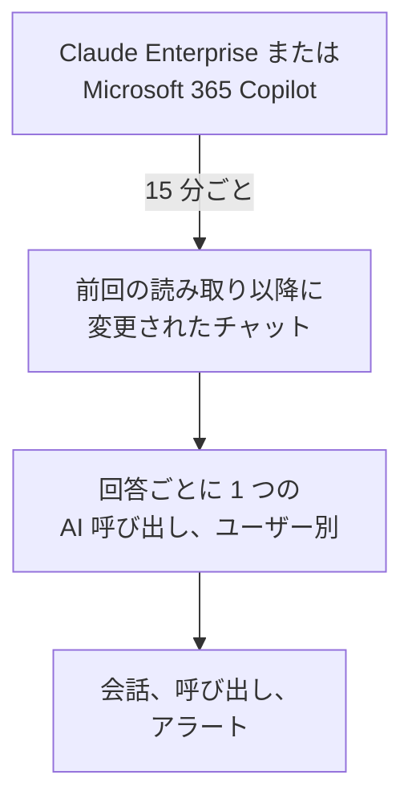

# 社内の AI ツール

会社が料金を払っている AI ツールに社員が何を尋ねているかを、ユーザーごとの会話として確認できます。Claude Enterprise または Microsoft 365 Copilot を読み取り専用の認証情報で接続すると、OneUptime が 15 分ごとに新しいチャットを **会話** に取り込みます。別の設定を選ばない限り、読めるのはプロジェクトのオーナーと管理者だけです。

:::cards
- [まず社員に伝える](#まず社員に伝える): チャットは社員自身の言葉です。
- [ツールを接続する](#ツールを接続する): 認証情報を貼り付け、読める人を選び、テストして接続します。
- [プライバシー](#プライバシー): 会話を読める人と、書かれた内容を保存するかどうか。
- [その他の AI ツール](#その他の-ai-ツール): ChatGPT Enterprise、Gemini、Open WebUI、LibreChat、コーディングアシスタント。
:::

## まず社員に伝える

> [!IMPORTANT]
> これは社員自身の言葉です。ツールを接続する前に、そのツールとのチャットが保存されることと、誰が読めるかを社員に伝え、社内の規程と現地の法律が何を求めているかを法務または人事部門に確認してください。

## 仕組み

OneUptime は 15 分ごとに、前回の読み取り以降に変更されたチャットをツールに問い合わせます。各回答は、質問したユーザーの 1 つの AI 呼び出しになり、前の回答以降の質問を含みます。各チャットは 1 つの会話になります。

チャットはアプリの AI 呼び出しと同じように届くため、スクラブルール、ドロップフィルター、保持期間、AI アラートが適用されます。これらのツールはシート単位の料金なので、呼び出しにはトークンもコストもありません。1 時間回答のない質問は単独で取り込まれるため、AI が回答しなかったチャットも表示されます。

## 始める前に

- Project Owner または Project Admin のロール。ツールを接続、変更、削除できるのはこのロールだけです。
- 認証情報を作成する、ツールの管理者。誰が必要かは、以下の各ツールのセクションで説明します。
- 社員への通知と、法務または人事部門からの回答。

## ツールを接続する

:::steps
### 接続を開く

**製品 → AI / LLM → 接続** を開きます。**社内の AI ツール** でツールのタイルをクリックします。

### 認証情報を貼り付ける

**認証情報** で、ツールが求める項目を入力します。シークレットは暗号化して保存され、二度と表示されません。

### 読める人を選ぶ

**プライバシー** で、[プライバシー](#プライバシー) の説明に従って **会話を閲覧できるユーザー** と **書かれた内容を保存** を設定します。

### テストする

**テスト** で **接続をテスト** をクリックします。OneUptime は直近 7 日間のチャットの数を数えるだけで、誰かが書いた内容を読み取ったり、表示したり、保存したりはしません。

### 接続する

**接続** をクリックします。最初の読み取りは 1 分以内に始まり、直近 7 日分を取り込みます。
:::

## Claude Enterprise

OneUptime は Compliance API を通じて、組織のすべての claude.ai チャットを読み取ります。誰が質問したか、Claude に何を尋ねたか、Claude が何と答えたか、どのモデルを使ったかです。新しいメッセージが届いたチャットはもう一度読み取られ、取り込み済みの回答は識別されてスキップされます。

:::steps
### Compliance API を有効にする

組織のプライマリ オーナーが claude.ai で Organization settings、API を開き、Compliance API を有効にします。

### コンプライアンス アクセス キーを作成する

同じ画面で `read:compliance_user_data` スコープのキーを作成します。キーは `sk-ant-api01-` で始まります。

### Claude Enterprise を接続する

キーを **コンプライアンス アクセス キー** に貼り付けます。
:::

## Microsoft 365 Copilot

OneUptime は Microsoft Graph から、各ユーザーの Copilot のやり取りの履歴を読み取ります。Teams、Outlook、Word、Excel、PowerPoint、Loop、Copilot Chat で Copilot に何を尋ねたか、何と回答されたか、どのアプリだったかです。プロンプトとその回答は 1 つの AI 呼び出しに、Copilot のセッションは 1 つの会話になります。大きなテナントは分割して読み取られ、前回の読み取りが止まったところから続きます。

:::steps
### アプリを登録する

Microsoft Entra ID でアプリを登録し、クライアント シークレットを作成します。

### アクセス許可を付与する

アプリに Microsoft Graph のアプリケーションのアクセス許可 `AiEnterpriseInteraction.Read.All` と `User.Read.All` を付与し、管理者の同意を与えます。

### Copilot を接続する

**ディレクトリ (テナント) ID**、**アプリケーション (クライアント) ID**、**クライアントシークレット** を入力します。一部のユーザーだけを読み取るには、**その他の項目** の **このグループのメンバーのみ** にグループのオブジェクト ID を入力し、アプリに `GroupMember.Read.All` も付与します。Azure Government の場合は、同じ場所で **クラウド** を変更します。
:::

## プライバシー

| 設定 | 動作 |
| --- | --- |
| **会話を閲覧できるユーザー** | **プロジェクトのオーナーと管理者** (既定): プロジェクトの他のユーザーは、これらの会話も、会話を構成する AI 呼び出しも、OneUptime のどこにも表示されません。**AI 呼び出しを閲覧できる全員**: プロジェクトのトレースを読めるユーザー全員。 |
| **書かれた内容を保存** | オン (既定): 質問と回答を保存します。オフ: 誰が、いつ、どのモデルで、どのアプリで質問したかは保存しますが、書かれた内容は保存しません。 |

読めるユーザーの変更は 1 分以内に反映されます。**書かれた内容を保存** をオフにすると、それ以降に読み取ったチャットに適用されます。それまでに保存された内容は、保持期間が終わるまで残ります。

内容は保存しつつメール アドレスやカード番号などの一部をマスクするには、**トレース → 設定** の **スクラブルール** を使います。スクラブルールは保存前に適用されます。会話は、接続のサービスがトレースを保持する期間だけ保存されます。[データ保持](/docs/telemetry/data-retention) を参照してください。接続を削除すると読み取りは止まりますが、読み取り済みの内容は同じユーザーが読める状態のまま、保持期間が終わるまで残ります。

## その他の AI ツール

以下のツールには、OneUptime がユーザーのチャットを読み取れる API がないか、別の方法が必要です。

### ChatGPT Enterprise

OpenAI は Compliance API をリクエストに応じてワークスペースに公開しており、記録の内容を公開していないため、OneUptime はまだ ChatGPT Enterprise のチャットを読み取れません。OpenAI の組織を [プロバイダー アカウント](/docs/telemetry/ai-provider-accounts#openai) として接続すると API の使用量とコストが表示されますが、ChatGPT は含まれません。

### Gemini for Google Workspace

Google はユーザーの Gemini のチャットを読み取る API を提供していません。Google Vault が電子情報開示のためにチャットを保管します。

### コーディングアシスタント

Claude Code、Codex、Gemini CLI、GitHub Copilot、Cursor は独自の OpenTelemetry を送ります。[AI コーディングアシスタント](/docs/telemetry/ai-coding-assistants) を参照してください。

### Open WebUI と LibreChat

セルフホストのチャット アプリは、設定した API を通じてモデルを呼び出します。モデルの前に LiteLLM プロキシを置き、[AI ゲートウェイ](/docs/telemetry/ai-gateways#litellm-proxy) の説明に従ってそのトレースを OneUptime に送ると、各チャットのプロンプトと回答が AI 呼び出しとして届きます。ユーザーごとの仮想キーで誰が質問したかがわかります。全員で共有するキーでは誰もわかりません。Open WebUI 自身の OpenTelemetry エクスポートがトレースするのは Web リクエストとデータベース呼び出しで、チャットではありません。

## トラブルシューティング

:::details テストでチャットが見つからない
直近 7 日間に誰もツールを使っていないか、認証情報が別の組織やテナントのものです。Copilot の場合は、**このグループのメンバーのみ** のグループが意図したものか確認してください。
:::

:::details 認証情報は有効だが、接続に必要なデータを読み取れない
Copilot の場合は、アプリの Graph のアクセス許可に管理者の同意を与え、グループを指定するときは `GroupMember.Read.All` も付与してください。Claude Enterprise の場合は、`read:compliance_user_data` スコープでキーを作成してください。
:::

:::details 会話が見えないユーザーがいる
**会話を閲覧できるユーザー** が **プロジェクトのオーナーと管理者** になっています。オーナーまたは管理者が、接続の行の **編集** で変更できます。
:::

:::details 会話に質問者は表示されるが、内容がない
読み取り時に **書かれた内容を保存** がオフでした。オンにすると、それ以降に読み取るチャットに適用されます。
:::

## 次のステップ

:::cards
- [AI / LLM オブザーバビリティ](/docs/telemetry/ai-llm-observability): 会話を読んで再生し、回答に問題があれば通知を受けます。
- [AI プロバイダーアカウント](/docs/telemetry/ai-provider-accounts): OpenAI、Anthropic、Azure、Bedrock、Vertex AI のアカウントの使用量とコスト。
- [AI コーディングアシスタント](/docs/telemetry/ai-coding-assistants): コーディングツールのエンジニアごとの支出。
- [データ保持](/docs/telemetry/data-retention): 会話が保存される期間。
:::
