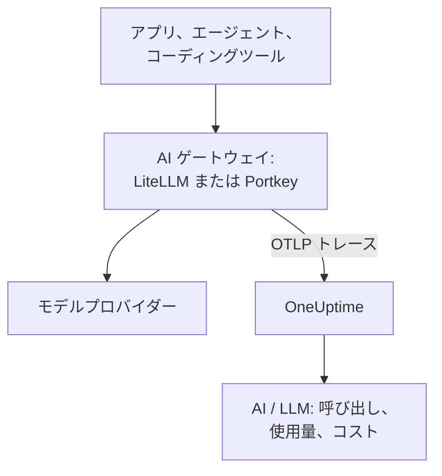

# AI ゲートウェイ (LiteLLM、Portkey)

AI ゲートウェイはアプリとモデルプロバイダーのあいだにあり、モデルへのすべての呼び出しがそこを通ります。ゲートウェイの OpenTelemetry を一度 OneUptime に送れば、その背後のすべての呼び出しが、モデル、トークン、コスト、そしてオフにしない限りプロンプトと回答とともに [AI / LLM](/docs/telemetry/ai-llm-observability) に届きます。アプリごとにインストルメンテーションする必要はありません。

:::cards
- [LiteLLM Proxy](#litellm-proxy): 組み込みのエクスポートを 3 つの変数で設定します。
- [誰が何に使ったか](#従業員ごとに仮想キーをひとつ): 従業員ごとの LiteLLM 仮想キーで、一人ひとりを特定します。
- [Portkey](#portkey): セルフホストのゲートウェイでは組み込みのエクスポート、それ以外ではアプリをインストルメントします。
- [呼び出しが届くか確認する](#呼び出しが届くか確認する): 何が見えるべきか、見えないときにどうするか。
:::

## 仕組み



| | LiteLLM Proxy | Portkey (セルフホストまたは Enterprise) | Portkey (オープンソースまたはホスト型) |
| --- | --- | --- | --- |
| OneUptime へのエクスポート | 組み込み | 組み込み、実験的 | なし: 代わりにアプリをインストルメント |
| 設定するエンドポイント | `https://oneuptime.com/otlp/v1/traces` | `https://oneuptime.com/otlp` | アプリ自身のエクスポーター |
| 一人ひとりを特定 | はい、従業員ごとの仮想キーで | いいえ | アプリが送るものだけ |
| プロンプトと回答 | オフにしない限り送信 | 常に送信 | インストルメンテーションによる |

## 始める前に

- 取り込みキー: **プロジェクト設定 → テレメトリと APM → 取り込みキー** を開き、 **取り込みキーを作成** をクリックします。
- OTLP のベース URL: `https://oneuptime.com/otlp`、OneUptime をセルフホストしている場合は `https://YOUR-ONEUPTIME-HOST/otlp`。OneUptime は HTTP 経由の OTLP を protobuf と JSON の両方で受け付けます。
- キーはエクスポートの各リクエストの `x-oneuptime-token` ヘッダーで送られます。

## LiteLLM Proxy

LiteLLM の OpenTelemetry コールバックはオープンソースのプロキシに含まれており、公式の Docker イメージ (`ghcr.io/berriai/litellm`) には必要なパッケージが入っています。

:::steps
### otel コールバックをオンにする

プロキシの `config.yaml` のコールバックに `otel` を追加します。

```yaml title="config.yaml"
model_list:
  - model_name: gpt-4o
    litellm_params:
      model: openai/gpt-4o
      api_key: os.environ/OPENAI_API_KEY

litellm_settings:
  callbacks: ["otel"]
```

### エクスポーターを OneUptime に向ける

プロキシに 3 つの変数を設定します。

```bash
export OTEL_EXPORTER="otlp_http"
export OTEL_ENDPOINT="https://oneuptime.com/otlp/v1/traces"
export OTEL_HEADERS="x-oneuptime-token=YOUR_INGESTION_TOKEN"
```

### プロキシを起動する

:::tabs
@tab Docker
```bash
docker run \
  -v $(pwd)/config.yaml:/app/config.yaml \
  -e OPENAI_API_KEY="sk-..." \
  -e OTEL_EXPORTER="otlp_http" \
  -e OTEL_ENDPOINT="https://oneuptime.com/otlp/v1/traces" \
  -e OTEL_HEADERS="x-oneuptime-token=YOUR_INGESTION_TOKEN" \
  -e OTEL_SERVICE_NAME="litellm-gateway" \
  -p 4000:4000 \
  ghcr.io/berriai/litellm:main-stable \
  --config /app/config.yaml
```
@tab pip
```bash
pip install 'litellm[proxy]' opentelemetry-api opentelemetry-sdk opentelemetry-exporter-otlp
litellm --config config.yaml
```
:::

`litellm[proxy]` だけでは OpenTelemetry のパッケージが入らないので、一緒にインストールしてください。

### リクエストを通してみる

プロキシを一度呼び出し、 [呼び出しが届くか確認する](#呼び出しが届くか確認する) の手順で AI / LLM を確認します。
:::

| 変数 | 値 | 補足 |
| --- | --- | --- |
| `OTEL_EXPORTER` | `otlp_http` | `OTEL_EXPORTER_OTLP_PROTOCOL` としても読み取られます |
| `OTEL_ENDPOINT` | `https://oneuptime.com/otlp/v1/traces` | `/v1/traces` までの完全なパスはどの LiteLLM バージョンでも使えます。 `OTEL_EXPORTER_OTLP_ENDPOINT` としても読み取られます |
| `OTEL_HEADERS` | `x-oneuptime-token=YOUR_INGESTION_TOKEN` | カンマ区切りの `key=value` の組。 `OTEL_EXPORTER_OTLP_HEADERS` としても読み取られます |
| `OTEL_SERVICE_NAME` | ゲートウェイの名前 | 呼び出しが表示されるサービス。何も設定しなければ `litellm` |

### LiteLLM が送るもの

各呼び出しは `gen_ai.system`、`gen_ai.request.model`、`gen_ai.response.model`、`gen_ai.usage.input_tokens`、`gen_ai.usage.output_tokens`、そのパラメーター、プロンプトと回答を持ちます。OneUptime が [呼び出しを読み取る](/docs/telemetry/ai-llm-observability) のに必要なものはすべてそろっています。

LiteLLM 1.81 以降、これらの属性はリクエストの `Received Proxy Server Request` スパンに載り、独立した `litellm_request` スパンはなくなりました。ひとつのリクエストがモデルを複数回呼び出すと、各呼び出しがそこで前の呼び出しの属性を上書きするので、呼び出しごとに `litellm_request` スパンを得るには `USE_OTEL_LITELLM_REQUEST_SPAN=true` を設定してください。

LiteLLM は、プロキシで設定した独自の料金も含めて各呼び出しの料金を自分で算出し、 `gen_ai.cost.total_cost` として報告します。OneUptime は自身の見積もりより報告された料金を優先し、 [トークンから見積もる](/docs/telemetry/ai-llm-observability) のは、料金を設定していない独自モデルのように LiteLLM が料金を算出できなかった場合だけです。

### 従業員ごとに仮想キーをひとつ

一人ひとりに専用の LiteLLM 仮想キーを渡すと、その人が行う呼び出しはすべて、誰の呼び出しかがわかる状態で届きます。LiteLLM はキーの所有者の ID、メールアドレス、チームをスパンに書き込み、OneUptime はそれを従業員とチームとして読み取るので、 **使用量** タブは各自のマシンで何も設定しなくても人ごとの支出をランキングできます。

仮想キーには、プロキシ上のデータベースとマスターキー (`DATABASE_URL` と `LITELLM_MASTER_KEY`) が必要です。メールアドレスを指定してユーザーを作成し、次にそのユーザーのキーを作成します。

```bash
curl -X POST "http://localhost:4000/user/new" \
  -H "Authorization: Bearer YOUR_MASTER_KEY" \
  -H "Content-Type: application/json" \
  -d '{"user_email": "alice@example.com"}'

curl -X POST "http://localhost:4000/key/generate" \
  -H "Authorization: Bearer YOUR_MASTER_KEY" \
  -H "Content-Type: application/json" \
  -d '{"user_id": "USER_ID_FROM_THE_FIRST_CALL", "team_id": "platform"}'
```

| LiteLLM のスパン属性 | OneUptime での読み取り方 |
| --- | --- |
| `metadata.user_api_key_user_id` | 従業員の ID |
| `metadata.user_api_key_user_email` | 従業員のメールアドレス |
| `metadata.user_api_key_team_id` | チーム |
| `metadata.user_api_key_end_user_id` | 従業員としては読み取らない: アプリが自社の顧客のために送る `user` です |

LiteLLM の OpenTelemetry v2 モードでは、同じ値が `litellm.` という接頭辞付き (`litellm.metadata.user_api_key_user_email` など) で届き、OneUptime はこれも読み取ります。

### プロンプトを送らない

`otel` コールバックは、既定でプロンプトと回答を丸ごと送ります。送らないようにするには、次のいずれかを使います。

:::tabs
@tab すべてのコールバック
```yaml title="config.yaml"
litellm_settings:
  callbacks: ["otel"]
  turn_off_message_logging: true
```
@tab OTel コールバックのみ
```yaml title="config.yaml"
litellm_settings:
  callbacks: ["otel"]

callback_settings:
  otel:
    message_logging: False
```
@tab 環境変数
```bash
export OTEL_INSTRUMENTATION_GENAI_CAPTURE_MESSAGE_CONTENT="NO_CONTENT"
```
:::

`callback_settings` は最上位のキーで、 `litellm_settings` の下のキーではありません。プロンプトは残しつつ一部をマスクしたい場合は、代わりに **トレース → 設定** のスクラブルールを使います。

:::details LiteLLM の OpenTelemetry v2 モード
新しい LiteLLM のバージョンには、オプトインの OpenTelemetry v2 モード (`LITELLM_OTEL_V2=true`、 `config.yaml` の変更は不要) があります。リクエストごとにひとつのトレースを送り、HTTP の処理、認証、ガードレール、モデルの呼び出しを、 `chat gpt-4o` のような名前の GenAI スパンとして含めます。v2 モードではプロンプトは既定でオフです。 `OTEL_INSTRUMENTATION_GENAI_CAPTURE_MESSAGE_CONTENT` でオンにします。コストは `litellm.cost.total` として届き、OneUptime はこれも読み取ります。どちらか一方のモードを使い、両方は使わないでください。
:::

## Portkey

Portkey が何を送れるかは、どのように動かしているかで決まります。

| デプロイ | OneUptime へのエクスポート |
| --- | --- |
| セルフホストまたは Enterprise のゲートウェイ | 組み込み (実験的): 下の変数を設定します |
| オープンソースのゲートウェイ (`portkey-ai/gateway`) | なし: それを呼び出すアプリをインストルメントします |
| ホスト型のゲートウェイ (portkey.ai) | ゲートウェイ側ではなし: それを呼び出すアプリをインストルメントします |

Portkey には独自の OpenTelemetry エンドポイント (`api.portkey.ai/v1/otel`) もあります。これは Portkey にトレースを取り込むもので、このページとは逆方向です。

### セルフホストと Enterprise のゲートウェイ

ゲートウェイのコンテナに次の変数を設定します。

```yaml title="docker-compose.yml"
services:
  portkey-gateway:
    environment:
      EXPERIMENTAL_GEN_AI_OTEL_TRACES_ENABLED: "true"
      EXPERIMENTAL_GEN_AI_OTEL_EXPORTER_OTLP_ENDPOINT: "https://oneuptime.com/otlp"
      EXPERIMENTAL_GEN_AI_OTEL_EXPORTER_OTLP_HEADERS: "x-oneuptime-token=YOUR_INGESTION_TOKEN"
```

- OTLP のベース URL を指定します。 `/v1/traces` は Portkey が自分で付け加えます。
- ヘッダーはカンマ区切りの `key=value` の組です。 `EXPERIMENTAL_GEN_AI_OTEL_RESOURCE_ATTRIBUTES` は同じ形式でリソース属性を追加します。たとえば `deployment.environment=production` です。
- Portkey は HTTP 経由の OTLP を JSON でのみ送ります。OneUptime はあいだにコレクターを置かずにこれを受け付けます。
- 各呼び出しは `{operation} {model}` という名前、たとえば `chat gpt-4o` のスパンになり、サービス `portkey` の下で、 `gen_ai.provider.name`、要求されたモデルと実際に応答したモデル、トークン数、 `gen_ai.conversation.id`、 `gen_ai.input.messages` と `gen_ai.output.messages` のメッセージを持ちます。
- プロンプトと回答は常に丸ごと含まれます。必要な部分は **トレース → 設定** のスクラブルールでマスクしてください。
- 各呼び出しは応答の後に個別に送られ、バッチ処理も再試行もありません。失敗したエクスポートは失われます。監査ログではなくオブザーバビリティとして扱ってください。
- `x-portkey-trace-id` が有効なトレース ID (16 進数 32 文字) であれば、Portkey はそれを再利用し、ゲートウェイのスパンがあなたのアプリのトレースにつながります。

Portkey はこのエクスポートを実験的としています。変数が効かない場合は、Portkey の最新のドキュメントとゲートウェイのバージョンを照らし合わせてください。

### オープンソースとホスト型のゲートウェイ

オープンソースのゲートウェイにはエクスポーターがなく、ホスト型のゲートウェイでは変数を設定できません。代わりに Portkey を呼び出すアプリをインストルメントします。Portkey は OpenAI の API を話すので、 [AI / LLM オブザーバビリティ](/docs/telemetry/ai-llm-observability) の GenAI インストルメンテーション (OpenLLMetry、OpenInference、OpenLIT) は、ベース URL が Portkey を指していても SDK の呼び出しをトレースします。

```python
from traceloop.sdk import Traceloop
from openai import OpenAI

Traceloop.init(
    app_name="my-ai-agent",
    api_endpoint="https://oneuptime.com/otlp",
    headers={"x-oneuptime-token": "YOUR_INGESTION_TOKEN"},
)

client = OpenAI(
    base_url="https://api.portkey.ai/v1",   # or your gateway's URL
    default_headers={"x-portkey-api-key": "PORTKEY_API_KEY"},
)
# Calls through Portkey are now traced to OneUptime.
```

これらのスパンは、アプリが行ったとおりの呼び出しを表します。要求したモデル、待った時間、受け取ったトークンです。フォールバック、再試行、キャッシュヒットなど、ゲートウェイが途中で決めたことは Portkey の中に残ります。それを OneUptime で見るには、セルフホストのゲートウェイのエクスポートを使ってください。

## 呼び出しが届くか確認する

:::steps
1. ゲートウェイ経由でリクエストを送り、数秒待ちます。
2. **製品 → AI / LLM → 呼び出し** を開きます。呼び出しがプロバイダー、モデル、トークンとともに一覧に表示されます。
3. 呼び出しをクリックしてトレースを開き、スパンの **LLM** タブを開きます。モデル、トークン、パラメーター、そしてオフにしていなければプロンプトと回答が表示されます。
4. **使用量** を開きます。呼び出しは、ゲートウェイが報告したか OneUptime が見積もったコストとともに合計に含まれています。
:::

## トラブルシューティング

:::details LiteLLM から何も届かない
しばらく `OTEL_EXPORTER="console"` を設定します。プロキシの出力にスパンが表示されれば LiteLLM はトレースしており、問題はエンドポイントかキーにあります。 `DEBUG_OTEL="true"` を設定すると、エクスポーターの動作がわかります。
:::

:::details キーが拒否される
OneUptime は、キーがない、不明、または期限切れの場合は `401` を、無効化されたキーやブラウザーキーの場合は `422` を返します。 **プロジェクト設定 → テレメトリと APM → 取り込みキー** でサーバーキーを作成し、 `x-oneuptime-token` で送ってください。
:::

:::details エンドポイントが間違っている
LiteLLM には完全なパス `https://oneuptime.com/otlp/v1/traces` を指定します。Portkey にはベース URL `https://oneuptime.com/otlp` を指定し、 `/v1/traces` は Portkey が自分で付け加えます。
:::

:::details スパンは届くが AI / LLM に表示されない
**トレース** をゲートウェイのサービス (`litellm`、`portkey`、または設定した `OTEL_SERVICE_NAME`) で絞り込み、生のスパンを確認します。スパンがモデルの呼び出しとして数えられるのは `gen_ai.*` 属性を持つ場合だけです。コールバックが `otel` であること、呼び出しがモデルに向かったことを確認してください。
:::

:::details 支出が帰属なしと表示される
呼び出しが人を特定していません。 [従業員ごとに仮想キーをひとつ](#従業員ごとに仮想キーをひとつ) のとおり、従業員ごとに専用の仮想キーを渡してください。アプリが送る `user` フィールドは従業員ではなくそのアプリの顧客を指し、従業員として読み取られることはありません。
:::

:::details 複数の呼び出しのうち最後のものしか表示されない
LiteLLM 1.81 以降、ひとつのリクエスト内のモデル呼び出しはひとつのスパンを共有します。呼び出しごとにスパンを得るには `USE_OTEL_LITELLM_REQUEST_SPAN=true` を設定してください。
:::

## 次のステップ

:::cards
- [AI / LLM オブザーバビリティ](/docs/telemetry/ai-llm-observability): これらの呼び出しの会話、アラート、使用量、1 日のコスト予算。
- [AI コーディングアシスタント](/docs/telemetry/ai-coding-assistants): 自分でテレメトリを送らないツールの前にゲートウェイを置きます。
- [AI エージェントのサーキットブレーカー](/docs/telemetry/ai-agent-circuit-breaker): アラートが発生したら暴走したエージェントを止めます。
- [トレース モニター](/docs/monitor/traces-monitor): ループで呼ばれるツールなど、スパンのパターンでアラートを出します。
:::
