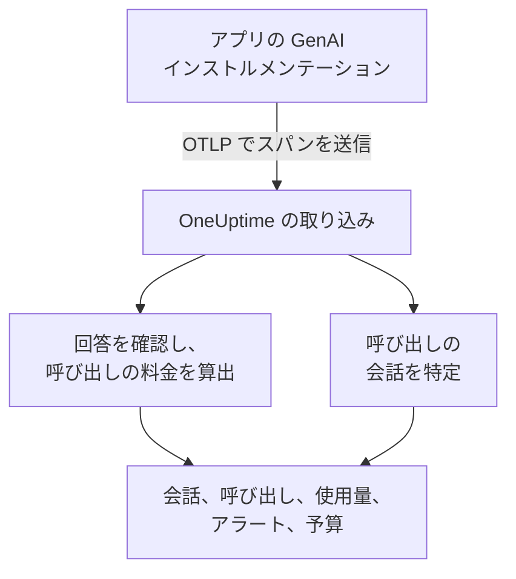
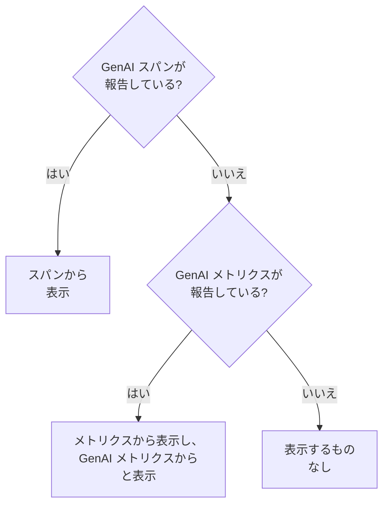

# AI / LLM オブザーバビリティ

AI が交わしたすべての会話を読み、起きたとおりに再生し、回答がまずいときには知らせを受けられます。OneUptime はこれらをすべて標準の OpenTelemetry から組み立てます。アプリが **GenAI セマンティック規約** (`gen_ai.*`) に沿ったスパンを送れば、独自の SDK なしで会話、アラート、使用量、コストが手に入ります。

:::cards
- [セットアップ](#5-つのステップでセットアップする): 最初のスパンからフラグ付きの回答まで、5 つのステップ。
- [会話を再生する](#会話を読み再生する): 相手が見たとおりに、起きたペースでチャットを読めます。
- [アラートを受ける](#ai-の回答がまずいときに知らせを受ける): 失敗、拒否、途切れ、フラグ付き、遅い回答に備えた既製のアラート。
- [支出を見張る](#誰が何に支出しているかを見る): 人、チーム、モデル、アプリごとのコストと 1 日の予算。
:::

## 仕組み

アプリの GenAI インストルメンテーションは、モデルへの各呼び出しを OpenTelemetry のスパンとしてエクスポートします。スパンが届くと、OneUptime はその `gen_ai.*` 属性を読み取り、回答に問題がないか確認し、呼び出しの料金を算出して、所属する会話に振り分けます。



**オブザーバビリティ** の下にある **製品 → AI / LLM** を開きます。この製品には 7 つのタブがあります。

| タブ | 表示内容 |
| --- | --- |
| **会話** | AI が交わしたすべての会話。対応が必要なものが先頭に並びます。一覧の上には、会話数、AI の回答数、対応が必要な数、コスト、一般的な回答時間が表示されます。 |
| **呼び出し** | すべてのモデル、埋め込み、エージェント、ツールの呼び出し。サービス、プロバイダー、モデル、操作、人、チーム、会話で絞り込めます。呼び出しをクリックするとトレースビューアーで開きます。 |
| **使用量** | 期間内の呼び出し、トークン、コストを、従業員、チーム、モデル、プロバイダー、アプリ別にランキングします。 |
| **アラート** | AI の回答がまずいときのための既製のアラートと、AI / LLM モニター。 |
| **予算** | 日ごとのコスト上限。アラートを設定できるメトリクスとして公開されます。 |
| **料金** | 組み込みの料金表にないモデルのための独自の料金。 |
| **セットアップ** | 以下の五つのステップと、プロジェクトのエンドポイント。 |

トレースビューアーでは、各 AI 呼び出しのスパンに **LLM** タブもあり、プロバイダー、モデル、トークン、コスト、リクエストのパラメーター、プロンプトと回答が表示されます。

## 始める前に

- テレメトリの取り込みキーを作成できる OneUptime プロジェクト。
- モデルを呼び出すアプリと、その言語向けの GenAI インストルメンテーション。**OpenLLMetry** (Traceloop)、**OpenInference** (Arize)、**Vercel AI SDK**、または OpenAI、Anthropic、Gemini 向けの OpenTelemetry インストルメンテーションです。

> [!TIP]
> LiteLLM や Portkey などのゲートウェイを経由するモデルのトラフィックは、各アプリではなくゲートウェイからエクスポートできます。[AI ゲートウェイ](/docs/telemetry/ai-gateways)を参照してください。エンジニアが使うコーディングアシスタントについては、[AI コーディングアシスタント](/docs/telemetry/ai-coding-assistants)を参照してください。

## 5 つのステップでセットアップする

呼び出しを見るには最初のステップだけで十分です。以降のステップごとに、見える情報が増えます。

:::steps
### AI の呼び出しを送信する

**プロジェクト設定 → テレメトリと APM → 取り込みキー** で取り込みキーを作成します ([OpenTelemetry のクイックスタート](/docs/telemetry/open-telemetry#取り込みキーを作成する)で手順を説明しています)。次に、インストルメンテーションを OneUptime に向けます。

:::tabs
@tab Python
```bash
pip install traceloop-sdk opentelemetry-exporter-otlp
```

```python
from traceloop.sdk import Traceloop

Traceloop.init(
    app_name="my-ai-agent",
    api_endpoint="https://oneuptime.com/otlp",
    headers={"x-oneuptime-token": "YOUR_INGESTION_TOKEN"},
)
# Your OpenAI, Anthropic and LangChain calls are now traced.
```
@tab Node.js
```bash
npm install @traceloop/node-server-sdk
```

```typescript
import * as traceloop from "@traceloop/node-server-sdk";

traceloop.initialize({
  appName: "my-ai-agent",
  baseUrl: "https://oneuptime.com/otlp",
  headers: { "x-oneuptime-token": "YOUR_INGESTION_TOKEN" },
});
```
@tab OpenTelemetry SDK
```bash
export OTEL_EXPORTER_OTLP_ENDPOINT="https://oneuptime.com/otlp"
export OTEL_EXPORTER_OTLP_HEADERS="x-oneuptime-token=YOUR_INGESTION_TOKEN"
export OTEL_EXPORTER_OTLP_PROTOCOL="http/protobuf"
export OTEL_SERVICE_NAME="my-ai-agent"
```
:::

OneUptime をセルフホストしている場合は、`https://oneuptime.com/otlp` の代わりに `https://YOUR-ONEUPTIME-HOST/otlp` を使います。モデルを 1 回呼び出すと、その呼び出しが **呼び出し** に表示されます。

### やり取りの内容を記録する

会話に、相手が尋ねたことと AI が答えたことが表示されるのは、インストルメンテーションがそれを記録している場合だけです。OpenLLMetry は、`TRACELOOP_TRACE_CONTENT=false` を設定しない限りプロンプトと回答を記録します。OpenTelemetry のインストルメンテーションは、指定したときだけ記録します。

```bash
export OTEL_INSTRUMENTATION_GENAI_CAPTURE_MESSAGE_CONTENT=true
```

新しい OpenTelemetry のインストルメンテーションは、`true` の代わりに `span_only`、`event_only`、`span_and_event` を受け付けます。内容が記録されていなくても、会話にはタイミング、コスト、問題が表示されます。プロンプトには機密データが含まれることがあります。保存前にマスクする方法は [プライバシーとマスキング](#プライバシーとマスキング) で説明しています。

### 呼び出しを会話にまとめる

チャットアプリは 1 ターンごとに 1 回モデルを呼び出します。すべての AI 呼び出しで `gen_ai.conversation.id` (または `session.id`) にチャットの ID を設定すると、呼び出しやトレースがいくつあっても、各チャットが 1 つの会話として表示されます。OpenLLMetry では、リクエストごとに 1 回設定します。

```python
from traceloop.sdk import Traceloop

Traceloop.set_association_properties({
    "session_id": chat.id,
    "user_email": user.email,
})
```

Vercel AI SDK では、チャットの ID を `experimental_telemetry: { metadata: { sessionId } }` として渡します。会話 ID のない呼び出しも、1 リクエスト (1 トレース) ずつ表示されます。

### 誰が尋ねたかを伝える

すべての AI 呼び出しに `user.id` または `user.email` を設定します (上の関連付けプロパティはメールアドレスを設定します)。すると各会話に相手が表示され、一覧を人で検索でき、**使用量** タブで支出が従業員別にランキングされます。OneUptime が読み取るすべての ID キーは [従業員とチームへの帰属](/docs/telemetry/ai-coding-assistants#従業員とチームへの帰属) に一覧があります。

### まずい回答にフラグを付ける

OneUptime は届いた回答をすべて確認し、問題があればその内容を記録します。

| 問題 | 意味 | 判定の根拠 |
| --- | --- | --- |
| 失敗 | 呼び出しがエラーで終わり、回答が届かなかった | スパンのステータス Error、`error.type`、または終了理由 `error` |
| 拒否 | AI が回答を断った、または安全フィルターが回答をブロックした | 拒否や安全性による終了理由 (`content_filter`、`refusal`、`SAFETY` など)、回答内の拒否、または英語の定型的な拒否文で始まる回答 |
| 途切れ | 回答がトークン上限で止まった | 終了理由 `length`、`max_tokens`、`MAX_TOKENS` |
| 空 | テキストもツール呼び出しもない | 何も含まない記録済みの内容、または出力トークン 0 |
| フラグ付き | アプリが送った評価が、回答をまずいと判定した | `gen_ai.evaluation.result` イベント |

最初の 4 つは何もしなくても検出されます。ガードレール、評価、または低評価ボタンで却下された回答にフラグを付けるには、スパンが開いている間に、回答のスパンへ `gen_ai.evaluation.result` イベントを追加し、`gen_ai.evaluation.score.label` を `fail` にします。

```python
from opentelemetry import trace

trace.get_current_span().add_event(
    "gen_ai.evaluation.result",
    {
        "gen_ai.evaluation.name": "relevance",
        "gen_ai.evaluation.score.label": "fail",
        "gen_ai.evaluation.explanation": "The answer is about another product.",
    },
)
```

`incorrect`、`wrong`、`unhelpful`、`toxic`、`unsafe`、`hallucination` などのラベルも失敗として数えられます。OneUptime が会話を別の AI に送って判定させることはありません。どのチェックも、呼び出し自体が持つ情報だけを読み取ります。
:::

## 会話を読み、再生する

会話は、チャットアプリが履歴を表示するように全体が開きます。相手の発言が右側、AI の回答が左側にモデル、時刻、トークン、コストとともに並び、その間にツール呼び出しが入り、問題が起きた箇所にはその場で印が付きます。回答の下の **詳細** には、止まった理由、評価、トレース内のその呼び出しへのリンクが表示されます。

下部のバーは、相手が体験したとおりに会話を再生します。

| 操作 | 動作 |
| --- | --- |
| **もう一度再生** | 最初のメッセージから、実際に起きたペースで会話を再生します。回答を待つ間は「AI が回答中…」がカウントアップします。任意のメッセージの時刻をクリックすると、そこから再生します。 |
| **待ち時間をスキップ** | 既定でオンです。3 秒を超える沈黙を短縮します。 |
| `1x` | 速度を変えます。1x、2x、4x、8x から選べます。 |
| **K**、**J** または **←**、**L** または **→** | 再生または一時停止、前のメッセージに戻る、次のメッセージに進む。 |

再生が止まったメッセージはページのアドレスに保持される (`?step=`) ため、共有したリンクはその時点で開きます。

## AI の回答がまずいときに知らせを受ける

**アラート** タブには、多くの AI アプリが必要とするアラートが並んでいます。1 つ選ぶと入力済みの **モニターを作成** が開き、保存前に何でも変更できます。

| アラート | 知らせるタイミング | 重大度 |
| --- | --- | --- |
| 回答に問題がある | 15 分間の回答のうち 5% 超が失敗、拒否、途切れ、空、またはフラグ付きになったとき | Warning |
| AI の呼び出しが失敗する | 5 分間のモデル呼び出しのうち 10% 超がエラーで終わったとき | Critical |
| AI が回答を拒否する | 30 分間の回答のうち 5% 超が拒否だったとき | Warning |
| 回答が途切れる | 30 分間に 3 件以上の回答がトークン上限で止まったとき | Warning |
| 回答にフラグが付く | 評価が回答をまずいと判定したとき | Warning |
| 回答が遅い | 15 分間の回答のうち 10% 超が 30 秒より長くかかったとき | Warning |
| AI が回答しなくなる | AI が 30 分間まったく回答しないとき | Critical |

回答の割合に基づくアラートは、まずい回答が少なくとも 3 件になるまで待つため、2 件中 1 件がまずかっただけで誰かが呼び出されることはありません。Critical のアラートにはプロジェクトで最も重いアラート重大度が、Warning のアラートにはその次の重大度が割り当てられます。新しいプロジェクトでは High と Low です。

それぞれのアラートは **AI / LLM** モニターです。設定では、何をまずい回答とみなすか ( **次の場合に回答を不適切と数える** 、 **または次より長くかかる（秒）** )、各チェックがどこまでさかのぼるか ( **時間枠** 、既定は 15 分)、どの **アプリ** を監視するか、そして **その他の項目** の下でどの **モデル** を監視するかを指定します。 **プレビュー** には、モニターが今この時点で何を数えるかが表示されます。条件では 3 つの数値、 **不適切な AI の回答（%）** 、 **不適切な AI の回答** 、 **AI の回答** を比較します。

既製のアラートは自動で解決するアラートを発生させ、回答がまずい間はモニターを **Degraded** と表示します。インシデントは入力済みですがオフになっています。誰かを呼び出したい場合はオンにしてください。

## 誰が何に支出しているかを見る

**使用量** タブには、期間内 (別の期間を選ばない限り過去 7 日間) の呼び出し、トークン、コストと、5 つの内訳 ( **従業員** 、 **チーム** 、 **モデル** 、 **プロバイダー** 、 **アプリケーション / サービス** ) のいずれかによる上位 25 件の表が表示されます。誰も特定できない呼び出しは **帰属なし** として数えられ、捨てられることはありません。

人とチームは、呼び出しの ID 属性から取得されます。[従業員とチームへの帰属](/docs/telemetry/ai-coding-assistants#従業員とチームへの帰属)を参照してください。

### スパンが優先され、メトリクスが補う

GenAI スパンは 1 回の呼び出しのモデル、トークン、コストを持つため、スパンがあればすべてに答えられます。ツールによっては、トークンとコストのメトリクスを公開し、GenAI スパンを送らないものがあります。ほとんどのコーディングアシスタントがそうです。OneUptime がこれらのメトリクスを読むのは、スパンが何も報告しなかった数値に限られ、両者を合算することはありません。多くのインストルメンテーションは同じ呼び出しについて両方を送るため、合算するとすべてのドルが二重に数えられてしまいます。



| 箇所 | メトリクスにフォールバックするもの | 条件 |
| --- | --- | --- |
| 入力と出力のトークン | 両方の合計 | スパンのトークン合計がどちらも 0 |
| コスト (USD) | コスト。Codex のマイクロ USD 単位のコストは USD に換算 | スパンのコスト合計が 0 |
| LLM の呼び出し | なし。スパンのみ | — |
| **従業員** 、 **チーム** 、 **モデル** の表 | コストのみ。呼び出しとトークンのセルは `—` を表示 | その表にスパンの行がない |
| **プロバイダー** 、 **アプリケーション / サービス** の表 | なし。スパンのみ | — |
| 会話 | なし。会話はスパンから組み立てられる | — |

メトリクスから取った数値には **GenAI メトリクスから** と表示されます。**呼び出し** に対応する行がないためです。そのため、GenAI スパンが数値を報告した時点で、メトリクスだけを送るツールの分は表示されなくなります。そのようなツールの支出を単独で見るには、GenAI スパンが届かない専用のプロジェクトに送ってください。

## 呼び出しのコスト

インストルメンテーションが報告したコスト (`gen_ai.usage.cost`) は、0 であってもそのまま使われます。報告がない場合、OneUptime はスパンの到着時に、トークン数と、OpenAI、Anthropic、Google Gemini、Mistral、DeepSeek、xAI、Cohere、Amazon Nova、Meta Llama の一般的なモデルの組み込み料金表からコストを見積もります。料金は、応答したモデル、次にリクエストしたモデルの順で決まります。

モデルは最も長い名前のプレフィックスで照合されるため、`gpt-4o-2024-08-06` や `us.anthropic.claude-sonnet-4-5-20250929-v1:0` のように日付やベンダーの装飾が付いた ID も、そのファミリーの料金が見つかります。表にないモデルは、新しいリリースであっても推測されることはなく、料金を設定するまでコストは 0 のままです。見積もりには定価が使われ、キャッシュやバッチの割引は含まれません。

モデルの料金を自分で設定するには (交渉済みの料金、ファインチューニングしたモデル、セルフホストしたモデルなど)、 **料金** タブの **カスタム LLM 料金** で追加します。 **モデルのプレフィックス** 、 **入力の料金（100 万トークンあたりの USD）** 、 **出力の料金（100 万トークンあたりの USD）** を指定します。独自の料金と組み込みの表をまたいで、一致する最も長いプレフィックスが優先され、同じ長さなら独自の料金が優先されます。料金は保存してから約 1 分後に届いた呼び出しに適用され、保存済みの呼び出しのコストは変わりません。

## 1 日のコスト予算

予算は、UTC の 1 日あたりの支出を USD で追跡します。OneUptime は 15 分ごとにその日の AI の支出を合計し (スパンから、またはどのスパンも支出を報告しなかった場合は GenAI のコストメトリクスから)、予算に表示し、2 つのメトリクスを公開します。

| メトリクス | 内容 |
| --- | --- |
| `oneuptime.llm.budget.spend.usd` | その日のこれまでの支出 (USD) |
| `oneuptime.llm.budget.percent.used` | 日ごとの上限に対する支出の割合 |

どちらも `oneuptime.llm.budget.id` と `oneuptime.llm.budget.name`、および予算にスコープがあればそのスコープを持ちます。

:::steps
### 予算を作成する

**予算** タブで **LLM のコスト予算を作成** をクリックします。名前と **1 日の予算（USD）** を指定し、プロジェクト全体を対象にするならスコープを空のままにするか、 **サービス（任意）** 、 **LLM プロバイダー（任意）** 、 **LLM モデル（任意）** のいずれかを選びます。複数の予算で異なるスコープを監視できます。

### アラートを設定する

`oneuptime.llm.budget.percent.used` に対して [メトリクス モニター](/docs/monitor/metrics-monitor)を作成し、`oneuptime.llm.budget.id` で絞り込みます (予算の名前を変えると名前は変わるため)。警告を発生させる条件 `>= 80` と、重大なアラートを発生させる条件 `>= 100` を追加します。

### 時間枠を広げる

モニターのローリングウィンドウを 30 分に設定します。予算は 15 分ごとに 1 点を公開するため、既定の 1 分のウィンドウでは 2 点の間で何も見つかりません。
:::

予算のアラートから、暴走したエージェントを止めるワークフローを実行することもできます。[AI エージェントのサーキットブレーカー](/docs/telemetry/ai-agent-circuit-breaker)を参照してください。

## ダッシュボードとメトリクスのアラート

`gen_ai.client.token.usage` や `gen_ai.client.operation.duration` などの GenAI メトリクスは、通常の OpenTelemetry メトリクスとして届きます。[ダッシュボード](/docs/dashboards/index)にグラフ化したり、[メトリクス モニター](/docs/monitor/metrics-monitor)でアラートを設定したりできます。たとえば、モデルごとにグループ化した `gen_ai.client.operation.duration` の p95 がしきい値を超えたときです。

## プライバシーとマスキング

AI の呼び出しはトレースのスパンとして保存されるため、トレースの **スクラブルール** と **破棄フィルター** が適用されます。保存前に属性をマスクしたり、スパンを破棄したりできます。どちらも **トレース → 設定** にあります。従業員のメールアドレスの列は、読み取り元の属性と一緒にスクラブされるため、メールアドレスをマスクするルールはこの列にも効きます。

会話はトレースと同じ権限で読み取られます。プロジェクトのトレースを読める人だけが、その会話を読めます。

## OneUptime が読み取る属性

OneUptime は OpenTelemetry の GenAI 規約に加えて、OpenLLMetry、OpenInference、Vercel AI SDK、LiteLLM が使う表記も読み取るため、一般的なライブラリはそのまま動きます。各値について、スパンが持つ最初のキーが優先されます。

| 値 | キー (試す順) |
| --- | --- |
| プロバイダー | `gen_ai.system`、`gen_ai.provider.name`、`llm.system`、`llm.provider` |
| 操作 | `gen_ai.operation.name`、`llm.request.type`、`openinference.span.kind` |
| リクエストしたモデル | `gen_ai.request.model`、`llm.model_name`、`llm.request.model` |
| 応答したモデル | `gen_ai.response.model`、`llm.response.model` |
| 入力トークン | `gen_ai.usage.input_tokens`、`gen_ai.usage.prompt_tokens`、`llm.token_count.prompt`、`llm.usage.prompt_tokens` |
| 出力トークン | `gen_ai.usage.output_tokens`、`gen_ai.usage.completion_tokens`、`llm.token_count.completion`、`llm.usage.completion_tokens` |
| 合計トークン | `gen_ai.usage.total_tokens`、`llm.token_count.total`、`llm.usage.total_tokens` |
| コスト (USD) | `gen_ai.usage.cost`、`gen_ai.usage.cost_usd`、`gen_ai.usage.total_cost`、`llm.usage.total_cost`、`gen_ai.cost.total_cost`、`litellm.cost.total` |
| 会話 | `gen_ai.conversation.id`、`session.id`、`langfuse.session.id`、`traceloop.association.properties.session_id`、`ai.telemetry.metadata.sessionId` |
| エージェント | `gen_ai.agent.name`、`agent.name` |
| ツール | `gen_ai.tool.name`、`tool.name`、`ai.toolCall.name` |
| 終了理由 | `gen_ai.response.finish_reasons`、`gen_ai.response.finish_reason`、`llm.response.finish_reason`、`ai.response.finishReason` |
| エラー | `error.type` |

これらの値のいずれか、または `gen_ai.`、`llm.`、`traceloop.` で始まる属性を持つスパンは、AI 呼び出しとして数えられます。合計が報告されない場合、合計トークンは入力と出力の和になります。`gen_ai.usage.total_tokens` と `gen_ai.usage.cost` のキーは規約に含まれず、規約はどちらも定義していませんが、一般的なインストルメンテーションが送るため OneUptime は読み取ります。

ID のキー (誰が呼び出したか、そのチーム) は [従業員とチームへの帰属](/docs/telemetry/ai-coding-assistants#従業員とチームへの帰属) に一覧があります。

### プロンプトと回答の読み取り元

会話ビューは、呼び出しのメッセージを次の順で読み取ります。

- `gen_ai.client.inference.operation.details` イベント。
- `gen_ai.input.messages`、`gen_ai.output.messages`、`gen_ai.system_instructions` 属性。
- 古いロール別のイベント: `gen_ai.system.message`、`gen_ai.user.message`、`gen_ai.assistant.message`、`gen_ai.tool.message`、`gen_ai.choice`。
- インデックス付きの属性: OpenLLMetry の `gen_ai.prompt.N.content` と `gen_ai.completion.N.content`、OpenInference の `llm.input_messages.N.message.content` と `llm.output_messages.N.message.content`。
- `gen_ai.prompt`、`gen_ai.completion`、`ai.prompt.messages`、`ai.response.text`、`input.value`、`output.value` 内のメッセージ配列。

## トラブルシューティング

:::details 呼び出しは届くが、会話にテキストが表示されない
インストルメンテーションが内容を記録していません。[やり取りの内容を記録する](#やり取りの内容を記録する) のとおりに有効にしてください。それより前の呼び出しはテキストなしのままです。
:::

:::details チャットの呼び出しがそれぞれ別の会話として表示される
呼び出しに会話 ID がありません。[呼び出しを会話にまとめる](#呼び出しを会話にまとめる) のとおり、チャットのすべての呼び出しに `gen_ai.conversation.id` または `session.id` を設定してください。
:::

:::details 呼び出しにトークンは表示されるが、コストが $0
モデルが組み込みの料金表にないか、スパンがモデルを示していません。 **料金** タブでモデルの料金を追加してください。それ以降に届いた呼び出しに料金が付きます。
:::

:::details 使用量タブに「GenAI メトリクスから」と表示され、呼び出しとトークンが `—` になる
数値は、メトリクスを送り GenAI スパンを送らないツール (コーディングアシスタントなど) から来ています。メトリクスはコストを持ちますが呼び出しごとの詳細を持たないため、これらのセルは空のままです。[スパンが優先され、メトリクスが補う](#スパンが優先されメトリクスが補う)を参照してください。
:::

:::details 予算のモニターが 2 つの状態の間を行き来する
モニターのローリングウィンドウが 15 分より短いため、点が見つからないことがあります。30 分に設定してください。
:::

## 次のステップ

:::cards
- [AI コーディングアシスタント](/docs/telemetry/ai-coding-assistants): Claude Code、Cursor、Codex、Gemini CLI、Copilot のエンジニア別の支出。
- [AI ゲートウェイ](/docs/telemetry/ai-gateways): 1 つの LiteLLM または Portkey ゲートウェイから、すべてのアプリのモデル呼び出しをトレースします。
- [AI エージェントのサーキットブレーカー](/docs/telemetry/ai-agent-circuit-breaker): 予算のアラートが発生したときに、暴走したエージェントを止めます。
- [OpenTelemetry](/docs/telemetry/open-telemetry): すべてのシグナルのエンドポイント、取り込みキー、制限。
:::
