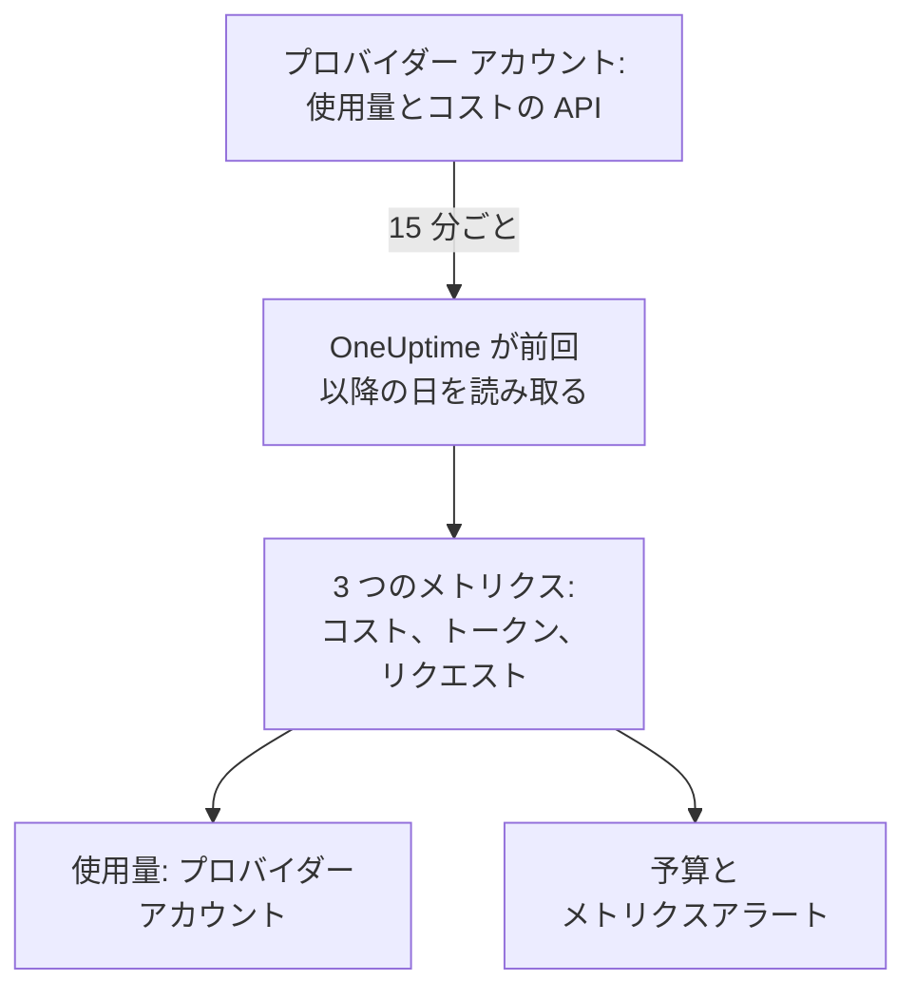

# AI プロバイダーアカウント

AI プロバイダーのアカウントが何をどれだけ使い、いくらかかったかを、アプリを変更せずに確認できます。OpenAI、Anthropic、Azure OpenAI と Microsoft Foundry、Amazon Bedrock、Google Vertex AI のアカウントを読み取り専用の認証情報で接続すると、OneUptime がその使用量を 15 分ごとに読み取り、**使用量**、**予算**、アラートを設定できるメトリクスに取り込みます。

:::cards
- [アカウントを接続する](#アカウントを接続する): プロバイダーを選び、認証情報を貼り付け、テストして接続します。
- [各プロバイダーから得られるもの](#各プロバイダーから得られるもの): コスト、トークン、リクエストと、各プロバイダーのグループ分け。
- [使用量を見る](#使用量を見る): モデル、ユーザー、プロジェクトまたはリソース、API キー、接続ごとに表示します。
- [予算とアラート](#予算とアラート): 請求額に対する日次予算と、メトリクスへのアラート。
:::

## 仕組み

OneUptime は 15 分ごとに、接続された各アカウントに UTC の日ごとの使用量を問い合わせ、接続専用のサービスの 3 つのメトリクスとして保存します。各読み取りでは前回の読み取り以降の日を取得し、さらに今日を含む直近 3 日分をもう一度読み取ります。プロバイダーは今日の分を追加し続け、直前の数日を修正するためです。

アカウントの使用量は、そのアカウントに日ごとに請求された内容です。会話、プロンプト、回答は含まれません。それらが必要な場合は、[AI / LLM オブザーバビリティ](/docs/telemetry/ai-llm-observability) の説明に従ってアプリの AI 呼び出しを送ってください。両者は別々に保存されるため、二重に数えられることはありません。

## 始める前に

- Project Owner または Project Admin のロール。アカウントを接続、変更、削除できるのはこのロールだけです。プロジェクトのテレメトリを読めるユーザーは全員、接続と使用量を見られます。
- アカウントを管理している人が用意した、そのアカウントの認証情報。どの認証情報をどこで作るかは、以下の各プロバイダーのセクションで説明します。
- インストールは不要です。OneUptime が自身のサーバーからプロバイダーの API を呼び出します。

## アカウントを接続する

:::steps
### 接続を開く

**製品 → AI / LLM → 接続** を開きます。**AI プロバイダーのアカウント** でプロバイダーのタイルをクリックします。

### 認証情報を貼り付ける

**認証情報** で、プロバイダーが求める項目を入力します。シークレットは暗号化して保存され、Dashboard でも API でも二度と表示されません。**名前** と、ほとんどの人が変更しない設定は **その他の項目** にあります。

### テストする

**テスト** で **接続をテスト** をクリックします。OneUptime は直近 7 日間の使用量を読み取り、見つかった内容 (コスト、トークン、リクエスト、モデル、ユーザー、キー、プロジェクト) を表示します。接続するまで何も保存されません。

### 接続する

**接続** をクリックします。最初の読み取りは 1 分以内に始まり、直近 30 日分を取り込みます。
:::

接続したアカウントはタイルの下に一覧表示され、**ステータス** と **最終読み取り** が表示されます。**今すぐ読み取る** はすぐに読み取り、**テスト** は保存済みの設定をもう一度確認し、**オフにする** は読み取りを止めて読み取り済みのデータを残し、**編集** は設定を変更します。シークレットを空欄のままにすると、保存済みの値が維持されます。**エラーを表示** は読み取りが失敗した理由を、シークレットを除いて表示します。

## 各プロバイダーから得られるもの

| プロバイダー | コスト | グループ分け | 認証情報 |
| --- | --- | --- | --- |
| OpenAI | OpenAI が報告する値 | プロジェクト、API キー、ユーザー、モデル | 管理者キー |
| Anthropic | Anthropic が報告する値 | ワークスペース、API キー、ユーザー、モデル | 管理者キー |
| Azure OpenAI と Microsoft Foundry | トークンからの推定 | リソースとモデル | Monitoring Reader を持つアプリ |
| Amazon Bedrock | トークンからの推定 | リージョンとモデル | CloudWatch を読めるアクセス キー |
| Google Vertex AI | トークンからの推定 | リージョンとモデル | Monitoring Viewer を持つサービス アカウント |

Anthropic 以外のプロバイダーはリクエスト数も数えます。Anthropic の使用量レポートにはリクエスト数がありません。推定コストには [呼び出しのコスト](/docs/telemetry/ai-llm-observability#呼び出しのコスト) の価格表と **料金** で設定した独自の価格が使われ、推定値として表示されます。価格表にないモデルは、そこで価格を設定するまでコストがありません。

これらの認証情報はどれもモデルを呼び出せません。それぞれが読み取るのは使用量、コスト、メトリクスだけです。

## OpenAI

OneUptime は管理者キーで OpenAI の組織を読み取ります。読み取るのは、日、モデル、プロジェクト、API キー、ユーザーごとの completions と embeddings の使用量と、プロジェクトと明細項目ごとの日々のコストです。コストの明細項目はそのモデルを使ったキーとユーザーに配分されるため、ユーザーの行にもコストが付きます。OpenAI の ID は、プロジェクト名、キー名、ユーザーのメール アドレスに置き換えられます。

:::steps
### OpenAI の管理者キーを作成する

OpenAI のダッシュボードで Settings、Organization、Admin keys を開き、キーを作成します。作成できるのは組織のオーナーだけです。キーは `sk-admin-` で始まります。

### OpenAI を接続する

キーを **管理者キー** に貼り付けます。
:::

## Anthropic

OneUptime は管理者キーで Claude API の組織を読み取ります。読み取るのは、日、モデル、ワークスペース、API キー、ユーザーごとのメッセージ使用量レポートと、ワークスペースと明細ごとのコスト レポートで、同じ方法で配分されます。組織のキーや Console のログインで使われた Claude Code もこれらのレポートに含まれ、使ったユーザーまたはキーの下に表示されます。

:::steps
### Anthropic の管理者キーを作成する

Claude Console で Settings、Admin keys を開き、キーを作成します。作成できるのは組織の管理者だけです。キーは `sk-ant-admin01-` で始まります。

### Anthropic を接続する

キーを **管理者キー** に貼り付けます。
:::

## Azure OpenAI と Microsoft Foundry

OneUptime は、サブスクリプション内のすべての Azure OpenAI と Foundry のリソースを Azure Monitor から読み取ります。日、リソース、モデルごとのトークンとリクエストです。Azure Monitor が数えるのはトークンでお金ではなく、ユーザーもキーも示さないため、コストは OneUptime の推定値になり、ユーザーとキーは空のままです。

:::steps
### アプリを登録する

Microsoft Entra ID でアプリを登録し、クライアント シークレットを作成します。

### メトリクスの読み取りを許可する

サブスクリプションで、アプリに Monitoring Reader ロールを付与します。

### Azure を接続する

**ディレクトリ (テナント) ID**、**アプリケーション (クライアント) ID**、**サブスクリプション ID**、**クライアントシークレット** を入力します。Azure Government の場合は、**その他の項目** の **クラウド** を変更します。
:::

## Amazon Bedrock

OneUptime は、指定した各リージョンの CloudWatch メトリクス `AWS/Bedrock` を読み取ります。日とモデルごとの入力、出力、キャッシュのトークンと呼び出し回数です。CloudWatch が数えるのはトークンでお金ではなく、ユーザーもキーも示しません。コストは OneUptime の推定値で、各リージョンはプロジェクトとして表示されます。

:::steps
### アクセス キーを作成する

`cloudwatch:GetMetricData` と `cloudwatch:ListMetrics` を許可するポリシーを持つ IAM ユーザーまたはロールを作成し、そのアクセス キーを作成します。

### Bedrock を接続する

**アクセス キー ID**、**シークレット アクセス キー**、**リージョン** をカンマ区切りで入力します。変更しなければ `us-east-1` です。
:::

## Google Vertex AI

OneUptime は、Vertex AI が自社モデル (Gemini や Claude などのパートナー モデル) について公開する Cloud Monitoring のメトリクスを読み取ります。日、リージョン、モデルごとの入力と出力のトークンと呼び出し回数です。Cloud Monitoring が数えるのはトークンでお金ではなく、ユーザーもキーも示しません。コストは OneUptime の推定値です。

:::steps
### サービス アカウントを作成する

プロジェクトで Monitoring Viewer ロールを持つサービス アカウントを作成し、その JSON キーを作成します。

### Vertex AI を接続する

**プロジェクト ID** を入力し、キー ファイル全体を **サービス アカウント キー (JSON)** に貼り付けます。
:::

## 使用量を見る

**使用量** を開き、**プロバイダー アカウント** を選びます。期間中にアカウントが報告したコスト、トークン、リクエストが、**モデル**、**ユーザー**、**プロバイダー**、**プロジェクトまたはリソース**、**API キー**、**接続** のいずれかでランキング表示されます。プロバイダーは 1 日単位で報告するため、期間は初日の UTC の 0 時から始まります。

**プロバイダー アカウント** と **自社の AI 呼び出し** が合算されることはありません。接続したアカウントのキーでアプリが行った呼び出しは両方に含まれるため、合算すると二重に数えることになります。

## 予算とアラート

予算はどちらか一方を数えます。**予算** で予算を作成し、**支出の集計元** を **プロバイダー アカウント** にします。予算は接続したアカウントに UTC の 1 日分として請求された額を数え、**LLM プロバイダー（任意）** と **LLM モデル（任意）** を設定した場合はそれで絞り込みます。プロバイダーは 1 日分の使用量を数分から数時間遅れて報告するため、数分以内にアラートを受けたい場合は代わりに **自社の AI 呼び出し** を予算にしてください。

各アカウントの使用量は 3 つのメトリクスとして保存され、[ダッシュボード](/docs/dashboards/index) にグラフ表示したり、[メトリクス モニター](/docs/monitor/metrics-monitor) でアラートを設定したりできます。

| メトリクス | 内容 |
| --- | --- |
| `oneuptime.llm.provider.cost` | 一日のコスト (USD) |
| `oneuptime.llm.provider.tokens` | 一日のトークン数。`gen_ai.token.type` ごと: `input` (キャッシュされたトークンを含む)、`output`、`cache_read`、`cache_write` |
| `oneuptime.llm.provider.requests` | 一日のリクエスト数 |

各ポイントには、その UTC の日の開始時刻が付きます。ポイントには `oneuptime.llm.connection.id` と `oneuptime.llm.connection.name` に加え、プロバイダーが示す `gen_ai.provider.name`、`gen_ai.request.model`、`user.email`、`oneuptime.llm.provider.project`、`oneuptime.llm.provider.api_key` が付きます。推定コストには `oneuptime.llm.cost.estimated` が付きます。

## 読み取りのスケジュール

| 読み取り | タイミング |
| --- | --- |
| 最初 | 接続から一分以内、30 日前まで |
| 以降 | 15 分ごと |
| キーまたは権限が拒否された後 | 60 分後 |
| その他の失敗の後 | 15 分後 |
| オフ | オンに戻すまで行わない |

テレメトリ機能のないプランでは何も読み取りません。接続を削除すると読み取りは止まり、読み取り済みのデータはサービスの保持期間で削除されるまで残ります。

## OneUptime が独自のゲートウェイを持たない理由

OneUptime はアカウントを読み取るだけで、アプリとプロバイダーの間に入ることはありません。プロキシを置けば、プロバイダーのキーを預かり、アプリのすべてのモデル呼び出しに経由点が 1 つ増えます。モデルのトラフィックがすでに LiteLLM、Portkey、OpenRouter を通っているなら、[AI ゲートウェイ](/docs/telemetry/ai-gateways) の説明に従ってゲートウェイのトレースを OneUptime に送り、請求額のためにアカウントを接続してください。

## トラブルシューティング

:::details テストでキーまたはシークレットが受け付けられなかった
全体をコピーしたか、失効していないか、このプロバイダーが求める種類か (プロジェクト キーや API キーではなく、OpenAI または Anthropic の管理者キーか) を確認してください。
:::

:::details 認証情報は有効だが、接続に必要なデータを読み取れない
このページがプロバイダーごとに示すロールを付与してください。Azure のサブスクリプションには Monitoring Reader、AWS には 2 つの CloudWatch アクション、Google Cloud のプロジェクトには Monitoring Viewer です。
:::

:::details テストは成功したが、今日の分が表示されない
プロバイダーは 1 日分の使用量を数分から数時間後に報告し、その後 1、2 日かけて修正します。次の読み取りで取り込まれます。
:::

:::details コストが請求書と異なる
報告されたコストは、税金、クレジット、割引を適用する前のプロバイダーの金額です。推定コストは、トークンを定価、または **料金** で設定した独自の価格で計算したものです。
:::

## 次のステップ

:::cards
- [AI / LLM オブザーバビリティ](/docs/telemetry/ai-llm-observability): 自社アプリの AI 呼び出しの会話、アラート、コスト。
- [社内の AI ツール](/docs/telemetry/ai-company-tools): 社員が Claude Enterprise と Microsoft 365 Copilot に尋ねている内容。
- [AI ゲートウェイ](/docs/telemetry/ai-gateways): LiteLLM、Portkey、OpenRouter を通るすべてのモデル呼び出しをトレースします。
- [メトリクス モニター](/docs/monitor/metrics-monitor): プロバイダーのメトリクスにアラートを設定します。
:::
