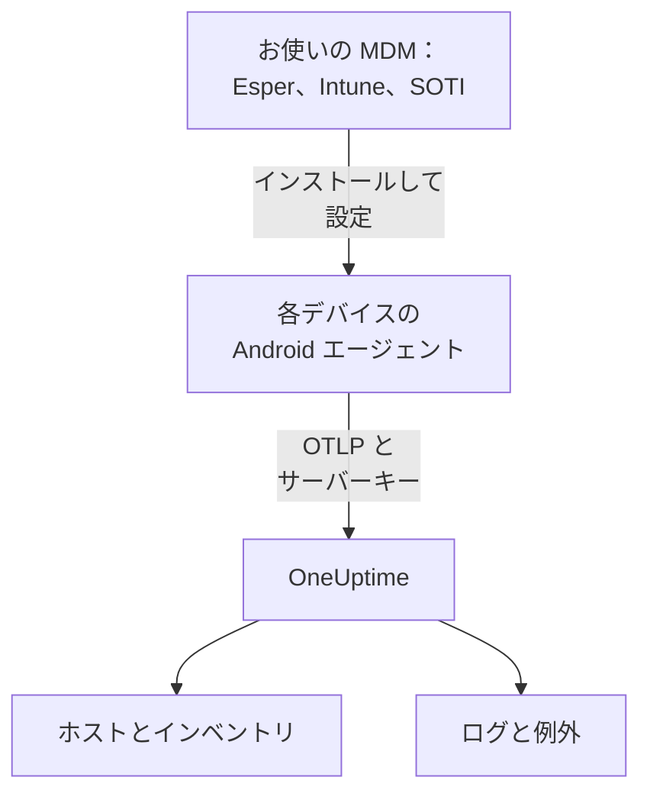

# Android エージェント

OneUptime の Android エージェントは、注文用キオスク、POS 端末、ハンディ端末、サイネージプレーヤーなど、組織が所有する Android デバイスの状態を OneUptime に報告します。報告するのは、メモリ、ストレージ、ネットワーク、バッテリー、温度、再起動、インストールされているアプリ、そしてデバイス上のアプリのクラッシュとログです。デバイス管理サービスが、フリート全体にまとめてインストールして設定します。各デバイスは、サーバーや Windows マシンと並んで、 **ホスト** ではホストとして、 **インベントリ** では 1 つの項目として表示されます。

:::cards
- [いつ使うか](#エージェントかアプリのインストルメンテーションか): エージェントが見るのはデバイス、アプリのインストルメンテーションが見るのはアプリです。
- [Esper でデプロイする](#esper-でデプロイする): APK をアップロードし、設定を配信して、一度起動します。
- [設定](#設定): 管理対象の構成のすべてのキー。
- [ほかのアプリのログを読み取る](#ほかのアプリのログを読み取る): adb またはデバイス管理サービスで、READ_LOGS を一度付与します。
- [ログセッション](#ログセッション): デバイスの前にいる人が許可した、一定時間のすべてのアプリのログ。
:::

## 仕組み

エージェントは、フォアグラウンドサービスとして動く小さなアプリです。1 分ごとにデバイスのヘルスを読み取り、デバイスの再起動、インストール済みアプリ、ログとあわせて、 **サーバー** の取り込みキーを使って OTLP でお使いの OneUptime に送信します。デバイスの起動時に自動で開始し、ネットワークが切れている間は収集したデータをデバイス上に保持して、ネットワークが戻ったら送信します。スリープ中のデバイスを起こしたままにすることはなく、送信するデータは圧縮します。



## エージェントか、アプリのインストルメンテーションか

| | アプリに組み込んだ [OpenTelemetry Android](/docs/rum/android-setup) | Android エージェント |
| --- | --- | --- |
| 見えるもの | アプリ：クラッシュ、ANR、画面、セッション、リクエスト、ワークフロー | デバイス：メモリ、ストレージ、ネットワーク、バッテリー、再起動、インストール済みアプリ、すべてのアプリのクラッシュと ANR |
| 表示先 | **リアルユーザーモニタリング** 、 **トレース** 、 **例外** | **ホスト** 、 **インベントリ** 、 **ログ** 、 **例外** |
| インストール方法 | アプリのコードに組み込む | アプリとして、デバイス管理サービスからインストールする |

自社で所有するデバイスでは両方を使い、両方でデバイスに同じ名前を付けてください。エージェントの `device_name` の設定と、アプリが設定する `host.name` です。するとデバイスは **インベントリ** の 1 つの項目になり、アプリのテレメトリとデバイスのテレメトリがそこにまとまります。

## 始める前に

- Android 7.0 以降を搭載し、Android の管理対象の構成に対応したデバイス管理サービスで管理されているデバイス。Esper、Microsoft Intune、Workspace ONE、SOTI など、Android Enterprise のデバイス管理サービスが該当します。デバイスが 1 台だけなら adb で十分です。
- **プロジェクト設定 → テレメトリと APM → 取り込みキー** で **取り込みキーを作成** を使って作成した **サーバー** の取り込みキー。
- エージェントの `oneuptime-android-agent.apk` 。 [OneUptime の各リリース](https://github.com/OneUptime/oneuptime/releases/latest) に添付されています。
- デバイスから OneUptime の URL への送信方向の HTTPS。すべてのリクエストに取り込みキーが含まれるため、エージェントは `https://` 以外の URL を拒否します。

## Esper でデプロイする

:::steps
### APK をアップロードする

Esper コンソールで、 `oneuptime-android-agent.apk` を **App Library** にアップロードし、監視するデバイスのブループリント (blueprint) に追加します。

### 設定を配信する

ブループリントでエージェントの **Managed Configuration** を開き、設定を貼り付けます。Esper Agent 8.00.0764 以降なら、Esper が各デバイスでプレースホルダーを埋めます。

```json title="Managed configuration"
{
  "oneuptime_url": "https://oneuptime.com",
  "oneuptime_token": "YOUR_TELEMETRY_INGESTION_TOKEN",
  "device_name": "${esper.deviceName}",
  "device_serial": "${esper.serialNumber}",
  "device_type": "kiosk",
  "labels": "region=emea"
}
```

OneUptime をセルフホストしている場合は、 `oneuptime_url` に自分の URL を入れてください。続いてデバイスに Converge を実行し、新しい設定を読み込ませます。

### 一度起動する

Android は、新しくインストールされたアプリを、一度開かれるまでは起動時に開始しません。ブループリントの Multi-App mode でエージェントの **Launch on Start** をオンにするか、各デバイスでエージェントを一度開いてください。それ以降は、デバイスが起動するたび、そして更新のたびに自動で開始します。

### OneUptime でデバイスを見つける

1 分以内に、各デバイスが `device_name` の名前で **ホスト** に表示され、 **インベントリ** にも表示されます。デバイス上のエージェント自身の画面には、報告できているかどうかと、できていない場合はその原因が表示されます。
:::

ほかのデバイス管理サービスでも手順は同じです。APK を基幹業務 (LOB) アプリまたは社内アプリとして追加し、アプリの構成で同じキーを設定して、各デバイスで一度開きます。

## 設定

エージェントは、管理対象の構成から次のキーを読み取ります。管理対象の構成がないデバイスでは、代わりにエージェント自身の画面で、URL、取り込みキー、デバイスの名前を設定できます。そこで入力したキーは、Android Keystore で暗号化して保存されます。

| キー | 設定する内容 | 既定値 |
| --- | --- | --- |
| `oneuptime_url` | OneUptime の URL | `https://oneuptime.com` |
| `oneuptime_token` | **サーバー** の取り込みキー | なし (キーがないと、エージェントは何も送信しません) |
| `device_name` | **ホスト** と **インベントリ** でのデバイスの名前。そこではこれがデバイスの識別子になります | モデル名と Android ID の先頭部分 |
| `device_serial` | シリアル番号。Android 10 以降、Android はこれをアプリに渡しません | なし |
| `device_type` | キオスク、POS 端末、ハンディ端末など、デバイスの種類 | `Android device` |
| `device_location` | 店舗番号など、デバイスの設置場所 | なし |
| `labels` | ホストのラベル。 `name=value` の組をカンマ区切りで指定します | なし |
| `collection_interval_seconds` | 報告する間隔。30 秒から 600 秒まで | `60` |
| `logcat_enabled` | Logcat から読み取った内容を送信するかどうか | `true` |
| `logcat_min_level` | Android 12 以前で送信する Logcat の行の最低レベル。 `verbose` 、 `debug` 、 `info` 、 `warn` 、 `error` 、 `fatal` のいずれか | `warn` |
| `installed_apps_enabled` | インストール済みアプリを送信するかどうか | `true` |

デバイス管理サービスが埋めなかったプレースホルダー (たとえば、そのまま送られてきた `${esper.deviceName}` ) は無視され、エージェントの画面にその旨が表示されます。デバイスが報告を始めたら、 `device_name` は変えないでください。名前が変わると新しいホストになります。

エージェントの画面と通知、そしてデバイス管理サービスがこれらのキーに表示するタイトルと説明は、デバイスの言語で表示されます。OneUptime のダッシュボードが対応しているすべての言語に対応しています。

## ほかのアプリのログを読み取る

Android では、アプリがほかのアプリのログを読み取れるのは READ_LOGS 権限がある場合だけで、この権限を付与できるのは adb だけです。アプリ自身も、デバイスポリシーも付与できません。各デバイスで一度付与すれば、再起動や更新を経ても付与されたままです。

```bash
adb shell pm grant com.oneuptime.androidagent android.permission.READ_LOGS
```

Esper では、このコマンドを **Secure Remote ADB** 経由で実行します。デバイスの ADB アクセスをオンにし、 `espercli secureadb connect --device DEVICE_ID` で接続してから、コマンドを実行します。権限が付与されると Android がエージェントを再起動し、エージェントはすぐに読み取りを始めます。

そのあとエージェントが読み取る内容は、Android のバージョンによって異なります。

- Android 13 以降では、すべてのアプリのクラッシュと ANR を読み取ります。Android がほかのアプリのログの行を見せるのは、画面に表示されているアプリに対して、デバイスの前にいる人が許可した後だけなので、バックグラウンドで動くエージェントはそれらを読み取れません。一定時間それらを受け取るには、 [ログセッション](#ログセッション) をリクエストします。
- Android 12 以前では、すべてのアプリのクラッシュと ANR に加えて、すべてのアプリの `logcat_min_level` 以上のログの行を読み取ります。

READ_LOGS がなくても、エージェントはそれ以外のすべてを報告します。付与の方法は、エージェントの画面とデバイスのログに表示されます。

### クラッシュのスタックトレースと再起動の理由

Android は、すべてのアプリのクラッシュ、ネイティブクラッシュ、ANR の完全なレポートと、再起動ごとの理由を DropBox に保存しています。エージェントは、READ_LOGS と使用状況へのアクセス、さらに Android 15 以降では READ_DROPBOX_DATA があれば、すべてのアプリについてそれらを読み取ります。READ_LOGS と同じように、adb で一度付与してください。

```bash
adb shell pm grant com.oneuptime.androidagent android.permission.READ_DROPBOX_DATA
adb shell appops set com.oneuptime.androidagent GET_USAGE_STATS allow
```

1 つ目のコマンドは Android 15 以降用です。使用状況へのアクセスは、デバイスの **設定 → 使用状況へのアクセス** でもオンにできます。これらはデバイスポリシーでは付与できず、まだ実行が必要なコマンドはエージェントの画面に一覧表示されます。これらがあれば、 **例外** の各クラッシュにはスタックトレース全体が、ネイティブクラッシュにはシグナルとクラッシュしたライブラリが、ANR にはメインスレッドのスタックが、 **ログ** の再起動には Android が示すその理由が付きます。エージェントが読み取った内容に含まれるカード番号、メールアドレス、トークン、パスワードは、送信前に `[card number]` 、 `[email]` 、 `[token]` 、 `[redacted]` に置き換えられます。

### フリート全体で付与する

エージェントは報告のたびに、これらの権限のうちまだ足りないものを伝えます。それらが必要なデバイスを一覧にするには、 **インベントリ** を開き、 **すべての項目** を開いて、 **エージェントの権限**: **欠落** で絞り込みます。 **エージェントの権限** 列をオンにして各デバイスに足りないものを確認し、一覧を CSV としてエクスポートします。

これらはデバイスポリシーでは付与できません。READ_LOGS と READ_DROPBOX_DATA は adb、システム、またはデバイスのメーカーだけが付与できる権限で、使用状況へのアクセスは adb かデバイスの前にいる人が設定するものだからです。Esper が提供する機能と、どれもこれらを付与できない理由は次のとおりです。

- **アプリの権限** は、ブループリントで設定しても `SET_APP_PERMISSION` コマンドで設定しても、Android のデバイスオーナー API を経由します。この API が付与するのは、アプリがデバイスの前にいる人に求める権限だけです。Android はこれらの権限を拒否します。
- **管理対象の構成** が設定するのはエージェント自身の設定で、Android の権限は決して設定しません。
- **Run Shell Script** は Linux と Windows のデバイスで実行され、Android のデバイスでは実行されません。
- **Secure Remote ADB** は、 `espercli` を実行するコンピューターから、一度に 1 台のデバイスに接続します。Esper Foundation のデバイスでは、デバイスの前に人がいなくてもかまいません。それ以外のデバイスでは、最初の 1 回だけ、デバイスの前にいる人が **Allow USB debugging?** を承認します。

そのため、次のように adb で付与します。

- **デバイスの出荷前** には、USB ケーブルでセットアップするときに付与します。次のコマンドは、コンピューターに接続されているすべてのデバイスに 3 つすべてを付与します。

  ```bash
  for serial in $(adb devices | awk 'NR > 1 && $2 == "device" { print $1 }'); do
    adb -s "$serial" shell pm grant com.oneuptime.androidagent android.permission.READ_LOGS
    adb -s "$serial" shell pm grant com.oneuptime.androidagent android.permission.READ_DROPBOX_DATA
    adb -s "$serial" shell appops set com.oneuptime.androidagent GET_USAGE_STATS allow
  done
  ```

  Android 14 以前では、2 つ目のコマンドが不明な権限だと表示します。そのデバイスには必要のない権限です。
- **現場で使われているデバイス** には、Secure Remote ADB 経由で、 **欠落** の一覧にあるデバイスに 1 台ずつ付与します。
- **使用状況へのアクセスだけ** は、デバイスの前にいる人が **設定 → 使用状況へのアクセス** で、またはエージェントの画面のボタンでオンにできます。

1 分以内に届くデバイスの次の報告で、そのデバイスは **欠落** の一覧から外れます。

### CPU 使用率

Android 8 以降では、デバイスの CPU 使用率をアプリが取得できません。読み取れるのはデバイスオーナーのアプリだけで、それもハードウェアが CPU 使用率を報告するデバイスに限られます。エージェントは、デバイスオーナーであれば CPU 使用率を読み取ります。デバイスオーナーは、アカウントがなく、ほかのデバイスオーナーもいないデバイスで、adb を使って設定します。

```bash
adb shell dpm set-device-owner com.oneuptime.androidagent/.admin.AgentDeviceAdminReceiver
```

デバイス管理サービスがすでにオーナーになっているデバイスには 2 つ目のオーナーを設定できないため、CPU 使用率は取得できず、エージェントの画面にその旨が表示されます。その場合、CPU 使用率はホストの一覧に表示されず、 **High CPU Utilization** テンプレートもそのデバイスには提示されません。

## ログセッション

ログセッションは、トラブルシューティングのために、デバイスのすべてのアプリのログを一定時間送信します。Android 13 以降では、これがほかのアプリのログの行を読み取る唯一の方法です。Android がそれらを見せるのは、画面に表示されているアプリに対して、デバイスの前にいる人が許可した後だけだからです。

:::steps
### セッションをリクエストする

デバイスを **ホスト** で開いてから **ログ** を開き、 **ログセッション** で **ログセッションをリクエスト** をクリックします。デバイスがログを送信する時間を 15 分から 4 時間の間で選び、送信する最低レベルを **情報** 、 **デバッグ** 、 **詳細** から選びます。 **メモ** には、「18 時以降に決済アプリが落ちる原因を調査しています」のように、リクエストする理由を書き添えます。

### デバイスで許可する

1 分以内に、誰かがログを求めたことを知らせる通知が、その人の名前とメモとともにデバイスに表示されます。デバイスの前にいる人がエージェントを開くと、メモが下に添えられたリクエストが表示されるので、 **許可** をタップします。Android 13 以降では、続いて Android がすべてのデバイスログへのアクセスを許可するかどうかを確認するので、そこでも許可します。

### ログの行を読む

セッションは **収集中** と表示され、すべてのアプリのログの行がデバイスのログに届きます。 **ログ行を表示** をクリックするとそのセッションの行だけが表示され、 **ログ行をダウンロード** をクリックするとそれらの行をファイルとして保存できます。セッションは、時間が来たとき、またはデバイスで誰かが停止したときや OneUptime でキャンセルされたときに終了します。
:::

メモは 200 文字までの 1 行です。セッションが許可を待っている間と実行中は、デバイスの通知とエージェントの画面に、メモが書かれたとおり引用符で囲んで表示されます。メモが翻訳されることはありません。改行はスペースに変わり、メモに含まれるカード番号、メールアドレス、トークン、パスワードは、保存前に `[card number]` 、 `[email]` 、 `[token]` 、 `[redacted]` に置き換えられます。エージェントが送信する内容と同じです。セッションの一覧では、リクエストした人の下にメモが表示され、ホストの **監査ログ** にはリクエストとともにメモが残ります。

**ログ行をダウンロード** は、セッションの行を、 `logcat -v threadtime` が出力する形式のテキストファイルとして保存します。ベンダーのサポートが読める形式で、各行にはミリ秒単位の時刻、プロセスとスレッド、レベル、タグ、メッセージが含まれます。時刻は UTC です。ファイルの最初の数行には、どのセッション、デバイス、メモのファイルか、そして誰がリクエストしたかが書かれています。ファイルに含まれるのは **ログ** に表示される行で、エージェントがマスクした状態のままなので、デバイスのログを読むのと同じ権限が必要です。1 つのファイルに入るのは最大 100,000 行、32 MB までです。それより長いセッションのファイルの最後には、セッション全体の行数が示されます。

セッションには READ_LOGS と `logcat_enabled` が必要で、これらがないと **利用不可** と表示されます。1 台のデバイスで同時に実行されるセッションは 1 つだけです。1 時間以内に誰も許可しなかったリクエストは期限切れになり、実行中にデバイスが再起動したセッションはそこで終了します。Android の権限はエージェントのプロセスとともに失われるためです。セッションをリクエストするにはホストを編集する権限が必要で、誰がいつリクエストしたかはホストの **監査ログ** に残ります。

## 報告される内容

| 内容 | OneUptime での表示先 |
| --- | --- |
| メモリ、ストレージ、ネットワーク、稼働時間 | **ホスト** にあるデバイスのページ。サーバーのコレクターが送るものと同じメトリクスなので、ホストのアラートテンプレートがそのまま使えます |
| バッテリー残量と温度、外部電源につながっているかどうか | メトリクス `hw.battery.charge` 、 `hw.temperature` 、 `android.battery.plugged` |
| 発熱の状態 | メトリクス `android.thermal.status` と `android.thermal.headroom` |
| CPU 使用率 | メトリクス `system.cpu.utilization` 。Android 7 と、エージェントが [デバイスオーナー](#cpu-使用率) である Android 8 以降で報告します |
| 再起動 | **ログ** ( `@event.name:device.boot` で検索)。それまでの稼働時間、正常にシャットダウンしたかどうか、電源が切れていた時間、再起動した理由、再起動の繰り返し |
| インストール済みアプリ | **ログ** ( `@event.name:android.package.inventory` で検索)。1 日 1 回の一覧と、インストール、更新、削除のたびの記録 |
| すべてのアプリのクラッシュと ANR | **例外** (未処理として、アプリの名前で)。エージェントが [DropBox](#クラッシュのスタックトレースと再起動の理由) を読み取る場合はスタックも付きます |
| メーカー、モデル、シリアル番号、OS のバージョン、セキュリティパッチレベル、ファームウェア | **インベントリ** にあるデバイスの項目と、 **セキュリティパッチレベル** のフィルターおよび列 |
| セキュリティパッチレベルがどれだけ古いか | メトリクス `android.os.security_patch.age` 。日数で表します |
| エージェントにまだ足りない権限 | **インベントリ** にあるデバイスの項目と、 **エージェントの権限** のフィルターおよび列 |

デバイスの OS は、 **ホスト** では Android のマーク付きで Android と表示されます。

セキュリティパッチレベルが 90 日より古いデバイスは、セキュリティパッチが遅れています。Google は Android のセキュリティに関する公開情報を毎月発行しており、Android Enterprise Recommended はデバイスのメーカーに、それぞれの修正を 90 日以内に配信するよう求めています。そのため、それより遅れているデバイスには、メーカーが配信しているはずの修正が欠けています。 **インベントリ** では、 **セキュリティパッチレベル** フィルターで **更新が必要** を選ぶとそうしたデバイスが一覧になり、 **Security Patch Out of Date** テンプレートがそれぞれについてアラートを出します。

直近 1 時間の起動回数はメトリクス `android.boot.recent_count` で、再起動を繰り返しているデバイスは起動のたびに警告をログに記録します。 **ホスト** では、Android デバイスに専用のアラートテンプレートが提示されます。Device Unplugged、Low Battery、Device Overheating、Restart Loop、Storage Nearly Full、Security Patch Out of Date に加えて、Host Stopped Reporting、Host Restarted、High Memory Utilization、そして CPU 使用率を報告するようになれば High CPU Utilization です。各アラートで最初に示されるデバッグ用のコマンドは adb のコマンドです。 [ホスト モニター](/docs/monitor/host-monitor#android-デバイス) を参照してください。

## トラブルシューティング

:::details デバイスがホストに表示されない
デバイスでエージェントを開いてください。取り込みキーがない、使えない URL が指定されている、アップロードに失敗した (とその理由) など、足りないものが画面に表示されます。インストール後に一度もエージェントを開いていないデバイスでは、エージェントは起動していません。一度開くか、 **Launch on Start** をオンにしてください。
:::

:::details OneUptime が取り込みキーを拒否したとエージェントに表示される
有効で期限切れでない **サーバー** キーを使ってください。 **ブラウザー** キーはデバイスからは拒否されます。
:::

:::details ほかのアプリのログが届かない
[ほかのアプリのログを読み取る](#ほかのアプリのログを読み取る) の説明に従って READ_LOGS を付与してください。Android 13 以降で読み取られるのは、 [ログセッション](#ログセッション) の実行中を除き、ほかのアプリのクラッシュと ANR だけです。
:::

:::details ログセッションが承認待ちのまま変わらない
デバイスでまだ誰も許可していません。誰かがデバイスでエージェントを開いて **許可** をタップし、Android 13 以降では、エージェントが画面に表示されている間に Android の確認画面でも許可する必要があります。Android の確認画面で拒否されたセッションは **拒否** と表示されます。新しいセッションをリクエストしてください。
:::

:::details 2 台のデバイスが 1 台のホストとして表示される
2 台の `device_name` が同じです。 `${esper.deviceName}` や `${esper.serialNumber}` のように、デバイスごとに異なるプレースホルダーを使ってください。
:::

## 次のステップ

:::cards
- [Android のセットアップ](/docs/rum/android-setup): OpenTelemetry Android で自社のアプリをインストルメントします。
- [ホスト](/docs/telemetry/hosts): ホストのページ、測定値、アラート。
- [ホスト モニター](/docs/monitor/host-monitor): デバイスの報告が止まったときや、ストレージが不足してきたときにアラートを受け取ります。
- [例外](/docs/telemetry/exceptions): デバイスが報告するクラッシュと ANR をトリアージします。
:::
