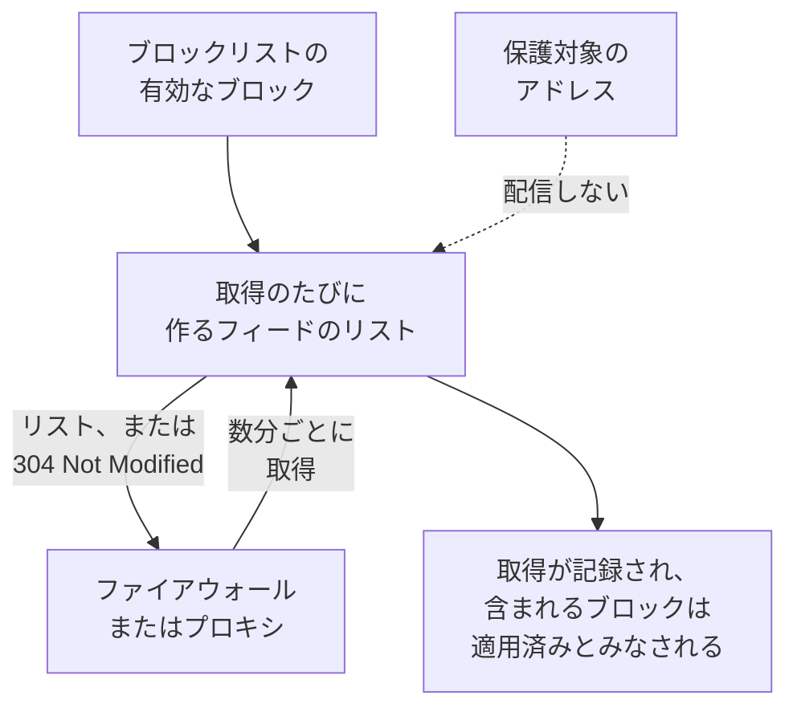

# ファイアウォールとプロキシ向けのブロックリストフィード

ブロックリストフィードは、ファイアウォールやプロキシが数分ごとにプロジェクトの[ブロックリスト](/docs/telemetry/security-cases#ブロックリスト)を読み取るシークレット URL です。Palo Alto Networks、FortiGate、Check Point、Cisco Secure Firewall、OPNsense、pfSense は外部リストとしてこれを読み取り、OneUptime からコピーしたコマンドは nftables、ipset、nginx、HAProxy、Windows ファイアウォールでこれを適用します。接続するのはファイアウォールの側なので、OneUptime がネットワーク内への経路やファイアウォールのパスワードを必要とすることはありません。

:::cards
- [フィードを作成する](#フィードを作成する): ファイアウォールを選び、シークレットをコピーして、手順に従います。
- [ファイアウォールを設定する](#ファイアウォールを設定する): ファイアウォールとプロキシごとの手順と取得間隔。
- [ブロックが適用されるとき](#ブロックが適用されるとき): ファイアウォールがそのブロックを含むリストを取得してからです。
- [シークレットをローテーションまたは取り消す](#シークレットをローテーションまたは取り消す): 1 日重なる新しいシークレット、またはすぐにすべて停止。
:::

## 仕組み



取得のたびに、その時点で有効なブロックからリストが作られます。期限切れになったブロックや解除されたブロックは次の取得から外れ、保護対象のアドレスは、ブロックされた後に保護対象になったものでも、決してリストに入りません。ブロックがフィードで適用済みとみなされるのは、ファイアウォールがそのブロックを含むリストを取得してからです。

## 始める前に

- `https` URL からアドレスのリストを読み取れるファイアウォールやプロキシ、または root や管理者としてコマンドを実行できる Linux や Windows のホスト。
- ファイアウォールから HTTPS で OneUptime に出られる経路: `https://oneuptime.com`、またはご自身の OneUptime サーバーのアドレス。
- フィードを作成できるロール: プロジェクト所有者、プロジェクト管理者、セキュリティ管理者。セキュリティメンバーとセキュリティ閲覧者はフィードとその取得履歴を閲覧できます。[ロール](/docs/permissions/reference#ロール)を参照してください。

## フィードを作成する

:::steps
### ブロックリストフィードを開く

**製品 → セキュリティイベント → プレイブック → ブロックリストフィード** を開きます。

### 新しいフィードを作成する

**ブロックリストフィードを作成** をクリックし、フィードを読み取る **ファイアウォール** を選びます。**名前** は、ブロックが適用される場所でブロックリストがこのフィードを呼ぶ名前です。空欄の場合は「FortiGate feed」のようにファイアウォールの名前が付けられます。**その他の項目** の **配信対象** で IPv4 と IPv6、IPv4 のみ、IPv6 のみのいずれかを選び、**許可する送信元アドレス** でフィードを読み取れる相手を制限します。

### シークレットをコピーする

フィードのページが開き、シークレットが 1 回だけ表示されます。OneUptime が保持するのはハッシュだけです。シークレットをコピーしてから **完了** をクリックしてください。ページを離れるまでは、ページ上の手順にシークレットが入った状態で表示されます。

### ファイアウォールの手順に従う

**ファイアウォールの設定** には、貼り付ける URL、ファイアウォールがシークレットを送る方法、ファイアウォールのコンソールで行う手順が、値が入った状態で表示されます。そこで別のファイアウォールを選ぶと、その手順が表示されます。ファイアウォールが最初に取得すると、フィードのステータスが **読み取り中** になり、**取得履歴** にその取得が表示されます。
:::

## フィードが配信するもの

| ファイル | 対象 | 内容 |
| --- | --- | --- |
| `blocklist.txt` | Palo Alto Networks、pfSense、ipset、HAProxy、Windows ファイアウォール、その他すべてのファイアウォール | 1 行に 1 つのアドレスまたは範囲。 |
| `blocklist.txt?comments=1` | `#` で始まる行を読み飛ばす FortiGate、Check Point、Cisco Secure Firewall、OPNsense | 各アドレスまたは範囲の前に、ブロックの理由を書いた行。 |
| `nftables.nft` | nftables | `inet oneuptime` テーブルの `blocklist_v4` と `blocklist_v6` のセットを空にしてから入れ直す、`nft -f` 用のファイル。 |
| `nginx.conf` | nginx | アドレスまたは範囲ごとに 1 行の `deny`。 |
| ファイル名の後ろに `.md5` を付けたもの (例: `blocklist.txt.md5`) | Cisco Secure Firewall | ファイルの MD5。ファイアウォールはリストが変わったときだけダウンロードします。 |

フィードの URL は `https://oneuptime.com/api/blocklist-feed/<feed ID>/<file>` で、フィードのページにはファイアウォールに合わせた URL が表示されます。`?comments=1` を付けると、リストは次のようになります。

```text
# OneUptime case CASE-42 until 2026-11-21 10:42 UTC
203.0.113.7
# OneUptime blocklist until lifted
198.51.100.0/24
```

フィードが配信するのは、アクションが **ブロック** の有効なブロックです。ファイアウォールはチャレンジを行えないため、チャレンジは決して配信されません。IPv4 のみ、または IPv6 のみを配信するフィードは、もう一方のアドレスを含めません。nftables は 1 つのセット内で重なり合うエントリを受け付けないため、nftables のファイルでは、リスト内の別の範囲にすでに含まれるアドレスを省きます。

何もブロックされていないとき、`blocklist.txt` にはアドレスが 1 つだけ、`192.0.2.1` (IPv6 のみを配信するフィードでは `2001:db8::1`) が入ります。これはドキュメント用に予約されたアドレスで、インターネット上のどのトラフィックもこのアドレスからは来ません。Palo Alto Networks と Cisco は空のリストを受け取ると最後に読み取ったリストを保持するため、空のリストでは解除したブロックが残り続けてしまいます。

すべての応答には `ETag` が付きます。ファイアウォールがこれを `If-None-Match` で送り返すと、リストが変わっていない間は `304 Not Modified` が返ります。OneUptime が提供するコマンドもそのようにします。

## ファイアウォールがシークレットを送る方法

| 方法 | ファイアウォールが送るもの | 使う製品 |
| --- | --- | --- |
| Basic 認証 | `oneuptime` などの任意のユーザー名と、パスワードとしてのシークレット | Palo Alto Networks (HTTPS のみ)、FortiGate、Check Point |
| Bearer トークン | `Authorization: Bearer <secret>` | nftables、ipset、nginx、HAProxy、Windows ファイアウォール用のコマンド |
| URL 内のシークレット | `https://oneuptime.com/api/blocklist-feed/<feed ID>/<secret>/blocklist.txt` | シークレットの送り方が文書化されていない Cisco Secure Firewall、OPNsense、pfSense |

シークレットがない、または間違っているリクエストには `401 Unauthorized` が返ります。間違ったシークレットを含む URL には、存在しないアドレスと同じく `404 Not Found` が返ります。OneUptime の Web サーバーはフィードの URL をアクセスログに記録しないため、URL 内のシークレットがそこに残ることはありません。

## フィードを読み取れる相手を制限する

**その他の項目** の **許可する送信元アドレス** には、`203.0.113.7` や `198.51.100.0/24` のようなアドレスと範囲を 1 行に 1 つずつ、最大 50 件まで入力できます。それ以外のアドレスからのリクエストには、正しいシークレットを送っていても `403 Forbidden` が返ります。空欄にすると、シークレットを持つすべてのアドレスがフィードを読み取れます。

1 つのアドレスが取得できるのは、1 つのフィードにつき 1 分に 60 回、すべてのフィードを合わせて 1 分に 600 回です。これを超えると、`Retry-After` ヘッダー付きの `429 Too Many Requests` が返ります。

## ブロックが適用されるとき

ブロックがフィードで適用済みとみなされるのは、ブロックが作成された後に、ファイアウォールがそのブロックを含むリストを取得したときで、そうした取得のたびに 10 分間続きます。`304 Not Modified` の応答は、同じリストの取得として扱われます。すると **ブロックリスト** の **適用先** にあるフィードのチップが緑色になり、ツールチップにブロックの作成からファイアウォールが取得するまでの時間が表示されます。例: 「ファイアウォールがこのブロックを作成から 3分 後に FortiGate feed から取得しました。最終取得: 2 分前。」

取得がないまま 10 分が過ぎると、チップにはファイアウォールがそれ以降フィードを取得していないと表示されます。ファイアウォールはまだそのアドレスをブロックしているかもしれませんが、OneUptime にはそれがわかりません。そのため、ファイアウォールには 5 分ごと、またはそれより頻繁にフィードを取得させてください。OPNsense のように取得の頻度が低いファイアウォールも取得の合間にブロックを続けますが、OneUptime がそこでブロックを適用済みとするのは各取得後の 10 分間だけです。

期限切れになったブロックや解除されたブロックは次の取得から外れ、そのチップはファイアウォールがそのブロックを含まないリストを取得するのを待ちます。OneUptime がどのアドレスが保護対象かを読み取れないときは、保護対象のアドレスを含むかもしれないリストの代わりに、`Retry-After: 60` 付きの `503 Service Unavailable` を返します。ファイアウォールは手元のリストを保持します。

## ファイアウォールが読み取りを停止したとき

OneUptime は、各フィードがどのくらいの頻度で取得されるかを学習します。通常の間隔の 3 倍、かつ 10 分以上フィードが取得されないと、フィードのステータスが **読み取り停止** になり、**ブロックリスト** のリストの上にそのフィードが表示され、プロジェクト所有者にメールが 1 通届きます: 「Your firewall stopped reading the blocklist feed _フィード名_」。ファイアウォールがフィードを 2 回取得するまでは、OneUptime は 5 分ごと、OPNsense なら 1 時間ごと、pfSense なら 1 日ごとの取得を想定します。

次の取得があると表示は消え、後で再び停止すると、もう一度メールが送られます。シークレットを取り消したフィードが停止とみなされることはありません。

## シークレットをローテーションまたは取り消す

フィードのページの **シークレットをローテーション** は、新しいシークレットを作成して 1 回だけ表示します。置き換えられたシークレットは 24 時間有効なままなので、その間にすべてのファイアウォールに新しいシークレットを設定できます。**取得履歴** では、古いシークレットを送った取得に **以前のシークレット** と表示されます。その 24 時間以内にもう一度ローテーションすると、最も古いシークレットはすぐに使えなくなります。

**シークレットを取り消す** は、シークレットとその前のシークレットをすぐに無効にします。シークレットが漏れたときに使ってください。その後、フィードは誰にも応答せず、ファイアウォールは **シークレットをローテーション** で新しいシークレットが作成されるまで、手元のリストを更新できないまま保持します。フィードを削除すると、フィード、シークレット、取得履歴がすべてなくなります。

## ファイアウォールを設定する

フィードのページには、選んだファイアウォール用にこれらの手順が表示され、URL、ユーザー名、そしてシークレットの作成直後にはシークレットも入力された状態になります。

| ファイアウォール | ファイル | シークレット | 取得間隔 | 上限 |
| --- | --- | --- | --- | --- |
| Palo Alto Networks | `blocklist.txt` | Basic 認証 | 5 分 (設定できる最短) | カスタムリスト 30 個、アドレス合計 50,000 件 (PA-3200、PA-5200、PA-7000 シリーズは 150,000 件) |
| FortiGate | `blocklist.txt?comments=1` | Basic 認証 | 5 分 (1～43,200 分、既定値 5 分) | すべての脅威フィードを合わせてアドレス 300,000 件 |
| Check Point | `blocklist.txt?comments=1`、IPv4 | Basic 認証 | 5 分 (既定値 1 時間) | フィードごとにアドレス 50,000 件 |
| Cisco Secure Firewall | `blocklist.txt?comments=1` とその MD5 | URL 内 | 5 分 (既定値 2 時間) | |
| OPNsense | `blocklist.txt?comments=1` | URL 内 | 1 時間 (設定できる最短) | |
| pfSense | `blocklist.txt` | URL 内 | 1 日 (設定できる最短) | |
| nftables、ipset、nginx、HAProxy、Windows ファイアウォール | それぞれのファイル | Bearer トークン | 1 分 | |

### Palo Alto Networks

1. Web インターフェースで **Objects → External Dynamic Lists** に移動し、**Add** をクリックします。
2. **Type** を **IP List** に、**Source** をフィードの URL `https://oneuptime.com/api/blocklist-feed/<feed ID>/blocklist.txt` に設定します。
3. **Client Authentication** をオンにし、**Username** に `oneuptime`、**Password** にフィードのシークレットを入力します。
4. **Check for updates** を **Every Five Minutes** に設定し、**OK** をクリックして commit します。
5. **Policies → Security** で、このリストを **Source Address**、アクションを **Deny** にしたルールを追加し、commit します。

Palo Alto Networks がユーザー名とパスワードを送るのは HTTPS の場合だけです。コメントはアドレスの後ろにあるときだけ読み取り、独立した行のコメントは読み取らないため、このファイアウォールのフィードはプレーンなリストです。[Configure the Firewall to Access an External Dynamic List](https://docs.paloaltonetworks.com/pan-os/11-1/pan-os-admin/policy/use-an-external-dynamic-list-in-policy/configure-the-firewall-to-access-an-external-dynamic-list)を参照してください。

### FortiGate

1. **Security Fabric → External Connectors** に移動し、**Create New** をクリックして **Threat Feeds** の **IP Address** を選択します。
2. **URL of external resource** をフィードの URL `https://oneuptime.com/api/blocklist-feed/<feed ID>/blocklist.txt?comments=1` に設定します。
3. **HTTP basic authentication** をオンにし、**Username** に `oneuptime`、**Password** にフィードのシークレットを入力します。
4. **Refresh Rate** を 5 分に設定し、**OK** をクリックします。
5. **Policy & Objects → Firewall Policy** で、フィードをポリシーの **Source** に指定し、**Action** を **DENY** に設定します。

[Configuring a threat feed](https://docs.fortinet.com/document/fortigate/7.6.0/administration-guide/379433/configuring-a-threat-feed)を参照してください。

### Check Point

1. SmartConsole で **Object Explorer** を開き、**New → More → Network Object → Network Feed** を選択します。
2. **Feed URL** をフィードの URL `https://oneuptime.com/api/blocklist-feed/<feed ID>/blocklist.txt?comments=1` に、**Format** を **Flat list** に、**Data type** を **IP Address** に設定します。
3. **Advanced Settings** の **Authentication** で、**Username** に `oneuptime`、パスワードにフィードのシークレットを入力します。
4. **Check feed interval** を 5 分に設定し、**Test Feed** をクリックしてから **OK** をクリックします。
5. アクションが **Drop** の Access Control ルールの **Source** にフィードを指定し、ポリシーをインストールします。

Check Point のネットワークフィードは IPv4 アドレスについて文書化されているため、Check Point 用に作成したフィードは IPv4 のみを配信します。[Network Feed](https://sc1.checkpoint.com/documents/R82/WebAdminGuides/EN/CP_R82_SecurityManagement_AdminGuide/Content/Topics-SECMG/Network_Feed.htm)を参照してください。

### Cisco Secure Firewall

1. 管理センターで **Objects → Security Intelligence** を選択し、**Add Network Lists and Feeds** をクリックします。
2. **Type** を **Feed** に、**Feed URL** をフィードの URL `https://oneuptime.com/api/blocklist-feed/<feed ID>/<secret>/blocklist.txt?comments=1` に、**MD5 URL** を同じ URL の `blocklist.txt` の後ろに `.md5` を付けたものに設定します。
3. **Update Frequency** を 5 分に設定して保存します。
4. アクセス制御ポリシーで **Security Intelligence → Networks** を開き、フィードを **Block List** に追加して、保存とデプロイを行います。

Cisco では更新頻度を 30 分以下にするには MD5 URL が必要です。また、管理対象デバイスは 30 分ごとに管理センターから更新を受け取るため、ブロックがデバイスに届くのはフィードの取得から最大 30 分後です。[Creating Security Intelligence feeds](https://docs.manage.security.cisco.com/cdfmc/t_creating_security_intelligence_feeds.html)を参照してください。

### OPNsense

1. **Firewall → Aliases** に移動し、**URL Table (IPs)** タイプのエイリアスを追加します。
2. **Content** をフィードの URL `https://oneuptime.com/api/blocklist-feed/<feed ID>/<secret>/blocklist.txt?comments=1` に、**Refresh Frequency** を 0 日 1 時間に設定します。
3. 保存して **Apply** を押し、**Firewall → Rules** で **Source** がこのエイリアスのトラフィックをブロックするルールを追加します。

OPNsense が URL テーブルを取得するのは最大でも 1 時間に 1 回のため、OneUptime がそのブロックを確認できるのは取得後 10 分間だけです。取得の合間も OPNsense はブロックを続けます。[Aliases](https://docs.opnsense.org/manual/aliases.html)を参照してください。

### pfSense

1. **Firewall → Aliases** に移動し、**Add** をクリックして **URL Table (IPs)** を選択します。
2. フィードの URL `https://oneuptime.com/api/blocklist-feed/<feed ID>/<secret>/blocklist.txt` を入力し、1 日ごとに更新するよう設定します。
3. **Save** と **Apply Changes** を押し、**Firewall → Rules** でこのエイリアスを **Source**、アクションを **Block** にしたルールを追加します。

> [!WARNING]
> pfSense が URL テーブルを取得するのは最大でも 1 日 1 回のため、進行中の攻撃をブロックするには遅すぎます。数分ごとに取得するファイアウォールと併用し、長期間のブロックに使ってください。

[Alias Types](https://docs.netgate.com/pfsense/en/latest/firewall/aliases-types.html)を参照してください。

### nftables

フィードのページに表示されたコマンドを root で 1 回実行してください。`blocklist_v4` と `blocklist_v6` の 2 つのセットを持つ `inet oneuptime` テーブル、セット内のアドレスからのトラフィックを破棄する `input` と `forward` チェーンのルール、そしてシークレットを root だけが読める `/etc/oneuptime-blocklist` に保管するスクリプト `/usr/local/sbin/oneuptime-blocklist` が作成されます。

```bash
# Run once, as root.
install -d -m 700 /etc/oneuptime-blocklist /var/lib/oneuptime-blocklist
printf 'Authorization: Bearer %s\n' 'YOUR_FEED_SECRET' > /etc/oneuptime-blocklist/auth
chmod 600 /etc/oneuptime-blocklist/auth
cat > /usr/local/sbin/oneuptime-blocklist <<'SCRIPT'
#!/bin/sh
# Loads the OneUptime blocklist into nftables when it changed.
set -eu
URL='https://oneuptime.com/api/blocklist-feed/<feed ID>/nftables.nft'
STATE=/var/lib/oneuptime-blocklist
if ! nft list table inet oneuptime >/dev/null 2>&1; then
  rm -f "$STATE/etag"
  nft -f - <<'NFT'
table inet oneuptime {
  set blocklist_v4 { type ipv4_addr; flags interval; auto-merge; }
  set blocklist_v6 { type ipv6_addr; flags interval; auto-merge; }
  chain input {
    type filter hook input priority filter; policy accept;
    ip saddr @blocklist_v4 drop
    ip6 saddr @blocklist_v6 drop
  }
  chain forward {
    type filter hook forward priority filter; policy accept;
    ip saddr @blocklist_v4 drop
    ip6 saddr @blocklist_v6 drop
  }
}
NFT
fi
TMP=$(mktemp)
trap 'rm -f "$TMP" "$TMP.h"' EXIT
ETAG=$(cat "$STATE/etag" 2>/dev/null || true)
CODE=$(curl --silent --show-error --max-time 60 --header @/etc/oneuptime-blocklist/auth \
  ${ETAG:+--header "If-None-Match: $ETAG"} \
  --dump-header "$TMP.h" --output "$TMP" --write-out '%{http_code}' "$URL")
[ "$CODE" = 304 ] && exit 0
[ "$CODE" = 200 ] || { echo "oneuptime-blocklist: the feed answered $CODE" >&2; exit 1; }
nft -f "$TMP"
sed -n 's/^[Ee][Tt][Aa][Gg]:[[:space:]]*//p' "$TMP.h" | tr -d '\r' > "$STATE/etag"
SCRIPT
chmod 700 /usr/local/sbin/oneuptime-blocklist
echo '* * * * * root flock -n /run/oneuptime-blocklist.lock /usr/local/sbin/oneuptime-blocklist' > /etc/cron.d/oneuptime-blocklist
/usr/local/sbin/oneuptime-blocklist
```

スクリプトは `/etc/cron.d/oneuptime-blocklist` から毎分実行されます。リストが変わったときだけ `nftables.nft` を 1 つのトランザクションで読み込むため、セットが中途半端な状態になることはありません。[Sets](https://wiki.nftables.org/wiki-nftables/index.php/Sets)を参照してください。

### ipset と iptables

フィードのページに表示されたコマンドを root で 1 回実行してください。`oneuptime_v4` と `oneuptime_v6` の 2 つのセットと、セット内のアドレスからのトラフィックを破棄する iptables と ip6tables の `raw` テーブルの `PREROUTING` チェーンのルールが作成されます。

スクリプトは cron から毎分実行されます。リストが変わったときは新しい 2 つのセットに書き込んでから入れ替えるため、ルールが書き込み途中のセットを参照することはありません。[ipset](https://ipset.netfilter.org/ipset.man.html)を参照してください。

### nginx

保護する各サイトの `server` ブロックに include 行を追加し、フィードのページに表示されたコマンドを root で 1 回実行してください。

```nginx
server {
    include /etc/nginx/oneuptime-blocklist.conf;
}
```

```bash
# Run once, as root.
install -d -m 700 /etc/oneuptime-blocklist /var/lib/oneuptime-blocklist
printf 'Authorization: Bearer %s\n' 'YOUR_FEED_SECRET' > /etc/oneuptime-blocklist/auth
chmod 600 /etc/oneuptime-blocklist/auth
touch /etc/nginx/oneuptime-blocklist.conf
cat > /usr/local/sbin/oneuptime-blocklist <<'SCRIPT'
#!/bin/sh
# Writes the OneUptime blocklist for nginx when it changed, and reloads nginx.
set -eu
URL='https://oneuptime.com/api/blocklist-feed/<feed ID>/nginx.conf'
STATE=/var/lib/oneuptime-blocklist
TMP=$(mktemp)
trap 'rm -f "$TMP" "$TMP.h"' EXIT
ETAG=$(cat "$STATE/etag" 2>/dev/null || true)
CODE=$(curl --silent --show-error --max-time 60 --header @/etc/oneuptime-blocklist/auth \
  ${ETAG:+--header "If-None-Match: $ETAG"} \
  --dump-header "$TMP.h" --output "$TMP" --write-out '%{http_code}' "$URL")
[ "$CODE" = 304 ] && exit 0
[ "$CODE" = 200 ] || { echo "oneuptime-blocklist: the feed answered $CODE" >&2; exit 1; }
cp /etc/nginx/oneuptime-blocklist.conf "$STATE/last.conf"
cp "$TMP" /etc/nginx/oneuptime-blocklist.conf
if nginx -t -q; then nginx -s reload; else cp "$STATE/last.conf" /etc/nginx/oneuptime-blocklist.conf; exit 1; fi
sed -n 's/^[Ee][Tt][Aa][Gg]:[[:space:]]*//p' "$TMP.h" | tr -d '\r' > "$STATE/etag"
SCRIPT
chmod 700 /usr/local/sbin/oneuptime-blocklist
echo '* * * * * root flock -n /run/oneuptime-blocklist.lock /usr/local/sbin/oneuptime-blocklist' > /etc/cron.d/oneuptime-blocklist
/usr/local/sbin/oneuptime-blocklist

# Then add this line to the server block of the site to protect, and reload nginx:
#   include /etc/nginx/oneuptime-blocklist.conf;
```

スクリプトは cron から毎分実行されます。リストが変わったときは `/etc/nginx/oneuptime-blocklist.conf` を書き込み、`nginx -t` で設定を確認してから nginx をリロードします。確認に失敗した場合は以前のファイルに戻します。

ロードバランサーや CDN の背後では、realip モジュールを設定しない限り、nginx から見えるのは訪問者ではなくロードバランサーのアドレスです。`set_real_ip_from` にロードバランサーのアドレスを、`real_ip_header` にロードバランサーが送るヘッダーを設定するか、ロードバランサーでブロックしてください。[ngx_http_access_module](https://nginx.org/en/docs/http/ngx_http_access_module.html)を参照してください。

### HAProxy

root でリストファイルを作成し、`haproxy.cfg` に 2 行を追加してから、HAProxy を 1 回リロードしてください。Runtime API が更新できるのは、HAProxy がすでに読み込んでいるリストだけです。

```text
global
    stats socket /run/haproxy/admin.sock mode 660 level admin

frontend www
    http-request deny if { src -n -f /etc/haproxy/oneuptime-blocklist.lst }
```

続けて、フィードのページに表示された残りのコマンドを実行してください。スクリプトは cron から毎分実行され、リストが変わったときは `/etc/haproxy/oneuptime-blocklist.lst` を書き込み、Runtime API を通じてリロードなしで HAProxy を更新します。[The Runtime API](https://docs.haproxy.org/3.4/management.html#9.3)を参照してください。

### Windows ファイアウォール

管理者として PowerShell で、フィードのページに表示されたコマンドを 1 回実行してください。スクリプトとシークレットが、SYSTEM と Administrators だけが読める `C:\ProgramData\OneUptime\Blocklist` に保存され、スクリプトを SYSTEM として毎分実行するスケジュールされたタスク「OneUptime Blocklist」が登録されます。

スクリプトは、リストのすべてのアドレスをブロックする受信ルールを、1 ルールにつき 1,000 件ずつ維持します: 「OneUptime blocklist 0」、「OneUptime blocklist 1」など。[Set-NetFirewallRule](https://learn.microsoft.com/en-us/powershell/module/netsecurity/set-netfirewallrule)を参照してください。

### その他のファイアウォール

1. ファイアウォールまたはプロキシの参照先を、フィードの URL `https://oneuptime.com/api/blocklist-feed/<feed ID>/blocklist.txt` にします。1 行に 1 つのアドレスまたは範囲が記載されています。
2. フィードのシークレットを、任意のユーザー名による Basic 認証のパスワードとして、または Bearer トークンとして送信します。
3. リストを 5 分ごと、またはそれより頻繁に取得するよう設定します。ブロックは取得のたびに 10 分間、そこで適用済みとみなされます。

### Kubernetes

クラスターの前段にあるエッジやクラウド WAF を、**セキュリティ接続** または **クラウド接続** でブロックリストの適用先として接続してブロックするか、クラスターの前に置いた自前のプロキシで nginx や HAProxy のコマンドを使ってブロックしてください。コミュニティ版の Ingress NGINX コントローラーは提供を終了し、そのリポジトリは 2026 年 3 月にアーカイブされたため、OneUptime はそのアノテーションを文書化していません。[Ingress NGINX Retirement](https://kubernetes.io/blog/2025/11/11/ingress-nginx-retirement/)を参照してください。

## 上限

| 項目 | 上限 |
| --- | --- |
| フィードのエントリ数 | 20,000 件 |
| 許可する送信元アドレス | アドレスと範囲 50 件 |
| 1 つのアドレスから 1 つのフィードへの取得 | 1 分に 60 回 |
| 1 つのアドレスからすべてのフィードへの取得 | 1 分に 600 回 |
| 置き換えられたシークレットが有効な期間 | 24 時間 |
| 取得後にブロックが適用済みとみなされる期間 | 10 分 |
| 取得履歴の保持期間 | 30 日 |

## トラブルシューティング

:::details ファイアウォールに 401 Unauthorized が返る
ファイアウォールが送っているシークレットがフィードのシークレットではありません。パスワードまたは Bearer トークンに、前後に余計な文字のないシークレット全体が入っているか確認してください。24 時間以上前に置き換えられたシークレットは使えません。**シークレットをローテーション** で新しいシークレットを作成してください。
:::

:::details ファイアウォールに 404 Not Found が返る
URL が、存在しないフィードやフィードが配信しないファイルを指しているか、URL 内のシークレットが間違っています。フィードのページから URL をもう一度コピーしてください。
:::

:::details ファイアウォールに 403 Forbidden が返る
フィードの **許可する送信元アドレス** に、ファイアウォールが取得に使うアドレスが含まれていません。**取得履歴** に、各取得の送信元アドレスが表示されます。
:::

:::details ブロックのチップが、ファイアウォールによるフィードの取得を待っていると表示する
ブロックの作成後にフィードを取得したファイアウォールがありません。フィードのページの **取得履歴** を確認してください。5 分ごとに取得するファイアウォールなら、5 分以内にブロックを適用します。
:::

## 次のステップ

:::cards
- [セキュリティケースとプレイブック](/docs/telemetry/security-cases): ケースから手動で、またはプレイブックでアドレスをブロックします。
- [脅威インテリジェンス](/docs/telemetry/threat-intelligence): 既知の悪意あるアドレスを OneUptime に取り込みます。
- [セキュリティイベント](/docs/telemetry/security-events): ブロックすべきアドレスを見つけます。
:::
