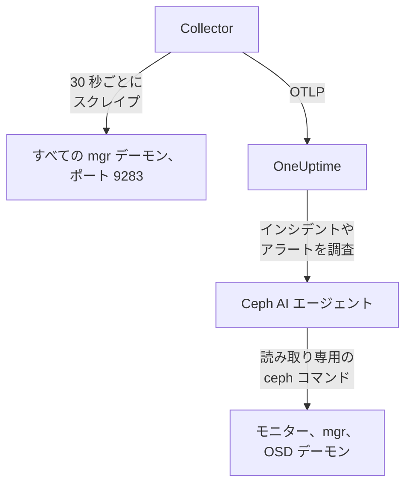

# Ceph エージェント

OneUptime の Ceph エージェントは Ceph クラスターを監視します。対象はヘルス、モニターのクォーラム、OSD、プール、配置グループです。すべての mgr デーモンで Ceph mgr の `prometheus` モジュールをスクレイプし、すべてのメトリクスにクラスター名を付与して OneUptime に送信します。OneUptime では、クラスターが OSD、プール、デーモンとともに表示されます。届いたデータに対しては [Ceph モニター](/docs/monitor/ceph-monitor) がアラートを出します。

:::cards
- [エージェントのインストール](#エージェントをインストールする): mgr モジュールを有効にし、インストールスクリプトか Docker Compose を使います。
- [エージェントが収集するもの](#エージェントが収集するもの): Ceph のページ、メトリクス、アラートテンプレートの元になる系列。
- [AI エージェント](#ai-エージェント): OneUptime AI が調査中にクラスターを読めるようにします。
- [トラブルシューティング](#トラブルシューティング): 診断スクリプトと、よくある問題。
:::

## 仕組み

エージェントは、1 台のマシン上で Docker Compose で実行する 2 つのコンテナです。OpenTelemetry Collector が、すべての mgr デーモンで mgr の `prometheus` モジュールを 30 秒ごとにスクレイプします。メトリクスを返すのはアクティブな mgr だけなので、スタンバイにフェイルオーバーしても、何も変更せずにメトリクスは届き続けます。隣で動く Ceph AI エージェントにより、OneUptime AI はインシデントやアラートの調査中に読み取り専用の `ceph` コマンドを実行できます。



クラスターは最初のデータとともに、エージェントがすべてのメトリクスに `ceph.cluster.name` として付与する名前で自身を登録します。

## 始める前に

- Docker Engine 20.10 以降と Docker Compose v2 プラグイン。Ceph の mgr デーモンにポート 9283 で到達できるマシン上に用意します。
- Ceph の管理ノード上のシェル。そこでは `ceph` CLI が管理者権限で動作する必要があります。
- 取り込みキー。**プロジェクト設定 → テレメトリと APM → 取り込みキー** で作成し、その値をコピーします。
- そのマシンから OneUptime の URL への送信方向の HTTPS。

## エージェントをインストールする

:::steps
### mgr の prometheus モジュールを有効にする

Ceph の管理ノードで次を実行します:

```bash
ceph mgr module enable prometheus
```

これで、各 mgr デーモンがポート `9283` の `/metrics` で Prometheus メトリクスを提供します。メトリクスを返すのはアクティブな mgr だけです。スタンバイの mgr は空の応答を返すか、`mgr/prometheus/standby_behaviour` が `error` に設定されていれば HTTP エラーを返します。そのため、エージェントはすべての mgr をスクレイプします。一覧を表示します:

```bash
ceph mgr stat                    # active mgr
ceph orch ps --daemon-type mgr   # all mgrs (cephadm clusters)
```

### エージェントをインストールして起動する

:::tabs
@tab install.sh
インストールスクリプトをダウンロードし、エージェントを置くマシンで実行します:

```bash
curl -sSL https://raw.githubusercontent.com/OneUptime/oneuptime/master/agents/CephAgent/install.sh -o install.sh
bash install.sh
```

スクリプトは、OneUptime の URL、取り込みキー、クラスターの名前、mgr のエンドポイント、そして [AI エージェント](#ai-エージェント) に修正の適用を許可するかどうかを尋ねます。`ceph` が管理者権限で動作する場所では、AI エージェント専用の Ceph クライアントの作成も提案します。`/opt/oneuptime-ceph-agent` にインストールし、`0600` の `.env` ファイルを書き込み、Docker Compose でエージェントを起動します。スクリプトを再実行すると、再度尋ねる代わりにその `.env` の内容をすべて再利用します。これが [エージェントのアップグレード](#エージェントのアップグレード) の方法です。
@tab Docker Compose
[CephAgent ディレクトリ](https://github.com/OneUptime/oneuptime/tree/master/agents/CephAgent) から、`docker-compose.yml` と `otel-collector-config.yaml` を新しいフォルダーにダウンロードします:

```bash
mkdir oneuptime-ceph-agent && cd oneuptime-ceph-agent
curl -fsSLO https://raw.githubusercontent.com/OneUptime/oneuptime/master/agents/CephAgent/docker-compose.yml
curl -fsSLO https://raw.githubusercontent.com/OneUptime/oneuptime/master/agents/CephAgent/otel-collector-config.yaml
```

その横に `.env` ファイルを作成します:

```bash title=".env"
ONEUPTIME_URL=YOUR_ONEUPTIME_URL
ONEUPTIME_TELEMETRY_INGESTION_KEY=YOUR_TELEMETRY_INGESTION_TOKEN
CEPH_CLUSTER_NAME=my-ceph-cluster
CEPH_MGR_ENDPOINTS=[ceph-mon-1:9283,ceph-mon-2:9283,ceph-mon-3:9283]
```

アクティブなものもスタンバイも含めてすべての mgr デーモンを、カンマ区切りで角かっこに入れて列挙します。角かっこがあると、Collector は値をスクレイプ対象のリストとして読み取ります。エージェントを起動します:

```bash
docker compose up -d
```

AI エージェントのコンテナも起動し、専用の Ceph クライアントを待ちます。[AI エージェント](#ai-エージェント) を参照してください。
:::

### エージェントが実行中であることを確認する

```bash
docker compose ps
docker logs -f oneuptime-ceph-agent
```

`docker compose ps` には Collector (`oneuptime-ceph-agent`) と AI エージェント (`oneuptime-ceph-ai-agent`) が表示されます。Collector が起動すると、ログに次の行が表示されるはずです:

```text
Everything is ready. Begin running and processing data.
```

### OneUptime でクラスターを見つける

**製品 → インフラストラクチャ → Ceph → すべてのクラスター** を開きます。1 分ほどで、クラスターが `CEPH_CLUSTER_NAME` の名前で OSD、プール、デーモンとともに表示されます。
:::

## 環境変数

インストールスクリプトはこれらを `/opt/oneuptime-ceph-agent/.env` に書き込みます。Docker Compose でのインストールでは、`docker-compose.yml` の横にある `.env` から読み取ります。値を変更したら、そのフォルダーで `docker compose up -d` を実行してください。

| 変数 | 必須 | 説明 |
| --- | --- | --- |
| `ONEUPTIME_URL` | はい | OneUptime の URL。`https://oneuptime.com` やセルフホストのインスタンスなど。インスタンスが HTTP のみの場合は、`http://` とそのポートを使います。 |
| `ONEUPTIME_TELEMETRY_INGESTION_KEY` | はい | **プロジェクト設定 → テレメトリと APM → 取り込みキー** で作成した取り込みキー。 |
| `CEPH_CLUSTER_NAME` | はい | OneUptime でのクラスターの名前で、すべてのメトリクスに `ceph.cluster.name` リソース属性として付与されます。変えないでください。あとで変更すると別のクラスターとして登録されます。既定は `ceph` です。 |
| `CEPH_MGR_ENDPOINTS` | はい | すべての mgr デーモンを、角かっこで囲んだカンマ区切りの `host:port` リストで指定します。例: `[ceph-mon-1:9283,ceph-mon-2:9283,ceph-mon-3:9283]`。角かっこはインストールスクリプトが付けます。 |

AI エージェント自身の設定は [AI エージェント](#ai-エージェント) にあります。

## エージェントのスクレイプ方法

- **すべての mgr を 30 秒ごとに**。mgr の `prometheus` モジュールは、各スクレイプの結果を `mgr/prometheus/scrape_interval` (既定は 15 秒) の間キャッシュします。それより頻繁にスクレイプしないでください。キャッシュを読み直すだけです。
- **`honor_labels: true`**。Ceph がエクスポートするラベル (`ceph_daemon`、`pool_id`、デーモンごとのインスタンスラベル) はそのまま保持されます。これがないと、`instance` ラベルはスクレイプ対象ごとに書き換えられ、アクティブな mgr が変わるたびに変化して、すべての系列が途切れます。

## エージェントが収集するもの

エージェントは、mgr の `prometheus` モジュールがエクスポートするものをすべて送信します。OneUptime の Ceph のページ、メトリクスカタログ、アラートテンプレートは次の系列に基づいています:

| カテゴリ | メトリクス |
| --- | --- |
| クラスターのヘルス | `ceph_health_status` (0 = OK、1 = WARN、2 = ERR)、`ceph_health_detail` (アクティブなヘルスチェックごとの系列で、ラベルは `name` と `severity`。Quincy 以降。ヘルスチェックのアラートテンプレートと、概要の **アクティブヘルスチェック** の元になります)、`ceph_healthcheck_slow_ops`、`ceph_daemon_health_metrics` (デーモンごと、`type` がキー)、`ceph_mon_quorum_status`、`ceph_mon_metadata`、`ceph_cluster_total_bytes`、`ceph_cluster_total_used_bytes` |
| OSD | `ceph_osd_up`、`ceph_osd_in`、`ceph_osd_apply_latency_ms`、`ceph_osd_commit_latency_ms`、`ceph_osd_stat_bytes`、`ceph_osd_stat_bytes_used`、`ceph_osd_numpg`、`ceph_osd_metadata`。OSD ごとに `ceph_daemon` ラベル (例: `osd.3`) で区別されます |
| プール | `ceph_pool_stored`、`ceph_pool_max_avail`、`ceph_pool_objects`、`ceph_pool_rd`、`ceph_pool_wr`、`ceph_pool_rd_bytes`、`ceph_pool_wr_bytes`、`ceph_pool_metadata`。データ系列が持つのは `pool_id` ラベルだけで、プールの名前は `ceph_pool_metadata` にあります。 |
| 配置グループ | `ceph_pg_total`、`ceph_pg_active`、`ceph_pg_clean`、`ceph_pg_degraded`、`ceph_pg_undersized` (いずれもプールごと、`pool_id` で区別)、`ceph_num_objects_degraded`、`ceph_num_objects_misplaced` |
| デーモン | `ceph_mgr_metadata`、`ceph_mds_metadata`、`ceph_rgw_metadata`。上記のモニターと OSD のメタデータに加わります。それぞれがデーモンの名前を示し、`ceph_version` ラベルにバージョンを持ちます。**デーモン** ページに一覧が表示されます。 |

### その他のスクレイプ対象

mgr モジュールはクラスターのヘルスと容量をカバーします。さらに詳しく見るには、`scrape_configs` の下にジョブを追加します (`otel-collector-config.yaml` 内):

- **`ceph-exporter` (Reef 18.2 以降)**。cephadm はクラスターの各ホストで `ceph-exporter` デーモンを実行し、デーモンごとのパフォーマンスカウンターをポート `9926` で提供します。ホストごとに 1 つの対象を追加します。
- **`node_exporter`**。各 Ceph ホストの CPU、メモリ、ディスク、ネットワークのメトリクスを集める定番のお供で、既定のポートは `9100` です。

どちらも同梱の `resource` プロセッサーから `ceph.cluster.name` リソース属性を受け取るため、OneUptime の同じクラスターに届きます。

## オプション — Ceph クラスターログを送信する

エージェントは `/var/log/ceph/ceph.log` を追跡して OneUptime に送信でき、クラスターの **クラスターログ** ページが埋まります。エージェントをクラスターログのあるホスト (既定ではモニターホスト) で実行する必要があるため、既定ではオフです。

:::steps
### レシーバーを有効にする

`otel-collector-config.yaml` で、`filelog` レシーバーと `logs` パイプラインのコメントを外します。

### ログディレクトリをマウントする

`docker-compose.yml` で、ディレクトリを Collector にマウントするボリュームのコメントを外します:

```yaml
- /var/log/ceph:/var/log/ceph:ro
```

### エージェントを再起動する

```bash
docker compose up -d
```
:::

行は書き込まれるたびに送信されます。OneUptime は表示時に `ceph.log` の形式 (時刻、デーモン、`INF`/`WRN`/`ERR` のレベル、メッセージ) を読み取り、`resource` プロセッサーが `ceph.cluster.name` を付与するため、ログはこのクラスターに届きます。

## プロジェクトラベルでクラスターにタグを付ける

`oneuptime.label.` で始まるリソース属性は、クラスターのプロジェクトラベルになります。`oneuptime.label.<dimension>=<value>` はラベル `<dimension>:<value>` です。`otel-collector-config.yaml` の `resource` プロセッサーに、`ceph.cluster.name` と並べて属性を追加します:

```yaml
processors:
  resource:
    attributes:
      # ...existing attributes...
      - key: oneuptime.label.team
        value: storage
        action: upsert
      - key: oneuptime.label.env
        value: production
        action: upsert
```

Collector は起動時にしか設定を読み込みません。`docker compose restart oneuptime-ceph-agent` を実行してください。すると、クラスターに `team:storage` と `env:production` のラベルが表示されます。ラベルは大文字と小文字を区別せずに照合されるため、既存の `Production` ラベルは重複せずに再利用されます。また、OneUptime で誰かが追加したラベルをエージェントが削除することはありません。

## systemd サービスとして実行する

マシンの起動時にエージェントを起動し、失敗したときに再起動するには、その systemd ユニットをインストールします。インストールスクリプトが配置する `/opt/oneuptime-ceph-agent` にエージェントがあることを前提としています:

```bash
sudo curl -fsSL https://raw.githubusercontent.com/OneUptime/oneuptime/master/agents/CephAgent/systemd/oneuptime-ceph-agent.service -o /etc/systemd/system/oneuptime-ceph-agent.service
sudo systemctl daemon-reload
sudo systemctl enable --now oneuptime-ceph-agent
```

## エージェントのアップグレード

エージェントは、そのファイルが固定している Collector のバージョンを **エージェントバージョン** として報告します。それがこの OneUptime のリリースが固定しているバージョンより古い場合、クラスターの **概要** でその横に警告マークが表示されます。マークを選択すると、これらのコマンドが表示されます。ファイルがバージョンを報告するようになる前にインストールしたエージェントは、この方法でアップグレードするまでバージョンが表示されません。

Collector のイメージは `docker-compose.yml` で固定され、その設定はその横にあるファイルなので、プルするだけではエージェントは新しくなりません。`install.sh` を再実行してください。既存の `.env` のすべての値を再利用し (何も尋ねられません)、`docker-compose.yml` と `otel-collector-config.yaml` を更新し (編集したファイルは `<file>.bak.<timestamp>` として残ります)、イメージをプルしてエージェントを作り直すため、Collector は新しい設定を読み込みます。AI エージェントの `ceph/` フォルダーはそのまま残ります。

```bash
curl -sSL https://raw.githubusercontent.com/OneUptime/oneuptime/master/agents/CephAgent/install.sh -o install.sh
bash install.sh
```

Docker Compose でインストールした場合は、エージェントのフォルダーで両方のファイルを再度ダウンロードし (それらに加えた変更があれば、もう一度行います)、イメージをプルしてエージェントを作り直します:

```bash
curl -fsSLO https://raw.githubusercontent.com/OneUptime/oneuptime/master/agents/CephAgent/docker-compose.yml
curl -fsSLO https://raw.githubusercontent.com/OneUptime/oneuptime/master/agents/CephAgent/otel-collector-config.yaml
docker compose pull
docker compose up -d --force-recreate
```

## エージェントのアンインストール

```bash
cd /opt/oneuptime-ceph-agent
docker compose down
```

AI エージェントの Ceph クライアントを作成した場合は、管理ノードで `ceph auth del client.oneuptime-ai` を実行して削除します。

## AI エージェント

エージェントの `docker-compose.yml` は **Ceph AI エージェント** (`oneuptime-ceph-ai-agent`、イメージ `oneuptime/resource-ai-agent:release`) も実行します。OneUptime AI がこのクラスターのインシデントやアラートを調査する間、これを通じて読み取り専用の `ceph` コマンド (`ceph health detail`、`ceph osd tree`、`ceph pg dump_stuck`、`ceph crash ls`) を実行し、許可した場合に限り、OSD を in に戻したり `noout` を解除したりといった修正を適用します。Collector と同じく `CEPH_CLUSTER_NAME` という名前のクラスターとして登録され、OneUptime ではクラスターの **AI → AI エージェント** ページに表示されます。

- **AI 調査はデフォルトで有効です**。エージェントが接続すると、OneUptime AI はこれを使ってこのクラスターのインシデントやアラートを調査し、クラスターの **概要** にエージェントの状態が表示されます。止めるには、エージェントを実行している場所で `ONEUPTIME_AI_INVESTIGATION=false` を設定する (AI エージェントのページの **AI に許可する操作** の下にある **変更** で方法が表示されます) か、エージェントを省きます。
- **専用の Ceph クライアントが越えられない上限です**。`client.oneuptime-ai` として接続し、クラスターの最小限の `ceph.conf` とそのクライアントのキーリングを `docker-compose.yml` の横の `ceph/` フォルダーに置きます (`/etc/ceph` に読み取り専用でマウント)。読み取りの caps しかなければ、実行するものがクラスターを変更することはありません。新規インストールでは `install.sh` がクライアントの作成を提案しますが、再実行時には作成しません。admin のキーリングは決してそのフォルダーに置かないでください。
- `ONEUPTIME_AI_ALLOW_WRITES=true` を設定し、修正に必要な caps をクライアントに与えない限り **読み取り専用** です (必要な caps はエージェントの README に記載)。`ONEUPTIME_AI_WRITE_TARGETS` (例: `osd.*,cluster`) で修正が触れてよい範囲を制限します。同じ `.env` の `ONEUPTIME_AI_FIXES` で修正の実行方法を指定します。`ask-for-approval` (人が 1 件ずつ承認)、`automatic`、`bypass-approval` のいずれかで、AI エージェントのページには読み取り専用で表示されます ([エージェントが設定する AI に許可する操作](/docs/ai/infrastructure-ai-agents#what-ai-may-do-set-by-the-agent))。
- モニター (TCP 3300 と 6789) と mgr および OSD デーモン (TCP 6800–7300) に外向きに接続し、UID 1000 で capabilities なしで動作し、`auth`、`config-key`、`tell` やデータを削除するものは一切実行しません。OneUptime AI を使わない場合は、`docker-compose.yml` から `oneuptime-ceph-ai-agent` サービスを削除してください。

クライアントを手動で作成するには、Ceph の管理ノードのエージェントのフォルダーで次を実行します (エージェントのマシンが別の場合は、2 つのファイルをそのマシンの `ceph/` フォルダーにコピーします):

```bash
mkdir -p ceph
ceph config generate-minimal-conf > ceph/ceph.conf
ceph auth get-or-create client.oneuptime-ai mon 'allow r' mgr 'allow r' osd 'allow r' -o ceph/ceph.client.oneuptime-ai.keyring
sudo chown 1000:1000 ceph/ceph.client.oneuptime-ai.keyring
sudo chmod 600 ceph/ceph.client.oneuptime-ai.keyring
docker compose up -d
```

実行できるコマンド、修正の仕組み、トラブルシューティングの方法: [Infrastructure AI Agents](/docs/ai/infrastructure-ai-agents#ceph-clusters)。

## トラブルシューティング

:::details まず診断スクリプトを実行する
エージェントには、経路全体を確認するスクリプト [`troubleshoot.sh`](https://github.com/OneUptime/oneuptime/blob/master/agents/CephAgent/troubleshoot.sh) が付属しています。コンテナランタイム、設定したすべての mgr エンドポイント、すべてのメトリクスに付与されたクラスター名、トークンの形式、Collector 自身のメトリクス、そして OneUptime が取り込みキーを受け付けるかどうかを確認します。`ceph_health_status` を返すエンドポイントがない場合や、1 つしか設定されていない場合は警告します。メトリクスを提供するのはアクティブな mgr だけだからです。最も重要なのはキーの確認です。OneUptime は不正なキーを `401` で拒否し (無効化されたキーやブラウザーキーでは `422`)、Collector はどちらも恒久的なエラーとして扱います。バッチを破棄して `Exporting failed` のエラーを 1 つログに出すだけなので、コンテナが正常なままだと見落としやすくなります。スクリプトはエージェントのネットワーク内から `GET <url>/otlp/v1/validate` を問い合わせて、`200` (有効) または `401` (無効) を直接受け取り、古いサーバーでは `POST /fluentd/v1/logs` にフォールバックします。

```bash
curl -sSL https://raw.githubusercontent.com/OneUptime/oneuptime/master/agents/CephAgent/troubleshoot.sh -o troubleshoot.sh
bash troubleshoot.sh    # add -d <dir> if you installed outside /opt/oneuptime-ceph-agent
```

最後に、最も可能性の高い原因を示す判定を出力します。
:::

:::details OneUptime にクラスターが表示されない
1. Collector のログを確認します: `docker logs oneuptime-ceph-agent`。エクスポート時の `401` は取り込みキーが不正であることを、接続拒否は `ONEUPTIME_URL` が誤っていることを意味します。
2. mgr がメトリクスを提供しているか確認します: `curl http://ACTIVE_MGR_HOST:9283/metrics | head` で `ceph_*` の行が出力されるはずです。出力されない場合は、`ceph mgr module enable prometheus` でモジュールを有効にします。
3. `CEPH_MGR_ENDPOINTS` が角かっこで囲まれているか確認します。角かっこがないと、Collector はカンマ区切りのリスト全体を 1 つの対象として読み取りますが、そのような対象は存在しません。
:::

:::details クラスターが切断済みと表示される
OneUptime がクラスターから 15 分間何も受信しないと、クラスターは切断状態になります。OneUptime は 5 分ごとに確認し、OneUptime 自身がデータを受信していなかった時間は数えません。Collector が動作しているか (`docker compose ps`)、ログにエクスポートエラーがないか、マシンが OneUptime の URL にまだ到達できるかを確認してください。次のデータが届くと、クラスターは再び接続状態になります。
:::

:::details mgr のフェイルオーバー後にメトリクスが止まる
以前アクティブだった mgr だけをスクレイプしている可能性があります。`CEPH_MGR_ENDPOINTS` にすべての mgr デーモンを列挙してください。スタンバイのスクレイプにはほとんどコストがかからず、空の応答が返るだけです。
:::

:::details Collector のログにスタンバイ mgr のスクレイプエラーが出る
クラスターで `mgr/prometheus/standby_behaviour` が `error` に設定されている場合は想定どおりです。その場合、スタンバイは HTTP 500 を返します。アクティブな mgr のスクレイプは成功しているので、これらのエラーはノイズです。止めるには、動作を `default` に戻します。
:::

:::details メトリクスが別のクラスターに入る
OneUptime は Ceph クラスターを `ceph.cluster.name` で登録し、エージェントはその値を `CEPH_CLUSTER_NAME` から取ります。最初のデータの後で変更すると、最初のクラスターの名前が変わるのではなく、2 つ目のクラスターが作成されます。
:::

## 次のステップ

:::cards
- [Ceph モニター](/docs/monitor/ceph-monitor): ヘルス、OSD、配置グループ、容量、クラッシュ、遅い操作でアラートを出します。
- [Proxmox エージェント](/docs/telemetry/proxmox): Proxmox VE の下で Ceph を実行していますか? クラスターも監視しましょう。
- [Infrastructure AI Agents](/docs/ai/infrastructure-ai-agents): Ceph AI エージェントが実行できるコマンドと、修正の仕組み。
- [ホスト OpenTelemetry Collector](/docs/telemetry/host-otel-collector): 各 Ceph ホストを OS の視点で見ます。
:::
