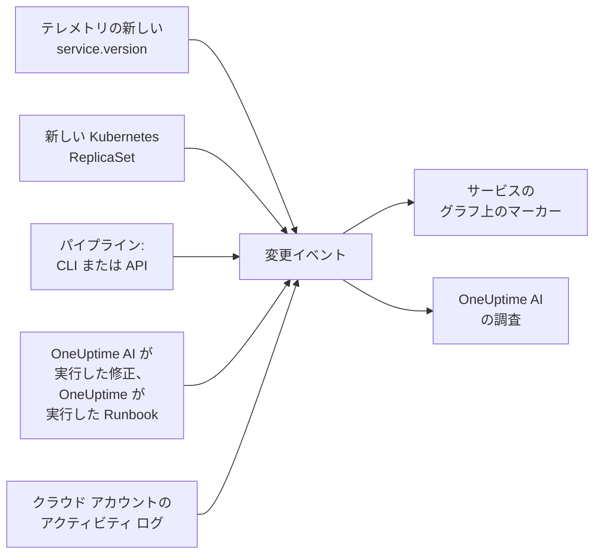

# デプロイと変更

OneUptime は、プロジェクトで何が変わったかを記録します。デプロイ、Kubernetes のロールアウト、設定変更、接続したクラウド アカウントでの変更、そして OneUptime 自身が実行した修正です。各変更はそのサービスまたはクラウド リソースのグラフにマーカーとして描かれ、OneUptime AI はインシデントを調査するときにそれらを読みます。そのため、「10:02 のデプロイの直後に始まった」ということが、最後ではなく最初にわかります。

:::cards
- [OneUptime が自動で記録するもの](#oneuptime-が自動で記録するもの): テレメトリからわかるデプロイとロールアウト、クラウド アカウントの変更、そして自身の修正。
- [パイプラインからデプロイを記録する](#パイプラインからデプロイを記録する): CLI、GitHub Actions、API。
- [OneUptime AI による変更の使い方](#oneuptime-ai-による変更の使い方): すべての調査で挙がる疑わしい変更。
- [リファレンス](#リファレンス): フィールド、属性、上限。
:::

## 仕組み



## OneUptime が自動で記録するもの

これらについては、何も送る必要はありません。OneUptime は、すでに受信しているテレメトリと、自身が行ったことから記録します。

| 変更 | 記録されるタイミング | ソース |
| --- | --- | --- |
| デプロイ | サービスが、その環境でこれまで報告していなかった `service.version` の報告を始めたとき | `service-version` |
| ロールアウト | Kubernetes の Deployment の Pod が、これまで実行していなかった ReplicaSet の実行を始めたとき。新しいイメージ、環境変数や設定の参照の変更、または再起動によるものです | `kubernetes` |
| OneUptime AI が実行した修正 | AI エージェントが、何かを変更するコマンド(`kubectl rollout restart` など)の結果を報告したとき | `oneuptime-ai` |
| Runbook | OneUptime が実行した Runbook が、開始後に完了、失敗、またはキャンセルされたとき | `runbook` |
| クラウドの変更 | 接続したクラウド アカウントのアクティビティ ログが変更を記録したとき: AWS CloudTrail、Azure のアクティビティ ログ、または Google Cloud の Admin Activity 監査ログ | `cloud` |
| プロバイダーのイベント | クラウド プロバイダーがアカウントについてヘルス イベントを公開したとき: AWS Health、Azure Service Health または Resource Health、または Google Cloud Service Health | `cloud-health` |

- **サービスが最初に報告したバージョンは、デプロイではなくベースラインです。** 何か月も稼働しているサービスが、OneUptime がそのテレメトリを受信し始めた瞬間にデプロイされたわけではありません。
- **過去 30 日間に見られたバージョンへのロールバックは記録されません。** そのバージョンは新しくないからです。OneUptime AI が実行したロールバックは、修正として記録されます。
- **1 時間に新しいバージョンや ReplicaSet が 6 個を超えると、その 1 時間が終わるまで記録されなくなります。** そうしないと、ビルドのタイムスタンプのように Pod ごとに変わる「バージョン」が、Pod ごとにデプロイを記録してしまいます。

デプロイが記録されるのは、`service.version` を報告するサービスだけです。OpenTelemetry SDK またはコレクターのリソース属性で、環境やコミットと一緒に設定してください:

```bash
OTEL_RESOURCE_ATTRIBUTES="service.version=2.3.1,deployment.environment.name=production,vcs.ref.head.revision=$GIT_SHA"
```

ロールアウトには [Kubernetes エージェント](/docs/telemetry/kubernetes-agent) が必要です。エージェントは、各 Pod のテレメトリにその Deployment と ReplicaSet を付けます。

クラウドの変更とプロバイダーのイベントには、[接続したクラウド アカウント](/docs/telemetry/cloud-accounts) が必要です。どちらも、OneUptime がそのリソースを一覧にしていれば、名前が挙がったクラウド リソースに結び付けられ、そのリソースのグラフに描かれます。種類は操作から決まります。操作の名前がそう示していれば `deployment`、`scaling`、`rollback`、それ以外は `config-change`、ヘルス イベントは `provider-event` です。どのリソースにも絞り込まれていないグラフにはクラウド アカウントのアクティビティ ログは表示されないため、忙しいアカウントでデプロイが埋もれることはありません。プロバイダーのヘルス イベントは表示されたままです。

## パイプラインからデプロイを記録する

パイプラインは、デプロイやその他の変更(設定変更、マイグレーション、フィーチャーフラグ)を、起きたときに記録できます。書き込みには、プロジェクトのテレメトリ取り込みキーを使います。アプリケーションがテレメトリの送信に使うのと同じ種類のキーです。**プロジェクト設定 → テレメトリと APM → 取り込みキー** で作成してください。

1 つのサービスに固定されたキーは、すべての変更をそのサービスの下に記録します。

:::tabs
@tab CLI
```bash
oneuptime deploy \
  --service checkout \
  --service-version 2.3.1 \
  --commit "$GIT_SHA" \
  --environment production \
  --url https://oneuptime.com \
  --ingestion-key "$ONEUPTIME_TELEMETRY_INGESTION_KEY"
```
@tab GitHub Actions
```yaml title=".github/workflows/deploy.yml"
- name: Record the deploy in OneUptime
  env:
    ONEUPTIME_URL: https://oneuptime.com
    ONEUPTIME_TELEMETRY_INGESTION_KEY: ${{ secrets.ONEUPTIME_TELEMETRY_INGESTION_KEY }}
  run: |
    npx -y @oneuptime/cli deploy \
      --service checkout \
      --service-version "${{ github.ref_name }}" \
      --commit "${{ github.sha }}" \
      --repository "${{ github.server_url }}/${{ github.repository }}" \
      --environment production
```
@tab API
```bash
curl -X POST https://oneuptime.com/telemetry/change-events/v1/ingest \
  -H "Content-Type: application/json" \
  -H "x-oneuptime-token: $ONEUPTIME_TELEMETRY_INGESTION_KEY" \
  -d '{"events": [{"serviceName": "checkout", "version": "2.3.1", "commit": "1a2b3c4", "environment": "production"}]}'
```
:::

セルフホストの OneUptime では、`https://oneuptime.com` の代わりに自分のアドレスを使います。API は、保存したイベントの数とスキップしたイベントの数を返します:

```json
{ "ingested": 1, "skipped": 0 }
```

CLI のすべてのオプションは [`oneuptime deploy`](/docs/cli/command-reference#oneuptime-deploy) を参照してください。

## OneUptime AI による変更の使い方

インシデントやアラートの [AI 調査](/docs/ai/ai-sre) はすべて、その前 2 時間に記録された変更と、その後 10 分間に記録された変更から始まります。後者は、ロールアウトが終わってからデプロイを記録するパイプラインのためです。インシデントがリンクされたサービス、クラスター、ホスト、クラウド リソースの変更が先に来ます。

OneUptime は、サービスを指定している変更のうち最大 4 件について、変更の前後 30 分間のサービスのテレメトリを読みます。そして、変更の直後にサービスが測定できるほど悪化していれば、その変更を **疑わしい変更** としてマークします:

| シグナル | 疑わしいと判断される条件 |
| --- | --- |
| 失敗したスパン | エラー率が倍以上になり、かつ一パーセントポイント以上上がり、失敗したスパンが 10 件以上ある |
| レイテンシ | p99 が元の値から五割以上、かつ 100 ms 以上長くなった |
| 例外 | 毎分の件数が三倍以上になり、かつ 10 件以上ある |
| 新しい例外 | その変更でリリースされたバージョンで、変更の 10 分前から 30 分後までの間に初めて見られた例外タイプが、3 回以上発生した |

OneUptime は、変更のタイトルに書かれた内容ではなく、これらの数値から疑わしい変更を判断します。調査は疑わしい変更を最初に確認し、それがインシデントの原因かどうか、そしてロールバックが最も速く安全な修正かどうかを示します。

疑わしい変更が、[AI 修正](/docs/ai/ai-sre#修正の仕組み) がオンになっているクラスター上の Kubernetes のロールアウトである場合、OneUptime AI はまずそれをロールバックします。使うのは、OneUptime が記録された変更から組み立てる `kubectl rollout undo` です。コードをリリースするデプロイは、そのコミットを通じてロールバックされます。調査が問題を起こしたコミットやプルリクエストを特定するので、[修正のプルリクエスト](/docs/ai/ai-sre#自動コード修正) でそれだけを正確に元に戻せます。

OneUptime は、誰かが呼び出されるかどうかにかかわらず、すべてのデプロイを自分でもチェックします。デプロイ後の 30 分が過ぎると、その 30 分間を直前の 30 分間と同じしきい値で比較し、サービスが悪化していれば、[AI インサイト](/docs/ai/ai-sre#インサイト-先回りの検出) がそのサービスのデプロイを示します。

OneUptime AI が作成した修正のプルリクエストも、同じ方法で確認されます。記録されたデプロイにそのコミットが含まれると、OneUptime はそこで修正の目的、つまり例外、修正が速くした処理、インシデントやアラートの背後にあるモニター、修正が追加するテレメトリを見守り、修正が効いたかどうかを表示します([自動コード修正](/docs/ai/ai-sre#自動コード修正) を参照)。デプロイされた修正をデプロイのバージョンで読むのは、サービス自身のテレメトリがそのバージョンを報告している場合だけで、そうでなければデプロイの 10 分後、古いインスタンスが止まった後から読みます。

調査と [AI に質問](/docs/ai/ask-ai) では、`recent_changes` が任意の期間の変更を一覧表示し、`get_change_details` がデプロイで何がリリースされたかを示します。サービスの前回のデプロイ以降のコミット、その作成者、プルリクエスト、変更されたファイルです。これには、変更にコミットが含まれていることと、[GitHub App](/docs/ai/github-app) で接続されたリポジトリが必要です。

## リファレンス

### フィールド

| フィールド | 内容 |
| --- | --- |
| `title` | 何が変わったか(`Deploy 2.3.1` など)。`version` を送るデプロイでは省略できます |
| `eventType` | 変更の種類: `deployment` (既定)、`config-change`、`scaling`、`rollback`、`feature-flag`、または独自の種類 |
| `serviceName` | 変更が属するサービス。指定しなければ、プロジェクト全体の変更になります |
| `time` | 発生日時。ISO 8601、またはエポック秒かエポックミリ秒で指定します。既定は到着した時刻です |
| `description` | 変更の詳細 |
| `version` | デプロイされたバージョン |
| `previousVersion` | 置き換えられたバージョン |
| `commit` | デプロイされたコミット(`commitSha` または `sha` も可) |
| `repository` | コミットのリポジトリ(`repositoryUrl` も可) |
| `branch` | デプロイされたブランチ |
| `pullRequest` | デプロイされたプルリクエスト |
| `environment` | デプロイ先の環境 |
| `attributes` | 最大 50 個の追加の属性。テキスト、数値、ブール値で指定します |

最上位のフィールドは、OpenTelemetry の名前の属性として保存されます。`version` は `service.version`、`commit` は `vcs.ref.head.revision`、`repository` は `vcs.repository.url.full`、`branch` は `vcs.ref.head.name`、`pullRequest` は `vcs.change.id`、`environment` は `deployment.environment.name` です。これらの名前のいずれかで送られた属性は、対応するフィールドより優先されます。

名前が `oneuptime.` で始まる属性は OneUptime 自身のもので、パイプラインが送った内容からは削除されます。パイプラインが記録した変更には、そのことが `oneuptime.change.source` に `api` として示されます。

クラウド アカウントから読み取った変更は、アカウントとリソースを OpenTelemetry の名前 `cloud.provider`、`cloud.account.id`、`cloud.region`、`cloud.resource_id` で示し、操作を `oneuptime.cloud.operation`、実行した人を `oneuptime.cloud.actor`、失敗したかどうかを `oneuptime.change.status`、クラウド アカウントを `oneuptime.cloud_account.id` に保持します。

### 上限

| 上限 | 値 |
| --- | --- |
| ひとつのリクエストに含まれるイベント | 100 |
| タイトル | 500 文字 |
| 説明 | 5,000 文字 |
| 属性 | 50 |
| 時刻 | 366 日より前、または 60 分より先の時刻は、イベントが到着した時刻に置き換えられます |

## 次のステップ

:::cards
- [AI SRE](/docs/ai/ai-sre): 調査が読むものと、見つけた問題の修正方法。
- [コマンド リファレンス](/docs/cli/command-reference): CLI のすべてのコマンド。
- [OpenTelemetry](/docs/telemetry/open-telemetry): サービスのテレメトリを、バージョンと一緒に送信します。
- [クラウド アカウントの接続](/docs/telemetry/cloud-accounts): AWS、Azure、Google Cloud のアカウントの変更とヘルス イベント。
:::
