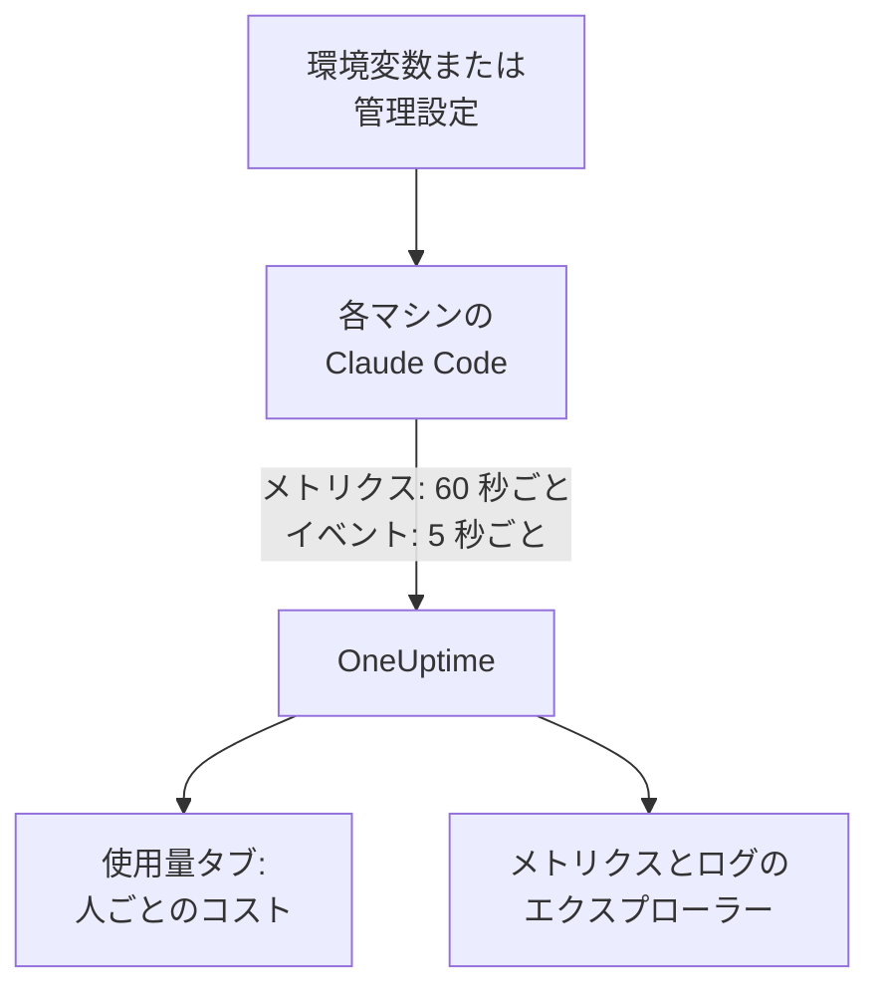

# Claude Code

Claude Code は OpenTelemetry のメトリクスとイベントを自分でエクスポートし、OneUptime に直接送ります。間に Collector やゲートウェイは不要です。いくつかの環境変数で、またはフリート全体なら 1 つの管理設定ファイルで有効にすると、開発者ごとのコスト、トークン、セッション、コミット、承認された編集を確認できます。

:::cards
- [1 台のマシンを設定する](#1-台のマシンを設定する): 6 つの環境変数と再起動。
- [フリートに展開する](#フリートに展開する): すべてのマシンに 1 つの管理設定ファイル。
- [支出を人に帰属させる](#使用量を人とチームに帰属させる): 誰がサインインしているか、ID を自分で設定すべきなのはいつか。
- [トラブルシューティング](#トラブルシューティング): 何も届かないときに確認すること。
:::

## 仕組み



Claude Code が送るもの:

- **コストとトークン**: `claude_code.cost.usage` (USD) と `claude_code.token.usage`。モデル別、メインエージェントかサブエージェントか別、呼び出しを行ったエージェント、スキル、プラグイン、MCP サーバー別に送られます。
- **アクティビティ**: セッション、コミット、プルリクエスト、追加・削除されたコード行、アクティブな時間。
- **編集の判断**: `claude_code.code_edit_tool.decision` は承認・却下された編集を数えるため、承認率は `accept / (accept + reject)` で、言語別、ツール別に求められます。
- **イベント**: プロンプト、ツールの結果、API のリクエストとエラー、権限モードの変更、MCP サーバーへの接続を、OTLP のログレコードとして送ります。

開発者が Claude アカウントでサインインしていると、すべてのメトリクスのデータポイントとイベントに `user.email` が付きます。OneUptime は、コストとトークンがあるメトリクス上で、これを従業員として読み取ります。

## 始める前に

1. **プロジェクト設定 → テレメトリと APM → 取り込みキー** で、テレメトリの取り込みキーを作成します。
2. OTLP エンドポイントは `https://oneuptime.com/otlp` です。OneUptime をセルフホストしている場合は `https://YOUR-ONEUPTIME-HOST/otlp` です。
3. フリート全体で 1 つのキーを使います。キーは開発者のすべてのマシンに置かれるため、データの送信だけができる共有の資格情報として扱い、ほかの資格情報と同じようにローテーションしてください。

## 1 台のマシンを設定する

:::steps
### 変数をエクスポートする

シェルプロファイル (`.zshrc` または `.bashrc`) に追加するか、Claude Code を起動するターミナルでエクスポートします。

```bash
export CLAUDE_CODE_ENABLE_TELEMETRY=1
export OTEL_METRICS_EXPORTER=otlp
export OTEL_LOGS_EXPORTER=otlp
export OTEL_EXPORTER_OTLP_PROTOCOL=http/protobuf
export OTEL_EXPORTER_OTLP_ENDPOINT="https://oneuptime.com/otlp"
export OTEL_EXPORTER_OTLP_HEADERS="x-oneuptime-token=YOUR_INGESTION_TOKEN"
```

| 変数 | 役割 |
| --- | --- |
| `CLAUDE_CODE_ENABLE_TELEMETRY` | メインスイッチ。これがないと何もエクスポートされません。 |
| `OTEL_METRICS_EXPORTER`、`OTEL_LOGS_EXPORTER` | `otlp` で OneUptime に送ります。`otlp,console` にすると送信内容も表示され、設定中に便利です。 |
| `OTEL_EXPORTER_OTLP_PROTOCOL` | `http/protobuf`。`http/json` と `grpc` も使えます。 |
| `OTEL_EXPORTER_OTLP_ENDPOINT` | ベース URL。Claude Code が `/v1/metrics` と `/v1/logs` を自分で付け加えます。 |
| `OTEL_EXPORTER_OTLP_HEADERS` | カンマ区切りの `key=value` のペア。ここでは取り込みキーです。 |

### Claude Code を再起動する

変数は Claude Code の起動時に読み込まれます。メトリクスは 60 秒ごと、イベントは 5 秒ごとに送られるため、確認する前に Claude Code を 1 分ほど使ってください。

### データが届くことを確認する

**メトリクス** を開いて `claude_code.token.usage` を探し、次に **製品 → AI / LLM** を開いて **使用量** に移動します。自分のメールアドレスの下にコストが表示され、 **GenAI メトリクスから** と示されます。
:::

メトリクスとイベントを別々の送信先に送るには、代わりに `OTEL_EXPORTER_OTLP_METRICS_ENDPOINT` と `OTEL_EXPORTER_OTLP_LOGS_ENDPOINT` を完全なパス (`https://oneuptime.com/otlp/v1/metrics`、`https://oneuptime.com/otlp/v1/logs`) で設定します。

## フリートに展開する

組織では、同じ変数を管理設定ファイルで配布します。形式は `settings.json` と同じで、変数は `env` ブロックに入れます。

```json title="managed-settings.json"
{
  "env": {
    "CLAUDE_CODE_ENABLE_TELEMETRY": "1",
    "OTEL_METRICS_EXPORTER": "otlp",
    "OTEL_LOGS_EXPORTER": "otlp",
    "OTEL_EXPORTER_OTLP_PROTOCOL": "http/protobuf",
    "OTEL_EXPORTER_OTLP_ENDPOINT": "https://oneuptime.com/otlp",
    "OTEL_EXPORTER_OTLP_HEADERS": "x-oneuptime-token=YOUR_INGESTION_TOKEN",
    "OTEL_RESOURCE_ATTRIBUTES": "team.id=platform,cost_center=eng-123"
  }
}
```

:::steps
### Claude Code が読み込む場所にファイルを置く

| プラットフォーム | パス |
| --- | --- |
| macOS | `/Library/Application Support/ClaudeCode/managed-settings.json` |
| Linux と WSL | `/etc/claude-code/managed-settings.json` |
| Windows | `C:\Program Files\ClaudeCode\managed-settings.json` |

Claude Code は、Windows の古いパス `C:\ProgramData\ClaudeCode\managed-settings.json` を読み込まなくなりました。すでに管理設定ファイルを配布している場合は、代わりにその隣に `managed-settings.d/10-telemetry.json` のようなドロップインを追加します。Claude Code はまず `managed-settings.json` をマージし、次に `managed-settings.d/` 内のすべての `*.json` ファイルをアルファベット順にマージします。

### 1 台のマシンで確認する

Claude Code で `/status` を実行します。`Setting sources` の行には `Enterprise managed settings (file)`、ドロップインの場合は `(drop-ins)` または `(file + drop-ins)` と表示されるはずです。かっこ内に別のソースが表示される場合は、より優先度の高いソースが勝ち、あなたのファイルは使われていません。

### フリートが届くのを確認する

**使用量** タブでは、新しい設定で Claude Code を使った開発者が、1 人 1 行で表示されます。
:::

同じ JSON は、claude.ai の管理コンソールのサーバー管理設定 (起動時と 1 時間ごとに取得)、`com.anthropic.claudecode` ドメインの macOS 構成プロファイル、Windows の `HKLM\SOFTWARE\Policies\ClaudeCode` の下の `Settings` 値から配布することもできます。

:::details どの管理ソースが勝つか、テレメトリの変数はどう組み合わされるか
既定では、Claude Code はいずれかのポリシーキーを設定している最も優先度の高いソースを使い、ほかのソースは無視します。順序は、サーバー管理設定、MDM または OS のポリシー、管理設定ファイル、ユーザーごとの `HKCU` レジストリ値です。例外は `env` ブロックで、バージョン 2.1.223 以降は管理ソースをまたいで変数ごとにマージされます。

テレメトリの変数はそうではありません。`OTEL_EXPORTER_OTLP_*` 変数、`OTEL_LOG_*` のコンテンツスイッチ、`OTEL_LOGS_EXPORTER`、ベータのトレースの変数は、いずれかを設定している最も優先度の高いソースからまとめて取得されるため、あるソースのエンドポイントが別のソースの資格情報と組み合わさることはありません。より優先度の高いソースがいずれかを設定している場合、テレメトリのドロップインは何の効果もありません。

サーバー管理設定には、もう 1 つ手順が必要です。空でない `OTEL_EXPORTER_OTLP_ENDPOINT` は、各開発者が対話型セッションでセキュリティの承認ダイアログを受け入れた後にだけ適用され、エクスポーターの設定の変更は次の起動時に反映されます。ファイルと MDM ポリシーにはダイアログはありません。
:::

:::details すべてのマシンを編集せずに取り込みキーをローテーションする
固定のヘッダーの代わりに、設定に `"otelHeadersHelper": "/path/to/generate-otel-headers.sh"` を指定します。スクリプトは `{"x-oneuptime-token":"..."}` のようなヘッダーのフラットな JSON オブジェクトを出力します。Claude Code は起動時に実行し、その後も `CLAUDE_CODE_OTEL_HEADERS_HELPER_DEBOUNCE_MS` ミリ秒 (既定は `1740000`、29 分) ごとに再実行します。失敗は `/status` に表示されます。
:::

## 使用量を人とチームに帰属させる

**従業員は `user.email` です。** 開発者が Claude アカウントでサインインしていると Claude Code はこれを送り、オフにする変数はありません。OneUptime は、設定なしで、コストとトークンのすべてのデータポイントからこれを読み取ります。

**ほかのサインイン方法ではメールアドレスは送られません。** API キーを使う場合や、Amazon Bedrock、Google Cloud、Microsoft Foundry 上の Claude を使う場合は、セッションに Claude アカウントがなく、Claude Code は `user.id` と `session.id` だけを送ります。マシンごとに、管理設定または起動用のラッパーで ID を自分で設定してください。

```bash
export OTEL_RESOURCE_ATTRIBUTES="user.email=jdoe@example.com,team.id=platform"
```

**`user.id` は人ではありません。** これは、Claude Code が初回実行時に `~/.claude.json` に書き込むランダムな ID です。インストールごとに 1 つで、ファイルを削除すると新しくなります。メールアドレスがないと、インストールごとに別の行として表示されます。例外が 1 つあります。Claude アプリのゲートウェイにサインインしたセッションは、サインインした ID を送り (`user.id` は ID プロバイダーのサブジェクト、`user.email` はメールアドレス)、自分で設定した `user.*` キーは無視します。

**チームとコストセンター** は `OTEL_RESOURCE_ATTRIBUTES` から取得されます。OneUptime は `team.id`、`team`、`cost_center`、`department` を読み取ります。値にスペースは使えず、引用符でも回避できません。`team=Platform_Engineering` と書くか、`team=Platform%20Engineering` のようにパーセントエンコーディングを使ってください。Claude Code はこれらのキーをすべてのデータポイントにコピーし (`OTEL_METRICS_INCLUDE_RESOURCE_ATTRIBUTES`、既定でオン)、OneUptime はどちらからでも読み取ります。自分で設定したキーが、Claude Code が自分で設定するキーを上書きすることはありません。

## OneUptime に表示されるもの

**製品 → AI / LLM → 使用量** では、`claude_code.cost.usage` が **従業員** 、 **チーム** 、 **モデル** の表に、`claude_code.token.usage` がトークンの合計に使われます。表示内容は 2 つのルールで決まります。

- **メトリクスはスパンを補うもので、スパンに加算されることはありません。** 同じプロジェクトが自社アプリからコスト付きの GenAI スパンを受け取っていると、Claude Code の支出は表示されません。Claude Code は専用のプロジェクトに送ってください。[スパンが優先され、メトリクスが補う](/docs/telemetry/ai-llm-observability#スパンが優先されメトリクスが補う)を参照してください。
- **メトリクスからの行はコストだけを持ちます。** 呼び出しとトークンのセルは `—` を表示し、 **プロバイダー** と **アプリケーション / サービス** の表は空のままです。メトリクスはプロバイダーを示さず、どの OneUptime サービスにも属さないためです。

開発者ごとの承認率、コード行数、コミット、プルリクエストや、`query_source` 別の支出など、それ以外のものはすべて、以下のメトリクスから [ダッシュボード](/docs/dashboards/index)にグラフ化し、[メトリクス モニター](/docs/monitor/metrics-monitor)でアラートを設定します。

## メトリクス

どのメトリクスもカウンターで、独自の属性に加えて標準の属性を持ちます。

| メトリクス | 単位 | 独自の属性 |
| --- | --- | --- |
| `claude_code.session.count` | なし | `start_type`: `fresh`、`resume`、`continue`、`agents_view` |
| `claude_code.lines_of_code.count` | なし | `type`: `added`、`removed`。`model` |
| `claude_code.commit.count` | なし | なし |
| `claude_code.pull_request.count` | なし | なし |
| `claude_code.cost.usage` | USD | `model`。`query_source`: `main`、`subagent`、`auxiliary`。`speed`: `fast`、`normal`。`effort`。`agent.name`、`skill.name`、`plugin.name`、`marketplace.name`、`mcp_server.name`、`mcp_tool.name` |
| `claude_code.token.usage` | トークン | `type`: `input`、`output`、`cacheRead`、`cacheCreation`。および `claude_code.cost.usage` と同じ属性 |
| `claude_code.code_edit_tool.decision` | なし | `tool_name`: `Edit`、`Write`、`NotebookEdit`。`decision`: `accept`、`reject`。`source`。`language` |
| `claude_code.active_time.total` | 秒 | `type`: `user` (キーボードを操作中)、`cli` (ツールとモデルの応答) |

標準の属性は `session.id`、`app.version`、`app.entrypoint`、`organization.id`、`user.account_uuid`、`user.account_id`、`user.id`、`user.email`、`terminal.type`、および `OTEL_RESOURCE_ATTRIBUTES` です。一部はオフにできます。[メトリクスの量を抑える](#メトリクスの量を抑える)を参照してください。

- キャッシュのトークンの種類はキャメルケースで、`cacheRead` と `cacheCreation` です。OneUptime のトークン合計は `input` と `output` だけを数えます。
- コストとトークンのメトリクスでは、`OTEL_LOG_TOOL_DETAILS=1` を設定しない限り (Claude Code 2.1.273 以降)、自社のエージェントと MCP サーバー、サードパーティのプラグインとスキルの名前は `custom` または `third-party` と表示されます。

## イベント

イベントは OTLP のログレコードとして届き、それぞれ `event.name`、`event.timestamp`、`event.sequence` を持ちます。よく使うものは次のとおりです。

| イベント | 記録する内容 |
| --- | --- |
| `claude_code.user_prompt` | プロンプト。長さとコマンド。テキストは有効にした場合のみ |
| `claude_code.api_request` | モデルへのリクエスト。`model`、`cost_usd`、`cost_usd_micros`、`duration_ms`、`input_tokens`、`output_tokens`、キャッシュのトークン |
| `claude_code.api_error` | 再試行後も失敗したリクエスト。`model`、`error`、`status_code`、`attempt` |
| `claude_code.tool_result` | ツールの実行。`tool_name`、`success`、`duration_ms`、実行を許可した判断 |
| `claude_code.tool_decision` | ツールが許可されたかどうかと、何が判断したか |
| `claude_code.mcp_server_connection` | MCP サーバーの接続または失敗 |

Claude Code は、拒否、権限モードの変更、プラグイン、フック、スキルのイベントなど、ほかにも多くのイベントを送ります。すべて Anthropic の [監視リファレンス](https://code.claude.com/docs/en/monitoring-usage) に一覧があります。`cost_usd_micros` では、コストは 100 万分の 1 USD 単位の整数で、丸め誤差なく合計できます。

## メトリクスの量を抑える

Claude Code は既定ですべてのデータポイントに `session.id` を付け、セッションごとに新しい系列になります。フリート全体では、この 1 つの属性がメトリクスの量を押し上げますが、コストのレポートには必要ありません。

```bash
export OTEL_METRICS_INCLUDE_SESSION_ID=false
```

| 変数 | 既定値 | 追加するもの |
| --- | --- | --- |
| `OTEL_METRICS_INCLUDE_SESSION_ID` | `true` | `session.id`。セッションごとに新しい値 |
| `OTEL_METRICS_INCLUDE_VERSION` | `false` | `app.version` |
| `OTEL_METRICS_INCLUDE_ACCOUNT_UUID` | `true` | `user.account_uuid` と `user.account_id` |
| `OTEL_METRICS_INCLUDE_ENTRYPOINT` | `false` | `app.entrypoint` |
| `OTEL_METRICS_INCLUDE_RESOURCE_ATTRIBUTES` | `true` | `OTEL_RESOURCE_ATTRIBUTES` のキー |
| `OTEL_METRICS_INCLUDE_REPOSITORY` | `false` | リポジトリの `vcs.*` 属性 |

`user.email`、`user.id`、`organization.id`、`terminal.type` にはスイッチがありません。最も量が多いシグナルはイベントで、アクティブな開発者ごとに 5 秒ごとに送られます (`OTEL_LOGS_EXPORT_INTERVAL`、ミリ秒単位)。値を大きくすると、より大きなバッチを少ない回数で送ります。コストと使用量だけが必要なら、それらはすべてメトリクスにあるため、`OTEL_LOGS_EXPORTER=none` を設定してください。

## プロンプトとツールの内容は既定でオフ

Claude Code は、それぞれを有効にしない限り、プロンプト、回答、ツールの引数、ツールの出力をエクスポートしません。

| 変数 | 既定値 | `1` で有効になるもの |
| --- | --- | --- |
| `OTEL_LOG_USER_PROMPTS` | オフ | プロンプトのテキスト |
| `OTEL_LOG_ASSISTANT_RESPONSES` | オフ | 回答のテキスト。未設定の場合は `OTEL_LOG_USER_PROMPTS` に従う |
| `OTEL_LOG_TOOL_DETAILS` | オフ | ツールのパラメーター、Bash コマンド、エージェント、プラグイン、スキル、MCP サーバーの実際の名前 |
| `OTEL_LOG_TOOL_CONTENT` | オフ | ツールの入力と出力。トレースのスパンのみ |
| `OTEL_LOG_RAW_API_BODIES` | オフ | API のリクエストとレスポンスの本文全体 (`file:<dir>` を指定すると代わりにディスクに書き込む) |

オフのままにすることをおすすめします。メトリクスと伏せ字にしたイベントだけで、誰がどのモデルにいくら使い、承認率がどれだけかがわかります。内容を取得すると、プロンプト、ソースコード、ツールの出力が、リポジトリとは異なるアクセス制御のテレメトリストアに移ります。調査のために有効にする場合は、`CLAUDE_CODE_OTEL_CONTENT_MAX_LENGTH` (既定は `61440`) でレコードごとの送信量を制限でき、 **トレース → 設定** にあるトレースの **スクラブルール** と **破棄フィルター** で、保存前にマスクまたは破棄できます。

## メトリクスは差分で届く

Claude Code は既定で差分のメトリクスを送ります。各データポイントは前回のエクスポートからの増加分で、累計ではありません。グラフやアラートでは、ウィンドウ内のデータポイントを合計し、累積カウンターのようにレート関数やカウンターリセット関数を適用しないでください。数値が、おかしく見えないまま間違ったものになります。

```bash
export OTEL_EXPORTER_OTLP_METRICS_TEMPORALITY_PREFERENCE=cumulative
```

`cumulative` に固定するのは、組織内のすべてのエクスポーターがそれを使う場合だけにし、フリート内で 2 つを混在させないでください。

## トレース (ベータ)

Claude Code にはベータのトレースエクスポーターもあり、各インタラクションをスパンのツリーとして描きます。`claude_code.interaction` の下に `claude_code.llm_request` と `claude_code.tool` が並びます。

```bash
export CLAUDE_CODE_ENHANCED_TELEMETRY_BETA=1
export OTEL_TRACES_EXPORTER=otlp
```

> [!WARNING]
> トレースのベータは、支出の把握に使うプロジェクトに入れないでください。そのモデルのスパンは `gen_ai.system` と `gen_ai.request.model` を持つため、OneUptime は **呼び出し** に表示しますが、トークンは `gen_ai.usage.*` のキーではなく `input_tokens` と `output_tokens` にあるため、トークンもコストもないまま届きます。それらが存在すると、 **従業員** 、 **チーム** 、 **モデル** の表には、メトリクスの支出ではなく、それらの $0 の行が表示されます。

Agent SDK のセッションと非対話型の `-p` セッションでは、Claude Code は受け取った `TRACEPARENT` を引き継ぐため、そのスパンは呼び出し元のトレースに加わります。対話型のセッションはこれを無視します。モデルに `traceparent` ヘッダーを送るのは、`ANTHROPIC_BASE_URL` が未設定か Anthropic API の場合だけです。独自のプロキシの背後では `CLAUDE_CODE_PROPAGATE_TRACEPARENT=1` を設定してください。

## トラブルシューティング

:::details 何も届かない
まず `CLAUDE_CODE_ENABLE_TELEMETRY=1` を確認してください。これがないと、ほかの変数は何もしません。次にエクスポーターに `console` を追加し (`OTEL_METRICS_EXPORTER=otlp,console`)、ターミナルを確認します。データポイントが表示されるなら Claude Code は正常で、問題はエンドポイント、キー、またはネットワークです。
:::

:::details 管理設定ファイルが無視されているようだ
`/status` を実行し、`Setting sources` の行を確認します。管理ソースが表示されない場合、ファイルのパスが間違っているか、有効な JSON ではないか、開発者のアカウントから読めません。別のソースが表示される場合は、そのソースが勝ち、あなたのファイルは使われていません。サーバー管理設定は、さらに開発者が対話型セッションで承認ダイアログを受け入れるまで待ちます。
:::

:::details 支出が帰属なしとして、またはインストールごとに 1 行で表示される
その開発者は Claude アカウントでサインインしていません。API キー、Amazon Bedrock、Google Cloud、Microsoft Foundry を使っています。[使用量を人とチームに帰属させる](#使用量を人とチームに帰属させる) のとおり、それらの開発者の `OTEL_RESOURCE_ATTRIBUTES` に `user.email` を設定してください。
:::

:::details チームやコストセンターがない
`OTEL_RESOURCE_ATTRIBUTES` がマシンに設定されていて、スペースを含まず、Claude Code が自分で設定するキーを再利用していないことを確認してください。Claude Code の値が優先されます。
:::

:::details 数値が小さすぎる、または大きすぎるように見える
Claude Code は差分を送ります。[メトリクスは差分で届く](#メトリクスは差分で届く) で説明しているとおり、ウィンドウ内のデータポイントを合計してください。また、メトリクスは 60 秒ごとに送られるため、丸 1 分待ってください。
:::

:::details キーが拒否される
OneUptime は間違った `x-oneuptime-token` を拒否します。 **プロジェクト設定 → テレメトリと APM → 取り込みキー** からキーをもう一度コピーし、ヘッダーが `=` の前後にスペースのない `x-oneuptime-token=YOUR_INGESTION_TOKEN` になっていることを確認してください。
:::

## 次のステップ

:::cards
- [AI コーディングアシスタント](/docs/telemetry/ai-coding-assistants): すべてのコーディングアシスタントで支出がどう帰属するか。
- [AI / LLM オブザーバビリティ](/docs/telemetry/ai-llm-observability): 自社の AI 呼び出しの会話、アラート、コスト、予算。
- [メトリクス モニター](/docs/monitor/metrics-monitor): 開発者ごとの支出やトークンにアラートを設定します。
:::
