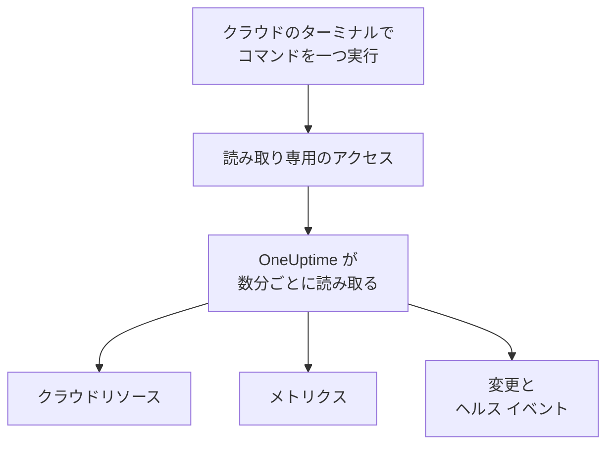

# クラウド アカウントの接続

ダッシュボードから AWS アカウント、Azure サブスクリプション、Google Cloud プロジェクトを接続すると、OneUptime がその中のすべてのリソースを一覧にし、主要なメトリクスを読み取り、リソースで何が変わったか、クラウド プロバイダーがリソースの状態について何を伝えているかを記録します。クラウドのブラウザー ターミナルでコマンドを一つ実行し、出力を貼り付けるだけです。コレクターの運用も、インストールも不要です。

:::cards
- [Amazon Web Services](#amazon-web-services): OneUptime がサインインする IAM ロール、またはアクセス キー。
- [Microsoft Azure](#microsoft-azure): Monitoring Reader ロールを持つアプリ。
- [Google Cloud](#google-cloud): 読み取り専用の四つのロールを持つサービス アカウント。
- [OneUptime が読み取るもの](#oneuptime-が読み取るもの): リソース、メトリクス、変更、ヘルス イベントを、どのくらいの頻度で読み取り、いくらかかるか。
- [データセキュリティ](#データセキュリティ): 接続によってデータセキュリティが読み取れるものと、各レベルがコマンドに追加するもの。
- [AI に問題を修正させる](#ai-に問題を修正させる): コマンドをもう一つ実行すれば、OneUptime AI は見つけた問題を修正できます。
:::

## 仕組み



- **アクセスは読み取りだけです。** コマンドが作成するアクセスは、リソースとその設定、メトリクス、変更内容、プロバイダーのヘルス イベントを読み取るだけで、それ以外は何もできません。AWS では下に挙げるアクション、Azure では **Monitoring Reader** ロール、Google Cloud では四つの閲覧者ロールです。OneUptime がこのアクセスでデータやシークレットを読み取ることはありません。ただし、AI にアカウントのログの読み取りを許可した場合はログ行を、[データセキュリティ](#データセキュリティ) でコンテンツのサンプルをオンにした場合はそのサンプルを読み取ります。削除すれば OneUptime のアクセスを止められます。
- **OneUptime は定期的に読み取ります。** 接続時に別の間隔を選ばない限り、Azure と Google Cloud は 5 分ごと、AWS は 10 分ごとです。各読み取りは前回からの変更も記録し、30 分ごとにすべてのリソースをもう一度一覧にします。
- **リソースごとに専用のページがあります。** リソースは **クラウド → すべてのリソース** に、主要なメトリクス、オーナー、ラベルとともに表示されます。一覧に載ったリソースのページには、**つながっているリソース** (どこで動いているか、どこからトラフィックが来るか)、エンドポイント、タグ、設定、そして **インシデント**、**アラート**、**変更** も表示されます。
- **アカウントごとに専用のページがあります。** アカウントは **クラウド → アカウント** に、種類とリージョン別のリソース、**変更**、リソースどうしのつながりを示す **トポロジー** とともに表示されます。
- **OneUptime AI が変更を読み取ります。** クラウド リソースにリンクされたインシデントやアラートの調査は、まずそのリソースの変更を読み取り、開始時にアカウントのアクティビティ ログを読み直します。

## 始める前に

- **プロジェクトのオーナーまたは管理者。** クラウド アカウントを接続、テスト、編集できるのはこの人たちだけです。
- **クラウドのターミナル** (AWS CloudShell、Azure Cloud Shell、Google Cloud Shell)。IAM ロールまたはユーザー、アプリの登録、サービス アカウントを作成できる人がサインインしている必要があります。

## Amazon Web Services

:::steps
### AWS のフォームを開く

**クラウド → 接続** に移動し、**Amazon Web Services** を選びます。

### AWS CloudShell でコマンドを実行する

OneUptime のサインイン方法を選びます。推奨は **IAM ロール** です。秘密情報は保存されず、ロールはいつでも削除できます。フォームには、プロジェクト用に書かれたコマンドが表示されます。このコマンドは、プロジェクトの外部 ID で OneUptime の AWS アカウントを信頼するロールを作成し、ロールの ARN を出力します。

**読み取る対象** で、このアカウントか、AWS Organization のすべてのアカウントを選びます。組織用のコマンドは管理アカウントで実行します。このコマンドは、すべてのアカウントに同じロールを置く StackSet を追加し (今あるアカウントにも、あとから加わるアカウントにも)、管理アカウントのロールがアカウントを一覧にできるようにします。一つの接続で最大 50 個のアカウントを読み取ります。

ロールを使えない場合は **アクセス キー** を使います。読み取れるのは自分のアカウントだけです。次のコマンドは同じ権限を持つユーザーを作成し、そのキーを出力します。

```bash
aws iam create-user --user-name OneUptimeReadOnly > /dev/null 2>&1 || true
aws iam put-user-policy --user-name OneUptimeReadOnly --policy-name OneUptimeReadOnly --policy-document '{"Version":"2012-10-17","Statement":[{"Effect":"Allow","Action":["cloudwatch:GetMetricData","cloudwatch:ListMetrics","tag:GetResources","iam:ListAccountAliases","cloudformation:ListResources","ec2:DescribeInstances","ec2:DescribeVolumes","ec2:DescribeVpcs","ec2:DescribeNatGateways","autoscaling:DescribeAutoScalingGroups","elasticloadbalancing:DescribeLoadBalancers","elasticloadbalancing:DescribeLoadBalancerAttributes","elasticloadbalancing:DescribeTargetGroups","elasticloadbalancing:DescribeTargetGroupAttributes","elasticloadbalancing:DescribeTargetHealth","elasticloadbalancing:DescribeTags","ecs:ListClusters","ecs:DescribeClusters","ecs:ListServices","ecs:DescribeServices","lambda:ListFunctions","rds:DescribeDBInstances","rds:DescribeDBClusters","elasticache:DescribeReplicationGroups","sqs:ListQueues","sqs:GetQueueAttributes","sns:ListTopics","sns:GetTopicAttributes","sns:ListSubscriptionsByTopic","dynamodb:ListTables","dynamodb:DescribeTable","kinesis:ListStreams","kinesis:DescribeStreamSummary","states:ListStateMachines","states:DescribeStateMachine","cloudfront:ListDistributions","elasticfilesystem:DescribeFileSystems","es:ListDomainNames","es:DescribeDomains","apprunner:ListServices","apprunner:DescribeService","cloudtrail:LookupEvents","health:DescribeEvents","health:DescribeEventDetails","rds:DescribeEvents","autoscaling:DescribeScalingActivities","ec2:DescribeInstanceStatus","ecs:DescribeTaskDefinition","lambda:GetFunctionConfiguration","lambda:GetFunctionConcurrency","lambda:GetAlias","servicequotas:ListServiceQuotas","logs:DescribeLogGroups","logs:FilterLogEvents"],"Resource":"*"},{"Effect":"Allow","Action":["apigateway:GET"],"Resource":["arn:aws:apigateway:*::/restapis","arn:aws:apigateway:*::/restapis/*","arn:aws:apigateway:*::/apis","arn:aws:apigateway:*::/apis/*"]}]}'
aws iam create-access-key --user-name OneUptimeReadOnly
```

### AWS のコマンドの出力を貼り付ける

コマンドの出力をすべて **コマンドの出力** に貼り付けます。OneUptime がロールの ARN、またはアクセス キー ID とそのシークレットを取り出します。

### AWS をテストして接続する

この手順を開くと、OneUptime が接続をテストします。サインインし、見つかったリソースを数え、読み取りにかかる費用を示します。**接続** を選んで保存します。
:::

このロールとユーザーにできるのは次のことだけです。

| OneUptime の用途 | アクション |
| --- | --- |
| メトリクスを送信しているリソースを見つけ、そのメトリクスを読み取る | `cloudwatch:GetMetricData`, `cloudwatch:ListMetrics` |
| 各リソースに名前を付け、そのタグを読み取る | `tag:GetResources`, `iam:ListAccountAliases` |
| Cloud Control を通じて、すべてのリソースとその構成を一覧にする | `cloudformation:ListResources`, `ec2:DescribeInstances`, `ec2:DescribeVolumes`, `ec2:DescribeVpcs`, `ec2:DescribeNatGateways`, `autoscaling:DescribeAutoScalingGroups`, `elasticloadbalancing:DescribeLoadBalancers`, `elasticloadbalancing:DescribeLoadBalancerAttributes`, `elasticloadbalancing:DescribeTargetGroups`, `elasticloadbalancing:DescribeTargetGroupAttributes`, `elasticloadbalancing:DescribeTargetHealth`, `elasticloadbalancing:DescribeTags`, `ecs:ListClusters`, `ecs:DescribeClusters`, `ecs:ListServices`, `ecs:DescribeServices`, `lambda:ListFunctions`, `rds:DescribeDBInstances`, `rds:DescribeDBClusters`, `elasticache:DescribeReplicationGroups`, `sqs:ListQueues`, `sqs:GetQueueAttributes`, `sns:ListTopics`, `sns:GetTopicAttributes`, `sns:ListSubscriptionsByTopic`, `dynamodb:ListTables`, `dynamodb:DescribeTable`, `kinesis:ListStreams`, `kinesis:DescribeStreamSummary`, `states:ListStateMachines`, `states:DescribeStateMachine`, `cloudfront:ListDistributions`, `elasticfilesystem:DescribeFileSystems`, `es:ListDomainNames`, `es:DescribeDomains`, `apprunner:ListServices`, `apprunner:DescribeService`, `apigateway:GET` |
| 変更を読み取る: アカウントの管理イベント | `cloudtrail:LookupEvents` |
| アカウントに関する AWS 自身のヘルス イベントを読み取る | `health:DescribeEvents`, `health:DescribeEventDetails` |
| 調査中に、リソースの現在の状態と最近のイベントを読み取る | `rds:DescribeEvents`, `autoscaling:DescribeScalingActivities`, `ec2:DescribeInstanceStatus`, `ecs:DescribeTaskDefinition`, `lambda:GetFunctionConfiguration`, `lambda:GetFunctionConcurrency`, `lambda:GetAlias` |
| 調査中に、アカウントのクォータを読み取る | `servicequotas:ListServiceQuotas` |
| AI にアカウントのログの読み取りを許可した場合にのみ、ログ行を読み取る | `logs:DescribeLogGroups`, `logs:FilterLogEvents` |
| 管理アカウントから組織のアカウントを一覧にする | `organizations:ListAccounts` |

`apigateway:GET` は API 自身の定義に対してだけ許可され、キーには許可されません。また、組織のアカウントを一覧にできるのは管理アカウントのロールだけです。AWS Health が応答するのは、Business、Enterprise On-Ramp、Enterprise のいずれかのサポート プランを契約しているアカウントだけです。契約がない場合、OneUptime は一日後にもう一度問い合わせます。

> [!NOTE]
> セルフホストの OneUptime では、**IAM ロール** の方式に OneUptime 自身の AWS ID が必要です。`CLOUD_CONNECT_AWS_ACCESS_KEY_ID` と `CLOUD_CONNECT_AWS_SECRET_ACCESS_KEY` に、`sts:AssumeRole` を呼び出せる IAM ユーザーのキーを設定してください。設定がない場合、フォームは **アクセス キー** を提示します。

## Microsoft Azure

:::steps
### Azure のフォームを開く

**クラウド → 接続** に移動し、**Microsoft Azure** を選びます。

### Azure Cloud Shell でコマンドを実行する

このコマンドは、現在のサブスクリプションで **Monitoring Reader** ロールを持つアプリを作成し、その詳細をシークレットの有効期限とともに出力します。

```bash
SCOPE="/subscriptions/$(az account show --query id --output tsv)"
OUT=$(az ad sp create-for-rbac --name OneUptimeReadOnly --role "Monitoring Reader" --scopes "$SCOPE")
APP=$(echo "$OUT" | jq -r .appId)
END=$(az ad app credential list --id "$APP" --query "max([].endDateTime)" --output tsv)
echo "$OUT" | jq --arg end "$END" '. + {endDateTime: $end}'
```

**読み取る対象** でテナントのすべてのサブスクリプションを選ぶと、ロールはテナントのルート管理グループに付与されます。

```bash
SCOPE="/providers/Microsoft.Management/managementGroups/$(az account show --query tenantId --output tsv)"
OUT=$(az ad sp create-for-rbac --name OneUptimeReadOnly --role "Monitoring Reader" --scopes "$SCOPE")
APP=$(echo "$OUT" | jq -r .appId)
END=$(az ad app credential list --id "$APP" --query "max([].endDateTime)" --output tsv)
echo "$OUT" | jq --arg end "$END" '. + {endDateTime: $end}'
```

### Azure のコマンドの出力を貼り付ける

コマンドの出力をすべて **コマンドの出力** に貼り付けます。OneUptime が `tenant`、`appId`、`password` と有効期限を取り出します。

### Azure をテストして接続する

この手順を開くと、OneUptime が接続をテストします。**接続** を選んで保存します。
:::

同じアプリでほかのサブスクリプションも読み取るには、それぞれのサブスクリプションでアプリにロールを付与します。

```bash
az role assignment create --assignee <APP_ID> --role "Monitoring Reader" --scope /subscriptions/<SUBSCRIPTION_ID>
```

**サブスクリプション** にいくつか指定しない限り、OneUptime はアプリが読み取れるすべてのサブスクリプションを最大 50 個まで読み取ります。アプリのシークレットは有効期限の日に使えなくなります。その 30 日前から、読み取りのたびに警告が出ます。コマンドをもう一度実行して出力を貼り付けると、新しいシークレットになります。

## Google Cloud

:::steps
### Google Cloud のフォームを開く

**クラウド → 接続** に移動し、**Google Cloud** を選びます。

### Google Cloud Shell でコマンドを実行する

監視するプロジェクトで実行します。OneUptime が読み取る API を有効にし、**Monitoring Viewer**、**Cloud Asset Viewer**、**Logs Viewer**、**Service Health Viewer** の各ロールを持つサービス アカウントを作成して、そのキーを出力します。

```bash
PROJECT_ID=$(gcloud config get-value project)
gcloud services enable monitoring.googleapis.com cloudasset.googleapis.com logging.googleapis.com cloudresourcemanager.googleapis.com servicehealth.googleapis.com
gcloud iam service-accounts create oneuptime-read-only --display-name "OneUptime (read only)" > /dev/null 2>&1 || true
gcloud projects add-iam-policy-binding "$PROJECT_ID" --member "serviceAccount:oneuptime-read-only@$PROJECT_ID.iam.gserviceaccount.com" --role roles/monitoring.viewer --condition=None > /dev/null
gcloud projects add-iam-policy-binding "$PROJECT_ID" --member "serviceAccount:oneuptime-read-only@$PROJECT_ID.iam.gserviceaccount.com" --role roles/cloudasset.viewer --condition=None > /dev/null
gcloud projects add-iam-policy-binding "$PROJECT_ID" --member "serviceAccount:oneuptime-read-only@$PROJECT_ID.iam.gserviceaccount.com" --role roles/logging.viewer --condition=None > /dev/null
gcloud projects add-iam-policy-binding "$PROJECT_ID" --member "serviceAccount:oneuptime-read-only@$PROJECT_ID.iam.gserviceaccount.com" --role roles/servicehealth.viewer --condition=None > /dev/null
gcloud iam service-accounts keys create oneuptime-key.json --iam-account "oneuptime-read-only@$PROJECT_ID.iam.gserviceaccount.com"
cat oneuptime-key.json && rm oneuptime-key.json
```

**読み取る対象** で組織のすべてのプロジェクトを選ぶと、ロールはプロジェクトの組織に付与されます。

```bash
PROJECT_ID=$(gcloud config get-value project)
ORG_ID=$(gcloud projects get-ancestors "$PROJECT_ID" --format="value(id)" | tail -1)
gcloud services enable monitoring.googleapis.com cloudasset.googleapis.com logging.googleapis.com cloudresourcemanager.googleapis.com servicehealth.googleapis.com
gcloud iam service-accounts create oneuptime-read-only --display-name "OneUptime (read only)" > /dev/null 2>&1 || true
gcloud organizations add-iam-policy-binding "$ORG_ID" --member "serviceAccount:oneuptime-read-only@$PROJECT_ID.iam.gserviceaccount.com" --role roles/monitoring.viewer --condition=None > /dev/null
gcloud organizations add-iam-policy-binding "$ORG_ID" --member "serviceAccount:oneuptime-read-only@$PROJECT_ID.iam.gserviceaccount.com" --role roles/cloudasset.viewer --condition=None > /dev/null
gcloud organizations add-iam-policy-binding "$ORG_ID" --member "serviceAccount:oneuptime-read-only@$PROJECT_ID.iam.gserviceaccount.com" --role roles/logging.viewer --condition=None > /dev/null
gcloud organizations add-iam-policy-binding "$ORG_ID" --member "serviceAccount:oneuptime-read-only@$PROJECT_ID.iam.gserviceaccount.com" --role roles/servicehealth.viewer --condition=None > /dev/null
gcloud iam service-accounts keys create oneuptime-key.json --iam-account "oneuptime-read-only@$PROJECT_ID.iam.gserviceaccount.com"
cat oneuptime-key.json && rm oneuptime-key.json
```

### キーを貼り付ける

コマンドの出力をすべて貼り付けます。OneUptime はキー自身のプロジェクトを読み取り、キーを暗号化して保存します。

### Google Cloud をテストして接続する

この手順を開くと、OneUptime が接続をテストします。**接続** を選んで保存します。
:::

同じサービス アカウントでほかのプロジェクトも読み取るには、それぞれのプロジェクトで四つのロールを付与し、**プロジェクト** に指定します。

```bash
for ROLE in roles/monitoring.viewer roles/cloudasset.viewer roles/logging.viewer roles/servicehealth.viewer; do gcloud projects add-iam-policy-binding <PROJECT_ID> --member "serviceAccount:oneuptime-read-only@<KEY_PROJECT_ID>.iam.gserviceaccount.com" --role "$ROLE"; done
```

**プロジェクト** にいくつか指定しない限り、組織の接続はその組織のプロジェクトを最大 50 個まで読み取ります。

## データセキュリティ

同じ接続で、[データセキュリティ](/docs/data-security/index) がアカウントのデータストア (バケット、データベース、データウェアハウス) を読み取れるようにもできます。**その他の項目** の **データセキュリティ** は、別の値を選ぶまで **オフ** で、フォームに表示されるコマンドはその値に合わせて変わります。

| データセキュリティ | データセキュリティが読み取れるもの | コマンドが追加するもの |
| --- | --- | --- |
| **オフ** | アカウントのデータストアはどれも読み取らない | なし |
| **設定のみ** | 各データストアにアクセスできる人と、その暗号化、バックアップ、ログ記録の設定。データは読み取らない。 | AWS では、読み取りアクションからなるもう一つのインラインポリシー `OneUptimeDataSecurity`。Azure と Google Cloud では何も追加しない。すでに **Monitoring Reader** と **Cloud Asset Viewer** で読み取れるため。 |
| **設定とコンテンツのサンプル** | 上記に加えて、機密データを見つけるためのオブジェクトと行のサンプル | AWS では、同じポリシーに `s3:ListBucket`、`s3:GetObject`、S3 経由に限った `kms:Decrypt` を加えたもの。Azure では **Storage Blob Data Reader**。Google Cloud では `roles/storage.objectViewer`、`roles/bigquery.dataViewer` と BigQuery API。 |

AWS では、ロールのコマンドに一行加わり、それがポリシーを追加します。コンテンツのレベルでは次のとおりです。

```bash
aws iam put-role-policy --role-name "$ROLE" --policy-name OneUptimeDataSecurity --policy-document '{"Version":"2012-10-17","Statement":[{"Effect":"Allow","Action":["s3:ListAllMyBuckets","s3:GetBucketLocation","s3:GetBucketPolicyStatus","s3:GetBucketPublicAccessBlock","s3:GetAccountPublicAccessBlock","s3:GetBucketAcl","s3:GetBucketPolicy","s3:GetEncryptionConfiguration","s3:GetBucketVersioning","s3:GetBucketLogging","s3:GetBucketOwnershipControls","s3:GetReplicationConfiguration","s3:GetBucketTagging","rds:DescribeDBInstances","rds:DescribeDBClusters","rds:DescribeDBSnapshots","rds:DescribeDBSnapshotAttributes","rds:DescribeDBClusterSnapshots","rds:DescribeDBClusterSnapshotAttributes","dynamodb:ListTables","dynamodb:DescribeTable","dynamodb:DescribeContinuousBackups","redshift:DescribeClusters","redshift:DescribeLoggingStatus","es:ListDomainNames","es:DescribeDomains","elasticache:DescribeReplicationGroups","elasticfilesystem:DescribeFileSystems","kms:ListAliases"],"Resource":"*"},{"Effect":"Allow","Action":["s3:ListBucket"],"Resource":"arn:aws:s3:::*"},{"Effect":"Allow","Action":["s3:GetObject"],"Resource":"arn:aws:s3:::*/*"},{"Effect":"Allow","Action":["kms:Decrypt"],"Resource":"*","Condition":{"StringLike":{"kms:ViaService":"s3.*.amazonaws.com"}}}]}'
```

IAM では、ユーザー自身のインラインポリシーは合計 2,048 文字までに制限されるため、**アクセス キー** の場合、ポリシーはユーザーが参加するグループ `OneUptimeDataSecurity` に付けられます。

```bash
aws iam create-user --user-name OneUptimeReadOnly > /dev/null 2>&1 || true
aws iam put-user-policy --user-name OneUptimeReadOnly --policy-name OneUptimeReadOnly --policy-document '{"Version":"2012-10-17","Statement":[{"Effect":"Allow","Action":["cloudwatch:GetMetricData","cloudwatch:ListMetrics","tag:GetResources","iam:ListAccountAliases","cloudformation:ListResources","ec2:DescribeInstances","ec2:DescribeVolumes","ec2:DescribeVpcs","ec2:DescribeNatGateways","autoscaling:DescribeAutoScalingGroups","elasticloadbalancing:DescribeLoadBalancers","elasticloadbalancing:DescribeLoadBalancerAttributes","elasticloadbalancing:DescribeTargetGroups","elasticloadbalancing:DescribeTargetGroupAttributes","elasticloadbalancing:DescribeTargetHealth","elasticloadbalancing:DescribeTags","ecs:ListClusters","ecs:DescribeClusters","ecs:ListServices","ecs:DescribeServices","lambda:ListFunctions","rds:DescribeDBInstances","rds:DescribeDBClusters","elasticache:DescribeReplicationGroups","sqs:ListQueues","sqs:GetQueueAttributes","sns:ListTopics","sns:GetTopicAttributes","sns:ListSubscriptionsByTopic","dynamodb:ListTables","dynamodb:DescribeTable","kinesis:ListStreams","kinesis:DescribeStreamSummary","states:ListStateMachines","states:DescribeStateMachine","cloudfront:ListDistributions","elasticfilesystem:DescribeFileSystems","es:ListDomainNames","es:DescribeDomains","apprunner:ListServices","apprunner:DescribeService","cloudtrail:LookupEvents","health:DescribeEvents","health:DescribeEventDetails","rds:DescribeEvents","autoscaling:DescribeScalingActivities","ec2:DescribeInstanceStatus","ecs:DescribeTaskDefinition","lambda:GetFunctionConfiguration","lambda:GetFunctionConcurrency","lambda:GetAlias","servicequotas:ListServiceQuotas","logs:DescribeLogGroups","logs:FilterLogEvents"],"Resource":"*"},{"Effect":"Allow","Action":["apigateway:GET"],"Resource":["arn:aws:apigateway:*::/restapis","arn:aws:apigateway:*::/restapis/*","arn:aws:apigateway:*::/apis","arn:aws:apigateway:*::/apis/*"]}]}'
aws iam create-group --group-name OneUptimeDataSecurity > /dev/null 2>&1 || true
aws iam put-group-policy --group-name OneUptimeDataSecurity --policy-name OneUptimeDataSecurity --policy-document '{"Version":"2012-10-17","Statement":[{"Effect":"Allow","Action":["s3:ListAllMyBuckets","s3:GetBucketLocation","s3:GetBucketPolicyStatus","s3:GetBucketPublicAccessBlock","s3:GetAccountPublicAccessBlock","s3:GetBucketAcl","s3:GetBucketPolicy","s3:GetEncryptionConfiguration","s3:GetBucketVersioning","s3:GetBucketLogging","s3:GetBucketOwnershipControls","s3:GetReplicationConfiguration","s3:GetBucketTagging","rds:DescribeDBInstances","rds:DescribeDBClusters","rds:DescribeDBSnapshots","rds:DescribeDBSnapshotAttributes","rds:DescribeDBClusterSnapshots","rds:DescribeDBClusterSnapshotAttributes","dynamodb:ListTables","dynamodb:DescribeTable","dynamodb:DescribeContinuousBackups","redshift:DescribeClusters","redshift:DescribeLoggingStatus","es:ListDomainNames","es:DescribeDomains","elasticache:DescribeReplicationGroups","elasticfilesystem:DescribeFileSystems","kms:ListAliases"],"Resource":"*"},{"Effect":"Allow","Action":["s3:ListBucket"],"Resource":"arn:aws:s3:::*"},{"Effect":"Allow","Action":["s3:GetObject"],"Resource":"arn:aws:s3:::*/*"},{"Effect":"Allow","Action":["kms:Decrypt"],"Resource":"*","Condition":{"StringLike":{"kms:ViaService":"s3.*.amazonaws.com"}}}]}'
aws iam add-user-to-group --user-name OneUptimeReadOnly --group-name OneUptimeDataSecurity
aws iam create-access-key --user-name OneUptimeReadOnly
```

Azure では、コンテンツのレベルで **Monitoring Reader** と同じスコープに **Storage Blob Data Reader** が追加されます。

```bash
SCOPE="/subscriptions/$(az account show --query id --output tsv)"
OUT=$(az ad sp create-for-rbac --name OneUptimeReadOnly --role "Monitoring Reader" --scopes "$SCOPE")
APP=$(echo "$OUT" | jq -r .appId)
az role assignment create --assignee "$APP" --role "Storage Blob Data Reader" --scope "$SCOPE" > /dev/null
END=$(az ad app credential list --id "$APP" --query "max([].endDateTime)" --output tsv)
echo "$OUT" | jq --arg end "$END" '. + {endDateTime: $end}'
```

Google Cloud では、二つのロールを追加し、`bigquery.googleapis.com` を有効にします。

```bash
PROJECT_ID=$(gcloud config get-value project)
gcloud services enable monitoring.googleapis.com cloudasset.googleapis.com logging.googleapis.com cloudresourcemanager.googleapis.com servicehealth.googleapis.com bigquery.googleapis.com
gcloud iam service-accounts create oneuptime-read-only --display-name "OneUptime (read only)" > /dev/null 2>&1 || true
gcloud projects add-iam-policy-binding "$PROJECT_ID" --member "serviceAccount:oneuptime-read-only@$PROJECT_ID.iam.gserviceaccount.com" --role roles/monitoring.viewer --condition=None > /dev/null
gcloud projects add-iam-policy-binding "$PROJECT_ID" --member "serviceAccount:oneuptime-read-only@$PROJECT_ID.iam.gserviceaccount.com" --role roles/cloudasset.viewer --condition=None > /dev/null
gcloud projects add-iam-policy-binding "$PROJECT_ID" --member "serviceAccount:oneuptime-read-only@$PROJECT_ID.iam.gserviceaccount.com" --role roles/logging.viewer --condition=None > /dev/null
gcloud projects add-iam-policy-binding "$PROJECT_ID" --member "serviceAccount:oneuptime-read-only@$PROJECT_ID.iam.gserviceaccount.com" --role roles/servicehealth.viewer --condition=None > /dev/null
gcloud projects add-iam-policy-binding "$PROJECT_ID" --member "serviceAccount:oneuptime-read-only@$PROJECT_ID.iam.gserviceaccount.com" --role roles/storage.objectViewer --condition=None > /dev/null
gcloud projects add-iam-policy-binding "$PROJECT_ID" --member "serviceAccount:oneuptime-read-only@$PROJECT_ID.iam.gserviceaccount.com" --role roles/bigquery.dataViewer --condition=None > /dev/null
gcloud iam service-accounts keys create oneuptime-key.json --iam-account "oneuptime-read-only@$PROJECT_ID.iam.gserviceaccount.com"
cat oneuptime-key.json && rm oneuptime-key.json
```

低いレベルのコマンドは、AWS のポリシーをその低いレベルのものに置き換えます。**オフ** は何も追加しないため、以前のコマンドが付与したものは、削除するまでそのまま残ります。AWS の `OneUptimeDataSecurity` ポリシー (`aws iam delete-role-policy --role-name <your role> --policy-name OneUptimeDataSecurity` で削除します) と、Azure と Google Cloud のコンテンツのレベルのロールです。どちらの場合も、データセキュリティはすぐに読み取りを止めます。読み取るのは、接続のレベルが許すものだけだからです。[データセキュリティを設定する](/docs/data-security/setup) には、ポリシーのすべてのアクションと、データセキュリティが読み取ったものから何を保持するかが載っています。

## OneUptime が読み取るもの

| | AWS | Azure | Google Cloud |
| --- | --- | --- | --- |
| リソース | 使用中のすべてのリージョンにある、OneUptime が知っている種類のすべてのリソース (Cloud Control から) | サブスクリプション内のすべてのリソース (Resource Graph から) | プロジェクト内のすべてのリソース (Cloud Asset Inventory から) |
| メトリクス | 各サービスの主要なメトリクス (インスタンスの CPU、ネットワーク、ステータス チェックなど) | リソースごとに最大 8 個の主要なメトリクス | 各リソース タイプの主要なメトリクス |
| 変更 | CloudTrail の管理イベント | アクティビティ ログの管理イベント | Admin Activity 監査ログ |
| ヘルス イベント | AWS Health | Service Health と Resource Health | Service Health |
| 読み取り間隔 | 10 分 | 5 分 | 5 分 |
| 削除されたリソース | 完全な一覧に載らなくなるとアーカイブ | 完全な一覧に載らなくなるとアーカイブ | 完全な一覧に載らなくなるとアーカイブ |

各読み取りは前回の続きから始まるため、各データ ポイントと各変更は一度だけ書き込まれます。新しい接続の最初の読み取りは一分以内に始まり、メトリクスは一時間分、変更は 2 時間分さかのぼります。中断のあとの読み取りは、さかのぼっても最大 6 時間です。メトリクスを報告するだけでどの一覧にも載らないリソースは、メトリクスが 7 日間なければアーカイブされます。

OneUptime の呼び出しは、クラウドの料金でお使いのクラウド アカウントに請求されます。リソースの一覧と、変更やヘルス イベントの読み取りは、三つのクラウドのどれでも無料です。費用がかかるのはメトリクスの読み取りです。テストは見つかったものの費用を見積もります。読み取り頻度を下げると費用も下がります。**その他の項目** の **メトリクスの読み取り間隔** を変更してください。

| クラウド | 料金 |
| --- | --- |
| AWS | CloudWatch `GetMetricData`: 1,000 メトリクスあたり $0.01。リソースの主要なメトリクス一つにつき、読み取りごとに一メトリクス |
| Azure | 各サブスクリプションで月 1,000,000 回までのメトリクス読み取りは無料。その後は 1,000 回あたり $0.01 |
| Google Cloud | 月 1,000,000 件までの時系列の読み取りは無料。その後は百万件あたり $0.50 |

## OneUptime で見えるもの

- **アカウントのページ。** **クラウド → アカウント** で、アカウントの概要には種類とリージョン別のリソース数と、接続が最後に読み取った時刻が表示されます。**リソース** にはリソースの一覧、**変更** には新しい順の変更、**トポロジー** にはリージョン、その中のネットワーク、それぞれで動いているものが、リンクされたリソース上の未解決のインシデントとアラートとともに描かれます。**フィード** には、アカウントが OneUptime に加わった経緯、クラウド AI エージェントの接続やリセット、そして OneUptime AI がそこで行えることを誰が変更したかが記録されます。
- **リソースの変更。** 変更は、変更したリソースとそのアカウントに結び付いた変更イベントとして保存され、リソースのメトリクス チャートにインシデントやアラートとともにマーカーとして描かれます。どのリソースにも絞り込まれていないチャートには、クラウド アカウントのアクティビティ ログは表示されません。忙しいアカウントでデプロイが埋もれないようにするためです。プロバイダーのヘルス イベントは表示されたままです。
- **インシデントとアラート。** モニター、インシデント、アラートのリンクされたリソースでクラウド リソースをリンクすると、そのインシデントとアラートがリソースのページに一覧表示されます。ホストがリソースのエンドポイントに (直接、または DNS を通じて) つながる Web サイト、API、SSL、ping、ポートのモニターでは、**リンクされたリソース** カードの **おすすめのクラウドリソース** にそのリソースが表示されます。**リソースをリンク** を選んでリンクします。

## AI に問題を修正させる

OneUptime AI は調査中、上記の読み取り専用のアクセスで、接続されたすべてのアカウントを読み取ります。サービスの再起動、スケールアウト、ロールバックなどで問題の修正もさせるには、**クラウド → アカウント** でアカウントを開き、その **概要** にある **AI エージェント** カードで **AI に問題を修正させる** を選択します。

ダイアログは **AI にどこまで任せますか？** という一つの質問をします。デフォルトの **実行前に確認する** では OneUptime AI が修正をひとつずつ提案し、人がワンクリックで承認します。**安全な修正は自動で適用する** では安全な変更は自動的に実行され、よりリスクの高い変更は引き続き承認を待ちます。そのほかはすべて、**その他の項目** の下に安全なデフォルトがあります。次に、このアカウント用に書き出されたコマンドが一つ表示されます。アカウントでロールを作成できるユーザーとしてサインインし、AWS CloudShell、Azure Cloud Shell、または Google Cloud Shell で実行してください。コマンドは、有効にした変更だけを行えるロールを作成し、そのロールでクラウド AI エージェントをアカウント内に起動します。エージェントは数分以内に自動的に接続され、ダイアログにもそう表示されます。貼り戻すものは何もありません。

エージェントは、アカウント内で月中ずっと動作する小さなコンテナ一つで、クラウドの標準料金で請求されます:

| クラウド | 実行されるもの | 目安 |
| --- | --- | --- |
| AWS | 0.25 vCPU と 0.5 GB の ECS Fargate タスク一つと、そのパブリック IPv4 アドレス(`us-east-1` の料金) | 月 $13 |
| Azure | 0.25 vCPU と 0.5 GiB の Container Apps レプリカ一つ。サブスクリプションの毎月の無料付与分である 180,000 vCPU 秒と 360,000 GiB 秒を差し引いた後 | 月 $14 |
| Google Cloud | CPU を常に割り当てた 1 vCPU と 0.5 GiB の Cloud Run インスタンス一つ(vCPU を丸ごと一つ使用)。毎月の無料枠である 240,000 vCPU 秒と 450,000 GiB 秒を差し引いた後 | 月 $45 |

エージェントが変更できるもの、各変更の段階と取り消し方、ログの読み方: [インフラストラクチャの AI エージェント](/docs/ai/infrastructure-ai-agents#クラウド-アカウント内で)。

## トラブルシューティング

:::details テストでキーまたはシークレットが受け付けられなかったと表示される
コマンドの出力をすべてコピーして、もう一度貼り付けてください。作成したばかりのキーは、使えるようになるまで少し時間がかかることがあります。有効期限が切れた Azure のシークレットも拒否されます。コマンドをもう一度実行してください。
:::

:::details テストでサインインはできるが、読み取れない
コマンドをもう一度実行してください。OneUptime に必要なロールが付与されます。AWS では、このプロジェクト用にフォームが表示するコマンドを実行してください。別のプロジェクト用に作成したロールは、そのプロジェクトの外部 ID を信頼しており、このプロジェクトのものではありません。
:::

:::details Google Cloud でコマンドがキーを作成できない
組織のポリシー `iam.disableServiceAccountKeyCreation` で、サービス アカウント キーが禁止されている場合があります。組織の管理者にこのプロジェクトの例外を依頼するか、[独自のコレクターでメトリクスを送信](/docs/telemetry/cloud-resources)してください。
:::

:::details リソースが表示されない
最初の読み取りでは、メトリクスを報告しているかどうかにかかわらず、アカウントのすべてのリソースが一覧になります。接続が動作していない場合は、**クラウド → 接続** の **エラーを表示** で、最後の読み取りが失敗した理由を確認できます。
:::

:::details 組織の一部のアカウントが見当たらない
一つの接続で読み取れるのは最大 50 個のアカウント、サブスクリプション、プロジェクトで、それより多い場合は読み取りのたびにそう表示されます。残りは別の接続で接続してください。
:::

## 次のステップ

:::cards
- [クラウドリソース](/docs/telemetry/cloud-resources): 代わりに独自の OpenTelemetry Collector を運用するか、CloudWatch メトリクスをストリーミングします。
- [デプロイと変更](/docs/telemetry/change-events): OneUptime が記録するすべての変更と、OneUptime AI がそれを読み取るしくみ。
- [メトリクス モニター](/docs/monitor/metrics-monitor): リソースのメトリクスでアラートを出します。
:::
