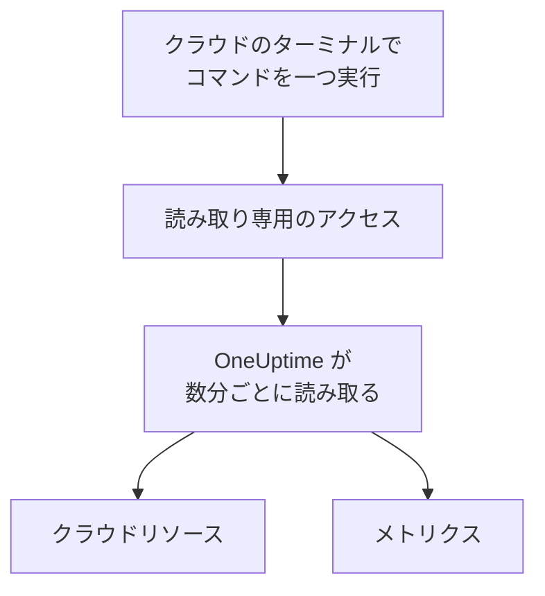

# クラウド アカウントの接続

ダッシュボードから AWS アカウント、Azure サブスクリプション、Google Cloud プロジェクトを接続すると、OneUptime がそのリソースを一覧にし、主要なメトリクスを定期的に読み取ります。クラウドのブラウザー ターミナルでコマンドを一つ実行し、出力を貼り付けるだけです。コレクターの運用も、インストールも不要です。

:::cards
- [Amazon Web Services](#amazon-web-services): OneUptime がサインインする IAM ロール、またはアクセス キー。
- [Microsoft Azure](#microsoft-azure): Monitoring Reader ロールを持つアプリ。
- [Google Cloud](#google-cloud): Monitoring Viewer ロールを持つサービス アカウント。
- [OneUptime が読み取るもの](#oneuptime-が読み取るもの): どのリソースとメトリクスを、どのくらいの頻度で読み取り、いくらかかるか。
:::

## 仕組み



- **アクセスは読み取りだけです。** コマンドが作成するアクセスはメトリクスを読み取るだけで、それ以外は何もできません。AWS では三つの読み取りアクション、Azure では **Monitoring Reader** ロール、Google Cloud では **Monitoring Viewer** ロールです。削除すれば OneUptime のアクセスを止められます。
- **OneUptime は定期的に読み取ります。** 接続時に別の間隔を選ばない限り、Azure と Google Cloud は 5 分ごと、AWS は 10 分ごとです。
- **リソースごとに専用のページがあります。** リソースは **クラウド → すべてのリソース** に、主要なメトリクス、オーナー、ラベルとともに表示されます。コレクターが報告するリソースと同じです。

## 始める前に

- **プロジェクトのオーナーまたは管理者。** クラウド アカウントを接続、テスト、編集できるのはこの人たちだけです。
- **クラウドのターミナル** (AWS CloudShell、Azure Cloud Shell、Google Cloud Shell)。IAM ロールまたはユーザー、アプリの登録、サービス アカウントを作成できる人がサインインしている必要があります。

## Amazon Web Services

:::steps
### AWS のフォームを開く

**クラウド → 接続** に移動し、**Amazon Web Services** を選びます。

### AWS CloudShell でコマンドを実行する

OneUptime のサインイン方法を選びます。推奨は **IAM ロール** です。秘密情報は保存されず、ロールはいつでも削除できます。フォームには、プロジェクト用に書かれたコマンドが表示されます。このコマンドは、プロジェクトの外部 ID で OneUptime の AWS アカウントを信頼するロールを作成し、ロールの ARN を出力します。ロールを使えない場合は **アクセス キー** を使います。次のコマンドは同じ権限を持つユーザーを作成し、そのキーを出力します。

```bash
aws iam create-user --user-name OneUptimeReadOnly > /dev/null 2>&1 || true
aws iam put-user-policy --user-name OneUptimeReadOnly --policy-name OneUptimeReadOnly --policy-document '{"Version":"2012-10-17","Statement":[{"Effect":"Allow","Action":["cloudwatch:GetMetricData","cloudwatch:ListMetrics","tag:GetResources"],"Resource":"*"}]}'
aws iam create-access-key --user-name OneUptimeReadOnly
```

### AWS のコマンドの出力を貼り付ける

コマンドの出力をすべて **コマンドの出力** に貼り付けます。OneUptime がロールの ARN、またはアクセス キー ID とそのシークレットを取り出します。

### AWS をテストして接続する

**接続をテスト** を選びます。OneUptime がサインインし、見つかったリソースを数え、その読み取りにかかる費用を示します。保存するには **接続** を選びます。
:::

このロールとユーザーにできることは三つだけです。

| アクション | OneUptime の用途 |
| --- | --- |
| `cloudwatch:ListMetrics` | 各リージョンでメトリクスを送信しているリソースを見つける |
| `cloudwatch:GetMetricData` | その主要なメトリクスを読み取る |
| `tag:GetResources` | 各リソースを `Name` タグで名前付けする |

> [!NOTE]
> セルフホストの OneUptime では、**IAM ロール** の方式に OneUptime 自身の AWS ID が必要です。`CLOUD_CONNECT_AWS_ACCESS_KEY_ID` と `CLOUD_CONNECT_AWS_SECRET_ACCESS_KEY` に、`sts:AssumeRole` を呼び出せる IAM ユーザーのキーを設定してください。設定がない場合、フォームは **アクセス キー** を提示します。

## Microsoft Azure

:::steps
### Azure のフォームを開く

**クラウド → 接続** に移動し、**Microsoft Azure** を選びます。

### Azure Cloud Shell でコマンドを実行する

このコマンドは、現在のサブスクリプションに **Monitoring Reader** ロールを持つアプリを作成し、その詳細を出力します。

```bash
az ad sp create-for-rbac --name OneUptimeReadOnly --role "Monitoring Reader" --scopes "/subscriptions/$(az account show --query id --output tsv)"
```

### Azure のコマンドの出力を貼り付ける

コマンドの出力をすべて **コマンドの出力** に貼り付けます。OneUptime が `tenant`、`appId`、`password` を取り出します。

### Azure をテストして接続する

**接続をテスト** を選び、次に **接続** を選びます。
:::

同じアプリでほかのサブスクリプションも読み取るには、それぞれのサブスクリプションでアプリにロールを付与します。

```bash
az role assignment create --assignee <APP_ID> --role "Monitoring Reader" --scope /subscriptions/<SUBSCRIPTION_ID>
```

**サブスクリプション** にいくつか指定しない限り、OneUptime はアプリが読み取れるすべてのサブスクリプションを読み取ります。

## Google Cloud

:::steps
### Google Cloud のフォームを開く

**クラウド → 接続** に移動し、**Google Cloud** を選びます。

### Google Cloud Shell でコマンドを実行する

監視するプロジェクトで実行します。Cloud Monitoring API を有効にし、**Monitoring Viewer** ロールを持つサービス アカウントを作成して、そのキーを出力します。

```bash
PROJECT_ID=$(gcloud config get-value project)
gcloud services enable monitoring.googleapis.com
gcloud iam service-accounts create oneuptime-read-only --display-name "OneUptime (read only)"
gcloud projects add-iam-policy-binding "$PROJECT_ID" --member "serviceAccount:oneuptime-read-only@$PROJECT_ID.iam.gserviceaccount.com" --role roles/monitoring.viewer --condition=None > /dev/null
gcloud iam service-accounts keys create oneuptime-key.json --iam-account "oneuptime-read-only@$PROJECT_ID.iam.gserviceaccount.com"
cat oneuptime-key.json && rm oneuptime-key.json
```

### キーを貼り付ける

コマンドの出力をすべて貼り付けます。OneUptime はキー自身のプロジェクトを読み取り、キーを暗号化して保存します。

### Google Cloud をテストして接続する

**接続をテスト** を選び、次に **接続** を選びます。
:::

同じサービス アカウントでほかのプロジェクトも読み取るには、それぞれのプロジェクトでロールを付与し、**プロジェクト** に指定します。

```bash
gcloud projects add-iam-policy-binding <PROJECT_ID> --member "serviceAccount:oneuptime-read-only@<KEY_PROJECT_ID>.iam.gserviceaccount.com" --role roles/monitoring.viewer
```

## OneUptime が読み取るもの

| | AWS | Azure | Google Cloud |
| --- | --- | --- | --- |
| リソース | 使用中のすべてのリージョンで CloudWatch にメトリクスを送信しているもの | サブスクリプション内のすべてのリソース | Cloud Monitoring にメトリクスを送信しているもの |
| メトリクス | 各サービスの主要なメトリクス (インスタンスの CPU、ネットワーク、ステータス チェックなど) | リソースごとに最大 8 個の主要なメトリクス | 各リソース タイプの主要なメトリクス |
| 読み取り間隔 | 10 分 | 5 分 | 5 分 |
| 削除されたリソース | メトリクスが 7 日間なければアーカイブ | 次の読み取りでアーカイブ | メトリクスが 7 日間なければアーカイブ |

各読み取りは前回の続きから始まるため、各データ ポイントは一度だけ書き込まれます。新しい接続の最初の読み取りはすぐに始まり、直近一時間分をさかのぼります。中断のあとの読み取りは、さかのぼっても最大 6 時間です。

OneUptime の呼び出しは、クラウドの料金でお使いのクラウド アカウントに請求されます。**接続をテスト** は見つかったものの費用を見積もります。読み取り頻度を下げると費用も下がります。**その他の項目** の **メトリクスの読み取り間隔** を変更してください。

| クラウド | 料金 |
| --- | --- |
| AWS | CloudWatch `GetMetricData`: 1,000 メトリクスあたり $0.01。リソースの主要なメトリクス一つにつき、読み取りごとに一メトリクス |
| Azure | 各サブスクリプションで月 1,000,000 回までのメトリクス読み取りは無料。その後は 1,000 回あたり $0.01 |
| Google Cloud | 月 1,000,000 件までの時系列の読み取りは無料。その後は百万件あたり $0.50 |

## トラブルシューティング

:::details テストでキーまたはシークレットが受け付けられなかったと表示される
コマンドの出力をすべてコピーして、もう一度貼り付けてください。作成したばかりのキーは、使えるようになるまで少し時間がかかることがあります。
:::

:::details テストでサインインはできるが、読み取れない
コマンドをもう一度実行してください。OneUptime に必要なロールが付与されます。AWS では、このプロジェクト用にフォームが表示するコマンドを実行してください。別のプロジェクト用に作成したロールは、そのプロジェクトの外部 ID を信頼しており、このプロジェクトのものではありません。
:::

:::details Google Cloud でコマンドがキーを作成できない
組織のポリシー `iam.disableServiceAccountKeyCreation` で、サービス アカウント キーが禁止されている場合があります。組織の管理者にこのプロジェクトの例外を依頼するか、[独自のコレクターでメトリクスを送信](/docs/telemetry/cloud-resources)してください。
:::

:::details リソースが表示されない
AWS と Google Cloud では、リソースはメトリクスを送信すると表示されます。接続が動作していない場合は、**クラウド → 接続** の **エラーを表示** で、最後の読み取りが失敗した理由を確認できます。
:::

## 次のステップ

:::cards
- [クラウドリソース](/docs/telemetry/cloud-resources): 代わりに独自の OpenTelemetry Collector を運用するか、CloudWatch メトリクスをストリーミングします。
- [メトリクス モニター](/docs/monitor/metrics-monitor): リソースのメトリクスでアラートを出します。
:::
