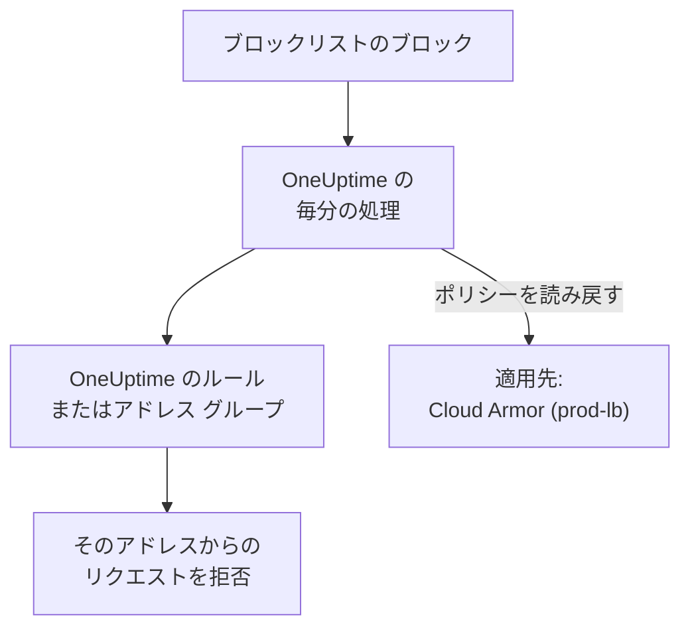

# Cloud Armor でアドレスをブロックする

プロジェクトのブロックリストは、ロードバランサーの Google Cloud Armor セキュリティ ポリシーで適用できます。既存の Google Cloud 接続でこれをオンにしてセキュリティ ポリシーを選ぶと、ブロックリストがブロックするすべてのアドレスがそこでブロックされます。ブロックしたのが人でも、プレイブックでも、OneUptime AI でも同じです。

:::cards
- [有効にする](#有効にする): Google Cloud 接続の設定を一つ変更し、必要なロールを付与します。
- [OneUptime が作成するもの](#oneuptime-が作成するもの): 各ポリシーに置く独自のルール、または Cloud Armor Enterprise でのアドレス グループです。
- [照合されるアドレス](#照合されるアドレス): 接続してきたアドレス、またはプロキシの背後にあるユーザー IP です。
:::

## しくみ

OneUptime は、選んだ各セキュリティ ポリシーに独自のルールを置き、ブロックリストがブロックするアドレスをそこに入れます。OneUptime は毎分、変わった部分をルール一つずつ変更し、その後ポリシーを読み戻します。**ブロックリスト** ページでは、ポリシーがブロックを保持してはじめて、ブロックの **適用先** に Cloud Armor (prod-lb) と表示されます。それまでは適用されていません。

## 始める前に

- OneUptime に接続済みの Google Cloud プロジェクト ([クラウド アカウントの接続](/docs/telemetry/cloud-accounts#google-cloud) を参照)。
- ブロックリストの適用先を変更できるロール: **プロジェクト所有者**、**プロジェクト管理者**、**セキュリティ管理者** のいずれか。
- Cloud Shell でコマンドを一つ実行するために、Google Cloud プロジェクトでロールを作成して付与できる人。

## 有効にする

:::steps
### 接続を開く
**クラウド → 接続** を開き、Google Cloud 接続を編集します。

### 設定をオンにする
**その他の項目** で **Cloud Armor でアドレスをブロック** を **オン** に設定して保存します。フォームに表示されるセットアップ コマンドは、ほかのロールを付与する場所に、以下のロールも付与するようになります。既存の接続でコマンドを再実行する必要はありません。**WAF を追加** ダイアログに、ポリシーのプロジェクトでロールを付与する行が表示されます。

### セキュリティ ポリシーを追加する
**セキュリティイベント → プレイブック → ブロックリスト** を開きます。**クラウド WAF** で **WAF を追加** をクリックし、セキュリティ ポリシーを選びます。OneUptime は何も書き込まずに、接続がそのポリシーに書き込めるかを Google Cloud に問い合わせます。

### ロールがなければ付与する
権限が不足している場合、ダイアログにはポリシーのプロジェクトで権限を付与する行が表示されます。Cloud Shell で実行し、**再確認** をクリックしてから、ポリシーを追加します。OneUptime がポリシーを設定すると、**ステータス** に **適用中** と表示されます。
:::

セキュリティ ポリシーは接続のインベントリから取得されます。OneUptime がまだ読み取っていないポリシーは、次回の読み取り後に一覧に表示されます。ポリシーがブロックリストを適用している間は、その接続の設定をオフにすることも、接続を削除することもできません。先にポリシーを削除して、OneUptime にルールを外させてください。

## OneUptime が作成するもの

ポリシーがブロックリストをどう保持するかは、ポリシーを追加するときに OneUptime が決めます。

| 内容 | 名前 | 場所 |
| --- | --- | --- |
| 403 で拒否するルール。それぞれ最大 10 個のアドレスまたは範囲を保持 | 説明が `OneUptime blocklist <project> #1`, `#2`, ... で始まる | 選んだ各ポリシー内。最大 20 個。 |
| 二つのアドレス グループ (IPv4 と IPv6) | `oneuptime-<project>-block-ipv4`, `oneuptime-<project>-block-ipv6` | グローバル。ポリシーのプロジェクト内。Cloud Armor Enterprise の場合のみ。 |
| どちらかのグループにあるものを 403 で拒否するルール一つ | 説明が `OneUptime blocklist <project>, address groups` で始まる | 選んだ各グローバル バックエンド ポリシー内。Cloud Armor Enterprise の場合。 |

`<project>` はプロジェクトの外部 ID の先頭八文字なので、同じポリシーを選んだ二つの OneUptime プロジェクトが互いのルールに書き込むことはありません。Cloud Armor はルールを優先度だけで識別するため、OneUptime は説明で自身のルールを見分けます。

- **ルール。** Cloud Armor はルール一つに 10 個のアドレスまたは範囲を保持するため、ポリシーは OneUptime の 20 個のルールに最大 200 個のブロックを保持します。収まらないブロックは、その行にそう表示されます。
- **アドレス グループ。** Cloud Armor Enterprise を利用しているプロジェクトのグローバル バックエンド ポリシーでは、代わりに二つのアドレス グループでブロックリストを保持します。IPv4 の範囲を 10,000 個、IPv6 の範囲を 2,000 個です。プロジェクトのこうしたポリシーはすべてグループを共有し、各ポリシーのルール一つがグループの内容を拒否します。グループはプロジェクトのアドレス グループ クォータを 16,000 ユニット使用します。

OneUptime は、Cloud Armor のルール メソッドを使って自身のルールを一つずつ追加、変更、削除します。ポリシーを丸ごと書き込むことはなく、あなたのルールに書き込むこともありません。単一のアドレスは `/32` または `/128` として書き込まれます。

## ポリシー内でのルールの位置

OneUptime は自身のルールを、リクエストを通過させるあなたの最初のルールより前の空き優先度に、小さい番号から順に置きます。そのため、あなたのルールがブロック対象のアドレスを通過させることはありません。リクエストを通過させるルールとは、許可、スロットリング、レートベースの禁止、公平な配分を行うルールです。拒否を行うあなたのルールは、それより前にあってもかまいません。OneUptime があなたのルールの番号を振り直したり、変更や削除をしたりすることはありません。最初のそうしたルールより前に空き優先度がない場合、ポリシーには **空き優先度なし** と表示され、あなたが一つ空けると OneUptime がルールを追加します。

## 照合されるアドレス

| セキュリティ ポリシー | クライアントアドレス | 選ぶ場面 |
| --- | --- | --- |
| バックエンド | **ロードバランサーに接続したアドレス (origin.ip)** | 既定値です。 |
| バックエンド | ポリシーのリクエストヘッダーによるユーザー IP (origin.user_ip) | 別のプロキシや CDN の背後にあるロードバランサーの場合。 |
| エッジ | ロードバランサーに接続したアドレス (origin.ip) | 唯一の選択肢です。エッジ ポリシーはほかのアドレスを読み取りません。 |

`origin.user_ip` は、ポリシーのユーザー IP リクエストヘッダー (`userIpRequestHeaders`) にあるアドレスで、ロードバランサーの前段にあるプロキシや CDN が書き込みます。ヘッダーが設定されていない場合や、有効なアドレスが含まれていない場合は `origin.ip` になります。ロードバランサーに直接到達するクライアントはこれらのヘッダーを自分で書き込めるため、そうしたプロキシが書き込む場合にだけ選んでください。この選択は **WAF を追加** ダイアログの **その他の項目** にあり、後からポリシーの行の **クライアントアドレス** で変更できます。

パススルー ネットワーク ロードバランサー向けのネットワーク エッジ セキュリティ ポリシーは選べず、**WAF を追加** ダイアログにその理由が表示されます。そのルールはリクエストではなくパケットを照合するためです。

Cloud Armor での OneUptime のルールは拒否のみを行います。アドレスへのチャレンジを求めるブロックは Cloud Armor では適用されず、その旨が表示されます。自動対応ポリシーのチャレンジは、同じ期間のブロックとしてそこで適用されます。

## ルールが手動で変更された場合

誰かが OneUptime のルールをプレビュー モードにしたり、変更や削除をしたり、アドレス グループを削除したりした場合、OneUptime はそのままにしておきます。ポリシーには **手動で変更済み** と表示され、そこにあったブロックは、理由とともに未適用になります。これは誰かがポリシーの行で **元に戻す** をクリックするまで続きます。「元に戻す」は、OneUptime が書き込むとおりにルールを書き直し、優先度が空いていれば元の優先度に置き、削除されたアドレス グループを作り直します。

OneUptime は、ポリシーがバックエンド サービスに接続されているかを確認しません。どのバックエンド サービスにも接続されていないポリシーは、何もブロックしません。

## Terraform でポリシーを管理する

`rule` ブロックを持つ `google_compute_security_policy` はポリシーのすべてのルールを所有するため、次回の plan で OneUptime のルールが削除されます。ルールは、ほかのルールに手を付けない `google_compute_security_policy_rule` リソースとして管理するか、ポリシーの `lifecycle` ブロックに `ignore_changes = [rule]` を追加してください。

## 権限

セットアップ コマンドは、接続のほかのロールを付与する場所にカスタム ロール `oneuptimeCloudArmorBlocklist` を追加し、接続のサービス アカウントに付与します。**WAF を追加** ダイアログに表示される行は、同じロールをポリシーのプロジェクトに追加します。アドレス グループではなくルールでブロックリストを保持するポリシーに必要なのは、ポリシー自体の権限だけです。

| 権限 | 理由 |
| --- | --- |
| `compute.securityPolicies.get`, `compute.securityPolicies.update` | グローバル ポリシーを読み取り、そこで OneUptime のルールを変更します。 |
| `compute.regionSecurityPolicies.get`, `compute.regionSecurityPolicies.update` | リージョン ポリシーを読み取り、そこで OneUptime のルールを変更します。 |
| `compute.globalOperations.get`, `compute.regionOperations.get` | 変更が完了するまで待ちます。 |
| `compute.projects.get` | プロジェクトに Cloud Armor Enterprise があるかを読み取ります。 |
| `networksecurity.addressGroups.get`, `networksecurity.addressGroups.list`, `networksecurity.addressGroups.create`, `networksecurity.addressGroups.update`, `networksecurity.addressGroups.delete`, `networksecurity.addressGroups.use` | OneUptime のアドレス グループを維持し、そのルールから参照します。Cloud Armor Enterprise の場合のみ。 |
| `networksecurity.operations.get` | アドレス グループの変更が完了するまで待ちます。 |

このロールはポリシーを削除できず、OneUptime がそれ以外のものに書き込むことはありません。セットアップ コマンドは Compute Engine API と Network Security API も有効にします。

## 削除する

:::steps
### セキュリティ ポリシーを削除する
**セキュリティイベント → プレイブック → ブロックリスト** で、ポリシーの行の **削除** をクリックします。OneUptime はポリシーから自身のルールを外し、プロジェクトのほかのポリシーがアドレス グループを使わなくなった時点でそれらを削除します。

### 設定をオフにする
接続を編集し、**Cloud Armor でアドレスをブロック** を **オフ** に設定して保存します。この設定は、接続のどのポリシーもブロックリストを適用しなくなった時点でオフにできます。
:::

OneUptime がポリシーに書き込めなくなった場合は、**WAF を削除** ダイアログで **OneUptime からのみ削除** にチェックを入れます。OneUptime はポリシーをブロックリストから削除し、残したルールとアドレス グループの名前を示します。これらは Google Cloud で削除するまで、保持している内容をブロックし続けます。

## トラブルシューティング

:::details 未適用
ポリシーのステータスには、Google Cloud の応答と対処方法が表示されます。拒否された場合は、不足している権限が示されます。**WAF を追加** がこのポリシーに表示する行を実行してから、**再確認** をクリックします。クォータを理由に拒否された場合は、そのクォータが示されます。Google Cloud にクォータの引き上げを依頼するか、使わなくなったルールを削除してください。
:::

:::details 空き優先度なし
リクエストを通過させるあなたの最初のルールより前の優先度が、すべて使われています。そのルールの番号を大きくしてから、**再確認** をクリックします。
:::

:::details ポリシーが一覧にない
OneUptime は、設定がオンになっている接続のセキュリティ ポリシーを、読み取った時点で一覧に表示します。その後に追加されたポリシーは、接続の次回の読み取り後に表示されます。
:::

## 次のステップ

:::cards
- [セキュリティケースとプレイブック](/docs/telemetry/security-cases): ケースからアドレスをブロックし、そのステップが確認される様子を見ます。
- [クラウド アカウントの接続](/docs/telemetry/cloud-accounts): この設定が属する接続です。
:::
