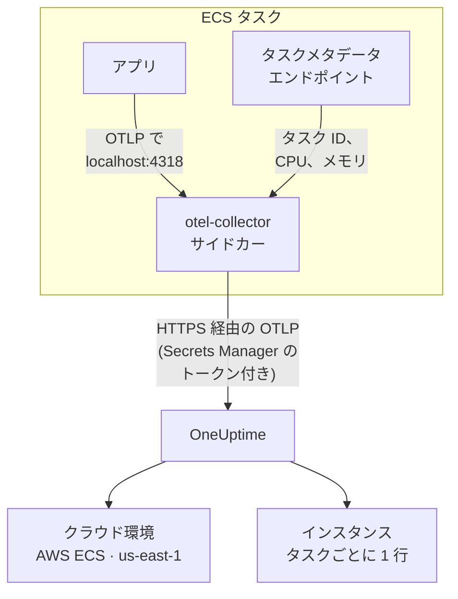

# AWS ECS / Fargate

Amazon ECS タスクのトレース、ログ、メトリクスを OneUptime に送ります。起動タイプは Fargate と EC2 のどちらでもかまいません。`cloud.platform=aws_ecs` を報告するすべてのタスクは、実行するサービスが一つでも五十でも、AWS アカウントとリージョンごとに一つの **クラウド環境** (例: _AWS ECS · us-east-1 · 123456789012_) に入ります。

:::cards
- [仕組み](#仕組み): ECS 検出器とサイドカー Collector の役割。
- [セットアップ](#セットアップ): トークンを保存し、タスク定義に設定を追加して、デプロイと確認を行います。
- [完全なタスク定義](#完全なタスク定義): そのまま登録できる完全な Fargate タスク定義。
- [トラブルシューティング](#トラブルシューティング): PENDING のまま止まるタスク、拒否されるエクスポート、空のインスタンスやタイル。
:::

## 仕組み



- **ECS 検出器が環境に名前を付けます。** SDK または Collector にある OpenTelemetry の ECS リソース検出器が、ECS が各コンテナに提供するタスクメタデータエンドポイントを読み取り、タスクが送るすべてのデータにアカウント、リージョン、タスクを付けます。ハードコードするものはありません。
- **タスクが各インスタンスの名前になります。** 環境の **インスタンス** タブには、実行中のタスクがタスク ID ごとに、CPU とメモリとともに一覧表示されます。
- **サイドカー Collector が CPU とメモリを追加します。** その `awsecscontainermetrics` レシーバーが、同じエンドポイントから各タスクの CPU とメモリを読み取ります。トークンは Collector が持つので、アプリケーションからは見えません。

ECS 検出器は次のリソース属性を設定します:

| 属性 | ECS 検出器が設定する値 | 用途 |
| ------------------------------------------------------------------ | ----------------------- | --------------------------------------------------------------------------------------------------------- |
| `cloud.platform` | `aws_ecs` | テレメトリを **クラウド環境** に振り分けます。値は完全に一致している必要があります |
| `cloud.account.id` | `123456789012` | 環境キーの一部 |
| `cloud.region` | `us-east-1` | 環境キーの一部 |
| `aws.ecs.task.arn` | タスク ARN | 末尾のタスク ID で、実行中のタスク一つを **インスタンス** に表示します |
| `aws.ecs.task.id` | タスク ID | 同上。新しいバージョンの検出器は両方を設定します |
| `aws.ecs.cluster.arn`, `aws.ecs.task.family`, `aws.ecs.launchtype` | クラスターとタスク | 検索できるよう、すべてのスパン、ログ、メトリクスに残ります。環境の一部ではありません |

環境キーは `aws_ecs|123456789012|us-east-1` です。SDK が `service.instance.id` も設定している場合でも、インスタンスの名前にはタスク ID が使われます。サイドカーのコンテナメトリクスはタスク ID しか持たないため、タスク ID をキーにすることで、タスクのスパンと CPU、メモリが同じ行にまとまります。ルールの全体は [クラウド環境](/docs/telemetry/cloud-environments) を参照してください。

## 始める前に

- **取り込みキー。** **プロジェクト設定 → テレメトリと APM → 取り込みキー** で **サーバー** キーを作成し、そのトークンをコピーします。
- **変更できる ECS クラスターとタスク定義**、およびそのアカウント用に設定した AWS CLI。
- **OpenTelemetry SDK で計装したアプリケーション** (OTLP をエクスポートするもの。言語は問いません)。

## テレメトリがタスクから出ていく方法を選ぶ

| | Sidecar collector | SDK direct |
| ----------------------- | ---------------------------------------------- | ----------------------------------------------- |
| 追加のコンテナ | 各タスクの `otel-collector` | なし |
| タスクごとの CPU とメモリ | あり (`awsecscontainermetrics` レシーバーから) | なし |
| トークンを持つもの | Collector | アプリケーション |
| シークレットの中身 | トークンのみ | ヘッダー全体 `x-oneuptime-token=...` |

ほとんどのチームはサイドカー Collector を使います。ECS について何も知らないライブラリーのテレメトリにも、`cloud.*` 属性を付けられるからです。サービスが一つだけなら、SDK direct が最も簡単です。以下の各ステップには両方のタブがあります。一方を選ぶと、すべてのステップがそれに従います。

## セットアップ

:::steps
### Secrets Manager にトークンを保存する

> [!IMPORTANT]
> トークンはシークレットです。AWS Secrets Manager に保存し、タスク定義からは `secrets` と `valueFrom` で参照します。通常の `environment` エントリーに書いたトークンは、タスク定義を読めるすべての人に見え、`describe-task-definition` の出力や CloudFormation の差分にも毎回表示されます。

:::tabs
@tab Sidecar collector
```bash
aws secretsmanager create-secret \
  --name oneuptime/ingestion-token \
  --region us-east-1 \
  --secret-string "YOUR_TELEMETRY_INGESTION_TOKEN"
```

Collector の設定がヘッダー名を付け加えるので、このシークレットにはトークンだけを入れます。
@tab SDK direct
```bash
aws secretsmanager create-secret \
  --name oneuptime/ingestion-token \
  --region us-east-1 \
  --secret-string "x-oneuptime-token=YOUR_TELEMETRY_INGESTION_TOKEN"
```

ECS はシークレットの値をそのまま変数に入れますが、`OTEL_EXPORTER_OTLP_HEADERS` には `name=value` の組全体が必要です。そのため、このシークレットにはヘッダー全体を入れます。
:::

コマンドが出力する ARN を控えておきます。末尾には `oneuptime/ingestion-token-AbCdEf` のようなランダムな接尾辞が付きます。この ARN をタスク定義に貼り付けます。

### タスクにシークレットの読み取りを許可する

タスク実行ロール (コードを実行するロールではなく、ECS がタスクを起動するときのロール) に、シークレットを読み取る権限が必要です。次のポリシーを `ecsTaskExecutionRole` にアタッチします:

```json title="secret-access-policy.json"
{
  "Version": "2012-10-17",
  "Statement": [
    {
      "Effect": "Allow",
      "Action": ["secretsmanager:GetSecretValue"],
      "Resource": "arn:aws:secretsmanager:us-east-1:123456789012:secret:oneuptime/ingestion-token-*"
    }
  ]
}
```

シークレットをカスタマーマネージド KMS キーで暗号化している場合は、そのキーに対する `kms:Decrypt` もロールに必要です。どちらかが欠けているとタスクは起動せず、`ResourceInitializationError: unable to pull secrets` で停止します。

### タスク定義に設定を追加する

:::tabs
@tab Sidecar collector
1. **AWS Console → Amazon Elastic Container Service → Task definitions** → ファミリーを選択 → **Create new revision**。
2. **Container - 1** (アプリケーション) で **Environment variables** を展開し、下記のアプリケーション変数を追加します。
3. **+ Add container**: 名前は `otel-collector`、イメージは `otel/opentelemetry-collector-contrib:latest` (動作を確認したらバージョンを固定します)、**Essential container: No**。**Docker configuration → Command** に `--config=env:OTEL_COLLECTOR_CONFIG` を入力します。
4. Collector コンテナに、**Value type: ValueFrom** とシークレット ARN を指定した環境変数 `ONEUPTIME_TOKEN` と、**Value type: Value** と下記の Collector 設定を指定した `OTEL_COLLECTOR_CONFIG` を追加します。
5. アプリケーションコンテナの **Startup dependency ordering** で、条件 **Start** を付けて `otel-collector` を追加します。こうすると、ポート 4318 で何かが待ち受ける前にアプリケーションが起動することはありません。
6. **Task execution role** が、ポリシーをアタッチしたロールであることを確認します。

アプリケーション変数。`awsvpc` ネットワークモード (Fargate では常にこれ) では、タスクのコンテナは一つのネットワークを共有するため、`localhost` がサイドカーになります:

```bash
OTEL_SERVICE_NAME=checkout-api
OTEL_EXPORTER_OTLP_ENDPOINT=http://localhost:4318
OTEL_EXPORTER_OTLP_PROTOCOL=http/protobuf
```

Collector の設定。Collector は設定全体を `OTEL_COLLECTOR_CONFIG` 変数から読むので、イメージに組み込むファイルは不要です。また、ECS が環境に入れたシークレットから `${env:ONEUPTIME_TOKEN}` を展開します:

```yaml title="OTEL_COLLECTOR_CONFIG"
receivers:
  otlp:
    protocols:
      http:
        endpoint: 0.0.0.0:4318
      grpc:
        endpoint: 0.0.0.0:4317
  # Per-task and per-container CPU / memory from the ECS task metadata
  # endpoint. This is what fills the CPU and memory tiles in OneUptime.
  awsecscontainermetrics:
    collection_interval: 20s
processors:
  # Stamps cloud.provider, cloud.platform=aws_ecs, cloud.account.id,
  # cloud.region and aws.ecs.task.arn on every span, log and metric.
  resourcedetection:
    detectors: [env, ecs]
    timeout: 5s
  batch: {}
exporters:
  otlphttp/oneuptime:
    endpoint: https://oneuptime.com/otlp
    headers:
      x-oneuptime-token: ${env:ONEUPTIME_TOKEN}
service:
  pipelines:
    traces:
      receivers: [otlp]
      processors: [resourcedetection, batch]
      exporters: [otlphttp/oneuptime]
    metrics:
      receivers: [otlp, awsecscontainermetrics]
      processors: [resourcedetection, batch]
      exporters: [otlphttp/oneuptime]
    logs:
      receivers: [otlp]
      processors: [resourcedetection, batch]
      exporters: [otlphttp/oneuptime]
```

`ecs` 検出器も `awsecscontainermetrics` レシーバーも、IAM 権限は不要です。どちらも、ECS が各コンテナに `ECS_CONTAINER_METADATA_URI_V4` で渡すメタデータエンドポイントを読みます。
@tab SDK direct
1. **AWS Console → Amazon Elastic Container Service → Task definitions** → ファミリーを選択 → **Create new revision**。
2. **Container - 1** (アプリケーション) で **Environment variables** を展開し、下記の変数を追加します。`OTEL_EXPORTER_OTLP_HEADERS` は、**Value type: ValueFrom** を選び、値にシークレット ARN を指定して追加します。
3. 下の表から、使っている言語の ECS リソース検出器を有効にする設定を追加します。
4. **Task execution role** が、ポリシーをアタッチしたロールであることを確認します。

```bash
OTEL_SERVICE_NAME=checkout-api
OTEL_EXPORTER_OTLP_ENDPOINT=https://oneuptime.com/otlp
OTEL_EXPORTER_OTLP_PROTOCOL=http/protobuf
# Injected from Secrets Manager (secrets / valueFrom), not typed here.
OTEL_EXPORTER_OTLP_HEADERS=x-oneuptime-token=YOUR_TELEMETRY_INGESTION_TOKEN
```

| 言語 | ECS 検出器を有効にする方法 |
| -------- | --------------------------------------------------------------------------------------------------------------- |
| Node.js | `OTEL_NODE_RESOURCE_DETECTORS=env,host,os,aws` (auto-instrumentations-node) |
| Python | `pip install opentelemetry-sdk-extension-aws` の後、`OTEL_EXPERIMENTAL_RESOURCE_DETECTORS=aws_ecs` |
| Java | `-Dotel.resource.providers.aws.enabled=true` (エージェントではこのプロバイダーが既定で無効です) |
| Go | `import "go.opentelemetry.io/contrib/detectors/aws/ecs"` し、`ecs.NewResourceDetector()` を `resource.New` に渡します |
| .NET | `OpenTelemetry.Resources.AWS` パッケージ: `.ConfigureResource(r => r.AddAWSECSDetector())` |

タスク定義ファイルでは、シークレットは `"secrets": [{ "name": "OTEL_EXPORTER_OTLP_HEADERS", "valueFrom": "<secret ARN>" }]` と書きます。
:::

OneUptime をセルフホストしている場合は、エンドポイントに `https://YOUR-ONEUPTIME-HOST/otlp` を使います。

### 新しいリビジョンをデプロイする

**Create** をクリックし、続けて **Clusters → your cluster → Services → select the service → Update → Task definition revision: latest → Deploy** を実行します。CLI の場合は次のとおりです:

```bash
aws ecs update-service \
  --cluster production \
  --service checkout-api \
  --task-definition checkout-api
```

### 接続を確認する

まずトークンを確認します。最も手軽な確認で、これが通らなければ後の手順はどれも動きません。

```bash
curl -i https://oneuptime.com/otlp/v1/validate \
  -H "x-oneuptime-token: YOUR_TELEMETRY_INGESTION_TOKEN"
```

`200` と `"valid": true` が返れば、トークンは受け付けられています。`401` は、トークンが不明、失効、無効、または期限切れであることを意味します。タスク自体が OneUptime に到達できることを確かめるため、ECS Exec でタスクの中から同じコマンドを実行します:

```bash
aws ecs execute-command --cluster production --task <task id> \
  --container app --interactive --command "sh"
```

Collector の CloudWatch ログストリーム (`otel/otel-collector/...`) に `Everything is ready` と表示され、`401` や `connection refused` の行がないことを確認します。最初のスパン、ログ、メトリクスが届いてから 1 分以内に、環境が **クラウド → すべての環境** に _AWS ECS · us-east-1 · 123456789012_ として表示されます。
:::

## 完全なタスク定義

`aws ecs register-task-definition --cli-input-json file://task-definition.json` で登録するファイルとしてのサイドカー構成です。アカウント ID、リージョン、イメージ、シークレット ARN を置き換えてください:

```json title="task-definition.json"
{
  "family": "checkout-api",
  "requiresCompatibilities": ["FARGATE"],
  "networkMode": "awsvpc",
  "cpu": "512",
  "memory": "1024",
  "executionRoleArn": "arn:aws:iam::123456789012:role/ecsTaskExecutionRole",
  "taskRoleArn": "arn:aws:iam::123456789012:role/checkout-api-task-role",
  "containerDefinitions": [
    {
      "name": "app",
      "image": "123456789012.dkr.ecr.us-east-1.amazonaws.com/checkout-api:1.4.2",
      "essential": true,
      "portMappings": [{ "containerPort": 8080, "protocol": "tcp" }],
      "environment": [
        { "name": "OTEL_SERVICE_NAME", "value": "checkout-api" },
        {
          "name": "OTEL_EXPORTER_OTLP_ENDPOINT",
          "value": "http://localhost:4318"
        },
        { "name": "OTEL_EXPORTER_OTLP_PROTOCOL", "value": "http/protobuf" }
      ],
      "dependsOn": [
        { "containerName": "otel-collector", "condition": "START" }
      ],
      "logConfiguration": {
        "logDriver": "awslogs",
        "options": {
          "awslogs-group": "/ecs/checkout-api",
          "awslogs-region": "us-east-1",
          "awslogs-stream-prefix": "app"
        }
      }
    },
    {
      "name": "otel-collector",
      "image": "otel/opentelemetry-collector-contrib:latest",
      "essential": false,
      "command": ["--config=env:OTEL_COLLECTOR_CONFIG"],
      "secrets": [
        {
          "name": "ONEUPTIME_TOKEN",
          "valueFrom": "arn:aws:secretsmanager:us-east-1:123456789012:secret:oneuptime/ingestion-token-AbCdEf"
        }
      ],
      "environment": [
        {
          "name": "OTEL_COLLECTOR_CONFIG",
          "value": "receivers:\n  otlp:\n    protocols:\n      http:\n        endpoint: 0.0.0.0:4318\n      grpc:\n        endpoint: 0.0.0.0:4317\n  awsecscontainermetrics:\n    collection_interval: 20s\nprocessors:\n  resourcedetection:\n    detectors: [env, ecs]\n    timeout: 5s\n  batch: {}\nexporters:\n  otlphttp/oneuptime:\n    endpoint: https://oneuptime.com/otlp\n    headers:\n      x-oneuptime-token: ${env:ONEUPTIME_TOKEN}\nservice:\n  pipelines:\n    traces:\n      receivers: [otlp]\n      processors: [resourcedetection, batch]\n      exporters: [otlphttp/oneuptime]\n    metrics:\n      receivers: [otlp, awsecscontainermetrics]\n      processors: [resourcedetection, batch]\n      exporters: [otlphttp/oneuptime]\n    logs:\n      receivers: [otlp]\n      processors: [resourcedetection, batch]\n      exporters: [otlphttp/oneuptime]\n"
        }
      ],
      "logConfiguration": {
        "logDriver": "awslogs",
        "options": {
          "awslogs-group": "/ecs/checkout-api",
          "awslogs-region": "us-east-1",
          "awslogs-stream-prefix": "otel"
        }
      }
    }
  ]
}
```

`OTEL_COLLECTOR_CONFIG` の値は、Collector の設定を一つの JSON 文字列にしたものです。手でエスケープする代わりに、YAML を `collector.yaml` に置いて `jq` に任せます:

```bash
jq --rawfile cfg collector.yaml \
  '.containerDefinitions[1].environment[0].value = $cfg' \
  task-definition.json > task-definition.rendered.json
aws ecs register-task-definition --cli-input-json file://task-definition.rendered.json
```

## ネットワーク

タスクは VPC の外にある二つの宛先に到達する必要があります。起動のための Secrets Manager と、エクスポートのための OneUptime です。

- **プライベートサブネットの Fargate タスク** には、インターネットへのルートが必要です。サブネットのルートテーブルにある NAT ゲートウェイか、`assignPublicIp=ENABLED` を付けたパブリックサブネットです。どちらもないタスクは、Collector が何かを送る前に、シークレットの取得で `PENDING` のまま止まります。
- **セキュリティグループの送信ルール** で、OneUptime ホスト (`oneuptime.com`、またはセルフホストのホストとその待ち受けポート) への TCP 443 を許可する必要があります。既定のセキュリティグループはすべての送信を許可しますが、制限されたグループでは許可されていないことがよくあります。テレメトリに受信ルールは不要です。
- **VPC インターフェイスエンドポイント** を `com.amazonaws.us-east-1.secretsmanager` (およびイメージの取得用に `ecr.api`、`ecr.dkr`、S3) に用意すると、AWS への呼び出しが NAT を通らなくなります。OneUptime 自体へのインターネットのルートは引き続き必要です。

```bash
aws ecs update-service \
  --cluster production \
  --service checkout-api \
  --task-definition checkout-api \
  --network-configuration "awsvpcConfiguration={subnets=[subnet-0abc1234],securityGroups=[sg-0def5678],assignPublicIp=ENABLED}"
```

## 得られるもの

- **概要**: トレースから算出したリクエスト、エラー率、p95 レイテンシ、**CPU** と **メモリ** のタイル、**CPU 使用率の上位インスタンス**。タイルには、`awsecscontainermetrics` レシーバーの `ecs.task.cpu.utilized` と `ecs.task.memory.utilized`、またはタスクの識別子を持つ任意の `container.cpu.utilization` と `container.memory.usage` メトリクスが使われます。SDK direct はどちらも送りません。
- **インスタンス**: 実行中のタスクごとに一行。名前はタスク ID (`aws.ecs.task.arn` の末尾) で、最新の CPU、メモリ、最終確認時刻が表示されます。報告が途絶えたタスクは **古い** になります。
- **ログ**、**トレース**、**メトリクス**: このアカウントとリージョンで `cloud.platform=aws_ecs` を持っていたすべてのデータ。
- **サービス**: 同じタスクを `service.name` ごとに分けたもの。

## トラブルシューティング

ECS で起きる障害を、起きる順に並べています:

:::details タスクが "unable to pull secrets" で PENDING のまま止まる
エラー全文は `ResourceInitializationError: unable to pull secrets` です。タスク実行ロールにシークレットに対する `secretsmanager:GetSecretValue` (またはそのキーに対する `kms:Decrypt`) がないか、タスクから Secrets Manager へのルートがありません (NAT ゲートウェイも VPC エンドポイントもない)。[ネットワーク](#ネットワーク) を参照してください。
:::

:::details Collector のログに 401 が出る
シークレットの値が間違っています。サイドカー Collector ではトークンだけ、SDK direct ではヘッダー全体 `x-oneuptime-token=...` でなければなりません。トークン自体は [接続を確認する](#接続を確認する) のコマンドで確認します。
:::

:::details 環境は表示されるが、インスタンスが空
テレメトリにタスクの識別子がありません。`ecs` 検出器が動いていることを確認してください。リソースには `aws.ecs.task.arn`、`aws.ecs.task.id`、または `service.instance.id` が必要です。
:::

:::details インスタンスは表示されるが、CPU とメモリのタイルが空のまま
`awsecscontainermetrics` レシーバーが `metrics` パイプラインにないか、そのパイプラインが `resourcedetection` プロセッサーを通っていないため、コンテナメトリクスが `cloud.platform` なしで届いています。SDK direct では、これらのタイルは埋まりません。
:::

環境がまったく表示されない、**ホスト** や **サーバーレス関数** に表示される、**切断済み** と表示される、二つに分かれる場合は、[クラウドのトラブルシューティング](/docs/telemetry/cloud-troubleshooting) を参照してください。

## 次のステップ

:::cards
- [クラウド環境](/docs/telemetry/cloud-environments): 環境とインスタンスの識別方法。
- [クラウドのトラブルシューティング](/docs/telemetry/cloud-troubleshooting): すべてのプラットフォームに共通する障害。
- [クラウドリソース (IaaS と PaaS)](/docs/telemetry/cloud-resources): CloudWatch から取得するロードバランサー、RDS データベース、バケット。
- [OpenTelemetry](/docs/telemetry/open-telemetry): アプリケーションの計装と、エンドポイントおよび制限。
:::
