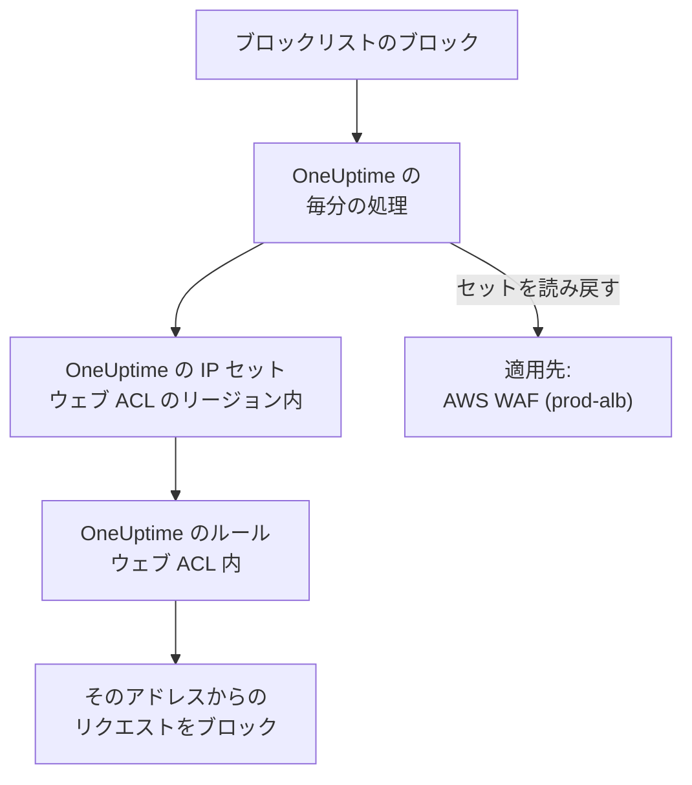

# AWS WAF でアドレスをブロックする

プロジェクトのブロックリストは、CloudFront ディストリビューション、ロードバランサー、API Gateway の前段にある AWS WAF のウェブ ACL で適用できます。既存の AWS クラウド接続でこれをオンにしてウェブ ACL を選ぶと、ブロックリストがブロックするすべてのアドレスがそこでブロックされます。ブロックしたのが人でも、プレイブックでも、OneUptime AI でも同じです。

:::cards
- [有効にする](#有効にする): AWS 接続の設定を 1 つ変更し、セットアップ コマンドをもう一度実行します。
- [OneUptime が作成するもの](#oneuptime-が作成するもの): リージョンごとに四つの IP セット、ウェブ ACL ごとに二つのルールです。
- [ウェブ ACL をコードで管理する](#ウェブ-acl-をコードで管理する): Terraform や CloudFormation で、ルールを自分で追加します。
:::

## しくみ

OneUptime は、選んだウェブ ACL があるリージョンごとに独自の IP セットを置き、各ウェブ ACL にはそのセット内のアドレスをブロックするルールを置きます。OneUptime は毎分、ブロックリストの内容で各セットを一度ずつ書き込み、その後セットを読み戻します。**ブロックリスト** ページでは、AWS WAF がブロックを保持し、ウェブ ACL のルールがそのセットをブロックしてはじめて、ブロックの **適用先** に AWS WAF (prod-alb) と表示されます。それまでは適用されていません。

## 始める前に

- OneUptime に接続済みの AWS アカウント ([クラウド アカウントの接続](/docs/telemetry/cloud-accounts#amazon-web-services) を参照)。
- ブロックリストの適用先を変更できるロール: **プロジェクト所有者**、**プロジェクト管理者**、**セキュリティ管理者** のいずれか。
- AWS アカウントで接続のセットアップ コマンドをもう一度実行できる人。

## 有効にする

:::steps
### 接続を開く
**クラウド → 接続** を開き、AWS 接続を編集します。

### ルールを追加する側を選ぶ
**その他の項目** で、**AWS WAF でアドレスをブロック** を **オン、OneUptime がルールを追加** に設定します。ウェブ ACL を Terraform や CloudFormation で管理している場合は、**オン、自分でコードにルールを追加** に設定します。

### セットアップ コマンドをもう一度実行する
フォームに表示されるコマンドは、IP セットの権限を付与するようになり、OneUptime がルールを追加する場合はそのルールの権限も付与します。AWS CloudShell で実行してから、接続を保存します。

### ウェブ ACL を追加する
**セキュリティイベント → プレイブック → ブロックリスト** を開きます。**クラウド WAF** で **ウェブ ACL を追加** をクリックし、ウェブ ACL と、クライアントのアドレスを読み取る場所を選んで追加します。OneUptime はすぐに設定を行い、ルールがセットをブロックすると **ステータス** に **適用中** と表示されます。
:::

ウェブ ACL は接続のインベントリから取得されます。OneUptime がまだ読み取っていないウェブ ACL は、次回の読み取り後に一覧に表示されます。ウェブ ACL がブロックリストを適用している間は、その接続の設定をオフにすることも、OneUptime がルールを追加する設定からコードでルールを追加する設定に切り替えることもできず、接続を削除することもできません。先にウェブ ACL を削除して、OneUptime にルールを外させてください。

## OneUptime が作成するもの

| 内容 | 名前 | 場所 |
| --- | --- | --- |
| 四つの IP セット: ブロック用とチャレンジ用、それぞれ IPv4 と IPv6 | `oneuptime-<project>-block-ipv4`, `oneuptime-<project>-block-ipv6`, `oneuptime-<project>-challenge-ipv4`, `oneuptime-<project>-challenge-ipv6` | 選んだウェブ ACL がある各リージョン。CloudFront のウェブ ACL はグローバルで、そのセットは `us-east-1` にあります。 |
| 二つのルール: 一方がブロックし、もう一方がチャレンジする | `OneUptime-Blocklist-<project>`, `OneUptime-Challenge-<project>` | OneUptime がルールを追加する場合、選んだ各ウェブ ACL 内。 |

`<project>` はプロジェクトの外部 ID の先頭八文字なので、一つのアカウント内の二つの OneUptime プロジェクトが互いのセットに書き込むことはありません。同じリージョンのウェブ ACL はセットを共有します。単一のアドレスは `/32` または `/128` として書き込まれます。AWS WAF が保持できるのは、セット 1 つにつき 10,000 個のアドレス、リージョン 1 つにつき 100 個の IP セットまでです (AWS が上限を引き上げた場合を除く)。収まらないブロックは、その行にそう表示されます。

## ウェブ ACL 内でのルールの位置

OneUptime は二つのルールを、あなたの最初のルールより小さい番号の空き優先度に置くため、あなたが書いたルールより先に評価されます。ウェブ ACL にルールが一つもない場合は、優先度 0 と 1 を使います。OneUptime があなたのルールの番号を振り直したり、変更や削除をしたりすることはありません。最初のルールより小さい番号の優先度に空きが二つない場合、ウェブ ACL には **空き優先度なし** と表示され、あなたが二つ空けると OneUptime がルールを追加します。

各ルールは、IPv4 と IPv6 のどちらかのセットにクライアントのアドレスが含まれているときに一致します。AWS WAF はウェブ ACL を丸ごと更新するため、OneUptime はウェブ ACL を読み取ってルールを追加し、ウェブ ACL のロックトークンを付けて書き戻します。その間に誰かが書き込んでいた場合は、もう一度読み取ります。

## 転送されたアドレス

別のプロキシや CDN の背後にあるウェブ ACL には、クライアントではなくプロキシのアドレスが見えます。クライアントのアドレスを読み取る場所は **クライアントアドレス** で選びます。

| クライアントアドレス | ルールが読み取るもの |
| --- | --- |
| **リクエストの送信元アドレス** | リクエストの送信元のアドレス。既定値です。 |
| `X-Forwarded-For` ヘッダーの最後のアドレス | 最後のプロキシが追加したアドレス。それより前のアドレスは、リクエストが自称したものです。 |
| `CF-Connecting-IP` ヘッダー | Cloudflare が書き込む唯一のアドレス。 |
| `True-Client-IP` ヘッダー | Akamai または Cloudflare Enterprise が書き込む唯一のアドレス。 |

ヘッダーのないリクエストは一致しません。AWS WAF は、プロキシのアドレスをブロックするのではなく、そのリクエストを通過させます。

## ウェブ ACL をコードで管理する

**オン、自分でコードにルールを追加** の場合、OneUptime は IP セットだけを作成し、ウェブ ACL には一切書き込みません。ウェブ ACL の行で **ルールを表示** をクリックすると、両方のルールが Terraform (`aws_wafv2_web_acl` の `rule` ブロック) と CloudFormation の形式で、各セットの ARN とウェブ ACL が読み取るヘッダーとともに表示されます。それらをほかのルールより前にコードに追加し、適用してください。

ルールが追加されるまで、ウェブ ACL には **ルールの追加待ち** と表示され、そのブロックは適用されません。OneUptime は処理のたびにウェブ ACL を読み取り、各セットをブロックするルールを見つけた最初の処理から、ルールにどんな名前を付けていてもブロックが適用されます。

## 権限

セットアップ コマンドは、ロールにインラインポリシー `OneUptimeWafBlocklist` を追加します。アクセスキーの場合は、IAM がユーザー自身のポリシーの数を制限しているため、ポリシーはグループ `OneUptimeWafBlocklist-<project>` に付けられ、ユーザーがそのグループに参加します。

| アクション | リソース | 理由 |
| --- | --- | --- |
| `wafv2:ListIPSets` | すべて | リージョン内の OneUptime の IP セットを見つけます。 |
| `wafv2:GetIPSet`, `wafv2:CreateIPSet`, `wafv2:UpdateIPSet`, `wafv2:DeleteIPSet` | OneUptime の IP セットのみ (`oneuptime-<project>-*`) | セットを維持し、リージョンの最後のウェブ ACL を削除したときにセットを削除します。 |
| `wafv2:GetSampledRequests` | ウェブ ACL | ルールが拒否したリクエストを読み取ります。ケースのブロックのステップは、これを根拠に確認されます。 |
| `wafv2:UpdateWebACL` | ウェブ ACL と、それが参照する IP セット、正規表現パターンセット、ルールグループ | OneUptime のルールを追加します。**オン、OneUptime がルールを追加** の場合のみです。 |

ウェブ ACL の読み取り (`wafv2:GetWebACL`) は、接続の読み取り専用ポリシーにすでに含まれています。

## 削除する

:::steps
### ウェブ ACL を削除する
**セキュリティイベント → プレイブック → ブロックリスト** で、ウェブ ACL の行の **削除** をクリックします。OneUptime はウェブ ACL から自身のルールを外し、リージョンのほかのウェブ ACL が IP セットを使わなくなった時点で、IP セットを空にして削除します。

### 設定をオフにする
接続を編集し、**AWS WAF でアドレスをブロック** を **オフ** に設定して保存します。この設定は、接続のどのウェブ ACL もブロックリストを適用しなくなった時点でオフにできます。
:::

OneUptime がウェブ ACL に書き込めなくなった場合は、**ウェブ ACL を削除** ダイアログで **OneUptime からのみ削除** にチェックを入れます。OneUptime はウェブ ACL をブロックリストから削除し、AWS WAF に残したルールと IP セットの名前を示します。これらは AWS WAF で削除するまで、保持している内容をブロックし続けます。あなたのルールがまだ参照しているセットも残ります。OneUptime はそのセットを空にし、その名前を示します。

## トラブルシューティング

:::details 未適用
ウェブ ACL のステータスには、AWS の応答と対処方法が表示されます。拒否された場合は、そのアクションと、それを許可する設定が示されます。その設定をオンにするか、**オン、OneUptime がルールを追加** を選び、接続のセットアップ コマンドをもう一度実行してから **再確認** をクリックします。
:::

:::details 空き優先度なし
最初のルールの優先度が 0 または 1 なので、それより小さい番号の優先度に空きが二つありません。ルールの優先度をそれぞれ二つずつ繰り下げてから、**再確認** をクリックします。
:::

:::details ウェブ ACL が一覧にない
OneUptime は、設定がオンになっている接続のウェブ ACL を、読み取った時点で一覧に表示します。メトリクスでしか確認されていないウェブ ACL を OneUptime が読み取れるようにするには、接続のセットアップ コマンドをもう一度実行する必要があります。
:::

## 次のステップ

:::cards
- [セキュリティケースとプレイブック](/docs/telemetry/security-cases): ケースからアドレスをブロックし、そのステップが確認される様子を見ます。
- [クラウド アカウントの接続](/docs/telemetry/cloud-accounts): この設定が属する接続です。
:::
