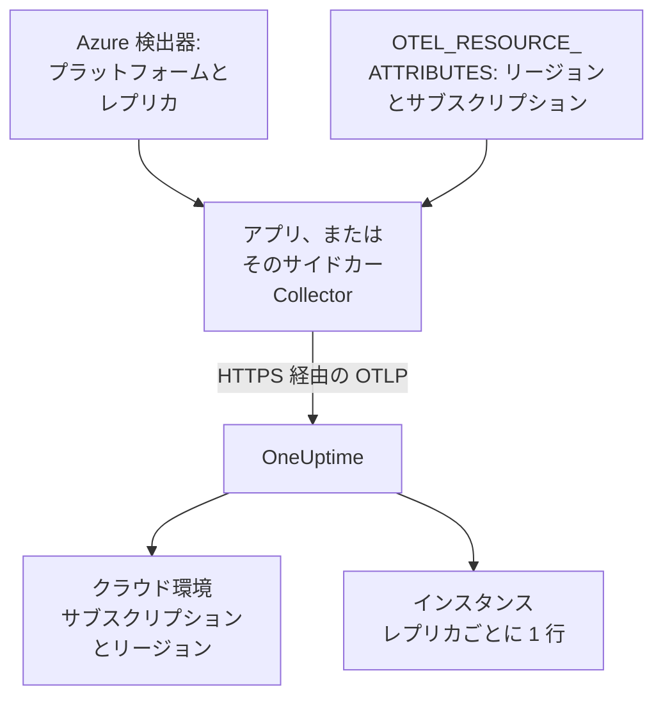

# Azure Container Apps

Azure Container Apps のトレース、ログ、メトリクスを OneUptime に送ります。`cloud.platform=azure_container_apps` を報告するすべてのレプリカは、Azure のサブスクリプションとリージョンごとに一つの **クラウド環境** (例: _Azure Container Apps · eastus · 00000000-0000-0000-0000-000000000000_) に入り、実行中のレプリカは **インスタンス** に一覧表示されます。

:::cards
- [仕組み](#仕組み): 検出器が設定するものと、自分で設定する二つの属性。
- [セットアップ](#セットアップ): トークンを保存し、Azure CLI またはポータルでアプリを構成して、確認します。
- [環境のマネージド OpenTelemetry エージェントを使う](#環境のマネージド-opentelemetry-エージェントを使う): サイドカーなしで、環境内のすべてのアプリのデータを転送します。
- [トラブルシューティング](#トラブルシューティング): 拒否されるエクスポート、見つからない環境、空のインスタンス。
:::

## 仕組み



Container Apps にはリソース検出器があります。Collector の `azurecontainerapps` 検出器と、Node.js (`@opentelemetry/resource-detector-azure`) および .NET (`OpenTelemetry.Resources.Azure`) の検出器です。これらは `CONTAINER_APP_NAME` と `CONTAINER_APP_REPLICA_NAME` を読み取り、`cloud.provider`、`cloud.platform`、`service.name`、レプリカ ID を設定します。どれもリージョンやサブスクリプションを知らないので、`cloud.region` と `cloud.account.id` は `OTEL_RESOURCE_ATTRIBUTES` で自分で設定します。

| 属性 | 値 | 用途 |
| --------------------------------- | ------------------------------------------------------------------------- | ------------------------------------------------------------ |
| `cloud.provider` | `azure` | 概要に表示されます |
| `cloud.platform` | `azure_container_apps` | テレメトリを **クラウド環境** に振り分けます |
| `cloud.region` | 環境のリージョン (例: `eastus`)。自分で設定します | 環境キーの一部 |
| `cloud.account.id` | サブスクリプション ID。自分で設定します | 環境キーの一部 |
| `azure.container_app.instance.id` | レプリカ名。検出器が `CONTAINER_APP_REPLICA_NAME` から設定します | 実行中のレプリカの名前になり、**インスタンス** にそれぞれ一行ずつ表示されます |
| `service.instance.id` | レプリカ名 (自分で設定する場合) | どの検出器もレプリカ ID を設定しなかった場合に使われます |

- **ドット区切りの表記も使えます。** Node.js と .NET の検出器は、プラットフォームをドット付きの `azure.container_apps` と書きます。OneUptime は受信時にこれを `azure_container_apps` に書き換えるので、どちらの表記も同じ環境に入ります。
- **ホスト名はレプリカ名です。** `host` 検出器だけを実行する SDK は、レプリカ名を `host.name` として報告します。より具体的な値がない場合、OneUptime はこれをインスタンスの名前にします。

環境キーは `azure_container_apps|<subscription id>|eastus` です。

## 始める前に

- **取り込みキー。** **プロジェクト設定 → テレメトリと APM → 取り込みキー** で **サーバー** キーを作成し、そのトークンをコピーします。
- **`containerapp` 拡張機能を入れた Azure CLI** (`az extension add --name containerapp --upgrade`) でサブスクリプションにサインインしていること。または Azure ポータル。
- **OpenTelemetry SDK で計装したアプリケーション** (OTLP をエクスポートするもの)。

## テレメトリがアプリから出ていく方法を選ぶ

| | SDK direct | Sidecar collector |
| ------------------ | ------------------------------------------- | ------------------------------------------------------------ |
| 追加のコンテナ | なし | アプリ内の `otel-collector`。レプリカの CPU とメモリを共有します |
| 属性を設定するもの | SDK と、アプリの `OTEL_RESOURCE_ATTRIBUTES` | Collector (通過するすべてのデータに対して) |
| シークレット | `oneuptime-otlp-headers`、ヘッダー全体 | `oneuptime-token`、トークンのみ |

三つ目の方法として、環境のマネージド OpenTelemetry エージェントを使うと、サイドカーなしで環境内のすべてのアプリのデータを転送できます。[環境のマネージド OpenTelemetry エージェントを使う](#環境のマネージド-opentelemetry-エージェントを使う) を参照してください。以下の各ステップには SDK direct とサイドカー Collector のタブがあります。一方を選ぶと、すべてのステップがそれに従います。

## セットアップ

:::steps
### Container Apps のシークレットとしてトークンを保存する

> [!IMPORTANT]
> トークンはシークレットです。Container Apps のシークレットとして保存し、環境変数からは `secretref:` で参照します。設定したシークレットは `az containerapp show` にもポータルにも表示されませんが、通常の環境変数は表示されます。

:::tabs
@tab SDK direct
```bash
az containerapp secret set \
  --name checkout-api \
  --resource-group my-rg \
  --secrets oneuptime-otlp-headers="x-oneuptime-token=YOUR_TELEMETRY_INGESTION_TOKEN"
```

SDK の `OTEL_EXPORTER_OTLP_HEADERS` には `name=value` のヘッダー全体が必要なので、シークレットにはそれを入れます。
@tab Sidecar collector
```bash
az containerapp secret set \
  --name checkout-api \
  --resource-group my-rg \
  --secrets oneuptime-token=YOUR_TELEMETRY_INGESTION_TOKEN
```

Collector がヘッダー名を自分で付け加えるので、シークレットにはトークンだけを入れます。
:::

ポータルの場合: **Azure portal → Container Apps → your app → Settings → Secrets → + Add**。キーを入力し、種類 **Container Apps secret** を選んで値を貼り付け、**Add** をクリックします。

シークレットを Key Vault で管理している場合は、値をコピーする代わりにシークレットを参照します。アプリのマネージド ID には、そのコンテナーに対する **Key Vault Secrets User** ロールが必要です:

```bash
az containerapp secret set \
  --name checkout-api --resource-group my-rg \
  --secrets "oneuptime-token=keyvaultref:https://my-vault.vault.azure.net/secrets/oneuptime-token,identityref:system"
```

### コンテナーアプリを構成する

:::tabs
@tab SDK direct
アプリケーションコンテナに、エクスポーターと、どの検出器も知らない属性を設定します。リージョンとサブスクリプション ID は自分のものに置き換えてください:

```bash
az containerapp update \
  --name checkout-api \
  --resource-group my-rg \
  --set-env-vars \
    OTEL_SERVICE_NAME=checkout-api \
    OTEL_EXPORTER_OTLP_ENDPOINT=https://oneuptime.com/otlp \
    OTEL_EXPORTER_OTLP_PROTOCOL=http/protobuf \
    OTEL_EXPORTER_OTLP_HEADERS=secretref:oneuptime-otlp-headers \
    "OTEL_RESOURCE_ATTRIBUTES=cloud.provider=azure,cloud.platform=azure_container_apps,cloud.region=eastus,cloud.account.id=00000000-0000-0000-0000-000000000000"
```

レプリカの識別子を得るには、SDK の Azure 検出器を有効にします。Node.js では `OTEL_NODE_RESOURCE_DETECTORS=env,host,os,azure`、.NET では `OpenTelemetry.Resources.Azure` と `.ConfigureResource(r => r.AddAzureContainerAppsDetector())` です。この検出器が `CONTAINER_APP_REPLICA_NAME` から `azure.container_app.instance.id` を設定します。

Container Apps では環境変数の中に別の環境変数を入れられないため、ほかの言語では `service.instance.id` を `OTEL_RESOURCE_ATTRIBUTES` に入れられません。ホスト検出器を有効にするか (その `host.name` がレプリカ名です)、コードで設定します:

```js title="tracing.js"
// Node.js: the file you load with --require before the app starts
const { NodeSDK } = require("@opentelemetry/sdk-node");
const { resourceFromAttributes } = require("@opentelemetry/resources");

const sdk = new NodeSDK({
  resource: resourceFromAttributes({
    "service.instance.id": process.env.CONTAINER_APP_REPLICA_NAME,
  }),
});
sdk.start();
```

```python title="tracing.py"
# Python: before the tracer provider is created
import os
from opentelemetry.sdk.resources import Resource

resource = Resource.create({"service.instance.id": os.environ.get("CONTAINER_APP_REPLICA_NAME", "")})
```

どの検出器を使う場合も、`cloud.region` と `cloud.account.id` は `OTEL_RESOURCE_ATTRIBUTES` に残してください。Container Apps のどの検出器もこれらを設定せず、環境キーにはこれらが必要です。

ポータルの場合:

1. **Application → Containers → Edit and deploy** を開き、**Container** タブで自分のコンテナを選んで **Edit** をクリックします。
2. **Environment variables** で、上記の各変数をソース **Manual entry** で追加し、`OTEL_EXPORTER_OTLP_HEADERS` はソース **Reference a secret** で `oneuptime-otlp-headers` を指定して追加します。
3. **Save** をクリックします。
@tab Sidecar collector
サイドカーは同じレプリカで動くので、同じ `CONTAINER_APP_NAME` と `CONTAINER_APP_REPLICA_NAME` が見えます。その `azurecontainerapps` 検出器がこれらを `cloud.provider`、`cloud.platform`、`service.name`、`azure.container_app.instance.id` に変換し、`env` 検出器が Collector 自身の環境の `OTEL_RESOURCE_ATTRIBUTES` から `cloud.region` と `cloud.account.id` を読み取ります。アプリケーションは `http://localhost:4318` にエクスポートするだけです。

アプリの定義をエクスポートし、`template.containers` に Collector を追加して適用します:

```bash
az containerapp show --name checkout-api --resource-group my-rg -o yaml > checkout-api.yaml
# edit checkout-api.yaml as below
az containerapp update --name checkout-api --resource-group my-rg --yaml checkout-api.yaml
```

```yaml title="checkout-api.yaml"
properties:
  configuration:
    secrets:
      - name: oneuptime-token
        value: YOUR_TELEMETRY_INGESTION_TOKEN
  template:
    containers:
      - name: app
        image: myregistry.azurecr.io/checkout-api:1.4.2
        env:
          - name: OTEL_SERVICE_NAME
            value: checkout-api
          - name: OTEL_EXPORTER_OTLP_ENDPOINT
            value: http://localhost:4318
          - name: OTEL_EXPORTER_OTLP_PROTOCOL
            value: http/protobuf
        resources:
          cpu: 0.5
          memory: 1Gi
      - name: otel-collector
        image: otel/opentelemetry-collector-contrib:latest
        args:
          - --config=env:OTEL_COLLECTOR_CONFIG
        env:
          - name: ONEUPTIME_TOKEN
            secretRef: oneuptime-token
          # Read by the resourcedetection processor's env detector.
          - name: OTEL_RESOURCE_ATTRIBUTES
            value: cloud.provider=azure,cloud.platform=azure_container_apps,cloud.region=eastus,cloud.account.id=00000000-0000-0000-0000-000000000000
          - name: OTEL_COLLECTOR_CONFIG
            value: |
              receivers:
                otlp:
                  protocols:
                    http:
                      endpoint: 0.0.0.0:4318
                    grpc:
                      endpoint: 0.0.0.0:4317
              processors:
                # env: cloud.region + cloud.account.id from OTEL_RESOURCE_ATTRIBUTES.
                # azurecontainerapps: cloud.provider, cloud.platform, service.name
                # and azure.container_app.instance.id from the CONTAINER_APP_*
                # variables. override: false keeps the service.name the
                # application set instead of the Container App's name.
                resourcedetection:
                  detectors: [env, azurecontainerapps]
                  timeout: 2s
                  override: false
                batch: {}
              exporters:
                otlphttp/oneuptime:
                  endpoint: https://oneuptime.com/otlp
                  headers:
                    x-oneuptime-token: ${env:ONEUPTIME_TOKEN}
              service:
                pipelines:
                  traces:
                    receivers: [otlp]
                    processors: [resourcedetection, batch]
                    exporters: [otlphttp/oneuptime]
                  metrics:
                    receivers: [otlp]
                    processors: [resourcedetection, batch]
                    exporters: [otlphttp/oneuptime]
                  logs:
                    receivers: [otlp]
                    processors: [resourcedetection, batch]
                    exporters: [otlphttp/oneuptime]
        resources:
          cpu: 0.25
          memory: 0.5Gi
```

`az containerapp show` はシークレットの値をエクスポートしないので、`secrets` エントリーを手で戻すか、最初のステップでシークレットを設定済みなら省きます。更新しても既存のシークレットは残ります。Container Apps はレプリカ内のすべてのコンテナの CPU とメモリを合算するので、サイドカーの `resources` もアプリの割り当てに含まれます。

ポータルの場合:

1. **Application → Containers → Edit and deploy** を開きます。**Container** タブで **+ Add** を使い、名前 `otel-collector`、イメージ `otel/opentelemetry-collector-contrib:latest`、**Arguments override** `--config=env:OTEL_COLLECTOR_CONFIG` のコンテナを追加します。
2. その環境変数を追加します: `ONEUPTIME_TOKEN` (**Reference a secret**: `oneuptime-token`)、`OTEL_RESOURCE_ATTRIBUTES` と `OTEL_COLLECTOR_CONFIG` (**Manual entry**、上記の値)。
3. **Save** をクリックします。
:::

OneUptime をセルフホストしている場合は、エンドポイントに `https://YOUR-ONEUPTIME-HOST/otlp` を使います。

### 新しいリビジョンをデプロイする

`az containerapp update` は、それだけで新しいリビジョンをデプロイします。ポータルでは **Create** をクリックします。複数のリビジョンが有効な場合は、**Revisions and replicas** でトラフィックを新しいリビジョンに移します。

### 接続を確認する

```bash
curl -i https://oneuptime.com/otlp/v1/validate \
  -H "x-oneuptime-token: YOUR_TELEMETRY_INGESTION_TOKEN"
```

`200` と `"valid": true` が返れば、トークンは受け付けられています。`401` は、トークンが不明、失効、無効、または期限切れであることを意味します。次に Collector の出力を確認します:

```bash
az containerapp logs show --name checkout-api --resource-group my-rg \
  --container otel-collector --follow
```

`Everything is ready` が表示され、`401` や `connection refused` がないことを確認します。最初のスパン、ログ、メトリクスが届いてから 1 分以内に、環境が **クラウド → すべての環境** に _Azure Container Apps · eastus · 00000000-0000-0000-0000-000000000000_ として表示されます。
:::

## 環境のマネージド OpenTelemetry エージェントを使う

Container Apps 環境では、Azure のマネージド OpenTelemetry エージェントを実行できます。このエージェントは環境内のすべてのアプリから OTLP を受け取り、設定したエンドポイントに転送するので、各アプリにサイドカーは不要です。エージェントは **OTLP/gRPC のみ** でエクスポートするため、HTTP の `/otlp` パスは使えません。代わりに、OneUptime が TLS 上で OTLP/gRPC を受け付ける、OneUptime ホストのポート 443 に向けます:

```bash
az containerapp env telemetry otlp add \
  --name my-aca-env \
  --resource-group my-rg \
  --otlp-name oneuptime \
  --endpoint oneuptime.com:443 \
  --insecure false \
  --headers "x-oneuptime-token=YOUR_TELEMETRY_INGESTION_TOKEN" \
  --enable-open-telemetry-traces true \
  --enable-open-telemetry-logs true \
  --enable-open-telemetry-metrics true
```

- **セルフホスト:** `YOUR-ONEUPTIME-HOST:443` を使います。セルフホストの OneUptime は、OTLP/gRPC を TLS 上でのみ受け付けます。[gRPC 上の OTLP](/docs/telemetry/open-telemetry#grpc-上の-otlp) を参照してください。
- **属性を設定するのは引き続きアプリです。** エージェントは各アプリに独自の `OTEL_EXPORTER_OTLP_ENDPOINT` と `OTEL_EXPORTER_OTLP_PROTOCOL=grpc` を入れるので、アプリではこの二つを設定せず、`OTEL_SERVICE_NAME` と `OTEL_RESOURCE_ATTRIBUTES` を残します。エージェントはアプリが送ったものを転送するので、`cloud.*` とレプリカ ID は引き続き各アプリから届きます。
- **自分の `OTEL_RESOURCE_ATTRIBUTES` が優先されます。** エージェントも `OTEL_RESOURCE_ATTRIBUTES` を設定しますが、アプリで設定した値がそれを置き換えます。自分の値にコンテナーアプリ名とレプリカ ID を含めるか、コードで設定してください。

## ネットワーク

- **送信トラフィックは既定で許可されています。** 環境のイングレスが外部でも内部でも、レプリカは設定なしで `oneuptime.com:443` に到達できます。
- **カスタム VNet は例外です。** `0.0.0.0/0` をファイアウォールや NAT ゲートウェイに送るユーザー定義ルートがある VNet、またはサブネットにネットワークセキュリティグループがある場合は、ファイアウォールまたは NSG で OneUptime ホスト (またはセルフホストのホストのポート) への TCP 443 を許可します。
- **VNet 内のセルフホストの OneUptime** は、環境のサブネットから名前解決でき、ルーティングできる必要があります。
- **テレメトリに Azure のロールは不要です。** Key Vault を参照する場合だけ、アプリのマネージド ID にコンテナーに対する **Key Vault Secrets User** が必要です。

## 得られるもの

- **概要**: トレースから算出したリクエスト、エラー率、p95 レイテンシ。Container Apps はレプリカのリソース使用量をサイドカーに公開しないため、**CPU** と **メモリ** のタイルは、レプリカの識別子を持つ `container.cpu.utilization` と `container.memory.usage` のメトリクスを送った場合にだけ埋まります。ほとんどのチームは、これを Azure Monitor に任せています。
- **インスタンス**: レプリカごとに一行。名前には、検出器の `azure.container_app.instance.id`、自分で設定した場合は `service.instance.id`、ホスト検出器だけが動いた場合は `host.name` が使われます。
- 環境に絞り込まれた **ログ**、**トレース**、**メトリクス** と、**サービス** でのサービスごとのビュー。

## トラブルシューティング

:::details 何も表示されず、Collector のログに 401 が出る
シークレットの値が間違っています。`oneuptime-token` はトークンだけ、`oneuptime-otlp-headers` はヘッダー全体 `x-oneuptime-token=...` でなければなりません。
:::

:::details アプリはサービスにあるが、環境がない
`OTEL_RESOURCE_ATTRIBUTES` がないか、`cloud.platform` が厳密に `azure_container_apps` になっていません。アプリの設定は `az containerapp show ... --query properties.template.containers[].env` で確認できます。
:::

:::details 環境はあるが、インスタンスが空
リソースに `service.instance.id`、`azure.container_app.instance.id`、`host.name` のいずれもありません。Collector に `azurecontainerapps` 検出器を追加するか、SDK の Azure 検出器またはホスト検出器を有効にするか、コードで `service.instance.id` を設定します。
:::

:::details 一つのサブスクリプションに二つの環境がある
あるアプリは `cloud.region` (または `cloud.account.id`) を設定し、別のアプリは設定していないか、リージョンの書き方が違います (`eastus` と `East US`)。値は一文字ずつ完全に一致している必要があります。
:::

その他の問題は [クラウドのトラブルシューティング](/docs/telemetry/cloud-troubleshooting) にあります。

## 次のステップ

:::cards
- [クラウド環境](/docs/telemetry/cloud-environments): 環境とインスタンスの識別方法。
- [その他のクラウドプラットフォーム](/docs/telemetry/cloud-other-platforms): Azure App Service と Azure Container Instances。
- [クラウドのトラブルシューティング](/docs/telemetry/cloud-troubleshooting): すべてのプラットフォームに共通する障害。
- [クラウドリソース (IaaS と PaaS)](/docs/telemetry/cloud-resources): Azure Monitor から取得する、サブスクリプション内のすべてのリソース。
:::
