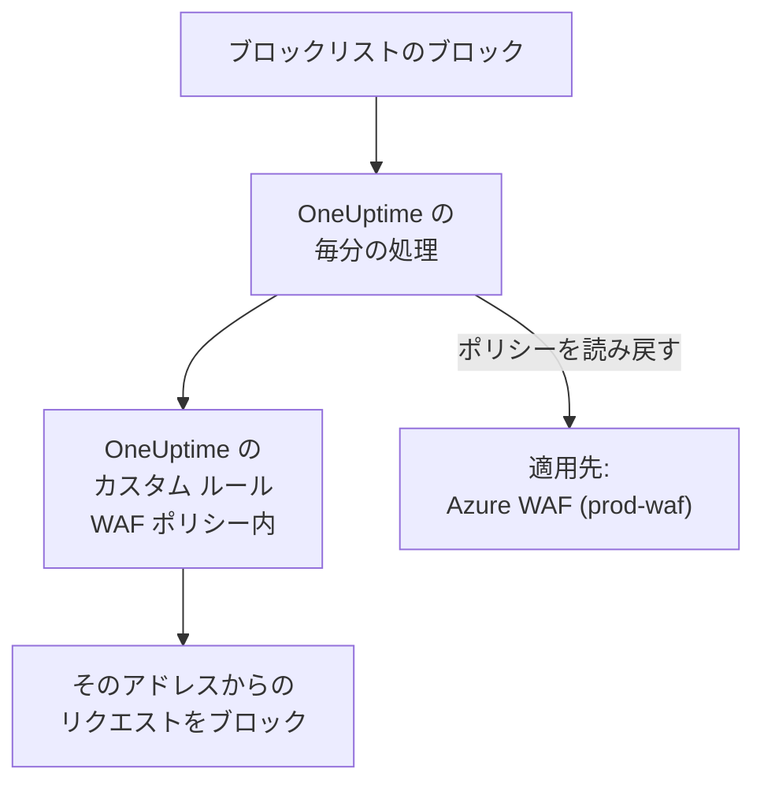

# Azure WAF でアドレスをブロックする

プロジェクトのブロックリストは、Application Gateway と Front Door の Azure WAF ポリシーで適用できます。既存の Azure クラウド接続でこれをオンにして WAF ポリシーを選ぶと、ブロックリストがブロックするすべてのアドレスがそこでブロックされます。ブロックしたのが人でも、プレイブックでも、OneUptime AI でも同じです。

:::cards
- [有効にする](#有効にする): Azure 接続の設定を一つ変更し、必要なロールを付与します。
- [OneUptime が作成するもの](#oneuptime-が作成するもの): 選んだ各ポリシーに置く、独自のカスタム ルールです。
- [照合されるアドレス](#照合されるアドレス): 接続してきたアドレス、またはプロキシの背後にある元のクライアントです。
:::

## しくみ

OneUptime は、選んだ各 WAF ポリシーに独自のカスタム ルールを置き、ブロックリストがブロックするアドレスをそこに入れます。OneUptime は毎分、ブロックリストの内容でポリシーを一度書き込み、その後ポリシーを読み戻します。**ブロックリスト** ページでは、ポリシーがブロックを保持し、Azure が変更を適用してはじめて、ブロックの **適用先** に Azure WAF (prod-waf) と表示されます。それまでは適用されていません。

## 始める前に

- OneUptime に接続済みの Azure サブスクリプション ([クラウド アカウントの接続](/docs/telemetry/cloud-accounts#microsoft-azure) を参照)。
- ブロックリストの適用先を変更できるロール: **プロジェクト所有者**、**プロジェクト管理者**、**セキュリティ管理者** のいずれか。
- Azure Cloud Shell でコマンドを一つ実行するために、Azure サブスクリプションでロールを割り当てられる人。

## 有効にする

:::steps
### 接続を開く
**クラウド → 接続** を開き、Azure 接続を編集します。

### 設定をオンにする
**その他の項目** で **Azure WAF でアドレスをブロック** を **オン** に設定して保存します。フォームに表示されるセットアップ コマンドは、以下のロールをサブスクリプション全体に付与するようになります。既存の接続でコマンドを再実行する必要はありません。**WAF を追加** ダイアログに、一つのポリシーだけにロールを付与する行が表示されます。

### WAF ポリシーを追加する
**セキュリティイベント → プレイブック → ブロックリスト** を開きます。**クラウド WAF** で **WAF を追加** をクリックし、WAF ポリシーを選びます。OneUptime は何も書き込まずに、接続がそのポリシーに書き込めるかを Azure に問い合わせます。

### ロールがなければ付与する
権限が不足している場合、ダイアログにはそのポリシーだけに権限を付与する行が表示されます。Azure Cloud Shell で実行し、**再確認** をクリックしてから、ポリシーを追加します。OneUptime がポリシーを読み取ると、**ステータス** に **適用中** と表示されます。
:::

WAF ポリシーは接続のインベントリから取得されます。OneUptime がまだ読み取っていないポリシーは、次回の読み取り後に一覧に表示されます。ポリシーがブロックリストを適用している間は、その接続の設定をオフにすることも、接続を削除することもできません。先にポリシーを削除して、OneUptime にルールを外させてください。

## OneUptime が作成するもの

| 内容 | 名前 | 場所 |
| --- | --- | --- |
| カスタム ルール。それぞれ IP 一致条件を一つ持ち、アクションは Block | `OneUptime<project>Block1`, `OneUptime<project>Block2`, ... | 選んだ各 WAF ポリシー内。最大 10 個。 |

`<project>` はプロジェクトの外部 ID の先頭八文字なので、同じポリシーを選んだ二つの OneUptime プロジェクトが互いのルールに書き込むことはありません。ルール一つに入るアドレスまたは範囲は、Application Gateway で 540 個、CRS 3.2 または Default Rule Set では 600 個、Front Door では 600 個です。ルールが十個なので、ポリシーには 5,400 個または 6,000 個のブロックが入ります。収まらないブロックは、その行にそう表示されます。

OneUptime がポリシー内で変更するのは自身のルールだけです。Azure は WAF ポリシーを丸ごとしか書き込まないため、OneUptime はポリシーを ETag 付きで読み取り、自身のルールを変更して、ETag を `If-Match` に入れて書き戻します。ほかのルール、設定、マネージド ルール セットは、読み取ったとおりに書き込まれます。その間に誰かがポリシーに書き込んでいた場合、Azure は書き込みを拒否し、OneUptime はポリシーを読み直して、その人が書いた内容の上に変更を加えます。

## ポリシー内でのルールの位置

OneUptime は自身のルールを、トラフィックを許可するあなたの最初のルールより前の空き優先度に、小さい番号から順に置きます。そのため、あなたのルールがブロック対象のアドレスを通過させることはありません。ブロックやログ記録を行うあなたのルールは、それより前にあってもかまいません。OneUptime があなたのルールの番号を振り直したり、変更や削除をしたりすることはありません。最初の Allow ルールより前に空き優先度がない場合、ポリシーには **空き優先度なし** と表示され、あなたが一つ空けると OneUptime がルールを追加します。

## 照合されるアドレス

| WAF ポリシー | クライアントアドレス | 選ぶ場面 |
| --- | --- | --- |
| Front Door | **Front Door に接続したアドレス (SocketAddr)** | 既定値です。 |
| Front Door | X-Forwarded-For による元のクライアント (RemoteAddr) | 別のプロキシや CDN の背後にある Front Door の場合。 |
| Application Gateway | ゲートウェイに接続したアドレス (RemoteAddr) | 唯一の選択肢です。その IP 一致はほかのアドレスを読み取りません。 |

Front Door は `RemoteAddr` を `X-Forwarded-For` ヘッダーから取得しますが、このヘッダーは Front Door に直接接続するクライアントが自分で書き込めます。Front Door の前段にある別のプロキシや CDN がこのヘッダーを書き込む場合にだけ選んでください。この選択は **WAF を追加** ダイアログの **その他の項目** にあり、後からポリシーの行の **クライアントアドレス** で変更できます。

Application Gateway の IP 一致は IPv4 アドレスしか読み取らないため、IPv6 のブロックはそこでは適用されず、その行に理由が表示されます。

Azure WAF での OneUptime のルールはブロックのみを行います。アドレスへのチャレンジを求めるブロックは Azure WAF では適用されず、その旨が表示されます。自動対応ポリシーのチャレンジは、同じ期間のブロックとしてそこで適用されます。

## 変更にかかる時間

Application Gateway は、Azure が変更を書き込むとすぐに適用します。Front Door は変更を受け付けると、その後の数分でエッジに展開します。その間ポリシーには **反映中** と表示され、新しいブロックの **適用先** は、Azure がポリシーのプロビジョニング完了を報告するまでポリシーを待ちます。それ以降、ブロックが適用されます。

## ルールが手動で変更された場合

誰かが Azure で OneUptime のルールを無効にしたり、変更したり、削除したりした場合、OneUptime はそのままにしておきます。ポリシーには **手動で変更済み** と表示され、そのルールにあったブロックは、理由とともに未適用になります。これは誰かがポリシーの行で **元に戻す** をクリックするまで続きます。「元に戻す」は、OneUptime が書き込むとおりにルールを書き直し、優先度が空いていれば元の優先度に置きます。

次のようなポリシーは何もブロックしないため、その旨が表示され、そのブロックは適用されません。

- 無効になっているポリシー。
- **Detection** モードのポリシー。OneUptime のルールに一致したものをログに記録するだけです。
- アプリケーション ゲートウェイ、リスナー、パス ルール、Front Door のドメインのいずれにも関連付けられていないポリシー。

## Terraform でポリシーを管理する

Terraform も WAF ポリシーを丸ごと書き込むため、次回の plan で OneUptime のルールが削除されます。OneUptime がルールを保持できるようにするには、`azurerm_web_application_firewall_policy` の `lifecycle` ブロックに `ignore_changes = [custom_rules]` を、`azurerm_cdn_frontdoor_firewall_policy` の場合は `ignore_changes = [custom_rule]` を追加し、そのポリシーのコードに独自のカスタム ルールを書かないでください。

## 権限

セットアップ コマンドはカスタム ロール `OneUptime WAF Blocklist` を追加し、サブスクリプションで接続のアプリに割り当てます。**WAF を追加** ダイアログに表示される行は、同じロールを一つのポリシーだけに割り当てます。

| アクション | 理由 |
| --- | --- |
| `Microsoft.Network/ApplicationGatewayWebApplicationFirewallPolicies/read`, `Microsoft.Network/ApplicationGatewayWebApplicationFirewallPolicies/write` | Application Gateway の WAF ポリシーを読み取り、そこに OneUptime のルールを書き込みます。 |
| `Microsoft.Network/FrontDoorWebApplicationFirewallPolicies/read`, `Microsoft.Network/FrontDoorWebApplicationFirewallPolicies/write` | Front Door の WAF ポリシーを読み取り、そこに OneUptime のルールを書き込みます。 |

このロールはポリシーを削除できず、OneUptime がそれ以外のものに書き込むことはありません。

## 削除する

:::steps
### WAF ポリシーを削除する
**セキュリティイベント → プレイブック → ブロックリスト** で、ポリシーの行の **削除** をクリックします。OneUptime はポリシーから自身のルールを外し、それ以外は何も変更しません。

### 設定をオフにする
接続を編集し、**Azure WAF でアドレスをブロック** を **オフ** に設定して保存します。この設定は、接続のどのポリシーもブロックリストを適用しなくなった時点でオフにできます。
:::

OneUptime がポリシーに書き込めなくなった場合は、**WAF を削除** ダイアログで **OneUptime からのみ削除** にチェックを入れます。OneUptime はポリシーをブロックリストから削除し、ポリシーに残したルールの名前を示します。これらは Azure で削除するまで、保持している内容をブロックし続けます。

## トラブルシューティング

:::details 未適用
ポリシーのステータスには、Azure の応答と対処方法が表示されます。拒否された場合は、不足している権限が示されます。**WAF を追加** がこのポリシーに表示する行を実行してから、**再確認** をクリックします。
:::

:::details 空き優先度なし
トラフィックを許可する最初のルールの優先度が 1 か、それより前の優先度がすべて使われています。そのルールの優先度の番号を大きくしてから、**再確認** をクリックします。
:::

:::details ポリシーが一覧にない
OneUptime は、設定がオンになっている接続の WAF ポリシーを、読み取った時点で一覧に表示します。その後に追加されたポリシーは、接続の次回の読み取り後に表示されます。
:::

## 次のステップ

:::cards
- [セキュリティケースとプレイブック](/docs/telemetry/security-cases): ケースからアドレスをブロックし、そのステップが確認される様子を見ます。
- [クラウド アカウントの接続](/docs/telemetry/cloud-accounts): この設定が属する接続です。
:::
