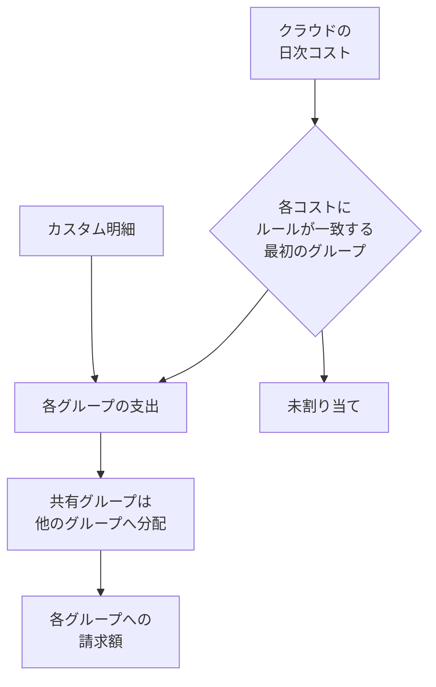

# クラウドコストの配分

コストグループは、毎月のクラウド請求で最初に問われる「誰が使ったのか」に答えます。「チーム別」や「コストセンター別」のような**コストビュー**は、接続したアカウントの支出をルールで**コストグループ**に振り分け、何も二重に数えません。どのルールにも一致しないものは未割り当ての支出としてはっきり見え、共有コストはグループ間で分配されます。**クラウド → 支出 → コストグループ** にあります。

:::cards
- [ビューを作成する](#ビューを作成する): 設定済みの所有者からチーム別に、タグ別に、または独自のグループで。
- [グループのルールを書く](#グループのルールを書く): アカウント、サービス、タグ、所有者チーム、ラベルなど。
- [未割り当ての支出](#未割り当ての支出): どのルールにも一致しないものと、それを振り分けるワンクリック。
- [共有コスト](#共有コスト): サポートプランや共有クラスターをグループ間で分配。
:::

## 仕組み



- **一致した最初のグループがコストを取ります。** ビューのグループには順序があり、各コストはルールが一致する最初のグループに入るため、二重に数えられることはありません。グループと未割り当ての支出の合計は、常に期間の合計と一致します。
- **ルールはコストが持つすべての情報を読みます。** アカウント、クラウド、サービス、リージョン、リソースとそのタグ、そして OneUptime がリソースについて知っていること (所有者チーム、ラベル、App Platforms の環境とアプリ) です。
- **すべては表示したときに計算されます。** コストごとに書き込まれるものはありません。ルールを変更すると、OneUptime が保持するすべての月が最大 400 日前まで振り分け直され、待つ必要はありません。各数値はその上の切り替えに従い、請求額、償却コスト、純コストのいずれかになります。[クラウドのコスト](/docs/telemetry/cloud-costs#請求額償却コスト純コスト) と同じで、カスタム明細はどの基準でも同じです。
- **複数のビューで同じ支出を振り分けられます。** 「チーム別」と「コストセンター別」は、それぞれ独自の方法で支出全体を振り分けます。

## 始める前に

- **読み取られるコスト。** [クラウドアカウントを接続](/docs/telemetry/cloud-accounts)し、[コストを読み取らせます](/docs/telemetry/cloud-costs)。
- **必要に応じてタグや所有者。** タグのルールには、そのタグが付いたコストが必要です。AWS では [リソース別のコスト](/docs/telemetry/cloud-costs#リソースごとのコスト) をオンにします。所有者チームは、手動または[所有者ルール](/docs/configuration/label-and-owner-rules)で設定した各リソースの所有者から決まります。

## ビューを作成する

**クラウド → 支出 → コストグループ** を開きます。まだビューがないプロジェクトには、三つの始め方が表示されます。

| 始め方 | 作成されるもの |
| --- | --- |
| **チーム別 (所有者から)** | クラウドリソースを所有するチームごとのグループ。チームにリンクされます。 |
| **タグ別** | コストに付いているタグの値ごとのグループ。たとえば `team` や `cost-center`。 |
| **独自のグループ** | 空のビュー。各グループのルールは自分で書きます。 |

タグ別や所有者チーム別のビューのグループは、保存したときに OneUptime が作成し、その後も新しいタグの値や所有者が現れるたびに毎時作成します。これらのグループは名前の変更、チームへのリンク、共有ができます。ルールは OneUptime のものです。足りないグループを今すぐ作成するには、ビューを開いて **今すぐグループを作成** を押します。

## グループのルールを書く

ビューを開き、**グループ** の **コストグループを作成** を選びます。コストは、グループのルールの**いずれか**が一致するとそのグループのものになり、ルールは条件が**すべて**一致すると一致します。条件は、コストが持つ一つの情報を、選択または入力した値と比べます。

| フィールド | 読み取る内容 |
| --- | --- |
| **タグ** | タグのキーで指定したタグの値。**設定済み** と **未設定** は、コストにそのタグがあるかどうかを確かめます。 |
| **アカウント** | コストが請求される接続済みのアカウント。 |
| **所有者チーム** | OneUptime でリソースを所有するチーム。 |
| **サービス** | クラウドの請求で使われるサービス名。 |
| **ラベル** | OneUptime でのリソースまたはそのアカウントのラベル。 |
| **リージョン** | リージョン。グローバルなサービスでは値を空にします。 |
| **クラウド** | AWS、Azure、または Google Cloud。 |
| **リソース** | クラウドでのリソース名。 |
| **App Platforms の環境** と **アプリ** | **クラウド → 支出 → コスト** の数え方で、環境やアプリに請求された額。 |
| **Kubernetes の Namespace** と **Kubernetes クラスター** | 共有グループを Namespace で分配するときの、クラスターの Namespace。[Kubernetes クラスター](#kubernetes-クラスター)を参照してください。 |

テキストは大文字と小文字を区別せずに比較されます。`Payments` と `payments` は同じチームです。タグのキーは、クラウドが保持する表記どおりに比較されます。

たとえば、三つのルールを持つ**決済**グループは、`team: payments` のタグが付いたコスト、**または** payments アカウントに請求されたコスト、**または**決済チームが所有するコストを取ります。

### グループの順序

**グループ** でグループをドラッグして順序を変えます。先のグループがルールをすでにカバーしているグループはコストを取れず、その行にはすべてを取るグループが表示されます。先のグループが取るコストにもルールが一致するグループには、そのうちどれだけを受け取るかが表示されます。

### 複数の所有者チームを持つリソース

二つのチームが所有するリソースは、チーム間で均等に分けられます。各チームの半分は、それぞれ別にルールを通ります。タグやアカウントのように所有者を問わないルールは、引き続きコスト全体を取ります。チームにグループがない半分は未割り当てのままです。

## 未割り当ての支出

ビューのページには、まだどのルールにも一致しないものが、その内訳となるサービス、アカウント、タグの値、所有者チームとして、高い順に表示されます。いずれかの横の **グループに追加** を押すと、そのためのルールをグループまたは新しいグループに追加できます。そのコストは過去の月も含めてすぐにグループに移ります。

## 共有コスト

サポートプラン、共有クラスター、ネットワークハブは全員のものです。それを独自のグループにし、**その他の項目** で **共有** をオンにして、そのコストをビューの他のグループへどう分配するかを選びます。

| 分配 | 方法 |
| --- | --- |
| **支出の割合で分配** | 各グループが、その月の他のグループのクラウド支出に占める割合を取ります。支出がなかった月は均等に分配されます。 |
| **均等に分配** | 各グループに同じ金額。 |
| **固定の割合で分配** | グループごとに設定した割合 (合計 100)。 |
| **Kubernetes の Namespace で分配** | その月のクラスターの各 Namespace のコスト。下記を参照してください。 |

共有グループのコストは、各月の割合で日ごとに分配されるため、月は日単位で読んでも月単位で読んでも同じ数字になります。未割り当ての支出が割り当てを受けることはありません。

### Kubernetes クラスター

クラスターのノードはクラウドが請求し、各 Namespace の使用量はクラスター自身のコストエンジンが示します。共有クラスター内のワークロードを各チームに請求するには、次のようにします。

1. クラスターのノードにルールが一致するグループを作成します。たとえば **タグ** `eks:cluster-name` **次のいずれか** `prod`。
2. **共有** をオンにし、**Kubernetes の Namespace で分配** を選んで、**Kubernetes クラスター** を選択します。
3. チームのグループに、Namespace のラベル (タグとして扱われます) を読むルールを付けます。たとえば **タグ** `team` **次のいずれか** `payments`、または **Kubernetes の Namespace** **で始まる** `payments-`。

毎月、ノードのコストはクラスターの[コストエンジン](/docs/telemetry/kubernetes-cost)での各 Namespace のコストで分配され、各 Namespace の分はルールが一致する最初のグループに入ります。空き容量と、どのグループにも入らない Namespace は、クラスターのグループに残ります。クラスター自身が算出したコストが請求に加算されることはないため、二重に数えられることはありません。

## カスタム明細

**クラウド → 支出 → コストグループ** の **カスタム明細** で、クラウドの請求書に含まれない請求やクレジットを追加します。サポート契約の分担分、企業向け割引、社内の上乗せ、プラットフォーム料金などです。

- **一度だけ、または毎月。** 月次の明細は各月の日数に按分されるため、月の一部にはその分が計上されます。
- **アカウントまたはグループに。** アカウントに追加した明細は、アカウントのコストと同じように各ビューのルールを通ります。グループに追加した明細は、そのグループに直接入ります。
- **常に別扱い。** どの数字でも明細はクラウドの請求額と分けて扱われるため、クラウド自身の数字はコンソールと一致したままです。

## 各グループの支出を見る

- **クラウド → 支出 → コスト**: **支出の内訳** で **コストグループ** とビューを選びます。各グループの支出を前の期間と比べて表示します。
- **ビューのページ**: 共有コストを含む各グループへの請求額、どのルールにも一致しないもの、そして月次のチャージバック用の **CSV をダウンロード**。
- **グループのページ**: 日ごとの支出、最も多く請求されているサービス、リソース、アカウント、そしてルール。そのグループの支出だけが表示されるので、グループを **チーム** にリンクし、チームにページを送りましょう。クラウドの支出を読めるユーザーなら誰でも開けます。

## API、CLI、MCP

ビュー、グループ、明細は API リソース (`cloud-cost-view`、`cloud-cost-group`、`cloud-cost-line-item`) で、他のリソースと同じく CLI コマンドと MCP ツールがあります。グループのルールは JSON です。

```json
[
  { "conditions": [{ "field": "tag", "key": "team", "operator": "is", "values": ["payments"] }] },
  { "conditions": [{ "field": "ownerTeam", "operator": "is", "values": ["<team ID>"] }] }
]
```

ビューの振り分けを、`startDate` から `endDate` までの UTC の日単位で読み取るには:

```bash
curl -X POST "https://oneuptime.com/api/cloud-cost-view/<view ID>/allocation" \
  -H "apikey: <API key>" -H "tenantid: <project ID>" -H "Content-Type: application/json" \
  -d '{"startDate": "2026-11-01", "endDate": "2026-11-30", "currency": "USD"}'
```

応答には、各グループの `total` とその内訳 (`cloud`、`lineItems`、`sharedIn`、`sharedOut`)、日別または月別の数字、前の期間、未割り当ての支出の内訳が含まれます。`POST /cloud-cost-group/<group ID>/spend` は一つのグループについて応答します。`basis` を `billed`、`amortized`、`net` のいずれかで送ると、その基準の数値になります。送らない場合はプロジェクトの基準になり、応答の `basis` がどれかを示します。

## 制限

- ビューに含められるグループは最大 500 個です。タグ別のビューは、コストの高い上位 500 個の値についてグループを作成します。
- グループのルールは最大 25 個、ルールの条件は最大 20 個、条件の値は最大 200 個です。
- コストは 400 日間保持されるため、ビューが読み取れるのは最大 400 日です。

## トラブルシューティング

:::details グループに何も入らない
ルールがまだどのコストにも一致していないか、ルールが一致するコストをすべて先のグループが取っている可能性があります。その場合、**グループ** の行にそのグループが表示されます。このグループをその上にドラッグするか、先のグループのルールを絞り込んでください。
:::

:::details コストが間違ったグループに入る
コストは、ルールが一致する最初のグループに入ります。コストが属するグループを、それを取っているグループより上にドラッグするか、そのグループのルールを絞り込んでください。
:::

:::details タグのルールが何にも一致しない
コストは、読み取られたときのタグを保持します。Google Cloud の請求エクスポートのラベル、それがなければ請求先リソースのタグで、AWS では [リソース別のコスト](/docs/telemetry/cloud-costs#リソースごとのコスト) が必要です。タグのキーは表記どおりに比較されます。
:::

:::details タグ別または所有者チーム別のビューにグループが足りない
OneUptime は足りないグループを毎時作成します。過去 400 日のコストのタグの値ごと、またはクラウドリソースを所有するチームごとに一つずつ、最大 500 個までです。すぐに作成するには、ビューのページで **今すぐグループを作成** を押します。
:::

:::details 数字にアカウントが含まれない
ビューの数字は、ほとんどのアカウントが請求される通貨で表示されます。別の通貨で請求されるアカウントは除外され、別の通貨の明細も同様です。
:::

## 次のステップ

:::cards
- [クラウドのコストと節約](/docs/telemetry/cloud-costs): 接続したアカウントのコストと、支出を減らす方法。
- [ラベルルールと所有者ルール](/docs/configuration/label-and-owner-rules): ルールが読む所有者チームとラベルをリソースに付けます。
- [Kubernetes コストオブザーバビリティ](/docs/telemetry/kubernetes-cost): Kubernetes の各ワークロードのコスト。
:::
