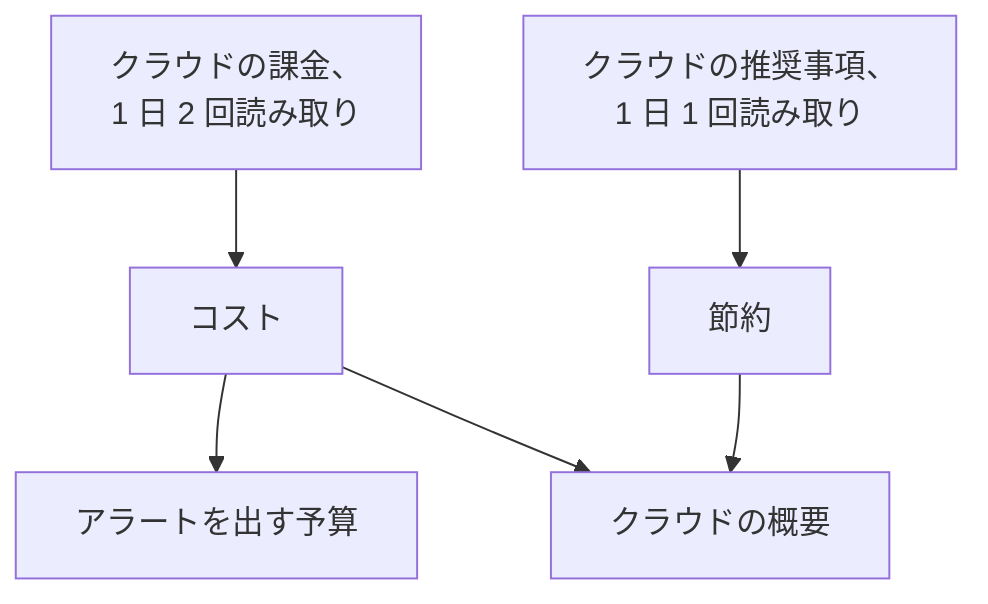

# クラウドのコストと節約

接続したクラウド アカウントからは、そのコストと、コストを下げる方法もわかります。OneUptime はクラウド自身の課金から毎日のコストを、クラウド自身の推奨サービスから推奨事項を読み取り、**クラウド → 支出 → コスト** と **クラウド → 支出 → 節約** に表示します。また、月のコストが予算を超える前に **クラウド → 支出 → 予算** でアラートを出します。

:::cards
- [Amazon Web Services](#amazon-web-services): Cost Explorer と Cost Optimization Hub。どちらも一度だけ有効にします。
- [Microsoft Azure](#microsoft-azure): Cost Management と Azure Advisor。ロールが一つ増えます。
- [Google Cloud](#google-cloud): BigQuery への課金エクスポートと Recommender。
- [予算](#予算): 月の支出が予算の一定の割合を超えたときのアラート。
:::

## 仕組み



- **コストはクラウド自身の課金から取得します。** AWS Cost Explorer、Azure Cost Management、Google Cloud の BigQuery への課金エクスポートから、クレジットと返金を差し引く前の額を、アカウントの請求通貨で読み取ります。各金額は一日分で、クラウドの請求と同じく UTC の日単位です。
- **クラウドは直近の一、二日を遅れて報告します。** 各読み取りは直近の一週間を、月の初めの数日は先月全体を読み直すため、クラウドが日を締めるにつれてその日のコストが確定します。接続の最初の読み取りは先々月の初めまでさかのぼります。
- **月の予測は直近一週間のペースに従います。** 今月これまでのコストに、残りの日数分を直近の丸七日間の平均で足したものです。
- **節約はクラウド自身の推奨サービスから取得します。** AWS Cost Optimization Hub、Azure Advisor、Google Cloud の Recommender が、より小さいサイズ、使われていないリソース、効果のあるコミットメントを、それぞれ月にいくら節約できるかとともに示します。クラウドのコンソールで実施または却下した推奨事項は、次の読み取りで消えます。

## 始める前に

- **接続済みのアカウント。** 現在のセットアップ コマンドで [クラウド アカウントの接続](/docs/telemetry/cloud-accounts) を行います。このコマンドで、接続はコストと推奨事項を読み取れるようになります。以前に作った接続は、コマンドを実行し直すまでどちらも読み取りません。

## Amazon Web Services

接続はコストを `ce:GetCostAndUsage` で、推奨事項を `cost-optimization-hub:ListRecommendations` で読み取ります。どちらも、先にアカウントで有効にしておくものがあります。

:::steps
### Cost Explorer を有効にする

AWS Billing and Cost Management コンソールで Cost Explorer を一度開きます。AWS は一日以内にアカウントのコストを準備します。メンバー アカウントすべてのコストを読み取るには、組織の管理アカウントを接続します。

### Cost Optimization Hub に参加する

同じコンソールで Cost Optimization Hub を開いて参加します。組織の場合は管理アカウントから、このアカウントだけの場合はこのアカウントで行います。推奨事項は一日以内に届きます。
:::

Cost Explorer はリクエストごとに $0.01 かかり、コストの読み取り一回で数回リクエストします。Cost Optimization Hub は無料です。

## Microsoft Azure

アプリは **Cost Management Reader** ロールでコストを読み取ります。スコープは **Monitoring Reader** と同じで、セットアップ コマンドが両方を付与します。Azure Advisor の推奨事項は **Monitoring Reader** で読み取るため、有効にするものはありません。以前に作ったアプリにロールを付与するには、次を実行します。

```bash
az role assignment create --assignee <APP_ID> --role "Cost Management Reader" --scope /subscriptions/<SUBSCRIPTION_ID>
```

Cost Management はサブスクリプションごとに、各コストの対象リソースとともに応答し、読み取りは無料です。あるサブスクリプションについて応答できない場合は、アカウントの **コスト** に理由が表示されます。

## Google Cloud

Google Cloud にはプロジェクトのコストを返す API がありません。OneUptime は請求先アカウントの BigQuery へのエクスポートからコストを読み取ります。

:::steps
### 課金を BigQuery にエクスポートする

Google Cloud コンソールで Billing、続いて Billing export を開き、詳細な使用コストのエクスポートを BigQuery データセットに対して有効にします。Google は数時間遅れで、有効にした日から書き込みます。

### サービス アカウントに読み取りを許可する

接続のサービス アカウントに、エクスポートのデータセットに対する **BigQuery Data Viewer** を付与します。セットアップ コマンドはすでに **BigQuery Job User** を付与しており、クエリは自分のプロジェクトで実行されます。

### エクスポートのテーブルを指定する

**クラウド → 接続** で接続を編集し、**その他の項目** の **課金エクスポートのテーブル** にテーブルの完全な名前を設定します: `<PROJECT_ID>.<DATASET>.gcp_billing_export_resource_v1_<BILLING_ACCOUNT_ID>`。
:::

詳細エクスポートには各コストの対象リソースが含まれます。標準エクスポートにはサービスとリージョンしかありません。クエリは BigQuery の料金です。月 1 TiB までは無料、その後は TiB あたり $6.25 で、エクスポートの一か月分は数メガバイトから数ギガバイトです。Recommender のマシンタイプと未使用リソースの推奨事項は、セットアップ コマンドが付与する **Compute Recommender Viewer** で読み取り、無料です。

## 支出を減らす方法

**クラウド → 支出 → 節約** は、節約額の大きい順にすべての推奨事項を一覧にします。何をするか、どのリソースか、何が変わるか、月にいくら節約できるかがわかります。上の帯には合計と種類別の合計が表示されます: より小さいサイズ、使われていないリソース、コミットメント。OneUptime にそのリソースがあれば、推奨事項はリソースのページにリンクします。

### OneUptime 自身の読み取り値によるサイズの適正化

推奨サービスが有効になっていない、リソースの種類に対応していない、リソースが新しすぎるといった理由で、どの推奨サービスも何も示さないリソースは、接続が直近 14 日間に読み取った CPU とメモリの値から OneUptime がサイズを判断します。対象は、AWS の EC2 インスタンス、RDS データベース、ElastiCache クラスター、Azure の仮想マシン、PostgreSQL と MySQL のフレキシブル サーバー、App Service プラン、Google Cloud の Compute Engine VM と Cloud SQL インスタンスです:

- **過剰プロビジョニング** は、半分、または四分の一のサイズでもまだ余裕がある場合です。小さいサイズで CPU の 95 パーセンタイルが 60% 以下、CPU の最高値が 100% 以下、メモリを読み取れる場合はメモリのピークが 70% 以下に収まるときです。
- **プロビジョニング不足** は、CPU の 95 パーセンタイルが 85% 以上、またはメモリのピークが 90% 以上の場合です。2 倍の大きさのサイズを勧めます。

リソースは、読み取り値が 6 日分たまるとサイズが判断されます。リソースのページでは、コストの横に **サイズの適正化** が表示され、過剰プロビジョニングのリソースは OneUptime をソースとして **クラウド → 支出 → 節約** に表示されます。変更による節約額は、直近 30 日間にリソースにかかったコストのうち変更が占める分なので、クラウドがリソースを名前で請求するようになるとわかります。Azure と Google Cloud の詳細エクスポートはリソースを名前で請求しますが、AWS Cost Explorer はしません。EC2 インスタンスは CloudWatch エージェントがある場合に、Compute Engine VM は Ops Agent がある場合にだけメモリを報告し、ない場合は CPU だけでサイズが判断されます。t3、B シリーズ、e2-micro などのバースト可能なサイズは判断の対象外です。

## 予算

:::steps
### 予算を作成する

**クラウド → 支出 → 予算** で予算を作成します: **月額** と、対象の **アカウント** (すべてのアカウントが対象なら空欄)。

### アラートを出すタイミングを選ぶ

**アラートのしきい値** には、アラートを出す予算の割合をパーセントで指定します。初期値は 80 と 100 です。**超過の見込み時にアラート** を有効にすると、直近一週間のペースでは月が予算を超える場合にも、月に一度アラートを出します。**通常と異なる日にアラート** を有効にすると、通常よりはるかに高くついた日の翌日にもアラートを出します。[通常と異なる日](#通常と異なる日) を参照してください。**アラートの重大度** と **オンコールポリシー** で、アラートの重大度と呼び出す相手を決めます。
:::

予算は、コストを読み取るたびと一時間ごとに確認されます。月の支出がしきい値を超えると、そのしきい値のアラートが一つ出ます。一回の読み取りで複数を超えた場合は最も高いしきい値のアラートが出ます。新しい月になると先月のアラートは解決されます。予算が数えるのは、予算の通貨で請求されるアカウントだけです。

AI エージェントは [MCP サーバー](/docs/ai/mcp-server) から、スクリプトは CLI の `oneuptime cloud-budget` コマンドで予算を作成、変更できます。[リソース操作](/docs/cli/resource-operations) を参照してください。

### 通常と異なる日

読み取りのたびに、アカウントの直近 14 日間の各日 (丸一日分) を、その前の 14 日間と比べます。サービスのコストが通常の日の 2 倍以上、またはアカウント全体のコストが通常の日の 5 割増し以上になった日は、通常と異なる日です。どちらも、増加分がアカウントの通貨で 10 以上、かつアカウントの通常の日の 5% 以上である必要があるため、数セントの増加が急増として扱われることはありません。ある日の通常の値はその前の 14 日間の中央値なので、一度の急増ではほとんど動きません。また、アカウントは一週間分のコストがたまるまで判断されません。

**クラウド → 支出 → コスト** では、日別の支出の下に通常と異なる日が一覧表示されます。アカウントを含む予算は、アカウントと日ごとに一つのアラートを翌日に出し、高くなったサービスをすべて挙げます。何日も続く急増は始まった日に知らせ、一週間より前の日は知らせません。これらのアラートができる前に作成された予算は、編集してオンにするまでこのアラートを出しません。

## OneUptime で見えるもの

- **クラウドの概要。** **クラウド → 概要** には、今月の支出と先月の同じ日までの支出の比較、コストの高いサービス、効果の大きい支出削減の方法が、対応が必要なものと並んで表示されます。
- **毎日の支出。** **クラウド → 支出 → コスト** は直近 30 日の各日を描き、通常よりはるかに高くついた日を一覧にし、期間をサービス、リージョン、アカウント、リソース別に分けます。コストを読み取れていないアカウントは、その理由とともに下に一覧表示されます。
- **アカウントのコスト。** アカウントの **コスト** には、そのアカウントだけについて同じ内容が、支出を減らす方法とともに表示されます。
- **リソースのコスト。** クラウドがリソースを名前で請求している場合、リソースのページには今月と直近 30 日のコストが、支出を減らす方法とサイズの適正化とともに表示されます。

## トラブルシューティング

:::details アカウントに 権限が必要 と表示される
接続はまだアカウントのコストを読み取れません。**クラウド → 接続** からセットアップ コマンドを実行し直してください。コストの読み取りに必要なものが追加されます。Google Cloud では、サービス アカウントにエクスポートのデータセットに対する **BigQuery Data Viewer** も付与してください。
:::

:::details アカウントに 未セットアップ と表示される
クラウドにまだ渡せるコストがありません。AWS では Cost Explorer を有効にし、Google Cloud ではエクスポートのテーブルを **課金エクスポートのテーブル** に指定します。最初の金額は次の読み取り、つまり 12 時間以内に届きます。
:::

:::details 金額にアカウントが含まれていない
金額は、ほとんどのアカウントの請求通貨で表示されます。別の通貨で請求されるアカウントはその通貨とともに下に一覧表示され、予算は予算自身の通貨で請求されるアカウントだけを数えます。
:::

:::details 今月の金額がクラウドのコンソールより低い
クラウドは直近の一、二日を遅れて報告し、金額はクレジットと返金を差し引く前の額です。次の読み取りで追いつきます。
:::

## 次のステップ

:::cards
- [クラウド アカウントの接続](/docs/telemetry/cloud-accounts): 別のアカウントを接続するか、コマンドを実行し直します。
- [クラウド リソース](/docs/telemetry/cloud-resources): 各リソースのメトリクスを、自分のコレクターから。
- [Kubernetes のコストの可観測性](/docs/telemetry/kubernetes-cost): Kubernetes の各ワークロードのコスト。
:::
