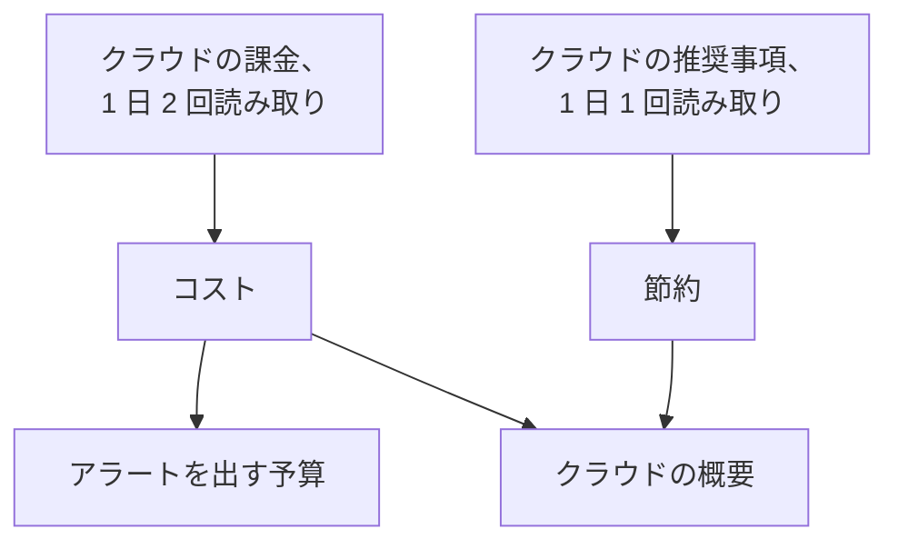

# クラウドのコストと節約

接続したクラウド アカウントからは、そのコストと、コストを下げる方法もわかります。OneUptime はクラウド自身の課金から毎日のコストを、クラウド自身の推奨サービスから推奨事項を読み取り、**クラウド → 支出 → コスト** と **クラウド → 支出 → 節約** に表示します。また、月のコストが予算を超える前に **クラウド → 支出 → 予算** でアラートを出します。

:::cards
- [Amazon Web Services](#amazon-web-services): Cost Explorer と Cost Optimization Hub。どちらも一度だけ有効にします。
- [Microsoft Azure](#microsoft-azure): Cost Management と Azure Advisor。ロールが一つ増えます。
- [Google Cloud](#google-cloud): BigQuery への課金エクスポートと Recommender。
- [予算](#予算): 月の支出が予算の一定の割合を超えたときのアラート。
- [必須タグ](#必須タグ): 必須にしたタグを持つ支出の割合と、タグのない新しいリソース。
:::

## 仕組み



- **コストはクラウド自身の課金から取得します。** AWS Cost Explorer、Azure Cost Management、Google Cloud の BigQuery への課金エクスポートから、クレジットと返金を差し引く前の額を、アカウントの請求通貨で読み取ります。各金額は一日分で、クラウドの請求と同じく UTC の日単位です。
- **クラウドは直近の一、二日を遅れて報告します。** 各読み取りは直近の一週間を、月の初めの数日は先月全体を読み直すため、クラウドが日を締めるにつれてその日のコストが確定します。接続の最初の読み取りは先々月の初めまでさかのぼります。
- **月の予測は直近一週間のペースに従います。** 今月これまでのコストに、残りの日数分を直近の丸七日間の平均で足したものです。
- **節約はクラウド自身の推奨サービスから取得します。** AWS Cost Optimization Hub、Azure Advisor、Google Cloud の Recommender が、より小さいサイズ、使われていないリソース、効果のあるコミットメントを、それぞれ月にいくら節約できるかとともに示します。クラウドのコンソールで実施または却下した推奨事項は、次の読み取りで消えます。

## 始める前に

- **接続済みのアカウント。** 現在のセットアップ コマンドで [クラウド アカウントの接続](/docs/telemetry/cloud-accounts) を行います。このコマンドで、接続はコストと推奨事項を読み取れるようになります。以前に作った接続は、コマンドを実行し直すまでどちらも読み取りません。

## Amazon Web Services

接続はコストを `ce:GetCostAndUsage` で、コミットメントを `ce:GetSavingsPlansCoverage`、`ce:GetSavingsPlansUtilization`、`ce:GetReservationCoverage`、`ce:GetReservationUtilization` で、推奨事項を `cost-optimization-hub:ListRecommendations` で読み取ります。Cost Explorer と Cost Optimization Hub は、先にアカウントで有効にしておく必要があります。

:::steps
### Cost Explorer を有効にする

AWS Billing and Cost Management コンソールで Cost Explorer を一度開きます。AWS は一日以内にアカウントのコストを準備します。メンバー アカウントすべてのコストを読み取るには、組織の管理アカウントを接続します。

### Cost Optimization Hub に参加する

同じコンソールで Cost Optimization Hub を開いて参加します。組織の場合は管理アカウントから、このアカウントだけの場合はこのアカウントで行います。推奨事項は一日以内に届きます。
:::

Cost Explorer はリクエストごとに $0.01 かかります。コストの読み取り一回で数回リクエストし、コミットメントは一日に四回のリクエストで読み取ります。Cost Optimization Hub は無料です。

### リソースごとのコスト

リソースレベルのデータを有効にすると、Cost Explorer は直近 14 日間の各リソースのコストも示します。AWS Billing and Cost Management コンソールで Cost Management の設定を開き、日次の粒度でリソースレベルのデータを有効にします。組織の場合は管理アカウントから有効にします。AWS は 48 時間以内にデータを準備します。

次に **クラウド → 接続** で接続を編集し、**その他の項目** で **リソースごとのコスト** をオンにします。接続は一日に一回、`ce:GetCostAndUsageWithResources` で読み取ります。初回は 14 日分、その後は直近三日分をもう一度読み取り、毎回数回リクエストします。読み取った内容は、Cost Explorer が保持しなくなった後もアカウントのコストとともに残ります。以前に作成した接続では、セットアップコマンドをもう一度実行してアクションを追加する必要があります。

## Microsoft Azure

アプリは **Cost Management Reader** ロールでコストを読み取ります。スコープは **Monitoring Reader** と同じで、セットアップ コマンドが両方を付与します。Azure Advisor の推奨事項は **Monitoring Reader** で読み取るため、有効にするものはありません。以前に作ったアプリにロールを付与するには、次を実行します。

```bash
az role assignment create --assignee <APP_ID> --role "Cost Management Reader" --scope /subscriptions/<SUBSCRIPTION_ID>
```

Cost Management はサブスクリプションごとに、各コストの対象リソースとともに応答し、読み取りは無料です。あるサブスクリプションについて応答できない場合は、アカウントの **コスト** に理由が表示されます。

Cost Management は、テナントのコストを読み取る速さを、読み取るすべての人に同じく制限します。各クエリは読み取るデータの月ごとにクエリ処理ユニット (QPU) を消費し、テナントには 10 秒ごとに 12 QPU、毎分 60、毎時 600 があります。OneUptime はテナントのサブスクリプションを各上限の三分の二以内で順番に読み取り、Cost Management がクエリを断ったときは求められた時間だけ待ち、次の読み取りで止まったところから続けます。まだ読み取られていないサブスクリプションには **キュー投入済み** と読み取られる時刻が表示され、すでに金額があるサブスクリプションはその間も金額を保ちます。

## Google Cloud

Google Cloud にはプロジェクトのコストを返す API がありません。OneUptime は請求先アカウントの BigQuery へのエクスポートからコストを読み取ります。

:::steps
### 課金を BigQuery にエクスポートする

Google Cloud コンソールで Billing、続いて Billing export を開き、詳細な使用コストのエクスポートを BigQuery データセットに対して有効にします。Google は数時間遅れで、有効にした日から書き込みます。

### サービス アカウントに読み取りを許可する

接続のサービス アカウントに、エクスポートのデータセットに対する **BigQuery Data Viewer** を付与します。セットアップ コマンドはすでに **BigQuery Job User** を付与しており、クエリは自分のプロジェクトで実行されます。

### エクスポートのテーブルを指定する

**クラウド → 接続** で接続を編集し、**その他の項目** の **課金エクスポートのテーブル** にテーブルの完全な名前を設定します: `<PROJECT_ID>.<DATASET>.gcp_billing_export_resource_v1_<BILLING_ACCOUNT_ID>`。
:::

詳細エクスポートには各コストの対象リソースが含まれます。標準エクスポートにはサービスとリージョンしかありません。クエリは BigQuery の料金です。月 1 TiB までは無料、その後は TiB あたり $6.25 で、エクスポートの一か月分は数メガバイトから数ギガバイトです。Recommender のマシンタイプと未使用リソースの推奨事項は、セットアップ コマンドが付与する **Compute Recommender Viewer** で読み取り、無料です。

## 支出を減らす方法

**クラウド → 支出 → 節約** は、節約額の大きい順にすべての推奨事項を一覧にします。何をするか、どのリソースか、何が変わるか、月にいくら節約できるかがわかります。上の帯には合計と種類別の合計が表示されます: より小さいサイズ、使われていないリソース、コミットメント。OneUptime にそのリソースがあれば、推奨事項はリソースのページにリンクします。

### OneUptime 自身の読み取り値によるサイズの適正化

推奨サービスが有効になっていない、リソースの種類に対応していない、リソースが新しすぎるといった理由で、どの推奨サービスも何も示さないリソースは、接続が直近 14 日間に読み取った CPU とメモリの値から OneUptime がサイズを判断します。対象は、AWS の EC2 インスタンス、RDS データベース、ElastiCache クラスター、Azure の仮想マシン、PostgreSQL と MySQL のフレキシブル サーバー、App Service プラン、Google Cloud の Compute Engine VM と Cloud SQL インスタンスです:

- **過剰プロビジョニング** は、半分、または四分の一のサイズでもまだ余裕がある場合です。小さいサイズで CPU の 95 パーセンタイルが 60% 以下、CPU の最高値が 100% 以下、メモリを読み取れる場合はメモリのピークが 70% 以下に収まるときです。
- **プロビジョニング不足** は、CPU の 95 パーセンタイルが 85% 以上、またはメモリのピークが 90% 以上の場合です。2 倍の大きさのサイズを勧めます。

リソースは、読み取り値が 6 日分たまるとサイズが判断されます。リソースのページでは、コストの横に **サイズの適正化** が表示され、過剰プロビジョニングのリソースは OneUptime をソースとして **クラウド → 支出 → 節約** に表示されます。変更による節約額は、直近 30 日間にリソースにかかったコストのうち変更が占める分なので、クラウドがリソースを名前で請求するようになるとわかります。Azure と Google Cloud の詳細エクスポートはリソースを名前で請求し、AWS も「リソースごとのコスト」をオンにすると請求します。t3、B シリーズ、e2-micro などのバースト可能なサイズは判断の対象外です。

クラウドが VM のメモリを読み取れるのは、VM の中に専用のエージェントがある場合だけです。EC2 インスタンスでは CloudWatch エージェント、Compute Engine VM では Ops Agent が必要で、Azure VM にはそうしたエージェントがなく、使用中のメモリではなく空きメモリを報告します。[OneUptime のホストコレクター](/docs/telemetry/hosts) が動いている VM は、代わりにホストコレクターが読み取るメモリでサイズが判断されます。

- **VM とホストは同じマシン** とみなすのは、プロバイダー、アカウント、リージョン、インスタンス ID がすべて一致する場合です。EC2 のインスタンス ID、Compute Engine VM の数値 ID、Azure VM の `vmId` を比べます。ホスト名だけで一致とみなすことはなく、クローンしたマシンのように 2 つのホストが同じ VM を名乗る場合は、どちらにもリンクしません。VM のページにはホストが、ホストのページには VM が表示され、互いにリンクします。
- **メモリはホストの使用中メモリで、キャッシュとバッファーを含みません**。ホストのページのグラフと同じ値を、同じ 14 日間で使います。ファイルキャッシュが多くても、マシンがいっぱいとは読みません。ホストにも 6 日分の読み取り値が必要です。
- **両方がメモリを読み取る場合**、たとえば Ops Agent とホストコレクターの両方がある Compute Engine VM では、読み取り値の多いほうを使います。CPU は常にクラウドの読み取り値です。

VM の **サイズの適正化** には、メモリをどこから読んだかが表示され、**クラウド → 支出 → 節約** の行にも表示されます。CPU だけでサイズを判断した VM はそう表示し、ホストコレクターをインストールするリンクを示します。ホストコレクターは、[ホストガイドの設定](/docs/telemetry/host-otel-collector) にある `resourcedetection/cloud` ステップでクラウドの識別情報を付けます。OneUptime の既定の設定を使うホストは OneUptime の次のリリースでこのステップを受け取り、独自の設定を使うホストは追加が必要です。Kubernetes ノードは、そこで動くもののリクエストをサイズ判断する [Kubernetes のコストの可観測性](/docs/telemetry/kubernetes-cost) に任せます。

### コミットメント

**クラウド → 支出 → 節約** とアカウントの **コスト** には、直近 30 日間の支出のうち各アカウントのコミットメントが支払った割合と、それらが使用された割合が、種類ごとに一行で表示されます。

- AWS: Savings Plans とリザーブドインスタンス。Cost Explorer から読み取ります。組織の管理アカウントは、組織のすべてのアカウントについて読み取ります。
- Azure: 節約プランと予約。Cost Management から、償却コストで読み取ります。
- Google Cloud: 確約利用割引。課金エクスポートから読み取ります。エクスポートはコミットメントのうち未使用だった分を示さないため、使用された割合は表示されません。

コミットメントのないアカウントには、オンデマンド料金で実行され、コミットメントがあれば安く支払えた分が表示されます。各種類の数値はそのクラウド自身のもので、種類どうしを合算することはありません。予約と Savings Plan は、同じマシンの支出をどちらも自分の対象として数えることがあるためです。

## 予算

:::steps
### 予算を作成する

**クラウド → 支出 → 予算** で予算を作成します: **月額** と、対象の **アカウント** (すべてのアカウントが対象なら空欄)。

### アラートを出すタイミングを選ぶ

**アラートのしきい値** には、アラートを出す予算の割合をパーセントで指定します。初期値は 80 と 100 です。**超過の見込み時にアラート** を有効にすると、直近一週間のペースでは月が予算を超える場合にも、月に一度アラートを出します。**通常と異なる日にアラート** を有効にすると、通常よりはるかに高くついた日の翌日にもアラートを出します。[通常と異なる日](#通常と異なる日) を参照してください。**アラートの重大度** と **オンコールポリシー** で、アラートの重大度と呼び出す相手を決めます。
:::

予算は、コストを読み取るたびと一時間ごとに確認されます。月の支出がしきい値を超えると、そのしきい値のアラートが一つ出ます。一回の読み取りで複数を超えた場合は最も高いしきい値のアラートが出ます。新しい月になると先月のアラートは解決されます。予算が数えるのは、予算の通貨で請求されるアカウントだけです。

AI エージェントは [MCP サーバー](/docs/ai/mcp-server) から、スクリプトは CLI の `oneuptime cloud-budget` コマンドで予算を作成、変更できます。[リソース操作](/docs/cli/resource-operations) を参照してください。

### 通常と異なる日

読み取りのたびに、アカウントの直近 14 日間の各日 (丸一日分) を、その前の 14 日間と比べます。サービスのコストが通常の日の 2 倍以上、またはアカウント全体のコストが通常の日の 5 割増し以上になった日は、通常と異なる日です。どちらも、増加分がアカウントの通貨で 10 以上、かつアカウントの通常の日の 5% 以上である必要があるため、数セントの増加が急増として扱われることはありません。ある日の通常の値はその前の 14 日間の中央値なので、一度の急増ではほとんど動きません。また、アカウントは一週間分のコストがたまるまで判断されません。

**クラウド → 支出 → コスト** では、通常と異なる日が日別の支出の棒の上に示され、その下に一覧表示されます。すべてのアカウントを表示しているときは、各マークからそのアカウントの **コスト** を開けます。アカウントを含む予算は、アカウントと日ごとに一つのアラートを翌日に出し、高くなったサービスをすべて挙げます。何日も続く急増は始まった日に知らせ、一週間より前の日は知らせません。これらのアラートができる前に作成された予算は、編集してオンにするまでこのアラートを出しません。

## 支出の内訳

**クラウド → 支出 → コスト** は、期間の支出をサービス、リージョン、アカウント、リソース別に分けるほか、さらに三つの方法で分けます。

- アプリプラットフォームの環境別: 各環境のアカウントとリージョンにあるプラットフォームのサービス (Amazon ECS や Cloud Run など) と、Elastic Beanstalk 環境のリソースを AWS が付けるタグで集計します。
- アプリ別: プラットフォームがアプリの名前で請求する分 (Cloud Run のサービスや Container App など) です。Amazon ECS はタスクを、App Service はプランを請求するため、それらのアプリのコストは環境のコストのままです。
- タグ別: 選んだタグの値ごとに分けます。コストには読み取った時点のタグが残ります。Google Cloud の課金エクスポートのラベル、なければ請求先リソースのタグで、AWS では「リソースごとのコスト」が必要です。

一覧の下には、残りがいくらだったかが表示されます。どの環境にも属さない分、環境全体に請求された分、またはタグのない分です。タグを保持する前に読み取ったコストは、初回の読み取りと同じだけさかのぼって一度だけ読み直され、タグが補われます。

## 必須タグ

支出は、付いているタグの分しか正しく配分できません。**クラウド → 支出 → タグ** で、すべてのリソースが持つべきタグ (`team`、`env`、`cost-center` など) を指定すると、そのタグを持つ支出とリソースの割合、タグのないリソース、タグなしで新しいリソースを作成した人がわかります。

:::steps
### タグを必須にする

**タグを必須にする** を選び、**タグキー** を入力します。**許可する値** には、取れる値をカンマ区切りで並べます。空欄にすると任意の値を受け付けます。あるアカウントだけで必須にするには **アカウント** を選びます。**その他の項目** にある **説明** は、タグの用途をメールで伝えます。

### カバー率を見る

ページの最初には、直近 30 日間の支出とリソースのうち、すべての必須タグを持つ割合が表示されます。その下に、タグが足りないリソースがコストの高い順に並び、続いてタグごとの割合、直近 12 週間の推移、アカウントごとの割合が表示されます。

### 足りないタグを付ける

タグが足りないリソースには、OneUptime が提案する値と、それをクラウドで設定するコマンドが表示されます。コードで宣言されたリソースには、宣言しているコードが表示されます。タグはそのコードに追加してください。追加しないと、次のデプロイで再び外れます。
:::

- **キーは大文字と小文字を区別しません。** `Team`、`team`、`TEAM` は同じキーで、いずれかの表記に許可された値があれば、そのリソースはタグを持つとみなします。値も大文字と小文字を区別せず、空の値は値なしとみなします。
- **許可する値はパターンにできます。** `*` は任意の文字列、`?` は 1 文字を表すので、`prod-*` は `prod-eu` と `prod-us` に一致します。パターンは正規表現ではありません。
- **アカウント独自のタグ。** あるアカウントで必須にしたタグは、そのアカウントでは同じキーのプロジェクトのタグに代わります。アカウントは独自のキーを必須にすることもできます。アカウントの **タグ** には両方が表示されます。
- **クラウドでは何も変更しません。** OneUptime は、タグが足りないことを理由にリソースを停止したりタグを付けたりしません。人に知らせて、値を提案します。

### カバー率

- **タグ付きの支出** は、直近 30 日間のコストのうち、すべての必須タグを持つ割合です。各コストを読み取ったときのタグで判断します。ページを開くたびに計算するので、今日必須にしたタグも過去 30 日間について測られます。AWS のコストにタグが付くのは [リソースごとのコスト](#リソースごとのコスト) をオンにしてからです。それまでは、AWS アカウントの支出は 0% ではなく **計測なし** と表示されます。
- **タグ付きのリソース** は、接続が一覧にするリソースのうち、現在のタグですべての必須タグを持つ割合です。
- **カバー率の推移** は直近 12 週間の各週を示します。支出はコストから、リソースは OneUptime が毎日数える件数から求めます。

### 新しいリソース

アカウントの最初の完全な一覧のあとに接続が一覧に加えたリソースが、新しいリソースです。接続は 30 分ごとに一覧を作るので、新しいリソースは作成から 1 時間以内に見つかります。必須タグが足りないリソースについては 1 回だけ知らせます。

- **知らせる相手。** アカウントの変更ログがメールアドレスでプロジェクトのメンバーを示している場合はその作成者と、所有者ルールとチームによるリソースの所有者です。どちらにも知らせられない場合は、プロジェクトの所有者に知らせます。いずれもクラウドリソースを読み取れる必要があります。
- **頻度。** 1 時間に 1 通のメールで、各人に新しいものをまとめて知らせます。**その他の設定** で **リソースごとに 1 通のメール** をオンにすると 1 件ずつ送り、**アラートを発生させる** をオンにするとアカウントごとにアラートも発生させます。重大度とオンコールポリシーは **アラートの送り先** で指定します。
- **タグが付いたとき。** メールを送る前にタグが付いたリソースはメールに含めません。**新しいリソース** の一覧では、タグが付くと **タグ付け済み** と表示されます。

### 提案される値

OneUptime が値を提案するのは、その値をタグが許可している場合だけです。

- **チームを表すキー** (`team`、`owner`、`squad` など): リソースを所有するチーム。
- **環境を表すキー** (`env`、`environment`、`stage` など): そのリソースとして動くアプリの App Platforms 環境、または VM の場合はそのホストが報告するデプロイ環境。
- **任意のキー**: 同じ CloudFormation スタック、同じ Azure リソースグループ、または `web-1` と `web-2` のように番号の前が同じ名前の、隣のリソースの多くが持つ値。少なくとも 2 つが一致する必要があります。
- **値を 1 つだけ許可するタグ**: その値。

コマンドは、クラウド自身のシェルから 1 ステップでタグを設定します。AWS では `aws resourcegroupstaggingapi tag-resources`、Azure では `az tag update --operation Merge`、Google Cloud では Compute Engine の VM とディスク、Cloud Storage バケット、Cloud SQL インスタンスに `gcloud ... add-labels` または `--update-labels` を使います。

## OneUptime で見えるもの

- **クラウドの概要。** **クラウド → 概要** には、今月の支出と先月の同じ日までの支出の比較、コストの高いサービス、効果の大きい支出削減の方法が、対応が必要なものと並んで表示されます。
- **毎日の支出。** **クラウド → 支出 → コスト** は直近 30 日の各日を描いて通常よりはるかに高くついた日に印を付け、それらの日を一覧にし、期間をサービス、リージョン、アカウント、リソース、アプリプラットフォームの環境、アプリ、タグ別に分けます。コストを読み取れていないアカウントは、その理由とともに下に一覧表示されます。
- **アカウントのコスト。** アカウントの **コスト** には、そのアカウントだけについて同じ内容が、コミットメントと支出を減らす方法とともに表示されます。
- **必須タグ。** **クラウド → 支出 → タグ** には、必須タグを持つ支出とリソースの割合が表示され、アカウントの **タグ** には、そのアカウントだけについて同じものが表示されます。
- **リソースのコスト。** クラウドがリソースを名前で請求している場合、リソースのページには今月と直近 30 日のコストが、支出を減らす方法とサイズの適正化とともに表示されます。

## トラブルシューティング

:::details アカウントに 権限が必要 と表示される
接続はまだアカウントのコストを読み取れません。**クラウド → 接続** からセットアップ コマンドを実行し直してください。コストの読み取りに必要なものが追加されます。Google Cloud では、サービス アカウントにエクスポートのデータセットに対する **BigQuery Data Viewer** も付与してください。
:::

:::details アカウントに 未セットアップ と表示される
クラウドにまだ渡せるコストがありません。AWS では Cost Explorer を有効にし、Google Cloud ではエクスポートのテーブルを **課金エクスポートのテーブル** に指定します。最初の金額は次の読み取り、つまり 12 時間以内に届きます。
:::

:::details アカウントに キュー投入済み と表示される
コストが順番を待っています。Azure Cost Management がテナントのコストを読み取る速さを制限しているためです。アカウントには読み取られる時刻が表示され、その時刻以降の接続の最初の読み取りで読み取られます。対応は不要です。すでに金額があるアカウントは、その間も金額を保ちます。
:::

:::details リソースごとのコスト に 未セットアップ と表示される
アカウントでリソースレベルのデータが有効になっていません。AWS Billing and Cost Management コンソールの Cost Management の設定で、日次の粒度で有効にしてください。組織のメンバーの場合は管理アカウントから有効にします。AWS は 48 時間以内にデータを準備し、翌日の読み取りで取り込まれます。
:::

:::details コミットメントに 権限が必要 と表示される
接続はまだアカウントの Savings Plans と予約を読み取れません。**クラウド → 接続** からセットアップコマンドをもう一度実行してください。読み取りに使う四つのアクションが追加されます。
:::

:::details 金額にアカウントが含まれていない
金額は、ほとんどのアカウントの請求通貨で表示されます。別の通貨で請求されるアカウントはその通貨とともに下に一覧表示され、予算は予算自身の通貨で請求されるアカウントだけを数えます。
:::

:::details 今月の金額がクラウドのコンソールより低い
クラウドは直近の一、二日を遅れて報告し、金額はクレジットと返金を差し引く前の額です。次の読み取りで追いつきます。
:::

## 次のステップ

:::cards
- [クラウド アカウントの接続](/docs/telemetry/cloud-accounts): 別のアカウントを接続するか、コマンドを実行し直します。
- [クラウド リソース](/docs/telemetry/cloud-resources): 各リソースのメトリクスを、自分のコレクターから。
- [Kubernetes のコストの可観測性](/docs/telemetry/kubernetes-cost): Kubernetes の各ワークロードのコスト。
:::
