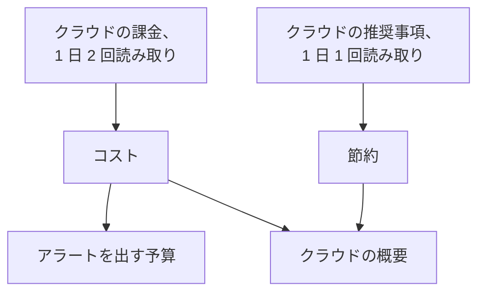

# クラウドのコストと節約

接続したクラウド アカウントからは、そのコストと、コストを下げる方法もわかります。OneUptime はクラウド自身の課金から毎日のコストを、クラウド自身の推奨サービスから推奨事項を読み取り、**クラウド → 支出 → コスト** と **クラウド → 支出 → 節約** に表示し、Savings Plans、予約、確約利用割引を **クラウド → 支出 → コミットメント** に一覧表示します。また、月のコストが予算を超える前に **クラウド → 支出 → 予算** でアラートを出します。許可すれば、所有者が承認した節約を実行し、本番以外のリソースを業務時間外に停止し、各変更を請求で確認することもできます。

:::cards
- [Amazon Web Services](#amazon-web-services): Cost Explorer と Cost Optimization Hub。どちらも一度だけ有効にします。
- [Microsoft Azure](#microsoft-azure): Cost Management と Azure Advisor。ロールが一つ増えます。
- [Google Cloud](#google-cloud): BigQuery への課金エクスポートと Recommender。
- [請求額、償却コスト、純コスト](#請求額償却コスト純コスト): 各コストを三通りで持ち、コミットメントとクレジットをお金が実際に使われた場所に計上します。
- [コミットメントと更新](#コミットメントと更新): すべてのコミットメント、終了前や使用不足のときのアラート、そして何を更新または購入するか。
- [節約の実行](#節約の実行): 所有者の承認を得て節約を適用し、元に戻すこともできます。
- [時間外スケジュール](#時間外スケジュール): 本番以外のリソースを夜間と週末に停止します。
- [節約の AI ルール](#節約の-ai-ルール): 所有者への提案、または上限内での変更。
- [予算](#予算): 月の支出が予算の一定の割合を超えたときのアラート。
:::

## 仕組み



- **コストはクラウド自身の課金から取得します。** AWS Cost Explorer、Azure Cost Management、Google Cloud の BigQuery への課金エクスポートから、アカウントの請求通貨で読み取り、それぞれを請求額、償却コスト、純コストの三通りで保存します。[請求額、償却コスト、純コスト](#請求額償却コスト純コスト) を参照してください。各金額は一日分で、クラウドの請求と同じく UTC の日単位です。
- **クラウドは直近の一、二日を遅れて報告します。** 各読み取りは直近の一週間を、月の初めの数日は先月全体を読み直すため、クラウドが日を締めるにつれてその日のコストが確定します。接続の最初の読み取りは先々月の初めまでさかのぼります。
- **月の予測は直近一週間のペースに従います。** 今月これまでのコストに、残りの日数分を直近の丸七日間の平均で足したものです。
- **節約はクラウド自身の推奨サービスから取得します。** AWS Cost Optimization Hub、Azure Advisor、Google Cloud の Recommender が、より小さいサイズ、使われていないリソース、効果のあるコミットメントを、それぞれ月にいくら節約できるかとともに示します。クラウドのコンソールで実施または却下した推奨事項は、次の読み取りで消えます。

## 始める前に

- **接続済みのアカウント。** 現在のセットアップ コマンドで [クラウド アカウントの接続](/docs/telemetry/cloud-accounts) を行います。このコマンドで、接続はコストと推奨事項を読み取れるようになります。以前に作った接続は、コマンドを実行し直すまでどちらも読み取りません。

## Amazon Web Services

接続はコストを `ce:GetCostAndUsage` で、コミットメントを `ce:GetSavingsPlansCoverage`、`ce:GetSavingsPlansUtilization`、`ce:GetSavingsPlansUtilizationDetails`、`ce:GetReservationCoverage`、`ce:GetReservationUtilization` で、購入済みの Savings Plans を `savingsplans:DescribeSavingsPlans` で、推奨事項を `cost-optimization-hub:ListRecommendations` と `cost-optimization-hub:GetRecommendation` で読み取ります。セットアップ コマンドは Cost Explorer の読み取りを `ce:GetCostAndUsage*`、`ce:GetSavingsPlans*`、`ce:GetReservation*` の三つのファミリーとして付与します。どれも読み取りだけで、アクセスキーのユーザーのポリシーが IAM の上限である 2,048 文字に収まるようにするためです。Cost Explorer と Cost Optimization Hub は、先にアカウントで有効にしておく必要があります。

:::steps
### Cost Explorer を有効にする

AWS Billing and Cost Management コンソールで Cost Explorer を一度開きます。AWS は一日以内にアカウントのコストを準備します。メンバー アカウントすべてのコストを読み取るには、組織の管理アカウントを接続します。

### Cost Optimization Hub に参加する

同じコンソールで Cost Optimization Hub を開いて参加します。組織の場合は管理アカウントから、このアカウントだけの場合はこのアカウントで行います。推奨事項は一日以内に届きます。
:::

Cost Explorer はリクエストごとに $0.01 かかります。コストの読み取り一回で二回かそれより少し多くリクエストし (請求額と償却コストで一回、純コストで一回)、コミットメントは対象範囲と使用率に一日四回、個々のコミットメントにさらに一日六回から十二回のリクエストで読み取ります。Savings Plans API と Cost Optimization Hub は無料です。

### リソースごとのコスト

リソースレベルのデータを有効にすると、Cost Explorer は直近 14 日間の各リソースのコストも示します。AWS Billing and Cost Management コンソールで Cost Management の設定を開き、日次の粒度でリソースレベルのデータを有効にします。組織の場合は管理アカウントから有効にします。AWS は 48 時間以内にデータを準備します。

次に **クラウド → 接続** で接続を編集し、**その他の項目** で **リソースごとのコスト** をオンにします。接続は一日に一回、`ce:GetCostAndUsageWithResources` で読み取ります。初回は 14 日分、その後は直近三日分をもう一度読み取り、毎回数回リクエストします。読み取った内容は、Cost Explorer が保持しなくなった後もアカウントのコストとともに残ります。以前に作成した接続では、セットアップコマンドをもう一度実行してアクションを追加する必要があります。

## Microsoft Azure

アプリは **Cost Management Reader** ロールでコストを読み取ります。スコープは **Monitoring Reader** と同じで、セットアップ コマンドが両方を付与します。Azure Advisor の推奨事項は **Monitoring Reader** で読み取るため、有効にするものはありません。以前に作ったアプリにロールを付与するには、次を実行します。

```bash
az role assignment create --assignee <APP_ID> --role "Cost Management Reader" --scope /subscriptions/<SUBSCRIPTION_ID>
```

Cost Management はサブスクリプションごとに、各コストの対象リソースとともに応答し、読み取りは無料です。あるサブスクリプションについて応答できない場合は、アカウントの **コスト** に理由が表示されます。

Cost Management は、テナントのコストを読み取る速さを、読み取るすべての人に同じく制限します。各クエリは読み取るデータの月ごとにクエリ処理ユニット (QPU) を消費し、テナントには 10 秒ごとに 12 QPU、毎分 60、毎時 600 があります。OneUptime はテナントのサブスクリプションを各上限の三分の二以内で順番に読み取り、Cost Management がクエリを断ったときは求められた時間だけ待ち、次の読み取りで止まったところから続けます。まだ読み取られていないサブスクリプションには **キュー投入済み** と読み取られる時刻が表示され、すでに金額があるサブスクリプションはその間も金額を保ちます。償却コストは読み取りのたびに、実際のコストは一日一回読み取るため、サブスクリプションの最初の読み取りでは Cost Management に二回問い合わせ、クエリユニットを二倍消費します。大きなテナントでは、最初の金額が出るまでに読み取りが数回多く必要です。

テナントの予約と節約プランは **Reservations Reader** と **Savings plan Reader** で読み取ります。Azure はこれらをテナント自体のスコープで付与し、そこで付与できるのは昇格したアクセス権を持つグローバル管理者だけです。セットアップ コマンドは付与を試み、できなかったときはそう表示します。後から付与するには、昇格したアクセス権を持つグローバル管理者として次を実行します。

```bash
az role assignment create --assignee <APP_ID> --role "Reservations Reader" --scope /providers/Microsoft.Capacity
az role assignment create --assignee <APP_ID> --role "Savings plan Reader" --scope /providers/Microsoft.BillingBenefits
```

これらがなくても、コストと推奨事項はこれまでどおり読み取られ、**クラウド → 支出 → コミットメント** に付与すべきロールが表示されます。

## Google Cloud

Google Cloud にはプロジェクトのコストを返す API がありません。OneUptime は請求先アカウントの BigQuery へのエクスポートからコストを読み取ります。

:::steps
### 課金を BigQuery にエクスポートする

Google Cloud コンソールで Billing、続いて Billing export を開き、詳細な使用コストのエクスポートを BigQuery データセットに対して有効にします。Google は数時間遅れで、有効にした日から書き込みます。

### サービス アカウントに読み取りを許可する

接続のサービス アカウントに、エクスポートのデータセットに対する **BigQuery Data Viewer** を付与します。セットアップ コマンドはすでに **BigQuery Job User** を付与しており、クエリは自分のプロジェクトで実行されます。

### エクスポートのテーブルを指定する

**クラウド → 接続** で接続を編集し、**その他の項目** の **課金エクスポートのテーブル** にテーブルの完全な名前を設定します: `<PROJECT_ID>.<DATASET>.gcp_billing_export_resource_v1_<BILLING_ACCOUNT_ID>`。
:::

詳細エクスポートには各コストの対象リソースが含まれます。標準エクスポートにはサービスとリージョンしかありません。クエリは BigQuery の料金です。月 1 TiB までは無料、その後は TiB あたり $6.25 で、エクスポートの一か月分は数メガバイトから数ギガバイトです。Recommender のマシンタイプと未使用リソースの推奨事項は、セットアップ コマンドが付与する **Compute Recommender Viewer** で読み取り、無料です。Compute Engine のコミットメントは、セットアップ コマンドがすでに付与している **Cloud Asset Viewer** で Cloud Asset Inventory から一覧にします。追加で付与するものはありません。

## 請求額、償却コスト、純コスト

各コストは三通りで保存され、**クラウド → 支出 → コスト**、アカウントの **コスト**、クラウドの概要、予算は、選んだ基準で表示します。

- **請求額** は、クラウドが請求した日の各料金で、クレジットと返金を差し引く前の額です。前払いの Savings Plan や予約は購入日の一回の大きな料金になり、その対象の使用量は残りの期間中ずっと無料に見えます。
- **償却コスト** は、各コミットメントの料金を対象の日とリソースに配分し、お金が実際に使われた場所に計上します。これもクレジットと返金を差し引く前の額です。別の基準を選ばない限り、ページにはこれが表示されます。
- **純コスト** は、償却コストからクレジット、返金、割引を差し引いたもので、請求書の合計になります。

| | 請求額 | 償却コスト | 純コスト |
|---|---|---|---|
| AWS | Cost Explorer の非ブレンドコスト (unblended) | Cost Explorer の償却コスト | Cost Explorer の純償却コスト (クレジットと返金を含む) |
| Azure | Cost Management の実際のコスト | Cost Management の償却コスト | 償却コスト: Azure はクレジットを課金アカウントで差し引きますが、サブスクリプションの接続はそれを読み取りません |
| Google Cloud | エクスポートのコスト | コストから確約利用割引とサブスクリプションのクレジットを差し引いた額 | コストからすべてのクレジットを差し引いた額 |

金額の上の切り替えでページの基準が変わり、OneUptime はこのプロジェクトでの選択をブラウザーに記憶します。ページが開くときの基準であり予算が監視する、プロジェクト自体の基準は **クラウド → 設定 → コスト設定** にあります。予算は独自の基準を監視することもできます。予算を編集して **コスト基準** を設定してください。

三通りが保存される前に読み取ったコストは、どの基準でも請求額を表示します。各接続は、最初の読み取りと同じだけさかのぼってコストを一度読み直し、それぞれの基準を埋めます。

## 支出を減らす方法

**クラウド → 支出 → 節約** は、節約額の大きい順にすべての推奨事項を一覧にします。何をするか、どのリソースか、何が変わるか、月にいくら節約できるかがわかります。上の帯には合計と種類別の合計が表示されます: より小さいサイズ、使われていないリソース、コミットメント。OneUptime にそのリソースがあれば、推奨事項はリソースのページにリンクします。OneUptime が実行できるものには **適用** があります: [節約の実行](#節約の実行) を参照してください。

### OneUptime 自身の読み取り値によるサイズの適正化

推奨サービスが有効になっていない、リソースの種類に対応していない、リソースが新しすぎるといった理由で、どの推奨サービスも何も示さないリソースは、接続が直近 14 日間に読み取った CPU とメモリの値から OneUptime がサイズを判断します。対象は、AWS の EC2 インスタンス、RDS データベース、ElastiCache クラスター、Azure の仮想マシン、PostgreSQL と MySQL のフレキシブル サーバー、App Service プラン、Google Cloud の Compute Engine VM と Cloud SQL インスタンスです:

- **過剰プロビジョニング** は、半分、または四分の一のサイズでもまだ余裕がある場合です。小さいサイズで CPU の 95 パーセンタイルが 60% 以下、CPU の最高値が 100% 以下、メモリを読み取れる場合はメモリのピークが 70% 以下に収まるときです。
- **プロビジョニング不足** は、CPU の 95 パーセンタイルが 85% 以上、またはメモリのピークが 90% 以上の場合です。2 倍の大きさのサイズを勧めます。

リソースは、読み取り値が 6 日分たまるとサイズが判断されます。リソースのページでは、コストの横に **サイズの適正化** が表示され、過剰プロビジョニングのリソースは OneUptime をソースとして **クラウド → 支出 → 節約** に表示されます。変更による節約額は、直近 30 日間にリソースにかかったコストのうち変更が占める分なので、クラウドがリソースを名前で請求するようになるとわかります。Azure と Google Cloud の詳細エクスポートはリソースを名前で請求し、AWS も「リソースごとのコスト」をオンにすると請求します。EC2 インスタンスは CloudWatch エージェントがある場合に、Compute Engine VM は Ops Agent がある場合にだけメモリを報告し、ない場合は CPU だけでサイズが判断されます。t3、B シリーズ、e2-micro などのバースト可能なサイズは判断の対象外です。

### コミットメント

**クラウド → 支出 → 節約** とアカウントの **コスト** には、直近 30 日間の支出のうち各アカウントのコミットメントが支払った割合と、それらが使用された割合が、種類ごとに一行で表示されます。

- AWS: Savings Plans とリザーブドインスタンス。Cost Explorer から読み取ります。組織の管理アカウントは、組織のすべてのアカウントについて読み取ります。
- Azure: 節約プランと予約。Cost Management から、償却コストで読み取ります。
- Google Cloud: 確約利用割引。課金エクスポートから読み取ります。エクスポートはコミットメントのうち未使用だった分を示さないため、使用された割合は表示されません。

コミットメントのないアカウントには、オンデマンド料金で実行され、コミットメントがあれば安く支払えた分が表示されます。各種類の数値はそのクラウド自身のもので、種類どうしを合算することはありません。予約と Savings Plan は、同じマシンの支出をどちらも自分の対象として数えることがあるためです。個々のコミットメントは **クラウド → 支出 → コミットメント** に一覧表示されます。[コミットメントと更新](#コミットメントと更新) を参照してください。

## コミットメントと更新

**クラウド → 支出 → コミットメント** には、接続で読み取れるすべての Savings Plan、予約、確約利用割引が一覧表示されるので、気づかないうちに終了するものはありません。

- 上部の **アクティブなコミットメント** はアクティブなものと 90 日以内に終了するものの数を、**使用率** は直近 30 日に使われた割合と未使用のまま残った分を、**カバー範囲** は支出のうちコミットメントでカバーされる割合を示します。
- **まもなく終了** には、90 日以内に終了し自動更新されないものが、それぞれの更新プランとともに表示されます。割引を維持するために何を購入するか (使われた分だけの時間あたりのコミットメントまたはインスタンス)、月あたりのコストと節約額、元が取れる時期、そして現在と終了後に支出のどれだけがカバーされるかです。**コンソールで更新** は、クラウドでそれを更新するページを開きます。
- **すべてのコミットメント** は全一覧です。それぞれが何で何をカバーするか、そのアカウント、終了日、期間と支払いオプション、直近 30 日に使われた割合、支払った使用量と節約額を示します。
- **購入プラン** は、クラウドの推奨サービスが購入を勧めるもので、それぞれに月あたりのコストと節約額、元が取れる時期、カバー範囲の変化が示されます。**コンソールで購入** は、それを購入するページを開きます。
- その下には、各アカウントのコミットメントが種類別に、そのアカウントの **コスト** と同じように表示され、コミットメントがいつアラートを出すかは **アラートを変更** で変えられます。

OneUptime は計画するだけで、コミットメントを購入、更新、返却することはありません。購入はクラウドのコンソールで行います。

| | コミットメントの取得元 | それぞれについてわかること |
|---|---|---|
| AWS | Cost Explorer の Savings Plans とリザーブドインスタンス (それぞれの使用率付き) と、購入済みプラン (開始待ちのものを含む) 用の Savings Plans API | 終了日、期間、支払いオプション、時間あたりのコミットメントまたはインスタンス、料金、直近 30 日と 7 日の使用率 |
| Azure | テナントの予約と節約プラン | 終了日、期間、課金プラン、自動更新されるかどうか、直近 30 日と 7 日の使用率 |
| Google Cloud | Cloud Asset Inventory からの Compute Engine のコミットメント | 終了日、プラン、リソース、自動更新されるかどうか。Google Cloud はコミットメントの使用量を示しません |

AWS では、組織の管理アカウントがすべてのアカウントのものを一覧にします。Google Cloud がプロジェクトではなく請求先アカウントで管理する費用ベースの確約利用割引は、まだ一覧にありません。

### コミットメントアラート

コミットメントはアラートを出し、他のアラートと同じくオンコールポリシーで呼び出します。**クラウド → 設定 → コスト設定** の **コミットメントアラート** で、いつ出すかを決めます。

- **コミットメント終了前にアラート**: 初期値は終了の 90 日前、30 日前、7 日前です。コミットメントが到達したうちで最も近い日にアラートが一つ出て、より近い日のアラートが前のものに置き換わります。自動更新されるコミットメントや、終了時に開始する更新がキューに入っているコミットメントでは出ません。
- **使用率がこれを下回ったらアラート**: 初期値は 80% で、一週間稼働した後のコミットメントの直近 7 日の使用率です。使用率が戻るとアラートは解決します。
- **カバー範囲がこれを下回ったらアラート**: 初期値は 60% で、アカウントのある種類のコミットメントがカバーできる支出に対する割合です。それより多くカバーしていた後に下回ると出ます。カバー範囲が戻ると解決します。空欄にすると、カバー範囲ではアラートが出ません。

**コミットメントでアラート** をオフにするとすべて止まり、**アラートの重大度**、**オンコールポリシー**、**所有者** で、重大度、呼び出す相手、所有者を決めます。各アラートには、コミットメントのカバー対象と支払った額が示され、更新プランへのリンクがあります。コミットメントが終了、更新されるか、一覧から消えると、アラートは自動で解決します。

## 節約の実行

アカウントのクラウド接続の **節約アクション** 設定で許可されると、OneUptime はその接続を通じて節約を実行します: 各選択肢で何が許可されるかは [節約アクション](/docs/telemetry/cloud-accounts#節約アクション) で説明しています。実行するのは 1 ステップの変更だけです: アイドル状態のインスタンスやデータベースの停止、gp2 ボリュームの gp3 への変更、未接続ディスク、古いスナップショット、未使用イメージの削除、未使用アドレスの解放、そして許可した場合はインスタンスやデータベースの推奨サイズへの変更です。コミットメントは購入しません: **コンソールで購入** で、そのためのクラウドのページが開きます。

:::steps
### 適用を選ぶ

**クラウド → 支出 → 節約** で節約の **適用** を選びます。ダイアログには、何が変わるか、月にいくら節約できるか、元に戻す方法 (または元に戻せないこと)、誰が承認するかが表示されます。

### 所有者が承認する

リソースの所有者として指定された人、またはリソースを所有するチームのメンバーで、リソースを編集できる人が変更を承認します。所有者のいないリソースは、プロジェクト所有者またはプロジェクト管理者が承認します。自分で承認できる場合は、**適用** でその場で自分として実行されます。そうでない場合は、所有者が **承認** を選ぶか、理由を添えて **非表示** を選ぶまで **承認待ち** で待ちます。

### OneUptime が実行する

変更は接続を通じて行われ、承認者とともにリソースとアカウントのタイムラインに記録されます。削除するディスクは、**最初に最終スナップショットを取得** をオフにしない限り、先に最終スナップショットを取得します。
:::

どの変更にも元に戻す方法が示されます: **実行した変更** の **元に戻す** で、停止したインスタンスの再起動、ボリュームやサイズの復元、削除したディスクの最終スナップショットからの再作成ができます。スナップショット、イメージ、解放したアドレスのように完全に削除されるものは元に戻せず、適用前にダイアログでそう表示されます。プロジェクトが **リスクの高い修正に 2 人の承認を必須にする** で 2 人の承認を求めている場合、元に戻せない変更には 2 人の承認が必要です。

Terraform や CloudFormation などのコードで管理されているとタグが示すリソースは、代わりにコードで変更します: ダイアログには、それを宣言しているリポジトリへの **プルリクエストを開く** が表示されるので、次の apply で節約が元に戻りません。

### 請求による証明

**今月の節約額** には、クラウドの請求に表れた分だけを数えます。変更後の 3 日分が請求で確定すると、リソースの 1 日あたりのコストを変更前の 1 週間と比較します: 約束した額の四分の一以上下がっていれば **請求で確認済み**、そうでなければ **請求で未確認**、クラウドがリソースを名前で請求しない場合は **測定不可** になります。**請求を確認中** には、その日数をまだ待っている変更を数えます。

## 時間外スケジュール

**クラウド → 支出 → スケジュール** では、スケジュールが本番以外のインスタンスとデータベースを業務時間外に停止し、再び起動します:

:::steps
### リソースを選ぶ

対象を選ぶクラウドのタグを指定します (例: `Schedule` = `office-hours`)。1 つのアカウントでも、すべてのアカウントでもかまいません。

### 稼働する時間を指定する

稼働日、起動する時刻と停止する時刻 (24 時間表記)、タイムゾーンを選びます。
:::

業務時間が終わると、スケジュールはアカウントの接続を通じて、タグで選ばれ本番ではないとわかっている稼働中のリソースをすべて停止します。業務時間が始まると、自分が停止したものだけを再び起動します: 誰かが手動で停止したリソースは停止したままです。**リソースを表示** には、スケジュールが今選んでいるものと、稼働したままにする理由が表示されます。停止の対象は、AWS の EC2 インスタンスと RDS データベース、Azure の仮想マシン、Google Cloud の Compute Engine インスタンスです。AWS は 1 週間停止したデータベースを自動で再び起動します。

スケジュールは本番を停止せず、環境が何も示されていないリソースも停止しません。リソースが本番ではないとわかるのは、次の場合です:

- タグがそう示している場合 (`environment`、`env`、`stage`、`tier`、`deployment.environment` などのキーに、`dev`、`test`、`qa`、`staging`、`sandbox` などの値);
- アカウントの **設定** の **環境** で、アカウントが **本番以外** に設定されている場合;
- またはラベルがそう示している場合 (例: `Staging`、`env: dev`)。

本番が優先されます: `prod`、`production`、`live` を示すタグや、**本番** に設定されたアカウントは、他の何が示していてもリソースを稼働したままにします。リソースの名前はこの判断に使いません。スケジュールをオフにすると、それ以上何も停止せず、停止したものは業務時間の開始時に起動します。削除すると、停止したものはすぐに起動します。

## 節約の AI ルール

**AI を有効化** がオンの場合、OneUptime AI はアカウントの節約を読み取るたびに、実行できる節約をリソースの所有者に提案し、所有者は **承認待ち** で承認または却下します。**クラウド → 設定 → 節約の AI ルール** では、ルールが一致する節約を OneUptime AI がどう扱うかを、変更の種類、リソースの環境、クラウドごとに指定します: **オフ**、**所有者に提案**、または月間上限までの **確認なしで実行**。ルールがなければすべての節約を提案し、実行はしません。ルールがあればルールに一致するものだけを扱い、一致するルールの中では最も慎重なものが優先されます。

ルールが確認なしで実行するのは、本番ではないとわかっているリソースで、元に戻せる変更で、一致するルールの最も小さい上限の範囲内に限られ、プロジェクトごとに 1 時間あたり最大 10 回までです: それ以外はすべて提案になります。確認なしで実行した変更は、実行したルールとともにタイムラインに記録され、所有者が元に戻せます。却下された節約や元に戻された節約は、30 日間再提案されません。

## 予算

:::steps
### 予算を作成する

**クラウド → 支出 → 予算** で予算を作成します: **月額**、対象の **アカウント** (すべてのアカウントが対象なら空欄)、数える **コスト基準** (プロジェクトの基準なら空欄)。

### アラートを出すタイミングを選ぶ

**アラートのしきい値** には、アラートを出す予算の割合をパーセントで指定します。初期値は 80 と 100 です。**超過の見込み時にアラート** を有効にすると、直近一週間のペースでは月が予算を超える場合にも、月に一度アラートを出します。**通常と異なる日にアラート** を有効にすると、通常よりはるかに高くついた日の翌日にもアラートを出します。[通常と異なる日](#通常と異なる日) を参照してください。**アラートの重大度** と **オンコールポリシー** で、アラートの重大度と呼び出す相手を決めます。
:::

予算は、コストを読み取るたびと一時間ごとに確認されます。月の支出がしきい値を超えると、そのしきい値のアラートが一つ出ます。一回の読み取りで複数を超えた場合は最も高いしきい値のアラートが出ます。新しい月になると先月のアラートは解決されます。予算が数えるのは、予算の通貨で請求されるアカウントだけで、予算の基準で数えます。償却コストの予算は前払いで購入したコミットメントでは発火しませんが、請求額の予算は購入日にそれを数えます。

AI エージェントは [MCP サーバー](/docs/ai/mcp-server) から、スクリプトは CLI の `oneuptime cloud-budget` コマンドで予算を作成、変更できます。[リソース操作](/docs/cli/resource-operations) を参照してください。

### 通常と異なる日

読み取りのたびに、アカウントの直近 14 日間の各日 (丸一日分) を、その前の 14 日間と比べます。サービスのコストが通常の日の 2 倍以上、またはアカウント全体のコストが通常の日の 5 割増し以上になった日は、通常と異なる日です。どちらも、増加分がアカウントの通貨で 10 以上、かつアカウントの通常の日の 5% 以上である必要があるため、数セントの増加が急増として扱われることはありません。ある日の通常の値はその前の 14 日間の中央値なので、一度の急増ではほとんど動きません。また、アカウントは一週間分のコストがたまるまで判断されません。

**クラウド → 支出 → コスト** では、通常と異なる日が日別の支出の棒の上に示され、その下に一覧表示されます。すべてのアカウントを表示しているときは、各マークからそのアカウントの **コスト** を開けます。アカウントを含む予算は、アカウントと日ごとに一つのアラートを翌日に出し、高くなったサービスをすべて挙げます。何日も続く急増は始まった日に知らせ、一週間より前の日は知らせません。これらのアラートができる前に作成された予算は、編集してオンにするまでこのアラートを出しません。

## 支出の内訳

**クラウド → 支出 → コスト** は、期間の支出をサービス、リージョン、アカウント、リソース別に分けるほか、さらに三つの方法で分けます。

- アプリプラットフォームの環境別: 各環境のアカウントとリージョンにあるプラットフォームのサービス (Amazon ECS や Cloud Run など) と、Elastic Beanstalk 環境のリソースを AWS が付けるタグで集計します。
- アプリ別: プラットフォームがアプリの名前で請求する分 (Cloud Run のサービスや Container App など) です。Amazon ECS はタスクを、App Service はプランを請求するため、それらのアプリのコストは環境のコストのままです。
- タグ別: 選んだタグの値ごとに分けます。コストには読み取った時点のタグが残ります。Google Cloud の課金エクスポートのラベル、なければ請求先リソースのタグで、AWS では「リソースごとのコスト」が必要です。

一覧の下には、残りがいくらだったかが表示されます。どの環境にも属さない分、環境全体に請求された分、またはタグのない分です。タグを保持する前に読み取ったコストは、初回の読み取りと同じだけさかのぼって一度だけ読み直され、タグが補われます。

## OneUptime で見えるもの

- **クラウドの概要。** **クラウド → 概要** には、今月の支出と先月の同じ日までの支出の比較、コストの高いサービス、効果の大きい支出削減の方法が、対応が必要なものと並んで表示されます。
- **毎日の支出。** **クラウド → 支出 → コスト** は直近 30 日の各日を描いて通常よりはるかに高くついた日に印を付け、それらの日を一覧にし、期間をサービス、リージョン、アカウント、リソース、アプリプラットフォームの環境、アプリ、タグ別に、請求額、償却コスト、純コストのいずれかで分けます。コストを読み取れていないアカウントは、その理由とともに下に一覧表示されます。
- **各コミットメント。** **クラウド → 支出 → コミットメント** は、各コミットメントの終了日と使用率、まもなく終了するものには何を更新するか、そして何を購入するかを一覧にします。
- **アカウントのコスト。** アカウントの **コスト** には、そのアカウントだけについて同じ内容が、コミットメントと支出を減らす方法とともに表示されます。
- **リソースのコスト。** クラウドがリソースを名前で請求している場合、リソースのページには今月と直近 30 日のコストが、支出を減らす方法とサイズの適正化とともに表示されます。
- **節約できた額。** **クラウド → 支出 → 節約** の最初には、実行した変更による今月の節約額 (請求に基づく)、承認待ちの変更と実行した変更、スケジュールがリソースを停止した時間が表示されます。

## トラブルシューティング

:::details アカウントに 権限が必要 と表示される
接続はまだアカウントのコストを読み取れません。**クラウド → 接続** からセットアップ コマンドを実行し直してください。コストの読み取りに必要なものが追加されます。Google Cloud では、サービス アカウントにエクスポートのデータセットに対する **BigQuery Data Viewer** も付与してください。
:::

:::details アカウントに 未セットアップ と表示される
クラウドにまだ渡せるコストがありません。AWS では Cost Explorer を有効にし、Google Cloud ではエクスポートのテーブルを **課金エクスポートのテーブル** に指定します。最初の金額は次の読み取り、つまり 12 時間以内に届きます。
:::

:::details アカウントに キュー投入済み と表示される
コストが順番を待っています。Azure Cost Management がテナントのコストを読み取る速さを制限しているためです。アカウントには読み取られる時刻が表示され、その時刻以降の接続の最初の読み取りで読み取られます。対応は不要です。すでに金額があるアカウントは、その間も金額を保ちます。
:::

:::details リソースごとのコスト に 未セットアップ と表示される
アカウントでリソースレベルのデータが有効になっていません。AWS Billing and Cost Management コンソールの Cost Management の設定で、日次の粒度で有効にしてください。組織のメンバーの場合は管理アカウントから有効にします。AWS は 48 時間以内にデータを準備し、翌日の読み取りで取り込まれます。
:::

:::details コミットメントに 権限が必要 と表示される
接続はまだアカウントの Savings Plans と予約を読み取れません。**クラウド → 接続** からセットアップコマンドをもう一度実行してください。読み取りに使うアクションが追加されます。Azure では、昇格したアクセス権を持つグローバル管理者が **Reservations Reader** と **Savings plan Reader** を付与します。[Microsoft Azure](#microsoft-azure) を参照してください。
:::

:::details 償却コストと純コストが請求額と同じになる
三通りが保存される前に読み取ったコストは、接続の次のコスト読み取りまで、どの基準でも請求額を表示します。次の読み取りでは、最初の読み取りと同じだけさかのぼって読み直します。Azure では、純コストは常に償却コストと同じです。
:::

:::details コミットメントが終了したのにアラートが来なかった
自動更新されるコミットメントや、終了時に開始する更新がキューに入っているコミットメントではアラートは出ません。**クラウド → 設定 → コスト設定** でコミットメントアラートがオフになっているプロジェクトのコミットメントでも出ません。アラートを出すには、プロジェクトにアラートの重大度も必要です。
:::

:::details 金額にアカウントが含まれていない
金額は、ほとんどのアカウントの請求通貨で表示されます。別の通貨で請求されるアカウントはその通貨とともに下に一覧表示され、予算は予算自身の通貨で請求されるアカウントだけを数えます。
:::

:::details 節約に「適用」がない
OneUptime が実行するのは 1 ステップの変更だけです: コミットメントや、複数の点を変える推奨事項は、クラウドのコンソールで行います。アカウントの接続が許可していない場合、「適用」で開くダイアログに、ここから実行できない理由が表示されます: 接続の **節約アクション** をオンにして、セットアップ コマンドをもう一度実行してください。
:::

:::details スケジュールがリソースを稼働したままにする
**リソースを表示** に理由が表示されます: 本番である、本番ではないと示すものがない、またはアカウントの接続で節約アクションが許可されていない、のいずれかです。`environment` = `dev` などのタグを付けるか、アカウントを **本番以外** に設定してください。
:::

:::details 今月の金額がクラウドのコンソールより低い
クラウドは直近の一、二日を遅れて報告し、請求額と償却コストはクレジットと返金を差し引く前の額です。次の読み取りで追いつきます。クラウドのコンソールに表示される基準と比べてください。AWS は非ブレンドコスト、つまり請求額で開きます。
:::

## 次のステップ

:::cards
- [クラウドコストの配分](/docs/telemetry/cloud-cost-allocation): 支出をチーム、製品、コストセンターごとに振り分けます。
- [クラウド アカウントの接続](/docs/telemetry/cloud-accounts): 別のアカウントを接続するか、コマンドを実行し直します。
- [クラウド リソース](/docs/telemetry/cloud-resources): 各リソースのメトリクスを、自分のコレクターから。
- [Kubernetes のコストの可観測性](/docs/telemetry/kubernetes-cost): Kubernetes の各ワークロードのコスト。
:::
