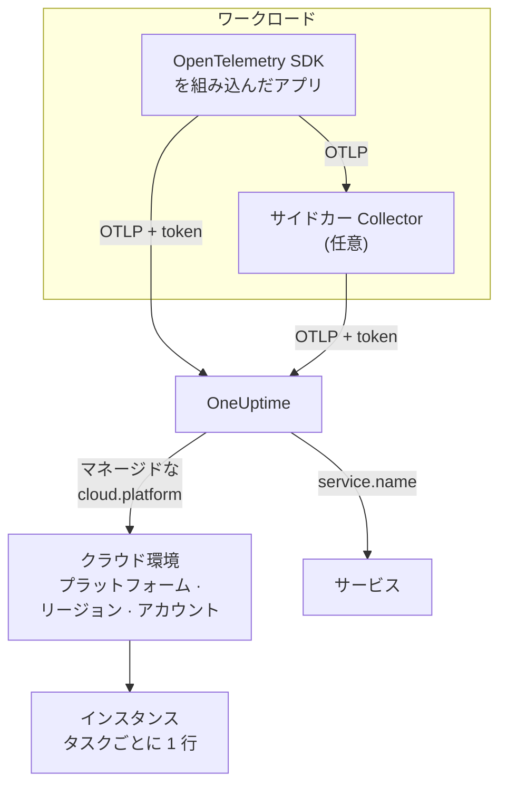

# クラウド環境

**クラウド環境** とは、マネージドなクラウドプラットフォーム上でコンテナが動く場所のことです。ECS クラスターのアカウントとリージョン、Cloud Run のプロジェクトとリージョン、Container Apps のサブスクリプションとリージョンがこれにあたります。適切なリソース属性を持つテレメトリが初めて届いた時点で OneUptime が環境を作成し、そこで動くすべてのワークロードをまとめます。手動で登録するものはありません。

:::cards
- [AWS ECS / Fargate](/docs/telemetry/cloud-aws-ecs): Fargate または EC2 上のタスク。タスクごとの CPU とメモリも表示します。
- [Google Cloud Run](/docs/telemetry/cloud-gcp-cloud-run): サービスとジョブ。サーバーレス関数としても表示されます。
- [Azure Container Apps](/docs/telemetry/cloud-azure-container-apps): レプリカ。リージョンとサブスクリプションは手動で設定します。
- [その他のクラウドプラットフォーム](/docs/telemetry/cloud-other-platforms): Elastic Beanstalk、App Runner、App Engine、App Service、Container Instances。
:::

## 仕組み



- **リソース検出器が、ワークロードの実行場所を伝えます。** SDK または Collector の OpenTelemetry リソース検出器がプラットフォームのメタデータを読み取り、ワークロードが送るすべてのデータに `cloud.platform`、`cloud.account.id`、`cloud.region` を付けます。検出器がない場合は、自分で設定します。
- **環境はまとめ役です。** プラットフォーム、アカウント、リージョンが同じワークロードは、すべて一つの環境に入ります。サービスは **サービス** にそれぞれ自分の行を持ちます。
- **実行中の各タスクがインスタンスです。** 環境の **インスタンス** タブには実行中のタスク、インスタンス、レプリカが一覧表示され、プラットフォームが提供できる場合はリアルタイムの CPU とメモリも表示されます。

## 始める前に

- **取り込みキー。** **プロジェクト設定 → テレメトリと APM → 取り込みキー** で **サーバー** キーを作成し、そのトークンをコピーします。[取り込みキーを作成する](/docs/telemetry/open-telemetry#取り込みキーを作成する)を参照してください。トークンはシークレットです。そのクラウドのシークレットストアのどこに保存するかは、各プラットフォームのページで説明しています。
- **アプリケーションの OpenTelemetry。** OTLP をエクスポートする OpenTelemetry SDK、またはアプリケーションの隣で動く OpenTelemetry Collector。

## サポートされているプラットフォーム

| プラットフォーム | `cloud.platform` | `cloud.*` を設定するもの | インスタンスの識別子 | ガイド |
| ------------------------- | --------------------------- | ---------------------- | --------------------------------- | ------------------------------------------------------------------ |
| AWS ECS / Fargate | `aws_ecs` | リソース検出器 | `aws.ecs.task.arn` | [AWS ECS / Fargate](/docs/telemetry/cloud-aws-ecs) |
| AWS Elastic Beanstalk | `aws_elastic_beanstalk` | リソース検出器 | `host.id` | [その他のクラウドプラットフォーム](/docs/telemetry/cloud-other-platforms) |
| AWS App Runner | `aws_app_runner` | 手動で設定 | `host.name` | [その他のクラウドプラットフォーム](/docs/telemetry/cloud-other-platforms) |
| Google Cloud Run | `gcp_cloud_run` | リソース検出器 | `faas.instance` | [Google Cloud Run](/docs/telemetry/cloud-gcp-cloud-run) |
| Google App Engine | `gcp_app_engine` | リソース検出器 | `faas.instance` | [その他のクラウドプラットフォーム](/docs/telemetry/cloud-other-platforms) |
| Azure Container Apps | `azure_container_apps` | リソース検出器 | `azure.container_app.instance.id` | [Azure Container Apps](/docs/telemetry/cloud-azure-container-apps) |
| Azure Container Instances | `azure_container_instances` | 手動で設定 | `host.name` | [その他のクラウドプラットフォーム](/docs/telemetry/cloud-other-platforms) |
| Azure App Service | `azure_app_service` | リソース検出器 | `host.id` | [その他のクラウドプラットフォーム](/docs/telemetry/cloud-other-platforms) |

- **リソース検出器:** SDK、または Collector の `resourcedetection` プロセッサーにある OpenTelemetry リソース検出器が、`cloud.*` 属性を自動で設定します。
- **手動で設定:** 検出器がないため、属性を `OTEL_RESOURCE_ATTRIBUTES` に入れます。正確な行は各プラットフォームのページに載っています。
- **Azure の検出器が知っていることは限られます。** Container Apps の検出器はリージョンもサブスクリプションも知らず、App Service の検出器はサブスクリプションを知りません。足りないものは自分で設定します。
- **ドット区切りの Azure の表記も使えます。** Node.js と .NET の Azure 検出器は `azure.container_apps` と `azure.app_service` を書き込みます。OneUptime は受信時に、これらを上記のアンダースコアの値に書き換えます。

## OneUptime が環境を識別する方法

環境は、次の三つのリソース属性の組み合わせごとに一つ存在します。

| 属性 | 必須 | 内容 |
| ------------------ | -------- | ------------------------------------------------------------------------------------------- |
| `cloud.platform` | はい | [サポートされているプラットフォーム](#サポートされているプラットフォーム) の値のいずれか |
| `cloud.account.id` | いいえ | AWS アカウント ID、Google Cloud プロジェクト ID、または Azure サブスクリプション ID |
| `cloud.region` | いいえ | リージョン。例: `us-east-1`、`us-central1`、`eastus` |

OneUptime はこの三つを `|` でつないで **環境キー** にし、同じ値を使って環境に _AWS ECS · us-east-1 · 123456789012_ のような名前を付けます:

```text title="Environment keys"
aws_ecs|123456789012|us-east-1
gcp_cloud_run|my-project|us-central1
azure_container_apps|00000000-0000-0000-0000-000000000000|eastus
```

> [!IMPORTANT]
> 欠けている部分は、キーの中に空のセグメントとして残ります: `aws_ecs||us-east-1`。そのため、`cloud.account.id` を省いたワークロードは、それを設定したワークロードとは別の環境に入ります。一つのはずの環境が二つ見えるのは、たいていこれが原因です。

### インスタンスの識別子

環境の中では、実行中のタスク、インスタンス、レプリカがそれぞれ **インスタンス** に一行ずつ表示されます。名前は、テレメトリが持つ次のリソース属性のうち、最初に見つかったものから付けられます:

1. `aws.ecs.task.id`
2. `aws.ecs.task.arn` (タスク ID に短縮)
3. `faas.instance`
4. `azure.container_app.instance.id`
5. `service.instance.id`
6. `container.id`
7. `host.id`
8. `host.name`

プラットフォーム自身の識別子を、意図的に先に使います。サイドカー Collector とアプリケーションの SDK の両方から見え、再起動しても変わらないからです。SDK は通常、プロセスごとに新しい `service.instance.id` を作ります (Node.js SDK は既定でそうします)。そのため、これを先にキーにすると一つの ECS タスクが二行に分かれてしまいます。`service.instance.id` は、プラットフォームが独自の識別子を設定しない場合に使われます。[サポートされているプラットフォーム](#サポートされているプラットフォーム) の **インスタンスの識別子** 列は、各プラットフォームの一般的な構成で使われる属性を示しています。

### 手動で作成する環境

通常は必要ありません。環境は取り込み時に自動で作成されます。テレメトリより先に環境を作るには、**クラウド → すべての環境** を開き、**クラウドリソースを作成** をクリックします。**クラウドプラットフォーム** を選び、**クラウドアカウント ID** と **クラウドリージョン** を、テレメトリが報告するとおりに正確に入力します。OneUptime はこの三つからキー `platform|account|region` を作り、取り込み時にはキーだけで環境を照合します。環境の名前は取り込み時と同じように付けられます。別の名前を表示するには、**その他の項目** を開いて **表示名** を入力します。

## クラウド環境にならないもの

| 実行先 | 表示される場所 | 理由 |
| ------------------------------------------------------------------------------------------------- | ------------------------ | ---------------------------------------------------------------------------------------------------- |
| EC2, Compute Engine, Azure VM (`aws_ec2`, `gcp_compute_engine`, `azure_vm`) | **ホスト** | 仮想マシンはホストです。[ホスト OpenTelemetry Collector](/docs/telemetry/host-otel-collector) を参照してください |
| EKS、GKE、AKS、セルフマネージドの Kubernetes | **Kubernetes** | `k8s.*` 属性で振り分けられます。[Kubernetes エージェント](/docs/telemetry/kubernetes-agent) を参照してください |
| Lambda, Cloud Functions, Azure Functions (`aws_lambda`, `gcp_cloud_functions`, `azure_functions`) | **サーバーレス関数** | `faas.name`、または FaaS の `cloud.platform` を持つ場合は `service.name` で振り分けられます。[サーバーレス関数](/docs/telemetry/serverless-functions) を参照してください |
| ロードバランサー、バケット、マネージドデータベース、その他の IaaS / PaaS リソース | **クラウドリソース** | Azure Monitor、CloudWatch、Cloud Monitoring が公開するメトリクスから検出されます。[クラウドリソース](/docs/telemetry/cloud-resources) を参照してください |

> [!NOTE]
> Cloud Run と App Engine は、意図的に二か所に表示されます。これらの検出器はマネージドな `cloud.platform` と `faas.name` の両方を設定するため、各サービスはそれぞれ独立した **サーバーレス関数** にもなり、**クラウド環境** はそのプロジェクトとリージョンのすべてのサービスをまとめます。同じテレメトリが両方に記録されます。

## ワークロードを接続する

各プラットフォームのページでは、そのクラウド独自のコマンドとコンソール画面を使ってこの手順を説明しています。概要は次のとおりです:

:::steps
### テレメトリにクラウド属性を付ける

:::tabs
@tab Sidecar collector
タスク、インスタンス、レプリカの中に置く二つ目のコンテナです。アプリケーションは `localhost:4318` にエクスポートし、Collector の `resourcedetection` プロセッサーが、通過するすべてのデータに `cloud.*` を付けます。トークンは Collector が持ち、ECS ではタスクごとの CPU とメモリも送ります:

```yaml title="collector.yaml"
processors:
  resourcedetection:
    detectors: [env, ecs] # [env, gcp] on Cloud Run and App Engine; [env, azurecontainerapps] on Container Apps
    timeout: 5s
```
@tab SDK direct
アプリケーションの SDK が OneUptime に直接エクスポートします。Node.js の `OTEL_NODE_RESOURCE_DETECTORS=env,host,os,aws` のように、SDK でプラットフォームのリソース検出器を有効にします。各言語での設定方法は、各プラットフォームのページに載っています。追加のコンテナはなく、コンテナの CPU とメモリも送られません。
:::

### OTLP を OneUptime にエクスポートする

:::tabs
@tab Sidecar collector
```yaml title="collector.yaml"
exporters:
  otlphttp/oneuptime:
    endpoint: https://oneuptime.com/otlp
    headers:
      x-oneuptime-token: ${env:ONEUPTIME_TOKEN}

service:
  pipelines:
    traces:
      receivers: [otlp]
      processors: [resourcedetection, batch]
      exporters: [otlphttp/oneuptime]
    metrics:
      receivers: [otlp]
      processors: [resourcedetection, batch]
      exporters: [otlphttp/oneuptime]
    logs:
      receivers: [otlp]
      processors: [resourcedetection, batch]
      exporters: [otlphttp/oneuptime]
```

Collector は `${env:ONEUPTIME_TOKEN}` を環境変数から展開します。この環境変数には、プラットフォームがシークレットストア (Secrets Manager、Secret Manager、Container Apps のシークレット) から値を設定します。
@tab SDK direct
```bash
OTEL_EXPORTER_OTLP_ENDPOINT="https://oneuptime.com/otlp"
OTEL_EXPORTER_OTLP_HEADERS="x-oneuptime-token=YOUR_TELEMETRY_INGESTION_TOKEN"
```
:::

OneUptime をセルフホストしている場合は、`https://YOUR-ONEUPTIME-HOST/otlp` を使います。

### 接続を確認する

```bash
curl -i https://oneuptime.com/otlp/v1/validate \
  -H "x-oneuptime-token: YOUR_TELEMETRY_INGESTION_TOKEN"
```

`200` と `"valid": true` が返れば、トークンは受け付けられています。`401` は、トークンが不明、失効、無効、または期限切れであることを意味し、どれに当たるかは応答の `message` に示されます。最初のスパン、ログ、メトリクスが届いてから 1 分以内に、環境が **クラウド → すべての環境** に表示されます。
:::

> [!TIP]
> 同じ手順はダッシュボードにもあり、トークンも入力済みです。最初の環境が届くまでは **クラウド → すべての環境** に、その後は各環境の **ドキュメント** タブに表示されます。

## 得られるもの

環境の **概要** には次が表示されます:

- トレースから算出した **リクエスト**、**エラー率**、**p95 レイテンシ**。選んだ期間のリクエスト、エラー、メモリのグラフも表示されます。
- 稼働中のインスタンス全体の **CPU** と **メモリ**、および **CPU 使用率の上位インスタンス** の一覧。これらは、インスタンスの識別子を持つ `container.cpu.utilization` と `container.memory.usage` のメトリクスから算出されます。ECS では、`awsecscontainermetrics` レシーバーの `ecs.task.cpu.utilized` と `ecs.task.memory.utilized` から算出されます。
- **インスタンス**: 直近 15 分間にデータを報告したインスタンスの数。**インスタンス** タブには、インスタンスごとに一行ずつ表示されます。
- 環境に絞り込まれた **ログ**、**トレース**、**メトリクス** タブ。

テレメトリが 15 分間届かない環境は **切断済み** と表示され、次のスパン、ログ、メトリクスが届くと **接続済み** に戻ります。OneUptime 自体が停止していた時間や、遅れを取り戻していた時間は、この 15 分に含まれません。

### ラベルと所有者

- **テレメトリから:** `oneuptime.label.team=payments` のようなリソース属性は、環境にラベル `team:payments` を追加します。
- **ルールから:** **クラウド → 設定 → ラベルルール** と **所有者ルール** が、条件に合う環境にラベルと所有者を追加します。[ラベルルールと所有者ルール](/docs/configuration/label-and-owner-rules) を参照してください。

## トラブルシューティング

[クラウドのトラブルシューティング](/docs/telemetry/cloud-troubleshooting) では、起きる順にすべての障害を扱います。環境がまったく表示されない、**ホスト** や **サーバーレス関数** だけに表示される、インスタンスや CPU とメモリがない、**切断済み** と表示される、二つに分かれる、手動で作成したのに一致しない、といったケースです。

## 次のステップ

:::cards
- [AWS ECS / Fargate](/docs/telemetry/cloud-aws-ecs): 最も一般的な構成と、完全なタスク定義。
- [クラウドのトラブルシューティング](/docs/telemetry/cloud-troubleshooting): 環境が見つからない、または正しくないときに確認すること。
- [クラウドリソース (IaaS と PaaS)](/docs/telemetry/cloud-resources): クラウド自身の監視から取得する、ロードバランサー、バケット、マネージドデータベース。
- [サーバーレス関数](/docs/telemetry/serverless-functions): Lambda、Cloud Functions、Azure Functions。
:::
