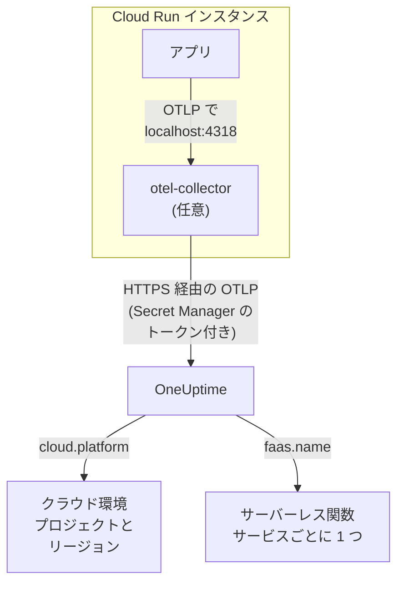

# Google Cloud Run

Cloud Run のサービスとジョブのトレース、ログ、メトリクスを OneUptime に送ります。`cloud.platform=gcp_cloud_run` を報告するものはすべて、Google Cloud のプロジェクトとリージョンごとに一つの **クラウド環境** (例: _GCP Cloud Run · us-central1 · my-project_) に入り、各サービスは **サーバーレス関数** にも表示されます。

:::cards
- [仕組み](#仕組み): GCP 検出器が設定するものと、サービスが二か所に表示される理由。
- [セットアップ](#セットアップ): トークンを保存し、サービスを構成して、デプロイと確認を行います。
- [サイドカー付きのサービス YAML](#サイドカー付きのサービス-yaml): Collector を含む完全な Cloud Run サービス。
- [トラブルシューティング](#トラブルシューティング): シークレットのエラー、サイドカーの起動順序、見つからない環境。
:::

## 仕組み



OpenTelemetry の GCP リソース検出器は、メタデータサーバーと環境変数 `K_SERVICE`、`K_REVISION` を読み取り、次の属性を設定します:

| 属性 | Cloud Run での値 | 用途 |
| ------------------ | ------------------------------ | ----------------------------------------------------------------------------------------- |
| `cloud.platform` | `gcp_cloud_run` | テレメトリを **クラウド環境** に振り分けます |
| `cloud.account.id` | プロジェクト ID | 環境キーの一部 |
| `cloud.region` | `us-central1` | 環境キーの一部 |
| `faas.name` | サービス名 (`K_SERVICE`) | サービスを **サーバーレス関数** にも表示します |
| `faas.version` | リビジョン (`K_REVISION`) | サービスのサーバーレス関数の概要に表示されます。環境では使いません |
| `faas.instance` | インスタンス ID | 実行中のインスタンスの名前になり、**インスタンス** にそれぞれ一行ずつ表示されます |

> [!NOTE]
> Cloud Run は、意図的に二か所に表示されます。検出器が `faas.name` を設定するため、各サービスはそれぞれ独自の呼び出し数、エラー率、実行時間を持つ **サーバーレス関数** にもなります。**クラウド環境** は、そのプロジェクトとリージョンのすべてのサービスをまとめたものです。二重に保存されるわけではなく、同じテレメトリが両方に記録されます。

環境キーは `gcp_cloud_run|my-project|us-central1` です。

## 始める前に

- **取り込みキー。** **プロジェクト設定 → テレメトリと APM → 取り込みキー** で **サーバー** キーを作成し、そのトークンをコピーします。
- **`gcloud`** (プロジェクトにログイン済みで、Secret Manager API が有効になっていること): `gcloud services enable secretmanager.googleapis.com`。
- **OpenTelemetry SDK で計装したアプリケーション** (OTLP をエクスポートするもの)。

## テレメトリがサービスから出ていく方法を選ぶ

| | SDK direct | Sidecar collector |
| --------------- | ---------------------------------------------------- | ---------------------------------------------------------------------- |
| 追加のコンテナ | なし | サービス内の `otel-collector` |
| 向いているケース | サービスが一つの場合と Cloud Run ジョブ | 一つのプロジェクトに複数のサービスがある場合、または検出器を実行できない SDK |
| トークンを持つもの | アプリケーション | Collector |
| シークレット | `oneuptime-otlp-headers`、ヘッダー全体 | `oneuptime-ingestion-token`、トークンのみ |

ジョブは完了まで実行されるだけなので、サイドカーを動かし続ける理由がありません。SDK direct を使ってください。以下の各ステップには両方のタブがあります。一方を選ぶと、すべてのステップがそれに従います。

## セットアップ

:::steps
### Secret Manager にトークンを保存する

> [!IMPORTANT]
> トークンはシークレットです。Secret Manager に保存し、サービスからはシークレットを参照する環境変数として使います。通常の環境変数は、コンソールでも `gcloud run services describe` でも、プロジェクトの閲覧者全員に見えてしまいます。

:::tabs
@tab SDK direct
```bash
printf '%s' "x-oneuptime-token=YOUR_TELEMETRY_INGESTION_TOKEN" | gcloud secrets create oneuptime-otlp-headers \
  --data-file=- \
  --replication-policy=automatic

gcloud secrets add-iam-policy-binding oneuptime-otlp-headers \
  --member="serviceAccount:checkout-api@my-project.iam.gserviceaccount.com" \
  --role="roles/secretmanager.secretAccessor"
```

Cloud Run はシークレットの値をそのまま変数に入れますが、`OTEL_EXPORTER_OTLP_HEADERS` には `name=value` の組全体が必要です。そのため、このシークレットにはヘッダー全体を入れます。
@tab Sidecar collector
```bash
printf '%s' "YOUR_TELEMETRY_INGESTION_TOKEN" | gcloud secrets create oneuptime-ingestion-token \
  --data-file=- \
  --replication-policy=automatic

gcloud secrets add-iam-policy-binding oneuptime-ingestion-token \
  --member="serviceAccount:checkout-api@my-project.iam.gserviceaccount.com" \
  --role="roles/secretmanager.secretAccessor"
```

Collector の設定がヘッダー名を付け加えるので、このシークレットにはトークンだけを入れます。
:::

`--member` には、自分のユーザーではなく、サービスのランタイムサービスアカウントを指定します。`roles/secretmanager.secretAccessor` がないと、リビジョンのデプロイは `Permission denied on secret` で失敗します。サービスがまだ Compute のデフォルトのサービスアカウントで動いている場合は、そのアカウントにロールを付与し、サービス専用のアカウントを用意することも検討してください。デフォルトのアカウントはプロジェクト内のすべてのもので共有されています。

### サービスを構成する

:::tabs
@tab SDK direct
1. **Google Cloud console → Cloud Run → click the service → Edit & deploy new revision**。
2. **Containers** タブでコンテナを開き、**Variables & Secrets** に移動します。下記の変数を追加します。
3. **Reference a secret** をクリックし、`oneuptime-otlp-headers` とバージョン `latest` を選んで、環境変数 `OTEL_EXPORTER_OTLP_HEADERS` として公開します。
4. **Security** タブで、**Service account** が `roles/secretmanager.secretAccessor` を付与したアカウントであることを確認します。

```bash
OTEL_SERVICE_NAME=checkout-api
OTEL_EXPORTER_OTLP_ENDPOINT=https://oneuptime.com/otlp
OTEL_EXPORTER_OTLP_PROTOCOL=http/protobuf
# Secret-backed (Variables & Secrets → Reference a secret), not typed here.
OTEL_EXPORTER_OTLP_HEADERS=x-oneuptime-token=YOUR_TELEMETRY_INGESTION_TOKEN
```

次に、使っている言語の GCP リソース検出器を有効にします:

| 言語 | GCP 検出器を有効にする方法 |
| -------- | ------------------------------------------------------------------------------------------------------------------- |
| Node.js | `OTEL_NODE_RESOURCE_DETECTORS=env,host,os,gcp` (auto-instrumentations-node) |
| Python | `pip install opentelemetry-resourcedetector-gcp` の後、`OTEL_EXPERIMENTAL_RESOURCE_DETECTORS=gcp_resource_detector` |
| Java | `-Dotel.resource.providers.gcp.enabled=true` |
| Go | `import "go.opentelemetry.io/contrib/detectors/gcp"` し、`gcp.NewDetector()` を `resource.New` に渡します |
| .NET | `OpenTelemetry.Resources.Gcp` パッケージ: `.ConfigureResource(r => r.AddGcpDetector())` |

CLI ですべて設定することもできます:

```bash
gcloud run services update checkout-api --region us-central1 \
  --set-env-vars "^@^OTEL_SERVICE_NAME=checkout-api@OTEL_EXPORTER_OTLP_ENDPOINT=https://oneuptime.com/otlp@OTEL_EXPORTER_OTLP_PROTOCOL=http/protobuf@OTEL_NODE_RESOURCE_DETECTORS=env,host,os,gcp" \
  --set-secrets "OTEL_EXPORTER_OTLP_HEADERS=oneuptime-otlp-headers:latest"
```

接頭辞 `^@^` を付けると、`gcloud` はそのフラグのリストを `,` ではなく `@` で区切ります。付けないと、`gcloud` は `OTEL_NODE_RESOURCE_DETECTORS=env,host,os,gcp` をカンマごとに分割し、`Bad syntax for dict arg [host]` で失敗します。
@tab Sidecar collector
1. **Google Cloud console → Cloud Run → click the service → Edit & deploy new revision**。
2. **Containers** タブでコンテナを開き、**Variables & Secrets** に移動します。下記のアプリケーション変数を追加します。
3. **+ Add container** をクリックします。コンテナイメージの URL を `otel/opentelemetry-collector-contrib:latest` にし、**Container command and arguments** で引数 `--config=env:OTEL_COLLECTOR_CONFIG` を追加します。
4. 新しいコンテナの **Variables & Secrets** タブで **Reference a secret** を使い、`oneuptime-ingestion-token` を環境変数 `ONEUPTIME_TOKEN` として公開します。[サイドカー付きのサービス YAML](#サイドカー付きのサービス-yaml) の Collector 設定を値にした変数 `OTEL_COLLECTOR_CONFIG` も追加します。
5. Collector の **Settings** タブで **Startup probe** (HTTP、パス `/`、ポート `13133`) を追加し、**Container start-up order** で自分のコンテナが `otel-collector` に依存するようにします。
6. **Security** タブで、**Service account** が `roles/secretmanager.secretAccessor` を付与したアカウントであることを確認します。

一つの Cloud Run インスタンス内のコンテナは `localhost` を共有するので、アプリケーションはそこでサイドカーにエクスポートします:

```bash
OTEL_SERVICE_NAME=checkout-api
OTEL_EXPORTER_OTLP_ENDPOINT=http://localhost:4318
OTEL_EXPORTER_OTLP_PROTOCOL=http/protobuf
```

CLI の場合、サイドカーは下記のサービス YAML で、`gcloud run services replace service.yaml --region us-central1` でデプロイします。
:::

OneUptime をセルフホストしている場合は、エンドポイントに `https://YOUR-ONEUPTIME-HOST/otlp` を使います。

### 新しいリビジョンをデプロイする

コンソールで **Deploy** をクリックします。Cloud Run はその設定で新しいリビジョンを起動し、準備ができたらトラフィックを送ります。`gcloud` コマンドは、それだけで新しいリビジョンをデプロイします。

### 接続を確認する

```bash
curl -i https://oneuptime.com/otlp/v1/validate \
  -H "x-oneuptime-token: YOUR_TELEMETRY_INGESTION_TOKEN"
```

`200` と `"valid": true` が返れば、トークンは受け付けられています。`401` は、トークンが不明、失効、無効、または期限切れであることを意味します。次にサービスにリクエストを一つ送り、Cloud Logging で Collector のログ (`otel-collector` コンテナで絞り込み) に `401`、`connection refused`、`context deadline exceeded` がないか確認します。1 分以内に、環境が **クラウド → すべての環境** に _GCP Cloud Run · us-central1 · my-project_ として表示され、サービスが **サーバーレス関数** に表示されます。
:::

## サイドカー付きのサービス YAML

Collector は設定全体を `OTEL_COLLECTOR_CONFIG` (`--config=env:OTEL_COLLECTOR_CONFIG`) から読み、トークンを `${env:ONEUPTIME_TOKEN}` でシークレットから読みます。アノテーション `run.googleapis.com/container-dependencies` によって、Cloud Run はまず Collector を起動し、その起動プローブが通るのを待ってからアプリケーションを起動します:

```yaml title="service.yaml"
apiVersion: serving.knative.dev/v1
kind: Service
metadata:
  name: checkout-api
spec:
  template:
    metadata:
      annotations:
        # "app" depends on "otel-collector": the collector starts first and
        # must pass its startup probe before the app container is started.
        run.googleapis.com/container-dependencies: '{"app":["otel-collector"]}'
    spec:
      serviceAccountName: checkout-api@my-project.iam.gserviceaccount.com
      containers:
        - name: app
          image: us-central1-docker.pkg.dev/my-project/apps/checkout-api:1.4.2
          ports:
            - containerPort: 8080
          env:
            - name: OTEL_SERVICE_NAME
              value: checkout-api
            - name: OTEL_EXPORTER_OTLP_ENDPOINT
              value: http://localhost:4318
            - name: OTEL_EXPORTER_OTLP_PROTOCOL
              value: http/protobuf
        - name: otel-collector
          image: otel/opentelemetry-collector-contrib:latest
          args:
            - --config=env:OTEL_COLLECTOR_CONFIG
          env:
            - name: ONEUPTIME_TOKEN
              valueFrom:
                secretKeyRef:
                  name: oneuptime-ingestion-token
                  key: latest
            - name: OTEL_COLLECTOR_CONFIG
              value: |
                receivers:
                  otlp:
                    protocols:
                      http:
                        endpoint: 0.0.0.0:4318
                      grpc:
                        endpoint: 0.0.0.0:4317
                processors:
                  # Stamps cloud.provider, cloud.platform=gcp_cloud_run,
                  # cloud.account.id, cloud.region and faas.* on everything.
                  resourcedetection:
                    detectors: [env, gcp]
                    timeout: 5s
                  batch: {}
                exporters:
                  otlphttp/oneuptime:
                    endpoint: https://oneuptime.com/otlp
                    headers:
                      x-oneuptime-token: ${env:ONEUPTIME_TOKEN}
                extensions:
                  health_check:
                    endpoint: 0.0.0.0:13133
                service:
                  extensions: [health_check]
                  pipelines:
                    traces:
                      receivers: [otlp]
                      processors: [resourcedetection, batch]
                      exporters: [otlphttp/oneuptime]
                    metrics:
                      receivers: [otlp]
                      processors: [resourcedetection, batch]
                      exporters: [otlphttp/oneuptime]
                    logs:
                      receivers: [otlp]
                      processors: [resourcedetection, batch]
                      exporters: [otlphttp/oneuptime]
          startupProbe:
            httpGet:
              path: /
              port: 13133
            periodSeconds: 2
            failureThreshold: 15
          resources:
            limits:
              cpu: 500m
              memory: 256Mi
```

デプロイします:

```bash
gcloud run services replace service.yaml --region us-central1
```

`ports` を宣言するのは、リクエストを受けるコンテナ (`app`) だけです。サイドカーは宣言してはいけません。

## ネットワーク

- **既定では**、Cloud Run サービスはインターネットに直接接続でき、`oneuptime.com` へのエクスポートに追加の設定は不要です。
- **VPC egress: All traffic** (`--vpc-egress all-traffic`。Direct VPC egress または Serverless VPC Access コネクタ経由) の場合、送信トラフィックは VPC を通るため、OneUptime ホストに到達するには Cloud NAT (またはプロキシへのルート) が必要です。既定の `private-ranges-only` では、プライベートアドレスだけが VPC を通り、OneUptime には直接到達します。
- VPC の **送信ファイアウォールルール** で、OneUptime ホストへの TCP 443 を許可する必要があります。
- **VPC 内のセルフホストの OneUptime** は逆のケースです。トラフィックを VPC 経由にして (`private-ranges-only` または `all-traffic`)、`https://YOUR-ONEUPTIME-HOST/otlp` がそこで名前解決されるようにします。

## 得られるもの

- **概要**: トレースから算出したリクエスト、エラー率、p95 レイテンシ。
- **インスタンス**: Cloud Run インスタンスごとに一行で、`faas.instance` が名前になります。Cloud Run はコンテナのリソース使用量をサイドカーに公開しないため、同じ `faas.instance` を持つ `container.cpu.utilization` と `container.memory.usage` のメトリクスを自分で送らない限り、**CPU** と **メモリ** のタイルは空のままです。ここではリクエストのタイルを見て、インスタンスの CPU とメモリは Cloud Monitoring に任せてください。
- 環境に絞り込まれた **ログ**、**トレース**、**メトリクス**。
- 同じサービスが **サーバーレス関数** (`faas.name` ごと) と **サービス** (`service.name` ごと) にも表示されます。

## トラブルシューティング

:::details リビジョンが "Permission denied on secret" で失敗する
ランタイムサービスアカウントに、シークレットに対する `roles/secretmanager.secretAccessor` がないか、サービスが参照しているものとは別のシークレットにバインドされています。ランタイムサービスアカウントを `--member` に指定して、`gcloud secrets add-iam-policy-binding` コマンドをもう一度実行します。
:::

:::details Cloud Run が container-dependencies を拒否する
アノテーションに存在しないコンテナ名が書かれているか、Collector に起動プローブがないため、Cloud Run が準備完了を判断できません。
:::

:::details サービスはサーバーレス関数にあるが、環境がない
テレメトリに `cloud.platform` がありません。SDK で GCP 検出器が有効になっていないか、Collector の `detectors` リストに `gcp` がありません。
:::

:::details 環境はあるが、インスタンスが空
テレメトリに `faas.instance` も `service.instance.id` もありません。原因は同じで、検出器が動いていません。
:::

環境がまったく表示されない、**切断済み** と表示される、二つに分かれる場合は、[クラウドのトラブルシューティング](/docs/telemetry/cloud-troubleshooting) を参照してください。

## 次のステップ

:::cards
- [クラウド環境](/docs/telemetry/cloud-environments): 環境とインスタンスの識別方法。
- [サーバーレス関数](/docs/telemetry/serverless-functions): Cloud Run の各サービスを、サービスごとに表示するビュー。
- [クラウドのトラブルシューティング](/docs/telemetry/cloud-troubleshooting): すべてのプラットフォームに共通する障害。
- [クラウドリソース (IaaS と PaaS)](/docs/telemetry/cloud-resources): Cloud Monitoring から取得する Cloud SQL、ロードバランサー、バケット。
:::
