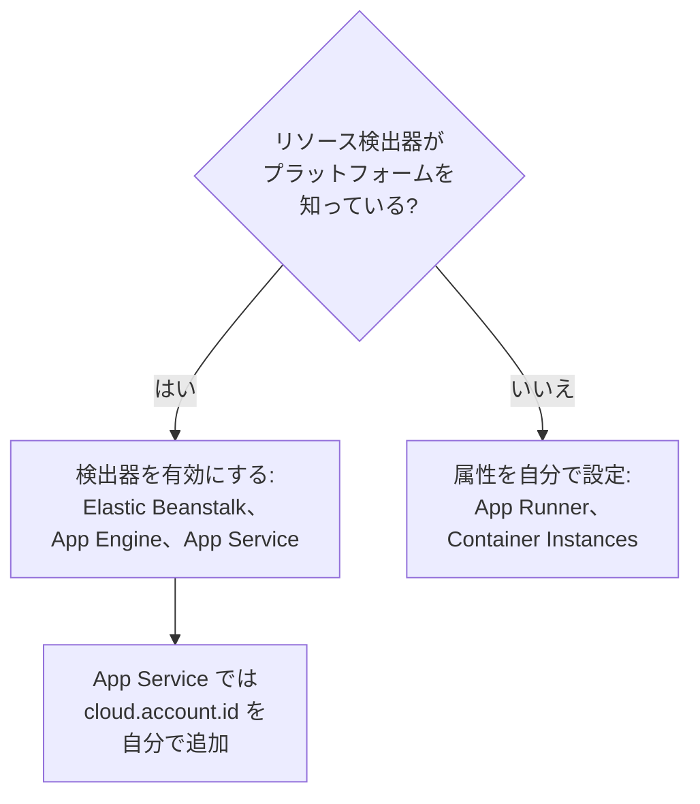

# その他のクラウドプラットフォーム

専用のページがないマネージドプラットフォームを設定します。対象は AWS Elastic Beanstalk、AWS App Runner、Google App Engine、Azure App Service、Azure Container Instances です。ルールはどのプラットフォームでも同じで、マネージドな `cloud.platform` と `cloud.account.id`、`cloud.region` を持つテレメトリは、プラットフォーム、アカウント、リージョンごとに一つの **クラウド環境** に入り、インスタンスの識別子によって、実行中の各インスタンスが **インスタンス** に一行ずつ表示されます。

:::cards
- [AWS Elastic Beanstalk](#aws-elastic-beanstalk): 各インスタンス上の Collector と、Beanstalk および EC2 の検出器。
- [AWS App Runner](#aws-app-runner): 手動で設定する属性と、Secrets Manager から取得するトークン。
- [Google App Engine](#google-app-engine): GCP 検出器と、`app.yaml` に書く設定。
- [Azure App Service](#azure-app-service): Azure の検出器、Key Vault 参照、手動で設定するサブスクリプション。
- [Azure Container Instances](#azure-container-instances): 手動で設定する属性と、セキュアな変数として渡すトークン。
:::

## 各プラットフォームに必要なもの

これらのプラットフォームの違いは、`cloud.*` 属性を誰が設定するかと、クラウドのコンソールのどこで設定するかです:



| プラットフォーム | `cloud.platform` | `cloud.*` を設定するもの | インスタンスの識別子 |
| ------------------------- | --------------------------- | ------------------------------------------------------------------------------------------ | ----------------------------------------------------------- |
| AWS Elastic Beanstalk | `aws_elastic_beanstalk` | Collector の `elastic_beanstalk` 検出器と `ec2` 検出器、Node.js の `aws` | `host.id` (デプロイの `service.instance.id` は削除) |
| AWS App Runner | `aws_app_runner` | 自分 (検出器なし) | `host.name` |
| Google App Engine | `gcp_app_engine` | `gcp` 検出器 (Collector とすべての SDK) | `faas.instance` |
| Azure App Service | `azure_app_service` | Collector の `azureappservice`、Node.js と .NET の `azure` 検出器。`cloud.account.id` は自分で設定 | `service.instance.id`、次に `host.id` |
| Azure Container Instances | `azure_container_instances` | 自分 (検出器なし) | `host.name` |

以下のどのセクションでも、**プロジェクト設定 → テレメトリと APM → 取り込みキー** の **サーバー** 取り込みキーと、OpenTelemetry SDK で計装したアプリケーションが必要です。OneUptime をセルフホストしている場合は、`https://oneuptime.com/otlp` を `https://YOUR-ONEUPTIME-HOST/otlp` に置き換えてください。

> [!IMPORTANT]
> これらのどのプラットフォームでも、トークンはシークレットです。各セクションでは、そのプラットフォームのシークレットストアを紹介しています。通常の環境変数に入力したトークンは、アプリの構成を読めるすべての人に読まれてしまいます。

## AWS Elastic Beanstalk

`cloud.platform`: `aws_elastic_beanstalk`。Beanstalk 検出器はインスタンス上の `/var/elasticbeanstalk/xray/environment.conf` を読み取り、`cloud.platform`、`service.instance.id`、`service.version`、環境名を設定します。アカウントとリージョンは知らないので、それらを知っていて `host.id` も設定する EC2 検出器と組み合わせます。

各インスタンスで、次の構成の OpenTelemetry Collector を実行します:

```yaml title="config.yaml"
receivers:
  otlp:
    protocols:
      http:
        endpoint: 0.0.0.0:4318
      grpc:
        endpoint: 0.0.0.0:4317
processors:
  # elastic_beanstalk sets cloud.platform and service.instance.id; ec2 adds
  # cloud.account.id, cloud.region and host.id. The first detector to set an
  # attribute wins, so elastic_beanstalk comes first.
  resourcedetection:
    detectors: [env, elastic_beanstalk, ec2]
    timeout: 5s
  # The Beanstalk detector's service.instance.id is the deployment ID, shared
  # by every instance of a deployment: drop it, so that ec2's host.id names
  # each instance.
  resource:
    attributes:
      - key: service.instance.id
        action: delete
  batch: {}
exporters:
  otlphttp/oneuptime:
    endpoint: https://oneuptime.com/otlp
    headers:
      x-oneuptime-token: ${env:ONEUPTIME_TOKEN}
service:
  pipelines:
    traces:
      receivers: [otlp]
      processors: [resourcedetection, resource, batch]
      exporters: [otlphttp/oneuptime]
    metrics:
      receivers: [otlp]
      processors: [resourcedetection, resource, batch]
      exporters: [otlphttp/oneuptime]
    logs:
      receivers: [otlp]
      processors: [resourcedetection, resource, batch]
      exporters: [otlphttp/oneuptime]
```

:::steps
1. トークンを Secrets Manager に保存します: `aws secretsmanager create-secret --name oneuptime/ingestion-token --secret-string "YOUR_TELEMETRY_INGESTION_TOKEN"`。Beanstalk の環境プロパティはシークレットストアではなく環境の構成に保存されるため、代わりにプラットフォームフックから、インスタンスプロファイルを使ってシークレットを読み取ります。インスタンスプロファイルには、そのシークレットに対する `secretsmanager:GetSecretValue` が必要です。
2. `.platform/hooks/postdeploy/` (または `.ebextensions`) のスクリプトから Collector をインストールします。`otelcol-contrib` パッケージを上記の構成で使い、シークレットを `ONEUPTIME_TOKEN` として環境に渡します。
3. **AWS Console → Elastic Beanstalk → Environments → your environment → Configuration**。
4. **Updates, monitoring, and logging** カテゴリで **Edit** をクリックし、**Environment properties** までスクロールします。`OTEL_SERVICE_NAME`、値が `http://localhost:4318` の `OTEL_EXPORTER_OTLP_ENDPOINT`、値が `http/protobuf` の `OTEL_EXPORTER_OTLP_PROTOCOL` を追加します。
5. **Apply** をクリックします。Beanstalk は新しいプロパティでアプリケーションを再起動します。
:::

Node.js アプリケーションは Collector を省略できます。SDK の検出器に Beanstalk と EC2 が含まれているからです。`OTEL_EXPORTER_OTLP_ENDPOINT` を `https://oneuptime.com/otlp` に、`OTEL_EXPORTER_OTLP_HEADERS` を `x-oneuptime-token=YOUR_TELEMETRY_INGESTION_TOKEN` に設定し、`OTEL_NODE_RESOURCE_DETECTORS=env,host,os,aws` を指定します。この場合、トークンは環境プロパティに置かれます。後でトレースのリソース属性を確認し、`cloud.platform` が `aws_ec2` になっていたら、その SDK のバージョンでは EC2 検出器が優先されています。確実なのは Collector を使う方法です。

**ネットワーク:** プライベートサブネットのインスタンスには NAT ゲートウェイが必要で、インスタンスのセキュリティグループでは OneUptime ホストへの TCP 443 の送信を許可する必要があります。

## AWS App Runner

`cloud.platform`: `aws_app_runner`。検出器がないので、属性は自分で設定します。App Runner は Secrets Manager (または SSM Parameter Store) のシークレットを環境変数に入れられます。

```bash
OTEL_SERVICE_NAME=checkout-api
OTEL_EXPORTER_OTLP_ENDPOINT=https://oneuptime.com/otlp
OTEL_EXPORTER_OTLP_PROTOCOL=http/protobuf
# From Secrets Manager: the secret holds the whole header.
OTEL_EXPORTER_OTLP_HEADERS=x-oneuptime-token=YOUR_TELEMETRY_INGESTION_TOKEN
OTEL_RESOURCE_ATTRIBUTES=cloud.provider=aws,cloud.platform=aws_app_runner,cloud.region=us-east-1,cloud.account.id=123456789012
OTEL_NODE_RESOURCE_DETECTORS=env,host,os
```

リージョンとアカウント ID は自分のものに置き換えてください。`host` 検出器が `host.name` (コンテナのホスト名) を設定します。これは App Runner のインスタンスごとに異なり、OneUptime はこれをインスタンスの名前にします。

:::steps
1. ヘッダー全体を Secrets Manager に保存します: `aws secretsmanager create-secret --name oneuptime/otlp-headers --secret-string "x-oneuptime-token=YOUR_TELEMETRY_INGESTION_TOKEN"`。App Runner はシークレットの値をそのまま変数に入れます。
2. **AWS Console → App Runner → Services → your service → Configuration → Configure service** (**Configuration** タブで **Edit** をクリック)。
3. **Environment variables** で、上記の通常の値ごとに **Add environment variable** をクリックします。
4. `OTEL_EXPORTER_OTLP_HEADERS` を **Source: Secrets Manager** とシークレットの ARN で追加します。**Security → Instance role** では、そのシークレットに対する `secretsmanager:GetSecretValue` を持つロールを選びます。イメージを取得するアクセスロールではなく、インスタンスロールです。
5. **Save changes** をクリックします。App Runner が新しいバージョンをデプロイします。
:::

**ネットワーク:** VPC コネクタのないサービスは、インターネットに直接接続します。**Outgoing network traffic: Custom VPC** の場合、送信トラフィックは VPC を通るため、NAT ゲートウェイと、OneUptime ホストへの TCP 443 を許可するセキュリティグループの送信ルールが必要です。

## Google App Engine

`cloud.platform`: `gcp_app_engine`。GCP 検出器は、`GAE_SERVICE`、`GAE_VERSION`、`GAE_INSTANCE` とメタデータサーバーから App Engine のスタンダード環境とフレキシブル環境を認識します。そして `cloud.account.id` (プロジェクト)、`cloud.region`、`faas.name`、`faas.version`、`faas.instance` を設定します。Cloud Run と同様に、`faas.name` によって各 App Engine サービスが **サーバーレス関数** にも表示され、環境はプロジェクトとリージョンをまとめます。

| 言語 | GCP 検出器を有効にする方法 |
| -------- | ------------------------------------------------------------------------------------------------------------------- |
| Node.js | `OTEL_NODE_RESOURCE_DETECTORS=env,host,os,gcp` |
| Python | `pip install opentelemetry-resourcedetector-gcp` の後、`OTEL_EXPERIMENTAL_RESOURCE_DETECTORS=gcp_resource_detector` |
| Java | `-Dotel.resource.providers.gcp.enabled=true` |
| Go | `go.opentelemetry.io/contrib/detectors/gcp` → `gcp.NewDetector()` |
| .NET | `OpenTelemetry.Resources.Gcp` → `.AddGcpDetector()` |

App Engine のコンソールには環境変数のエディターがありません。環境変数は `app.yaml` に書きます。

```yaml title="app.yaml"
runtime: nodejs22
env_variables:
  OTEL_SERVICE_NAME: checkout-api
  OTEL_EXPORTER_OTLP_ENDPOINT: https://oneuptime.com/otlp
  OTEL_EXPORTER_OTLP_PROTOCOL: http/protobuf
  OTEL_NODE_RESOURCE_DETECTORS: env,host,os,gcp
  # Do not commit the real value. Template it in CI, or read the secret at
  # start-up with the Secret Manager client instead.
  OTEL_EXPORTER_OTLP_HEADERS: x-oneuptime-token=YOUR_TELEMETRY_INGESTION_TOKEN
```

:::steps
1. ヘッダー全体を Secret Manager に保存します: `printf '%s' "x-oneuptime-token=YOUR_TELEMETRY_INGESTION_TOKEN" | gcloud secrets create oneuptime-otlp-headers --data-file=-`。App Engine のサービスアカウント (`my-project@appspot.gserviceaccount.com`) に、このシークレットに対する `roles/secretmanager.secretAccessor` を付与します。
2. デプロイパイプラインでシークレットを `app.yaml` に入れ、コミットするファイルにはプレースホルダーを残します。または、起動時に `projects/PROJECT_ID/secrets/oneuptime-otlp-headers/versions/latest` を読み取り、コードでエクスポーターの `headers` オプションに渡します。
3. `gcloud app deploy` でデプロイします。コンソールでは、**App Engine → Versions** に新しいバージョンが、**App Engine → Services** に **サーバーレス関数** に表示されるサービスが表示されます。
:::

**ネットワーク:** App Engine のスタンダード環境は、インターネットに直接接続します。フレキシブル環境のインスタンスは VPC 内にあり、サブネットに外部 IP がない場合は、Cloud NAT と、OneUptime ホストへの TCP 443 を許可する送信ファイアウォールルールが必要です。

## Azure App Service

`cloud.platform`: `azure_app_service`。Node.js と .NET の Azure 検出器、および Collector の `azureappservice` 検出器は、App Service が設定する `WEBSITE_*` 変数を読み取ります。そして `cloud.platform`、`cloud.region`、`service.instance.id` (`WEBSITE_INSTANCE_ID` から)、`deployment.environment` (スロット)、`host.id` を設定します。どれも `cloud.account.id` は設定しません。サブスクリプション ID を自分で追加しないと、環境キーのアカウント部分が空になります。

```bash
OTEL_SERVICE_NAME=checkout-api
OTEL_EXPORTER_OTLP_ENDPOINT=https://oneuptime.com/otlp
OTEL_EXPORTER_OTLP_PROTOCOL=http/protobuf
# The Key Vault reference, which resolves to the whole header.
OTEL_EXPORTER_OTLP_HEADERS=@Microsoft.KeyVault(SecretUri=https://my-vault.vault.azure.net/secrets/oneuptime-otlp-headers/)
OTEL_RESOURCE_ATTRIBUTES=cloud.account.id=00000000-0000-0000-0000-000000000000
# Node.js:
OTEL_NODE_RESOURCE_DETECTORS=env,host,os,azure
```

SDK の検出器はプラットフォームをドット付きの `azure.app_service` と書きます。OneUptime は受信時にこれを `azure_app_service` に書き換えます。.NET では `OpenTelemetry.Resources.Azure` を追加し、`.ConfigureResource(r => r.AddAzureAppServiceDetector())` を呼び出します。ほかの言語では、`OTEL_RESOURCE_ATTRIBUTES` に `cloud.provider=azure,cloud.platform=azure_app_service,cloud.region=<region>` を追加し、`service.instance.id` はコードで `WEBSITE_INSTANCE_ID` から取得します。

:::steps
1. アプリのシステム割り当てマネージド ID をオンにし (**Settings → Identity**)、コンテナーに対する **Key Vault Secrets User** を付与します。ヘッダー全体 `x-oneuptime-token=YOUR_TELEMETRY_INGESTION_TOKEN` を、シークレット `oneuptime-otlp-headers` として保存します。
2. **Azure portal → App Services → your app → Settings → Environment variables** (古いポータルでは **Configuration → Application settings**)。
3. 上記の各変数を **+ Add** で追加します。`OTEL_EXPORTER_OTLP_HEADERS` の値は Key Vault 参照です。
4. **Apply**、続けて **Confirm** をクリックします。アプリは新しい設定で再起動します。デプロイスロットには個別の設定があるので、テレメトリを送るスロットを一つに限る場合は、トークンを **deployment slot setting** としてマークします。
:::

**ネットワーク:** **VNet integration** で **Route All** を有効にしていない限り、App Service はインターネットに直接接続します。有効にしている場合、VNet には NAT ゲートウェイ、または OneUptime ホストへの TCP 443 を許可するファイアウォールへのルートが必要です。

## Azure Container Instances

`cloud.platform`: `azure_container_instances`。検出器がないので、属性は自分で設定します。コンテナーグループの環境変数は作成時に固定され、一つ変更するにはグループを作り直す必要があります。`az container show` で返されないよう、トークンは `--secure-environment-variables` で渡します:

```bash
az container create \
  --resource-group my-rg \
  --name checkout-api \
  --image myregistry.azurecr.io/checkout-api:1.4.2 \
  --location eastus \
  --environment-variables \
    OTEL_SERVICE_NAME=checkout-api \
    OTEL_EXPORTER_OTLP_ENDPOINT=https://oneuptime.com/otlp \
    OTEL_EXPORTER_OTLP_PROTOCOL=http/protobuf \
    "OTEL_RESOURCE_ATTRIBUTES=cloud.provider=azure,cloud.platform=azure_container_instances,cloud.region=eastus,cloud.account.id=00000000-0000-0000-0000-000000000000" \
    OTEL_NODE_RESOURCE_DETECTORS=env,host,os \
  --secure-environment-variables \
    "OTEL_EXPORTER_OTLP_HEADERS=x-oneuptime-token=YOUR_TELEMETRY_INGESTION_TOKEN"
```

`host` 検出器の `host.name` (コンテナーグループのホスト名) がインスタンスの名前になります。コンテナーグループは ECS タスクと同じように複数のコンテナを実行するので、ここでもサイドカー Collector が使えます。[Azure Container Apps](/docs/telemetry/cloud-azure-container-apps) の `detectors: [env]` と `OTEL_RESOURCE_ATTRIBUTES` の組み合わせを使ってください。グループの識別子を持つ `container.cpu.utilization` と `container.memory.usage` を送れば、**CPU** と **メモリ** のタイルもこのサイドカーで埋まります。

:::steps
1. **Azure portal → Container Instances → + Create**。**Basics** タブで、リソースグループ、名前、リージョン、イメージを入力します。
2. **Advanced** タブの **Environment variables** で各変数を追加します。`OTEL_EXPORTER_OTLP_HEADERS` は、ポータルと API に値が表示されないよう、**Mark as secure** を **Yes** にします。
3. **Review + create**、続けて **Create** をクリックします。後で変数を変えるには、グループを削除して作り直します。
:::

**ネットワーク:** パブリック IP を持つコンテナーグループは、インターネットに直接接続します。VNet のサブネット内のグループは VNet のルートでしか外に出られないので、NAT ゲートウェイを追加するか、ファイアウォールまたは NSG で OneUptime ホストへの TCP 443 を許可します。

## 接続を確認する

どのプラットフォームを設定した場合も、まずトークンを確認し、それから環境を探します:

```bash
curl -i https://oneuptime.com/otlp/v1/validate \
  -H "x-oneuptime-token: YOUR_TELEMETRY_INGESTION_TOKEN"
```

`200` と `"valid": true` が返れば、トークンは受け付けられています。`401` は、トークンが不明、失効、無効、または期限切れであることを意味します。最初のスパン、ログ、メトリクスが届いてから 1 分以内に、プラットフォーム、リージョン、アカウントにちなんだ名前で、環境が **クラウド → すべての環境** に表示されます。

## トラブルシューティング

:::details Beanstalk のインスタンスがホストに表示される
EC2 検出器の `cloud.platform=aws_ec2` が優先されました。属性を最初に設定した検出器が優先されるので、`detectors` では `elastic_beanstalk` を `ec2` より前に置きます。Collector がない場合、Node.js SDK でも EC2 検出器が優先されることがあります。Collector を使ってください。
:::

:::details Beanstalk のすべてのインスタンスが、インスタンスの一行を共有している
Beanstalk 検出器の `service.instance.id` はデプロイ ID で、デプロイ内のすべてのインスタンスで共通です。しかも `host.id` より先に読まれます。これを削除する `resource` プロセッサーを、すべてのパイプラインに残してください。
:::

:::details App Service のアプリが 401 を受け取る
Key Vault 参照が解決されず、App Service が `@Microsoft.KeyVault(...)` という文字列をそのままヘッダーとして渡しています。アプリのマネージド ID にコンテナーに対する **Key Vault Secrets User** を付与し、シークレットにヘッダー全体 `x-oneuptime-token=...` が入っていることを確認します。
:::

:::details App Service の環境でアカウント部分が空になっている
App Service のどの検出器も `cloud.account.id` を設定しません。すべてのアプリで `OTEL_RESOURCE_ATTRIBUTES` にサブスクリプション ID を追加してください。これがあるテレメトリとないテレメトリは、二つの環境に分かれます。
:::

:::details Container Instances の変数を変更しても反映されない
コンテナーグループの環境変数は作成時に固定されます。グループを削除し、新しい値で作り直してください。
:::

その他の問題、特に環境が **ホスト** に表示される、**サーバーレス関数** にだけ表示される (GCP 検出器のない App Engine)、二つ表示される (`cloud.account.id` を設定したデプロイとしていないデプロイがある) といった場合は、[クラウドのトラブルシューティング](/docs/telemetry/cloud-troubleshooting) を参照してください。

## 次のステップ

:::cards
- [クラウド環境](/docs/telemetry/cloud-environments): 環境とインスタンスの識別方法。
- [クラウドのトラブルシューティング](/docs/telemetry/cloud-troubleshooting): すべてのプラットフォームに共通する障害。
- [サーバーレス関数](/docs/telemetry/serverless-functions): Lambda、Cloud Functions、Azure Functions。
- [クラウドリソース (IaaS と PaaS)](/docs/telemetry/cloud-resources): クラウド自身の監視から取得する、アプリの周辺のリソース。
:::
