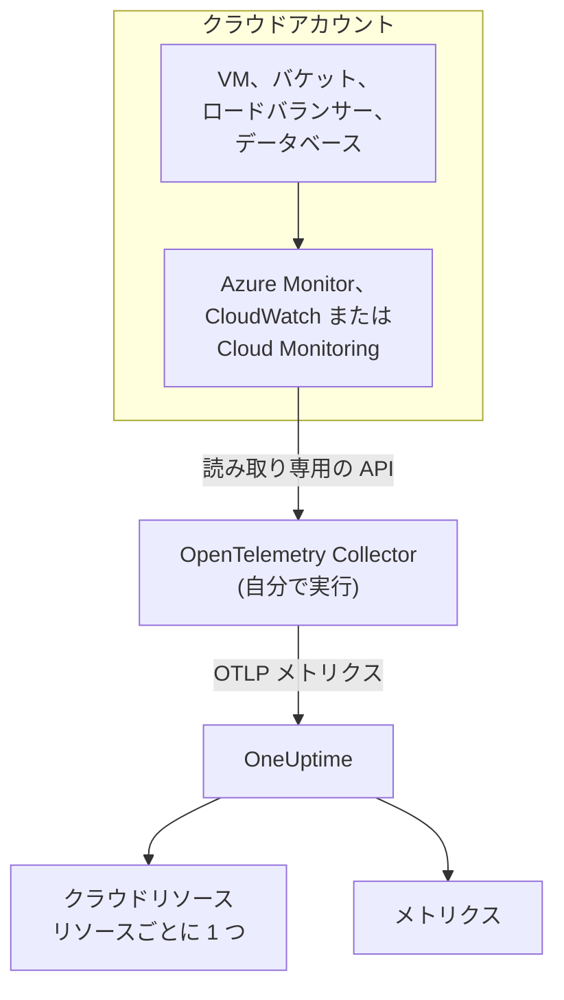
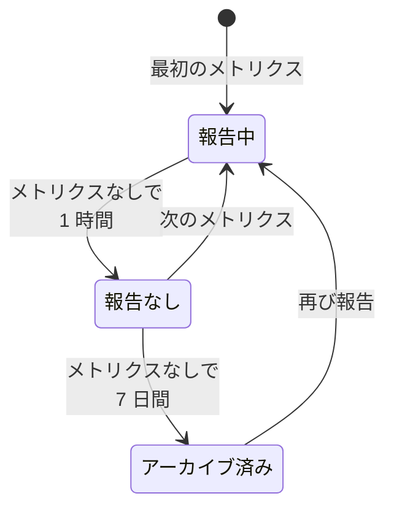

# クラウドリソース (IaaS と PaaS)

**クラウドリソース** には、AWS、Azure、Google Cloud のアカウントにある IaaS と PaaS のリソースが一覧表示されます。仮想マシン、ディスク、ロードバランサー、バケット、マネージドデータベース、キャッシュ、キュー、API ゲートウェイなどです。各リソースには専用のページがあり、種類、リージョン、アカウント、プロバイダー独自の ID、プロバイダーが公開するすべてのメトリクスが表示され、OneUptime のほかのリソースと同じように所有者とラベルを付けられます。リソースは **クラウド → すべてのリソース** にあります。

:::cards
- [Azure を接続する](#azure-を接続する): サブスクリプション内のすべてのリソースを Azure Monitor から読み取ります。
- [AWS を接続する](#aws-を接続する): CloudWatch をポーリングするか、Amazon Data Firehose 経由でストリーミングします。
- [Google Cloud を接続する](#google-cloud-を接続する): プロジェクトのサービスを Cloud Monitoring から読み取ります。
- [リソースの識別方法](#リソースの識別方法): OneUptime が認識するすべてのリソースの種類 (プロバイダー別)。
:::

## 仕組み



- **プロバイダーはすでにリソースを計測しています。** Azure Monitor、Amazon CloudWatch、Google Cloud Monitoring は、ユーザーのために動かしているすべてのリソースについてメトリクスを公開しています。
- **自分で実行する Collector がそれを読み取ります。** その監視サービスへの読み取り専用アクセスを持つ OpenTelemetry Collector が、メトリクスを OneUptime にエクスポートします。リソースには何もインストールせず、OneUptime がクラウドの認証情報を持つこともありません。認証情報を持つのは、ユーザーの環境で動く Collector です。
- **各リソースは最初のメトリクスとともに表示されます。** OneUptime は各データポイントがどのリソースのものかを判断し、初めて見たときにクラウドリソースを作成します。

クラウドリソースは、クラウドが表示される場所の一つにすぎません:

| 実行しているもの | 表示される場所 | 方法 |
| --- | --- | --- |
| ECS、Cloud Run、Container Apps、App Service などのコンテナ | **クラウド → すべての環境** | ワークロード自身のテレメトリ (`cloud.platform` で判断)。[クラウド環境](/docs/telemetry/cloud-environments) を参照してください |
| プロバイダーが監視する任意の IaaS / PaaS リソース | **クラウド → すべてのリソース** | Collector が読み取るプロバイダーの監視 API。このページです |
| OpenTelemetry Collector を入れた仮想マシン | **ホスト** | ホスト自身のメトリクスとログ。[ホスト OpenTelemetry Collector](/docs/telemetry/host-otel-collector) を参照してください |
| アプリケーションが使うキューとトピック | **キュー** | スパンと、同じクラウドメトリクス。[キュー](/docs/telemetry/queues) を参照してください |

一つのリソースが複数の場所に表示されることもあります。Collector を入れた仮想マシンは **ホスト** であり、そのプラットフォームメトリクス (ハイパーバイザーから見た CPU クレジット、ディスク、ネットワーク) によって **クラウドリソース** にもなります。SQS キューは **キュー** であり、**クラウドリソース** でもあります。各ビューには、そのデータソースが知っていることが表示されます。

## 始める前に

- **取り込みキー。** **プロジェクト設定 → テレメトリと APM → 取り込みキー** で **サーバー** キーを作成します。以下の Collector は、構成ファイルではなく環境変数 `ONEUPTIME_TOKEN` からキーを読み取ります。
- **OpenTelemetry Collector を実行する場所**: `otelcol-contrib` ディストリビューション (イメージ `otel/opentelemetry-collector-contrib`) を、クラウドプロバイダーと OneUptime への送信アクセスがある場所で実行します。小さな VM、コンテナ、Kubernetes クラスターのいずれでもよく、一つの Collector で複数のアカウントやプロバイダーを読み取れます。
- **プロバイダーの監視 API への読み取りアクセス。** 以下の各プロバイダーの最初のステップで作成します。

> [!TIP]
> 同じ手順はダッシュボードにもあり、トークンも入力済みです。最初のリソースが届くまでは **クラウド → すべてのリソース** に、その後は各リソースの **ドキュメント** タブ (そのリソースのプロバイダーの手順が開きます) に表示されます。

OneUptime をセルフホストしている場合は、`https://oneuptime.com/otlp` を `https://YOUR-ONEUPTIME-HOST/otlp` に置き換えてください。

## Azure を接続する

`azure_monitor` レシーバーはサブスクリプションのリソースを一覧し、1 分ごとにそのプラットフォームメトリクスを読み取ります。`services` リストを指定しなければすべての種類のリソースを読み取るので、サブスクリプション内のすべてのリソースがクラウドリソースになります。

:::steps
### Monitoring Reader のサービスプリンシパルを作成する

**Monitoring Reader** はメトリクスを読み取り、リソースを一覧できますが、何も変更できません:

```bash
az ad sp create-for-rbac \
  --name oneuptime-cloud-collector \
  --role "Monitoring Reader" \
  --scopes /subscriptions/<SUBSCRIPTION_ID>
```

`appId` (クライアント ID)、`password` (クライアントシークレット)、`tenant` が出力されます。同じサービスプリンシパルにほかのサブスクリプションでもこのロールを付与すれば、同じ Collector でそれらも読み取れます。

### Azure Monitor レシーバーを構成する

次の内容を `config.yaml` として保存します:

```yaml
extensions:
  azure_auth:
    service_principal:
      tenant_id: ${env:AZURE_TENANT_ID}
      client_id: ${env:AZURE_CLIENT_ID}
      client_secret: ${env:AZURE_CLIENT_SECRET}

receivers:
  azure_monitor:
    subscription_ids: ["${env:AZURE_SUBSCRIPTION_ID}"]
    auth:
      authenticator: azure_auth
    collection_interval: 60s
    # No `services` list: every resource type in the subscription.
    # Series Azure returns per metric and resource (default 10).
    maximum_number_of_records_per_resource: 50

processors:
  batch: {}

exporters:
  otlphttp/oneuptime:
    endpoint: https://oneuptime.com/otlp
    headers:
      x-oneuptime-token: ${env:ONEUPTIME_TOKEN}

service:
  extensions: [azure_auth]
  pipelines:
    metrics:
      receivers: [azure_monitor]
      processors: [batch]
      exporters: [otlphttp/oneuptime]
```

### Azure 用の Collector を実行する

```bash
docker run -d --name oneuptime-cloud-collector --restart unless-stopped \
  -e ONEUPTIME_TOKEN=YOUR_TELEMETRY_INGESTION_TOKEN \
  -e AZURE_TENANT_ID=<TENANT> \
  -e AZURE_CLIENT_ID=<APP_ID> \
  -e AZURE_CLIENT_SECRET=<PASSWORD> \
  -e AZURE_SUBSCRIPTION_ID=<SUBSCRIPTION_ID> \
  -v "$(pwd)/config.yaml:/etc/otelcol-contrib/config.yaml" \
  otel/opentelemetry-collector-contrib:latest
```

数分以内に、リソースが **クラウド → すべてのリソース** に表示されます。
:::

`azure_monitor` レシーバーのオプション:

| オプション | 機能 |
| --- | --- |
| `resource_groups`, `services`, `resource_tags` | 読み取る範囲を絞ります。リソースグループ、Resource Manager の種類 (`Microsoft.Compute/virtualMachines`)、またはリソースが持つべきタグのリストを指定します |
| `metrics` | 各リソースの種類を、指定したメトリクスと集計に限定します。種類を指定すると、その種類では指定したメトリクスだけが読み取られます |
| `discover_subscriptions: true` | `subscription_ids` の代わりに、サービスプリンシパルが見えるすべてのサブスクリプションを読み取ります |
| `maximum_number_of_records_per_resource` | Azure がメトリクスとリソースごとに返す系列の数 (既定は 10)。値の多いディメンションでメトリクスが分かれる場合に引き上げます |
| `use_batch_api: true` | 大きなサブスクリプション向けです。レシーバーはリソースと 20 メトリクスのバッチごとに Resource Manager を 1 回呼び出しますが、Resource Manager の読み取りは 1 時間に約 12,000 回までです。バッチ API は Azure Monitor のデータプレーンから 1 回の呼び出しで最大 50 リソースを読み取り、その上限ははるかに高くなっています |
| `cache_resources` | レシーバーがリソースを一覧する間隔 (秒)。既定では 1 日 1 回です。Collector の起動後に作成されたリソースは、表示されるまで最大 1 日かかることがあります。すぐに一覧するには Collector を再起動します |

## AWS を接続する

CloudWatch のメトリクスは、次の二つの方法のいずれかで OneUptime に届きます:

| | Polling | Metric Streams |
| --- | --- | --- |
| 方法 | Collector の `aws_cloudwatch` レシーバーが CloudWatch に問い合わせる | CloudWatch が Amazon Data Firehose 経由で Collector の `awsfirehose` レシーバーに送る |
| AWS 側で必要なもの | 認証情報のみ | 各リージョンの Firehose ストリームとメトリクスストリーム |
| AWS から Collector に到達できる必要があるか | いいえ | はい (ポート 443 の HTTPS) |
| 遅延 | 10〜20 分 | 数分 |
| 向いているケース | ほとんどのアカウント | 大規模なアカウント |

### aws_cloudwatch レシーバーでポーリングする

:::steps
#### Collector に CloudWatch の読み取りを許可する

Collector を実行するロール (EC2 インスタンスプロファイル、ECS タスクロール、EKS サービスアカウント)、または Collector にアクセスキーを渡す IAM ユーザーに、次のポリシーをアタッチします:

```json
{
  "Version": "2012-10-17",
  "Statement": [
    {
      "Effect": "Allow",
      "Action": [
        "cloudwatch:ListMetrics",
        "cloudwatch:GetMetricData",
        "sts:GetCallerIdentity"
      ],
      "Resource": "*"
    }
  ]
}
```

`sts:GetCallerIdentity` があると、レシーバーはアカウント ID を報告できます。各リソースの ARN にはアカウント ID が必要です。

#### CloudWatch レシーバーを構成する

一つのレシーバーは一つのリージョンの一つの名前空間を読み取るので、必要な名前空間とリージョンごとにレシーバーを追加します。この例はよく使われるものを読み取ります。`config.yaml` として保存してください:

```yaml
receivers:
  aws_cloudwatch/ec2:
    region: ${env:AWS_REGION}
    metrics:
      collection_interval: 5m
      period: 5m
      delay: 10m
      discovery:
        filters:
          namespace: AWS/EC2
        # Metrics read per scrape, at most. Each costs 4 GetMetricData queries.
        limit: 1000
  aws_cloudwatch/ebs:
    region: ${env:AWS_REGION}
    metrics:
      collection_interval: 5m
      period: 5m
      delay: 10m
      discovery:
        filters:
          namespace: AWS/EBS
        # Metrics read per scrape, at most. Each costs 4 GetMetricData queries.
        limit: 1000
  aws_cloudwatch/applicationelb:
    region: ${env:AWS_REGION}
    metrics:
      collection_interval: 5m
      period: 5m
      delay: 10m
      discovery:
        filters:
          namespace: AWS/ApplicationELB
        # Metrics read per scrape, at most. Each costs 4 GetMetricData queries.
        limit: 1000
  aws_cloudwatch/rds:
    region: ${env:AWS_REGION}
    metrics:
      collection_interval: 5m
      period: 5m
      delay: 10m
      discovery:
        filters:
          namespace: AWS/RDS
        # Metrics read per scrape, at most. Each costs 4 GetMetricData queries.
        limit: 1000
  aws_cloudwatch/lambda:
    region: ${env:AWS_REGION}
    metrics:
      collection_interval: 5m
      period: 5m
      delay: 10m
      discovery:
        filters:
          namespace: AWS/Lambda
        # Metrics read per scrape, at most. Each costs 4 GetMetricData queries.
        limit: 1000
  aws_cloudwatch/dynamodb:
    region: ${env:AWS_REGION}
    metrics:
      collection_interval: 5m
      period: 5m
      delay: 10m
      discovery:
        filters:
          namespace: AWS/DynamoDB
        # Metrics read per scrape, at most. Each costs 4 GetMetricData queries.
        limit: 1000

processors:
  batch: {}

exporters:
  otlphttp/oneuptime:
    endpoint: https://oneuptime.com/otlp
    headers:
      x-oneuptime-token: ${env:ONEUPTIME_TOKEN}

service:
  pipelines:
    metrics:
      receivers: [aws_cloudwatch/ec2, aws_cloudwatch/ebs, aws_cloudwatch/applicationelb, aws_cloudwatch/rds, aws_cloudwatch/lambda, aws_cloudwatch/dynamodb]
      processors: [batch]
      exporters: [otlphttp/oneuptime]
```

#### CloudWatch 用の Collector を実行する

```bash
docker run -d --name oneuptime-cloud-collector --restart unless-stopped \
  -e ONEUPTIME_TOKEN=YOUR_TELEMETRY_INGESTION_TOKEN \
  -e AWS_REGION=us-east-1 \
  -e AWS_ACCESS_KEY_ID=<ACCESS_KEY_ID> \
  -e AWS_SECRET_ACCESS_KEY=<SECRET_ACCESS_KEY> \
  -v "$(pwd)/config.yaml:/etc/otelcol-contrib/config.yaml" \
  otel/opentelemetry-collector-contrib:latest
```

ロールを持つ EC2 インスタンス、ECS タスク、EKS ポッドでは、二つのキー変数を省きます。
:::

- **`stats` は設定しないでください。** そうすると、各メトリクスは期間ごとに一つの要約として読み取られます。統計は四つで `GetMetricData` クエリも四つになり、AWS は `GetMetricData` を要求したメトリクスごとに課金します。`discovery.limit` はレシーバーが 1 回の収集で読み取るメトリクスの数を制限し (必ず設定してください。レシーバー自身の既定値は 100 です)、`collection_interval` を長くすると読み取りの頻度が下がります。
- **データは遅れて届きます。** `delay` は CloudWatch が期間を公開するのを待つため、データポイントは計測した時刻の 10〜20 分後に届き、リソースは 20 分ほどで表示されます。

### CloudWatch Metric Streams でストリーミングする

:::steps
#### Firehose レシーバーを構成する

Collector には、そのアドレスの証明書が必要です。Firehose はポート 443 の `https://` にしか配信しません。次の内容を `config.yaml` として保存します:

```yaml
extensions:
  awscloudwatchmetricstreams_encoding:
    format: opentelemetry1.0

receivers:
  awsfirehose:
    # Firehose delivers to HTTPS on port 443 only: expose this port as
    # 443, for example behind a load balancer.
    endpoint: 0.0.0.0:4433
    encoding: awscloudwatchmetricstreams_encoding
    access_key: ${env:FIREHOSE_ACCESS_KEY}
    tls:
      cert_file: /etc/otelcol-contrib/tls/server.crt
      key_file: /etc/otelcol-contrib/tls/server.key

processors:
  batch: {}

exporters:
  otlphttp/oneuptime:
    endpoint: https://oneuptime.com/otlp
    headers:
      x-oneuptime-token: ${env:ONEUPTIME_TOKEN}

service:
  extensions: [awscloudwatchmetricstreams_encoding]
  pipelines:
    metrics:
      receivers: [awsfirehose]
      processors: [batch]
      exporters: [otlphttp/oneuptime]
```

#### Firehose 用の Collector を実行する

```bash
docker run -d --name oneuptime-cloud-collector --restart unless-stopped \
  -e ONEUPTIME_TOKEN=YOUR_TELEMETRY_INGESTION_TOKEN \
  -e FIREHOSE_ACCESS_KEY=<A_LONG_RANDOM_SECRET> \
  -p 4433:4433 \
  -v "$(pwd)/tls:/etc/otelcol-contrib/tls:ro" \
  -v "$(pwd)/config.yaml:/etc/otelcol-contrib/config.yaml" \
  otel/opentelemetry-collector-contrib:latest
```

証明書とその鍵は、`server.crt` と `server.key` として `tls/` に置きます。ポート 4433 を、ロードバランサーなど 443 で応答するものの背後に公開します。

#### Firehose ストリームとメトリクスストリームを作成する

1. **Amazon Data Firehose → Create Firehose stream**: ソースは **Direct PUT**、宛先は **HTTP Endpoint** です。エンドポイントの URL は Collector の `https://` アドレス、アクセスキーは `FIREHOSE_ACCESS_KEY` です。配信に失敗したデータ用の S3 バケットを選ぶか作成します。
2. **CloudWatch → Metrics → Streams → Create metric stream**: 含める名前空間 (またはすべて)、Firehose ストリーム、出力形式 **OpenTelemetry 1.0** を指定します。
3. 各リージョンで繰り返します。メトリクスストリームが運ぶのは、そのリージョンのメトリクスだけです。
:::

AWS はメトリクスストリームが配信したメトリクスの更新ごとに課金し、Firehose のデータ料金も加わるので、必要な名前空間だけを含めてください。**JSON** 形式 (エンコーディング拡張機能の `format: json`) のストリームも同じリソースを特定しますが、各名前空間を `service.name` にも書き込むため、すべての名前空間が **サービス** にも表示されます。**OpenTelemetry 1.0** を使ってください。

## Google Cloud を接続する

`googlecloudmonitoring` レシーバーは、一つのプロジェクトについて、`metrics_list` に指定したメトリクスの種類を読み取ります。

:::steps
### Monitoring Viewer のサービスアカウントを作成する

**Monitoring Viewer** はメトリクスを読み取れますが、何も変更できません:

```bash
gcloud iam service-accounts create oneuptime-cloud-collector \
  --project <PROJECT_ID>

gcloud projects add-iam-policy-binding <PROJECT_ID> \
  --member "serviceAccount:oneuptime-cloud-collector@<PROJECT_ID>.iam.gserviceaccount.com" \
  --role roles/monitoring.viewer

gcloud iam service-accounts keys create key.json \
  --iam-account oneuptime-cloud-collector@<PROJECT_ID>.iam.gserviceaccount.com
```

Google Cloud 上で Collector を実行する場合は、キーを作成する代わりに、このサービスアカウントとして実行します。

### Cloud Monitoring レシーバーを構成する

各フィルターは、一つのサービスのすべてのメトリクスの種類を読み取ります。次の内容を `config.yaml` として保存します:

```yaml
receivers:
  googlecloudmonitoring:
    project_id: ${env:GCP_PROJECT_ID}
    collection_interval: 2m
    # Only the metric types these filters list are read.
    metrics_list:
      - metric_descriptor_filter: 'metric.type = starts_with("compute.googleapis.com/")'
      - metric_descriptor_filter: 'metric.type = starts_with("cloudsql.googleapis.com/")'
      - metric_descriptor_filter: 'metric.type = starts_with("loadbalancing.googleapis.com/")'
      - metric_descriptor_filter: 'metric.type = starts_with("storage.googleapis.com/")'
      - metric_descriptor_filter: 'metric.type = starts_with("redis.googleapis.com/")'
      - metric_descriptor_filter: 'metric.type = starts_with("run.googleapis.com/")'

processors:
  batch: {}

exporters:
  otlphttp/oneuptime:
    endpoint: https://oneuptime.com/otlp
    headers:
      x-oneuptime-token: ${env:ONEUPTIME_TOKEN}

service:
  pipelines:
    metrics:
      receivers: [googlecloudmonitoring]
      processors: [batch]
      exporters: [otlphttp/oneuptime]
```

### Google Cloud 用の Collector を実行する

```bash
docker run -d --name oneuptime-cloud-collector --restart unless-stopped \
  -e ONEUPTIME_TOKEN=YOUR_TELEMETRY_INGESTION_TOKEN \
  -e GCP_PROJECT_ID=<PROJECT_ID> \
  -e GOOGLE_APPLICATION_CREDENTIALS=/etc/otelcol-contrib/key.json \
  -v "$(pwd)/key.json:/etc/otelcol-contrib/key.json:ro" \
  -v "$(pwd)/config.yaml:/etc/otelcol-contrib/config.yaml" \
  otel/opentelemetry-collector-contrib:latest
```
:::

- **リストは Collector の起動時に読み取られます:** 変更したら再起動してください。`metric_name: compute.googleapis.com/instance/cpu/utilization` を使うと、サービスのすべての種類ではなく一つの種類だけを読み取ります。
- **一つのレシーバーが読み取るのは一つのプロジェクトです:** プロジェクトごとにレシーバーを追加します。
- **読み取りには費用とクォータがかかります。** メトリクスの種類ごとに、収集間隔ごとに 1 回 Cloud Monitoring API の読み取りが発生します。Google Cloud 自身のメトリクスの読み取りは API の月間無料枠の範囲内なら無料です。`collection_interval` を長くすると、大きなプロジェクトでもその範囲内、および 1 分あたりのクォータ内に収まります。

## パイプラインでリソース検出を使わない

> [!WARNING]
> クラウドの監視を読み取るパイプラインに `resourcedetection` プロセッサーを追加しないでください。Collector のマシン自身の `host.name` と `os.type` がすべてのデータポイントに付き、OneUptime がクラウドのメトリクスを **ホスト** のそのマシンの下にも記録してしまいます。自分のホストも監視する Collector では、それを別のパイプラインで行ってください。

## リソースの識別方法

これらのレシーバーからのデータポイントは、それぞれ一つのリソースを指します。OneUptime はクラウドリソースを、変更できる名前ではなく、そのリソースの識別子に結び付けます。識別子は大文字と小文字を区別せずに比較されるので、二通りの表記で報告されたリソースも一つのリソースです。

### Azure

すべてのデータポイントはリソースの Azure リソース ID (`azuremonitor.resource_id`) を持っているため、レシーバーが読み取るすべてのリソースがクラウドリソースになります。下記の種類は分かりやすい名前で、それ以外は Resource Manager の種類で表示されます。リソース ID、リージョン、サブスクリプション、リソースグループはすべてリソースに表示されます。

:::details 分かりやすい名前で表示される Azure のリソースの種類
| リソースの種類 | 表示名 | モデル |
| --- | --- | --- |
| `Microsoft.Compute/virtualMachines` | Virtual Machine | IaaS |
| `Microsoft.Compute/virtualMachineScaleSets` | Virtual Machine Scale Set | IaaS |
| `Microsoft.Compute/disks` | Managed Disk | IaaS |
| `Microsoft.Network/loadBalancers` | Load Balancer | IaaS |
| `Microsoft.Network/applicationGateways` | Application Gateway | IaaS |
| `Microsoft.Network/publicIPAddresses` | Public IP Address | IaaS |
| `Microsoft.Network/natGateways` | NAT Gateway | IaaS |
| `Microsoft.Network/virtualNetworkGateways` | Virtual Network Gateway | IaaS |
| `Microsoft.Network/expressRouteCircuits` | ExpressRoute Circuit | IaaS |
| `Microsoft.Network/azureFirewalls` | Azure Firewall | IaaS |
| `Microsoft.Network/frontdoors` | Front Door (classic) | IaaS |
| `Microsoft.Cdn/profiles` | Front Door and CDN Profile | IaaS |
| `Microsoft.Network/trafficmanagerprofiles` | Traffic Manager Profile | IaaS |
| `Microsoft.Network/networkInterfaces` | Network Interface | IaaS |
| `Microsoft.Network/virtualNetworks` | Virtual Network | IaaS |
| `Microsoft.Network/privateEndpoints` | Private Endpoint | IaaS |
| `Microsoft.Network/dnszones` | DNS Zone | IaaS |
| `Microsoft.Network/bastionHosts` | Bastion | IaaS |
| `Microsoft.Storage/storageAccounts` | Storage Account | IaaS |
| `Microsoft.RecoveryServices/vaults` | Recovery Services Vault | PaaS |
| `Microsoft.Web/sites` | App Service or Function App | PaaS |
| `Microsoft.Web/serverfarms` | App Service Plan | PaaS |
| `Microsoft.Web/staticSites` | Static Web App | PaaS |
| `Microsoft.App/containerApps` | Container App | PaaS |
| `Microsoft.App/managedEnvironments` | Container Apps Environment | PaaS |
| `Microsoft.ContainerInstance/containerGroups` | Container Instance | PaaS |
| `Microsoft.ContainerService/managedClusters` | AKS Cluster | PaaS |
| `Microsoft.ContainerRegistry/registries` | Container Registry | PaaS |
| `Microsoft.SignalRService/SignalR` | SignalR Service | PaaS |
| `Microsoft.Sql/servers/databases` | SQL Database | PaaS |
| `Microsoft.Sql/servers/elasticpools` | SQL Elastic Pool | PaaS |
| `Microsoft.Sql/managedInstances` | SQL Managed Instance | PaaS |
| `Microsoft.DBforPostgreSQL/flexibleServers` | PostgreSQL Flexible Server | PaaS |
| `Microsoft.DBforMySQL/flexibleServers` | MySQL Flexible Server | PaaS |
| `Microsoft.DocumentDB/databaseAccounts` | Cosmos DB Account | PaaS |
| `Microsoft.Cache/redis` | Azure Cache for Redis | PaaS |
| `Microsoft.Cache/redisEnterprise` | Azure Managed Redis | PaaS |
| `Microsoft.ServiceBus/namespaces` | Service Bus Namespace | PaaS |
| `Microsoft.EventHub/namespaces` | Event Hubs Namespace | PaaS |
| `Microsoft.EventGrid/topics` | Event Grid Topic | PaaS |
| `Microsoft.EventGrid/systemTopics` | Event Grid System Topic | PaaS |
| `Microsoft.EventGrid/namespaces` | Event Grid Namespace | PaaS |
| `Microsoft.ApiManagement/service` | API Management | PaaS |
| `Microsoft.Logic/workflows` | Logic App | PaaS |
| `Microsoft.DataFactory/factories` | Data Factory | PaaS |
| `Microsoft.Synapse/workspaces` | Synapse Workspace | PaaS |
| `Microsoft.Kusto/clusters` | Data Explorer Cluster | PaaS |
| `Microsoft.StreamAnalytics/streamingjobs` | Stream Analytics Job | PaaS |
| `Microsoft.CognitiveServices/accounts` | Azure AI Services or OpenAI | PaaS |
| `Microsoft.Search/searchServices` | AI Search Service | PaaS |
| `Microsoft.MachineLearningServices/workspaces` | Machine Learning Workspace | PaaS |
| `Microsoft.KeyVault/vaults` | Key Vault | PaaS |
| `Microsoft.Insights/components` | Application Insights | PaaS |
| `Microsoft.OperationalInsights/workspaces` | Log Analytics Workspace | PaaS |
| `Microsoft.Automation/automationAccounts` | Automation Account | PaaS |
| `Microsoft.Devices/IotHubs` | IoT Hub | PaaS |
:::

### AWS

CloudWatch のメトリクスは、名前空間によって異なるディメンションでリソースを指定します。**識別に使うディメンション** にあるディメンションを持つデータポイントは、そのアカウントとリージョンとともに、そのリソースのものです。それ以外のディメンションは系列を絞り込むだけで、リソースは変わりません (Application Load Balancer のターゲットグループごとの系列は、ロードバランサーのものです)。リソース以外のもの (`InstanceType`、`DatabaseClass`、アカウント全体の合計) で集計されたデータポイントはリソースを指さず、検出されません。一覧にない名前空間も同様ですが、そのメトリクスは **メトリクス** には届きます。

各リソースは、メトリクスから ARN を完全に組み立てられる場合は ARN で表示されます。組み立てられない場合 (Auto Scaling グループの ARN には、どのメトリクスも報告しない UUID が含まれます) は、名前空間とディメンションで表示されます。

:::details CloudWatch の名前空間と、リソースの識別に使うディメンション
| 名前空間 | 識別に使うディメンション | 表示名 | リソースの種類 | モデル |
| --- | --- | --- | --- | --- |
| `AWS/EC2` | `InstanceId` | EC2 Instance | `AWS::EC2::Instance` | IaaS |
| `AWS/EC2` | `AutoScalingGroupName` (without `InstanceId`) | Auto Scaling Group | `AWS::AutoScaling::AutoScalingGroup` | IaaS |
| `AWS/AutoScaling` | `AutoScalingGroupName` | Auto Scaling Group | `AWS::AutoScaling::AutoScalingGroup` | IaaS |
| `AWS/EBS` | `VolumeId` | EBS Volume | `AWS::EC2::Volume` | IaaS |
| `AWS/ELB` | `LoadBalancerName` | Classic Load Balancer | `AWS::ElasticLoadBalancing::LoadBalancer` | IaaS |
| `AWS/ApplicationELB` | `LoadBalancer` | Elastic Load Balancer (ALB, NLB, GWLB) | `AWS::ElasticLoadBalancingV2::LoadBalancer` | IaaS |
| `AWS/NetworkELB` | `LoadBalancer` | Elastic Load Balancer (ALB, NLB, GWLB) | `AWS::ElasticLoadBalancingV2::LoadBalancer` | IaaS |
| `AWS/GatewayELB` | `LoadBalancer` | Elastic Load Balancer (ALB, NLB, GWLB) | `AWS::ElasticLoadBalancingV2::LoadBalancer` | IaaS |
| `AWS/NATGateway` | `NatGatewayId` | NAT Gateway | `AWS::EC2::NatGateway` | IaaS |
| `AWS/TransitGateway` | `TransitGateway` | Transit Gateway | `AWS::EC2::TransitGateway` | IaaS |
| `AWS/VPN` | `VpnId` | Site-to-Site VPN Connection | `AWS::EC2::VPNConnection` | IaaS |
| `AWS/DX` | `ConnectionId` | Direct Connect Connection | `AWS::DirectConnect::Connection` | IaaS |
| `AWS/CloudFront` | `DistributionId` | CloudFront Distribution | `AWS::CloudFront::Distribution` | IaaS |
| `AWS/GlobalAccelerator` | `Accelerator` (without `Listener`, `EndpointGroup`) | Global Accelerator | `AWS::GlobalAccelerator::Accelerator` | IaaS |
| `AWS/Route53` | `HealthCheckId` | Route 53 Health Check | `AWS::Route53::HealthCheck` | IaaS |
| `AWS/NetworkFirewall` | `FirewallName` | Network Firewall | `AWS::NetworkFirewall::Firewall` | IaaS |
| `AWS/WAFV2` | `WebACL` (without `Rule`, `RuleGroup`) | WAF Web ACL | `AWS::WAFv2::WebACL` | PaaS |
| `AWS/S3` | `BucketName` | S3 Bucket | `AWS::S3::Bucket` | IaaS |
| `AWS/EFS` | `FileSystemId` | EFS File System | `AWS::EFS::FileSystem` | IaaS |
| `AWS/FSx` | `FileSystemId` | FSx File System | `AWS::FSx::FileSystem` | IaaS |
| `AWS/ECS` | `ClusterName` + `ServiceName` | ECS Service | `AWS::ECS::Service` | PaaS |
| `AWS/ECS` | `ClusterName` (without `ServiceName`) | ECS Cluster | `AWS::ECS::Cluster` | PaaS |
| `AWS/AppRunner` | `ServiceName` | App Runner Service | `AWS::AppRunner::Service` | PaaS |
| `AWS/ElasticBeanstalk` | `EnvironmentName` | Elastic Beanstalk Environment | `AWS::ElasticBeanstalk::Environment` | PaaS |
| `AWS/Lambda` | `FunctionName` | Lambda Function | `AWS::Lambda::Function` | PaaS |
| `AWS/States` | `StateMachineArn` | Step Functions State Machine | `AWS::StepFunctions::StateMachine` | PaaS |
| `AWS/RDS` | `DBInstanceIdentifier` | RDS DB Instance | `AWS::RDS::DBInstance` | PaaS |
| `AWS/RDS` | `DBClusterIdentifier` (without `DBInstanceIdentifier`) | Aurora / RDS DB Cluster | `AWS::RDS::DBCluster` | PaaS |
| `AWS/DocDB` | `DBInstanceIdentifier` | DocumentDB Instance | `AWS::DocDB::DBInstance` | PaaS |
| `AWS/DocDB` | `DBClusterIdentifier` (without `DBInstanceIdentifier`) | DocumentDB Cluster | `AWS::DocDB::DBCluster` | PaaS |
| `AWS/Neptune` | `DBInstanceIdentifier` | Neptune Instance | `AWS::Neptune::DBInstance` | PaaS |
| `AWS/Neptune` | `DBClusterIdentifier` (without `DBInstanceIdentifier`) | Neptune Cluster | `AWS::Neptune::DBCluster` | PaaS |
| `AWS/DynamoDB` | `TableName` | DynamoDB Table | `AWS::DynamoDB::Table` | PaaS |
| `AWS/ElastiCache` | `CacheClusterId` | ElastiCache Cluster | `AWS::ElastiCache::CacheCluster` | PaaS |
| `AWS/ElastiCache` | `ReplicationGroupId` (without `CacheClusterId`) | ElastiCache Replication Group | `AWS::ElastiCache::ReplicationGroup` | PaaS |
| `AWS/ElastiCache` | `clusterId` (without `CacheClusterId`) | ElastiCache Serverless Cache | `AWS::ElastiCache::ServerlessCache` | PaaS |
| `AWS/MemoryDB` | `ClusterName` | MemoryDB Cluster | `AWS::MemoryDB::Cluster` | PaaS |
| `AWS/Redshift` | `ClusterIdentifier` | Redshift Cluster | `AWS::Redshift::Cluster` | PaaS |
| `AWS/ES` | `DomainName` | OpenSearch Domain | `AWS::OpenSearchService::Domain` | PaaS |
| `AWS/SQS` | `QueueName` | SQS Queue | `AWS::SQS::Queue` | PaaS |
| `AWS/SNS` | `TopicName` | SNS Topic | `AWS::SNS::Topic` | PaaS |
| `AWS/Kinesis` | `StreamName` | Kinesis Data Stream | `AWS::Kinesis::Stream` | PaaS |
| `AWS/Firehose` | `DeliveryStreamName` | Data Firehose Stream | `AWS::KinesisFirehose::DeliveryStream` | PaaS |
| `AWS/AmazonMQ` | `Broker` | Amazon MQ Broker | `AWS::AmazonMQ::Broker` | PaaS |
| `AWS/Kafka` | `Cluster Name` | MSK Cluster | `AWS::MSK::Cluster` | PaaS |
| `AWS/Events` | `RuleName` | EventBridge Rule | `AWS::Events::Rule` | PaaS |
| `AWS/ApiGateway` | `ApiName` | API Gateway REST API | `AWS::ApiGateway::RestApi` | PaaS |
| `AWS/ApiGateway` | `ApiId` (without `ApiName`) | API Gateway HTTP or WebSocket API | `AWS::ApiGatewayV2::Api` | PaaS |
| `AWS/AppSync` | `GraphQLAPIId` | AppSync GraphQL API | `AWS::AppSync::GraphQLApi` | PaaS |
| `AWS/CertificateManager` | `CertificateArn` | ACM Certificate | `AWS::CertificateManager::Certificate` | PaaS |
| `AWS/KMS` | `KeyId` | KMS Key | `AWS::KMS::Key` | PaaS |
| `AWS/Cognito` | `UserPool` | Cognito User Pool | `AWS::Cognito::UserPool` | PaaS |
| `AWS/SageMaker` | `EndpointName` | SageMaker Endpoint | `AWS::SageMaker::Endpoint` | PaaS |
| `AWS/Logs` | `LogGroupName` | CloudWatch Log Group | `AWS::Logs::LogGroup` | PaaS |
:::

### Google Cloud

Cloud Monitoring は、各メトリクスの監視対象リソースを種類とラベルで示します。下記の種類のデータポイントは、記載したラベルで識別されるそのリソースのものです。リソースのほかのラベルやメタデータラベルによってリソースが分かれることはありません。Kubernetes の種類 (`k8s_container`、`k8s_pod`、…) は [Kubernetes](/docs/telemetry/kubernetes-agent) 製品に任せています。

:::details Cloud Monitoring のリソースの種類と、識別に使うラベル
| 監視対象リソースの種類 | 識別に使うラベル | 表示名 | モデル |
| --- | --- | --- | --- |
| `gce_instance` | `project_id`, `zone`, `instance_id` | Compute Engine VM Instance | IaaS |
| `instance_group` | `project_id`, `location`, `instance_group_id` | Instance Group | IaaS |
| `gcs_bucket` | `project_id`, `bucket_name` | Cloud Storage Bucket | IaaS |
| `filestore_instance` | `project_id`, `location`, `instance_name` | Filestore Instance | IaaS |
| `https_lb_rule` | `project_id`, `url_map_name` | External Application Load Balancer | IaaS |
| `internal_http_lb_rule` | `project_id`, `region`, `url_map_name` | Internal Application Load Balancer | IaaS |
| `vpn_gateway` | `project_id`, `region`, `gateway_id` | Cloud VPN Gateway | IaaS |
| `nat_gateway` | `project_id`, `region`, `router_id`, `gateway_name` | Cloud NAT Gateway | IaaS |
| `gce_router` | `project_id`, `region`, `router_id` | Cloud Router | IaaS |
| `cloudsql_database` | `project_id`, `database_id` | Cloud SQL Instance | PaaS |
| `alloydb.googleapis.com/Instance` | `resource_container`, `location`, `cluster_id`, `instance_id` | AlloyDB Instance | PaaS |
| `redis_instance` | `project_id`, `region`, `instance_id` | Memorystore for Redis Instance | PaaS |
| `spanner_instance` | `project_id`, `instance_id` | Spanner Instance | PaaS |
| `bigtable_table` | `project_id`, `instance` | Bigtable Instance | PaaS |
| `bigquery_dataset` | `project_id`, `dataset_id` | BigQuery Dataset | PaaS |
| `cloud_function` | `project_id`, `region`, `function_name` | Cloud Run Function | PaaS |
| `cloud_run_revision` | `project_id`, `location`, `service_name` | Cloud Run Service | PaaS |
| `cloud_run_job` | `project_id`, `location`, `job_name` | Cloud Run Job | PaaS |
| `gae_app` | `project_id`, `module_id` | App Engine Service | PaaS |
| `pubsub_topic` | `project_id`, `topic_id` | Pub/Sub Topic | PaaS |
| `pubsub_subscription` | `project_id`, `subscription_id` | Pub/Sub Subscription | PaaS |
| `cloud_tasks_queue` | `project_id`, `location`, `queue_id` | Cloud Tasks Queue | PaaS |
| `cloud_composer_environment` | `project_id`, `location`, `environment_name` | Cloud Composer Environment | PaaS |
| `dataproc_cluster` | `project_id`, `region`, `cluster_name` | Dataproc Cluster | PaaS |
| `aiplatform.googleapis.com/Endpoint` | `resource_container`, `location`, `endpoint_id` | Vertex AI Endpoint | PaaS |
:::

### 名前

リソースの名前は、プロバイダーが付けた名前 (`vm-prod-01`、`checkout`、`orders`) になります。名前はプロジェクト内で一意ですが、プロバイダーの名前はそうではありません。二つのサブスクリプションにそれぞれ `web-01` があったり、App Service プランとそのアプリの名前がどちらも `checkout` だったりします。そのため、名前が使われているリソースには、種類、次にリソースグループまたはリージョン、次にアカウントを加えた名前が付きます: `web-01 (Virtual Machine, rg-prod)`。どのリソースも **設定** タブで名前を変更できます。メトリクスは名前ではなく識別子で照合されます。

## ステータス、アーカイブ、制限



- **報告中** は、プロバイダーが直近 1 時間以内にそのリソースのメトリクスを送ったことを意味します。メトリクスがないまま 1 時間たつと **報告なし** になります。誰も呼び出していない Key Vault や、CloudWatch がストレージのメトリクスを 1 日 1 回しか公開しないバケットのように、もともと静かなリソースもあり、次のデータポイントで戻ってきます。
- **7 日間メトリクスを送らない** リソースは自動でアーカイブされます。Auto Scaling グループに置き換えられたインスタンス、削除されたボリューム、なくなったバケットなどです。ラベル、所有者、履歴は **クラウド → 詳細 → アーカイブ済み** に残り、再び報告されるとすぐに自動で復元されます。自分でアーカイブしたリソースはアーカイブされたままです。静かな間に復元したリソースは、報告されるまで一覧に残ります。
- プロバイダーがまだ報告しているリソースを削除しても、元に戻ります。次のメトリクスから再び検出されるからです。代わりにアーカイブしてください。
- プロジェクトがアーカイブされていない稼働中のリソースを **5,000** 個持つと、検出は新しいリソースの作成を止めて警告をログに出します。アーカイブ済みのリソースは数えません。

セルフホストのインストールでは、アプリの環境変数でこれらを変更できます:

| 変数 | 既定値 | 意味 |
| --- | --- | --- |
| `CLOUD_RESOURCE_AUTO_ARCHIVE_DAYS` | `7` | リソースがアーカイブされるまでの、メトリクスのない日数 (最小 1) |
| `CLOUD_RESOURCE_AUTO_CREATE_BUDGET` | `5000` | 検出が新しいリソースの作成を止めるまでに、プロジェクトが持てる稼働中のリソースの数 (`0` で検出をオフ) |

## リソースのアラート

:::steps
1. リソースを開き、その **メトリクス** タブを開きます。プロバイダーがそのリソースについて報告するすべてのメトリクスが一覧表示されます。
2. メトリクスを開くと、メトリクスエクスプローラーで、そのリソースに絞り込まれたグラフが表示されます。
3. **このビューからモニターを作成** をクリックします。モニターは、そのリソースのそのメトリクスを監視します。
:::

> [!IMPORTANT]
> クラウドの監視は、各値を計測した時刻の数分後に公開します。上記のようにポーリングする CloudWatch では 10〜20 分、Azure Monitor と Cloud Monitoring では数分です。値は計測した時刻で保存されます。これらのメトリクスを監視するモニターには、その遅れより長いウィンドウ (CloudWatch では 30 分、ほかは 15 分) を設定してください。そうしないとデータが見えず、アラートが発生しません。

## インベントリとルール

- **インベントリ:** クラウドリソースは [インベントリ](/docs/inventory/overview) に **クラウドリソース** の項目として表示され、プロバイダーの ID が `cloud.resource.id`、種類が `cloud.resource.type` になります。AI エージェントのリソースツールでも一覧されます。
- **ルール:** **クラウド → 設定 → ラベルルール** と **所有者ルール** は、クラウド環境と同じようにクラウドリソースにも適用されます。

## トラブルシューティング

### リソースが表示されない

1. トークンを確認します: `curl -i https://oneuptime.com/otlp/v1/validate -H "x-oneuptime-token: YOUR_TELEMETRY_INGESTION_TOKEN"` が `"valid": true` を含む `200` を返す必要があります。
2. Collector のログ (`docker logs oneuptime-cloud-collector`) を読みます。認可エラーには、足りない権限が示されます: `AuthorizationFailed` (Azure: サブスクリプションの **Monitoring Reader**)、`cloudwatch:GetMetricData` での `AccessDenied` (AWS: 上記のポリシー)、`PermissionDenied` (Google Cloud: **Monitoring Viewer**)。
3. **メトリクス** でプロバイダーのメトリクス (`azure_…`、`amazonaws.com/aws/…`、`compute.googleapis.com/…`) を探します。メトリクスはあるのにリソースがない場合、データポイントは OneUptime が認識するリソースを指していません。上記の一覧にない AWS の名前空間や Google Cloud の種類、またはリソース以外で集計されたデータポイントです。
4. 遅れて届くデータを待ちます。上記のようにポーリングする CloudWatch は 10〜20 分遅れます。

### リソースが見つからない

- **Azure:** レシーバーがリソースを一覧するのは 1 日 1 回です。新しいリソースをすぐに一覧するには、Collector を再起動します。Azure Monitor にプラットフォームメトリクスがないリソースの種類には、報告するものがありません。
- **AWS:** 各レシーバーは一つのリージョンの一つの名前空間を読み取り、`discovery.limit` で読み取るメトリクスの数が制限されます。アカウントにそれより多くある場合は引き上げてください。
- **Google Cloud:** `metrics_list` に、リソースのサービスを指定する必要があります。
- **すべてのプロバイダー:** 上限に達したプロジェクトでは、一部がアーカイブされるまで新しいリソースは作成されません。[ステータス、アーカイブ、制限](#ステータスアーカイブ制限) を参照してください。

### 同じリソースが二つ表示される

アカウント ID ありで一度、なしで一度読み取られた AWS リソースは、二つのリソースになります。ポーリングするレシーバーは、`sts:GetCallerIdentity` を呼び出せる場合にだけアカウントを報告します。すべての Collector にこの権限を与え、アカウントのないほうのコピーをアーカイブしてください。

### クラウドのメトリクスがホストの下に表示される

パイプラインに `resourcedetection` プロセッサーがあります。[パイプラインでリソース検出を使わない](#パイプラインでリソース検出を使わない) を参照してください。

## 制限事項

- **メトリクスのみです。** プロバイダーの監視 API は、リソースのログやトレースを公開しません。それらはワークロードから OpenTelemetry で送ってください。
- **検出はメトリクスに従います。** プロバイダーがメトリクスを公開していない、または Collector が読み取っていないリソースは検出されません。
- **独自の保持期間の設定はありません。** リソースのメトリクスは、その Collector が送るほかのメトリクスと同じ期間だけ保持されます。
- **ポーリングには費用がかかり**、クラウド API の上限にも数えられます。上記の各プロバイダーの注記を参照してください。

## 次のステップ

:::cards
- [クラウド環境](/docs/telemetry/cloud-environments): ECS、Cloud Run、Container Apps 上のコンテナ。それぞれのテレメトリから表示します。
- [キュー](/docs/telemetry/queues): 同じクラウドメトリクスを使う SQS、Service Bus、Pub/Sub。
- [ラベルルールと所有者ルール](/docs/configuration/label-and-owner-rules): リソースが検出されたときに、ラベルと所有者を割り当てます。
- [インベントリ](/docs/inventory/overview): すべてのホスト、デバイス、クラウドリソースを一つの一覧で表示します。
:::
