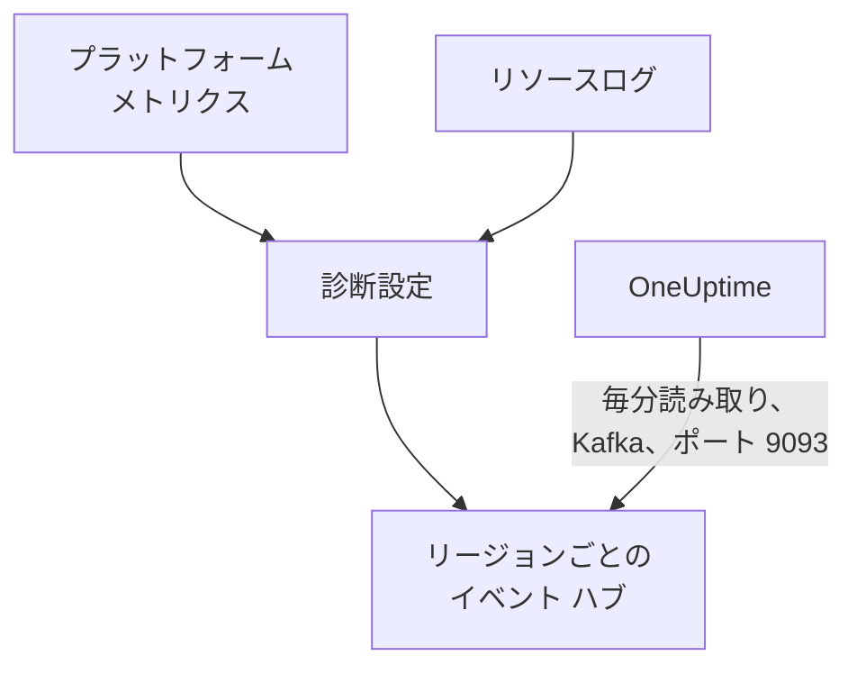

# Azure Monitor のメトリクスとログのストリーミング

接続済みの Azure サブスクリプションは、Azure Monitor のメトリクスとリソースログを OneUptime にストリーミングできます。診断設定がそれらをサブスクリプション内のイベント ハブに送り、OneUptime がイベント ハブを毎分読み取ります。主要メトリクスは、接続の次の読み取りを待たずに Azure Monitor が取得してから数分以内に届き、リソースログは OneUptime のログとして、それぞれ対象のリソースの下に届きます。Azure Cloud Shell でコマンドを 1 つ実行するだけで設定でき、実行し続けるものは何もありません。

:::cards
- [しくみ](#しくみ): 診断設定が各リージョンのイベント ハブに送り、OneUptime がそれを読み取ります。
- [ストリーミングを設定する](#ストリーミングを設定する): ストリーミングするものを選び、読み取りをオンにして、コマンドを 1 つ実行します。
- [届くもの](#届くもの): メトリクスは測定対象のリソースに、ログは発生元のリソースに届きます。
- [コマンドが作成するもの](#コマンドが作成するもの): コマンドがサブスクリプションに作成するすべてのリソースと権限。
- [ストリーミングを停止する](#ストリーミングを停止する): 読み取りを停止してから、コマンドが作成したものを削除します。
:::

## しくみ



- **リージョンごとに 1 つのイベント ハブ。** 診断設定は、リソース自身のリージョンにあるイベント ハブにしか送れません。そのためコマンドは、リソースがある各リージョンに Event Hubs 名前空間を 1 つのリソースグループの中に作成し、各リソースの診断設定をそのリージョンのイベント ハブに向けます。
- **OneUptime が読み取る。** Azure Monitor の送信先はイベント ハブ、ストレージ アカウント、Log Analytics ワークスペースだけで、お使いのアドレスには送れません。OneUptime が読み取るイベント ハブなら、お客様側で何も実行する必要がありません。OneUptime は接続自身のアプリとしてサインインし、そのアプリが読み取れるのはこれらのイベント ハブだけです。
- **読み取りはストリーミングされたメトリクスをストリームに任せる。** ストリームがあるリージョンのリソースタイプの主要メトリクスを配信している間、接続の読み取りはそれを書き込まないため、データポイントが二重に数えられることはありません。読み取りはリソース、その状態、その変更を引き続き見つけ、イベントが 15 分途絶えるとメトリクスを再び引き受けます。
- **OneUptime が読み取れない間も何も失われない。** イベントは、イベント ハブが保持している限り、OneUptime が読み取るまでイベント ハブで待ちます。OneUptime は各パーティションをどこまで読んだかを覚えているので、止まったところから再開します。

## 始める前に

- **接続済みの Azure サブスクリプション。** まず **クラウド → 接続** で接続してください。[クラウド アカウントの接続](/docs/telemetry/cloud-accounts) を参照してください。
- **プロジェクトのオーナーまたは管理者。** 読み取りをオンにし、ストリーミングを停止できるのはこれらのユーザーだけです。
- **Azure Cloud Shell**。サブスクリプションの **Owner**、または **User Access Administrator** でもある **Contributor** としてサインインしてください。コマンドはリソースグループとロールの割り当てを作成し、診断設定を変更します。
- **セルフホストの OneUptime では Azure への経路。** OneUptime は各名前空間を `<namespace>.servicebus.windows.net` のポート 9093 で読み取り、名前空間はインターネットからの接続を受け付けます。

## ストリーミングを設定する

:::steps
### ストリーミングのダイアログを開く

**クラウド → 接続** に移動し、Azure サブスクリプションの行で **メトリクスとログをストリーミング** を選択します。

### ストリーミングするものを選ぶ

**メトリクス** は、すべてのリソースのすべての主要メトリクスを 1 分ごとにストリーミングします。OneUptime が各リソースをグラフにし、評価する基準のメトリクスです。**メトリクスとログ** は各リソース自身のログ (Azure がそのリソースについて保持するすべてのカテゴリ) を加え、**ログ** はリソースログだけをストリーミングします。

### 読み取りをオンにする

**読み取りをオンにする** を選択します。OneUptime は毎分イベント ハブを探し、コマンドが作成するまで待ちます。

### Azure Cloud Shell でコマンドを実行する

コマンドをコピーして Azure Cloud Shell で実行し、完了するまで待ちます。イベント ハブを作成した各リージョン、そこに送るリソースの数、除外したリソースとその Azure の理由が表示されます。

### 最初のイベントを待つ

ダイアログは数秒ごとに何が届いたかを確認します。Azure はコマンドの完了から数分以内に送信を始めます。届くと、ダイアログに何がどこから来たかが表示され、接続の行には **ストリーミング中** と表示されます。
:::

**その他の項目** には残りがあります。

| 項目 | 役割 |
| --- | --- |
| **サブスクリプション** | ストリーミング元のサブスクリプション。最初は接続が読み取るサブスクリプションです。最初のサブスクリプションにイベント ハブが置かれ、OneUptime はそこで読み取ります。最大 50 個 |
| **別の方法で設定する** | Terraform やポータルで設定するために、コマンドが使う名前 |

接続がまだサブスクリプションを読み取っていない場合、または 50 個を超えて読み取る場合は、代わりにダイアログが手順の前に **サブスクリプション** を尋ねます。

最初のサブスクリプションが、OneUptime がイベント ハブを読み取っているサブスクリプションでない場合は、ダイアログにそう表示されます。コマンドを実行する前に **そちらで読み取る** を選択してください。

## 届くもの

| 何が | どこに届くか |
| --- | --- |
| 主要メトリクス | 測定対象のクラウドリソースに、接続の読み取りが書き込むのと同じ系列で |
| リソースログ | ログエクスプローラーの、接続のテレメトリサービスの下に、サブスクリプション、リージョン、カテゴリを属性として |
| OneUptime が知っているリソースのログ | そのリソースにも。クラウドのそのページに **ログ** タブが追加されます |

ストリームが運ぶのは、接続が 1 分ごとに読み取る主要メトリクスです。ストレージ アカウントの使用容量のように、より粗い間隔で読み取るメトリクスは読み取りのままです。ログはリソースの ARM ID によってそのリソースの下に置かれ、`cloud.resource_id` として運ばれます。カテゴリ、操作、結果、プロパティは、`azure.category` のように属性として残ります。

仮想マシン、スケール セット、ディスク、ネットワーク インターフェイス、仮想ネットワーク、プライベート エンドポイント、NAT ゲートウェイ、DNS ゾーン、App Service プランは独自のリソースログを送らないため、それらのページには **ログ** タブがありません。ストレージ アカウントのログはそのサービスのログで、コンテナー アプリのログはその環境のログです。

## コマンドが作成するもの

リソースグループの名前は `oneuptime-stream-` に接続の ID の先頭 8 文字を付けたものです。OneUptime にリソースへのアクセス権は与えません。接続のアプリが読み取れるのはイベント ハブだけです。

| リソース | できること |
| --- | --- |
| リソースグループ `oneuptime-stream-<suffix>` (最初のサブスクリプション内) | イベント ハブを格納し、接続の ID が `oneuptime-connection` タグとして付きます |
| 各リージョンの Event Hubs 名前空間 `oneuptime-<suffix>-<region>` (Standard レベル、スループット ユニット 1) | そのリージョンの診断設定が送るものを受け取ります |
| それぞれのイベント ハブ `oneuptime` (パーティション 2) | OneUptime が読み取るまでイベントを保持します |
| 接続のアプリに付与する **Azure Event Hubs Data Receiver** ロール (リソースグループのみが対象) | アプリにイベント ハブの読み取りだけを許可します |
| 各リソースの診断設定 `OneUptime-<suffix>` | リソースのメトリクス、ログ、またはその両方を、そのリージョンのイベント ハブに送ります |

Front Door のようなグローバル リージョンのリソースは、最初のリージョンのイベント ハブに送ります。Azure がメトリクスだけ、またはログだけを保持するリソースは、持っているもので設定され、Azure が許す上限の 5 個の診断設定をすでに持つリソースは除外されます。Azure は各名前空間のスループット ユニットを時間単位で、診断設定が送るイベントとともに請求します。

## ストリーミングを停止する

:::steps
### 読み取りを停止する

**クラウド → 接続** のサブスクリプションの行で **ストリーミングを停止** を選択します。OneUptime は直ちにイベント ハブの読み取りを止め、接続はすべてのメトリクスを再びスケジュールどおりに読み取ります。読み取り済みのものは残ります。

### コマンドが作成したものを削除する

イベント ハブと診断設定は削除されるまで Azure に残り、Azure はその料金を請求します。ダイアログにコマンドが表示されます。各リソースの診断設定を削除してから、リソースグループを、それがどのサブスクリプションにあっても削除します。

```bash
oneuptime_stream_stop() {
  local SUB ID N=0
  for SUB in '11111111-aaaa-4aaa-8aaa-111111111111' '22222222-bbbb-4bbb-8bbb-222222222222'; do
    while IFS= read -r ID; do
      if [ -z "$ID" ]; then continue; fi
      az monitor diagnostic-settings delete --name OneUptime-6f1c3a2e --resource "$ID" --output none 2> /dev/null &
      N=$((N + 1))
      if [ $((N % 4)) -eq 0 ]; then wait; fi
    done < <(az resource list --subscription "$SUB" --query "[].id" --output tsv)
  done
  wait
  for SUB in '11111111-aaaa-4aaa-8aaa-111111111111' '22222222-bbbb-4bbb-8bbb-222222222222'; do
    if [ "$(az group exists --subscription "$SUB" --name oneuptime-stream-6f1c3a2e 2> /dev/null)" = true ]; then
      az group delete --subscription "$SUB" --name oneuptime-stream-6f1c3a2e --yes --no-wait && echo "Deleting oneuptime-stream-6f1c3a2e in $SUB."
    fi
  done
}
oneuptime_stream_stop
```
:::

ストリーミングするものを変えるには、もう一度 **メトリクスとログをストリーミング** を開き、ストリーミングするものを選んで新しいコマンドを実行します。最初の実行で作成したものが更新され、何も二重には作成されません。

## 別の方法で設定する

Terraform またはポータルで、コマンドが作成するものを次の名前で作成します。

| 設定 | 値 |
| --- | --- |
| リソースグループ | `oneuptime-stream-<suffix>`。OneUptime がイベント ハブを読み取るサブスクリプション内 |
| Event Hubs 名前空間 | `oneuptime-<suffix>-<region>`。ストリーミングするリソースがあるリージョンごとに 1 つ |
| イベント ハブ | `oneuptime`。各名前空間内 |
| 診断設定 | 各リソースの `OneUptime-<suffix>`。そのリージョンのイベント ハブへ、名前空間の `RootManageSharedAccessKey` 規則で送信 |
| ロール | 接続のアプリに付与する **Azure Event Hubs Data Receiver**。リソースグループが対象 |

その後、そのサブスクリプションを **サブスクリプション** の先頭にして、読み取りをオンにします。

## トラブルシューティング

:::details ダイアログが最初のイベントを待ち続ける
コマンドが完了し、あるリージョンのイベント ハブの準備ができたと表示されたかを確認してください。`az eventhubs namespace list --resource-group oneuptime-stream-6f1c3a2e` で名前空間を一覧表示できます。診断設定が送るのは Azure Monitor が持っているものだけなので、何もしていないリソースはほとんど送りません。新しいロールが有効になるまで数分かかることがあり、それまで読み取りにはイベントが見えません。
:::

:::details 接続に ストリーム失敗 と表示される
ダイアログと行のツールチップに理由が表示されます。アプリにイベント ハブを読み取る権限がない場合は、コマンドをもう一度実行してください。アプリにロールが再び付与されます。OneUptime がイベント ハブに到達できなかった場合は、名前空間がインターネットからの接続を受け付けているか、セルフホストの OneUptime がポート 9093 に到達できるかを確認してください。
:::

:::details コマンドがリソースを除外した
除外したリソースが、それぞれ Azure の理由とともに一覧表示されます。診断設定を持たないタイプのリソースは何も送りません。すでに 5 個の診断設定を持つリソースは、先にそのうちの 1 つを削除する必要があります。その後、コマンドをもう一度実行してください。
:::

## 次のステップ

:::cards
- [クラウド アカウントの接続](/docs/telemetry/cloud-accounts): 接続が何を、どのくらいの頻度で読み取るか。
- [Google Cloud のログのストリーミング](/docs/telemetry/cloud-streaming-google-cloud): Google Cloud プロジェクトのログを Pub/Sub 経由でプッシュします。
- [CloudWatch のメトリクスとログのストリーミング](/docs/telemetry/cloud-streaming): AWS アカウントのものを Amazon Data Firehose で配信します。
- [ログエクスプローラー](/docs/telemetry/logs-explorer): ストリームが配信したものを検索し、絞り込みます。
:::
