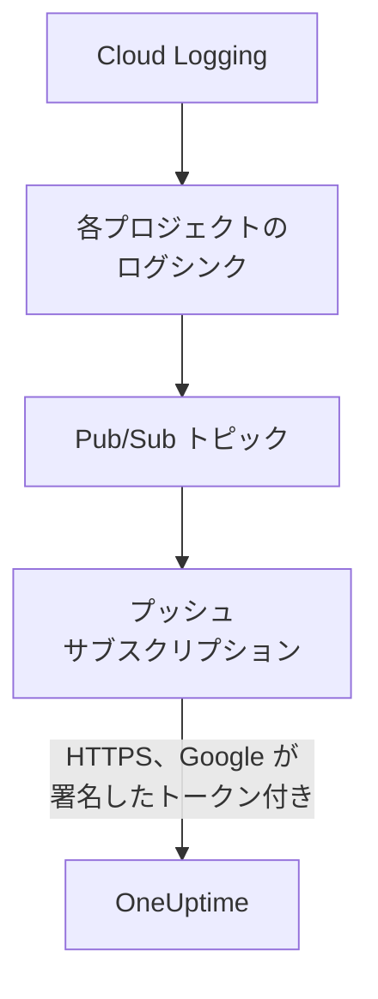

# Google Cloud のログのストリーミング

接続済みの Google Cloud プロジェクトは、ログを書き込まれたそばから OneUptime にストリーミングできます。Cloud Logging がログシンクを通じてログを Pub/Sub トピックに転送し、トピックのプッシュ サブスクリプションが各エントリを 1 分以内に OneUptime に配信します。各エントリは OneUptime のログとして、対象のリソースの下に届きます。Google Cloud Shell でコマンドを 1 つ実行するだけで設定でき、実行し続けるものは何もありません。Cloud Monitoring にはメトリクスをプッシュするエクスポートがないため、接続は引き続きスケジュールどおりにメトリクスを読み取ります。

:::cards
- [しくみ](#しくみ): 各プロジェクトのログシンク、トピック、そのプッシュ サブスクリプション。
- [ストリーミングを設定する](#ストリーミングを設定する): ログを選び、ストリームキーを作成して、コマンドを 1 つ実行します。
- [届くもの](#届くもの): ログは発生元のリソースに届きます。
- [コマンドが作成するもの](#コマンドが作成するもの): コマンドがプロジェクトに作成するすべてのリソースと権限。
- [ストリーミングを停止する](#ストリーミングを停止する): キーを無効にしてから、コマンドが作成したものを削除します。
:::

## しくみ



- **各プロジェクトのログシンク。** 各プロジェクトのシンクは、フィルターに一致するエントリを、接続自身のサービス アカウントのプロジェクトにある 1 つの Pub/Sub トピックに転送します。
- **プッシュごとに二つの確認。** Pub/Sub はプッシュ専用に作成したサービス アカウントの OpenID Connect トークンに署名し、トークンのオーディエンスは接続のストリームキーです。OneUptime がプッシュを受け付けるのは、Google がそのサービス アカウントのトークンに署名し、キーが接続のものである場合だけです。キーは接続を、つまりプロジェクトを示します。プッシュの中身が書き込み先を決めることはありません。OneUptime が保存するのはキーの SHA-256 だけです。
- **OneUptime が受け付けられない間も何も失われない。** Pub/Sub は拒否されたエントリを、試行の間に 10 秒から最大 10 分待ちながら再送し、1 日保持します。

## 始める前に

- **接続済みの Google Cloud プロジェクト。** まず **クラウド → 接続** で接続してください。[クラウド アカウントの接続](/docs/telemetry/cloud-accounts) を参照してください。
- **プロジェクトのオーナーまたは管理者。** ストリームキーを作成し、ストリーミングを停止できるのはこれらのユーザーだけです。
- **Google Cloud Shell**。プロジェクトの **Owner**、またはそれらのプロジェクトでサービス アカウント、Pub/Sub トピック、ログシンクを作成できるユーザーとしてサインインしてください。
- **セルフホストの OneUptime では HTTPS のアドレス。** Pub/Sub は `https://` アドレスにしかプッシュせず、Google が信頼する証明書が必要で、アドレスは Google Cloud から到達できなければなりません。

## ストリーミングを設定する

:::steps
### ストリーミングのダイアログを開く

**クラウド → 接続** に移動し、Google Cloud プロジェクトの行で **ログをストリーミング** を選択します。

### ストリーミングするログを選ぶ

**警告とエラー** は、重大度 `WARNING` 以上のすべてのエントリをストリーミングします。すべてのリクエストではなく、問題が起きたものだけです。**すべてのログ** は、すべての読み取りを記録し、プロジェクトが書き込む他のすべてを上回ることもある Data Access 監査ログを除いて、すべてのエントリをストリーミングします。**独自のフィルター** は、**フィルター** 欄に書いた Cloud Logging のクエリに一致するエントリをストリーミングします。

### ストリームキーを作成する

**ストリームキーを作成** を選択します。キーが表示されるのはこの一度だけで、コマンドの中に含まれます。OneUptime が保存するのはその SHA-256 だけです。

### Google Cloud Shell でコマンドを実行する

コマンドをコピーして Google Cloud Shell で実行し、完了するまで待ちます。シンクを設定した各プロジェクトが表示され、Google が拒否した最初のステップで、Google の理由とともに止まります。

### 最初のプッシュを待つ

ダイアログは数秒ごとに何が届いたかを確認します。プロジェクトがフィルターに一致するエントリを書き込むと、Pub/Sub は 1 分以内にそれをプッシュします。届くと、ダイアログに何がどこから来たかが表示され、接続の行には **ストリーミング中** と表示されます。
:::

**その他の項目** には残りがあります。

| 項目 | 役割 |
| --- | --- |
| **プロジェクト** | ログをストリーミングするプロジェクト。最初は接続が読み取るプロジェクトです。トピックは接続のサービス アカウントのプロジェクトに作成されます。最大 100 個 |
| **別の方法で設定する** | Terraform やコンソールで設定するための、プッシュ エンドポイント、プッシュ用サービス アカウント、キー |

## 届くもの

| 何が | どこに届くか |
| --- | --- |
| ログ | ログエクスプローラーの、接続のテレメトリサービスの下に、プロジェクト、リージョン、ログ名を属性として |
| OneUptime が知っているリソースのログ | そのリソースにも。クラウドのそのページに **ログ** タブが追加されます |

各ログは、エントリの時刻をナノ秒まで、重大度、トレースとスパン、HTTP リクエストを OpenTelemetry のセマンティック規約の名前で保持します。モニタリング対象リソースが、VM (`gce_instance`)、Cloud Run サービス (`cloud_run_revision`)、Cloud SQL インスタンス (`cloudsql_database`) のように OneUptime がメトリクスを読み取る種類であれば、ログはそのリソースの下に置かれ、リソースの ID を `cloud.resource_id` として運びます。外部ロードバランサーのリクエストログは `http_load_balancer` の下に書き込まれますが、その URL マップ、つまりメトリクスが届く `https_lb_rule` の下に置かれます。

インスタンス グループのログはその VM のログなので、そのページには **ログ** タブがありません。それ以外の種類のエントリも、プロジェクトの下にそのままストリーミングされます。

## コマンドが作成するもの

作成するリソースの名前には、接続の ID の先頭 8 文字が付きます。OneUptime にプロジェクトへのアクセス権は与えません。エントリは外に流れるだけです。

| リソース | できること |
| --- | --- |
| サービス アカウント `oneuptime-push-<suffix>` (接続のサービス アカウントのプロジェクト内) | ロールを持ちません。Pub/Sub がこのアカウントのためにプッシュのトークンに署名します |
| Pub/Sub サービス エージェントに付与する **Service Account OpenID Connect Identity Token Creator** ロール (そのサービス アカウントのみが対象) | Pub/Sub にそのトークンの作成だけを許可します |
| Pub/Sub トピック `oneuptime-stream-<suffix>` | シンクが転送するエントリを保持します |
| そのプッシュ サブスクリプション `oneuptime-stream-<suffix>-push` | 各エントリを確認応答期限 60 秒で OneUptime にプッシュし、プッシュできなかったものを 1 日保持します |
| 各プロジェクトのログシンク `oneuptime-stream-<suffix>` | フィルターに一致するエントリをトピックに転送します |
| 各シンクの書き込み ID に付与する **Pub/Sub Publisher** ロール (トピックのみが対象) | シンクにトピックへのパブリッシュだけを許可します |

コマンドは、トピックのプロジェクトで Pub/Sub と Cloud Logging の API がオフになっていればオンにします。Google は配信したログについて Pub/Sub の料金を請求します。必要なログだけをストリーミングしてください。

## ストリーミングを停止する

:::steps
### キーを無効にする

**クラウド → 接続** のプロジェクトの行で **ストリーミングを停止** を選択します。接続のすべてのストリームキーが直ちに使えなくなり、OneUptime は Pub/Sub からのプッシュを拒否します。配信済みのものは残ります。

### コマンドが作成したものを削除する

シンク、トピック、そのプッシュ サブスクリプションは削除されるまで Google Cloud に残り、Pub/Sub はプッシュを続けます。ダイアログに、接続が読み取るプロジェクト向けのコマンドが表示されます。

```bash
for SOURCE in 'acme-prod' 'acme-data'; do
  gcloud logging sinks delete oneuptime-stream-6f1c3a2e --project "$SOURCE" --quiet
done
gcloud pubsub subscriptions delete oneuptime-stream-6f1c3a2e-push --project 'acme-prod' --quiet
gcloud pubsub topics delete oneuptime-stream-6f1c3a2e --project 'acme-prod' --quiet
gcloud iam service-accounts delete 'oneuptime-push-6f1c3a2e@acme-prod.iam.gserviceaccount.com' --project 'acme-prod' --quiet
```
:::

ストリーミングするログを変えるには、もう一度 **ログをストリーミング** を開き、**新しいキーを作成** を選んで新しいコマンドを実行します。置き換えられたキーは 24 時間使えるため、サブスクリプションの更新中にプッシュが拒否されることはありません。同時に使える置き換え済みのキーは最大 3 個です。

## 別の方法で設定する

Pub/Sub トピックに次の値でプッシュ サブスクリプションを追加し、Pub/Sub サービス エージェントがプッシュ用サービス アカウントのトークンを作成できるようにします。

| 設定 | 値 |
| --- | --- |
| プッシュ エンドポイント | `https://oneuptime.com/telemetry/gcp-pubsub/v1/logs` |
| 認証 | `oneuptime-push-<suffix>@<project>.iam.gserviceaccount.com` の OpenID Connect トークン |
| オーディエンス | ストリームキー |
| ペイロード | ラップあり (特に指定しない場合の Pub/Sub の送り方) |
| 確認応答期限 | 60 秒 |
| メッセージの保持期間 | 1 日 |

その後、ログシンクで各プロジェクトのログをトピックに転送し、各シンクの書き込み ID にトピックの **Pub/Sub Publisher** を付与します。セルフホストの OneUptime では、`https://oneuptime.com` をお使いの OneUptime の HTTPS アドレスに置き換えてください。

OneUptime は、Pub/Sub が期待するとおりに各プッシュに応答します。

| 応答 | いつ | Pub/Sub の動作 |
| --- | --- | --- |
| `204` | エントリを受け付けた、以前に受け付け済み、またはメッセージがログエントリではない | 次に進む |
| `400` | OneUptime が読み取れる Pub/Sub のプッシュではない | 毎回待ち時間を延ばしながら、1 日間再送する |
| `401` | トークンが Google によってプッシュ用サービス アカウントに対して署名されていない、またはオーディエンスが接続のキーではない | 毎回待ち時間を延ばしながら、1 日間再送する |
| `402` | プロジェクトにテレメトリの料金を請求できない | 毎回待ち時間を延ばしながら、1 日間再送する |
| `403` | 接続がオフになっている、またはプロジェクトがテレメトリを受け付けられない | 毎回待ち時間を延ばしながら、1 日間再送する |
| `413` | リクエストが 1 MiB を超える、またはエントリが 512 KiB を超える | 毎回待ち時間を延ばしながら、1 日間再送する |
| `429` | 接続のサブスクリプションが 1 分間に 12,000 件を超えるエントリをプッシュした | 毎回待ち時間を延ばしながら、1 日間再送する |
| `503` | OneUptime がその時点でトークンを確認できなかった、またはエントリをキューに入れられなかった | 毎回待ち時間を延ばしながら、1 日間再送する |

## トラブルシューティング

:::details ダイアログが最初のプッシュを待ち続ける
コマンドが途中で止まらずに完了したか、プロジェクトがフィルターに一致するエントリを書き込んだかを確認してください。**警告とエラー** では、静かなプロジェクトは何も送りません。`gcloud pubsub subscriptions describe oneuptime-stream-6f1c3a2e-push --project acme-prod` でサブスクリプションのエンドポイントを確認できます。セルフホストの OneUptime では、Google Cloud がそのアドレスに HTTPS で到達できるかを確認してください。
:::

:::details 接続に ストリーム拒否 と表示される
ダイアログと行のツールチップに理由が表示されます。キーが間違っている場合、サブスクリプションはもう使えないキーでプッシュしています。新しいキーを作成し、コマンドをもう一度実行してください。プッシュ用サービス アカウントに対して署名されていないプッシュは、サブスクリプションが別のアカウントとして署名しているか、Pub/Sub にそのアカウントの署名が許可されていないことを意味します。コマンドをもう一度実行してください。
:::

:::details リソースのログがそのページに表示されない
ページには、Cloud Logging がそのリソースのモニタリング対象リソースの下に、メトリクスと同じラベルで置いたログが表示されます。コンテナーのログのように、ワークロードが別のリソースの下に書き込むログは、プロジェクトの下にだけストリーミングされます。
:::

## 次のステップ

:::cards
- [クラウド アカウントの接続](/docs/telemetry/cloud-accounts): 接続が何を、どのくらいの頻度で読み取るか。
- [Azure Monitor のメトリクスとログのストリーミング](/docs/telemetry/cloud-streaming-azure): Azure サブスクリプションのものをイベント ハブから読み取ります。
- [CloudWatch のメトリクスとログのストリーミング](/docs/telemetry/cloud-streaming): AWS アカウントのものを Amazon Data Firehose で配信します。
- [ログエクスプローラー](/docs/telemetry/logs-explorer): ストリームが配信したものを検索し、絞り込みます。
:::
