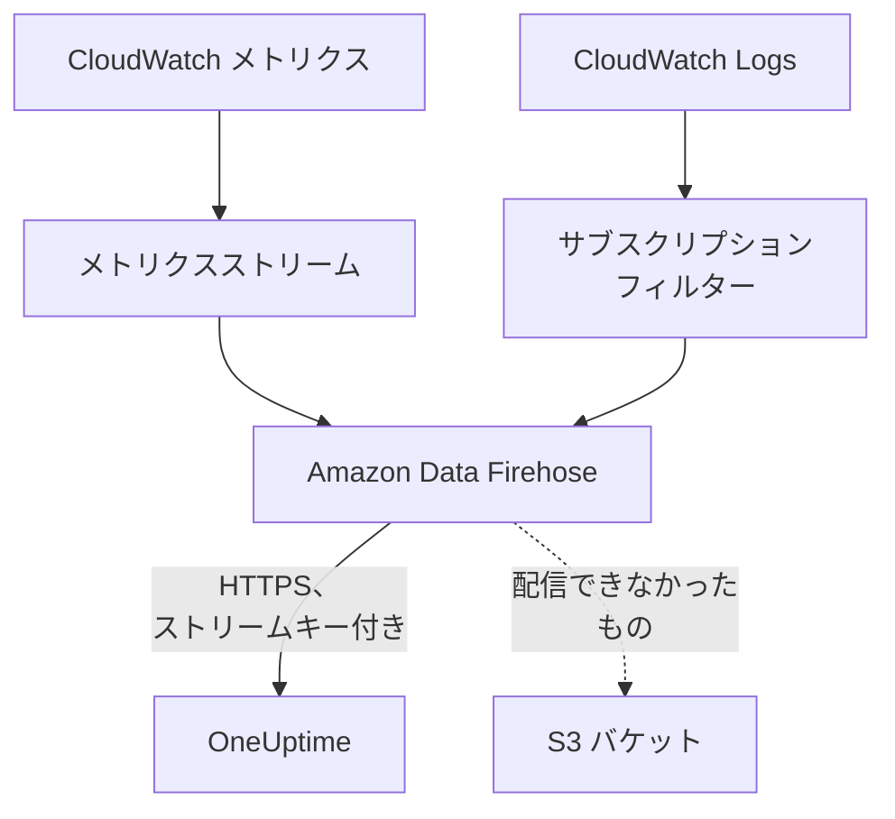

# CloudWatch のメトリクスとログのストリーミング

接続済みの AWS アカウントは、Amazon Data Firehose 経由で CloudWatch のメトリクスとログを OneUptime にストリーミングできます。メトリクスは接続の次の読み取りを待たずに、CloudWatch に入ってから数分で届き、CloudWatch Logs は OneUptime のログとして届き、それぞれが対象のリソースにひも付けられます。AWS CloudShell でコマンドを 1 つ実行するだけで設定でき、実行し続けるものは何もありません。

:::cards
- [しくみ](#しくみ): 各リージョンのメトリクスストリームとログのサブスクリプションを、Firehose が配信します。
- [ストリーミングを設定する](#ストリーミングを設定する): ストリーミングするものを選び、ストリームキーを作成し、コマンドを 1 つ実行します。
- [届くもの](#届くもの): メトリクスは測定対象のリソースに、ログは送信元のリソースに届きます。
- [スタックが作成するもの](#スタックが作成するもの): コマンドがアカウントに作成するすべてのリソースと権限です。
- [ストリーミングを停止する](#ストリーミングを停止する): キーを無効にしてから、スタックを削除します。
:::

## しくみ



- **リージョンごとに 1 つのスタック。** コマンドは、ストリーミング元の各リージョンに CloudFormation スタックをデプロイします。そのメトリクスストリームとログのサブスクリプションフィルターがすべてを二つの Firehose ストリームに渡し、Firehose が HTTPS で OneUptime に配信します。
- **ストリームキーが持ち主を示す。** Firehose は配信のたびに接続のストリームキーを送ります。キーは接続を、つまりプロジェクトを示します。配信の中身が書き込み先を決めることはありません。OneUptime が保存するのはキーの SHA-256 だけです。
- **読み取りはストリーミングされたメトリクスをストリームに任せる。** ストリームがあるリージョンの名前空間を配信している間、接続の読み取りはその名前空間のメトリクスを書き込まないため、データポイントが二重に数えられることはありません。読み取りはリソース、その状態、その変更を引き続き見つけ、配信が 15 分途絶えると名前空間を再び引き受けます。
- **OneUptime が受け付けられない間も何も失われない。** Firehose は拒否されたバッチを最大 1 時間再送し、その後スタックの S3 バケットに 30 日間保管します。

## 始める前に

- **接続済みの AWS アカウント。** まず **クラウド → 接続** で接続してください。[クラウド アカウントの接続](/docs/telemetry/cloud-accounts) を参照してください。
- **プロジェクトのオーナーまたは管理者。** ストリームキーを作成し、ストリーミングを停止できるのはこれらのユーザーだけです。
- **そのアカウントの AWS CloudShell**。CloudFormation スタックと IAM ロールを作成できるユーザーでサインインしてください。
- **セルフホストの OneUptime では HTTPS のアドレス。** Firehose はポート 443 の `https://` アドレスにしか配信せず、AWS が信頼する証明書が必要で、アドレスは AWS から到達できなければなりません。

## ストリーミングを設定する

:::steps
### ストリーミングのダイアログを開く

**クラウド → 接続** に移動し、AWS アカウントの行で **メトリクスとログをストリーミング** を選択します。

### ストリーミングするものを選ぶ

**メトリクス** は、すべてのリソースのすべての主要メトリクスを 1 分ごとにストリーミングします。OneUptime が各リソースをグラフにし、評価する基準のメトリクスです。**メトリクスとログ** は CloudWatch Logs を加え、**ログ** は CloudWatch Logs だけをストリーミングします。

ログの場合は、**ロググループ** を 1 行に 1 つずつ、横の **リージョン** 内の名前か、それ自身のリージョンの ARN で指定するか、**アカウントのすべてのロググループ (新しいものも含む)** を選択します。1 つのコマンドが名前でサブスクライブできるのは最大 50 個のロググループ、最大 10 個のリージョンです。

### ストリームキーを作成する

**ストリームキーを作成** を選択します。キーが表示されるのはこの 1 回だけで、コマンドの中に入っています。OneUptime が保存するのはその SHA-256 だけです。

### AWS CloudShell でコマンドを実行する

コマンドをコピーして AWS CloudShell で実行し、完了するまで待ちます。コマンドはテンプレートを `oneuptime-stream.json` に書き出し、キーを二度と表示されないパラメーターとして渡して、各リージョンにデプロイします。

### 最初の配信を待つ

ダイアログは数秒ごとに何が届いたかを確認します。Firehose はコマンドの完了から数分以内に配信し、ダイアログには何がどこから届いたかが表示され、接続の行には **ストリーミング中** と表示されます。
:::

**その他の項目** に残りの設定があります。

| 項目 | 内容 |
| --- | --- |
| **主要メトリクスだけでなく、すべてのメトリクス** | CloudWatch にあるアカウントのすべてのメトリクス (独自のメトリクスを含む) をストリーミングします。AWS はストリームが送るメトリクスの更新ごとに課金するため、何倍もの費用がかかることがあります |
| **リージョン** | ストリーミング元です。最初は、接続がリソースを見つけたリージョンが入っています。空のままにすると、AWS CloudShell 自身のリージョンからストリーミングします。最大 30 個です |
| **別の方法で設定する** | Terraform やコンソールでストリームを設定するための、メトリクスとログのエンドポイントとキーです |

**テンプレートをダウンロード** は、コマンドがデプロイするテンプレートを保存し、独自の方法でデプロイできるようにします。

## 届くもの

| 内容 | 届く場所 |
| --- | --- |
| メトリクス | 測定対象のクラウドリソースに、接続の読み取りと同じ名前と属性で届きます |
| ログ | ログエクスプローラーに、接続のテレメトリサービスの下で、アカウント、リージョン、ロググループを属性として届きます |
| AWS がリソースの名前を付けたロググループのログ | そのリソースにも届きます。クラウドのそのリソースのページに **ログ** タブが加わります |

AWS がリソースにちなんで名前を付けたロググループは、そのリソースにひも付けられます。

| ロググループ | リソースの種類 |
| --- | --- |
| `/aws/lambda/<function>` | `AWS::Lambda::Function` |
| `/aws/rds/instance/<instance>/<log>` | `AWS::RDS::DBInstance` |
| `/aws/rds/cluster/<cluster>/<log>` | `AWS::RDS::DBCluster` |
| `/aws/docdb/<cluster>/<log>` | `AWS::DocDB::DBCluster` |
| `/aws/neptune/<cluster>/<log>` | `AWS::Neptune::DBCluster` |
| `/aws/redshift/cluster/<cluster>/<log>` | `AWS::Redshift::Cluster` |
| `/aws/OpenSearchService/domains/<domain>/<log>` | `AWS::OpenSearchService::Domain` |
| `/aws/aes/domains/<domain>/<log>` | `AWS::OpenSearchService::Domain` |
| `/aws/apprunner/<service>/<service-id>/<log>` | `AWS::AppRunner::Service` |
| `/aws/elasticbeanstalk/<environment>/<log>` | `AWS::ElasticBeanstalk::Environment` |
| `/aws/ecs/containerinsights/<cluster>/performance` | `AWS::ECS::Cluster` |

各ログはリソースの ID を `cloud.resource_id` として持ち、Lambda 関数のログは `faas.name` も持つため、Serverless の関数にも表示されます。ほかの名前のロググループもそのアカウントとリージョンの下でストリーミングされます。ログの重大度は、Lambda の書き方に沿ってメッセージに示されたものです。

## スタックが作成するもの

スタックの名前は `OneUptimeStream-` に接続 ID の先頭 8 文字を付けたものです。スタックは OneUptime にアカウントへのアクセスを一切与えません。データは外に出ていくだけです。

| リソース | 許可されること |
| --- | --- |
| OpenTelemetry 1.0 形式の CloudWatch メトリクスストリーム | メトリクス用の Firehose ストリームにだけレコードを書き込む |
| ログのサブスクリプションフィルター、またはすべてのロググループを対象とするアカウント全体のサブスクリプションポリシー 1 つ | ログ用の Firehose ストリームにだけレコードを書き込む |
| 二つの Firehose ストリーム、`OneUptime-<suffix>-metrics` と `OneUptime-<suffix>-logs` | GZIP、1 MiB または 60 秒のバッファ、1 時間の再試行で OneUptime に配信し、配信できなかったものをバケットに書き込む |
| 配信できなかったもののための S3 バケット | パブリックアクセスはブロックされ、暗号化され、30 日後に空になり、スタックを削除しても残ります |
| ロググループ `/aws/kinesisfirehose/OneUptime-<suffix>` | Firehose 自身の配信エラーを保持し、ストリーミングされることはありません |
| 3 つの IAM ロール | それぞれがこのアカウントの 1 つの AWS サービスだけを信頼し、上の行に書かれたことだけを許可します |

AWS はメトリクスストリームについて送信したメトリクスの更新ごとに、Firehose について配信した量に応じて課金します。必要なメトリクスとロググループだけをストリーミングしてください。

## ストリーミングを停止する

:::steps
### キーを無効にする

**クラウド → 接続** のアカウントの行で、**ストリーミングを停止** を選択します。接続のすべてのストリームキーがすぐに無効になり、OneUptime はストリームの配信を拒否し、接続は再びすべてのメトリクスをスケジュールどおりに読み取ります。ストリームが配信済みのものは残ります。

### スタックを削除する

スタックを削除するまで、ストリームは AWS に残り、AWS から課金されます。ダイアログには、ストリームの配信元のリージョンと、接続がリソースを見つけたリージョンを対象とするコマンドが表示されます。

```bash
for REGION in us-east-1 eu-west-1; do
  aws cloudformation delete-stack --region "$REGION" --stack-name OneUptimeStream-6f1c3a2e
done
```
:::

スタックがストリーミングする内容を変えるには、**メトリクスとログをストリーミング** をもう一度開き、**新しいキーを作成** を選択して、新しいコマンドを実行します。置き換えられるキーは 24 時間使えるため、スタックの更新中に配信が拒否されることはありません。同時に使える置き換え済みのキーは最大 3 つです。

## 別の方法で設定する

各 Firehose ストリームにこれらの値を使った HTTP エンドポイントの送信先を設定し、メトリクスストリームの出力形式を OpenTelemetry 1.0 にします。

| 設定 | 値 |
| --- | --- |
| メトリクスのエンドポイント | `https://oneuptime.com/telemetry/aws-firehose/v1/metrics` |
| ログのエンドポイント | `https://oneuptime.com/telemetry/aws-firehose/v1/logs` |
| アクセスキー | ストリームキー。`X-Amz-Firehose-Access-Key` として送られます |
| コンテンツエンコーディング | `GZIP` |
| バッファ | 1 MiB または 60 秒 |
| 再試行の期間 | 3600 秒。配信できなかったもののための S3 バケットを付けます |

セルフホストの OneUptime では、`https://oneuptime.com` を OneUptime の HTTPS アドレスに置き換えてください。メトリクスのエンドポイントは JSON 形式のメトリクスストリームも受け付けます。

OneUptime は、Firehose が想定するとおりに各配信に応答します。

| 応答 | いつ | Firehose の動作 |
| --- | --- | --- |
| `200` | 配信を受け付けた、または以前に受け付け済み | 次に進む |
| `400` | OneUptime が読める Firehose の配信ではない (例: 10,000 件を超えるレコード) | 最大 1 時間再送する |
| `401` | キーが接続のキーのどれでもない | 最大 1 時間再送する |
| `402` | プロジェクトにテレメトリの料金を請求できない | 最大 1 時間再送する |
| `403` | 接続がオフになっている、またはプロジェクトがテレメトリを受け付けられない | 最大 1 時間再送する |
| `413` | リクエストが 4 MiB を超えている、または展開すると 32 MiB を超える | バケットに保管する |
| `429` | 接続のストリームが 1 分間に 600 件を超える配信を送った | 後で再送する |

## トラブルシューティング

:::details ダイアログが最初の配信を待ち続ける
すべてのリージョンでコマンドがエラーなく完了したことを確認してください。`aws cloudformation describe-stacks --stack-name OneUptimeStream-6f1c3a2e` でスタックの状態がわかります。メトリクスストリームは CloudWatch にあるメトリクスしか配信しないため、リソースのないリージョンは何も送りません。セルフホストの OneUptime では、AWS がポート 443 の HTTPS でそのアドレスに到達できることを確認してください。
:::

:::details 接続に ストリーム拒否 と表示される
ダイアログと行のツールチップに理由が表示されます。キーが間違っている場合、スタックはもう使えないキーで動いています。新しいキーを作成して、コマンドをもう一度実行してください。Firehose は保持しているものを送り続け、キーが正しくなった時点で受け付けられます。
:::

:::details Lambda 関数のログがそのページに表示されない
ページに表示されるのは、関数にちなんで名前が付いたロググループ `/aws/lambda/<function>` のログです。ほかの名前のロググループに書き込む関数のログは、そのアカウントとリージョンの下にだけストリーミングされます。
:::

## 次のステップ

:::cards
- [クラウド アカウントの接続](/docs/telemetry/cloud-accounts): 接続が読み取るものと、その頻度。
- [クラウドリソース (IaaS と PaaS)](/docs/telemetry/cloud-resources): OneUptime が認識するすべてのリソースの種類。
- [ログエクスプローラー](/docs/telemetry/logs-explorer): ストリームが配信したものを検索し、絞り込みます。
:::
