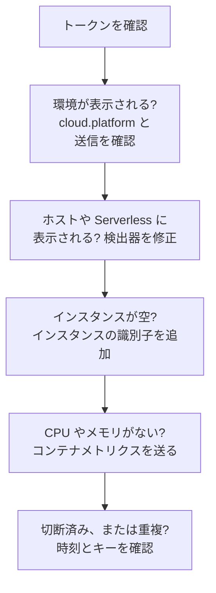

# クラウドのトラブルシューティング

クラウド環境が見つからない、間違った場所に記録される、空になる、重複する原因を突き止めます。各セクションは障害が起きる順に並んでおり、一つずつ層を除外していくので、上から順に確認してください。一つのプラットフォームに固有の障害は、そのプラットフォームのページの最後にあります: [AWS ECS / Fargate](/docs/telemetry/cloud-aws-ecs)、[Google Cloud Run](/docs/telemetry/cloud-gcp-cloud-run)、[Azure Container Apps](/docs/telemetry/cloud-azure-container-apps)、[その他のクラウドプラットフォーム](/docs/telemetry/cloud-other-platforms)。



## まずトークンを確認する

最も手軽な確認で、これが通らなければ以下のどれも動きません:

```bash
curl -i https://oneuptime.com/otlp/v1/validate \
  -H "x-oneuptime-token: YOUR_TELEMETRY_INGESTION_TOKEN"
```

| 応答 | 意味 |
| ------------------------- | -------------------------------------------------------------------------------------------------------------------------- |
| `200`, `"valid": true` | トークンは受け付けられています。`keyType` は `Server` である必要があります。`Browser` キーは、Collector やバックエンドサービスからの送信では拒否されます。 |
| `401`, `"valid": false` | トークンがない、不明、失効、無効、または期限切れで、どれに当たるかは応答の `message` に示されます。**プロジェクト設定 → テレメトリと APM → 取り込みキー** で新しいキーを作成し、デプロイし直します。 |

OneUptime をセルフホストしている場合は、`https://YOUR-ONEUPTIME-HOST/otlp/v1/validate` を使います。できれば、タスク、インスタンス、レプリカの中から確認を実行してください (ECS Exec、`az containerapp exec`)。そうすれば、手元のノート PC だけでなく、ワークロード自体が OneUptime に到達できることを確かめられます。

## 環境が表示されない

最初のリクエストから 1 分たっても、**クラウド → すべての環境** に何も表示されない場合です。次の三点を、この順に確認します。

**`cloud.platform` がない、またはマネージドな値ではない。** OneUptime がテレメトリをクラウド環境に記録するのは、リソースが次のいずれかの値を持つ場合だけです: `aws_ecs`、`aws_elastic_beanstalk`、`aws_app_runner`、`gcp_cloud_run`、`gcp_app_engine`、`azure_container_apps`、`azure_container_instances`、`azure_app_service`。よくある原因は次のとおりです:

- SDK でリソース検出器が無効になっている (`OTEL_NODE_RESOURCE_DETECTORS`、`OTEL_EXPERIMENTAL_RESOURCE_DETECTORS`、`-Dotel.resource.providers.<cloud>.enabled=true`)。
- Collector のパイプラインが `resourcedetection` プロセッサーを通っていない。
- 検出器のないプラットフォームで、`OTEL_RESOURCE_ATTRIBUTES` に入力ミスがある。

Node.js と .NET の Azure 検出器は `azure.container_apps`、`azure.app_service`、`azure.functions` と書きます。OneUptime はこれらをアンダースコアの値に書き換えるので、問題なく認識されます。テレメトリが何を持っているかを見るには、**サービス** でサービスを開き、**トレース** タブからトレースを一つ開いて、リソース属性を確認します。`cloud.platform` がなければ、それが問題のすべてです。

**トークンが間違っている。** トークンの確認で `401` が返りました。Collector はこれを `Permanent error: ... 401` としてログに出します。SDK は一度だけログに出して再試行をやめます。これは OTLP として正しい動作ですが、見落としがちです。

**送信がブロックされている。** Collector のログに `connection refused`、`context deadline exceeded`、`i/o timeout`、または DNS エラーが出ます:

- **ECS と Fargate:** プライベートサブネットには NAT ゲートウェイか `assignPublicIp=ENABLED` が必要で、セキュリティグループでは TCP 443 の送信を許可する必要があります。
- **Cloud Run:** **VPC egress: All traffic** では Cloud NAT が必要です。
- **Container Apps:** ファイアウォールへのユーザー定義ルートで、OneUptime ホストを許可する必要があります。
- **共通:** プライベート DNS 名の背後にあるセルフホストの OneUptime は、ワークロードのネットワークから名前解決できる必要があります。

## 代わりにホストに表示される

リソースが仮想マシンのプラットフォーム (`aws_ec2`、`gcp_compute_engine`、`azure_vm`) を持っているため、OneUptime はそれを **ホスト** に記録します。仮想マシンなら正しいのですが、マネージドなコンピューティングでは誤りです。仮想マシンの検出器がマネージドなものより優先されました。Collector で `detectors: [ec2, elastic_beanstalk]` としていて、`cloud.platform` を最初に設定した検出器が優先されたか、SDK の順序で EC2 検出器が優先されたケースです。`elastic_beanstalk` を先に置くか、`OTEL_RESOURCE_ATTRIBUTES` で `cloud.platform` を自分で設定して `env` 検出器だけを残します。

## サーバーレス関数にだけ表示される

リソースが `faas.name` を持っていますが、マネージドな `cloud.platform` を持っていません。Cloud Run と App Engine では、GCP 検出器が動いていれば両方が設定されます。`faas.name` を手動で設定した場合や、SDK の検出器が設定したリソース属性を Collector が落とした場合は、サーバーレス側の条件しか満たされません。検出器を有効にするか、`cloud.platform=gcp_cloud_run` (または `gcp_app_engine`)、`cloud.account.id`、`cloud.region` を自分で設定します。

> [!NOTE]
> Cloud Run と App Engine では、サービスが両方の場所に表示されるのが正しい動作です。環境はプロジェクトとリージョンをまとめ、**サーバーレス関数** は個々のサービスを表示します。

## インスタンスが空

環境はあるのに、**インスタンス** タブに何も表示されません。テレメトリにインスタンスの識別子がないからです。OneUptime は、次のリソース属性のうち最初に見つかったものからインスタンスの名前を付けます:

1. `aws.ecs.task.id`
2. `aws.ecs.task.arn` (タスク ID に短縮)
3. `faas.instance`
4. `azure.container_app.instance.id`
5. `service.instance.id`
6. `container.id`
7. `host.id`
8. `host.name`

プラットフォーム自身の識別子は `service.instance.id` より優先されます。そのため、SDK がプロセスごとに作る ID (Node.js SDK は既定でそうします) によって、タスクとそのサイドカーの CPU、メモリが分かれることはありません。各プラットフォームで識別子を設定するものは次のとおりです:

| プラットフォーム | 識別子を設定するもの |
| ----------------------------------------- | ------------------------------------------------------------------------------------------------------------------------------------------------ |
| ECS | `ecs` 検出器がタスク ARN を設定します |
| Cloud Run, App Engine | `gcp` 検出器が `faas.instance` を設定します |
| Container Apps | Collector の `azurecontainerapps` 検出器がレプリカ ID を設定します。または `CONTAINER_APP_REPLICA_NAME` から `service.instance.id` を設定するか、ホスト検出器を実行します |
| App Runner, Container Instances | ホスト検出器の `host.name` |
| App Service, Elastic Beanstalk | プラットフォームの検出器が `service.instance.id` を設定します。Beanstalk では、`host.id` で各インスタンスの名前が付くよう、これを削除します |

インスタンスは、その属性を持つ最初のシグナルから 1 分以内に表示されます。

## CPU とメモリが空

インスタンスは表示されているのに、概要の **CPU** と **メモリ** のタイル、および **インスタンス** の CPU とメモリの列が空です。これらはトレースではなくメトリクスから算出されます。トレースと同じインスタンスの識別子と `cloud.platform` をリソースに持つ、`container.cpu.utilization` と `container.memory.usage` (または `container.memory.usage.total`) のデータポイントです。

- **ECS では**、サイドカー Collector の `awsecscontainermetrics` レシーバーが、これらを `ecs.task.cpu.utilized` と `ecs.task.memory.utilized` として提供します。このレシーバーを `metrics` パイプラインに入れ、同じパイプラインに `resourcedetection` も残してください。そうしないと、メトリクスが `cloud.platform` なしで届き、別の場所に記録されます。
- **Cloud Run、Container Apps、その他のプラットフォームでは**、プラットフォームがコンテナの使用量をサイドカーに公開しません。それらのメトリクスを自分で送らない限りタイルは空のままなので、代わりにリクエストのタイルを見てください。
- **SDK direct では**、コンテナメトリクスを送るものがないため、タイルが空なのは想定どおりです。

## 環境が切断済みと表示される

15 分間テレメトリが届かない環境は **切断済み** と表示され、次のスパン、ログ、メトリクスで元に戻ります。OneUptime 自体が停止していた時間や、遅れを取り戻していた時間は数えません。テレメトリが流れている間でも最終確認時刻は最大五分遅れることがあるため、しきい値は 15 分になっています。

- **送信量の多い環境が切断済みと表示される:** エクスポーターが停止しています。Collector のログで、上記の `401` や送信のエラーを確認してください。
- **夜間にゼロまでスケールダウンするステージング環境** は、朝の最初のリクエストまで切断済みと表示されます。これは正しい表示です。

インスタンスには二つの時計があります:

- **古い:** **インスタンス** タブは、直近 15 分間に報告のないタスク、インスタンス、レプリカを **古い** とマークし、概要ではそれ以外だけを稼働中として数えます。
- **削除:** クリーンアップ処理が、`CLOUD_INSTANCE_STALE_MINUTES` (既定は 15、最小 10) の間見られなかったインスタンスの行を削除します。この時間は環境自身の最新のテレメトリから数えるので、Collector が停止しても、最後に分かっていたタスクの一覧が消えることはなく、時計が止まるだけです。サーバーレス関数は `SERVERLESS_INSTANCE_STALE_MINUTES` を使います。しきい値を上げると行は長く残りますが、**古い** になるタイミングは変わりません。

## 一つのはずの環境が二つある

環境キーは `cloud.platform|cloud.account.id|cloud.region` で、一文字ずつ比較されます。`cloud.account.id` を設定するワークロードとしないワークロードがある、一方が `eastus`、もう一方が `East US` と書いている、あるいは一方の Collector だけが `ecs` 検出器を実行している、といった場合、`aws_ecs|123456789012|us-east-1` と `aws_ecs||us-east-1` が並んで作られます。

各環境の **概要** を開いてください。**環境キー** を見れば、どの部分が違うかが分かります。値が欠けているワークロードを修正します。空の部分がある環境にはテレメトリが届かなくなるので、アーカイブしてかまいません。

## 手動で作成した環境が一致しない

取り込みではキーだけで環境を照合し、キーは `platform|account|region` (例: `aws_ecs|123456789012|us-east-1`) と完全に一致する必要があります。つまり、テレメトリが持つものと同じプラットフォームの値、アカウント ID、リージョンです。作成フォーム (**クラウド → すべての環境** の **クラウドリソースを作成**) は、**クラウドプラットフォーム**、**クラウドアカウント ID**、**クラウドリージョン** の各フィールドからキーを作るので、この三つはテレメトリと一文字ずつ一致している必要があります。一致しない場合、取り込みは自分が算出したキーで二つ目の環境を作り、作成した環境は空のままになります。手動で作成した環境をアーカイブして取り込みに正しい環境を作らせるか、正しい値で作り直してください。

## それでも解決しない場合

サポートに問い合わせる前に、次の情報を集めてください:

- ワークロードから送られた実際のスパンまたはログレコード一つのリソース属性。Collector の `debug` エクスポーターで出力するか、**サービス** でサービスのトレースを開きます。
- ワークロードの中から実行した `/otlp/v1/validate` の確認の応答。
- Collector のログの最後の 50 行、または `OTEL_LOG_LEVEL=debug` を指定した SDK の診断ログ。
- 表示された各環境の **環境キー**。

その上で support@oneuptime.com に連絡するか、[GitHub](https://github.com/OneUptime/oneuptime) で issue を作成してください。

## 次のステップ

:::cards
- [クラウド環境](/docs/telemetry/cloud-environments): 環境とインスタンスの識別方法。
- [AWS ECS / Fargate](/docs/telemetry/cloud-aws-ecs): 完全なタスク定義を含む ECS の設定。
- [OpenTelemetry](/docs/telemetry/open-telemetry): エンドポイント、制限、各応答の意味。
:::
