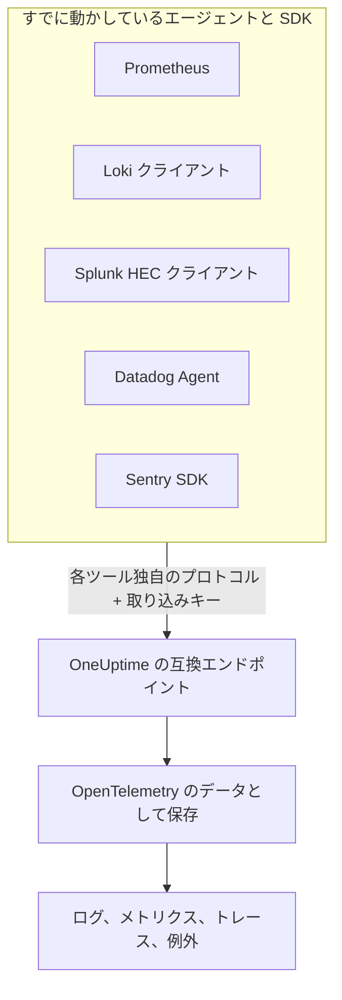

# Prometheus, Loki, Splunk, Datadog & Sentry

Prometheus、Loki クライアント、Splunk フォワーダー、Datadog Agent、Sentry SDK のいずれかをすでに動かしていますか? それはそのまま使い続けてください。OneUptime は、これらのツールがそれぞれ送るものを、そのツールがすでに使っているパスで受け付け、OpenTelemetry のデータとして保存します。OneUptime を試すのに必要なのは URL とキーを変えることだけで、計装し直す必要はありません。また、破棄フィルター、スクラブルール、ログパイプライン、データ保持、取り込み予算は、ほかのデータと同じようにこのデータにも適用されます。

:::cards
- [Prometheus remote write](#prometheus-remote-write): Prometheus、Grafana Alloy、または任意の remote write 送信元からのメトリクス。
- [Loki](#loki): Promtail、Grafana Alloy、Fluent Bit、Vector からのログ。
- [Splunk HTTP Event Collector](#splunk-http-event-collector): 任意の HEC クライアントからのログとメトリクスイベント。
- [Datadog Agent](#datadog-agent): Datadog Agent からのメトリクスとログ。
- [Sentry SDK](#sentry-sdk): 任意の Sentry SDK からのエラー、トランザクション、ログ。
:::

## 仕組み



各エンドポイントは、そのツール自身の形式で応答します。Prometheus と Loki には `204`、HEC には `{"text": "Success", "code": 0}`、Datadog には `202`、Sentry にはイベント ID を返すので、ツールはこれまでと同じように成功と失敗を報告します。その後、データは OpenTelemetry SDK から届いたデータとまったく同じように処理されます。

## 始める前に

- **OneUptime プロジェクト**: OneUptime Cloud では、テレメトリは取り込んだ GB 単位で課金されます。また Free プランのプロジェクトは、テレメトリを送る前に支払い方法を登録する必要があります。
- **テレメトリ取り込みキー**: **製品 → プロジェクト設定 → テレメトリと APM → 取り込みキー** で **サーバー** キーを作成し、その **シークレットキー** をコピーします。各ツールは、自身の認証情報を送るのと同じ場所でこのキーを送ります。ブラウザーアプリの Sentry DSN には、代わりにサイトのオリジンを登録した **ブラウザー** キーを使います。
- **お使いのホスト**: 例では `oneuptime.com` を使っています。OneUptime をセルフホストしている場合は、自分のホストを使ってください。

> [!TIP]
> ログ、メトリクス、トレース、例外の「セットアップガイド」タブでは、これらのツールが送信方法の一覧に含まれており、ホストと選んだキーがあらかじめ入力されています。

## エンドポイント

| ツール | 送信先 | キーの渡し方 |
| --- | --- | --- |
| Prometheus remote write | `https://oneuptime.com/telemetry/prometheus/api/v1/write` | Bearer トークン、またはキーをパスワードにした Basic 認証。 |
| Loki | `https://oneuptime.com/telemetry/loki/api/v1/push` | キーをパスワードにした Basic 認証、または Bearer トークン。 |
| Splunk HTTP Event Collector | `https://oneuptime.com/telemetry/services/collector` | HEC トークン: `Authorization: Splunk <key>`。 |
| Datadog Agent | `https://oneuptime.com/telemetry/datadog` | API キー: `DD-API-KEY`。 |
| Sentry SDK | DSN `https://<key>@oneuptime.com/telemetry/sentry/1` | DSN の公開キー。 |

どのエンドポイントも、`x-oneuptime-token` ヘッダーでもキーを受け付けます。また `x-oneuptime-service-name` ヘッダーを付けると、送られるすべてのデータが属するサービスを指定できます。キーはハイフンを除いた 32 文字の 16 進数で書くこともでき、Sentry の DSN と Datadog の API キーは必ずその形で書く必要があります。

## Prometheus remote write

OneUptime を remote write のターゲットとして追加します。Prometheus はこれまでどおりスクレイプを続け、すべてのサンプルのコピーを送ります。

```yaml title="prometheus.yml"
remote_write:
  - url: https://oneuptime.com/telemetry/prometheus/api/v1/write
    authorization:
      credentials: YOUR_TELEMETRY_KEY
```

Grafana Alloy では、`prometheus.remote_write` コンポーネントを追加し、スクレイプした結果をそこに転送します。

```text title="config.alloy"
prometheus.remote_write "oneuptime" {
  endpoint {
    url          = "https://oneuptime.com/telemetry/prometheus/api/v1/write"
    bearer_token = "YOUR_TELEMETRY_KEY"
  }
}
```

remote write 1.0 と 2.0 のどちらも受け付けます。どの送信元も送っているとおり、snappy で圧縮された形式です。

### 系列がどうなるか

- **名前とラベルはそのまま残ります。** `http_requests_total{job="checkout", code="500"}` は、属性 `job` と `code` を持つメトリクス `http_requests_total` になるため、Grafana から移したクエリでも見つかります。
- **ジョブがサービスになります。** OpenTelemetry が定める Prometheus の対応付けルールのとおり、各 `job` はサービスに、各 `instance` はそのサービスインスタンスになります。
- **型は保持されます。** カウンター、およびヒストグラムのバケットとカウントは累積和になるため、レートが正しくグラフに描かれます。型は送信元が含めるメタデータから決まります。メタデータがない場合、名前が `_total` で終わるものはカウンター、`le` ラベルを持つ `_bucket` はヒストグラムのバケットになります。
- **ネイティブヒストグラム** は指数ヒストグラムになり、カスタムバケットを持つネイティブヒストグラムはヒストグラムになります。
- **保持されないもの:** staleness マーカーとそのほかの NaN または無限大のサンプル、カウンターの `_created` 系列、エグザンプラー。

## Loki

OneUptime は Loki の push API を Loki 自身のパスで受け付けます。形式は JSON、または Promtail と Grafana Alloy が送る snappy 圧縮の protobuf です。クライアントとして追加します。

```yaml title="promtail.yaml"
clients:
  - url: https://oneuptime.com/telemetry/loki/api/v1/push
    bearer_token: YOUR_TELEMETRY_KEY
```

Fluent Bit の `loki` 出力では、ホストとパスを別々に指定します。

```text title="fluent-bit.conf"
[OUTPUT]
    Name         loki
    Match        *
    Host         oneuptime.com
    Port         443
    Tls          On
    Uri          /telemetry/loki/api/v1/push
    Http_User    oneuptime
    Http_Passwd  YOUR_TELEMETRY_KEY
    Labels       job=fluent-bit
```

### ストリームがどうなるか

- **各エントリがログになり**、ナノ秒単位の独自のタイムスタンプを持ち、その行が本文になります。
- **ラベルと構造化メタデータは属性になり**、Loki での名前がそのまま使われます。
- **サービス** は、Loki と同じ探し方で、`service_name`、`service`、`app`、`application`、`name`、`app_kubernetes_io_name`、`container`、`container_name`、`component`、`workload`、`job` のうちストリームが持つ最初のものから決まります。`host` または `hostname` ラベルはホストを示します。
- **レベル** は、`level`、`detected_level`、`severity` のいずれかのラベルまたはメタデータから決まり、それがなければ logfmt の `level=` か、JSON の行の `level` フィールドから決まります。
- **トレースコンテキスト:** 構造化メタデータに `trace_id` と `span_id` があると、ログがそのトレースに関連付けられます。

## Splunk HTTP Event Collector

取り込みキーを HEC トークンとして、OneUptime を HTTP Event Collector として使います。Splunk の Docker ロギングドライバーはパスを自分で付け加えるので、ホストだけを指定します。

```bash
docker run \
  --log-driver=splunk \
  --log-opt splunk-url=https://oneuptime.com \
  --log-opt splunk-token=YOUR_TELEMETRY_KEY \
  --log-opt splunk-format=json \
  your-image
```

そのほかの HEC クライアントは `/services/collector/event` または `/services/collector/raw` に POST します。イベントを 1 つ送るには、次のようにします。

```bash
curl https://oneuptime.com/telemetry/services/collector/event \
  -H "Authorization: Splunk YOUR_TELEMETRY_KEY" \
  -d '{"event": "Payment failed for order 42", "sourcetype": "app", "fields": {"service": "checkout"}}'
```

`{"text": "Success", "code": 0}` を含む `200` が返れば、イベントは受け付けられています。エンドポイントは HEC 独自のコードでも応答します。`No data` (5)、有効でなかったイベントの番号を伴う `Invalid data format` (6)、`Event field is required` (12) です。また、`GET /services/collector/health` にはトークンなしで応答します。

### イベントがどうなるか

- **ログ** になり、`time` がタイムスタンプになります。文字列のイベントはそのまま本文になります。オブジェクトのイベントでは `message`、`msg`、`log`、`line`、`text` のいずれかが本文になり、そのほかのフィールドは属性になります。
- **メタデータは残ります:** `host` はホストになり、`source`、`sourcetype`、`index` は `com.splunk.source`、`com.splunk.sourcetype`、`com.splunk.index` として保持されます。イベントに含まれていないものは、クエリ文字列の `host`、`source`、`sourcetype`、`index` で補われます。
- **フィールドは属性になります。** `service.name` フィールドがサービスを示し、ログの `service` フィールドも同様です。
- **メトリクスイベント** (`metric_name` と `_value`、または `metric_name:<name>` フィールドを持つ `"event": "metric"`) は、ログではなく必ずメトリクスとして保存されます。
- **提供されないもの:** インデクサー確認応答。これを要求するクライアントには `ackId` が返されません。

## Datadog Agent

取り込みキーを API キーとして、Agent のメトリクスとログを OneUptime に向けます。

```yaml title="datadog.yaml"
api_key: YOUR_TELEMETRY_KEY_WITHOUT_HYPHENS
dd_url: https://oneuptime.com/telemetry/datadog
logs_enabled: true
logs_config:
  use_http: true
  logs_dd_url: oneuptime.com:443
apm_config:
  enabled: false
process_config:
  process_collection:
    enabled: false
```

Agent は `dd_url` に独自のパスを付け加え、ログは `logs_dd_url` が指定するホストとポートの `/api/v2/logs` に送ります。OneUptime がルートでそれらのパスに応答するのは、`DD-API-KEY` ヘッダーを含むリクエストに対してだけです。変更後は Agent を再起動してください。OneUptime がキーを受け付けると、`datadog-agent status` に API キーが有効と表示されます。

### Agent のデータがどうなるか

- **メトリクス** は名前が保持されます。ゲージはゲージに、カウントは合計に、レートは 1 秒あたりの値のゲージになります。
- **ディストリビューション** は、カウント、合計、最小値、最大値を持つサマリーになります。
- **サービスチェック** は、チェック名を名前とするメトリクスになり、その値はチェックのステータスです: 0 が OK、1 が警告、2 が重大、3 が不明。
- **ログ** はメッセージ、ステータス、ホスト、サービスを保持し、残りのフィールドは属性になります。
- **タグは属性になり**、`service`、`env`、`version` タグがそれぞれサービス、その環境、そのバージョンを示します。
- **まだ読み取られないもの:** APM トレース、プロセス、コンテナ、ネットワークデータ、プロファイル。上の例のように、`datadog.yaml` でオフにしておいてください。

Datadog の HTTP API クライアント (`/api/v2/logs` に POST するログライブラリや、系列を POST するスクリプトなど) も、`DD-API-KEY` ヘッダーを付けて同じエンドポイントに送れます。

## Sentry SDK

Sentry を設定している箇所で DSN を置き換えます。Sentry のそのほかのコードはそのままです。

```javascript
Sentry.init({
  dsn: "https://YOUR_TELEMETRY_KEY_WITHOUT_HYPHENS@oneuptime.com/telemetry/sentry/1",
  release: "checkout@1.4.2",
  environment: "production",
});
```

```python
sentry_sdk.init(
    dsn="https://YOUR_TELEMETRY_KEY_WITHOUT_HYPHENS@oneuptime.com/telemetry/sentry/1",
    release="checkout@1.4.2",
    environment="production",
)
```

DSN の末尾の `1` は Sentry の SDK が必要とするもので、読み取られません。ブラウザーアプリの DSN は公開されるので、そこではサイトのオリジンを登録した **ブラウザー** 取り込みキーを使ってください。

### エンベロープがどうなるか

- **エラー** は、スタックトレースと原因となった例外とともに「例外」に表示され、ほかの例外と同じようにまとめられます。各エラーは、そのトレース上で、アクティブだったスパンの下のスパンになります。
- **トランザクション** とそのスパンは「トレース」に表示されます。
- **Sentry のログ** と、`capture_message` で取得したメッセージは「ログ」に表示されます。
- **サービス** は `service` タグ、それがなければリリース名の `@` より前の部分です。`checkout@1.4.2` なら `checkout` です。リリースはサービスのバージョンになり、環境は保持されます。
- **保持されないもの:** セッション、リプレイ、添付ファイル、プロファイル、チェックイン。SDK はこれらを引き続き送りますが、OneUptime は受け付けたうえで破棄します。

## 制限と取り込み予算

- **リクエストサイズ**: OneUptime のイングレスは `/telemetry` 配下で最大 4 MB のリクエストを受け付け、展開後の本文は 1 つあたり最大 64 MB です。
- **取り込み予算**: Prometheus remote write と Loki は、本文を読み取る前にメトリクスまたはログの予算と照合され、予算を使い切っていると `403` で拒否されます。HEC のバッチ、Datadog のペイロード、Sentry のエンベロープには複数のシグナルが含まれることがあるため、各シグナルは保存時にそれぞれの予算に計上され、その予算を使い切っていれば破棄されます。

## トラブルシューティング

### すべてのリクエストが 401 で拒否される

キーが、エンドポイントの探す場所に届いていないか、このプロジェクトのキーではありません。ツールの認証情報の設定を [エンドポイント](#エンドポイント) の表と照らし合わせ、キーが無効化されていないか、期限切れになっていないかを確認してください。

### Sentry SDK が DSN を無効と報告する

Sentry の SDK は、キーにハイフンを含む DSN を拒否します。キーはハイフンを除いた 32 文字の 16 進数で書いてください。

### Datadog のメトリクスは届くが、ログが届かない

`logs_config.use_http` が `true` であること、そして `logs_config.logs_dd_url` が URL ではなくホストとポートであることを確認してください。`use_http` が設定されていないと、Agent はログを TCP で送ります。

### Prometheus が 415 を報告する

送信元が、OneUptime の読み取らない remote write プロトコルを要求しました。remote write 1.0 または 2.0 で送ってください。
