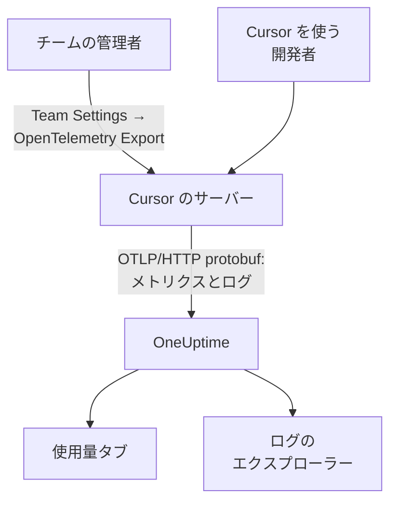

# Cursor

Cursor は、チームのテレメトリを Cursor 自身のサーバーからエクスポートします。チームの管理者が Cursor のダッシュボードで OneUptime を送信先として一度追加すると、チーム全体のトークン、推定コスト、ツール呼び出しが届きます。開発者のマシンにインストールや設定をする必要はありません。

:::cards
- [セットアップする](#セットアップする): OneUptime でキーを、Cursor で送信先を作成します。
- [得られるもの](#得られるもの得られないもの): メトリクスとログ。トレースはありません。
- [誰が何に使ったか](#従業員への帰属): 人は Cursor のユーザー ID として届きます。
- [トラブルシューティング](#トラブルシューティング): 何も届かないときに確認すること。
:::

## 仕組み



## 始める前に

- **Cursor の Enterprise プラン。** OpenTelemetry Export の画面は、ほかのプランにはありません。
- **Cursor がインターネットから到達できるエンドポイント。** 接続するのは Cursor の側で、固定のアドレス群から接続してきます。OneUptime Cloud では追加の作業は不要です。ファイアウォールの内側にあるセルフホストの OneUptime では、Cursor が [OpenTelemetry Export](https://cursor.com/docs/enterprise/opentelemetry-export) のページに掲載している送信元アドレスを許可する必要があります。

## セットアップする

:::steps
### 取り込みキーを作成する

OneUptime で **プロジェクト設定 → テレメトリと APM → 取り込みキー** を開き、 **取り込みキーを作成** をクリックしてキーをコピーします。OTLP のベース URL は `https://oneuptime.com/otlp` です。OneUptime をセルフホストしている場合は `https://YOUR-ONEUPTIME-HOST/otlp` です。

### Cursor で送信先を作成する

Cursor の Web ダッシュボードで、チームの管理者として **Team Settings → OpenTelemetry Export** を開き、送信先を作成します。

| フィールド | 値 |
| --- | --- |
| Endpoint (base URL) | `https://oneuptime.com/otlp` |
| Header name | `x-oneuptime-token` |
| Header value | `YOUR_INGESTION_TOKEN` |

ベース URL は `/v1` を付けずに入力します。Cursor が `/v1/metrics` と `/v1/logs` を自分で付け加えるため、`https://oneuptime.com/otlp/v1` にすると `/otlp/v1/v1/metrics` に送られ、何も届きません。

### テストして有効にする

**Test connection** をクリックして URL とヘッダーを確認し、次に **Enable** をクリックします。エクスポートは 1 分ほどで始まります。その後のヘッダーの変更は 30 秒ほどで反映されます。

### データが届くことを確認する

Cursor を 1、2 分使ってから OneUptime で **ログ** を開き、サービス名 `cursor` で絞り込みます。トークン数を持つ `cursor.api.request` レコードがあれば、キーと URL は正しく設定されています。
:::

Cursor が話すのは HTTP 上の OTLP で、バイナリの protobuf のみです (gRPC も JSON もなし)。OneUptime はこれをそのまま受け付けます。ヘッダーは暗号化して保存され、送信先はチームごとに 1 つです。OneUptime とほかの場所の両方に送るには、前段に Collector を置いてください。

## 得られるもの、得られないもの

| シグナル | Cursor から |
| --- | --- |
| メトリクス: トークン、推定コスト、ツール呼び出し | はい、差分として |
| ログイベント: リクエスト、エラー、訂正、スキル、フック、プラグイン、クラウドエージェント | はい |
| プロンプトと回答のテキスト | `conversation_content` ファミリーを有効にした場合のみ |
| トレース | いいえ |
| 送信先を有効にする前のデータ | いいえ |

そのため OneUptime では、Cursor は `cursor.token.usage` と `cursor.cost.usage` をもとに **製品 → AI / LLM** の **使用量** タブに表示されますが、トレースから組み立てられる **呼び出し** や **会話** には表示されません。リクエストごとの詳細は、 **ログ** エクスプローラーの `cursor.api.request` イベントです。

### ファミリー

各シグナルとテレメトリの各ファミリーには、Cursor の設定にそれぞれのスイッチがあります。

| ファミリー | 対象 |
| --- | --- |
| `model_usage` | `cursor.token.usage`、`cursor.cost.usage`、および `cursor.api.request`、`cursor.api.error`、`cursor.api.correction` のイベント |
| `tool_calls` | `cursor.tool.calls` |
| `skills_hooks_plugins` | スキル、フック、プラグインのイベント |
| `cloud_agents` | `cursor.cloud_agent.*` のイベント |
| `grok_bot_agent_actions` | `cursor.grok_bot.*` のイベント。Action Recording が必要 |
| `conversation_content` | メッセージのテキストと、MCP ツールの入力と出力。既定でオフ |

`conversation_content` 以外のファミリーは、最初からオンになっています。Cursor が今後追加するファミリーも、`auto_enable_new_families` をオフにしない限り最初からオンになります。

## メトリクスとイベント

3 つのメトリクスはどれも差分の合計です。

| メトリクス | 単位 | 属性 |
| --- | --- | --- |
| `cursor.token.usage` | `{token}` | `cursor.token.type`: `input`、`output`、`cache_read`、`cache_creation`。`cursor.model.name`。`cursor.api.status`: `success`、`errored`、`aborted`。`cursor.api.billable` |
| `cursor.cost.usage` | `USD` | `cursor.model.name` |
| `cursor.tool.calls` | `{call}` | `cursor.tool.kind`: `builtin`、`mcp`。`cursor.tool.name`。`cursor.tool.status`: `success`、`failure`、`aborted`。`cursor.mcp.server.name` |

データポイントには会話 ID もリクエスト ID もないため、セッションごとのコストはメトリクスにはありません。`cursor.model.name` はリクエストされたモデルで、ルーティングされた選択はまとめられています。モデルの内訳には `Auto` という行があり、Cursor が実際に振り分けたモデルごとに分けることはできません。

最もよく使うログイベントは `cursor.api.request` です。リクエストごとに 1 件で、入力、出力、キャッシュのトークン数、モデル、課金されたかどうかを持ちます。`cursor.api.error` は失敗したリクエストを記録し (エラーメッセージは含まない)、`cursor.api.correction` は後から届いて、リクエストが結局課金されなかったことを伝えます。Cursor の [ワイヤーリファレンス](https://cursor.com/docs/enterprise/opentelemetry-export/wire) に、すべてのイベントと属性の一覧があります。

すべてのレコードは、次のリソース属性を持ちます。

| 属性 | 内容 |
| --- | --- |
| `service.name` | 常に `cursor`。 **ログ** と **メトリクス** のエクスプローラーでこれで絞り込む |
| `cursor.team.id` | チーム。整数で、常に存在する |
| `cursor.user.id` | 人。チーム内で有効な整数で、任意 |
| `cursor.surface` | アクティビティの発生元。`desktop`、`cli`、`cloud_agent`、`bugbot` など |
| `cursor.entrypoint` | 開始のしかた。`desktop`、`cli`、`web`、`api`、`github_pr` など |

## 従業員への帰属

**Cursor は人を `cursor.user.id` で示します。これは Cursor にしか名前に変換できない整数で、クラウドエージェントでは省かれることがよくあります。** OneUptime はこれを従業員として、`cursor.team.id` をチームとして読み取るため、 **使用量** タブでは設定なしで人とチームをランキングできますが、人は整数で表示されます。

- どちらもリソース属性 (`resource.cursor.user.id`、`resource.cursor.team.id`) として届き、OneUptime はそれを読み取ります。
- Cursor は `cursor.user.email` も送れますが、OneUptime はまだ読み取らないため、Cursor では従業員のメールアドレスの列は空のままです。
- `gen_ai.user`、`llm.user`、LiteLLM のエンドユーザー ID が従業員として読み取られることはありません。これらは社員ではなく顧客を示します。[従業員とチームへの帰属](/docs/telemetry/ai-coding-assistants#従業員とチームへの帰属)を参照してください。

### 使用量タブでの Cursor の表示

Cursor はメトリクスを送り、GenAI スパンは送りません。メトリクスはスパンを補うだけです。 **同じプロジェクトがコスト付きの GenAI スパンを受け取っていると、Cursor の支出は表示されません。** Cursor は専用のプロジェクトに送ってください。[スパンが優先され、メトリクスが補う](/docs/telemetry/ai-llm-observability#スパンが優先されメトリクスが補う)を参照してください。

| 内訳 | Cursor の場合 |
| --- | --- |
| **従業員** | はい。`cursor.user.id` 別 |
| **チーム** | はい。`cursor.team.id` 別 |
| **モデル** | はい。`cursor.model.name` 別 |
| **プロバイダー** | いいえ。Cursor はどのプロバイダーが呼び出しを処理したかを伝えない |
| **アプリケーション / サービス** | いいえ。Cursor のメトリクスはどの OneUptime サービスにも属さない |

Cursor の行はコストだけを持ちます。`cursor.cost.usage` には呼び出しごとの詳細がないため、呼び出しとトークンのセルには `—` が表示されます。`cursor.token.usage` は引き続き表の上のトークン合計に使われ (`input` と `output` の種類のみ。キャッシュのトークンは除外)、`cursor.token.type` 別にダッシュボードにグラフ化できます。

:::details Cursor のユーザー ID を人に変換する
名前と請求額は Cursor の Admin API にありますが、OneUptime はこれを呼び出しません。必要なら自分で呼び出してください。Enterprise 専用で、`https://api.cursor.com` にあり、管理者の API キーをユーザー名に、パスワードを空にして使います。

```bash
curl -u YOUR_API_KEY: https://api.cursor.com/teams/members
```

`GET /teams/members` は各メンバーのメールアドレスと名前を返します。`POST /teams/filtered-usage-events` はイベントごとの課金された使用量を返すので、支出はその `chargedCents` を合計します。その `conversationId` は Cursor のログイベントの `cursor.conversation.id` と一致するため、両方にある場合は、人と請求額をすでに見ているセッションに結び付けられます。整数の `cursor.user.id` と Admin API のユーザー ID が同じであることを Cursor は文書化していないため、それをもとに誰かに請求する前に、自分のチームで確認してください。
:::

## Cursor の配信のしかた

これらはグラフの見え方を変えるため、欠落を報告する前に知っておいてください。

- **メトリクスは最大 1 回だけ送られます。** 失敗したエクスポートは再試行されないため、失敗の後に短い欠落があるのは想定どおりです。Cursor のメトリクスの欠落で誰かを呼び出さないでください。
- **ログは少なくとも 1 回送られ**、`cursor.event.id` で重複が除かれ、約 7 日間自動的に再試行されます。
- **順序は保証されません。** `cursor.api.correction` は、訂正対象のリクエストより後に届きます。到着順ではなく、レコードのタイムスタンプで並べてください。
- **さかのぼって補完されることはありません。** 送信先を有効にする前のデータは届かず、壊れたまま放置された送信先は、Cursor が送れなかった分を失います。
- **送信先を無効にしたり削除したりすると、送信中のデータが失われます。** 取り込みキーを変えるには、送信先を削除して作り直すのではなく、送信先のヘッダーを編集してください。

## コストは見積もりで、請求書ではない

Cursor は `cursor.cost.usage` をベストエフォートの見積もりと説明しています。含まれる使用量とオンデマンドで課金される使用量を区別せず、自分のモデルキーを使う場合は Cursor のトークン単価だけを反映してプロバイダーの請求額は反映せず、後から届く `cursor.api.correction` がすでに数えた使用量を取り消すこともあります。傾向として読んでください。請求書と一致する数値が必要なら、Cursor の Admin API の `chargedCents` を合計してください。

## トラブルシューティング

:::details 何も届かない
Cursor で **Test connection** をもう一度実行します。ベース URL が `/v1` で終わっていないこと、ヘッダー名が `x-oneuptime-token` で値がキーそのものであること、`model_usage` ファミリーがオンになっていることを確認してください。エクスポートは、送信先を有効にしてから 1 分ほどで始まります。
:::

:::details セルフホストの OneUptime に何も届かない
Cursor は自社のサーバーから接続します。OTLP エンドポイントは、公開 DNS 名でインターネットから到達でき、ファイアウォールで Cursor の送信元アドレスを許可している必要があります。
:::

:::details ログは届くが、使用量タブに Cursor の支出が表示されない
プロジェクトがコスト付きの GenAI スパンも受け取っているため、Cursor のメトリクスは読み取られません。Cursor は専用の取り込みキーを持つ専用のプロジェクトに送ってください。
:::

:::details 人が数字で表示される
それは `cursor.user.id` で、現在 OneUptime が Cursor から読み取る唯一の人の ID です。Cursor の Admin API を使って名前と対応付けてください。
:::

## 次のステップ

:::cards
- [AI コーディングアシスタント](/docs/telemetry/ai-coding-assistants): すべてのコーディングアシスタントで支出がどう帰属するか。
- [AI ゲートウェイ](/docs/telemetry/ai-gateways): 自社アプリが行うモデル呼び出しの完全なトレースとプロンプト。
- [メトリクス モニター](/docs/monitor/metrics-monitor): `cursor.cost.usage`、`cursor.token.usage`、`cursor.tool.calls` にアラートを設定します。
:::
