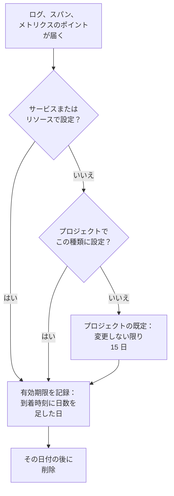

# データ保持

OneUptime は、ログ、トレース、メトリクス、プロファイルを一定の日数保持し、その後削除します。変更しない限り 15 日です。このページでは、その日数がどのように決まるか、プロジェクト全体で変更する方法、そして一部のテレメトリを他より長く、または短く保持する方法を説明します。

:::cards
- [テレメトリの保持期間](#テレメトリの保持期間): OneUptime が設定を読む順序。
- [プロジェクトの保持期間を変更する](#プロジェクトの保持期間を変更する): すべてのテレメトリに 1 つの日数。
- [一部のテレメトリを長く、または短く保持する](#一部のテレメトリを長くまたは短く保持する): 種類、重大度、ステータス、サービスごと。
- [保持にかかるコスト](#保持にかかるコスト): OneUptime Cloud での課金、セルフホストでのディスク。
:::

## テレメトリの保持期間

ログ、スパン、メトリクスのポイント、プロファイルのサンプルはそれぞれ、届いた時点で保持期間が決まります。OneUptime は保持する日数を計算し、有効期限の日付を記録して、その日付を過ぎたら削除します。最も限定的な設定が優先されます。

詳しくは、OneUptime は次の順序で設定を読み、最初に設定されているものが使われます。

| 順序 | 設定 | 設定する場所 |
| --- | --- | --- |
| 1 | 特定のサービスまたはリソースの、ログの重大度またはスパンのステータスごとの日数 | そのページの **設定** にある **テレメトリタイプ別の保持期間** |
| 2 | 特定のサービスまたはリソースの、テレメトリの種類ごとの日数 | 同じカード |
| 3 | 特定のサービスまたはリソースから届くすべてのものの日数 | 同じページの **テレメトリデータの保持期間** |
| 4 | プロジェクトの、ログの重大度またはスパンのステータスごとの日数 | **データ保持** の **テレメトリタイプ別の保持期間** |
| 5 | プロジェクトの、テレメトリの種類ごとの日数 | 同じカード |
| 6 | それ以外のすべての日数 | **データ保持** の **デフォルトの保持期間（日数）** |

- **設定 1 から 5 は保持期間の上書きです。** これらは [エンタープライズ版](/docs/self-hosted/enterprise) と、OneUptime Cloud の Scale プランに含まれます。上書きがなければ、すべてのレコードはプロジェクトの既定に従って保持されます。
- **変更は新しいテレメトリに適用されます。** レコードは記録された日付を保ちます。保持期間を短くしても早く削除されることはなく、長くしてもより長く保持されることはありません。新しいレコードは約 5 分で変更に従います。
- **例外は、見つかった元のものに従います。** 例外は、その元になったスパンやログと同じ期間保持されます。Session Replay には独自の保持期間があります。[独自の保持期間を持つその他のデータ](#独自の保持期間を持つその他のデータ) を参照してください。

## 始める前に

- **プロジェクトを変更するロール。** プロジェクトの保持期間は Project Owner または Project Admin が変更します。サービスやリソースの保持期間には、その他の設定を変更するロールが必要です。
- **上書きには、エンタープライズ版または Scale プラン。** セルフホストのインストールには Enterprise ライセンスが、OneUptime Cloud のプロジェクトには Scale プラン以上が必要です。プロジェクトの既定の保持期間は、すべてのエディションとプランにあります。

## プロジェクトの保持期間を変更する

:::steps
### データ保持を開く

**プロジェクト設定 → テレメトリと APM → データ保持** に移動します。サイドメニューの **テレメトリと APM** は最初は折りたたまれているので、クリックして開きます。**テレメトリデータの保持期間** カードに **デフォルトの保持期間（日数）** が表示されます。

### 日数を設定する

**保持期間の設定を編集** をクリックし、1 以上の日数を入力して、**変更を保存** をクリックします。
:::

新しい日数は、それ以降に届き、独自の上書きを持たないすべてのレコードに適用されます。

## 一部のテレメトリを長く、または短く保持する

上書きを使うと、必要なものは長く、それ以外は短く保持できます。たとえば、エラーログは四半期、デバッグログは数日です。

### プロジェクト全体

既定の下にある **テレメトリタイプ別の保持期間** カードで、テレメトリの種類ごとに日数を設定します。**Edit Overrides** をクリックし、必要なフィールドに入力して、それ以外は空欄のままにします。

| 種類 | フィールド |
| --- | --- |
| ログ | **Logs default (days)** と、ログの重大度ごとのフィールド |
| トレース | **Traces default (days)** と、スパンのステータス（エラー、OK、未設定）ごとのフィールド |
| メトリクス | **Metrics default (days)** |
| プロファイル | **Profiles default (days)** |

空欄のフィールドは上の順序で次の設定に従うため、独自の日数を持たない重大度のログは、ログの既定に従って保持されます。

### 特定のサービスまたはリソース

サービスまたはリソースの **設定** ページを開きます。その **テレメトリデータの保持期間** カードには、送られるすべてのものに対する日数の **テレメトリデータの保持期間（日）** があり、**テレメトリタイプ別の保持期間** カードにはプロジェクトと同じフィールドがあります。プロジェクトの設定を使うには、フィールドを空欄のままにします。

サービス、ホスト、Kubernetes クラスター、Docker と Podman のホスト、Docker Swarm、Proxmox、Ceph のクラスター、ストレージアレイ、vCenter、データベース、サーバーレス関数、クラウドリソース、RUM アプリケーション、IoT フリートのすべてにこれらのカードがあります。サービスの **設定** ページについては、[サービスカタログ](/docs/telemetry/services#サービスを変更する) を参照してください。

### プランやライセンスに上書きが含まれなくなったとき

- **セルフホストのインストールでは、** ライセンスがないまま Enterprise の試用期間または猶予期間が終わると、上書きは適用されなくなります。新しいテレメトリはプロジェクトの既定に従って保持され、カードは読み取り専用になりますが、設定した内容は削除されません。ライセンスを有効にすると、再び適用されます。[エンタープライズ版](/docs/self-hosted/enterprise#ライセンスの期限切れまたは未設定のとき) を参照してください。
- **OneUptime Cloud では、** 試用中に設定されたままの上書きは、Scale プランより下のプランでも適用され続けます。そのページではアップグレードのカードの下に上書きが表示され、どのプランでも使える **上書きを削除** ボタンがあります。上書きを再び設定するには Scale プランが必要です。

## 独自の保持期間を持つその他のデータ

| データ | 保持期間 | 変更する場所 |
| --- | --- | --- |
| Session Replay | 変更しない限り 7 日 | RUM アプリケーションのリプレイポリシー。[アプリケーションの管理](/docs/rum/applications#セッションリプレイの保持期間) を参照してください。 |
| モニターログ（チェックごとの行） | 変更しない限り 1 日 | セルフホストのインストールでは、Admin Dashboard の **モニターログ保持期間（日）** |
| モニターのメトリクスと、SLO が記録するメトリクス | 変更しない限り 30 日 | セルフホストのインストールでは、Admin Dashboard の **モニターメトリクス保持期間（日）** |

## 保持にかかるコスト

- **OneUptime Cloud では、** テレメトリは取り込んだ GB 単位で課金され、GB あたりの料金には 15 日間の保持が含まれます。保持期間が長いほど比例して高くなり、30 日なら GB あたり 15 日の 2 倍です。保持期間が短いほど比例して安くなりますが、7 日未満の保持は 7 日として課金されます。**プロジェクト設定 → 請求と請求書 → 使用履歴** には、各サービスが送った量と保持期間が日ごとに表示されます。
- **セルフホストの場合、** テレメトリは ClickHouse に保存され、保持期間に応じてディスク使用量が増えます。[サイジング](/docs/installation/sizing#保持期間とストレージへの影響) を参照してください。

必要のないテレメトリは、保存しなければ費用はかかりません。[破棄フィルターとスクラブルール](/docs/telemetry/drop-filters-and-scrub-rules) を使えば、届いた時点で破棄できます。

## トラブルシューティング

:::details 保持期間を短くしたのに古いデータが残っている
レコードは、届いた時点で記録された有効期限を保ちます。変更前に保存されたレコードはそれぞれの日付で削除され、新しい保持期間に従うのは新しいレコードだけです。
:::

:::details 上書きのカードにアップグレードの案内が表示される
保持期間の上書きには、セルフホストのインストールではエンタープライズ版が、OneUptime Cloud では Scale プランが必要です。それまでは、すべてがプロジェクトの既定に従って保持されます。
:::

:::details データの期限が切れてから 1 日後にディスク容量が戻る
期限切れのレコードは、期限が切れた時点で検索、チャート、一覧に表示されなくなります。ディスク上では、ログとメトリクスはその後の最初の午前 0 時に削除されるため、容量が戻るまで最大 1 日かかります。
:::

## 次のステップ

:::cards
- [取り込みキー](/docs/telemetry/ingestion-keys): プロジェクトにテレメトリを送ります。
- [破棄フィルターとスクラブルール](/docs/telemetry/drop-filters-and-scrub-rules): 必要なテレメトリだけを残します。
- [サービスカタログ](/docs/telemetry/services): サービス独自の保持期間を設定します。
- [エンタープライズ版](/docs/self-hosted/enterprise): 保持期間の上書きが含まれるエディション。
:::
