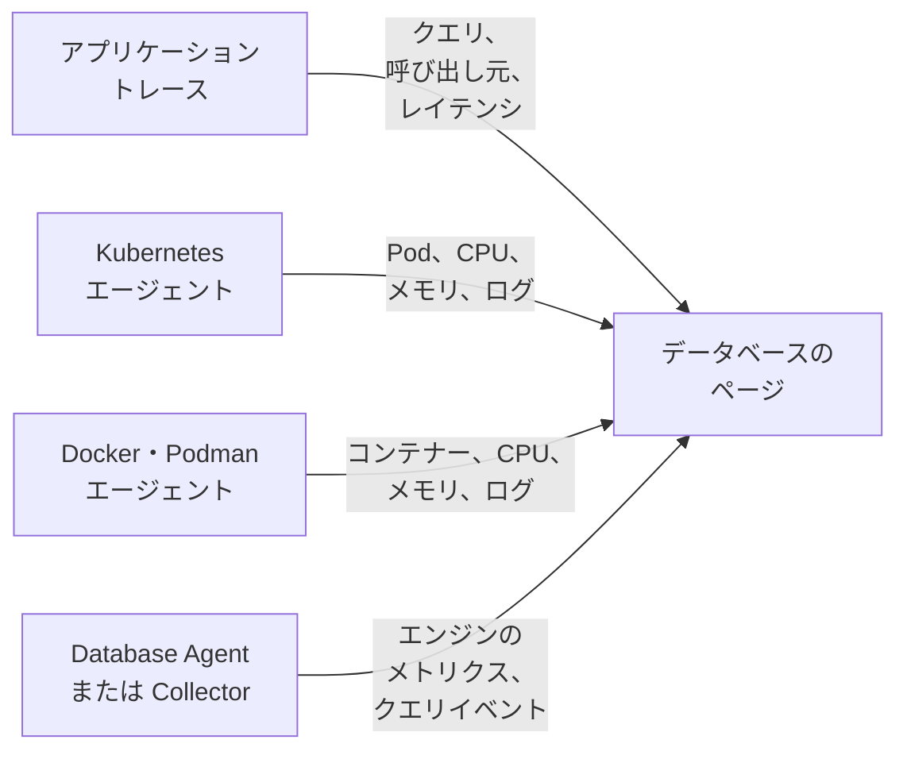

# データベース

**データベース** は、プロジェクトが実行している、または通信しているすべてのデータベースサーバーに専用のページを用意します。そこには、何がどれだけの速さで呼び出しているか、どこで動いているか、エンジン自身のヘルスメトリクス、ログとトレース、紐付いたインシデント、アラート、定期メンテナンス、そしてそのエンジンに推奨されるアラートモニターが表示されます。データベースには、ほかのすべてのリソースと同じく、ラベル、所有者、ラベルルールと所有者ルール、データベースごとの保持期間、アーカイブがあります。**製品 → リソース → データベース** で開きます。

:::cards
- [Database Agent](#database-agent): PostgreSQL、MySQL、SQL Server、Oracle、Redis、MongoDB、Elasticsearch、Memcached のエンジンのメトリクス。
- [データベースの検出方法](#データベースの検出方法): トレース、Kubernetes、Docker、Podman、Collector から検出します。
- [データベースのアラート](#データベースのアラート): 推奨モニターと、自分で作るモニター。
- [トラブルシューティング](#トラブルシューティング): 診断スクリプトと、よくある問題。
:::

## 仕組み

ほとんどのデータベースは自動的に表示されます。OneUptime は各データベースを最大 4 つのソースから組み立て、ソースごとに加わる情報が異なります:

| ソース | 必要なもの | データベースのページに加わるもの |
| --- | --- | --- |
| **アプリケーショントレース** | 計装済みのアプリケーション (OpenTelemetry) | アプリケーションからのクエリ: 呼び出しレート、エラー、レイテンシ、呼び出し元のサービス |
| **Kubernetes** | [OneUptime Kubernetes エージェント](/docs/telemetry/kubernetes-agent) | 実行場所: Pod、CPU とメモリ、Pod のログ |
| **Docker / Podman** | [Docker エージェント](/docs/telemetry/docker-host) または [Podman エージェント](/docs/telemetry/podman-host) | 実行場所: コンテナー、その CPU とメモリ、そのログ |
| **Database Agent** (OpenTelemetry Collector) | [Database Agent](#database-agent) または独自の Collector | **エンジンのメトリクス**: 接続、スループット、キャッシュヒット率、ロック、レプリケーションの遅延、メモリなど、エンジンが持つ範囲のもの ([収集される内容](#収集される内容) を参照)、加えて任意のクエリサンプル、トップクエリ、エンジンのログファイル |



エンジンのメトリクスは、データベース自体と通信する Collector (マネージドのクラウドデータベースの場合は、プロバイダーの監視 API と通信する Collector) からのみ届きます。トレースとコンテナーのインベントリは、データベースが存在することとその使われ方を OneUptime に伝えますが、内部の状態までは伝えません。各データベースの **エンジンのメトリクス** の状態が、その部分が接続されているかどうかを示します。

データベースは手動でも追加できます。**データベース → データベースを作成** で、エンジン、アドレス、ポートを指定します。エージェントをまったく必要としない、プローブによるヘルスチェックについては、[データベースヘルス モニター](/docs/monitor/database-health-monitor) を参照してください。

## 対応データベース

OneUptime は以下のエンジンを名前で認識します。計装が `db.system.name` (または古い `db.system`) に入れる値を 2 列目の値に正規化し、エンジン名を表示し、スパンやアドレスにポートがない場合はそのデフォルトポートを適用し、そのコンテナーイメージと Helm チャートを認識し、エンジンのメトリクスの入手元を把握しています。一覧にないエンジンも、データベースをアドレスで識別するあらゆる場面で機能します。スパンが報告する生の名前で表示されるだけで、トレースだけから作成されることはありません。

**ファミリー** とは、フォークやプロトコル互換のエンジンに接続するときに経由するエンジンのことです。クライアントライブラリは MariaDB と MySQL、Valkey と Redis を区別できないため、スパンは `mysql` や `redis` と報告し、コンテナーイメージ、Helm チャート、Database Agent はフォークの名前を報告します。どちらも同じデータベースに入り、コンテナーイメージ、または現在のエンジンを決めたソース以上に強いソースがより具体的なエンジンを指定すると、データベースはそのエンジンを表示します ([データベースに表示されるエンジン](#データベースに表示されるエンジン) を参照)。

**トレースから作成** は、クライアントスパンだけでそのエンジンのデータベースが作成されるかどうかを示します ([アプリケーショントレースから](#アプリケーショントレースから) を参照)。プロバイダーの共有 API ホスト経由で接続するマネージドサービスと、アプリケーションのプロセス内で動くエンジンは、作成されることがありません。**エンジンのメトリクス** は、エンジン自身のヘルスメトリクスの入手元を示します。Database Agent の設定、独自の Collector に追加する collector-contrib のレシーバー、エンジン自身の Prometheus エンドポイント (`:port/path`、Collector の `prometheus` レシーバーでスクレイプ)、クラウドプロバイダーの監視 API、または組み込みなし、のいずれかです。各データベースの **ドキュメント** タブは、これをそのデータベース用のすぐに使える Collector 設定にします。

| エンジン | `db.system.name` | デフォルトポート | ファミリー | トレースから作成 | エンジンのメトリクス |
| --- | --- | --- | --- | --- | --- |
| Actian Ingres | `actian.ingres` | — | — | はい | 組み込みなし |
| Actian Zen (Pervasive PSQL) | `pervasive` | 1583 | — | はい | 組み込みなし |
| Aerospike | `aerospike` | 3000 | — | はい | `aerospike` レシーバー |
| Amazon DocumentDB | `aws.documentdb` | 27017 | MongoDB | はい | `awsfirehose` レシーバー (クラウド監視) |
| Amazon DynamoDB | `aws.dynamodb` | 443 | — | いいえ (クラウド API) | `awsfirehose` レシーバー (クラウド監視) |
| Amazon Neptune | `aws.neptune` | 8182 | — | はい | `awsfirehose` レシーバー (クラウド監視) |
| Amazon Redshift | `aws.redshift` | 5439 | PostgreSQL | はい | `awsfirehose` レシーバー (クラウド監視) |
| Apache Derby | `derby` | 1527 | — | いいえ (インプロセス) | なし (インプロセス) |
| Apache Doris | `doris` | 9030 | MySQL | はい | Prometheus, `:8030/metrics` |
| Apache Druid | `druid` | 8888 | — | はい | 組み込みなし |
| Apache Geode | `geode` | 10334 | — | はい | 組み込みなし |
| Apache HBase | `hbase` | — | — | はい | 組み込みなし |
| Apache Hive | `hive` | 10000 | — | はい | 組み込みなし |
| Apache Ignite | `ignite` | 10800 | — | はい | 組み込みなし |
| Apache Impala | `impala` | 21050 | — | はい | 組み込みなし |
| Apache Pinot | `pinot` | 8099 | — | はい | 組み込みなし |
| Apache Solr | `solr` | 8983 | — | はい | 組み込みなし |
| ArangoDB | `arangodb` | 8529 | — | はい | Prometheus, `:8529/_admin/metrics/v2` |
| Azure Cosmos DB | `azure.cosmosdb` | 443 | — | いいえ (クラウド API) | `azure_monitor` レシーバー (クラウド監視) |
| Cassandra | `cassandra` | 9042 | — | はい | 組み込みなし |
| Chroma | `chroma` | 8000 | — | はい | 組み込みなし |
| Claris FileMaker | `filemaker` | 2399 | — | はい | 組み込みなし |
| ClickHouse | `clickhouse` | 9000 | — | はい | Prometheus, `:9363/metrics` |
| Cloud Bigtable | `gcp.bigtable` | 443 | — | いいえ (クラウド API) | `googlecloudmonitoring` レシーバー (クラウド監視) |
| Cloud Firestore | `gcp.firestore` | 443 | — | いいえ (クラウド API) | `googlecloudmonitoring` レシーバー (クラウド監視) |
| Cloud Spanner | `gcp.spanner` | 443 | — | いいえ (クラウド API) | `google_cloud_spanner` レシーバー |
| CockroachDB | `cockroachdb` | 26257 | PostgreSQL | はい | Prometheus, `:8080/_status/vars` |
| Couchbase | `couchbase` | 11210 | — | はい | Prometheus, `:8091/metrics` |
| CouchDB | `couchdb` | 5984 | — | はい | `couchdb` レシーバー |
| Databricks | `databricks` | 443 | — | はい | 組み込みなし |
| Dragonfly | `dragonfly` | 6379 | Redis | はい | Database Agent (`redis` レシーバー) |
| DuckDB | `duckdb` | — | — | いいえ (インプロセス) | なし (インプロセス) |
| Elasticsearch | `elasticsearch` | 9200 | — | はい | Database Agent (`elasticsearch` レシーバー) |
| etcd | `etcd` | 2379 | — | はい | Prometheus, `:2379/metrics` |
| FerretDB | `ferretdb` | 27017 | MongoDB | はい | Prometheus, `:8088/debug/metrics` |
| Firebird | `firebirdsql` | 3050 | — | はい | 組み込みなし |
| FoundationDB | `foundationdb` | 4500 | — | はい | 組み込みなし |
| Google BigQuery | `bigquery` | 443 | — | いいえ (クラウド API) | `googlecloudmonitoring` レシーバー (クラウド監視) |
| Greenplum | `greenplum` | 5432 | PostgreSQL | はい | 組み込みなし |
| H2 | `h2database` | 9092 | — | いいえ (インプロセス) | なし (インプロセス) |
| Hazelcast | `hazelcast` | 5701 | — | はい | 組み込みなし |
| HyperSQL | `hsqldb` | 9001 | — | いいえ (インプロセス) | なし (インプロセス) |
| IBM Db2 | `ibm.db2` | 50000 | — | はい | 組み込みなし |
| IBM Informix | `ibm.informix` | 9088 | — | はい | 組み込みなし |
| IBM Netezza | `ibm.netezza` | 5480 | — | はい | 組み込みなし |
| InfluxDB | `influxdb` | 8086 | — | はい | Prometheus, `:8086/metrics` |
| InstantDB | `instantdb` | — | — | いいえ (インプロセス) | なし (インプロセス) |
| InterBase | `interbase` | 3050 | Firebird | はい | 組み込みなし |
| InterSystems IRIS / Caché | `intersystems.cache` | 1972 | — | はい | Prometheus, `:52773/api/monitor/metrics` |
| KeyDB | `keydb` | 6379 | Redis | はい | Database Agent (`redis` レシーバー) |
| MariaDB | `mariadb` | 3306 | MySQL | はい | Database Agent (`mysql` レシーバー) |
| Meilisearch | `meilisearch` | 7700 | — | はい | Prometheus, `:7700/metrics` |
| Memcached | `memcached` | 11211 | — | はい | Database Agent (`memcached` レシーバー) |
| Milvus | `milvus` | 19530 | — | はい | Prometheus, `:9091/metrics` |
| MongoDB | `mongodb` | 27017 | — | はい | Database Agent (`mongodb` レシーバー) |
| MySQL | `mysql` | 3306 | — | はい | Database Agent (`mysql` レシーバー) |
| Neo4j | `neo4j` | 7687 | — | はい | Prometheus, `:2004/metrics` |
| OceanBase | `oceanbase` | 2881 | MySQL | はい | 組み込みなし |
| OpenSearch | `opensearch` | 9200 | Elasticsearch | はい | Database Agent (`elasticsearch` レシーバー) |
| Oracle | `oracle.db` | 1521 | — | はい | Database Agent (`oracledb` レシーバー) |
| Pinecone | `pinecone` | 443 | — | いいえ (クラウド API) | 組み込みなし |
| PostgreSQL | `postgresql` | 5432 | — | はい | Database Agent (`postgresql` レシーバー) |
| Presto | `presto` | 8080 | — | はい | 組み込みなし |
| Progress OpenEdge | `progress` | — | — | はい | 組み込みなし |
| Qdrant | `qdrant` | 6333 | — | はい | Prometheus, `:6333/metrics` |
| QuestDB | `questdb` | 8812 | PostgreSQL | はい | Prometheus, `:9003/metrics` |
| RavenDB | `ravendb` | 8080 | — | はい | 組み込みなし |
| Redis | `redis` | 6379 | — | はい | Database Agent (`redis` レシーバー) |
| Riak KV | `riak` | 8087 | — | はい | `riak` レシーバー |
| SAP ASE (Sybase) | `sybase` | 5000 | — | はい | 組み込みなし |
| SAP HANA | `sap.hana` | 30015 | — | はい | `saphana` レシーバー |
| SAP MaxDB | `sap.maxdb` | 7210 | — | はい | 組み込みなし |
| ScyllaDB | `scylladb` | 9042 | Cassandra | はい | Prometheus, `:9180/metrics` |
| SingleStore | `singlestore` | 3306 | MySQL | はい | Prometheus, `:9104/metrics` |
| Snowflake | `snowflake` | 443 | — | はい | `snowflake` レシーバー |
| Software AG Adabas | `softwareag.adabas` | — | — | はい | 組み込みなし |
| SQL Server | `microsoft.sql_server` | 1433 | — | はい | Database Agent (`sqlserver` レシーバー) |
| SQLite | `sqlite` | — | — | いいえ (インプロセス) | なし (インプロセス) |
| StarRocks | `starrocks` | 9030 | MySQL | はい | Prometheus, `:8030/metrics` |
| SurrealDB | `surrealdb` | 8000 | — | はい | 組み込みなし |
| Teradata | `teradata` | 1025 | — | はい | 組み込みなし |
| TiDB | `tidb` | 4000 | MySQL | はい | Prometheus, `:10080/metrics` |
| Trino | `trino` | 8080 | — | はい | Prometheus, `:8080/metrics` |
| Typesense | `typesense` | 8108 | — | はい | 組み込みなし |
| Valkey | `valkey` | 6379 | Redis | はい | Database Agent (`redis` レシーバー) |
| Vertica | `vertica` | 5433 | — | はい | 組み込みなし |
| Vitess | `vitess` | 3306 | MySQL | はい | Prometheus, `:15000/metrics` |
| Weaviate | `weaviate` | 8080 | — | はい | Prometheus, `:2112/metrics` |
| YugabyteDB | `yugabytedb` | 5433 | PostgreSQL | はい | Prometheus, `:9000/prometheus-metrics` |

よく使われる別の表記も受け付けます: `postgres` と `pg`、`mssql` と `sqlserver`、`oracle`、`mongo`、`scylla`、`dragonflydb`、`memsql`、そして OpenTelemetry がこれまで使ってきた古い `db.system` の値すべて (`db2`、`hanadb`、`cosmosdb`、`dynamodb`、`spanner`、`redshift`、`informix`、`maxdb`、`cache`、`h2`、`firebird`、`edb`、`cloudscape`、…)。あるエンジンのプロトコルを話すマネージドサービス (Amazon RDS と Aurora、Azure Database、Cloud SQL、AlloyDB、Neon、Supabase、PlanetScale、ElastiCache、Memorystore、MongoDB Atlas) は、そのエンジンとして扱われます。

## データベースの検出方法

各データベースは、それを作成したソースを記憶しています (**検出元** 列)。また、**フィード** の最初の項目には、何がそれを見つけたかが表示されます。Kubernetes のワークロードとそのクラスター、Docker または Podman のコンテナー (または Compose や Swarm のサービス) とそのホスト、アプリケーションが呼び出したエンドポイント、またはそれを報告した Database Agent (バージョン付き) か Collector です。後から来たソースは、同じエンドポイントを表している限り、新しいデータベースを作らずに同じデータベースに情報を追加します ([エンドポイント](#エンドポイントと-1-つの所有者のルール) を参照)。

### アプリケーショントレースから

OneUptime は 10 分ごとに、アプリケーションが過去 15 分間に送信した CLIENT スパンのうち、`db.system.name` (または古い `db.system`) を持つものを集計します。サーバーは `server.address` (または古い `net.peer.name`、次に `network.peer.address` / `net.sock.peer.addr`) から、ポートは `server.port` (または `net.peer.port`、`network.peer.port`、`net.sock.peer.port`) から取得し、スパンにポートがない場合はエンジンのデフォルトポートとみなします。エンジン名は正規化されるため ([対応データベース](#対応データベース) を参照)、`postgres`、`pg`、`postgresql` は 1 つのエンジンで、`mssql` と `microsoft.sql_server` も同様です。`mariadb` と `mysql` は 1 つのファミリーに属する 2 つのエンジンです。

データベースがトレースから **作成される** のは、次の条件がすべて満たされる場合だけです。それ以外のものも既存のデータベースには加算されますが、データベースを作成することはありません:

- アドレスがプロジェクト全体で 1 台のサーバーを指していること: DNS 名であり、IP リテラルではなく、1 台のマシン上や 1 つのネットワーク内でしか解決されない名前でもないこと (ただし、呼び出し元の Kubernetes クラスターで修飾される場合を除く。[エンドポイント](#エンドポイントと-1-つの所有者のルール) を参照)。
- ポートがサーバーの待ち受けるポートであること。OS は接続のクライアント側に 32768 以上のポートを割り当てます (Linux のデフォルトのエフェメラルポート範囲はそこから始まり、Windows と macOS は 49152–65535 を使います)。そのため、32768 以上のポートは、エンジン自身のデフォルトポート (IBM Db2 の 50000) でない限り、データベースを作成しません。eBPF による計装は、Kubernetes エージェントのものも含め、長時間続く接続に途中から加わり、その両端を取り違えることがあります。その場合、スパンはクライアント自身のポートをサーバーとして報告するため、このルールがなければ接続ごとに別のデータベースができてしまいます。
- エンジンが OneUptime の知っているもので、独自のアドレスを持つこと: [対応データベース](#対応データベース) の **トレースから作成** 列です。すべての顧客がホストを共有するクラウド API (DynamoDB、BigQuery、Spanner、Firestore、Bigtable、Cosmos DB、Pinecone)、アプリケーション内で動くエンジン (SQLite、DuckDB、H2、HyperSQL、Derby)、OneUptime が知らないエンジンは、トレースから作成されることはありません。手動で追加してください。
- 1 回の実行が対象とする 15 分間の枠内で、エンドポイントが少なくとも 10 件のクエリを受けていること。これにより、使い捨てのスクリプトがデータベースを作成することはありません。クライアントライブラリの接続管理スパン (node-postgres の `pg.connect` と `pg-pool.connect`、`redis-connect`、`connect`、…) はクエリではありません。ここでも、データベースの **クエリ** でも数えられません。
- プロジェクトが [自動作成の上限](#自動作成の上限) に達していないこと。

データベースへの CLIENT スパンは、取り込み時にそのエンドポイントでタグ付けされます。そのため、データベースがエンドポイントを所有すると、**アプリケーションからのクエリ** セクションと **トレース** タブに、データベースが作成される前の呼び出しも含め、そこへのすべての呼び出しが表示されます。`server.address` を持つ `db.client.*` メトリクス (例: `db.client.operation.duration`) も同じようにタグ付けされます。

**クラスターとホストのリスト**。複数のホストを並べた接続文字列 (`m1:27017,m2:27017,m3:27017`) は、クライアントがどの順序で並べても 1 つのデータベースです。MongoDB Atlas のメンバー (`cluster0-shard-00-01.ab1cd.mongodb.net`) は、そのクラスターにちなんだ名前 (`cluster0.ab1cd.mongodb.net`) の 1 つのデータベースになり、観測された各メンバーはそのエンドポイントの 1 つになります。Cassandra リング、Redis Cluster、Elasticsearch クラスターの各メンバーや ElastiCache のノードを個別に報告するドライバーでは、メンバーごとに 1 つのデータベースができてしまいます。それらのホスト名には、どのクラスターに属するかを示すものがないためです。1 つを残し、ほかをそれに [統合](#エンドポイントと-1-つの所有者のルール) してください。

### Kubernetes から

OneUptime は 5 分ごとに、接続された各 Kubernetes クラスターの Pod を調べ、データベースのワークロードを認識します:

1. **まずオペレーターとチャートのラベル**: CloudNativePG、Zalando (Spilo)、Crunchy PGO、Bitnami のチャート、ECK、Altinity ClickHouse、cass-operator、Percona、Oracle MySQL オペレーター、Vitess オペレーター (その `vtgate` Pod がデータベースで、`vttablet`、`vtctld`、`vtorc`、`vtbackup` はその一部であり、メンバーではありません)。1 つのオペレータークラスターが 1 つのデータベースになります。Vitess クラスター自身の vtgate Service の名前はハッシュ化されているため、アプリケーションがそれを経由して接続する場合は、データベースの **エンドポイント** タブで追加してください。
2. **それ以外はコンテナーイメージ** で、イメージ名の完全一致で判断します: [対応データベース](#対応データベース) にあるエンジンのうちイメージを提供しているものの、公式イメージ、Bitnami のイメージ (移転先の `bitnamilegacy` と `bitnamisecure` リポジトリを含む)、Red Hat / OpenShift のイメージです (`postgres`、`bitnami/postgresql`、`rhel9/postgresql-16`、`mysql`、`mariadb`、`mssql/server`、`gvenzl/oracle-free`、`redis`、`valkey/valkey`、`mongo`、`cockroachdb/cockroach`、`pingcap/tidb`、`clickhouse/clickhouse-server`、`qdrant/qdrant`、…)。フォークはそれ自体として認識されます。`mariadb` イメージは MariaDB、`valkey/valkey` イメージは Valkey です。エクスポーター、オペレーター、管理 UI、コネクションプーラー (pgbouncer、pgpool、ProxySQL、HAProxy、Cloud SQL Proxy)、バックアップツールはデータベースではありません。アプリケーションコンテナーも動かしている Pod もデータベースとしては扱いません (データベースのサイドカーを持つアプリはアプリのままです)。ただし、データベースコンテナーがエンジンのデフォルトポートを宣言している StatefulSet には、OneUptime が認識しないコンテナー (ログシッパーなど) が 1 つ余分にあってもかまいません。

データベースのイメージだからといって Pod がデータベースサーバーになるわけではありませんが、それ以外のものと判断するには明確な根拠が必要です。プログラムがクライアントツールやダンプツール (`psql`、`redis-cli`、`mongosh`、`pg_dump`、`mysql`)、キープアライブ (`sleep infinity`、`tail -f /dev/null`)、対話型シェルであるコンテナー (または `sh -c` スクリプトがそうしたツール、シェルの組み込みコマンド、`echo` や `cp` のような単純なユーティリティしか実行しないコンテナー) は、クライアントやデバッグの実行であり、データベースではありません。Redis や Valkey の Sentinel (`redis-sentinel`、`redis-server --sentinel`) も同様です。これはランチャーを経由していても変わりません。`env` (`NAME=value` の設定を含む)、`nohup`、`setsid`、`tini`、`dumb-init`、イメージの `docker-entrypoint.sh` は、それらが起動するプログラムまでたどって判断され、スクリプト内の `exec`、`env`、`nohup` も同様です。そのため、`env PGPASSWORD=… psql` と `tini -- redis-cli` はクライアントの実行ですが、`tini -- docker-entrypoint.sh postgres` はサーバーであり、イメージ自身のサーバーをフラグ付きで起動する `docker-entrypoint.sh -c max_connections=200` もサーバーです。その後でほかのものを起動するスクリプト (`sleep 5 && exec redis-server`、`bash -ecx 'exec cockroach start …'`)、スクリプトファイル (`sh /start.sh`)、プログラムの前に独自の引数を取るラッパー (`gosu postgres …`、`timeout 30 …`)、長すぎて読めないスクリプトは、サーバーの可能性があるものとして扱います。終了した Pod、バッチジョブ、ポートを宣言していない使い捨ての `kubectl run` Pod もデータベースではありません。

データベースは、その Pod の 1 つが約 10 分間 Ready の状態になると表示されます (サイドカーだけが原因で Pod が Ready にならない場合は、代わりに準備のできたデータベースコンテナーで判断します)。クラッシュループしている Pod は再起動のたびに改めて Ready になるため、データベースになることはありません。CI ジョブや 1 分後にクラッシュした Pod も同様です。作成されたデータベースは、実行のたびに更新されます。

Pod は StatefulSet、Deployment、オペレータークラスターごとにまとめられるため、3 メンバーの StatefulSet は 3 つのメンバーを持つ 1 つのデータベースになります。ページの **インスタンス** は、データベースコンテナーが実行中の Pod を数えます。`CrashLoopBackOff` や `ImagePullBackOff` で待機中のもの、終了したものは、Kubernetes がまだ Running と報告していても数えません。ゼロにスケールされたワークロードは 0 と表示され、[自動アーカイブ](#ライフサイクルアーカイブ保持期間) で片付けられるまでページが残ります。逆方向のリンクもあります。ワークロードの StatefulSet や Deployment のページ、およびその各 Pod のページには、実行しているデータベースが **Open database** リンクで表示されます。データベースと異なる名前の StatefulSet や Deployment (`shop-redis` に対する Bitnami の `shop-redis-master`、`cluster1` に対する Percona の `cluster1-pxc`) でも同じです。一方、オペレーターがクラスターの一部としてラベル付けしたプーラーやバックアップのワークロードには、そのデータベースのクラスターの一部であることが表示されます。

Kubernetes エージェントは Service オブジェクトを報告しないため、データベースの Service 名は、チャートやオペレーターが従う慣例から導かれます。所有元の StatefulSet や Deployment の名前、StatefulSet のヘッドレス Service (とその背後の各メンバー、`<pod>.<headless-service>`)、そしてオペレーターのプロキシとプーラーの Service です。具体的には、Percona XtraDB Cluster の HAProxy と ProxySQL、Percona Server for MySQL のルーターと HAProxy、Percona Server for MongoDB の mongos、Crunchy の pgBouncer、Zalando と CloudNativePG のプーラーです。それぞれがクラスターで修飾されたエンドポイント (`postgres.prod.svc.cluster.local:5432@my-cluster`) になるため、2 つのクラスターにある同じ名前は 2 つのデータベースのままです。プロジェクトにクラスターがちょうど 1 つある間は、修飾なしの `postgres.prod.svc.cluster.local:5432` も追加され、2 つ目のクラスターが現れてから約 2 時間後に再び解放されます。ほかの名前の Service は、データベースの **エンドポイント** タブで追加してください。

テレメトリが Kubernetes エージェントを経由するアプリケーションは名前空間とクラスターを伝えるため、その呼び出しは Pod のリゾルバーと同じように解釈されます。`postgres` (同じ名前空間から)、`postgres.prod` (名前空間 `prod` の Service `postgres`)、`postgres.prod.svc`、完全な名前のすべてがデータベースに対応付けられ、呼び出し元と同じ名前空間にある StatefulSet のメンバー `mongo-0.mongo-headless` も同様です。

OneUptime が読み取るのは、Pod のメタデータ、ラベル、イメージ、宣言されたポート、そしてコンテナーのコマンドラインが何を実行するか (プログラム名、シェルのフラグ、スクリプトが実行するよく知られたクライアント、キープアライブ、シェルのコマンド。それ以外のコマンドは認識されないものとして記録されるだけです) であり、環境変数、引数の値、スクリプトの本文、シークレットは決して読み取りません。

### Docker と Podman から

OneUptime は 5 分ごとに、接続された各 Docker / Podman ホストのコンテナーを同じ方法でイメージにより分類し、その名前と Compose、Swarm、Testcontainers のラベルでまとめて絞り込みます。実行するコマンドで判断することはありません (後述)。1 つの Compose サービス (Compose のプロジェクトとサービスのラベルによる) や 1 つの Swarm サービスのコンテナーは、複数のメンバーを持つ 1 つのデータベースになり、そのワークロードはそのサービスです (`Compose service/<project>-<service>`、`Swarm service/<service>`)。それ以外のコンテナーは、正確な名前 (`Container/<name>`) でそれぞれ別のデータベースになるため、`redis-6379` と `redis-6380` は 2 つのままです。Testcontainers、`docker compose run` による使い捨ての実行、kubelet が Docker ノード上で実行するコンテナー (Kubernetes の検出で Pod として見つかります)、10 分未満しか動いていないコンテナーは、データベースになりません。コンテナーの経過時間は稼働時間なので、すでにそれだけ動いているコンテナーは、エージェントのインストール後の最初の実行でデータベースになります。**インスタンス** は実行中のコンテナーを数え、各コンテナーのページからはそのデータベースへリンクします (**Open database**)。同じ名前で 2 回登録されたホストは、最も最近確認された登録を通じて 1 回だけ読み取られます。

エージェントは、`otel-collector-config.yaml` がそれらのラベルをコピーするようになると (`container_labels_to_metric_labels`)、各コンテナーのメトリクスと一緒にラベルを送信します。古い Docker / Podman エージェントはこれを行いません。更新してください。そうしないと、Testcontainers の実行や使い捨ての実行も含め、すべてのコンテナーがそれぞれ別のデータベースになります。

Kubernetes と違い、コンテナーのコマンドラインは読み取られません (シークレットを含む可能性があるため、エージェントは送信しません)。そのため、データベースイメージの長時間動くクライアントやデバッグ用のコンテナー (`sleep infinity`、`psql` や `redis-cli` のループ) は、10 分間動くとデータベースになります。不要ならアーカイブしてください。人がアーカイブしたデータベースはアーカイブされたままです。そのままにしておくと、コンテナーが停止してから 7 日後に [自動的にアーカイブ](#ライフサイクルアーカイブ保持期間) されます。

コンテナー名は 1 つの Docker ネットワーク内でしか解決されないため、これらのデータベースにはエンドポイントが自動的には **一切** 付きません。ページにはコンテナー自身のメトリクスとログが表示されます。アプリケーションが送るクエリを結び付けるには、アプリケーションが使うアドレスを [エンドポイント](#エンドポイントと-1-つの所有者のルール) タブで追加します。

エンジンのメトリクスを得るには、データベース自身の **ドキュメント** タブから [Database Agent](#database-agent) をインストールします。そのインストールコマンドと `.env` には `DATABASE_SERVER_ID` があらかじめ入力されているため、エージェントのデータはこのデータベースに入ります。これなしでインストールしたエージェントは、代わりに `DATABASE_SERVER_ADDRESS` で照合されますが、コンテナーのデータベースはそのアドレスを所有していません。DNS 名の場合はサーバーが 2 つ目のデータベースとして登録され (コンテナーのページとエンジンのメトリクスのページが別々になります。[1 台のサーバーに 2 つのデータベース](#1-台のサーバーに-2-つのデータベース) を参照)、プライベート IP やコンテナー名の場合はどこにも結び付きません。

### Database Agent または独自の Collector から

エンジンのメトリクスやログが Collector のデータベースレシーバーから届くと、OneUptime は取り込みの時点でそれをデータベースに対応付けます。データに `oneuptime.database.server.id` (エージェントの `DATABASE_SERVER_ID`) があれば ID で直接、なければデータが示すエンドポイント (`server.address` / `server.port`) で対応付けます:

- ID で結び付いたデータは、報告するアドレスがプライベート IP、クラスターローカルな名前、別のデータベースが所有するアドレス、またはアドレスなしのいずれであっても、そのデータベースに入り、そのページに (そしてそこだけに) 表示されます。報告されたアドレスがプロジェクト全体で 1 台のサーバーを指し、まだどのデータベースにも属していない場合は、エンドポイントとしてデータベースに追加されるため、そのアドレスへのアプリケーショントレースもそこに入ります。
- それ以外の場合、データベースがすでに所有しているエンドポイントは、そのデータベースが何によって作成されたかに関係なく、データをそのデータベースに結び付けます。
- それ以外の場合はデータベースが **作成されます**。ただし、プロジェクト全体で 1 台のサーバーを意味する名前 (DNS 名、パブリック IP、またはデータが Kubernetes クラスター (`k8s.cluster.name`。Database Agent は決して付与しません) で修飾したクラスターローカル名、`.internal` 名、`.local` 名) からのみであり、単独で作成してよいエンジンに限られます ([対応データベース](#対応データベース) の **トレースから作成** 列。共有クラウド API、プロセス内エンジン、未知のエンジンは対象外)。プライベート IP とリンクローカル IP、単一ラベルの名前 (`db`)、修飾なしのクラスターローカル名 (`postgres.prod.svc.cluster.local`)、`.internal` 名、`.local` 名は、ネットワークごとに別のサーバーを指す可能性があります。Pod の IP は再起動のたびに変わります。また、Collector 自身の名前空間で補完された単一ラベルの名前は、Service である場合も Collector 自身の Pod である場合もあります。こうした名前を示すデータは、それをすでにエンドポイントとして持つデータベース (Service 名については、Kubernetes で検出されたワークロード) にしか入りません。そのデータベースを手動で作成する (**データベース → データベースを作成**、同じアドレスとポート) か、`DATABASE_SERVER_ID` でエージェントをそのデータベースに結び付けてください。Kubernetes クラスターがあるプロジェクトでは、クラスターなしのクラスターローカルな Service 名は拒否されます。データベースを `postgres.prod.svc.cluster.local:5432@my-cluster` として作成し、その **エンドポイント** タブで修飾なしの `postgres.prod.svc.cluster.local:5432` (エージェントが報告する名前) を追加してください。
- サーバーをまったく示さないレシーバーのバッチは無視されます ([独自の OpenTelemetry Collector を使う](#独自の-opentelemetry-collector-を使う) を参照)。

Collector が作成するデータベースは、ほかの検出されたデータベースと同じく [自動作成の上限](#自動作成の上限) に数えられます。手動で作成し `DATABASE_SERVER_ID` で結び付けたデータベースは、作成の必要がありません。[Database Agent](#database-agent) を参照してください。

### データベースに表示されるエンジン

データベースのエンジンについてソース間で食い違いがある場合は、より強い根拠が優先されます。人が設定したエンジン、次に Collector または Database Agent (エンジン自身による報告)、次にコンテナーイメージまたは Helm チャート、次にクライアントスパンの順です。PostgreSQL ドライバーは、CockroachDB と通信しているときでも `postgresql` と報告します。ソースがデータベースを別のエンジンファミリーに移すのは、その根拠が現在のエンジンを決めたものより強い場合だけで、人が設定したエンジンが検出によって変更されることはありません。ファミリー内では、フォークを指定するソースが現在のエンジンを決めたソース以上に強い場合、またはコンテナーイメージである場合に、フォークがエンジンをより具体的にします。スパンが `redis`、イメージが `valkey` と報告すれば、データベースは Valkey と表示されます。Collector の `redis` レシーバーが `redis` と報告していた場合でも同じです。このレシーバーは両者を区別できないためです。アプリケーショントレースだけで、イメージや Collector が決めたエンジンがより具体的になることはありません。クライアントは自分が話すプロトコルを報告するもので、MariaDB Connector/J は MySQL サーバーに対しても `mariadb` と報告します。Collector がフォークを指定するのは、`db.system.name` にそれを付与する場合 (Database Agent は `DATABASE_SYSTEM` に基づいて付与します) か、バッチの `db.system.version` がそれを示す場合です。後者は、フォークの名前を含むバージョン文字列 (`8.0.11-TiDB-v7.5.1`) か、フォークだけがリリースしたメジャーバージョンです。MySQL には 10.x も 11.x もないため、`mysql` と `11.4.13` (`mysql` レシーバーが MariaDB 11.4 について報告する数字だけの値) の組み合わせは MariaDB です ([独自の OpenTelemetry Collector を使う](#独自の-opentelemetry-collector-を使う) を参照)。フォークが取り消されるのは、そのファミリーのエンジンを示すコンテナーイメージによってだけで、しかもフォークを示したのがアプリケーショントレースだけの場合に限られます。ファミリーを示す Collector やトレースがフォークを取り消すことはありません。イメージが同じファミリーのフォークに変わった Kubernetes のワークロード (`redis` から `valkey`) は、同じデータベースのままです。

### 自動作成の上限

トレース、Kubernetes、Docker、Podman、Collector が自動的にデータベースを作成するのは、プロジェクトのアクティブでアーカイブされていない検出済みデータベースが 500 未満の間だけです (`DATABASE_SERVER_AUTO_CREATE_BUDGET`。[セルフホストでの調整](#セルフホストでの調整) を参照)。手動で作成したデータベースは数えられず、ブロックされることもありません。アーカイブされたデータベースは数えられないため、[自動アーカイブ](#ライフサイクルアーカイブ保持期間) によって上限に空きができます。既存のデータベースは引き続き照合され、更新されます。上限に達すると、新しいエンドポイントの Collector データは何も作成せず (既存のデータベースに入るだけです)、OneUptime はプロジェクトごとに 10 分に 1 回まで警告をログに記録します。

## Database Agent

OneUptime Database Agent は、**PostgreSQL**、**MySQL / MariaDB**、**SQL Server**、**Oracle**、**Redis / Valkey / KeyDB / Dragonfly**、**MongoDB**、**Elasticsearch / OpenSearch**、**Memcached** 向けに事前構成された OpenTelemetry Collector です。設定だけで構成されています。標準の `otel/opentelemetry-collector-contrib` コンテナーがエンジン用の Collector ネイティブのレシーバーを実行し、その設定がすべてのバッチにデータベースの ID を付与して OTLP で OneUptime に送ります。データベースサーバーには何もインストールしません。同じ `docker-compose.yml` は、OneUptime AI のために Collector の横で [データベース AI エージェント](#ai-エージェント) も実行します。[対応データベース](#対応データベース) のほかのエンジンについては [独自の OpenTelemetry Collector を使う](#独自の-opentelemetry-collector-を使う) を参照してください。各データベースの **ドキュメント** タブに設定があります。

**1 つのエージェントで 1 台のデータベースサーバーを監視します**。エージェントが送るすべてのものに ID が付与されるため、サーバーごとに 1 つのエージェント (1 つのインストールディレクトリ) を実行し、レプリカを個別のページで見たい場合はレプリカごとに 1 つ実行してください。

エージェントは [DatabaseAgent ディレクトリ](https://github.com/OneUptime/oneuptime/tree/master/agents/DatabaseAgent) にあります: `docker-compose.yml`、レシーバーごとの Collector 設定 (`configs/postgresql.yaml`、`configs/mysql.yaml`、`configs/sqlserver.yaml`、`configs/oracledb.yaml`、`configs/redis.yaml`、`configs/mongodb.yaml`、`configs/elasticsearch.yaml`、`configs/memcached.yaml`)、`install.sh`、`troubleshoot.sh`、systemd ユニットです。フォークや互換の代替エンジンは、そのファミリーの設定を実行して自分の名前を報告します。`DATABASE_SYSTEM=mariadb` は `configs/mysql.yaml` を実行し、データベースは MariaDB として表示されます。

### 始める前に

- Docker Engine 20.10 以降と Docker Compose v2 プラグインがあり、データベースのポートに到達できるマシン (または Kubernetes クラスター。[Kubernetes](#kubernetes) を参照)。
- 監視用ユーザーを作成し、以下の統計情報の権限を付与できるデータベースのログイン。
- 取り込みキー。**プロジェクト設定 → テレメトリと APM → 取り込みキー** で作成し、その値をコピーします。

:::steps
### 監視用ユーザーを作成する

エージェントには、エンジンの統計情報を読み取れる専用のログインを与えてください。管理者や、アプリケーションのログインは決して使わないでください。[データベースヘルス モニター](/docs/monitor/database-health-monitor#監視用ユーザーを作成する) 用の監視ユーザーをすでに作成している場合、その PostgreSQL、MySQL、SQL Server の権限はエージェントにもそのまま使えます。

:::tabs
@tab PostgreSQL
```sql
CREATE USER oneuptime_monitor WITH PASSWORD 'a-strong-password';
GRANT pg_monitor TO oneuptime_monitor;
```

`pg_monitor` は組み込みのロール (PostgreSQL 10 以降) で、統計情報と監視用のビューへの読み取りアクセスを付与し、テーブルへのアクセスは付与しません。これは省略できません。これがないと `pg_stat_activity` は失敗せずにエージェント自身のセッションだけを返すため、実際には満杯のサーバーでも接続数が `1` と表示されます。レシーバーはデータベースごとの統計情報を読むためにすべてのデータベースに接続するので、ユーザーには各データベースに対する `CONNECT` も必要です (`PUBLIC` にはデフォルトで付与されています)。PostgreSQL レシーバーはパスワードなしでは起動しません。

トップクエリ (`DATABASE_QUERY_EVENTS=true`) は `pg_stat_statements` も読み取ります。`shared_preload_libraries = 'pg_stat_statements'` で読み込み (再起動が必要です)、監視するすべてのデータベースで作成してください:

```sql
CREATE EXTENSION IF NOT EXISTS pg_stat_statements;
```

トップクエリの実行計画には、クエリが参照するテーブルに対する `SELECT` が必要ですが、`pg_monitor` はこれを付与しません。実行計画が必要な場合は、スキーマごとに付与してください (`GRANT SELECT ON ALL TABLES IN SCHEMA app TO oneuptime_monitor`)。付与しなくてもトップクエリは届きますが実行計画は空になり、Collector はクエリごとに `failed to explain` をログに記録します。診断スクリプトはこれを権限不足ではなく警告として報告します。

`pg_monitor` を使えないマネージドサービスでは、`pg_read_all_stats` が同じビューをカバーします。エージェントは、顧客のログインでは開けない Amazon RDS、Azure、Cloud SQL、AlloyDB の内部データベースをあらかじめスキップします。
@tab MySQL / MariaDB
```sql
CREATE USER 'oneuptime_monitor'@'%' IDENTIFIED BY 'a-strong-password';
GRANT PROCESS, REPLICATION CLIENT ON *.* TO 'oneuptime_monitor'@'%';
GRANT SELECT ON performance_schema.* TO 'oneuptime_monitor'@'%';
```

`PROCESS` と `REPLICATION CLIENT` は、グローバルなステータスカウンター、InnoDB のステータス、レプリカのステータスをカバーします。`performance_schema` (MySQL 5.6 以降はデフォルトで有効) は、クエリサンプルとトップクエリのために読み取られます。MariaDB 10.5.9 以降ではレプリカのステータスが独自の権限に分かれたため、そこでは `GRANT SLAVE MONITOR ON *.* TO 'oneuptime_monitor'@'%';` も実行してください。MariaDB サーバーには `DATABASE_SYSTEM=mariadb` を設定します。同じ設定で監視でき、データベースは MariaDB として表示されます。これが確実な方法です。MariaDB 10 以降に対して `mysql` としてインストールしたエージェントも、バージョン番号 (`11.4.13`。MySQL は 10.x や 11.x をリリースしていません) によって MariaDB になりますが、MariaDB 5.5 は MySQL のままです。
@tab SQL Server
```sql
CREATE LOGIN oneuptime_monitor WITH PASSWORD = 'a-strong-password';
GRANT VIEW SERVER STATE TO oneuptime_monitor;
GRANT VIEW ANY DEFINITION TO oneuptime_monitor;
```

`VIEW SERVER STATE` (SQL Server 2022 以降では `VIEW SERVER PERFORMANCE STATE` で十分) は、すべてのメトリクスの元になる動的管理ビューを読み取り、データへのアクセスは付与しません。レシーバーはログインを引用符で囲まずに接続文字列に入れるため、ユーザー名とパスワードにはセミコロン (`;`) やダブルクォート (`"`) を含めることができず、先頭や末尾をスペースにすることもできません。`install.sh` はこれらを拒否します。ドライバーはサーバーと暗号化を直接ネゴシエートするため、TLS の変数は適用されません。

名前付きインスタンス (`sql1.corp\INST01`) では、`DATABASE_ENDPOINT` をそのインスタンス自身の TCP ポートに向けてください。既定のインスタンスの 1433 は決して使わないでください。そのポートでは既定のインスタンスに接続してしまいます。ポートは SQL Server 構成マネージャー (インスタンスの TCP/IP プロトコル、IPAll) で確認するか、インスタンスで `SELECT local_tcp_port FROM sys.dm_exec_connections WHERE session_id = @@SPID;` を実行します。`install.sh` は `host\instance` を拒否し、`host:port` を求めます。
@tab Oracle
```sql
-- In the pluggable database the agent connects to, e.g. ALTER SESSION SET CONTAINER = FREEPDB1;
CREATE USER oneuptime_monitor IDENTIFIED BY "a-strong-password";
GRANT CREATE SESSION TO oneuptime_monitor;
GRANT SELECT_CATALOG_ROLE TO oneuptime_monitor;
```

`SELECT_CATALOG_ROLE` は、メトリクス、クエリサンプル、トップクエリの元になる `V$` と `DBA_` のビューを読み取り、テーブルへのアクセスは付与しません。`DATABASE_ORACLE_SERVICE` は、エージェントが接続するサービス (`FREEPDB1`、`ORCLPDB1`、…) を指定します。
@tab Redis / Valkey / KeyDB / Dragonfly
```text
ACL SETUSER oneuptime_monitor on >a-strong-password -@all +info +ping
```

レシーバーは `INFO` だけを実行します。ユーザーは `ACL SAVE` (または `redis.conf` や ACL ファイルの `user` 行) で永続化してください。`requirepass` だけで保護されたサーバーでは、`DATABASE_USERNAME` を空のままにして `DATABASE_PASSWORD` を設定します。認証のないサーバーでは両方とも空のままにします。これらのサーバーでは、`DATABASE_SYSTEM` を `valkey`、`keydb`、`dragonfly` のいずれかに設定してください。レシーバーは `INFO` の `redis_version` からバージョンを読み取りますが、Valkey はこれを `7.2.4` (フォーク元の Redis のリリース) に固定し、Dragonfly はエミュレートしている Redis のバージョンを設定します。OneUptime はこれらについてはこの値を無視するため、Valkey や Dragonfly のデータベースは、Kubernetes、Docker、Podman で実行されている場合はコンテナーイメージのバージョンを表示し、エージェントだけの場合はバージョンを表示しません。
@tab MongoDB
```js
db.getSiblingDB("admin").createUser({
  user: "oneuptime_monitor",
  pwd: "a-strong-password",
  roles: [{ role: "clusterMonitor", db: "admin" }],
});
```

`clusterMonitor` はすべてのメトリクスをカバーします。トップクエリの実行計画には、監視するデータベースごとに `{ role: "read", db: "<database>" }` も必要です。これがなくてもトップクエリは届きますが、実行計画は空になります。エージェントはちょうど 1 つのメンバーに接続する (`direct_connection`) ため、レプリカセットのメンバーごとに 1 つのエージェントを実行してください。
@tab Elasticsearch / OpenSearch
```text
POST /_security/role/oneuptime_monitor
{ "cluster": ["monitor"], "indices": [{ "names": ["*"], "privileges": ["monitor"] }] }

POST /_security/user/oneuptime_monitor
{ "password": "a-strong-password", "roles": ["oneuptime_monitor"] }
```

`monitor` 権限は、ノード、クラスター、インデックスの統計情報を読み取り、ドキュメントは読み取りません。セキュリティプラグインを使う OpenSearch では、代わりにクラスター権限 `cluster_monitor` と、`*` に対するインデックス権限 `indices_monitor` を付与します。セキュリティのないクラスターでは、`DATABASE_USERNAME` と `DATABASE_PASSWORD` を空のままにします。1 つのエージェントが 1 つのエンドポイント、つまり URL (`http://search.internal:9200`、TLS の場合は `https://`) を通じてクラスター全体を監視します。OpenSearch クラスターには `DATABASE_SYSTEM=opensearch` を設定してください。
@tab Memcached
Memcached にはユーザーがありません。レシーバーはテキストプロトコルで `stats` を実行するため、`DATABASE_USERNAME` と `DATABASE_PASSWORD` は空のままにしてください。SASL 認証 (`-S`) で起動したサーバーは、この方法では監視できません。
:::

### エージェントをインストールして起動する

各 OneUptime は、自分のリリースのエージェントのインストールスクリプトとファイルを配布します。以下のコマンドは `https://oneuptime.com` からダウンロードするので、セルフホストの OneUptime ではこのアドレスを自分の URL に置き換えてください。インストールスクリプトはまず `install.sh` として保存されるので、実行する前に内容を読めます。

:::tabs
@tab install.sh
インストールスクリプトをダウンロードし、エージェントを置くマシンで実行します:

```bash
curl -fsSL https://oneuptime.com/install/database-agent -o install.sh
bash install.sh
```

スクリプトは、OneUptime の URL と取り込みキー、エンジン、接続先のエンドポイント、監視用の認証情報 (パスワードはエコーなしで読み取ります) を尋ね、[AI エージェント](#ai-エージェント) が対応しているエンジンの場合は、修正を適用してよいか、よい場合はその専用のログインも尋ねます。`docker-compose.yml` と対応する `configs/<receiver>.yaml` (`otel-collector-config.yaml` として保存) を `/opt/oneuptime-database-agent` にダウンロードし、権限 `0600` の `.env` ファイルを書き込んで、エージェントを起動します。エンドポイントがこのマシン上でしか意味を持たない場合 (`localhost`、`host.docker.internal`) は、アプリケーションが使うホスト名も尋ねます。その名前がデータベースの ID になるためです。その名前が 1 つのネットワーク内でしか解決されない場合 (プライベート IP やリンクローカル IP、単一ラベルの名前、クラスターローカル名、`.internal` 名、`.local` 名) は、OneUptime でのデータベースの ID (`DATABASE_SERVER_ID`) を求めます。そのような名前が単独でデータベースを作成することはないためです。

どのプロンプトにも同じ名前のエクスポート済み変数で答えることができ、`INSTALL_DIR` でディレクトリを選べます。たとえば 2 つ目のデータベースには `INSTALL_DIR=/opt/oneuptime-database-agent-orders bash install.sh` とします。スクリプトを再実行すると、既存の `.env` のすべての値が再利用されます ([アップグレードとアンインストール](#アップグレードとアンインストール) を参照)。

パスワードには、SQL Server の接続文字列で扱えないわずかな文字を除き、どの文字でも使えます ([監視用ユーザーを作成する](#監視用ユーザーを作成する) の SQL Server タブを参照)。Collector は読み取った値の中の `$` をもう一度展開する (`$$` は `$` に、`${NAME}` は別の変数になります) ため、スクリプトは Docker Compose 用に値を引用符で囲むのに加えて、`DATABASE_USERNAME` と `DATABASE_PASSWORD` のすべての `$` を二重にして書き込みます。
@tab Docker Compose
お使いの OneUptime から `docker-compose.yml` とエンジン用の設定を 1 つのフォルダーにダウンロードし、設定は `otel-collector-config.yaml` として保存します:

```bash
curl -fsSL https://oneuptime.com/install/database-agent/docker-compose.yml -o docker-compose.yml
curl -fsSL https://oneuptime.com/install/database-agent/configs/postgresql.yaml -o otel-collector-config.yaml
```

それらの横に `.env` ファイルを作成します (`chmod 600 .env`。パスワードを含むため):

```bash
# DATABASE_USERNAME and DATABASE_PASSWORD are escaped for the collector: every $ is written as $$.
ONEUPTIME_URL=YOUR_ONEUPTIME_URL
ONEUPTIME_TELEMETRY_INGESTION_KEY=YOUR_TELEMETRY_INGESTION_KEY
DATABASE_SYSTEM=postgresql
DATABASE_ENDPOINT=db.example.com:5432
DATABASE_ENDPOINT_HOST=db.example.com
DATABASE_ENDPOINT_PORT=5432
DATABASE_ORACLE_SERVICE=
DATABASE_SERVER_ADDRESS=db.example.com
DATABASE_SERVER_PORT=5432
DATABASE_USERNAME=oneuptime_monitor
DATABASE_PASSWORD='a-strong-password'
DATABASE_TLS_INSECURE=true
DATABASE_TLS_INSECURE_SKIP_VERIFY=false
DATABASE_COLLECTION_INTERVAL=30s
DATABASE_QUERY_EVENTS=false
DATABASE_SERVER_ID=
```

パスワードは単一引用符で囲み、その中の `$` はすべて `$$` と書きます。1 行目には、`install.sh` が書き込む `.env` と同じ言葉でそのことが書かれています。また、このフォルダー (`INSTALL_DIR`) で再実行した `install.sh` も、同じ方法でファイルを読み取ります。起動します:

```bash
docker compose up -d
```
:::

### OneUptime でデータベースを見つける

最初の収集の後、データベースが **データベース** の下に表示されます。OneUptime が同じアドレスのトレースやコンテナーからすでに検出していた場合は、その **エンジンのメトリクス** の状態が「接続済み」に変わります。プライベート IP や、ネットワーク内でしか解決されない名前 (`db.prod.internal`、クラスターローカル名) の場合は、先にデータベースを作成するか、`DATABASE_SERVER_ID` を設定してください ([Database Agent または独自の Collector から](#database-agent-または独自の-collector-から) を参照)。
:::

### 環境変数

| 変数 | 必須 | 説明 |
| --- | --- | --- |
| `ONEUPTIME_URL` | はい | OneUptime インスタンスの URL (例: `https://oneuptime.com` やセルフホストのホスト) |
| `ONEUPTIME_TELEMETRY_INGESTION_KEY` | はい | **プロジェクト設定 → テレメトリと APM → 取り込みキー** の取り込みキー |
| `DATABASE_SYSTEM` | はい | エンジン。`db.system.name` として付与されます: `postgresql`、`mysql`、`mariadb`、`redis`、`valkey`、`keydb`、`dragonfly`、`mongodb`、`microsoft.sql_server`、`oracle.db`、`elasticsearch`、`opensearch`、`memcached`。`install.sh` は一般的な表記を受け付け、対応する設定をダウンロードします |
| `DATABASE_ENDPOINT` | はい | エージェントが接続する `host:port`。エージェントがデータベースのマシン上で動く場合は `host.docker.internal:<port>` を使います (拒否される場合は [トラブルシューティング](#トラブルシューティング) を参照)。Elasticsearch / OpenSearch では URL: `http://host:9200`、TLS の場合は `https://` |
| `DATABASE_ENDPOINT_HOST` | SQL Server | `DATABASE_ENDPOINT` のホスト部分だけ。SQL Server レシーバーはホストとポートを別々に受け取ります。`install.sh` が書き込みます |
| `DATABASE_ENDPOINT_PORT` | SQL Server | `DATABASE_ENDPOINT` のポート部分だけ。`install.sh` が書き込みます |
| `DATABASE_ORACLE_SERVICE` | Oracle | 接続先の Oracle サービス。例: `FREEPDB1` や `ORCLPDB1` |
| `DATABASE_SERVER_ADDRESS` | はい | データベースの ID。`server.address` として付与されます。**アプリケーション** がデータベースに接続するときに使うホスト名です。`localhost` は決して使わないでください。OneUptime は 一台のマシン上でしか意味を持たないアドレスを無視します。一つのネットワーク内でしか解決されない名前 (プライベート IP、単一ラベルの名前、クラスターローカル名、`.internal` 名、`.local` 名) は、それをすでにエンドポイントとして持つデータベースにしか入りません。安定させてください。変更すると二つ目のデータベースが登録されます |
| `DATABASE_SERVER_PORT` | はい | アプリケーションが使うポート。`server.port` として付与されます |
| `DATABASE_USERNAME` | PostgreSQL、MySQL、SQL Server、Oracle | 監視用ユーザー。認証のない Redis、MongoDB、Elasticsearch のサーバーでは任意。Memcached では使いません |
| `DATABASE_PASSWORD` | PostgreSQL、SQL Server、Oracle | そのパスワード。`.env` では単一引用符で囲み、すべての `$` を `$$` と書きます (`install.sh` が両方とも行います) |
| `DATABASE_TLS_INSECURE` | いいえ | `true` (デフォルト) は TLS なしで接続し、`false` は TLS を有効にします |
| `DATABASE_TLS_INSECURE_SKIP_VERIFY` | いいえ | `true` は Collector のイメージが信頼しない証明書 (自己署名、プライベート CA) を受け入れます。デフォルトは `false` |
| `DATABASE_COLLECTION_INTERVAL` | いいえ | エンジンの統計情報を読み取る間隔。デフォルトは `30s` |
| `DATABASE_QUERY_EVENTS` | いいえ | `true` にすると、クエリサンプルとトップクエリをログとして送信します (PostgreSQL、MySQL、MongoDB、SQL Server、Oracle)。クエリのテキストを含みます。デフォルトは `false` |
| `DATABASE_SERVER_ID` | いいえ | OneUptime がすでに表示しているデータベースの ID (その **ドキュメント** タブにあらかじめ入力されています)。データはそのデータベースに直接入り、報告するアドレスが何であっても (またはアドレスがなくても) そのページに表示されます。Kubernetes やプライベート IP ではこの方法を使います。取り込みキーが属するプロジェクトのデータベースである必要があります |

### 収集される内容

| エンジン | レシーバー | エージェントが追加で有効にするもの (アップストリームでは無効) | クエリイベント |
| --- | --- | --- | --- |
| PostgreSQL | `postgresql`: `max_connections` に対する接続数、コミットとロールバック、ブロックの読み取り、データベースとテーブルのサイズ、行操作、レプリケーションのバイト遅延、WAL の経過時間、チェックポイント、VACUUM | `postgresql.blks_hit` / `postgresql.blks_read` (キャッシュヒット率)、`postgresql.deadlocks`、`postgresql.temp_files`、`postgresql.tup_*` (行のスループット)、`postgresql.database.locks`、`postgresql.wal.delay` (レプリケーションの時間遅延) | クエリサンプル (`pg_stat_activity`)、トップクエリ (`pg_stat_statements`) |
| MySQL / MariaDB | `mysql`: スレッドと接続、バッファプールの使用量と読み取り、行ロックとテーブルロック、ハンドラー、行操作 (MySQL のみ)、稼働時間 | `mysql.query.count`、`mysql.query.slow.count`、`mysql.commands`、`mysql.connection.count`、`mysql.connection.errors`、`mysql.max_used_connections`、`mysql.replica.time_behind_source`、`mysql.client.network.io` | クエリサンプル、トップクエリ (`performance_schema`) |
| SQL Server | `sqlserver`: ユーザー接続、バッチ要求、コンパイル、バッファキャッシュのヒット率、ページの平均寿命、ロック待機 | `sqlserver.deadlock.rate`、`sqlserver.processes.blocked`、`sqlserver.memory.grants.pending.count`、`sqlserver.cpu.utilization`、`sqlserver.database.io`、`sqlserver.database.latency`、`sqlserver.availability_group.database_replica.secondary_lag` | クエリサンプル、トップクエリ (動的管理ビュー) |
| Oracle | `oracledb`: セッション、実行、コミットとロールバック、解析、論理読み取りと物理読み取り、CPU 時間、PGA、表領域のサイズ (プラガブルデータベースへの接続では、プロセス数もセッションやプロセスの上限も報告されません) | `oracledb.db.time`、`oracledb.tablespace.utilization`、`oracledb.sga.usage`、`oracledb.sga.limit` | クエリサンプル、トップクエリ (`V$SESSION`、`V$SQL`) |
| Redis / Valkey / KeyDB / Dragonfly | `redis`: クライアント、毎秒のコマンド数、キースペースのヒットとミス、メモリ、エビクション、有効期限切れ、レプリケーションのオフセット、稼働時間 | `redis.maxmemory`、`redis.role`、`redis.replication.replica_offset`、`redis.cmd.latency` | — |
| MongoDB | `mongodb`: 接続、操作とその時間、キャッシュ操作、メモリ、データ・ストレージ・インデックスのサイズ、カーソル、セッション | `mongodb.uptime`、`mongodb.operation.latency.time`、`mongodb.page_faults`、`mongodb.lock.deadlock.count`、`mongodb.active.reads`、`mongodb.active.writes` | クエリサンプル (`$currentOp`)、トップクエリ (プロファイラーまたは `getLog`) |
| Elasticsearch / OpenSearch | `elasticsearch`: クラスターの正常性、シャードと保留中のタスク、ノードごとのドキュメント、操作とその時間、スレッドプール、キャッシュ、ディスク、JVM ヒープと GC、インデックスごとのサイズと操作 | `jvm.memory.heap.utilization`、`elasticsearch.process.cpu.usage`、`elasticsearch.node.operations.current` | — |
| Memcached | `memcached`: 接続、コマンド、ヒットとミス、エビクション、アイテム、バイト、ネットワーク、スレッド、CPU (すべてデフォルトで有効) | — | — |

PostgreSQL レシーバーの `postgresqlreceiver.preciselagmetrics` フィーチャーゲートはデフォルトで有効で、レプリケーションの時間遅延を `postgresql.wal.lag` ではなく `postgresql.wal.delay` として記録しますが、このメトリクスはアップストリームでは無効です。そのためエージェントはこれを有効にしています。各設定には、ほかの任意のメトリクスがコメントで列挙されています。どれも同じ方法で有効にできます。データベースの概要にある **エンジンのメトリクス** セクションには、この表のエンジンごとに厳選したセットが表示されます (Elasticsearch / OpenSearch ではクラスターの正常性、ノード、未割り当てのシャード、保留中のタスク、JVM ヒープ、ディスクの空き容量、検索とインデックス作成。Memcached では接続、メモリ、アイテム、get のヒットとミス、コマンド、エビクション)。**メトリクス** タブにはすべてがあります。そこでは、概要に表示されるメトリクスは概要と同じ値 (系列は同じ方法で結合され、カウンターは毎秒のレート) を示し、その方法を説明するキャプション (_系列の合計_、_毎秒、全系列_) が付きます。それ以外の行は系列の平均を示し、属性でリストを絞り込んでいる間はすべての行が平均を示します。MariaDB は `mysql.buffer_pool.limit` を、レシーバーが宣言するバイト数ではなくバッファプールのページ数として報告するため、MariaDB のデータベースではその行とグラフはページ単位で読みます。MariaDB には `Innodb_rows_*` ステータスカウンターがないため、レシーバーは MariaDB について `mysql.row_operations` を送らず、MariaDB の概要には **Row operations** グラフがありません。行の読み取りと書き込みは **Handler operations** に表示されます。

データベースの **バージョン** は、レシーバーが報告する場合はレシーバーから取得します: `db.system.version` (MySQL / MariaDB、MongoDB)、`redis.version` (Redis、KeyDB)、`oracle.db.version` (Oracle)、`elasticsearch.node.version` (Elasticsearch / OpenSearch)。PostgreSQL、SQL Server、Memcached のレシーバーは報告しないため、エージェントだけの場合、これらのデータベースにはバージョンが表示されません。Kubernetes、Docker、Podman でも動いているデータベースは、コンテナーイメージのバージョンを表示します。

クエリサンプルとトップクエリは、クエリのテキストをメッセージとしてデータベースの **ログ** タブに届きます。レシーバーはこれらを本文が空でクエリが `db.query.text` に入った状態で送ります。設定の `transform/query_event_body` プロセッサーがそれを本文にコピーして属性は残し、クエリのテキストがないイベントにはイベント名 (`db.server.query_sample`、`db.server.top_query`) を与えます。

すべてのバッチには `db.system.name` (`DATABASE_SYSTEM` から)、`server.address`、`server.port`、`oneuptime.database.agent`、`oneuptime.agent.version` が付き、`DATABASE_SERVER_ID` が設定されている場合は `oneuptime.database.server.id` も付きます。設定は `service.name` を削除するため、データが幻のサービスを登録することはありません。SQL Server と Oracle の設定は、レシーバーの `host.name` (データベースのマシン名) を無効にします。また、どの設定にも `resourcedetection` プロセッサーがないため、マシンがデータベースの ID の代わりになることはありません。

### オプション: データベースのログファイルを送信する

PostgreSQL、MySQL、Redis、MongoDB の設定には、コメントアウトされた `filelog` レシーバーがあります。コメントを外して `logs` パイプラインに追加し、`docker-compose.yml` でエンジンのログディレクトリを `/var/log/database` にマウントします (例: `- /var/log/postgresql:/var/log/database:ro`)。Collector は root 以外のユーザーで動くため、ファイルはそのユーザーが読み取れる必要があります。`resource` プロセッサーが同じ ID を付与するため、ログ行はデータベースの **ログ** タブに入ります。

### systemd サービスとして実行する

```bash
sudo cp /opt/oneuptime-database-agent/systemd/oneuptime-database-agent.service /etc/systemd/system/
sudo systemctl daemon-reload
sudo systemctl enable --now oneuptime-database-agent
```

ユニットは `/opt/oneuptime-database-agent` (インストールスクリプトのデフォルト) を前提としています。2 つ目のデータベースでは、新しい名前でコピーして `WorkingDirectory` を変更してください。

### アップグレードとアンインストール

`install.sh` を再実行します。既存の `.env` のすべての値を再利用し、`docker-compose.yml`、`otel-collector-config.yaml`、systemd ユニットを最新のものに置き換え、新しい設定が反映されるようにエージェントのコンテナーを作り直します。編集していたファイル (`network_mode: host`、`filelog` レシーバーとそのマウント、追加のメトリクス) は新しいファイルの横に `<file>.bak.<timestamp>` として残され、スクリプトは最後にそれを一覧表示するので、編集を適用し直せます。`.env` や `otel-collector-config.yaml` の編集は `docker compose up -d --force-recreate` で適用してください。Collector は起動時にしか設定を読み取らず、設定ファイルだけが変わった場合、通常の `docker compose up -d` は実行中のコンテナーをそのままにします。スクリプトはインストールしたものを `.agent-files.sha256` に記録するため、誰も編集していないファイルは、新しいバージョンがどれだけ変わっていてもコピーを残さずに置き換えられます。その記録がないディレクトリ (手動で用意したもの) では、編集が含まれている可能性があるため、新しいバージョンと異なるファイルはすべて残されます。エージェントを削除するには、`cd /opt/oneuptime-database-agent && docker compose down` を実行し、監視用ユーザー (作成した場合は AI エージェント専用のログインも) を削除します。

エージェントは、ファイルで固定された Collector のバージョンを **エージェントのバージョン** として報告します。それがこの OneUptime リリースで固定されたバージョンより古い場合、データベースの **概要** でその横に警告マークが表示されます。選択すると、アップグレード方法が表示されます。インストールスクリプト、Docker Compose、または Kubernetes 上のデータベースではセットアップガイドの Deployment を使います。

## AI エージェント

Database Agent の `docker-compose.yml` は **データベース AI エージェント** (`oneuptime-database-ai-agent` サービス、イメージ `oneuptime/resource-ai-agent:release`) も実行します。OneUptime AI がこのデータベースのインシデントやアラートを調査する間、エージェントに診断 (`db sessions --limit 20`、`db long-queries --min-seconds 30`、`db locks`、`db replication`、`db settings work_mem`) を依頼し、許可した場合に限り修正を適用します。修正とは、実行中のクエリを 1 つキャンセルするか、セッションを 1 つ終了することです。`db` は SQL ではありません。各コマンドは固定カタログの 1 つの操作で、エージェントがエンジン自身のドライバーを通じて、すべてのステートメントに時間制限のある読み取り専用のセッションで実行します。OneUptime AI が SQL、Redis のコマンド、MongoDB のシェルコードを書くことはなく、クエリのテキストはすべてのリテラルが `?` に置き換えられた状態で返されます。

- **AI 調査はデフォルトで有効です**。エージェントが接続すると、OneUptime AI はこれを使ってこのデータベースのインシデントやアラートを調査し、データベースの **概要** にエージェントの状態が表示されます。止めるには、エージェントを実行している場所で `ONEUPTIME_AI_INVESTIGATION=false` を設定する (AI エージェントのページの **AI に許可する操作** の下にある **変更** で方法が表示されます) か、エージェントを省きます。
- PostgreSQL、MySQL (と MariaDB、Percona Server)、Redis (と Valkey、KeyDB、Dragonfly)、MongoDB に対応しています。SQL Server、Oracle、Elasticsearch / OpenSearch、Memcached では何も実行せず、そのことをデータベースの **AI → AI エージェント** ページに表示します。
- Collector が報告するデータベース (`DATABASE_SERVER_ID`、または `DATABASE_SYSTEM`、`DATABASE_SERVER_ADDRESS`、`DATABASE_SERVER_PORT`) として登録され、同じ `.env` にある Collector の監視用ログインで `DATABASE_ENDPOINT` に接続します。**ログインが越えられない上限です**。監視用ログインは読み取り以外何もできません。
- `ONEUPTIME_AI_ALLOW_WRITES=true` を設定しない限り **読み取り専用** です。修正には、ほかのセッションにシグナルを送れる AI エージェント専用のログイン (PostgreSQL の `pg_signal_backend`、MySQL 8 の `CONNECTION_ADMIN` 権限、Redis ACL ユーザーの `+client|kill`、MongoDB の `killop` アクション) が必要です。これを同じ `.env` で `ONEUPTIME_AI_DATABASE_USERNAME` / `ONEUPTIME_AI_DATABASE_PASSWORD` として設定すると、Collector のログインは読み取り専用のままになります (権限はエージェントの README に、ほかのリソースの権限は [認証情報と最小権限](/docs/ai/infrastructure-ai-agents#認証情報と最小権限) にあります)。自身のセッションを終了することはありません。同じ `.env` の `ONEUPTIME_AI_FIXES` で修正の実行方法を指定します。`ask-for-approval` (人が 1 件ずつ承認)、`automatic`、`bypass-approval` のいずれかで、AI エージェントのページには読み取り専用で表示されます ([エージェントが設定する AI に許可する操作](/docs/ai/infrastructure-ai-agents#ai-に許可することエージェントで設定))。
- UID 1000 で capabilities なしで動作します。OneUptime AI を使わない場合は、`oneuptime-database-ai-agent` サービスを `docker-compose.yml` から削除してください。

専用の変数は同じ `.env` にあります (compose ファイルはこれらを AI エージェントにだけ渡します。変更した後は `docker compose up -d` を実行してください):

| 変数 | デフォルト | 説明 |
| --- | --- | --- |
| `ONEUPTIME_AI_INVESTIGATION` | `true` | `false` にすると、OneUptime AI は調査中に読み取り専用の診断さえ実行しません |
| `ONEUPTIME_AI_FIXES` | `ONEUPTIME_AI_ALLOW_WRITES=true` の場合は `ask-for-approval`、それ以外は `off` | 修正の実行方法: `off`、`ask-for-approval`、`automatic`、`bypass-approval`。`off` 以外のモードには `ONEUPTIME_AI_ALLOW_WRITES=true` も必要です。データベースの AI エージェントのページには両方が読み取り専用で表示されます |
| `ONEUPTIME_AI_ALLOW_WRITES` | `false` | `true` で修正の適用を許可します。それ以外の値では読み取り専用のままです |
| `ONEUPTIME_AI_WRITE_TARGETS` | すべてのセッション | 修正が触れてよい `session:<id>` の glob パターン (カンマ区切り) |
| `ONEUPTIME_AI_PROTECTED_TARGETS` | — | 修正が決して触れない `session:<id>` の glob パターン (カンマ区切り) |
| `ONEUPTIME_AI_DATABASE_USERNAME` | 監視用ログイン | AI エージェント専用のログイン。この二つのどちらかが設定されている場合、`DATABASE_USERNAME` / `DATABASE_PASSWORD` の代わりに使われます。そのまま書きます。Collector のログインと違い、`$` は二重にしません |
| `ONEUPTIME_AI_DATABASE_PASSWORD` | — | そのログインのパスワード。単一引用符で囲みます |
| `ONEUPTIME_AI_DATABASE_NAME` | `postgres` / `admin` | PostgreSQL: エージェントが接続するデータベース。MongoDB: ログインの認証データベース |
| `ONEUPTIME_AI_DATABASE_CA_FILE` | — | コンテナーにマウントした PEM 形式の CA バンドル (`oneuptime-database-ai-agent` のコメントアウトされた `volumes` を参照)。`DATABASE_TLS_INSECURE=false` のとき、サーバーの証明書をこれで検証します |
| `ONEUPTIME_AI_AGENT_RESOURCE_NAME` | Collector の ID | AI エージェントを Collector とは別のデータベースとして登録します。OneUptime での ID または `<engine>\|<address>:<port>` を指定します。空のままにしてください |
| `LOG_LEVEL` | `info` | AI エージェントのログレベル: `debug`、`info`、`warn`、`error` |

実行できるコマンド、修正の仕組み、トラブルシューティングの方法: [Infrastructure AI Agents](/docs/ai/infrastructure-ai-agents#データベースサーバー)。

## Kubernetes

OneUptime Kubernetes エージェントがあるクラスターで動くデータベースは、その Pod、リソース使用量、ログとともに [自動的に検出](#kubernetes-から) されます。エンジンのメトリクスには、その横で Database Agent が必要です。データベースの名前空間で小さな Deployment として実行し、ID で検出済みのデータベースに結び付けます。

検出されたデータベースのアプリ内の **ドキュメント** タブには、このマニフェストがそのデータベース用に (名前空間、エンジン、アドレス、ID を) 入力済みの状態で表示されます。手動で行う場合:

:::steps
### 設定とシークレットを名前空間に置く

エンジン用の設定を ConfigMap に、シークレットを Secret に入れます (パスワードの `$` はすべて `$$` と書いてください。Collector が展開します):

```bash
curl -fsSL https://oneuptime.com/install/database-agent/configs/postgresql.yaml -o config.yaml
kubectl -n prod create configmap oneuptime-database-agent --from-file=config.yaml=config.yaml
kubectl -n prod create secret generic oneuptime-database-agent \
  --from-literal=ONEUPTIME_TELEMETRY_INGESTION_KEY='YOUR_TELEMETRY_INGESTION_KEY' \
  --from-literal=DATABASE_PASSWORD='a-strong-password'
```

### Deployment を適用する

```yaml
apiVersion: apps/v1
kind: Deployment
metadata:
  name: oneuptime-database-agent
  namespace: prod
spec:
  replicas: 1
  selector:
    matchLabels:
      app.kubernetes.io/name: oneuptime-database-agent
  template:
    metadata:
      labels:
        app.kubernetes.io/name: oneuptime-database-agent
    spec:
      containers:
        - name: otel-collector
          image: otel/opentelemetry-collector-contrib:0.161.0
          env:
            - name: ONEUPTIME_URL
              value: "YOUR_ONEUPTIME_URL"
            - name: ONEUPTIME_TELEMETRY_INGESTION_KEY
              valueFrom:
                secretKeyRef:
                  name: oneuptime-database-agent
                  key: ONEUPTIME_TELEMETRY_INGESTION_KEY
            - name: DATABASE_SYSTEM
              value: "postgresql"
            - name: DATABASE_ENDPOINT
              value: "postgres.prod.svc.cluster.local:5432"
            - name: DATABASE_ENDPOINT_HOST
              value: "postgres.prod.svc.cluster.local"
            - name: DATABASE_ENDPOINT_PORT
              value: "5432"
            - name: DATABASE_ORACLE_SERVICE
              value: ""
            - name: DATABASE_SERVER_ADDRESS
              value: "postgres.prod.svc.cluster.local"
            - name: DATABASE_SERVER_PORT
              value: "5432"
            - name: DATABASE_USERNAME
              value: "oneuptime_monitor"
            - name: DATABASE_PASSWORD
              valueFrom:
                secretKeyRef:
                  name: oneuptime-database-agent
                  key: DATABASE_PASSWORD
            - name: DATABASE_TLS_INSECURE
              value: "true"
            - name: DATABASE_TLS_INSECURE_SKIP_VERIFY
              value: "false"
            - name: DATABASE_COLLECTION_INTERVAL
              value: "30s"
            - name: DATABASE_QUERY_EVENTS
              value: "false"
            - name: DATABASE_SERVER_ID
              value: "YOUR_DATABASE_ID"
          volumeMounts:
            - name: config
              mountPath: /etc/otelcol-contrib
              readOnly: true
          resources:
            requests:
              cpu: 50m
              memory: 64Mi
            limits:
              memory: 320Mi
      volumes:
        - name: config
          configMap:
            name: oneuptime-database-agent
```
:::

2 つの値によって、メトリクスが OneUptime がすでに検出したデータベースに結び付きます:

- `DATABASE_SERVER_ID`: データベースの **ドキュメント** タブにある ID。クラスターローカル名は 1 つのクラスター内でしか一意でないため、単独でデータベースを作成することはありません。ID はデータを検出済みのデータベースに直接結び付けるので、プロジェクトに複数のクラスターがある場合でも、データはそのデータベースのページに表示されます。これがない場合、データは、修飾なしの `<service>.<namespace>.svc.cluster.local:<port>` をすでにエンドポイントとして持つデータベースにしか入りません。OneUptime がこれを自動的に追加するのは、プロジェクトのクラスターがちょうど 1 つの間だけです。
- `DATABASE_SERVER_ADDRESS`: Service の完全な名前 `<service>.<namespace>.svc.cluster.local` で、`DATABASE_ENDPOINT` は同じ Service を指します。メンバーごとのメトリクスを得るには、メンバーごとに 1 つのエージェントを実行し、両方をその Pod のヘッドレス名 (`<pod>.<headless-service>.<namespace>.svc.cluster.local`) に、`DATABASE_SERVER_ID` は同じ値に設定します。こうすると、メンバーの系列は `server.address` によって区別されます。

エージェントは `k8s.cluster.name` を決して付与しません。OneUptime はこの属性を Kubernetes エージェント自身のハートビートとして読み取るため、Database Agent が付与すると、クラスターが接続済みに見え続けたり、入力ミスで新しいクラスターが登録されたりします。

Collector のイメージは、デフォルトのコマンドがすでに読み取るパスに ConfigMap をマウントするため、`args` は不要です。Collector 自体がデータベースとして検出されることはありません。Collector はインフラストラクチャーとして認識されます。

## 独自の OpenTelemetry Collector を使う

すでに Collector を運用している場合は、エージェントを実行する代わりに、そのいずれかにレシーバーを追加してください。OneUptime は、collector-contrib の `postgresql`、`mysql`、`sqlserver`、`oracledb`、`redis`、`mongodb`、`mongodbatlas`、`elasticsearch`、`memcached`、`couchdb`、`riak`、`saphana`、`snowflake`、`aerospike`、`googlecloudspanner` の各レシーバーのデータ (現在の Collector では Atlas と Spanner のレシーバーを `mongodb_atlas` と `google_cloud_spanner` として設定します) と、`db.system.name` (または古い `db.system`) と `server.address` の両方を持つあらゆるリソースのデータ (たとえば、エンジン自身のメトリクスエンドポイントを Prometheus でスクレイプし、自分で付与したもの) を認識します。各データベースの **ドキュメント** タブには、そのエンジン用の完全な Collector 設定 (レシーバーまたは Prometheus のスクレイプ、ID の付与、エクスポーター、パイプライン) が表示されます。ルールは 3 つです:

1. **すべてのバッチがサーバーを示す必要があります**。OneUptime は `server.address` / `server.port`、次に `service.instance.id` の中の `host:port`、次に `mysql.instance.endpoint`、次に `mongodb_atlas.host.name` / `mongodb_atlas.process.port`、次に `saphana.host` (SAP HANA のデフォルトポート 30015 を使用) を読み取ります。何も識別しない値 (`unknown`、コンテナー ID、Pod 自身の名前) は、ないものとして扱います。これらのどれも報告しないレシーバー (`resource_attributes.server.address` と `server.port` を有効にしていない Redis、Memcached、Elasticsearch、CouchDB、Snowflake、Riak、Aerospike、Cloud Spanner) は、エージェントの設定と同じように `resource` プロセッサーで `server.address` と `server.port` を付与する (または `oneuptime.database.server.id` を付与する) まで無視されます。`saphana` レシーバーのバッチは HANA 自身のホスト名で結び付きます。そのホスト名が単一ラベルの名前である場合 (そうした名前は、それをすでに持つデータベースにしか入らず、データベースを作成することもありません) や、アプリケーションが使うアドレスでない場合は、やはり `server.address` と `server.port` (または ID) を付与してください。パイプラインごとにレシーバーのインスタンスは 1 つにしてください。そうしないと、付与によってそれらが 1 つにまとまってしまいます。フォークに向けたレシーバーは、そのファミリーを報告します。デフォルト設定では、`mysql` レシーバーは MariaDB と TiDB について `mysql` と、`redis` レシーバーは Valkey について `redis` と報告します。`mysql` レシーバーは、`resource_attributes.db.system.name` を有効にすると (デフォルトでは無効) 自分で MariaDB を指定し、`mariadb` と報告します。サーバー自身のバージョン文字列を持つ `db.system.version` も、MariaDB、TiDB、Vitess、OceanBase を示していればエンジンをより具体的にします (`8.0.11-TiDB-v7.5.1` は TiDB です)。`mysql` レシーバーはそこに数字だけを報告します (`11.4.13` であり、`11.4.13-MariaDB` ではありません)。MySQL は 10.x や 11.x をリリースしていないので、これでも MariaDB 10 以降は判別できますが、MariaDB 5.5 や、MySQL と同じ番号を使う TiDB、Vitess、OceanBase は判別できません。`db.system.name` にフォークの名前を付与するのが、フォークをそれ自体として表示させる確実な方法です。Database Agent は `DATABASE_SYSTEM` に基づいてそうしています。
2. **リソースに `service.name` を付けないでください**。`service.name` を持つデータは、まずそのサービスに振り分けられます。Prometheus レシーバーは常にこれを (ジョブ名に) 設定するため、`resource` プロセッサーでこれを削除し、スクレイプ対象である `service.instance.id` も削除してください。
3. **アプリケーションが使うサーバー名を指定してください**。ループバックのエンドポイント (`localhost:5432`) はどのサーバーも示しません。OneUptime が Collector マシンの `host.name` で代用するのは、VM やベアメタルのホストで直接動く Collector の場合だけです (`resourcedetection` の `system` 検出器が `os.type` を報告し、コンテナー、Pod、サーバーレスのタスクを示すものが何もない場合)。それ以外の場所ではバッチは無視されます。いずれにしても、`server.address` にアプリケーションが使う名前を付与するほうが確実で、それがエンジンのメトリクスとアプリケーショントレースを結び付けます。エージェントの設定と同じように、データベースのレシーバーには専用のパイプラインを用意してください。レシーバーのデータはどちらにしてもそのデータベースに属します ([メトリクスがホストに入る](#メトリクスがホストに入るまたは新しいサービスが表示される) を参照) が、データベースの ID を付与する `resource` プロセッサーは、ホストのメトリクスも含め、そのパイプラインのすべてのリソースに ID を付与してしまいます。

OneUptime がすでに表示しているデータベースに、アドレスにかかわらずレシーバーを結び付けるには、そのデータベースの ID を `oneuptime.database.server.id` として付与します (ID はその **ドキュメント** タブにあります)。Collector が環境から読み取る値はもう一度展開されるため、パスワードの `$` はすべて `$$` と書いてください。

レシーバーのクエリイベント (`db.server.query_sample`、`db.server.top_query`) を有効にする場合は、エージェントの設定と同じようにクエリのテキストをログの本文にコピーしてください。レシーバーは本文を空のままにするため、そのままでは **ログ** タブで各イベントのメッセージが `{}` と表示されます:

```yaml
processors:
  transform/query_event_body:
    error_mode: ignore
    log_statements:
      - set(log.body, log.attributes["db.query.text"]) where (log.body == nil or log.body == "") and log.attributes["db.query.text"] != nil and log.attributes["db.query.text"] != ""
      - set(log.body, log.event_name) where (log.body == nil or log.body == "") and log.event_name != ""
```

これを `logs` パイプラインの `batch` の前に追加します。

## エンドポイントと 1 つの所有者のルール

エンドポイントとは、データベースが応答する `host:port` です。データベースの **エンドポイント** タブにそれらが一覧表示されます。プライマリエンドポイント (データベースの作成元になったエンドポイントで、削除できません) と、任意のエイリアスです。エンドポイントを示すすべてのもの (スパン、`db.client.*` メトリクス、レシーバーのバッチ、データベースのヘルスや SQL クエリのモニター) は、それを所有するデータベースに帰属するため、トレース、Kubernetes、エンジンのメトリクス、アラートを 1 つのページにまとめるのはエンドポイントです。

- **所有者は 1 つ**。エンドポイントは、プロジェクト内の最大 1 つのデータベースに属します。別のデータベースがすでに所有しているエイリアスを追加しようとすると拒否され、そのデータベースを閲覧できる場合はその名前が示されます。
- **エイリアスの追加と削除は編集です**。そのデータベースを編集する権限が必要で (ラベルや所有者で範囲を限定した編集権限は、その範囲のデータベースにしか及びません)、プライマリエンドポイントは決して削除できません。この方法で追加または削除したエイリアスは、エンドポイントと変更者とともにデータベースの **フィード** に記録されます。検出によるエンドポイントの変更は記録されません。
- **1 台のサーバーである 2 つのデータベースの統合**。残さないほうのエンドポイントを控えてから削除し、すぐにそれらのエンドポイントをもう一方のエイリアスとして追加します。削除すると、プライマリを含め、削除したデータベースのすべてのエンドポイントが解放されます。アーカイブではそうなりません。アーカイブされたデータベースはエンドポイントを保持します。エイリアスを追加すると、それらを示すものはすべて残したデータベースに入るため、削除したデータベースが戻ってくることはありません。
- **正規形**。エンドポイントは小文字で、ポート付き (指定がない場合はエンジンのデフォルト) で保存され、IPv6 は角かっこで囲まれます。Kubernetes の名前は `<service>.<namespace>.svc.cluster.local` に展開され、1 つのネットワーク内でしか解決されない名前は、クラスターがわかっている場合、クラスターがサフィックスとして付きます (`postgres.prod.svc.cluster.local:5432@my-cluster`)。複数のホストを並べた接続文字列は、並び順にかかわらず 1 つのエンドポイントです。
- **SQL Server の名前付きインスタンス**。1 台のホスト上の 2 つの名前付きインスタンスは 2 つのデータベースです。インスタンスを示しポートを示さないアドレス (`sql1.corp\INST01`、スパンの `db.mssql.instance_name`、または `instance|database` 形式の `db.namespace` のインスタンス部分) は、ポートなしのエンドポイント `sql1.corp\inst01` になります。既知のポートはそれだけでインスタンスを識別するため、`sql1.corp:14330` にインスタンス名は不要で、既定のインスタンスである `MSSQLSERVER` はインスタンスとして扱いません。インスタンス名で接続するアプリケーションとポートで接続するアプリケーションがある場合は、上記の方法で 2 つのデータベースを統合してください。
- **ローカル専用の名前がデータベースを識別することはありません**。`localhost`、`127.0.0.1`、`::1`、`host.docker.internal`、`host.containers.internal`、そのほかのすべての `*.docker.internal` 名、minikube、k3d、Lima、OrbStack、Rancher Desktop の `host.<tool>.internal` 名は、呼び出し元ごとに異なる場所を指します。多くの場合は、localhost 上の Cloud SQL Auth Proxy や pgbouncer のようなサイドカープロキシです。これらへの呼び出しはどのデータベースにも帰属せず、エイリアスとして追加することもできません。
- **1 つのネットワーク内でしか解決されない名前** (`postgres` のような単一ラベルの名前、クラスターローカル名、`.internal`、`.local`、`.home.arpa`、`.localdomain` の名前、`10/8`、`172.16/12`、`192.168/16`、`100.64/10`、`fc00::/7` のようなプライベート IP) は、呼び出し元が Kubernetes で動いている場合、呼び出し元のクラスターで修飾されます。クラスターがない場合 (VM、ノート PC、サーバーレス関数、Database Agent からの呼び出し) は、スパンやレシーバーのデータに記録されますが、データベースを作成することはありません。そのエンドポイントをそのまま持つデータベース、つまりそのアドレスで作成したデータベースか、その名前がプロジェクト内で本当に一意であるためにエイリアスとして追加したデータベースにだけ結び付きます。リンクローカルアドレス (`169.254/16`、`fe80::/10`) は、Pod からであってもデータベースを作成しません。ネットワークリンクごとに独自のものがあるためです。
- **Kubernetes からの呼び出しはクラスターを伝えます**。テレメトリが Kubernetes エージェントを経由するアプリケーションは、名前空間とクラスターを報告するため、その呼び出しは Pod のリゾルバーと同じように解釈されます (`postgres` は自身の名前空間の Service、`postgres.prod` は名前空間 `prod` の Service `postgres`)。クラスター内でしか解決されない名前は、クラスターを付けて記録されます。VM から呼び出された 2 つの部分からなる名前は、通常の DNS 名です。
- **クラスターを自分で指定する**。エンドポイント (作成するデータベースのアドレスや、そのエンドポイントタブのエイリアス) を入力するときは、1 つのクラスターやネットワーク内でしか解決されない名前の後に `@` を付けてクラスターを書きます: `postgres.prod.svc.cluster.local:5432@my-cluster` または `postgres.prod:5432@my-cluster` のように、Kubernetes エージェントをインストールしたときのクラスター名を使います。そうしないと、そのクラスターからの呼び出しと一致しません。Kubernetes で検出されたデータベースでは、クラスターなしで入力した名前にはデータベース自身のクラスターが付きます。どこでも同じように解決される名前 (`db.example.com@prod`) には修飾子を付けられません。単一ラベルの名前には先に名前空間が必要で (`postgres@prod` ではなく `postgres.prod@prod`)、`user@host` (`admin@10.0.0.5:5432`) は拒否されます。データベースのユーザーはエンドポイントに含めるものではありません。
- **エンジンに依存しません**。エンドポイントはエンジンを持たないため、プロトコル互換のエンジンは同じデータベースにまとまります。アプリケーションが PostgreSQL ドライバーで接続する CockroachDB や YugabyteDB のクラスター、MySQL ドライバーで接続する MariaDB サーバー、クライアントが Elasticsearch として報告する OpenSearch クラスターも、そのデータベースに入ります。データベースは、イメージ、チャート、エージェントが具体的なエンジンを示した時点でそのエンジンを表示します。
- **検出されたエンドポイントは移動します**。**追加者** 列は、エンドポイントを追加したのが人か検出かを示します。検出は自分のエンドポイントを管理します。Kubernetes の Service 名は、ワークロードがそれを生成しなくなってから約 2 時間後に解放されます (名前の変わった Service、またはプロジェクトに 2 つ目のクラスターができた後の修飾なしの形式)。ワークロードが置き換えられた場合 (Deployment が StatefulSet に移行した、イメージが別のエンジンとして認識された、など) は、古いワークロードが 1 時間確認されなくなった時点で、古いデータベースのエンドポイントが新しいデータベースに移ります。また、ワークロードが検出される前にアプリケーショントレースが作成した手付かずの重複データベース、つまり過去 30 日間に誰も名前の変更、説明の記入、ラベルや所有者の付与、インシデント・アラート・定期メンテナンスへの紐付け、エンドポイントの追加、保持期間の変更、アーカイブからの復元を行っていないデータベースからも移されます。人が追加したエンドポイントが移動や解放されることはありません。**最終一致** の更新は最大で 1 時間に 1 回です。Kubernetes の Service 名の場合は、ワークロードが最後にそれを生成した時刻です。

データベースの名前のデフォルトは、エンジンとそのエンドポイント (`PostgreSQL db.example.com:5432`) です。コンテナーから検出されたデータベースでは、エンジンとそのワークロードになります。Kubernetes では `<namespace>/<workload>` (`PostgreSQL data/postgres`)、Docker や Podman ではコンテナーの名前、その Compose サービス (`<project>-<service>`)、またはその Swarm サービスです。名前は自由に変更できます。名前は ID ではありません。このデフォルトにより、名前によるラベルルールや所有者ルールを簡単に作れます。名前パターン `^PostgreSQL` はすべての PostgreSQL データベースに、`^MariaDB` はすべての MariaDB データベースに一致します。

## データベースのアラート

データベースの **アラート** タブと **インシデント** タブには、そのデータベースを示すモニターが開いたものが表示されます。データベースが進行中の定期メンテナンスの時間帯にある間、それらのモニターは、時間帯の外にあるリソースも示している場合を除き、新しいインシデントやアラートを開きません。状態は引き続き更新され、時間帯の前に開いたものは引き続き解決されます。データベースは、ほかのリソースと同じように、インシデント、アラート、定期メンテナンスに手動で紐付けることもできます。データベース自身の **インシデント**、**アラート**、**定期メンテナンス** タブから作成すると、データベースが選択された状態で始まります。

### 推奨モニター

データベースの **推奨事項** タブでは、エンジン向けのすぐに使えるメトリクスモニター (上限に近い接続数、レプリケーションの遅延、メモリとキャッシュの逼迫、ブロックされたセッション、満杯の表領域、クラスターの正常性、再起動、そしてエンジンのメトリクスが届かなくなったときに発火する **Engine Metrics Stopped** チェック) を、次のエンジンについて提案します: PostgreSQL、MySQL、MariaDB、SQL Server、Oracle、Redis、Valkey、KeyDB、Dragonfly、Memcached、MongoDB、CouchDB、Elasticsearch、OpenSearch。これらはエンジンの Collector レシーバーが報告するメトリクスを読み取るため、それらのメトリクスのいずれかが過去 30 日間にデータベースの `oneuptime.database.server.id` 付きで届いた時点で提案されます (ログ、別のレシーバー (たとえば MongoDB Atlas クラスターの `mongodbatlas` レシーバー)、エクスポーターは数えません。それまでは、タブが空である理由を表示します)。いずれのモニターも、データベースの `oneuptime.database.server.id` で絞り込みます。タブの横のバッジは、まだ作成していないものの数を示します。

レシーバーのドキュメントは、報告できる内容を列挙したものであり、あらゆる構成から届く内容ではありません。そのため、SQL Server と Oracle のモニターは、Database Agent 自身の設定から届くことが確認されたメトリクスだけを読み取ります。このため SQL Server には、トランザクションログやロック待機時間のモニターがありません (これらを報告するのは Windows のパフォーマンスカウンターだけで、エージェントは直接接続します)。Oracle には、セッションやプロセスの上限のモニターがありません (プラガブルデータベースへの接続はこれらを報告しません)。

### 自分で作るモニター

自分で作るモニターは、データベースを示している場合に、そのアラートとインシデントをデータベースに紐付けます:

- **ID で**。エンジンのメトリクスに対する **メトリクス** モニター、またはクエリイベントやログファイルに対する **ログ** モニターで、`oneuptime.database.server.id` (データベースの **ドキュメント** タブにある ID) で絞り込むもの。1 つのモニターで多数のデータベースを監視するには、代わりにクエリを `oneuptime.database.server.id` でグループ化します。すると各系列がそれぞれのデータベースに紐付き、そのデータベースの定期メンテナンスだけによって抑止されます。
- **エンドポイントで**。**データベースのヘルス** と **SQL クエリ** のモニターは、接続先のホストとポートをエンドポイントに含むデータベースに紐付きます (SQL Server の名前付きインスタンス `host\instance` の場合はホストとインスタンス。ドライバーは名前付きインスタンスのポートを無視し、SQL Browser にインスタンス自身のポートを問い合わせます)。`server.address` で絞り込むメトリクスモニターと **トレース** モニターも同様で、`server.port` を一緒に指定するか、指定しない場合は `db.system.name` のフィルターやレシーバーのメトリクス (`postgresql.backends`) が示すエンジンのデフォルトポートを使います。`orders-db.example.com` への失敗した呼び出しに対するトレースモニターは、そのデータベースのものです。アドレスはスパンのアドレスと同じように解釈されるため、クラスターローカル名の横に `k8s.namespace.name` や `k8s.cluster.name` のフィルターがあれば、それによって名前が補完され修飾されます。プローブはクラスターを持たないため、1 つのクラスター内でしか解決されない名前に一致するのは、データベースがその名前を修飾なしでも持っている間 (Kubernetes クラスターが 1 つのプロジェクト) だけです。

最も手早く作るには、グラフそのものから作ります。データベースの **メトリクス** タブから開いたグラフには **モニターを作成** があり、そのメトリクスに対する新しいメトリクスモニターを (グラフの集計、属性フィルター、時間範囲を引き継いで) 開きます。このモニターはデータベースの `oneuptime.database.server.id` で絞り込まれているため、最初からデータベースに属します。グラフが系列をまたいで合計する厳選されたゲージ (データベースごとの接続数、レプリカセットのメンバーごとに 1 つのエージェント) は、系列ごとにアラートを出すモニターになり (モニターは系列を合算できません)、グラフが系列の最大値や最小値を示すものは Max や Min で読み取ります。ボタンの下の行にそのことが表示されます。累積カウンター (グラフはそのレートを示しますが、モニターにはレートがありません) や、データベースの ID を持たないメトリクス (データベースを呼び出すアプリケーションの `db.client.*` メトリクスや、データベースが動く Pod とコンテナーの CPU とメモリ) では、ボタンは無効になり、その理由が表示されます。それらはメトリクスエクスプローラーから作成してください。

`server.address` でグループ化しても何も紐付きません。`oneuptime.database.server.id` でグループ化してください。グラフにデータベースのインシデントとアラートが重ねて表示されるのは、`oneuptime.database.server.id` で絞り込んだ場合であり、`oneuptime.database.server.name` で絞り込んだ場合ではありません。後者はデータから作られた表示名で、データベース自身の名前ではありません。

### 何でアラートを出すか

しきい値のあるゲージ (上限に対する接続数、メモリ、レプリケーションの遅延、キャッシュヒット率、ブロックされたセッション)、または同じスクレイプから得た 2 つのゲージの比率です。累積カウンター (遅いクエリ、デッドロック、拒否された接続、エビクション) は増え続けるだけで、モニターにはレート関数がないため、生の値に対するしきい値は一度発火すると解除されません。それでも **メトリクス** タブはレートとしてグラフ表示します。カウンターでアラートを出すには、Collector で `cumulativetodelta` プロセッサーを使ってデルタに変換します。各ポイントが前のポイントからの増分になり、モニターのウィンドウ全体の合計 (Sum) にしきい値を適用できます。エージェントの `otel-collector-config.yaml` でプロセッサーを追加し、`metrics` パイプラインの `batch` の前に入れます:

```yaml
processors:
  cumulativetodelta/alerting:
    include:
      metrics:
        - postgresql.deadlocks
        - postgresql.rollbacks
      match_type: strict

service:
  pipelines:
    metrics:
      processors: [memory_limiter, resource, transform/optional_identity, cumulativetodelta/alerting, batch]
```

アラートに使うカウンターだけを列挙してください。それ以降、データベースのグラフはそれらのメトリクスを間隔ごとの値で表示します。アップグレードは設定を置き換え、編集したコピーをその横に残す ([アップグレードとアンインストール](#アップグレードとアンインストール) を参照) ので、アップグレードの後に編集を適用し直してください。

SQL Server の `sqlserver.*.rate` メトリクス (バッチ要求、コンパイル、ロック待機、デッドロック) は、実質的にはカウンターです。エージェントの直接接続では、毎秒のレートではなく、サーバー起動以降のカウンターの合計値を持ちます (レートを報告するのは Windows のパフォーマンスカウンターだけです)。また、レシーバーがゲージとして報告するため、`cumulativetodelta` はこれらに手を加えません。代わりに、SQL Server のある時点の値でアラートを出してください。ブロックされたセッション、保留中のメモリ許可、ページの平均寿命、バッファキャッシュのヒット率です。

エージェントなしでデータベースをチェックするプローブについては、[データベースヘルス モニター](/docs/monitor/database-health-monitor) を参照してください。

## ライフサイクル、アーカイブ、保持期間

- **最終確認** はすべてのソースによって更新され、データベースのヘッダーのピルがこれを読み取ります。いずれかのソースが過去 30 分以内にデータベースを確認している間は _最近確認_、それを過ぎると _最近確認されていません_、どのソースもまだ確認していない間は _未確認_ と表示されます。これはエンジンのメトリクスについては何も示しません。エンジンのメトリクスには独自の状態があります。
- **エンジンのメトリクス** は、Collector のデータが届き続けている間は _接続済み_、報告していた Collector が 15 分間止まると _切断済み_、Database Agent や Collector が一度も報告していない場合は _未接続_ と表示されます。15 分は最小値です。OneUptime はデータが流れている間、Collector のハートビートを約 5 分ごとにしか記録しないため、最後に記録されたハートビートから数えてさらに 7 分待ち、5 分ごとにチェックします。止まった Collector は、最後のデータポイントから 15 分後から約 27 分後までの間に _切断済み_ になります。一覧の **エンジンのメトリクス** フィルターでは、3 つすべてを選べます。
- **アーカイブして非表示にする**。検出されたデータベースを削除しても、ソースが再びそれを確認するまでしか消えません。次のスパンや Pod によって新しいデータベースとして戻ってきます。完全に非表示にするには **アーカイブ** してください。アーカイブされたデータベースはエンドポイントを保持するため、それに一致するものはすべて、新しいデータベースを作らずにアーカイブされたデータベースに結び付いたままになります。
- **クライアントのポートに対して作成されたデータベース**。アプリケーショントレースが 32768 以上のポート (エンジンのデフォルトポート以外) に対して作成したデータベースは、誰も手を加えておらず、名前の変更、説明の記入、アーカイブ、復元のいずれも行われていない場合、アーカイブではなく削除されます。検出ではもうこうしたデータベースは作成されません ([接続ごとに 1 つのデータベース](#接続ごとに-1-つのデータベースそれぞれが異なる高いポート) を参照)。削除されたものが戻ってくることはありません。
- **自動アーカイブ**。どのソースからも 7 日間確認されていない検出済みのデータベースは、誰かが手を加えていない限り自動的にアーカイブされます。手を加えたものとは、人が追加したラベルや所有者、インシデント、アラート、定期メンテナンス、人が追加したエンドポイント、保持期間の設定です。ラベルルール、所有者ルール、`oneuptime.label.*` 属性によって自動で付いたラベルや所有者は、人がデータベースで保存するまでは数えません (そうしないと、包括的なルールによってすべてのデータベースが永久に残ってしまいます)。Kubernetes クラスターや Docker / Podman のホスト自体が沈黙している場合、そのデータベースは沈黙している間アーカイブされません。データベースが未確認とみなされるのは、クラスターやホストよりもかなり前から確認されなくなっていた場合だけです。
- **復元**。自動的にアーカイブされたデータベースは、ソースが再び確認するとすぐに自動的に復元されます。ただし、Kubernetes、Docker、Podman のワークロードのデータベースは例外で、そのワークロードか Collector によってのみ戻ります。その Service をまだ示しているアプリケーショントレースは、データベースを復元せず、確認したことにもなりません (その **最終確認** は変わりません)。自分で作成したデータベースと、人がアーカイブしたデータベースは、検出によってアーカイブや復元されることはありません。人が復元したデータベースは、何にも確認されていなくても 30 日間 (アーカイブの期間のほうが長い場合はその期間) 復元されたままです。次に確認された時点から、再び 7 日のルールが適用されます。
- **保持期間**。データベースの **設定** タブの保持期間の設定は、Collector やエージェントがデータベース自体から収集したテレメトリ (エンジンのメトリクス、クエリイベント、ログファイル。ホストや Kubernetes のメトリクスと Collector を共有するデータベースレシーバーのデータを含む) に適用されます。設定がない場合は、プロジェクトのデフォルトが適用されます。アプリケーショントレースは送信元のサービスの保持期間に従い、コンテナーのログとメトリクスはそのクラスターまたはホストの保持期間に従います。

## セルフホストでの調整

セルフホスト環境では、OneUptime アプリの次の環境変数で検出を調整できます:

| 変数 | デフォルト | 制御する内容 |
| --- | --- | --- |
| `DATABASE_SERVER_MIN_CALLS` | `10` | 10 分ごとの各実行が対象とする 15 分間の枠内で、トレースがエンドポイントのデータベースを作成するまでに必要なクエリ数 (`pg.connect` などの接続スパンは数えません) |
| `DATABASE_SERVER_AUTO_CREATE_BUDGET` | `500` | トレース、Kubernetes、Docker、Podman、Collector が新しいデータベースの作成をやめるまでに、プロジェクトが持てるアクティブでアーカイブされていない検出済みデータベースの数。例外は手動で作成したデータベースだけです。`0` で自動作成を無効にします |
| `DATABASE_SERVER_AUTO_ARCHIVE_DAYS` | `7` | 手付かずの検出済みデータベースが、確認されないままアーカイブされるまでの日数 (最小 1) |
| `DATABASE_SERVER_COLLECTOR_STALE_MINUTES` | `15` | Collector が沈黙してからエンジンのメトリクスが切断済みと表示されるまでの分数 (最小 10)。最後のデータから少なくともこの時間が経過し、さらに最大で約 12 分かかります ([ライフサイクル](#ライフサイクルアーカイブ保持期間) を参照) |

## トラブルシューティング

### まず診断スクリプトを実行する

```bash
curl -fsSL https://oneuptime.com/install/database-agent/troubleshoot.sh -o troubleshoot.sh
bash troubleshoot.sh    # add -d <dir> if you installed outside /opt/oneuptime-database-agent
```

診断スクリプトは、コンテナー、`.env` の ID、エージェント自身のネットワークからのデータベースへの TCP 到達性、Collector のログにあるログイン・権限・TLS のエラー (そこで見つかったほかのレシーバーのエラーも示します)、取り込みキーをチェックします。キーのチェックは重要です。OneUptime の OTLP エンドポイントは不正なキーを `401` (無効化されたキーやブラウザーキーの場合は `422`) で拒否し、Collector は配信できなかったバッチをすべて破棄して、バッチごとに 1 行の `Exporting failed` をログに記録しますが、これはレシーバーの出力に埋もれて見落としがちです。スクリプトは `GET <url>/otlp/v1/validate` を呼び出し、これは `200` か `401` を直接返します。チェックはバージョンを固定した curl イメージから実行し、キーはコマンドラインではなく stdin で渡します。

### エージェントは動いているのにデータベースが表示されない

- `DATABASE_SERVER_ADDRESS` が `localhost`、`127.0.0.1`、`host.docker.internal` になっています。ローカル専用のアドレスは無視されます。アプリケーションが使う名前を使ってください。
- プライベート IP、単一ラベルの名前、クラスターローカル名 (`*.svc.cluster.local`) になっています。こうした名前が単独でデータベースを作成することはありません。そのアドレスとポートでデータベースを手動で作成するか、`DATABASE_SERVER_ID` を設定してください。Kubernetes クラスターがあるプロジェクトでは、クラスターローカルな Service 名をクラスター付き (`postgres.prod.svc.cluster.local:5432@my-cluster`) で作成し (そこでは修飾なしの名前は拒否されます)、その後、エージェントが報告する修飾なしの名前をデータベースの **エンドポイント** タブで追加してください。
- `DATABASE_SERVER_ID` が、取り込みキーが属するプロジェクトのデータベースの ID ではありません。
- 取り込みキーが間違っています。診断スクリプトを実行してください。
- 独自の Collector が `server.address` のないレシーバーのバッチを送っています。**サーバーを示さないレシーバーのバッチは無視されます**。`resource_attributes.server.address` / `server.port` を有効にする (Redis) か、`resource` プロセッサーで両方を付与してください (Memcached、Elasticsearch、CouchDB、Snowflake、Riak、Aerospike、Cloud Spanner)。自分で付与するリソースには、`server.address` の横に `db.system.name` (または古い `db.system`) が必要です。
- 独自の Collector のバッチが、単一ラベルの名前 (たとえば SAP HANA 自身のホスト名) でしかサーバーを示しておらず、その名前ではデータベースが作成されません。アプリケーションが使う名前で `server.address` / `server.port` を付与するか、`oneuptime.database.server.id` を付与してください。

### Collector がデータベースに接続できない

エージェントのコンテナー内では、`localhost` はコンテナー自体です。`host.docker.internal:<port>` を使い (compose ファイルは Linux でもこれをマシンに対応付けます)、データベースが Docker ブリッジのアドレスでも待ち受けるようにしてください。または、`docker-compose.yml` の `network_mode: host` のコメントを外して `localhost:<port>` を使います。リモートのサーバーでは、DNS、ファイアウォール、サーバー自身の許可リスト (`pg_hba.conf`、`bind-address`、`bind`、`net.bindIp`) を確認してください。

### Collector のログにログイン、権限、TLS のエラーがある

- `password authentication failed`、`Access denied for user`、`Login failed for user`、`ORA-01017`、`WRONGPASS`、`Authentication failed`: 認証情報を確認してください。Collector はその中の `$` をもう一度展開するため、`.env` や Kubernetes の Secret では、すべての `$` を `$$` と書く必要があります (`install.sh` はこれを行います)。`#`、スペース、引用符を含むパスワードは、`.env` で引用符で囲んでください。SQL Server では、`;` や `"` を含むログインや、前後にスペースがあるログインは常に失敗します。接続文字列がそれらを扱えないためです ([監視用ユーザーを作成する](#監視用ユーザーを作成する) の SQL Server タブを参照)。
- 接続数が常に `1`、`permission denied`、`Access denied; you need … privilege(s)` (MySQL / MariaDB のエラー 1227: `PROCESS`、または MariaDB 10.5.9 以降では `SLAVE MONITOR`)、`NOPERM`、`not authorized`、`VIEW SERVER STATE`、`ORA-00942`: 監視用ユーザーに権限がありません。[監視用ユーザーを作成する](#監視用ユーザーを作成する) を参照してください。
- `ORA-12514` または `ORA-12505`: Oracle のリスナーは応答します (そのため接続チェックは成功します) が、`DATABASE_ORACLE_SERVICE` が示すサービスを知りません。データベースのホストで `lsnrctl services` を実行すると、リスナーが知っているサービスが一覧表示されます。
- `ORA-28000` または `ORA-28001`: Oracle の監視用ユーザーがロックされているか、パスワードの期限が切れています。
- PostgreSQL のトップクエリでの `failed to explain` は権限不足ではありません。実行計画にはテーブルに対する `SELECT` が必要ですが、`pg_monitor` は意図的にこれを付与しません。メトリクスとトップクエリには影響せず、実行計画が空になるだけです。
- `SSL is not enabled on the server`: `DATABASE_TLS_INSECURE=true` を設定してください。TLS が必要なサーバーでは `DATABASE_TLS_INSECURE=false` を設定し、イメージが信頼しない証明書の場合はさらに `DATABASE_TLS_INSECURE_SKIP_VERIFY=true` を設定します。Elasticsearch / OpenSearch では、`DATABASE_ENDPOINT` の `http://` か `https://` で決まります。
- `pg_stat_statements` のエラー: 拡張機能を作成するか、`DATABASE_QUERY_EVENTS=false` を設定してください。
- そのほかのレシーバーのエラーについては、診断スクリプトが最も頻繁なものを、データベースドライバーの表現のまま (パスワードは伏せて) 表示します。

### メトリクスがホストに入る、または新しいサービスが表示される

OneUptime がバッチをデータベースに帰属させるのは、バッチがデータベースのサーバーを示すか、その `oneuptime.database.server.id` を持つ場合だけです。そうでないバッチは、ほかの属性によって帰属先が決まります。`resourcedetection` が `host.name` を追加した場合は Collector のホストに、`service.name` を持つ場合はサービスに帰属し、後者はデータベースの ID よりも優先されます。`server.address` / `server.port` を付与し ([独自の OpenTelemetry Collector を使う](#独自の-opentelemetry-collector-を使う) を参照)、`resource` プロセッサーで `service.name` を削除してください。

データベースレシーバーのデータは、そのレシーバーがホストや Kubernetes のメトリクスと Collector (とパイプライン) を共有している場合でも、データベースに属します。各レシーバーは独自のリソースを出力するため、ホストメトリクスや Kubernetes エージェントのパイプラインに追加した PostgreSQL レシーバーは、ホストやクラスターではなくそのデータベースに帰属し、インベントリのホストを登録することも、ハートビートでホストを生かし続けることもありません。ホストのままになるのは、それ自体も `system.*` や `process.*` のメトリクスを持つ単一のリソースだけです。データベースが存在する前にこの方法で設定された Collector は、今ではそのデータをデータベース (アドレスが許せば自動的に作成されます) に送ります。そのため:

- データベースの保持期間が適用されます (データベースの **設定** タブで設定します)。設定するまでは、ホストやクラスターのものではなく、プロジェクトのデフォルトが適用されます。
- 行には `oneuptime.host.id` ではなく `oneuptime.database.server.id` が付きます。そうしたメトリクスを `oneuptime.host.id` でグループ化していたモニターやダッシュボードは、代わりに `oneuptime.database.server.id` で絞り込むかグループ化してください。

### 1 台のサーバーに 2 つのデータベース

ソースによって呼び方が異なっていました。ある場所では IP、別の場所では DNS 名、2 つの DNS 名、ある場所ではインスタンス名、別の場所ではポートで示された SQL Server のインスタンス、またはドライバーが個別に報告したクラスターのメンバー (Cassandra、Redis Cluster、Elasticsearch、ElastiCache) などです。残さないほうを削除し、そのエンドポイントをもう一方のエイリアスとして追加してください ([エンドポイント](#エンドポイントと-1-つの所有者のルール) を参照)。`DATABASE_SERVER_ID` でエージェントをデータベースに向ければ、エンジンのメトリクスについてはこの問題を避けられます。特に、Docker や Podman のコンテナーから検出されたデータベースには、エージェントのアドレスと一致するエンドポイントがないため有効です。そのデータベースの **ドキュメント** タブからエージェントをインストールしてください。そこでは ID があらかじめ入力されています。

### 接続ごとに 1 つのデータベース、それぞれが異なる高いポート

ホストが同じでポートが 32768 以上の異なる多数のデータベース (たとえば `Redis my-worker.default.svc.cluster.local:46600`、`…:46482`、`…:60538`) が、すべて **アプリケーショントレース** によって見つかっている場合、それらはデータベースではありません。各接続のクライアント側の端です。接続の途中から加わった eBPF の計装が両端を取り違えたため、各スパンが呼び出し元のワークロードとそのエフェメラルポートをサーバーとして報告しました。検出ではもうこうしたポートに対してデータベースを作成しません ([アプリケーショントレースから](#アプリケーショントレースから) を参照)。以前に作成されたものは 5 分以内に削除されます。ただし、誰かが名前の変更、説明の記入、ラベルや所有者の付与、アーカイブ、復元のいずれかを行った場合、インシデント・アラート・定期メンテナンスに紐付けた場合、エンドポイントを追加した場合、保持期間を変更した場合は除きます。それらは自分で削除してください。

### アプリケーションが使うデータベースが作成されなかった

おそらく [作成ポリシー](#アプリケーショントレースから) の対象外でした。IP アドレス、ローカル専用の名前や単一ラベルの名前、Kubernetes の外から呼び出された 1 つのネットワーク内でしか解決されない名前 (`.internal` 名や `.local` 名、クラスターローカル名)、エンジンのデフォルトではない 32768 以上のポート (ランダムに公開された Docker のポートなど)、過去 15 分間のクエリが 10 件未満 (`pg.connect` や `pg-pool.connect` などの接続スパンは数えません)、トレースからは作成されないエンジン (共有クラウド API、プロセス内エンジン、OneUptime が知らないエンジン)、プロジェクトの [自動作成の上限](#自動作成の上限) のいずれかです。アプリケーションが使うアドレスで手動で作成してください。その **アプリケーションからのクエリ** セクションは、すでに保存されているスパンから埋まります。

### Kubernetes のデータベースが検出されなかった

クラスターが接続されていて (Kubernetes エージェントが動いていて)、データベースの Pod の 1 つが約 10 分間 Ready になっている必要があります。`CrashLoopBackOff` の Pod は再起動のたびに改めて Ready になります。アプリケーションコンテナーも動かしている Pod、データベースイメージのクライアントやデバッグの実行 (直接、`sh -c` 経由、または `env`、`nohup`、`tini`、`dumb-init`、`docker-entrypoint.sh` の背後)、ポートを宣言していない `kubectl run` の Pod、OneUptime が認識しないイメージ、コネクションプーラーは、データベースではありません。手動で作成し、その Service 名をクラスター付きのエンドポイント (`postgres.prod.svc.cluster.local:5432@my-cluster`) として追加してください。そうすれば、クラスター内のアプリケーションからの呼び出しが一致します。

### 「アプリケーションからのクエリ」が空になっている

スパンに `db.system.name` / `db.system` または `server.address` がないか、データベースのエンドポイントにないアドレスが使われています。**エンドポイント** タブと、**トレース** エクスプローラーのスパンにある `server.address` を比べ、足りないエイリアスを追加してください。

### エンジンのメトリクスが「切断済み」または「未接続」になっている

_未接続_: このデータベースについて、Database Agent も Collector も一度も報告していません。その **ドキュメント** タブからエージェントをインストールしてください。_切断済み_: 報告していたものが 15 分以上何も送っていません ([ライフサイクル](#ライフサイクルアーカイブ保持期間) を参照)。それが動いている場所で [診断スクリプト](#まず診断スクリプトを実行する) を実行してください。推奨モニターは、エンジンのレシーバー自身のメトリクスが届いた時点で **推奨事項** タブに表示されます。

### モニターのアラートがデータベースに表示されない

モニターがデータベースを示していません。メトリクスモニターやログモニターを `oneuptime.database.server.id` で絞り込むかグループ化するか、データベースのヘルス、SQL クエリ、メトリクス、トレースのモニターが示すホストとポートが、**エンドポイント** タブの一覧のとおりにデータベースのエンドポイントの 1 つになっていることを確認してください ([自分で作るモニター](#自分で作るモニター) を参照)。

## 次のステップ

:::cards
- [メトリクス モニター](/docs/monitor/metrics-monitor): データベースの `oneuptime.database.server.id` で絞り込み、そのエンジンのメトリクスでアラートを出します。
- [データベースヘルス モニター](/docs/monitor/database-health-monitor): エージェントなしで、プローブから PostgreSQL、MySQL、SQL Server をチェックします。
- [OpenTelemetry](/docs/telemetry/open-telemetry): アプリケーションを計装し、データベースの呼び出しで **アプリケーションからのクエリ** が埋まるようにします。
- [Infrastructure AI Agents](/docs/ai/infrastructure-ai-agents): データベース AI エージェントが実行できることと、修正の仕組み。
:::
