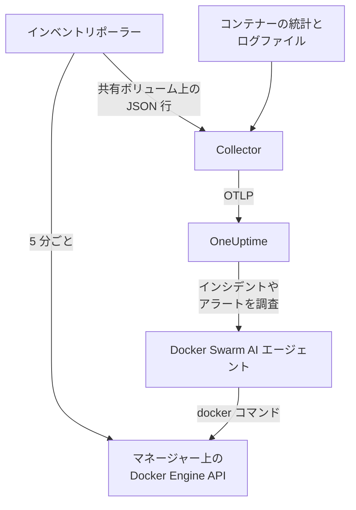

# Docker Swarm エージェント

OneUptime の Docker Swarm エージェントは Docker Swarm クラスターを監視します。対象はノード、サービス、タスク、スタック、オーバーレイネットワーク、シークレット、コンフィグ、ボリューム、そして各コンテナーのメトリクスとログです。Swarm のマネージャーノード上で Docker Compose で実行すると、クラスターがそれらすべてとともに OneUptime に表示されます。届いたデータに対しては [Docker Swarm モニター](/docs/monitor/docker-swarm-monitor) がアラートを出します。

:::cards
- [エージェントのインストール](#エージェントをインストールする): マネージャーノード上で、インストールスクリプトか Docker Compose を使います。
- [エージェントが収集するもの](#エージェントが収集するもの): インベントリ、クラスターのカウント、コンテナーのメトリクスとログ。
- [AI エージェント](#ai-エージェント): OneUptime AI が調査中に Swarm を読めるようにします。
- [トラブルシューティング](#トラブルシューティング): 診断スクリプトと、よくある問題。
:::

## 仕組み

エージェントは 3 つのコンテナーで、すべて 1 つの `docker-compose.yml` で定義されています:

1. **Collector**: OpenTelemetry Collector です。各コンテナーのメトリクスとして `docker_stats` を読み取り、コンテナーのログファイルを追跡し、インベントリのスナップショットファイルも追跡します。すべてにクラスター名 (`docker.swarm.cluster.name`) を付与し、OTLP で OneUptime に送信します。
2. **インベントリポーラー**: `curl` と `jq` による小さなサイドカーです。5 分ごとに Swarm マネージャーの API (`/nodes`、`/services`、`/tasks`、`/networks`、`/secrets`、`/configs`、`/volumes`) を巡回し、サービスラベル `com.docker.stack.namespace` からスタックを割り出します。オブジェクトごとに JSON を 1 行書き込み、Collector がそれを転送します。
3. **AI エージェント**: `oneuptime-docker-swarm-ai-agent` です。OneUptime AI がこのクラスターのインシデントやアラートを調査する間、求められた `docker` コマンドを実行します。修正を許可しない限り読み取り専用です ([AI エージェント](#ai-エージェント) を参照)。



クラスターは最初のデータとともに、設定したクラスター名で自身を登録します。

## 始める前に

- エージェントを実行する Swarm の **マネージャー** ノード。インベントリポーラーと AI エージェントは、マネージャーしか応答しない API エンドポイントを呼び出します。
- Docker Engine 20.10 以降と Docker Compose v2 プラグイン。
- 取り込みキー。**プロジェクト設定 → テレメトリと APM → 取り込みキー** で作成し、その値をコピーします。
- ノードから OneUptime の URL への送信 HTTPS。

### エージェントを実行する場所

マネージャーノードで実行してください。Collector は自分が動いているノードのコンテナーを報告するため、すべてのノードのコンテナーメトリクスを得るには、各ノードで Collector を実行し、どれも同じ `DOCKER_SWARM_CLUSTER_NAME` にします。インベントリポーラーと AI エージェントは 1 台のマネージャーで動いていれば十分です。`install.sh` はマネージャーでないノードには AI エージェントを入れません (以前そこに入れたものは削除します)。それでもワーカーで起動された AI エージェントは、クラスターに登録されることはありません。ノードがマネージャーになるまで待つため、マネージャーの AI エージェントを押しのけることはできません。Compose ではなく Swarm スタックとしてエージェントをデプロイしますか? その場合は、制約 `node.role == manager` でインベントリポーラーと AI エージェントをマネージャーに置いてください。

## エージェントをインストールする

:::steps
### エージェントをインストールして起動する

:::tabs
@tab install.sh
インストールスクリプトをダウンロードし、マネージャーノードで実行します:

```bash
curl -sSL https://raw.githubusercontent.com/OneUptime/oneuptime/master/agents/DockerSwarmAgent/install.sh -o install.sh
sh install.sh
```

スクリプトは、OneUptime の URL、取り込みキー、クラスターの名前を尋ねます。`/opt/oneuptime-docker-swarm-agent` にインストールし、所有者だけが読める `.env` ファイルを書き込み、3 つのコンテナーすべてを起動します。AI エージェントを入れない場合は `--no-ai-agent` を付けます。
@tab Docker Compose
[DockerSwarmAgent ディレクトリ](https://github.com/OneUptime/oneuptime/tree/master/agents/DockerSwarmAgent) から、`docker-compose.yml`、`otel-collector-config.yaml`、`inventory-snapshot.sh` をマネージャーノード上の新しいフォルダーにダウンロードします:

```bash
curl -fsSL https://raw.githubusercontent.com/OneUptime/oneuptime/master/agents/DockerSwarmAgent/docker-compose.yml -o docker-compose.yml
curl -fsSL https://raw.githubusercontent.com/OneUptime/oneuptime/master/agents/DockerSwarmAgent/otel-collector-config.yaml -o otel-collector-config.yaml
curl -fsSL https://raw.githubusercontent.com/OneUptime/oneuptime/master/agents/DockerSwarmAgent/inventory-snapshot.sh -o inventory-snapshot.sh
chmod +x inventory-snapshot.sh
```

その横に `.env` ファイルを作成します。取り込みキーが入るので、`chmod 600 .env` で非公開にしてください:

```bash title=".env"
ONEUPTIME_URL=https://oneuptime.com
ONEUPTIME_SERVICE_TOKEN=your-telemetry-ingestion-key
DOCKER_SWARM_CLUSTER_NAME=my-swarm
```

エージェントを起動します:

```bash
docker compose up -d
```
:::

### エージェントが実行中であることを確認する

```bash
docker compose ps
docker compose logs --tail 50 oneuptime-docker-swarm-agent oneuptime-docker-swarm-inventory
```

`docker compose ps` には 3 つのコンテナーが表示されます。Collector (`oneuptime-docker-swarm-agent`)、インベントリポーラー (`oneuptime-docker-swarm-inventory`)、AI エージェント (`oneuptime-docker-swarm-ai-agent`) です。

### OneUptime でクラスターを見つける

**製品 → インフラストラクチャ → Docker Swarm → すべてのクラスター** を開きます。数分でクラスターが表示され、最初のインベントリスナップショットの後 5 分以内に、**ノード**、**サービス**、**タスク**、**スタック**、**ネットワーク**、**シークレット**、**設定**、**ボリューム** の各ページが埋まります。
:::

## 環境変数

インストールスクリプトは最初の 3 つを `/opt/oneuptime-docker-swarm-agent/.env` に書き込みます。Docker Compose でのインストールでは、`docker-compose.yml` の横にある `.env` から読み取ります。そこでいずれかを追加または変更してから、そのフォルダーで `docker compose up -d` を実行してください。

| 変数 | 必須 | 説明 |
| --- | --- | --- |
| `ONEUPTIME_URL` | はい | OneUptime の URL。`https://oneuptime.com` やセルフホストのインスタンスなど。インスタンスが HTTP のみの場合は、`http://` とそのポートを使います。 |
| `ONEUPTIME_SERVICE_TOKEN` | はい | **プロジェクト設定 → テレメトリと APM → 取り込みキー** で作成した取り込みキー。 |
| `DOCKER_SWARM_CLUSTER_NAME` | はい | OneUptime でのクラスターの名前で、すべてのノードのデータをまとめるキーです。すべてに `docker.swarm.cluster.name` リソース属性として付与されます。変えないでください。あとで変更すると別のクラスターとして登録されます。既定は `docker-swarm` です。 |
| `DOCKER_INVENTORY_INTERVAL_SECONDS` | いいえ | インベントリポーラーがスナップショットを取る間隔 (秒)。既定は `300` です。 |
| `DOCKER_API_VERSION` | いいえ | Collector とインベントリポーラーが使う Docker Engine API のバージョン。既定は `1.44` です。空にするとデーモンとネゴシエートします ([トラブルシューティング](#トラブルシューティング) を参照)。AI エージェントは、指定しない限りネゴシエートします。 |

AI エージェント自身の設定は [AI エージェント](#ai-エージェント) にあります。

## エージェントが収集するもの

| シグナル | ソース | 表示される場所 |
| --- | --- | --- |
| ノード、サービス、タスク、スタック、ネットワーク、シークレット、コンフィグ、ボリューム | インベントリポーラー (Swarm マネージャーの API から) | クラスターの一覧ページと詳細ページ |
| クラスターのカウント (Ready のノード、実行中のタスク、サービス、スタックなど) | 同じスナップショット | 概要のカードとサイドメニューのバッジ |
| コンテナーの CPU、メモリ、プロセス数、稼働時間 | `docker_stats` レシーバー | **メトリクス** ページ |
| コンテナーの stdout と stderr のログ | `filelog` レシーバー | **ログ** ページ |

### Docker エージェントとの違い

[Docker エージェント](/docs/telemetry/docker-host) は 1 台のホストをモデル化し、`host.name` と `container.runtime=docker` を付与します。Docker Swarm エージェントは意図的に `docker.swarm.cluster.name` だけを付与します。これにより OneUptime は、各ノードを個別のホストとして登録するのではなく、データを Swarm クラスターの下に整理します。

## プロジェクトラベルでクラスターにタグを付ける

`oneuptime.label.` で始まるリソース属性は、クラスターのプロジェクトラベルになります。`oneuptime.label.<dimension>=<value>` はラベル `<dimension>:<value>` です。`otel-collector-config.yaml` の `resource` プロセッサーに、`docker.swarm.cluster.name` と並べて属性を追加します:

```yaml
processors:
  resource:
    attributes:
      # ...existing attributes...
      - key: oneuptime.label.team
        value: platform
        action: upsert
      - key: oneuptime.label.env
        value: production
        action: upsert
```

Collector は起動時にしか設定を読み込みません。`docker compose restart oneuptime-docker-swarm-agent` を実行してください。すると、クラスターに `team:platform` と `env:production` のラベルが表示されます。ラベルは大文字と小文字を区別せずに照合されるため、既存の `Production` ラベルは重複せずに再利用されます。また、OneUptime で誰かが追加したラベルをエージェントが削除することはありません。

## systemd サービスとして実行する

ノードの起動時にエージェントを起動し、失敗したときに再起動するには、その systemd ユニットをインストールします。インストールスクリプトが配置する `/opt/oneuptime-docker-swarm-agent` にエージェントがあることを前提としています:

```bash
sudo curl -fsSL https://raw.githubusercontent.com/OneUptime/oneuptime/master/agents/DockerSwarmAgent/systemd/oneuptime-docker-swarm-agent.service -o /etc/systemd/system/oneuptime-docker-swarm-agent.service
sudo systemctl daemon-reload
sudo systemctl enable --now oneuptime-docker-swarm-agent
```

## エージェントのアップグレード

エージェントは実行中の Collector のバージョンを報告します。それがこの OneUptime のリリースが固定しているバージョンより古い場合、クラスターの **概要** ページでエージェントのバージョンの横に警告マークが表示されます。マークを選択すると、これらのコマンドが表示されます。

マネージャーノードでインストールスクリプトを再実行し、同じ URL、キー、クラスター名で質問に答えます。最新のファイルをダウンロードし、イメージをプルしてエージェントを再起動します:

```bash
curl -sSL https://raw.githubusercontent.com/OneUptime/oneuptime/master/agents/DockerSwarmAgent/install.sh -o install.sh
sh install.sh
```

スクリプトは回答から `.env` を書き直します。保持されるのは、AI エージェントの対象リストと AI に許可する操作 (`ONEUPTIME_AI_INVESTIGATION`、`ONEUPTIME_AI_FIXES`) だけです。`DOCKER_API_VERSION` など、自分で設定した変数は追加し直してください。AI による修正をオンにしていた場合は、`ONEUPTIME_AI_ALLOW_WRITES=true sh install.sh` として実行すればオンのままになります。AI エージェントを入れていなかった場合は、もう一度 `--no-ai-agent` を渡します。

Docker Compose の場合は、エージェントのフォルダーで 3 つのファイルを再度ダウンロードし (`docker-compose.yml` に加えた変更があれば、もう一度行います)、プルして再起動します:

```bash
docker compose pull
docker compose up -d
```

Collector のバージョンはファイルで固定されているため、プルするだけではエージェントは新しくなりません。

## エージェントのアンインストール

```bash
cd /opt/oneuptime-docker-swarm-agent
docker compose down
```

## AI エージェント

Swarm の `docker-compose.yml` (と `install.sh`) は **Docker Swarm AI エージェント** も実行します。3 つ目のコンテナー `oneuptime-docker-swarm-ai-agent` (イメージ `oneuptime/resource-ai-agent:release`) で、OneUptime AI がこのクラスターのインシデントやアラートを調査する間、求められた読み取り専用の `docker` コマンド (`docker node ls`、`docker service ps web --no-trunc`、`docker service logs --tail 200 web`) を実行し、許可した場合に限り、名前を指定したサービスのローリング再起動などの修正を適用します。Collector と同じ `ONEUPTIME_URL`、`ONEUPTIME_SERVICE_TOKEN`、`DOCKER_SWARM_CLUSTER_NAME` を読むため、まさにこのクラスターを受け持ち、OneUptime ではクラスターの **AI → AI エージェント** ページに表示されます。

- **AI 調査はデフォルトで有効です**。エージェントが接続すると、OneUptime AI はこれを使ってこのクラスターのインシデントやアラートを調査し、クラスターの **概要** にエージェントの状態が表示されます。止めるには、エージェントを実行している場所で `ONEUPTIME_AI_INVESTIGATION=false` を設定する (AI エージェントのページの **AI に許可する操作** の下にある **変更** で方法が表示されます) か、エージェントを省きます。
- インベントリポーラーと同様、**マネージャーノードで実行する必要があります**。ノード、サービス、タスクのコマンドはマネージャー専用だからです。ワーカー上では何も実行せず、ノードがマネージャーになるまでクラスターに登録されません (その理由は `/status` に表示されます)。クラスターごとに 1 つ実行します。
- `.env` で `ONEUPTIME_AI_ALLOW_WRITES=true` を設定して `docker compose up -d` を実行しない限り (または、その変数を付けて `install.sh` を実行しない限り)、**読み取り専用** です。インストーラーは環境から `ONEUPTIME_AI_ALLOW_WRITES`、`ONEUPTIME_AI_INVESTIGATION`、`ONEUPTIME_AI_FIXES`、`ONEUPTIME_AI_WRITE_TARGETS`、`ONEUPTIME_AI_PROTECTED_TARGETS` を `.env` に書き込み、再実行時には、その変数を (空でも) 渡さない限り、後の 4 つについて `.env` にある値を保持します。`ONEUPTIME_AI_WRITE_TARGETS` (サービス名とノード名のグロブ。例: `web_*,api_*`) で修正が触れてよい範囲を制限します。同じ `.env` の `ONEUPTIME_AI_FIXES` で修正の実行方法を指定します。`ask-for-approval` (人が 1 件ずつ承認)、`automatic`、`bypass-approval` のいずれかで、AI エージェントのページには読み取り専用で表示されます ([エージェントが設定する AI に許可する操作](/docs/ai/infrastructure-ai-agents#what-ai-may-do-set-by-the-agent))。ノードのドレインは、モードにかかわらず常に人の承認が必要です。
- Docker ソケットをマウントした root として動作します。ソケットの所有者が root だからです。そしてマネージャー上では、ソケットを使える者が `:ro` かどうかに関係なく Swarm 全体を制御できます。歯止めはエージェントのコマンドポリシーです。サービスやスタックの作成・削除は一切せず、シークレットやコンフィグには触れず、自分自身、Collector、インベントリポーラー、`ONEUPTIME_AI_PROTECTED_TARGETS` (サービス名とノード名のグロブ) に含まれるものは決して変更しません。
- `install.sh --no-ai-agent` で除外できます。または `docker-compose.yml` から `oneuptime-docker-swarm-ai-agent` サービスを削除します。

実行できるコマンド、修正の仕組み、トラブルシューティングの方法: [Infrastructure AI Agents](/docs/ai/infrastructure-ai-agents#docker-swarm-clusters)。

## トラブルシューティング

:::details まず診断スクリプトを実行する
エージェントには、経路全体を確認するスクリプト [`troubleshoot.sh`](https://github.com/OneUptime/oneuptime/blob/master/agents/DockerSwarmAgent/troubleshoot.sh) が付属しています。コンテナー、インベントリポーラーがマネージャー上にあること (`docker node ls`)、スナップショットファイル、すべてに付与されたクラスター名、トークンの形式、Collector 自身のメトリクス、そして OneUptime が取り込みキーを受け付けるかどうかを確認します。最も重要なのは最後の確認です。OneUptime は不正なキーを `401` で拒否し (無効化されたキーやブラウザーキーでは `422`)、Collector はそれをバッチごとに `Exporting failed` の 1 行としてログに出すだけなので、見落としやすくなります。スクリプトは `GET <url>/otlp/v1/validate` を問い合わせて、`200` (有効) または `401` (無効) を直接受け取ります。マネージャーノードで実行してください:

```bash
curl -sSL https://raw.githubusercontent.com/OneUptime/oneuptime/master/agents/DockerSwarmAgent/troubleshoot.sh -o troubleshoot.sh
bash troubleshoot.sh    # add -d <dir> if you installed outside /opt/oneuptime-docker-swarm-agent
```
:::

:::details クラスターが表示されない
まず診断スクリプトを実行します。それ以外の場合は、Collector のログ (`docker compose logs oneuptime-docker-swarm-agent`) を読み、`.env` の `ONEUPTIME_SERVICE_TOKEN` と `ONEUPTIME_URL` が正しいこと、ノードが OneUptime の URL に到達できることを確認してください。
:::

:::details インベントリが表示されない
インベントリポーラーがマネージャー上で動いているか確認します。そこで `docker node ls` が成功する必要があります。次に、そのログで `failed to emit ...` の行を探します: `docker compose logs oneuptime-docker-swarm-inventory`。
:::

:::details クラスターが切断状態に切り替わる
OneUptime がクラスターから 15 分間何も受信しないと、クラスターは切断状態になります。OneUptime は 5 分ごとに確認し、OneUptime 自身がデータを受信していなかった時間は数えません。Collector のコンテナーが動き続けているか確認してください。`docker compose ps` に表示されます。
:::

:::details Collector が "client version is too new" で終了する
Collector のログに次のように表示されます:

```text
Error: cannot start pipelines: failed to start "docker_stats" receiver:
Error response from daemon: client version 1.44 is too new.
Maximum supported API version is 1.41
```

デーモンの最も高い API バージョンが既定の `1.44` より低いため (Docker Engine 20.10 は `1.41` まで)、`docker_stats` レシーバーが起動できず、コンテナーが再起動を繰り返します。デーモンの最も高いバージョンを確認します:

```bash
docker version --format '{{ .Server.APIVersion }}'
```

`.env` で `DOCKER_API_VERSION` をその値に設定し、エージェントが動いているすべてのノードで `docker compose up -d` を実行します。新しいデーモンも古い API バージョンを引き続き提供するため、Docker をアップグレードした後もこの設定は機能し続けます。あるいは `DOCKER_API_VERSION=` (空) に設定すると、Collector はバージョンを固定せず、デーモンとネゴシエートします。
:::

:::details クラスターが誤った名前で表示される
クラスターの名前は `DOCKER_SWARM_CLUSTER_NAME` から取られます。`.env` で変更して `docker compose up -d` を実行します。新しい名前では、古いクラスターの名前が変わるのではなく、新しいクラスターが登録されます。
:::

## 次のステップ

:::cards
- [Docker Swarm モニター](/docs/monitor/docker-swarm-monitor): ノード、サービス、タスク、コンテナーでアラートを出します。
- [Infrastructure AI Agents](/docs/ai/infrastructure-ai-agents): Docker Swarm AI エージェントが実行できるコマンドと、修正の仕組み。
- [Docker エージェント](/docs/telemetry/docker-host): 代わりに 1 台の Docker ホストを監視します。
:::
