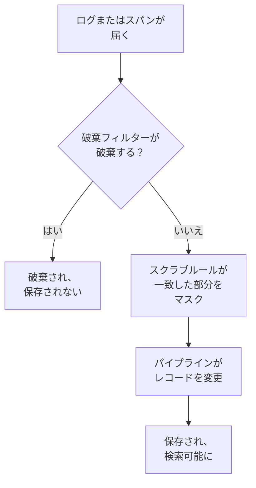

# 破棄フィルターとスクラブルール

破棄フィルターとスクラブルールは、ログとスパンが届いた時点で、何かが保存される前に処理します。破棄フィルターは決して必要としないレコードを捨てるか、その一部のサンプルだけを残します。スクラブルールは、メールアドレス、カード番号、パスワードなどの個人データやシークレットをマスクし、ストレージに届かないようにします。

:::cards
- [実行される場所](#実行される場所): パイプラインの前、保存の前。
- [レコードを破棄またはサンプリングする](#レコードを破棄またはサンプリングする): レコードを絞り込み、破棄するか一部を残します。
- [フィルターが取り去るもの](#フィルターが取り去るもの): 保存する前に、レコードを読み取っているものを確認します。
- [機密データをスクラブする](#機密データをスクラブする): パターンで見つかったものを秘匿、マスク、またはハッシュ化します。
- [フィルターが破棄したものを確認する](#フィルターが破棄したものを確認する): 各フィルターのカウント。
:::

## 実行される場所

ログ用は **ログ → 設定** に、スパン用は **トレース → 設定** にあります。レコードが届くと、OneUptime は次の順序で実行します。



- **新しいレコードにだけ作用します。** 作成または変更したルールは、約 1 分後に届くレコードから適用されます。すでに保存されたレコードは変わりません。
- **破棄されたレコードは消えます。** 検索、チャート、モニター、記録ルールのどれからも見えず、そこから例外が作られることもありません。OneUptime Cloud では課金もされません。
- **各リストは順番に実行されます。** 順序を変えるにはリストの行をドラッグします。実行されるのは有効なフィルターとルールだけです。

ログの破棄フィルターとスクラブルールは、OpenTelemetry、Syslog、Fluent Bit、Fluentd からのログに同じように適用されます。その次のステップは [ログパイプライン](/docs/telemetry/log-pipelines) で説明しています。

## 始める前に

- **届いているログまたはスパン。** [OpenTelemetry](/docs/telemetry/open-telemetry) を参照してください。
- **テレメトリの設定を変更するロール。** プロジェクト所有者またはプロジェクト管理者、あるいは変更する対象の権限（Create Log Drop Filter や Create Trace Scrub Rule など）を持つカスタムロールです。Telemetry ロールはフィルターとルールを表示できますが、変更はできません。

## レコードを破棄またはサンプリングする

:::steps
### 破棄フィルターを開く

**ログ → 設定 → 破棄フィルター** に移動します。スパンの場合は **トレース → 設定 → 破棄フィルター** に移動します。

### レコードを絞り込む

**ログ破棄フィルターを作成** をクリックします。スパンの場合は **トレース破棄フィルターを作成** をクリックします。**一致** でフィルターに **名前** を付け、**フィルタークエリ** を組み立てます。条件ごとにフィールド、演算子、値を指定し、**すべての条件** と **いずれかの条件** のどちらに一致させるかを選びます。**次へ** をクリックします。

### アクションを選ぶ

**アクション** で、一致したレコードをすべて捨てるなら **破棄** のままにします。または **サンプル** を選び、残す **サンプリング率** を 1 から 99 の範囲で入力します。その後、フィルターを作成します。
:::

フィルターは 1 分以内に破棄を始めます。まだ何も破棄せずに保存するには、作成する前に **詳細** で **有効** をオフにします。

> [!WARNING]
> 破棄されたレコードは元に戻せません。フィルターのクエリは狭く保ち、作成後は **破棄済み** のカウントを確認してください。

フィルターでは次のフィールドと、**カスタム属性...** による任意の属性を条件にできます。

| レコード | フィールド |
| --- | --- |
| ログ | **重大度**、**ログ本文**、**サービス ID** |
| スパン | **スパン名**、**スパンの種類**、**ステータス**、**ステータスメッセージ**、**サービス ID**、**例外あり**、**ルートスパンである** |

| 演算子 | 一致するもの |
| --- | --- |
| **と等しい** | 大文字と小文字も含めて完全に同じ値。`Debug` は一致し、`DEBUG` は一致しません。 |
| **と等しくない** | 完全に同じ値以外のすべて。 |
| **を含む** | 大文字と小文字を区別せず、フィールド内のどこかにある値。値の中の `%` はワイルドカードです。 |
| **次のいずれか** | カンマで区切った、完全に一致する値の一覧のいずれか。 |

**クエリをプレビュー** には、条件から作られるクエリが表示されます。次のクエリは、ヘルスチェックのデバッグ行を破棄します。

```text
severityText = 'Debug' AND body LIKE 'healthcheck'
```

サンプリングはレコードごとに判断されます。**サンプリング率** が 10 なら、一致したレコードのおよそ 10 件に 1 件が残ります。フィルターはリストの順に実行され、レコードを最初に破棄したフィルターで決まります。サンプルで残ったレコードは次のフィルターに進みます。

## フィルターが取り去るもの

破棄されたレコードは、それを読み取るすべてのものから消えます。そのため、破棄フィルターを書いている間、入力を止めて少しすると、フォームにそのフィルターが取り去るものが表示されます。**一致** では **フィルタークエリ** の下に、**アクション** ではアクションの下に表示されます。最も重要な影響が一行で示され、残りは **詳細を表示** で確認できます。

- **どれだけ一致するか。** 過去一日に保存されたレコードのうち、いくつが一致するかです。つまり、フィルターによってストレージに入らず、請求にも含まれなくなるものです。件数は保存された内容から、スクラブルールとパイプラインが変更した後の状態で数えられ、対象はレコードを読み取れるサービスだけです。10 秒より長くかかるカウントは停止され、フォームにその旨が表示されます。
- **セキュリティイベントが失うもの。** [セキュリティイベント](/docs/telemetry/security-events) が **ログ** でログを読み取っている場合、またはスパンを読み取っている場合、フォームには、一致したレコードのうちセキュリティイベントが読み取った件数が表示されます。セキュリティイベントがイベントに変えるサインイン、攻撃、ファイアウォールの記録です。**サンプル** のフィルターでは、件数で発火するルールと、フィルターがその割合だけを残すとそれらのルールがどうなるかも示されます。10% なら、5 分間に 10 回のサインイン失敗で発火するルールには約 100 回が必要になるため、発火する頻度がはるかに下がるか、まったく発火しなくなります。
- **同じレコードを読み取っているほかのもの。** フィルターが取り去るレコードをクエリで拾う可能性のある、モニター、SLO、ウィジェットを含むダッシュボード、記録ルール、保存済みビューです。クエリは、同じ種類のレコードを、フィルターが取り去りうるサービスから読み取り、正確な値に固定している条件のどれもフィルターを除外しない場合に、それらを読み取るとみなされます。**デバッグ** ログのフィルターはエラーのモニターに影響せず、1 つのサービスのフィルターは別のサービスの SLO に影響しません。ログ本文の検索のように、フォームが除外できないものは、読み取っているものとして数えられます。それぞれがリンクになっており、開けないものは件数だけが示され、名前は表示されません。

フィルターが取り去るものを何かが読み取っている場合、フィルターの作成、有効化、または有効なフィルターのクエリやアクションの変更の際に、確認を求められます。それでもフィルターは保存できます。確認は、状況を知ったうえで判断できるようにするためのものです。何も読み取っていないフィルターは、確認なしで保存されます。

API では何も確認されません。スクリプトや Terraform には答える人がいないためです。API で作成または変更したフィルターは保存され、ほかのものが読み取っているものを取り去る場合は、応答に `X-OneUptime-Write-Warning` ヘッダーが付き、その内容が件数で示されます。Terraform プロバイダーはこれを警告として表示します。事前に確認するには、フィルターの `filterQuery`、`action`、`samplePercentage` を `POST /api/telemetry/logs/drop-filter-impact` に、スパンの場合は `/api/telemetry/traces/drop-filter-impact` に送信します。フォームに表示される内容がすべて返されます。

OneUptime がプロジェクトに追加する OpenStack のフィルターは、OneUptime が作成したままであれば、セキュリティイベントが読み取るすべての行を残します。変更すると、自分で作ったフィルターと同じように、一致するものを破棄します。

## 機密データをスクラブする

:::steps
### スクラブルールを開く

**ログ → 設定 → スクラブルール** に移動します。スパンの場合は **トレース → 設定 → スクラブルール** に移動します。

### 見つけるものを選ぶ

**ログのスクラブルールを作成** をクリックします。スパンの場合は **トレースのスクラブルールを作成** をクリックします。次に **パターンタイプ** を選びます。自分で名前を入力するまで、ルールには **メールアドレスをスクラブ** のようにパターンにちなんだ名前が付きます。**カスタム正規表現** の場合は **カスタム正規表現パターン** も入力します。

### スクラブの方法を選ぶ

**詳細** で **スクラブアクション** と **スクラブするフィールド** を選ぶか、そのままにします。新しいルールは、レコード内のどこにあっても、一致した部分を `[REDACTED]` に置き換えます。その後、ルールを作成します。
:::

| パターンタイプ | 見つけるもの |
| --- | --- |
| **メールアドレス** | メールアドレス。例: `jane@example.com` |
| **クレジットカード番号** | 四桁ずつ区切った十六桁の数字。例: `4111 1111 1111 1111` |
| **SSN (社会保障番号)** | 米国の社会保障番号。例: `123-45-6789` |
| **電話番号** | 北米の電話番号。例: `555-123-4567` |
| **IP アドレス** | パブリックな IPv4 アドレスと IPv6 アドレス。例: `203.0.113.7`、`2001:db8::1`。プライベート、ループバック、リンクローカルのアドレスは含みません |
| **機密属性のキー** | キーがシークレットに見える属性の値全体。例: `password`、`token`、`api_key`、`authorization`、`cookie` |
| **カスタム正規表現** | スラッシュやフラグを付けずに書いた独自の正規表現。大文字と小文字を区別して照合します |

| スクラブアクション | 一致した部分がどうなるか |
| --- | --- |
| **秘匿** | `[REDACTED]`（既定） |
| **マスク** | ほとんどを隠します。メールアドレスは先頭の文字とドメインの末尾を、カード番号、電話番号、社会保障番号は末尾の四桁を、カスタムの一致やシークレットの値は最初と最後の文字を残します。IP アドレスはすべて隠します。 |
| **ハッシュ** | プロジェクト固有のトークン。同じ値なら常に同じになるため繰り返しを数えられますが、誰も元の値を割り出せません |

たとえば **メールアドレス** のルールは、次のログ本文を

```text
Payment failed for jane@example.com
```

**スクラブアクション** に応じて次のいずれかの形で保存します。

```text
Redact: Payment failed for [REDACTED]
Mask:   Payment failed for j***@***.com
Hash:   Payment failed for [HASHED:5e29db14e508e09a]
```

**スクラブするフィールド** は、ログのルールでは **本文のみ** か **属性のみ** を選ばない限り **両方（本文と属性）** です。スパンのルールでは **スパン名のみ**、**属性のみ**、**イベント属性のみ** を選ばない限り **すべて（名前、属性、イベント）** です。スパンのリンクの属性は、スパン自身の属性と一緒にスクラブされます。また **すべて（名前、属性、イベント）** は、スパンのステータスメッセージとイベント名もスクラブします。**機密属性のキー** のルールはキーを読むため、常にその下の値をスクラブします。対象は属性と、ログの JSON 本文です。

- **ルールは 1 つのサービス用にできます。** **詳細** の **1 つのサービスのみ** でサービスを選ぶと、ルールはそのサービスのレコードをスクラブし、ほかのサービスのレコードはそのままです。空欄のままにすると、すべてのサービスのレコードをスクラブします。一覧の **スコープ** 列にどちらかが表示されます。
- **フォームには、ルールがほかに何を変えるかが表示されます。** ルールを作成する前と、ルールを有効にするときに、OneUptime は、ルールが隠す値を読み取っているモニター、ダッシュボード、保存済みビュー、記録ルール、SLO をそれぞれリンクとして一覧にし、[セキュリティイベント](/docs/telemetry/security-events) が失うものも示します。隠された値でフィルターするモニターは、その値に一致しなくなります。ルールはどちらの場合も保存されます。
- **IP アドレスのルールは、個人データであるアドレスを隠します。** 対象はパブリックな IPv4 アドレスと IPv6 アドレスで、書き方は問いません。`2001:db8::1` のような短縮形、`[2001:db8::1]:443` のようなポート付きの角かっこ表記（角かっことポートは残ります）、`2001:db8::2%eth0` のようなゾーン付きの表記（ゾーンは残ります）を隠し、`::ffff:203.0.113.7` のように IPv6 として書かれた IPv4 アドレスは全体を隠します。`10.0.0.12`、`127.0.0.1`、`fe80::1` のようなプライベート、ループバック、リンクローカルのアドレスと、リクエストの URL 内のクラウドメタデータアドレス `169.254.169.254` は残します。[セキュリティイベント](/docs/telemetry/security-events)はここでサーバーサイドリクエストフォージェリを探します。内部アドレスも隠すには、それ用の **カスタム正規表現** のルールを追加します。たとえばすべての IPv4 アドレスには `\b(?:\d{1,3}\.){3}\d{1,3}\b` を使います。ルールがハッシュしない限り、セキュリティイベントは、そのルールがスクラブするログやトレースで見つけた攻撃のアドレスを示しません（[スクラブルールによって非表示](/docs/telemetry/security-events#スクラブルールによって非表示)を参照）。
- **ハッシュのトークンはプロジェクト固有です。** トークンは、インストールの `ENCRYPTION_SECRET` から導かれたプロジェクト固有のキーで作られます。そのため同じ値でも別のプロジェクトでは別のトークンになり、トークンを読んだ人が元の値を割り出したり、推測した値をハッシュして照合したりすることはできません。IP アドレスは書き方にかかわらずトークンが 1 つです。`::ffff:203.0.113.7` と `203.0.113.7` は同じトークンになります。トークンにキーがなかった頃に保存されたレコードには `[HASHED:8c87b489]` のような 8 文字のトークンがあり、現在の 16 文字のトークンとは異なります。それらのレコードが保持期間の終わりに達するまでは、両方を検索してください。`ENCRYPTION_SECRET` を変更するとすべてのトークンが変わります。また、セルフホストのインストールでは、トークンはそのシークレットと同じ程度にしか秘密になりません。
- **ハッシュ化された IP アドレスでも、セキュリティイベントはアドレスを示せます。** [セキュリティイベント](/docs/telemetry/security-events)がログやトレースを読み取る場合、ハッシュする IP アドレスのルールは、隠した各アドレスをそのトークンと並べて、セキュリティイベントのスキャンだけが読み取るストアにも保存します。ページ、検索、エクスポート、API、AI ツールからは読み取れません。そのため、ログにトークンとしてしか表示されないアドレスからの攻撃でも、そのアドレスが示され、ケースにはどのアドレスをブロックすべきかが示されます。各アドレスは最後に確認されてから 30 日後まで保存されます。秘匿またはマスクするルールは何も保存しないため、セキュリティイベントはスクラブルールがアドレスを隠したと表示します。30 日より古いトークンや、トークンにキーがなかった頃に作られたトークンでも同じです。
- **リストと入れ子の値も読まれます。** ルールは、HTTP ヘッダーの値のようなリスト、リストのリスト、キーと値のリストの中にあるすべてのテキストを読み、値の形を保ちます。数値と真偽値はそのまま残ります。**機密属性のキー** のルールは値の中のキーも読むため、キーと値のリストの中の `password` も隠されます。マップやリストとして送られたログの本文は JSON テキストとして保存され、**機密属性のキー** のルールは、JSON で書かれた本文と同じように、その中のキーを読みます。パターンのルールはそのような本文を JSON のまま保ち、AI 呼び出しのメッセージのように JSON で書かれた属性も同じです。アプリケーションが書いたとおりにテキストを読み、`\n` のようなエスケープはそれが表す改行として読み、見つけたものはテキストと数値の中だけで置き換えます。
- **文字列の中の JSON も読まれます。** 例えば `{"password":"hunter2"}` を持つ属性 `http.request.body` や、ログの本文の中にある Fluentd レコードの `log` 行のように、それ自体が JSON であるテキストは、JSON が入れ子になった 4 階層まで JSON として読まれ、それより深いものはテキストとして読まれます。**機密属性のキー** のルールは、その中で秘密に見えるキーの下の値を隠し、それ以外は変えません。数値、空白、その他のテキストはアプリケーションが書いたとおりに残ります。`{token}` のように JSON に見えるだけのテキストは、そのまま残ります。
- **1 項目ずつ読むには大きすぎる値は、テキストとして読まれます。** 32 階層より深く入れ子になった値や、レコードのリストとマップの中の値を 10,000 個より多くしてしまう値は、JSON テキストとして読まれ、保存されます。パターンのルールはそのテキストの中で見つけたものをスクラブし、**機密属性のキー** のルールは、`password` や `token` のような語が含まれていると値全体を隠します。 ログの本文と文字列の中の JSON では、これらの上限を超えた部分だけがテキストとして読まれ、残りは引き続きキーごとに読まれます。
- **例外はスクラブ後のレコードから作られます。** ログで見つかった例外はスクラブの後で作られ、スパンのイベントをスクラブするルールは、そこに記録された例外もスクラブします。 各例外は引き続きスクラブ前の内容でグループ化されるため、ルールを追加しても既存の例外が新しい例外になったり、その例外について **新しい例外** が再び発生したりすることはありません。新しい例外をグループ化する内容の一部をルールが隠した場合、そのフィンガープリントはハッシュのトークンと同じくプロジェクト固有のキーで作られるため、隠された内容を誰も復元できません。
- **syslog の行の生のコピーは、ルールがその各部分で隠したものを隠します。** syslog は RFC 5424 の行の構造化データを届いたままの形で `syslog.structured.raw` に保持し、HTTP で送られた syslog は行全体を `syslog.raw` に保持します。各コピーは、ヘッダーのフィールド、構造化データの各パラメーター、メッセージについてルールが残したものから組み立て直され、その後ルールは他の属性と同じようにそれを読みます。そのため、**機密属性のキー** のルールが `syslog.structured.auth_1.password` で隠すパスワードや、**本文のみ** のルールがメッセージで隠すアドレスはコピーでも隠され、RFC 5424 が値を書くとおり `password="[REDACTED\]"` のように書かれます。ルールが何も変えない行は、届いたままのコピーを保持します。
- **レコードのセッション ID は保たれます。** **機密属性のキー** のルールは、`session_id`、`sessionid`、Cookie のようなログイン セッションを隠しますが、`session.id` がそのログやスパンの属するセッションを持つときは残します。[Session Replay](/docs/telemetry/session-replay) がレコードを記録にひも付けるランダムな ID で、レコードはいずれにしてもそれを自分のセッションとして保ちます。AI 呼び出しの会話 ID も同じように保たれます。ログイン セッションの秘密を `session.id` として送らないでください。
- **Session Replay もスクラブされます。** すべてのサービス用のログのスクラブルールは、ブラウザーでレコーダーが行うマスクに加えて、Session Replay の記録にも適用されます。
- **ルールはリストの順に実行されます。** 各ルールは、それより前のルールが残したものを見ます。
- **カスタムパターンにかかる時間はレコードの長さに比例します。** どのように書かれていても、先読みと後読みを含めて JavaScript の構文と答えを保ちます。`\1` のような後方参照はそのようには実行できないため、後方参照を含むルールは保存時に拒否されます。大きすぎて実行できないパターンも同じです。すべての一致を見つけるために長い値を何度も読み直す必要がある場合、ルールは値全体をスクラブします。プロジェクトの破棄フィルター、スクラブルール、パイプラインも、送信するバッチごとに、バッチの大きさに比例した作業の割り当てを共有します。これは数十個のカスタムパターンがすべての値を読める量です。パターンがそれより多くを必要とする場合、カスタムスクラブルールは値全体をスクラブし、答えを出せないフィルターはそのレコードに適用されません。

## フィルターが破棄したものを確認する

**破棄フィルター** の一覧には、各フィルターの **破棄済み** のカウントと、**最終破棄** の時刻が表示されます。**まだ何も破棄されていません** は、一度も一致していないことを意味します。フィルターのページの **アクティビティ** にも同じ内容が表示され、破棄から 1 分以内に更新されます。**フィルター条件** のカードには絞り込みの内容が表示され、そこで条件を変更できます。

## トラブルシューティング

:::details 破棄フィルターが何も破棄しない
**と等しい**、**と等しくない**、**次のいずれか** は、大文字と小文字も含めて完全に同じテキストを比較します。重大度は `Information` と `Warning` で、`INFO` や `WARN` ではありません。フィルターが有効になっていることを確認し、変更後は 1 分待ってください。
:::

:::details 届くはずのログがない
各破棄フィルターの **破棄済み** のカウントと **最終破棄** の時刻を確認します。疑わしいフィルターの **有効** をオフにすると、次のログからまた届くようになります。
:::

:::details カスタムのスクラブルールに「何もスクラブしません」と表示される
パターンが空か、有効な正規表現ではないか、`\1` のような後方参照を含むなどの理由で実行できないため、何もスクラブしません。ルールを編集し、少なくとも 1 文字に一致するパターンを指定してください。
:::

:::details 古いレコードに、新しいルールでスクラブされるデータが残っている
スクラブルールはレコードが届いた時点で作用します。ルールより前に保存されたレコードは、保持期間が終わるまで元の内容のままです。[データ保持](/docs/telemetry/data-retention) を参照してください。
:::

## 次のステップ

:::cards
- [ログパイプライン](/docs/telemetry/log-pipelines): 残したログを解析して情報を付け加えます。
- [ログエクスプローラー](/docs/telemetry/logs-explorer): 保存されたものを検索します。
- [トレースエクスプローラー](/docs/telemetry/traces-explorer): 残したスパンをたどります。
- [データ保持](/docs/telemetry/data-retention): 保持する期間を決めます。
:::
