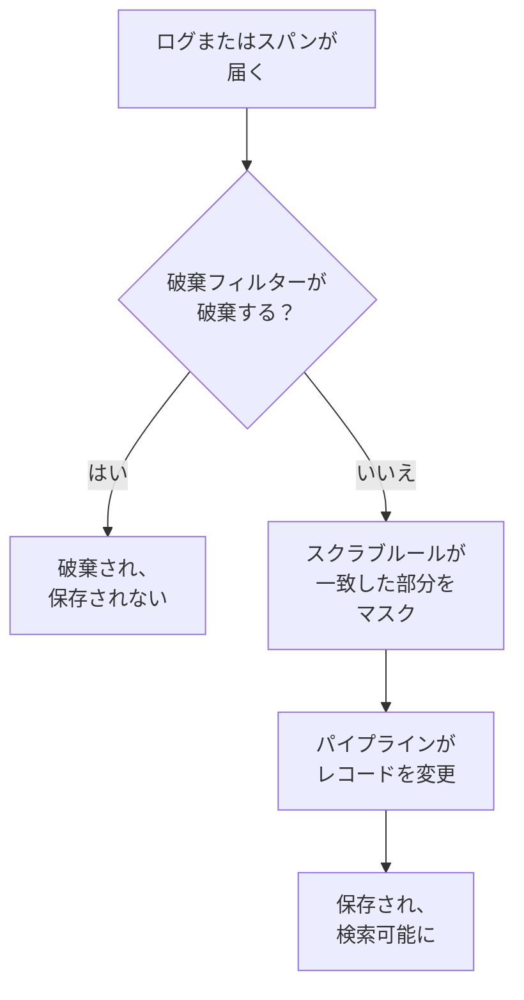

# 破棄フィルターとスクラブルール

破棄フィルターとスクラブルールは、ログとスパンが届いた時点で、何かが保存される前に処理します。破棄フィルターは決して必要としないレコードを捨てるか、その一部のサンプルだけを残します。スクラブルールは、メールアドレス、カード番号、パスワードなどの個人データやシークレットをマスクし、ストレージに届かないようにします。

:::cards
- [実行される場所](#実行される場所): パイプラインの前、保存の前。
- [レコードを破棄またはサンプリングする](#レコードを破棄またはサンプリングする): レコードを絞り込み、破棄するか一部を残します。
- [機密データをスクラブする](#機密データをスクラブする): パターンで見つかったものを秘匿、マスク、またはハッシュ化します。
- [フィルターが破棄したものを確認する](#フィルターが破棄したものを確認する): 各フィルターのカウント。
:::

## 実行される場所

ログ用は **ログ → 設定** に、スパン用は **トレース → 設定** にあります。レコードが届くと、OneUptime は次の順序で実行します。



- **新しいレコードにだけ作用します。** 作成または変更したルールは、約 1 分後に届くレコードから適用されます。すでに保存されたレコードは変わりません。
- **破棄されたレコードは消えます。** 検索、チャート、モニター、記録ルールのどれからも見えず、そこから例外が作られることもありません。OneUptime Cloud では課金もされません。
- **各リストは順番に実行されます。** 順序を変えるにはリストの行をドラッグします。実行されるのは有効なフィルターとルールだけです。

ログの破棄フィルターとスクラブルールは、OpenTelemetry、Syslog、Fluent Bit、Fluentd からのログに同じように適用されます。その次のステップは [ログパイプライン](/docs/telemetry/log-pipelines) で説明しています。

## 始める前に

- **届いているログまたはスパン。** [OpenTelemetry](/docs/telemetry/open-telemetry) を参照してください。
- **テレメトリの設定を変更するロール。** Project Owner または Project Admin、あるいは変更する対象の権限（Create Log Drop Filter や Create Trace Scrub Rule など）を持つカスタムロールです。Telemetry ロールはフィルターとルールを表示できますが、変更はできません。

## レコードを破棄またはサンプリングする

:::steps
### 破棄フィルターを開く

**ログ → 設定 → 破棄フィルター** に移動します。スパンの場合は **トレース → 設定 → 破棄フィルター** に移動します。

### レコードを絞り込む

**ログ破棄フィルターを作成** をクリックします。スパンの場合は **トレース破棄フィルターを作成** をクリックします。**一致** でフィルターに **名前** を付け、**フィルタークエリ** を組み立てます。条件ごとにフィールド、演算子、値を指定し、**すべての条件** と **いずれかの条件** のどちらに一致させるかを選びます。**次へ** をクリックします。

### アクションを選ぶ

**アクション** で、一致したレコードをすべて捨てるなら **破棄** のままにします。または **サンプル** を選び、残す **サンプリング率** を 1 から 99 の範囲で入力します。その後、フィルターを作成します。
:::

フィルターは 1 分以内に破棄を始めます。まだ何も破棄せずに保存するには、作成する前に **詳細** で **有効** をオフにします。

> [!WARNING]
> 破棄されたレコードは元に戻せません。フィルターのクエリは狭く保ち、作成後は **破棄済み** のカウントを確認してください。

フィルターでは次のフィールドと、**カスタム属性...** による任意の属性を条件にできます。

| レコード | フィールド |
| --- | --- |
| ログ | **重大度**、**ログ本文**、**サービス ID** |
| スパン | **スパン名**、**スパンの種類**、**ステータス**、**ステータスメッセージ**、**サービス ID**、**例外あり**、**ルートスパンである** |

| 演算子 | 一致するもの |
| --- | --- |
| **と等しい** | 大文字と小文字も含めて完全に同じ値。`Debug` は一致し、`DEBUG` は一致しません。 |
| **と等しくない** | 完全に同じ値以外のすべて。 |
| **を含む** | 大文字と小文字を区別せず、フィールド内のどこかにある値。値の中の `%` はワイルドカードです。 |
| **次のいずれか** | カンマで区切った、完全に一致する値の一覧のいずれか。 |

**クエリをプレビュー** には、条件から作られるクエリが表示されます。次のクエリは、ヘルスチェックのデバッグ行を破棄します。

```text
severityText = 'Debug' AND body LIKE 'healthcheck'
```

サンプリングはレコードごとに判断されます。**サンプリング率** が 10 なら、一致したレコードのおよそ 10 件に 1 件が残ります。フィルターはリストの順に実行され、レコードを最初に破棄したフィルターで決まります。サンプルで残ったレコードは次のフィルターに進みます。

## 機密データをスクラブする

:::steps
### スクラブルールを開く

**ログ → 設定 → スクラブルール** に移動します。スパンの場合は **トレース → 設定 → スクラブルール** に移動します。

### 見つけるものを選ぶ

**ログのスクラブルールを作成** をクリックします。スパンの場合は **トレースのスクラブルールを作成** をクリックします。次に **パターンタイプ** を選びます。自分で名前を入力するまで、ルールには **メールアドレスをスクラブ** のようにパターンにちなんだ名前が付きます。**カスタム正規表現** の場合は **カスタム正規表現パターン** も入力します。

### スクラブの方法を選ぶ

**詳細** で **スクラブアクション** と **スクラブするフィールド** を選ぶか、そのままにします。新しいルールは、レコード内のどこにあっても、一致した部分を `[REDACTED]` に置き換えます。その後、ルールを作成します。
:::

| パターンタイプ | 見つけるもの |
| --- | --- |
| **メールアドレス** | メールアドレス。例: `jane@example.com` |
| **クレジットカード番号** | 四桁ずつ区切った十六桁の数字。例: `4111 1111 1111 1111` |
| **SSN (社会保障番号)** | 米国の社会保障番号。例: `123-45-6789` |
| **電話番号** | 北米の電話番号。例: `555-123-4567` |
| **IP アドレス** | IPv4 アドレス。例: `192.168.1.1` |
| **機密属性のキー** | キーがシークレットに見える属性の値全体。例: `password`、`token`、`api_key`、`authorization`、`cookie` |
| **カスタム正規表現** | スラッシュやフラグを付けずに書いた独自の正規表現。大文字と小文字を区別して照合します |

| スクラブアクション | 一致した部分がどうなるか |
| --- | --- |
| **秘匿** | `[REDACTED]`（既定） |
| **マスク** | ほとんどを隠します。メールアドレスは先頭の文字とドメインの末尾を、カード番号、電話番号、社会保障番号は末尾の四桁を、カスタムの一致やシークレットの値は最初と最後の文字を残します。IP アドレスはすべて隠します。 |
| **ハッシュ** | 値の短いハッシュ。同じ値なら常に同じになるため、繰り返しを数えられます |

たとえば **メールアドレス** のルールは、次のログ本文を

```text
Payment failed for jane@example.com
```

**スクラブアクション** に応じて次のいずれかの形で保存します。

```text
Redact: Payment failed for [REDACTED]
Mask:   Payment failed for j***@***.com
Hash:   Payment failed for [HASHED:8c87b489]
```

**スクラブするフィールド** は、ログのルールでは **本文のみ** か **属性のみ** を選ばない限り **両方（本文と属性）** です。スパンのルールでは **スパン名のみ**、**属性のみ**、**イベント属性のみ** を選ばない限り **すべて（名前、属性、イベント）** です。**機密属性のキー** のルールは属性のキーを読むため、常に属性の値をスクラブします。

- **例外はスクラブ後のレコードから作られます。** ログで見つかった例外はスクラブの後で作られ、スパンのイベントをスクラブするルールは、そこに記録された例外もスクラブします。
- **Session Replay もスクラブされます。** ログのスクラブルールは、ブラウザーでレコーダーが行うマスクに加えて、Session Replay の記録にも適用されます。
- **ルールはリストの順に実行されます。** 各ルールは、それより前のルールが残したものを見ます。

## フィルターが破棄したものを確認する

**破棄フィルター** の一覧には、各フィルターの **破棄済み** のカウントと、**最終破棄** の時刻が表示されます。**まだ何も破棄されていません** は、一度も一致していないことを意味します。フィルターのページの **アクティビティ** にも同じ内容が表示され、破棄から 1 分以内に更新されます。**フィルター条件** のカードには絞り込みの内容が表示され、そこで条件を変更できます。

## トラブルシューティング

:::details 破棄フィルターが何も破棄しない
**と等しい**、**と等しくない**、**次のいずれか** は、大文字と小文字も含めて完全に同じテキストを比較します。重大度は `Information` と `Warning` で、`INFO` や `WARN` ではありません。フィルターが有効になっていることを確認し、変更後は 1 分待ってください。
:::

:::details 届くはずのログがない
各破棄フィルターの **破棄済み** のカウントと **最終破棄** の時刻を確認します。疑わしいフィルターの **有効** をオフにすると、次のログからまた届くようになります。
:::

:::details カスタムのスクラブルールに「何もスクラブしません」と表示される
パターンが空か、有効な正規表現ではないため、何もスクラブしません。ルールを編集し、少なくとも 1 文字に一致するパターンを指定してください。
:::

:::details 古いレコードに、新しいルールでスクラブされるデータが残っている
スクラブルールはレコードが届いた時点で作用します。ルールより前に保存されたレコードは、保持期間が終わるまで元の内容のままです。[データ保持](/docs/telemetry/data-retention) を参照してください。
:::

## 次のステップ

:::cards
- [ログパイプライン](/docs/telemetry/log-pipelines): 残したログを解析して情報を付け加えます。
- [ログエクスプローラー](/docs/telemetry/logs-explorer): 保存されたものを検索します。
- [トレースエクスプローラー](/docs/telemetry/traces-explorer): 残したスパンをたどります。
- [データ保持](/docs/telemetry/data-retention): 保持する期間を決めます。
:::
