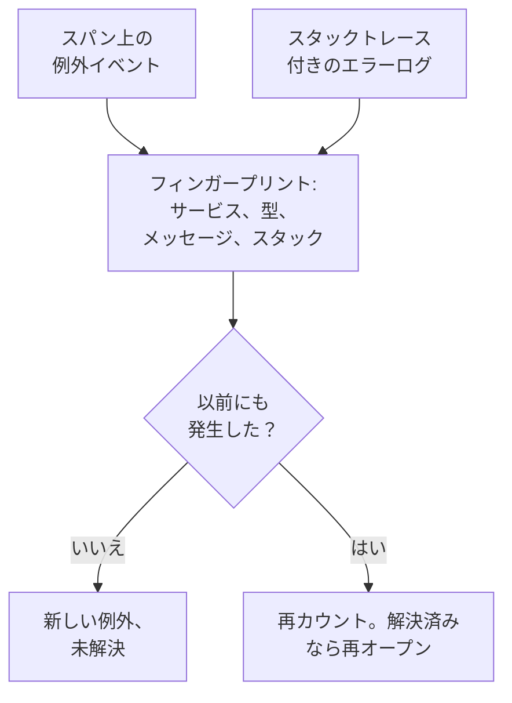

# 例外トラッキング

例外トラッキングは、コードがスローするエラーを収集し、同じエラーの発生をすべて 1 つの例外にまとめます。例外にはスタックトレース、推移、発生したリクエストが付きます。To-Do リストのようにトリアージしましょう。修正する、解決済みにする、ノイズをアーカイブする、そして AI が修正できるものは AI に pull request を開かせます。

:::cards
- [例外の出どころ](#例外の出どころ): サービスがすでに送っているスパンとログ。
- [一覧をトリアージする](#一覧をトリアージする): 未解決のものが先頭、ノイズは非表示。
- [例外のページ](#例外のページ): スタックトレース、発生、コンテキスト。
- [AI で修正する](#ai-で修正する): 修正または回帰テストを含む pull request。
:::

## 例外の出どころ

例外を別に送る必要はありません。OneUptime は、サービスがすでに送っているテレメトリから例外を見つけます。

- スパン上の例外イベント。OpenTelemetry の `recordException()` が書き込むものです。
- `exception.type`、`exception.message`、`exception.stacktrace` のいずれかの属性を持つログ。
- 重大度が Error または Fatal で、メッセージにスタックトレースを含むログ。ただし、スパンの中で書かれたログは除きます（スパンがすでに報告しているため）。

各発生は、同じエラーの以前の発生とまとめて 1 つの例外になります。

- **サービスとエラーごとに 1 つの例外。** フィンガープリントは、サービス、例外の型、メッセージ、スタックトレースから作られます。呼び出しごとに変わる値は先に取り除かれます。UUID などの ID、タイムスタンプ、IP アドレスとメールアドレス、7 桁以上の数値です。そのため `Order id=1042 not found` と `Order id=2077 not found` は 1 つの例外になります。
- **新しい発生は、解決済みの例外を再オープンします。** 解決した後にまた起きたなら、修正が効いていません。
- **アーカイブした例外はアーカイブされたままです。** 新しい発生は引き続き数えられますが、通知は届かなくなります。

> [!TIP]
> サービスが拒否した不正な入力のような、想定内のエラーを例外トラッキングに入れないようにするには、スパンの例外イベントで `error.class` 属性を `user-error` または `expected-denial` に設定します。そうすると OneUptime は例外を記録しません。

## 始める前に

- **届いているスパンまたはログ。** [OpenTelemetry](/docs/telemetry/open-telemetry) でサービスを計装します。**セットアップガイド** タブに、使っている言語向けのコードが表示されます。
- **テレメトリを読み取れるロール。** Project Owner、Project Admin、Project Member、Viewer、Telemetry Admin、Telemetry Member、Telemetry Viewer のいずれか、または Read Telemetry Service Exception 権限を持つカスタムロール。解決とアーカイブには、Project Owner か Project Admin、または Edit Telemetry Service Exception 権限が必要です。

## 一覧をトリアージする

:::steps
### 例外の一覧を開く

**製品 → オブザーバビリティ → 例外** に移動します。**例外** タブのバッジは未解決の問題の数を示し、一覧は **未解決** の例外で開きます。

### ステータスを選ぶ

**未解決**、**解決済み**、**アーカイブ済み**、**すべて** を切り替えます。一覧の上のチャートは、発生のうち **未処理** と **処理済み** がそれぞれいくつあったかを時系列で示します。

### 何を問題として扱うかを選ぶ

デフォルトの **問題** は、ユーザーのエラーと想定内の拒否を隠すので、一覧には修正が必要なものが表示されます。**ユーザーエラー** はそれらだけを表示し、**すべて** はすべての例外を表示します。

### 検索して絞り込む

`type:TypeError env:production` のようなクエリを入力するか（[検索構文](/docs/telemetry/search-syntax#例外) を参照）、**フィルター** サイドバーの値をクリックします。サービス、ホストなどのリソース、**例外タイプ**、**環境**、**エラークラス** です。

### 例外を開く

行をクリックすると、例外のページが開きます。
:::

## 例外のページ

ページのサイドメニューは、例外に対して行うことをまとめています。

| ページ | 表示内容 |
| --- | --- |
| **概要** | メッセージ、サービス、発生頻度、最初と最後に確認された日時、時間の経過に伴う推移、最新の発生（リリース、環境、スパン、トレース、ユーザーセッション）。 |
| **スタックトレース** | スタックのフレーム。ブラウザーのコードでは、リリースの [ソースマップ](/docs/telemetry/source-maps) をアップロードすると、元のファイルと行が表示されます。 |
| **発生** | すべての発生と、その時刻、メッセージ、発生したトレース。 |
| **コンテキスト** | 最新の発生の属性、記録されていればそのセッションリプレイ、発生に至った手順。 |
| **ログ** | 最新の発生の前後に書かれたログ。 |
| **AI アシスタンス** | 例外を修正またはテストする AI タスク。 |
| **設定** | 例外を解決またはアーカイブします。このページは最初は折りたたまれている **管理** の下にあります。 |

## 解決、再オープン、アーカイブ

例外のページ上部のボタンと、その **設定** ページで、例外のステータスを変えます。

| 操作 | 使う場面 | その後に起きること |
| --- | --- | --- |
| **解決** | 修正をデプロイした。 | **未解決** の一覧から外れます。新しい発生があると再オープンされます。 |
| **再オープン** | 修正が効かなかった。 | 再び未解決になります。 |
| **アーカイブ** | 修正するつもりのないノイズである。 | 一覧から外れます。新しい発生は数えられますが、通知は届かなくなります。 |
| **アーカイブ解除** | また知らせてほしい。 | 本来の一覧に戻ります。 |

**設定** には、最後に例外を解決またはアーカイブしたのが誰で、それがいつかが表示されます。ボタンの表示は **解決済みとしてマーク** または **未解決としてマーク**、そして **アーカイブ** または **アーカイブ解除** です。

## エラークラス

すべての例外にはエラークラスがあり、誰の問題かを示します。OneUptime AI は、新しい例外や急増した例外など、例外についてのインサイトをトリアージするときにエラークラスを設定します。[AI SRE](/docs/ai/ai-sre#インサイト-先回りの検出) を参照してください。まだトリアージされていない例外は `unknown` のままです。

| クラス | 意味 | **問題** に含まれるか |
| --- | --- | --- |
| `code-fault` | コードの欠陥。AI が自動で修正する唯一のクラスです。 | はい |
| `infrastructure` | タイムアウト、切断された接続、使い果たされたリソース。 | はい |
| `unknown` | まだ分類されていない。 | はい |
| `user-error` | ユーザーの不正な入力の結果。 | いいえ |
| `expected-denial` | 拒否されたログインのように、チェックが正しく働いた結果。 | いいえ |

AI インサイトの設定で **想定内の例外をアーカイブする** をオンにすると、トリアージで想定内の拒否と判断された例外が自動でアーカイブされます。

## AI で修正する

**AI アシスタンス** ページには 3 つのタスクがあります。どれも、コードリポジトリに pull request を開く AI タスクとして実行されます。

| タスク | pull request の内容 |
| --- | --- |
| **AI でこの例外を修正** | 根本原因を修正します。**AI で修正** で開始します。 |
| **回帰テストを生成** | バグが修正されるまで失敗するテストを追加します。 |
| **エラー処理を改善** | 想定内のエラー向け: 入力を早い段階で検証し、ユーザーのデータをメッセージに含めず、エラーを処理済みとしてマークします。 |

AI には、まず 3 つのものが必要です。LLM プロバイダー、接続したリポジトリ(GitHub、GitLab、Forgejo または Gitea、任意の Git サーバー)、タスクを実行するオンラインの AI エージェントです。ページはそれぞれを確認し、足りないものへのリンクを示します。例外が解決済みまたはアーカイブ済みの間、タスクは一時停止します。[コード](/docs/ai/ai-agent) を参照してください。

## 例外のインサイト

**インサイト** タブは、**未解決**、**解決済み**、**アーカイブ済み** の例外の数と解決率を数え、最も頻繁な例外、それらが影響するサービス、最近確認された例外を一覧表示します。

## トラブルシューティング

:::details スローしたばかりの例外が一覧にない
まずレンズを確認してください。**問題** はユーザーのエラーと想定内の拒否を隠すので、**すべて** を選びます。次に時間範囲を広げ、例外がスパン上、またはスタックトレース付きのログに記録されたかを確認してください。
:::

:::details 1 つのエラーが複数の例外として表示される
フィンガープリントにはメッセージとスタックトレースが含まれます。それらが異なる場合、たとえばメッセージに呼び出しごとに変わる短い数値や名前が含まれる場合、それぞれのバリエーションが別の例外になります。
:::

:::details 解決済みの例外が何度も戻ってくる
新しい発生が解決済みの例外を再オープンするのは意図した動作です。エラーがまだ起きているからです。修正がそのエラーを報告しているリリースに含まれているか確認するか、もう知らせが不要なら例外をアーカイブしてください。
:::

## 次のステップ

:::cards
- [例外モニター](/docs/monitor/exceptions-monitor): 例外が急増したらアラートを受け取ります。
- [ソースマップ](/docs/telemetry/source-maps): ブラウザーのコードの読みやすいスタックトレース。
- [コード](/docs/ai/ai-agent): AI がコードを修正して pull request を開く仕組み。
- [トレースエクスプローラー](/docs/telemetry/traces-explorer): 例外が発生したリクエストを確認します。
:::
