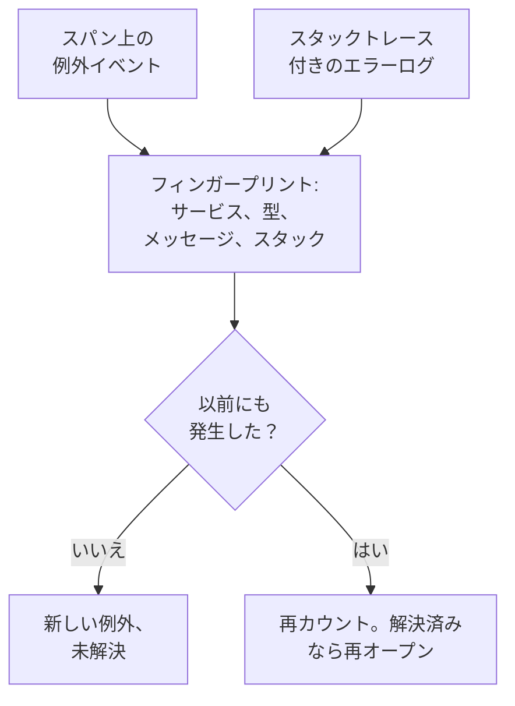

# 例外トラッキング

例外トラッキングは、コードがスローするエラーを収集し、同じエラーの発生をすべて 1 つの例外にまとめます。例外にはスタックトレース、推移、発生したリクエストが付きます。To-Do リストのようにトリアージしましょう。修正する、解決済みにする、ノイズをアーカイブする、そして AI が修正できるものは AI に pull request を開かせます。

:::cards
- [例外の出どころ](#例外の出どころ): サービスがすでに送っているスパンとログ。
- [一覧をトリアージする](#一覧をトリアージする): 未解決のものが先頭、ノイズは非表示。
- [例外のページ](#例外のページ): スタックトレース、発生、コンテキスト。
- [AI で修正する](#ai-で修正する): 修正または回帰テストを含む pull request。
- [AI で新しい例外や急増する例外を見つけて修正する](#ai-で新しい例外や急増する例外を見つけて修正する): OneUptime が見つけた例外のための pull request。
:::

## 例外の出どころ

例外を別に送る必要はありません。OneUptime は、サービスがすでに送っているテレメトリから例外を見つけます。

- スパン上の例外イベント。OpenTelemetry の `recordException()` が書き込むものです。
- `exception.type`、`exception.message`、`exception.stacktrace` のいずれかの属性を持つログ。
- 重大度が Error または Fatal で、メッセージにスタックトレースを含むログ。ただし、スパンの中で書かれたログは除きます（スパンがすでに報告しているため）。

各発生は、同じエラーの以前の発生とまとめて 1 つの例外になります。

- **サービスとエラーごとに 1 つの例外。** フィンガープリントは、サービス、例外の型、メッセージ、スタックトレースから作られます。呼び出しごとに変わる値は先に取り除かれます。UUID などの ID、タイムスタンプ、IP アドレスとメールアドレス、7 桁以上の数値です。そのため `Order id=1042 not found` と `Order id=2077 not found` は 1 つの例外になります。 新しい例外は代わりに、型と、スタックトレース内の自分のコードの関数とファイルでグループ化されます。行番号、ライブラリのフレーム、メッセージは除外されるため、同じコードから投げられたバリエーションは 1 つの例外になります。スタックトレースがない場合は、上記のとおりメッセージでグループ化されます。このグループ化より前に記録された例外は、元のグループ化のままです。
- **新しい発生は、解決済みの例外を再オープンします。** 解決した後にまた起きたなら、修正が効いておらず、例外には **再発** の印が付きます。解決より前に起きた発生が後から OneUptime に届いても、再オープンはされません。
- **アーカイブした例外はアーカイブされたままです。** 新しい発生は引き続き数えられますが、通知は届かなくなります。

> [!TIP]
> サービスが拒否した不正な入力のような、想定内のエラーを例外トラッキングに入れないようにするには、スパンの例外イベントで `error.class` 属性を `user-error` または `expected-denial` に設定します。そうすると OneUptime は例外を記録しません。

## 始める前に

- **届いているスパンまたはログ。** [OpenTelemetry](/docs/telemetry/open-telemetry) でサービスを計装します。**セットアップガイド** タブに、使っている言語向けのコードが表示されます。
- **テレメトリを読み取れるロール。** Project Owner、Project Admin、Project Member、Viewer、Telemetry Admin、Telemetry Member、Telemetry Viewer のいずれか、または Read Telemetry Service Exception 権限を持つカスタムロール。解決とアーカイブには、Project Owner か Project Admin、または Edit Telemetry Service Exception 権限が必要です。

## 一覧をトリアージする

:::steps
### 例外の一覧を開く

**製品 → オブザーバビリティ → 例外** に移動します。**例外** タブのバッジは未解決の問題の数を示し、一覧は **未解決** の例外で開きます。

### ステータスを選ぶ

**未解決**、**解決済み**、**アーカイブ済み**、**すべて** を切り替えます。一覧の上のチャートは、発生のうち **未処理** と **処理済み** がそれぞれいくつあったかを時系列で示します。**再発** の印が付いた行は解決後に再び起きたもの、**新規** の印が付いた行は過去 24 時間以内に初めて検出されたものです。

各行には、選んだ期間にその例外が影響したユーザーの数と、その期間の発生を示す小さなチャートも表示されます。発生は、例外イベント、そのスパンまたはログレコード、あるいはリソースの `user.id`、`enduser.id`、`enduser.pseudo.id` 属性でユーザーを示します。ユーザーを示さない発生は数えられません。

### 何を問題として扱うかを選ぶ

デフォルトの **問題** は、ユーザーのエラーと想定内の拒否を隠すので、一覧には修正が必要なものが表示されます。**ユーザーエラー** はそれらだけを表示し、**すべて** はすべての例外を表示します。

### 検索して絞り込む

`type:TypeError env:production` のようなクエリを入力するか（[検索構文](/docs/telemetry/search-syntax#例外) を参照）、**フィルター** サイドバーの値をクリックします。サービス、ホストなどのリソース、**例外タイプ**、**環境**、**エラークラス** です。**自分の担当** は自分に割り当てられた例外だけを表示し、並べ替えメニューで一覧を **最終確認**、**初回確認**、**イベント数順** の順に並べ替えられます。

### 例外を開く

行をクリックすると、例外のページが開きます。
:::

## 例外のページ

ページのサイドメニューは、例外に対して行うことをまとめています。

| ページ | 表示内容 |
| --- | --- |
| **概要** | メッセージ、サービス、発生頻度、最初と最後に確認された日時、時間の経過に伴う推移、最新の発生（リリース、環境、スパン、トレース、ユーザーセッション）。 一番上には、AI が有効な場合、何が起きたかについての OneUptime AI の説明が表示されます。 |
| **スタックトレース** | スタックのフレーム。ブラウザーのコードでは、リリースの [ソースマップ](/docs/telemetry/source-maps) をアップロードすると、元のファイルと行が表示されます。 |
| **発生** | すべての発生と、その時刻、メッセージ、発生したトレース。 |
| **コンテキスト** | 最新の発生の属性、記録されていればそのセッションリプレイ、発生に至った手順。 |
| **ログ** | 最新の発生の前後に書かれたログ。 |
| **AI アシスタンス** | 例外を修正またはテストする AI タスク。 |
| **設定** | 例外を解決またはアーカイブします。このページは最初は折りたたまれている **管理** の下にあります。 |

## 解決、再オープン、アーカイブ

例外のページ上部のボタン、その **設定** ページ、一覧にあるその行の ⋯ メニューで、例外のステータスを変えます。

| 操作 | 使う場面 | その後に起きること |
| --- | --- | --- |
| **解決** | 修正をデプロイした。 | **未解決** の一覧から外れます。新しい発生があると再オープンされます。 |
| **次のリリースで解決** | 修正は次のリリースで出る。 | **未解決** の一覧から外れます。最後に確認されたリリースからの発生では再オープンされず、ほかのリリースからの発生では再オープンされます。 |
| **再オープン** | 修正が効かなかった。 | 再び未解決になります。 |
| **アーカイブ** | 修正するつもりのないノイズである。 | 一覧から外れます。新しい発生は数えられますが、通知は届かなくなります。 |
| **アーカイブ解除** | また知らせてほしい。 | 本来の一覧に戻ります。 |

**次のリリースで解決** は、例外の発生がリリース（リソース属性 `service.version`）を示している間、**解決** の横のメニュー、行の ⋯ メニュー、**一括操作**、**設定** にあります。

**設定** には、最後に例外を解決またはアーカイブしたのが誰で、それがいつかが表示されます。ボタンの表示は **解決済みとしてマーク** または **未解決としてマーク**、そして **アーカイブ** または **アーカイブ解除** です。

複数をまとめて変えるには、一覧でそれぞれの行にチェックを入れるか、行の上のボックスでページ上のすべての例外を選び、**一括操作** の同じ操作を使います。結果には、変更された例外と、そのままにされた例外とその理由が表示されます。

例外のヘッダーの **割り当て** で 1 人または 1 つのチームに割り当て、選択を外すと割り当てを解除します。各行には担当者が表示され、行の ⋯ メニューには **自分に割り当て** があり、**一括操作** の **割り当て先…** で複数をまとめて割り当てられます。

例外の **概要** の一番下にある **アクティビティ** には、誰がいつ変更したかが新しい順に表示されます。誰が解決、再オープン、アーカイブ、割り当てをしたか、別の例外をこの例外に統合したか統合を解除したか、そして解決後にいつ再発したかです。例外のページ、一覧、**一括操作**、API、OneUptime 自身のどこで行われた変更もすべて記録され、API キーで行われた変更にはそのキーの名前が付きます。

## エラークラス

すべての例外にはエラークラスがあり、誰の問題かを示します。OneUptime AI は、新しい例外や急増した例外など、例外についてのインサイトをトリアージするときにエラークラスを設定します。[AI SRE](/docs/ai/ai-sre#インサイト-先回りの検出) を参照してください。まだトリアージされていない例外は `unknown` のままです。

| クラス | 意味 | **問題** に含まれるか |
| --- | --- | --- |
| `code-fault` | コードの欠陥。AI が自動で修正する唯一のクラスです。 | はい |
| `infrastructure` | タイムアウト、切断された接続、使い果たされたリソース。 | はい |
| `unknown` | まだ分類されていない。 | はい |
| `user-error` | ユーザーの不正な入力の結果。 | いいえ |
| `expected-denial` | 拒否されたログインのように、チェックが正しく働いた結果。 | いいえ |

AI インサイトの設定で **想定内の例外をアーカイブする** をオンにすると、トリアージで想定内の拒否と判断された例外が自動でアーカイブされます。

## AI で説明する

例外の **概要** の一番上にある **OneUptime AI で説明** は、何が問題だったのかを OneUptime AI に尋ねます。最新の発生のスタックトレース、トレース、ログと、例外が始まった頃のサービスのデプロイを読み取り、**何が起きたか** カードで答えます。

| 項目 | 内容 |
| --- | --- |
| **何が起きたか** | ひとことふたことの要約、OneUptime AI の確信度、そして障害がどこにあるか (コード、依存関係、インフラストラクチャ、不正な入力、設定)。 |
| **考えられる根本原因** | 原因と、それを示すフレーム、スパン、ログの行、またはデプロイ。 |
| **修正案** | 何を変えるか。 |
| **確認する箇所** | 最初に開くべきスタックトレースのフレーム。 |
| **次のステップ** | 確認または修正のための、最大三つのステップ。 |

説明は例外に保存されるので、次に開いた人はすぐに読めます。**もう一度説明する** で新しい説明を求められます。**修正のプルリクエストを作成** は例外の **AI アシスタンス** ページを開き、**追加で質問する** はこの例外について Ask AI を開きます。

ID、メールアドレス、IP アドレス、トークンは送信されるすべての内容から取り除かれ、スパンの属性はルートやステータスコードなどごく一部だけが送信されます。説明にはプロジェクトの LLM プロバイダーと AI クレジットが使われ、**AI を有効化** がオフの間は表示されません。例外を読める人なら誰でも説明を求められます。

カードの下の **類似の例外** には、この例外に似た例外が最大 5 件表示されます。値を取り除くと **同じメッセージ** のもの、コード内の **同じコード位置** のもの、ほとんど同じ語を含む **似たメッセージ** のものです。1 つの根本原因が複数の例外に分かれることがあるため、**OneUptime AI で確認** を押すと、それぞれが **同じバグの可能性が高い**、**関連するバグ**、**別のバグ** のどれかとその理由を示します。確認にはプロジェクトの AI クレジットを使い、**AI を有効化** がオフの間は表示されません。回答は次の発生まで保存されます。

OneUptime AI が **同じバグの可能性が高い** と判断した同じサービスの例外は、横の **統合** でこの例外に統合できます。これまでの発生も新しい発生も、それ以降はこの例外で数えられてこのページに表示され、一覧からは消えます。下の **この例外に統合された例外** に統合されたものが並び、それぞれの横、または統合された例外自身のページの **統合を解除** で、その後の発生も含めて一覧での元の場所に戻せます。統合と解除には例外を編集する権限が必要です。

## AI で修正する

**AI アシスタンス** ページには 3 つのタスクがあります。どれも、コードリポジトリに pull request を開く AI タスクとして実行されます。

| タスク | pull request の内容 |
| --- | --- |
| **AI でこの例外を修正** | 根本原因を修正します。**AI で修正** で開始します。 |
| **回帰テストを生成** | バグが修正されるまで失敗するテストを追加します。 |
| **エラー処理を改善** | 想定内のエラー向け: 入力を早い段階で検証し、ユーザーのデータをメッセージに含めず、エラーを処理済みとしてマークします。 |

AI には、まず 3 つのものが必要です。LLM プロバイダー、接続したリポジトリ(GitHub、GitLab、Forgejo または Gitea、任意の Git サーバー)、タスクを実行するオンラインの AI エージェントです。ページはそれぞれを確認し、足りないものへのリンクを示します。例外が解決済みまたはアーカイブ済みの間、タスクは一時停止します。[コード](/docs/ai/ai-agent) を参照してください。タスクを開始するには、タスクが作業するリポジトリを編集する権限が必要です。例外を読むことしかできない人には、タスクは表示されますが開始できません。

## AI で新しい例外や急増する例外を見つけて修正する

OneUptime は 15 分ごとに例外を調べ、新しい例外、急に発生回数が大きく増えた例外、そして例外にスタックトレースが付いていないサービスを探し、見つかったものを根拠とともに AI インサイトとして記録します。続いて OneUptime AI がそれぞれを調べ、修正できるものには pull request を開きます。マージは一切されません。各 pull request はチームがレビューします。

| 検出結果 | OneUptime が記録する条件 | pull request |
| --- | --- | --- |
| **新しい例外** | 直近 24 時間に初めて見つかり、すでに 3 回以上発生した例外。 | 例外を修正するか、よりうまく処理します。 |
| **例外の急増** | 直近一時間に 10 回以上発生し、その前の 24 時間の毎時の発生率の 5 倍以上になった例外。 | 例外を修正するか、よりうまく処理します。 |
| **スタックトレースなし** | あるサービスが直近一日に記録した例外にスタックトレースがなく、合わせて 20 回以上発生した。 | サービスが例外ごとにスタックトレースを記録するようにします。 |

新しい例外や急増する例外の pull request は、その例外自身の AI タスク、つまり **AI アシスタンス** ページが開始するタスクで、OneUptime AI が検出結果を調べ終えるまで待ちます。原因のコードが見つかった場合 (`code-fault`)、pull request は **AI でこの例外を修正** と同じようにそれを修正します。想定内のエラーが見つかった場合 (`user-error` または `expected-denial`)、pull request は **エラー処理を改善** と同じようにそのエラーをよりうまく処理します。それ以外の判定では、pull request は自動では開かれません。**想定内の例外をアーカイブする** がオンの場合、想定内の拒否は代わりにアーカイブされ、pull request は開かれません。

OneUptime AI が自動で開くのは、自分のコードで発生した例外だけです。つまり、ライブラリやランタイムのフレームだけでなく、自分のコードのフレームがスタックトレースに含まれる例外です。誰かがマージせずに閉じた pull request があると、その例外の自動の pull request は一時停止します。それでも誰でも、検出結果の **AI で修正** でどれでも依頼できます。

### オンにする

**例外 → AI → 設定** に **新しい例外や急増する例外を見つけて修正する** スイッチがあり、新しいプロジェクトではオンになっています。オフの間は、新しい例外や急増する例外はこれまでどおり AI インサイトが扱います。[AI SRE](/docs/ai/ai-sre#インサイト-先回りの検出) を参照してください。**AI を有効化** がオフの場合、例外は引き続き見つかりますが、OneUptime AI は何もしません。pull request を開くには、[コード](/docs/ai/ai-agent) で接続したリポジトリが必要です。足りないものはページが最初に示します。各リポジトリのコードは、そのリポジトリがコードで選んだ Runner 上で変更されます。

OneUptime AI が自動で開く pull request は 1 日 (UTC) 最大 5 件で、検出結果ごとに 1 件です。リポジトリの開いている AI pull request の上限を超えることはありません。

### AI ルール

ルールがない場合、OneUptime AI は見つけた例外をすべてすぐに調査し、修正できるものには pull request を開きます。**その他の設定** の **AI ルール** で、これを 3 つのステップで絞り込みます。

| ステップ | 決めること |
| --- | --- |
| **一致** | 対象のサービス: 選んだもの、特定のラベルを持つもの、または名前がパターンに一致するもの。 |
| **調査** | **すぐに**、または **待機後もまだ見つかる場合のみ**。待機中に解消した例外は調査されません。 |
| **修正** | **修正しない**、**修正前に確認する**、または **確認せずに修正する**。先に確認する場合、pull request は人に任されます。検出結果に **AI で修正** が表示されます。 |

**その他の項目** では、ルールごとに OneUptime AI が使えるコードリポジトリ、MCP サーバー、LLM プロバイダーを選びます。何も選ばない場合はすべてを使え、プロジェクトの既定の LLM プロバイダーを使います。

### 実行内容を確認する

- **例外 → AI → インサイト** には OneUptime が見つけたものが一覧され、各検出結果に、スタックトレース内の自分のコードのフレームを含む根拠が付きます。**例外グループを表示** で例外を開けます。サービスのスタックトレースなしの検出結果では、**例外で開く** でそのサービスの直近一日の未解決の例外を開けます。
- **例外 → AI → ログ** にはすべての調査と pull request が新しい順に、それぞれの状態と各調査で見つかった内容とともに一覧されます。
- pull request には開いた理由が、検出結果へのリンクとともに書かれます。新しい例外や急増する例外の pull request は例外にもリンクし、その例外の **AI アシスタンス** ページに表示されます。コードでは、タスクに修正対象の例外、または元になった検出結果が示されます。

## 例外のインサイト

**インサイト** タブは、**未解決**、**解決済み**、**アーカイブ済み** の例外の数と解決率を数え、最も頻繁な例外、それらが影響するサービス、最近確認された例外を一覧表示します。

タブ上部の **新着** では、**OneUptime AI で要約** を押すと、OneUptime AI が直近 24 時間に初めて確認された例外と、解決後に再発した例外を要約します。全体についての数文のあと、各例外を 1 行ずつ、緊急度の高い順に、例外へのリンク付きで示します。要約は依頼したときに作成され、次の発生まで保存されるため、もう一度依頼してもクレジットは使われません。プロジェクトの AI クレジットを使い、**AI を有効化** がオフの間は表示されません。

## トラブルシューティング

:::details スローしたばかりの例外が一覧にない
まずレンズを確認してください。**問題** はユーザーのエラーと想定内の拒否を隠すので、**すべて** を選びます。次に時間範囲を広げ、例外がスパン上、またはスタックトレース付きのログに記録されたかを確認してください。
:::

:::details 1 つのエラーが複数の例外として表示される
フィンガープリントにはメッセージとスタックトレースが含まれます。それらが異なる場合、たとえばメッセージに呼び出しごとに変わる短い数値や名前が含まれる場合、それぞれのバリエーションが別の例外になります。 新しい例外は代わりに自分のコードの関数でグループ化されるため、これは主に以前に記録された例外に当てはまります。同じバグの 2 つは **類似の例外** から統合できます。
:::

:::details 解決済みの例外が何度も戻ってくる
新しい発生が解決済みの例外を再オープンするのは意図した動作です。エラーがまだ起きているからです。修正がそのエラーを報告しているリリースに含まれているか確認するか、もう知らせが不要なら例外をアーカイブしてください。ロールアウト中に古いリリースの Pod が報告し続ける場合は、代わりに **次のリリースで解決** を使ってください。
:::

## 次のステップ

:::cards
- [例外モニター](/docs/monitor/exceptions-monitor): 例外が急増したらアラートを受け取ります。
- [ソースマップ](/docs/telemetry/source-maps): ブラウザーのコードの読みやすいスタックトレース。
- [コード](/docs/ai/ai-agent): AI がコードを修正して pull request を開く仕組み。
- [トレースエクスプローラー](/docs/telemetry/traces-explorer): 例外が発生したリクエストを確認します。
:::
