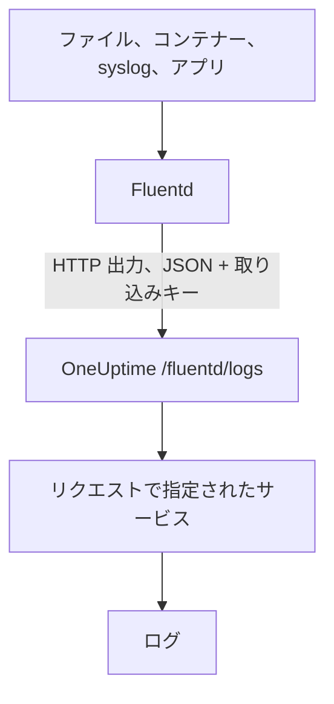

# Fluentd

[Fluentd](https://www.fluentd.org/) は、ファイル、コンテナー、syslog、アプリケーションなど [多くのソース](https://www.fluentd.org/datasources) からログを集めます。組み込みの [HTTP 出力](https://docs.fluentd.org/output/http) がそれらを OneUptime の Fluentd エンドポイントに送り、ログは **製品 → ログ** で検索できるようになります。

:::cards
- [Fluentd を構成する](#fluentd-を構成する): OneUptime を指す HTTP 出力を追加します。
- [レコードの読み取り方](#レコードの読み取り方): どのフィールドがメッセージ、重大度、属性になるか。
- [セルフホストの OneUptime](#セルフホストの-oneuptime): Fluentd を自分のインスタンスに向けます。
:::

## 仕組み



Fluentd はレコードを JSON でまとめて送ります。取り込みキーは `x-oneuptime-token` ヘッダーに、サービス名は `x-oneuptime-service-name` に入れます。OneUptime は各レコードをそのサービスのログにし、最初に送信されたときにサービスを作成します。

## 始める前に

- **Fluentd をインストールする**: [インストールガイド](https://docs.fluentd.org/installation) を参照してください。
- **OneUptime プロジェクト。** OneUptime Cloud では、テレメトリは取り込んだ GB 単位で課金されます ([料金](https://oneuptime.com/pricing) を参照)。また Free プランのプロジェクトは、テレメトリを送る前に支払い方法を登録する必要があります。
- **テレメトリ取り込みキー。** まだない場合は次の手順で作成します。

:::steps
### 取り込みキーを開く

**製品 → プロジェクト設定** に移動し、サイドメニューで **テレメトリと APM** を開いて **取り込みキー** を選びます。


### キーを作成する

**取り込みキーを作成** をクリックします。ダイアログにはキーの名前が入力済みで、**サーバー** (アプリケーションや Collector が送信に使う種類のキー) が選ばれているので、そのまま **取り込みキーを作成** をクリックして作成するか、先に名前を変更します。

### シークレットをコピーする

新しいキーは専用のページで開きます。その **シークレットキー** をコピーしてください。これが下の構成の `YOUR_SERVICE_TOKEN` です。


:::

## Fluentd を構成する

Fluentd の構成ファイルは通常 `/etc/fluent/fluentd.conf` です。古い td-agent パッケージでは `/etc/td-agent/td-agent.conf` です。

:::steps
### HTTP 出力を追加する

レコードを OneUptime に送る `<match>` セクションを追加します。`YOUR_SERVICE_TOKEN` は取り込みキーに、`YOUR_SERVICE_NAME` はログを表示したい名前 (どんな名前でもかまいません) に置き換えます。

```text title="fluentd.conf"
# Send the time Fluentd gave each event: the HTTP output sends only the record
<filter **>
  @type record_transformer
  enable_ruby true
  <record>
    fluentd_time ${time.utc.strftime("%Y-%m-%dT%H:%M:%S.%NZ")}
  </record>
</filter>

# Match all patterns
<match **>
  @type http

  endpoint https://oneuptime.com/fluentd/logs
  open_timeout 2

  headers {"x-oneuptime-token":"YOUR_SERVICE_TOKEN", "x-oneuptime-service-name":"YOUR_SERVICE_NAME"}

  content_type application/json
  json_array true

  # Send a batch again when OneUptime is busy (429) or restarting (502, 503, 504)
  retryable_response_codes 429,502,503,504

  <format>
    @type json
  </format>
  <buffer>
    # Keep the batches on disk until OneUptime takes them: a restart of Fluentd loses none
    @type file
    path /var/log/fluent/buffer/oneuptime
    total_limit_size 512m
    flush_interval 10s
    chunk_limit_size 900k
    # Try again at least every 30 seconds, for up to 72 hours
    retry_max_interval 30s
    retry_timeout 72h
  </buffer>
</match>

# Keep Fluentd's own logs out of OneUptime
<label @FLUENT_LOG>
  <match **>
    @type null
  </match>
</label>
```

`json_array true` はバッファーのチャンクごとに 1 つの JSON 配列として送り、`flush_interval 10s` は 10 秒ごとにバッファーを送ります。`chunk_limit_size 900k` は各リクエストを、このエンドポイントで OneUptime が受け付ける上限の 1 MB 未満に保ちます。

Fluentd の既定の設定でも動作します。`content_type` と `json_array true` がない場合、Fluentd は改行区切りの JSON を 1 行に 1 レコードずつ送り、OneUptime は各行をそのレコードとして読み取ります。`compress gzip` の有無は問いません。

`@type file` は、まだ送っていないバッチを `path` が示すフォルダーに保持するので、Fluentd を再起動してもどれも失われません。Fluentd の既定であるメモリー上のバッファーは、保持していたものを失います。Fluentd のユーザーはそのフォルダーに書き込める必要があります。`/var/log/fluent` は fluent-package の、`/var/log/td-agent` は td-agent の、`/fluentd/log` は `fluent/fluentd` イメージのフォルダーです。`total_limit_size 512m` はそこに最大 512 MB まで保持し、いっぱいになると、バッチが送られるまで Fluentd はそれ以上レコードを受け取りません。

`retryable_response_codes 429,502,503,504` は、OneUptime が混み合っているとき (`429`) や再起動中のとき (`502`、`503`、`504`) にバッチを送り直します。これがないと、Fluentd は `503` 以外の応答でバッチを破棄します。`retry_max_interval 30s` は再試行の間隔を最大 30 秒に保ち、`retry_timeout 72h` は 72 時間たっても送れないバッチを破棄します。`record_transformer` フィルターは、Fluentd が各レコードに付けた時刻を `fluentd_time` として加えます。HTTP 出力はレコードしか送らず、OneUptime はログの時刻をレコードから読み取るためです。

### Fluentd を再起動する

新しい出力を読み込むように、Fluentd サービスを再起動します。

### ログが届くことを確認する

次のフラッシュから数秒後に、ログが **製品 → ログ** に表示されます。サービスは **製品 → サービス** に並びます。まだ存在しなかった場合は、OneUptime が作成します。
:::

## 完全な例

この構成は、ポート `24224` で Fluentd の forward プロトコルを使って、このホストからだけレコードを受け取り、すべて OneUptime に送ります。

```text title="fluentd.conf"
####
## Source descriptions:
##

## built-in TCP input
## @see https://docs.fluentd.org/input/forward
<source>
  @type forward
  port 24224
  # This host alone: see "Take records from other hosts" to open it
  bind 127.0.0.1
</source>

# Send the time Fluentd gave each event: the HTTP output sends only the record
<filter **>
  @type record_transformer
  enable_ruby true
  <record>
    fluentd_time ${time.utc.strftime("%Y-%m-%dT%H:%M:%S.%NZ")}
  </record>
</filter>

<match **>
  @type http

  endpoint https://oneuptime.com/fluentd/logs
  open_timeout 2

  headers {"x-oneuptime-token":"YOUR_SERVICE_TOKEN", "x-oneuptime-service-name":"YOUR_SERVICE_NAME"}

  content_type application/json
  json_array true

  # Send a batch again when OneUptime is busy (429) or restarting (502, 503, 504)
  retryable_response_codes 429,502,503,504

  <format>
    @type json
  </format>
  <buffer>
    # Keep the batches on disk until OneUptime takes them: a restart of Fluentd loses none
    @type file
    path /var/log/fluent/buffer/oneuptime
    total_limit_size 512m
    flush_interval 10s
    chunk_limit_size 900k
    # Try again at least every 30 seconds, for up to 72 hours
    retry_max_interval 30s
    retry_timeout 72h
  </buffer>
</match>

# Keep Fluentd's own logs out of OneUptime
<label @FLUENT_LOG>
  <match **>
    @type null
  </match>
</label>
```

`bind 127.0.0.1` はこのホストからだけレコードを受け取ります。たとえば、`localhost:24224` に送る Docker の `fluentd` ログドライバーのレコードです。異なるソースを異なるサービスとして送るには、タグごとに `<match>` セクションを 1 つずつ使い、それぞれに独自の `x-oneuptime-service-name` とバッファーの独自の `path` を設定します。1 つのパスに 2 つのバッファーがあると、Fluentd は起動しません。

## ほかのホストからレコードを受け取る

`bind 0.0.0.0` で `<security>` セクションがないと、ポート `24224` に届く人は誰でも、あなたの取り込みキーで OneUptime にログを送れます。ほかのホストの Fluentd や Fluent Bit からレコードを受け取るには、すべてのアドレスで待ち受け、送信元ごとに共有キーを求め、TLS を使います。完全な例の `<source>` セクションを次のものに置き換えます。

```text title="fluentd.conf on this host"
<source>
  @type forward
  port 24224
  bind 0.0.0.0
  <transport tls>
    cert_path /etc/fluent/certs/fluentd.crt
    private_key_path /etc/fluent/certs/fluentd.key
  </transport>
  <security>
    self_hostname fluentd.example.com
    shared_key YOUR_SHARED_KEY
  </security>
</source>
```

`cert_path` と `private_key_path` は、このホストの名前 (ここでは `fluentd.example.com`) の証明書とその鍵で、Fluentd のユーザーが読める必要があります。鍵にパスフレーズがないと Fluentd は警告します。`private_key_passphrase` でパスフレーズを設定できます。`YOUR_SHARED_KEY` を、`openssl rand -base64 32` で作ったような長いランダムな秘密に置き換え、各送信元にも同じものを設定します。

```text title="fluentd.conf on each sender"
<match **>
  @type forward
  transport tls
  # The certificate of the authority that signed this host's; not needed for a public one
  tls_cert_path /etc/fluent/certs/ca.crt
  <security>
    self_hostname app-1.example.com
    shared_key YOUR_SHARED_KEY
  </security>
  <server>
    host fluentd.example.com
    port 24224
  </server>
  <buffer>
    @type file
    path /var/log/fluent/buffer/forward
  </buffer>
</match>

# Keep Fluentd's own logs out of OneUptime
<label @FLUENT_LOG>
  <match **>
    @type null
  </match>
</label>
```

Fluent Bit の `forward` 出力も同じ設定 `Shared_Key`、`Self_Hostname`、`tls On`、`tls.ca_file` を受け付けます。

キーのない送信元や TLS を使わない送信元は拒否されます。キーそのものがネットワークを流れることはなく、双方がキーを持っていることを証明し合います。TLS がないと、ホスト間のネットワーク上の誰もがレコードを読めます。ホストのファイアウォールでは、ポート `24224` を送信元のホストにだけ開けてください。ログガイドの Docker Compose ファイルで Fluentd を動かしている場合は、そこでもポートをすべてのアドレスに公開し (`"24224:24224"`)、証明書のフォルダーをコンテナーにマウントします。

## レコードの読み取り方

OneUptime は各レコードから次のフィールドを読み取ります。

| ログのフィールド | レコードの次のフィールドのうち最初にあるものから読み取る | 補足 |
| --- | --- | --- |
| 本文 | `message`、`log`、`msg`、`body`、`text` | ログの行。どれもないレコードは、全体が JSON として保存されます。 |
| 重大度 | `level`、`severity`、`loglevel`、`log_level`、`priority`、`severityText`、`severity_text` | `trace`、`debug`、`info`、`notice`、`warn`、`error`、`critical`、`fatal` などの名前 (大文字・小文字は問いません)。それ以外の値は `Unspecified` として保存されます。 |
| トレース ID | `trace_id`、`traceId`、`traceid` | ログをそのトレースに結び付けます。 |
| スパン ID | `span_id`、`spanId`、`spanid` | ログをそのスパンに結び付けます。 |
| サービス | `x-oneuptime-service-name` ヘッダー | ヘッダーがない場合は `Fluentd`。 |
| 時刻 | `time`、`timestamp`、`@timestamp`、`ts`、`fluentd_time` | `2026-11-14T08:00:00.123Z` のような ISO 8601 の時刻、またはエポックからの秒、ミリ秒、マイクロ秒、ナノ秒。タイムゾーンのない時刻は UTC とみなします。2000 年より前の時刻や、1 日より先の時刻は読み取りません。時刻を読み取ったフィールドは属性として保存されません。時刻のないレコードは、OneUptime がレコードを受け取った時刻で保存されます。 |

ほかのフィールドはすべて、`fluentd.` にフィールド名を続けた名前の属性になり、検索や絞り込みに使えます。たとえば `container_name` フィールドは、ログのエクスプローラーでは `@fluentd.container_name` です。入れ子のオブジェクトは `fluentd.kubernetes.pod_name` のようにドットでつないで平坦化され、リストは JSON として保存されます。

Fluentd のログも、ほかのログと同じように [ログパイプライン](/docs/telemetry/log-pipelines)、ドロップフィルター、スクラブルールを通ります。

## セルフホストの OneUptime

`endpoint` の `https://oneuptime.com` を OneUptime インスタンスの URL に置き換えます: `http(s)://YOUR_ONEUPTIME_HOST/fluentd/logs`。

## トラブルシューティング

:::details Fluentd が HTTP 出力から `401` を記録する
取り込みキーがない、不明、または期限切れです。`headers` の `x-oneuptime-token` の値を確認してください。
:::

:::details Fluentd が `402` または `422` を記録する
`402`: OneUptime Cloud で、プロジェクトが Free プランで支払い方法がありません。**プロジェクト設定 → 請求と請求書 → 請求** で追加してください。`422`: キーが無効化されているか、ブラウザーキーです。キーの設定で **有効** をオンに戻すか、**サーバー** キーを作成してください。
:::

:::details Fluentd が `413` を記録する
リクエストが、このエンドポイントで OneUptime が受け付ける上限の 1 MB を超えています。上の設定と同じように、`<buffer>` セクションに `chunk_limit_size 900k` を設定してください。
:::

:::details Fluentd が `429`、`502`、`503`、`504` を記録する
OneUptime が混み合っているか、再起動中です。上の設定と同じように `<match>` セクションに `retryable_response_codes 429,502,503,504` があれば、Fluentd はバッチを保持して送り直します。ない場合、Fluentd はバッチを破棄します。`<buffer>` セクションに `@type file` があれば、Fluentd は再起動してもバッチを保持します。
:::

:::details ログに自身の時刻ではなく、OneUptime が受け取った時刻が表示される
OneUptime はログの時刻をそのレコードから読み取りますが、Fluentd の HTTP 出力はレコードしか送りません。`<parse>` セクションはレコードから `time` フィールドをイベントの時刻として取り除くので、そこに `time_key fluentd_time` を加えて、どのレコードの時刻も読まず `time` をそのまま残すようにしてください。上の設定の `record_transformer` フィルターも加えてください。Fluentd が各レコードに付けた時刻を `fluentd_time` として加えます。
:::

:::details `time` が `null`、`true`、リスト、オブジェクトの JSON 行が届かない
Fluentd の `json` パーサーは行の `time` フィールドをイベントの時刻として読み、`time` がテキストでも数値でもない行を警告なしで破棄します。上と同じように、その `<parse>` セクションに `time_key fluentd_time` を加えてください。そうすると Fluentd は `time` をレコードにそのまま残します。上の `record_transformer` フィルターがあれば、OneUptime はログを Fluentd が読んだ時刻 `fluentd_time` で保存し、なければ OneUptime が受け取った時刻で保存します。
:::

:::details ログが `Fluentd` サービスで届く
`x-oneuptime-service-name` ヘッダーがありません。各 `<match>` セクションの `headers` に追加してください。
:::

:::details ログの本文にレコード全体が JSON で表示される
OneUptime は本文を `message`、`log`、`msg`、`body`、`text` のうちレコードに最初にあるものから取り、どれもない場合はレコード全体を保存します。ログの行を持つフィールドの名前を、たとえば Fluentd の `record_transformer` フィルターでこれらのいずれかに変更してください。
:::

構成についてご質問やサポートが必要な場合は、support@oneuptime.com までご連絡ください。

## 次のステップ

:::cards
- [ログパイプライン](/docs/telemetry/log-pipelines): Fluentd が送るログを解析し、情報を付け加えます。
- [検索構文](/docs/telemetry/search-syntax): ログのエクスプローラーでログを探します。
- [Fluent Bit](/docs/telemetry/fluentbit): OpenTelemetry で送る、より軽量なエージェント。
- [ログ モニター](/docs/monitor/logs-monitor): 一致するログが現れたらアラートを出します。
:::
