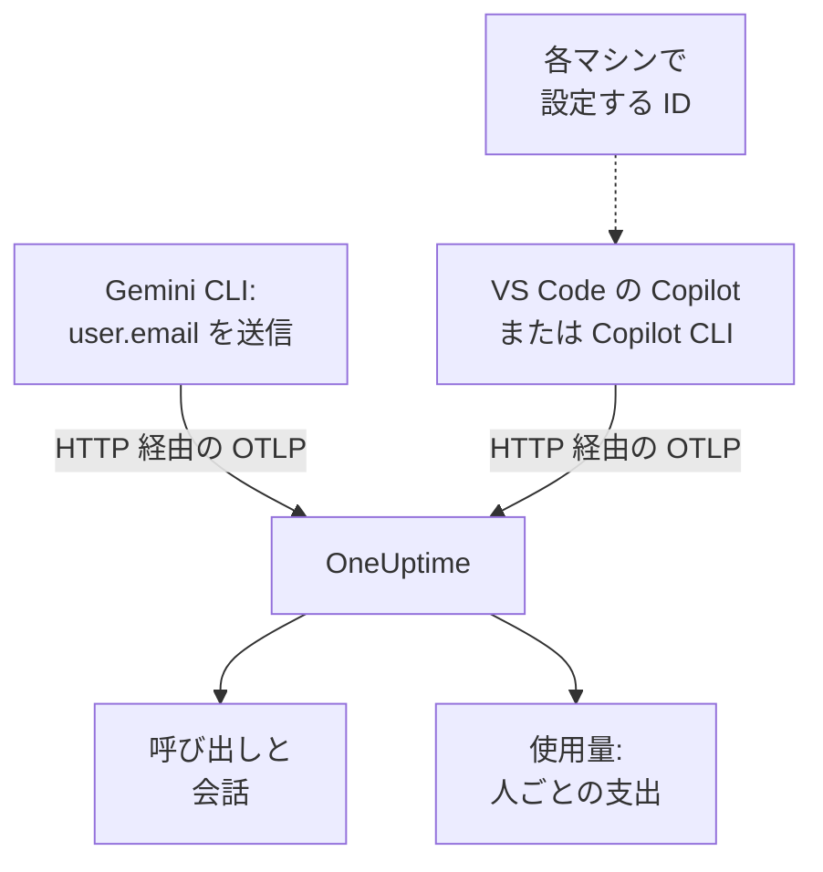

# Gemini CLI と GitHub Copilot

Gemini CLI と GitHub Copilot はどちらも自分で OpenTelemetry をエクスポートします。OneUptime に向ければ、モデルの呼び出し、トークン、コスト、ツールの呼び出しが、あなた自身のアプリの AI 呼び出しと並んで [AI / LLM](/docs/telemetry/ai-llm-observability) に届きます。チャージバックで最も重要な点が両者で異なります。Gemini CLI はすべてのレコードで人を特定しますが、Copilot は誰も特定しないので、開発者一人ひとりを自分で指定します。

:::cards
- [Gemini CLI](#gemini-cli-を設定する): トレース付きでテレメトリをオンにし、OneUptime に直接送ります。
- [GitHub Copilot](#github-copilot-を設定する): VS Code または Copilot CLI からエクスポートします。
- [開発者一人ひとりを指定する](#開発者一人ひとりを指定する): Copilot が送らない ID。
- [トラブルシューティング](#トラブルシューティング): 何も届かないときに確認すること。
:::

## 仕組み



| | Gemini CLI | GitHub Copilot |
| --- | --- | --- |
| 送るもの | トレース、メトリクス、ログ | トレース、メトリクス、イベント (エージェント機能からのみ) |
| 人の特定 | サインインしていれば `user.email` | なし: `enduser.id` と `user.email` を自分で設定 |
| プロンプトのテキスト | `logPrompts` をオフにしない限り送信 | `captureContent` をオンにしない限り送信しない |
| 既定の送信先 | `http://localhost:4317` (gRPC) | `http://localhost:4318` (HTTP) |

## 始める前に

- 取り込みキー: **プロジェクト設定 → テレメトリと APM → 取り込みキー** を開き、 **取り込みキーを作成** をクリックします。
- OTLP のベース URL: `https://oneuptime.com/otlp`、OneUptime をセルフホストしている場合は `https://YOUR-ONEUPTIME-HOST/otlp`。
- キーはエクスポートの各リクエストの `x-oneuptime-token` ヘッダーで送られます。

## Gemini CLI を設定する

Gemini CLI はトレース、メトリクス、ログイベントを送り、誰かがサインインしていればすべてのレコードに `user.email` を付けます。OneUptime は `user.email` を従業員として読み取るので、対応表もマシンごとの設定もなしに、一人ひとりの支出が表示されます。

:::steps
### テレメトリをオンにする

各マシンのユーザー設定ファイル、またはリポジトリの `.gemini/settings.json` に `telemetry` ブロックを追加します。

```json title="~/.gemini/settings.json"
{
  "telemetry": {
    "enabled": true,
    "target": "local",
    "otlpEndpoint": "https://oneuptime.com/otlp",
    "otlpProtocol": "http",
    "otlpHeaders": {
      "x-oneuptime-token": "YOUR_INGESTION_TOKEN"
    },
    "traces": true,
    "logPrompts": false
  }
}
```

### 新しいセッションを始める

Gemini CLI は起動時に設定を読み込むので、再起動してプロンプトを実行します。

### データが届くか確認する

**製品 → AI / LLM → 呼び出し** を開きます。呼び出しがサービス `gemini-cli` の下に、モデルとトークンとともに一覧表示されます。
:::

このブロックの設定のうち、特に重要なのは次の 3 つです。

- `otlpProtocol: "http"`。Gemini CLI は、指定しない限り gRPC を使います。HTTP では、ベース URL に `/v1/traces`、 `/v1/metrics`、 `/v1/logs` を自分で付け加えます。OneUptime はポート 443 で gRPC も受け付けますが ( [gRPC 経由の OTLP](/docs/telemetry/open-telemetry#grpc-上の-otlp) を参照)、HTTP のほうが簡単です。
- `traces: true`。既定ではオフで、これがないと Gemini CLI のスパンにはモデルもトークン数も載らないため、料金を算出できません。Gemini CLI はコストのメトリクスも送りません。呼び出しのコストを見るにはトレースをオンにしてください。
- `logPrompts: false`。下の警告を読んでください。

> [!WARNING]
> `logPrompts` は既定で `true` なので、テレメトリをオンにすると、エンジニアが入力するテキストが送られます。多くの場合、ソースコード、顧客データ、貼り付けた認証情報が含まれます。テレメトリをオンにするのと同じ変更でこれを `false` にしてください。デバッグのためにプロンプトが必要なら意図して判断し、必要な部分は **トレース → 設定** のスクラブルールでマスクしてください。

### 多数のマシンに配布する設定

すべての設定には環境変数があり、環境変数はリポジトリの `.gemini/settings.json` より優先されます。そのため、MDM で配布するポリシーは環境変数で設定するのが適しています。

```bash
export GEMINI_TELEMETRY_ENABLED=true
export GEMINI_TELEMETRY_TARGET=local
export GEMINI_TELEMETRY_OTLP_ENDPOINT="https://oneuptime.com/otlp"
export GEMINI_TELEMETRY_OTLP_PROTOCOL=http
export GEMINI_TELEMETRY_OTLP_HEADERS="x-oneuptime-token=YOUR_INGESTION_TOKEN"
export GEMINI_TELEMETRY_TRACES_ENABLED=true
export GEMINI_TELEMETRY_LOG_PROMPTS=false
```

| 設定 | 変数 | 既定値 | 内容 |
| --- | --- | --- | --- |
| `enabled` | `GEMINI_TELEMETRY_ENABLED` | `false` | テレメトリをオンにする |
| `target` | `GEMINI_TELEMETRY_TARGET` | `local` | `local` は設定したエンドポイントへ、 `gcp` は Google Cloud へ送る |
| `otlpEndpoint` | `GEMINI_TELEMETRY_OTLP_ENDPOINT` | `http://localhost:4317` | テレメトリの送信先 |
| `otlpProtocol` | `GEMINI_TELEMETRY_OTLP_PROTOCOL` | `grpc` | `grpc` または `http` |
| `otlpHeaders` | `GEMINI_TELEMETRY_OTLP_HEADERS` | なし | エクスポートごとのヘッダー。ファイルではオブジェクト、変数では `key=value` の組か JSON |
| `traces` | `GEMINI_TELEMETRY_TRACES_ENABLED` | `false` | モデル、トークン、ペイロードをスパンに載せる |
| `logPrompts` | `GEMINI_TELEMETRY_LOG_PROMPTS` | `true` | プロンプトのテキストをログイベントに載せる |
| `outfile` | `GEMINI_TELEMETRY_OUTFILE` | なし | 代わりにテレメトリをファイルに書き出し、何が送られるかを確認する |

コマンドラインフラグは `GEMINI_TELEMETRY_*` 変数より優先され、それは標準の `OTEL_EXPORTER_OTLP_*` 変数より優先され、それは `settings.json` より優先されます。Gemini CLI は `OTEL_EXPORTER_OTLP_HEADERS` も読み取るので、ほかのツールのためにすでに設定したヘッダーもそのまま届きます。

:::details OpenTelemetry Collector 経由で送る
各マシン、またはチームごとに置いたコレクターで、テレメトリを OneUptime に届ける前にバッチ処理、再試行、ルーティングできます。Gemini CLI は gRPC で `http://localhost:4317` に送る既定のままにして、キーはコレクターに追加させます。

```yaml title="otel-collector-config.yaml"
receivers:
  otlp:
    protocols:
      grpc:
        endpoint: 0.0.0.0:4317
      http:
        endpoint: 0.0.0.0:4318

exporters:
  otlphttp:
    endpoint: "https://oneuptime.com/otlp"
    headers:
      "x-oneuptime-token": "YOUR_INGESTION_TOKEN"

service:
  pipelines:
    traces:
      receivers: [otlp]
      exporters: [otlphttp]
    metrics:
      receivers: [otlp]
      exporters: [otlphttp]
    logs:
      receivers: [otlp]
      exporters: [otlphttp]
```

コレクターの実行方法は [OpenTelemetry](/docs/telemetry/open-telemetry) を参照してください。
:::

### Gemini CLI が送るもの

| メトリクス | 内容 |
| --- | --- |
| `gen_ai.client.token.usage` | 入力と出力のトークン。OneUptime が数える系列 |
| `gemini_cli.token.usage` | Gemini CLI 独自の名前での同じトークンと、その `thought`、`cache`、`tool` のトークン。トークンを二重に数えないよう、数えない |
| `gen_ai.client.operation.duration` | モデルの各呼び出しにかかった時間 |
| `gemini_cli.api.request.count` | モデルの呼び出し |
| `gemini_cli.tool.call.count` | ツールの呼び出し |
| `gemini_cli.session.count` | 開始したセッション |
| `gemini_cli.lines.changed` | エージェントが変更した行 |

ログイベントには `gemini_cli.user_prompt`、 `gemini_cli.api_request`、 `gemini_cli.api_response`、 `gemini_cli.api_error`、 `gemini_cli.tool_call`、 `gemini_cli.file_operation` があります。すべてのレコードが `session.id`、 `installation.id`、 `active_approval_mode`、そしてサインインしていれば `user.email` を持ちます。OneUptime は `session.id` を会話 ID として読み取るので、Gemini CLI のセッション全体が、トレースがいくつあっても **会話** の下でひとつの会話として表示されます。

メトリクスは通常の OpenTelemetry メトリクスです。どれでもダッシュボードのグラフにでき、 [メトリクス モニター](/docs/monitor/metrics-monitor) でアラートを出すこともできます。

## GitHub Copilot を設定する

GitHub は、Copilot のエージェント機能についてのみ OpenTelemetry を文書化しています。

| 機能 | OpenTelemetry の送信 |
| --- | --- |
| VS Code の Copilot Chat とエージェントモード | はい |
| Copilot CLI | はい |
| Copilot SDK | はい |
| JetBrains IDE のエージェントワークフロー | はい (Copilot プラグインの設定で指定) |
| インライン補完、github.com 上の Copilot、Copilot のコードレビュー | 文書化されていない |

そのため、主にインライン補完を使っているチームは、エクスポートをどう設定しても OneUptime では何もしていないように見えます。

:::tabs
@tab VS Code
```json title="settings.json"
{
  "github.copilot.chat.otel.enabled": true,
  "github.copilot.chat.otel.exporterType": "otlp-http",
  "github.copilot.chat.otel.otlpEndpoint": "https://oneuptime.com/otlp",
  "github.copilot.chat.otel.captureContent": false
}
```
@tab Copilot CLI
```bash
export COPILOT_OTEL_ENABLED=true
export OTEL_EXPORTER_OTLP_ENDPOINT="https://oneuptime.com/otlp"
export OTEL_EXPORTER_OTLP_HEADERS="x-oneuptime-token=YOUR_INGESTION_TOKEN"
```
@tab 管理された設定
```json
{
  "telemetry": {
    "enabled": true,
    "endpoint": "https://oneuptime.com/otlp",
    "protocol": "http/protobuf",
    "serviceName": "github-copilot",
    "captureContent": false,
    "lockCaptureContent": true,
    "headers": {
      "x-oneuptime-token": "YOUR_INGESTION_TOKEN"
    }
  }
}
```
:::

- VS Code の設定にはヘッダー用のキーがありません。Copilot CLI と同じく、VS Code を起動する環境で `OTEL_EXPORTER_OTLP_HEADERS` を設定してください。環境変数は VS Code の設定より優先されます。
- 企業が VS Code と Copilot CLI に配布する管理された設定は、キーを `headers` に持ち、各開発者の設定より優先されます。 `lockCaptureContent` は全員のプロンプト収集をオフのまま固定します。そこでの `protocol` はワイヤー形式で、 `http/protobuf` または `http/json` です。
- `captureContent` は既定でオフなので、オンにしない限りプロンプトと回答は送られません。

## 開発者一人ひとりを指定する

Copilot は、OneUptime が使える ID を送りません。 `captureIdentity` 設定は `user.name` を追加し、Copilot CLI は `enduser.pseudo.id` を追加することがありますが、OneUptime はどちらも従業員としては読み取りません。ID がなければ、Copilot の支出はすべて **使用量** タブの **帰属なし** という 1 行にまとめられます。

各マシンで、VS Code と Copilot CLI を起動する環境に ID を設定します。シェルのプロファイルや、MDM が実行するスクリプトです。

```bash
export OTEL_RESOURCE_ATTRIBUTES="enduser.id=alice@example.com,user.email=alice@example.com,team.id=platform,cost_center=eng-tools"
```

| 属性 | OneUptime での読み取り方 |
| --- | --- |
| `enduser.id` | 従業員の ID |
| `user.email` | 従業員のメールアドレス。 **使用量** タブに表示される名前 |
| `team.id`、`team`、`cost_center`、`department` | チームまたはコストセンター |

これらはリソース属性なので、 `resource.enduser.id`、 `resource.user.email` のように届きます。OneUptime は ID とチームのキーを、 `resource.` 接頭辞の有無にかかわらず読み取ります。Gemini CLI はすでに `user.email` を送っているので、 `OTEL_RESOURCE_ATTRIBUTES` はチームのためだけに設定してください。

- 最初の呼び出しの前に ID を設定してください。ID なしで届いた呼び出しは、後から帰属させることができません。
- Copilot の管理された設定に `resourceAttributes` を入れないでください。それは `OTEL_RESOURCE_ATTRIBUTES` より優先され、各マシンで設定した ID を置き換えてしまいます。
- `gen_ai.user` や `llm.user` は使わないでください。顧客にサービスを提供するアプリではこれらが顧客を指すため、OneUptime は従業員としては決して読み取りません。

## Copilot のデータの見え方

Copilot は OpenTelemetry の GenAI 規約に従っているので、その呼び出しは、自分のアプリの呼び出しと同じように **呼び出し**、 **会話**、 **使用量** に表示されます。

| スパン | 単位 |
| --- | --- |
| `invoke_agent` | エージェントのターン |
| `chat` | モデルの呼び出し |
| `execute_tool` | ツールの呼び出し |
| `execute_hook` | フックの実行 |

スパンはモデル、 `gen_ai.usage.input_tokens`、 `gen_ai.usage.output_tokens`、 `gen_ai.conversation.id` を持つので、エージェントのターン全体がひとつの会話として表示されます。どちらの機能も `gen_ai.client.token.usage` と `gen_ai.client.operation.duration` のメトリクス、そして OTLP のログシグナルでイベントを送ります。あいだに置くコレクターには `logs` パイプラインを残してください。

OneUptime は、各呼び出しの料金をモデルとトークンから **料金** の単価で算出します。これはトークンを定価で使った場合の額であり、GitHub の請求額ではありません。Copilot の料金はシート単位とプレミアムリクエスト単位です。

シート、シートの利用状況、プレミアムリクエストの請求は OpenTelemetry にはまったく含まれません。それらは GitHub の REST API にあり、OneUptime は読み取りません。シートと請求の数字は GitHub から取得してください。

## トラブルシューティング

:::details Gemini CLI から何も届かない
よくある原因は、エンドポイントが HTTP の URL なのに `otlpProtocol` が既定の `grpc` のままになっていることです。 `otlpProtocol` を `http` にし、 `otlpEndpoint` が `/otlp` で終わるベース URL であること、 `x-oneuptime-token` ヘッダーが設定されていることを確認してください。しばらく `outfile` を設定すると、Gemini CLI が何を送るかを確認できます。
:::

:::details Gemini CLI の呼び出しにモデル、トークン、コストがない
`traces` がオフです。オンにしてください。これがないと Gemini CLI のスパンにはモデルもトークン数も載らず、コストのメトリクスも送られません。
:::

:::details Copilot の支出が帰属なしと表示される
ID がエクスポーターに届いていません。VS Code または Copilot CLI を起動した環境で `OTEL_RESOURCE_ATTRIBUTES` が設定されていること、そして Copilot の管理された設定がそれを置き換える `resourceAttributes` を設定していないことを確認してください。
:::

:::details Copilot から何も送られてこない
対象の人がインライン補完ではなくエージェント機能を使っていること、そして `OTEL_EXPORTER_OTLP_HEADERS` がキーを持っていることを確認してください。VS Code 自体の設定ではキーを渡せません。
:::

:::details キーが拒否される
OneUptime は、キーがない、不明、または期限切れの場合は `401` を、無効化されたキーやブラウザーキーの場合は `422` を返します。 `x-oneuptime-token` で送るサーバーキーを使ってください。
:::

## 次のステップ

:::cards
- [AI コーディングアシスタント](/docs/telemetry/ai-coding-assistants): 誰がどのツールを使い、一人ひとりと各チームがいくら使っているか。
- [AI / LLM オブザーバビリティ](/docs/telemetry/ai-llm-observability): OneUptime が読み取る属性、コストの算出方法、1 日の予算。
- [AI ゲートウェイ](/docs/telemetry/ai-gateways): 独自のエクスポートを持たないツールを、ゲートウェイ経由で。
:::
