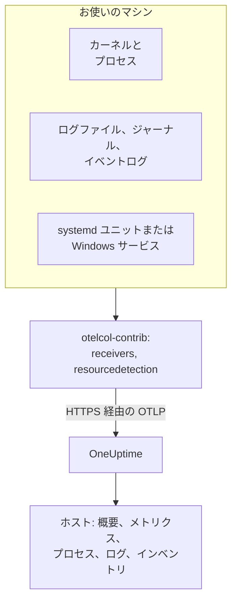

# ホスト OpenTelemetry Collector

Linux、macOS、Windows のマシンで OpenTelemetry Collector を実行し、そのメトリクス、プロセス、ログ、サービスの状態を OneUptime に送信します。マシンは **製品 → インフラストラクチャ → ホスト** の下に専用のページとともに表示され、OneUptime のエージェントをインストールする必要はありません。Collector はアップストリームの `otelcol-contrib` リリースそのものです。[ホスト モニター](/docs/monitor/host-monitor) は、送信された内容をもとにアラートを出します。

:::cards
- [Collector をインストールする](#collector-をインストールする): Linux、macOS、Windows で 3 ステップ。
- [収集する内容を選ぶ](#収集する内容を選ぶ): メトリクス、ファイルログ、ジャーナル、イベントログ、サービスの状態。
- [インベントリ属性](#インベントリ属性-ipmacシリアル番号メーカーモデルファームウェア): CMDB 向けの IP、MAC、シリアル番号、メーカー、モデル、ファームウェア。
- [送信量を減らす](#収集するデータ量を減らす): ログ行を減らし、間隔を粗くし、系列を減らします。
:::

## 仕組み

Collector はレシーバーを通じてマシンを読み取り、すべてのレコードにマシンの ID を付け、取り込みキーを使って OTLP で OneUptime に送信します。OneUptime は最初のメトリクスからホストを登録し、データが届くにつれてそのページを埋めていきます。



| ホストで表示される内容 | 取得元 |
| --- | --- |
| **概要** と **メトリクス** | `hostmetrics` レシーバー: CPU、メモリ、ディスク、ファイルシステム、ネットワーク、負荷、ページング。 |
| **プロセス** | `hostmetrics` の `process` スクレイパー: プロセスごとの系列のセット。 |
| **ログ** | `filelog`、`journald`、`windowseventlog` レシーバー。 |
| **Systemd ユニット** (Linux) | `systemd` レシーバー。 |
| **サービス** (Windows) | `windows_service` レシーバー。 |
| インベントリ項目 | `resourcedetection` プロセッサーと、[付与する属性](#インベントリ属性-ipmacシリアル番号メーカーモデルファームウェア)。 |
| **エージェントバージョン** | `resource` プロセッサー内の `oneuptime.agent.version`。 |

ホストが登録されるのは、`host.name` を持つバッチが `hostmetrics` または `process` のメトリクス、あるいは `os.type` 属性も持っているときです。`resourcedetection` プロセッサーがこれらをすべて設定するため、どの設定でもこのプロセッサーを先頭に置いています。`host.id` や `host.arch` だけではホストは登録されず、Kubernetes の ID (`k8s.cluster.name`、`k8s.node.name`、`k8s.pod.name`) を持つテレメトリは、代わりにそのクラスターの下に登録されます。Kubernetes のノードは [Kubernetes エージェント](/docs/telemetry/kubernetes-agent) で監視してください。

## 始める前に

- 取り込みキー。**プロジェクト設定 → テレメトリと APM → 取り込みキー** で作成し、値をコピーします。Collector はこれを `x-oneuptime-token` ヘッダーで送信します。
- マシンの管理者権限: Linux と macOS では `sudo`、Windows では管理者として実行した PowerShell。
- マシンから OneUptime の URL への送信方向の HTTPS。
- Collector の contrib ディストリビューションである `otelcol-contrib`。コアの `otelcol` ビルドには、これらの設定が使うレシーバーとプロセッサーが含まれていません。`systemd` レシーバー (Linux) は v0.143.0 から、`windows_service` レシーバー (Windows) は v0.155.0 から動作します。以下のコマンドは、OneUptime が固定しているリリースである v0.161.0 をインストールします。

## Collector をインストールする

:::steps
### 設定を保存する

インストールコマンドを実行するフォルダーにこれを `config.yaml` として保存し、`YOUR_TELEMETRY_INGESTION_TOKEN` を取り込みキーに置き換えます (セルフホストしている場合は、エンドポイントも自分の URL に置き換えます)。

:::tabs
@tab Linux
```yaml title="config.yaml"
receivers:
  hostmetrics:
    collection_interval: 30s
    scrapers:
      cpu:
        metrics:
          system.cpu.utilization:
            enabled: true
          system.cpu.logical.count:
            enabled: true
      memory:
        metrics:
          system.memory.utilization:
            enabled: true
      disk:
      filesystem:
        metrics:
          system.filesystem.utilization:
            enabled: true
      load:
      network:
      paging:
      processes:
      process:
        mute_process_name_error: true
        mute_process_exe_error: true
        mute_process_io_error: true
        metrics:
          process.cpu.utilization:
            enabled: true
          process.memory.utilization:
            enabled: true

  # The systemd journal: every unit's logs, info and above.
  journald:
    directory: /var/log/journal
    priority: info

  # Powers the Systemd Units tab (otelcol-contrib v0.143.0+).
  systemd:
    collection_interval: 30s
    units: ["*.service"]
    metrics:
      systemd.service.cpu.time:
        enabled: false

processors:
  # Stamps host.name, host.id and os.type: this is how OneUptime attaches
  # telemetry to the host. Without it the host's pages stay empty.
  resourcedetection:
    detectors: [system, env]
    system:
      hostname_sources: [os]
      resource_attributes:
        host.name:
          enabled: true
        host.id:
          enabled: true
        host.arch:
          enabled: true
        host.ip:
          enabled: true
        host.mac:
          enabled: true
        os.type:
          enabled: true
        os.description:
          enabled: true
        os.version:
          enabled: true
  # The collector release this config is for: the host's Agent Version.
  resource:
    attributes:
      - key: oneuptime.agent.version
        value: "0.161.0"
        action: upsert
  batch:

exporters:
  otlphttp/oneuptime:
    endpoint: https://oneuptime.com/otlp
    headers:
      x-oneuptime-token: YOUR_TELEMETRY_INGESTION_TOKEN

service:
  pipelines:
    metrics:
      receivers: [hostmetrics, systemd]
      processors: [resourcedetection, resource, batch]
      exporters: [otlphttp/oneuptime]
    logs:
      receivers: [journald]
      processors: [resourcedetection, resource, batch]
      exporters: [otlphttp/oneuptime]
```
@tab macOS
```yaml title="config.yaml"
receivers:
  hostmetrics:
    collection_interval: 30s
    scrapers:
      cpu:
        metrics:
          system.cpu.utilization:
            enabled: true
          system.cpu.logical.count:
            enabled: true
      memory:
        metrics:
          system.memory.utilization:
            enabled: true
      disk:
      filesystem:
        metrics:
          system.filesystem.utilization:
            enabled: true
      load:
      network:
      paging:
      processes:
      process:
        mute_process_name_error: true
        mute_process_exe_error: true
        mute_process_io_error: true
        metrics:
          process.cpu.utilization:
            enabled: true
          process.memory.utilization:
            enabled: true

  filelog/system:
    include:
      - /var/log/install.log
      - /var/log/wifi.log
    start_at: end

processors:
  # Stamps host.name, host.id and os.type: this is how OneUptime attaches
  # telemetry to the host. Without it the host's pages stay empty.
  resourcedetection:
    detectors: [system, env]
    system:
      hostname_sources: [os]
      resource_attributes:
        host.name:
          enabled: true
        host.id:
          enabled: true
        host.arch:
          enabled: true
        host.ip:
          enabled: true
        host.mac:
          enabled: true
        os.type:
          enabled: true
        os.description:
          enabled: true
        os.version:
          enabled: true
  # The collector release this config is for: the host's Agent Version.
  resource:
    attributes:
      - key: oneuptime.agent.version
        value: "0.161.0"
        action: upsert
  batch:

exporters:
  otlphttp/oneuptime:
    endpoint: https://oneuptime.com/otlp
    headers:
      x-oneuptime-token: YOUR_TELEMETRY_INGESTION_TOKEN

service:
  pipelines:
    metrics:
      receivers: [hostmetrics]
      processors: [resourcedetection, resource, batch]
      exporters: [otlphttp/oneuptime]
    logs:
      receivers: [filelog/system]
      processors: [resourcedetection, resource, batch]
      exporters: [otlphttp/oneuptime]
```
@tab Windows
```yaml title="config.yaml"
receivers:
  hostmetrics:
    collection_interval: 30s
    scrapers:
      cpu:
        metrics:
          system.cpu.utilization:
            enabled: true
          system.cpu.logical.count:
            enabled: true
      memory:
        metrics:
          system.memory.utilization:
            enabled: true
      disk:
      filesystem:
        metrics:
          system.filesystem.utilization:
            enabled: true
      load:
      network:
      paging:
      processes:
      process:
        mute_process_name_error: true
        mute_process_exe_error: true
        mute_process_io_error: true
        metrics:
          process.cpu.utilization:
            enabled: true
          process.memory.utilization:
            enabled: true

  windowseventlog/system:
    channel: System
    start_at: end

  windowseventlog/application:
    channel: Application
    start_at: end

  windowseventlog/security:
    channel: Security
    start_at: end

  # Powers the Services tab (otelcol-contrib v0.155.0+).
  windows_service:
    collection_interval: 30s

processors:
  # Stamps host.name, host.id and os.type: this is how OneUptime attaches
  # telemetry to the host. Without it the host's pages stay empty.
  resourcedetection:
    detectors: [system, env]
    system:
      hostname_sources: [os]
      resource_attributes:
        host.name:
          enabled: true
        host.id:
          enabled: true
        host.arch:
          enabled: true
        host.ip:
          enabled: true
        host.mac:
          enabled: true
        os.type:
          enabled: true
        os.description:
          enabled: true
        os.version:
          enabled: true
  # The collector release this config is for: the host's Agent Version.
  resource:
    attributes:
      - key: oneuptime.agent.version
        value: "0.161.0"
        action: upsert
  batch:

exporters:
  otlphttp/oneuptime:
    endpoint: https://oneuptime.com/otlp
    headers:
      x-oneuptime-token: YOUR_TELEMETRY_INGESTION_TOKEN

service:
  pipelines:
    metrics:
      receivers: [hostmetrics, windows_service]
      processors: [resourcedetection, resource, batch]
      exporters: [otlphttp/oneuptime]
    logs:
      receivers:
        - windowseventlog/system
        - windowseventlog/application
        - windowseventlog/security
      processors: [resourcedetection, resource, batch]
      exporters: [otlphttp/oneuptime]
```
:::

どの設定も、ダッシュボードが **製品 → インフラストラクチャ → ホスト → ドキュメント** に表示するものにログパイプラインを加えたものです。プロセッサーは `resourcedetection`、`resource`、`batch`、エクスポーターは `otlphttp/oneuptime` です。`service.name` は設定しないため、ホストのテレメトリはホスト自体に属し、`host/<hostname>` として登録されます。その名前のテレメトリサービスの下に登録したい場合にだけ、`resource` プロセッサーに `service.name` を追加してください。

### Collector をインストールして起動する

:::tabs
@tab Linux
Debian または Ubuntu の場合:

```bash
VERSION=0.161.0                      # the release OneUptime pins
ARCH=$(dpkg --print-architecture)   # amd64 or arm64

curl -fL -o /tmp/otelcol-contrib.deb \
  "https://github.com/open-telemetry/opentelemetry-collector-releases/releases/download/v${VERSION}/otelcol-contrib_${VERSION}_linux_${ARCH}.deb"
sudo dpkg -i /tmp/otelcol-contrib.deb
```

RHEL、CentOS、Fedora、Amazon Linux の場合:

```bash
VERSION=0.161.0
ARCH=$(uname -m | sed 's/x86_64/amd64/;s/aarch64/arm64/')

curl -fL -o /tmp/otelcol-contrib.rpm \
  "https://github.com/open-telemetry/opentelemetry-collector-releases/releases/download/v${VERSION}/otelcol-contrib_${VERSION}_linux_${ARCH}.rpm"
sudo rpm -Uvh /tmp/otelcol-contrib.rpm
```

パッケージは `/usr/bin/otelcol-contrib` と systemd ユニットをインストールし、既定の設定で起動します。自分の設定に置き換え、Collector のユーザーがジャーナルを読めるようにしてから再起動します:

```bash
sudo install -m 0644 config.yaml /etc/otelcol-contrib/config.yaml
sudo usermod -aG systemd-journal otelcol-contrib
sudo systemctl enable otelcol-contrib
sudo systemctl restart otelcol-contrib
sudo systemctl status otelcol-contrib
```

パッケージのユニットは、権限のない `otelcol-contrib` ユーザーとして Collector を実行します。`systemd-journal` グループに入るとジャーナルを読めます。`/var/log` 内のファイル (Debian と Ubuntu では `adm` グループが読める) を追跡するには、そのグループも追加します。`process` スクレイパーが他のユーザーのプロセスを見られるようにするには、`CAP_SYS_PTRACE` ケーパビリティを付与します。
@tab macOS
```bash
VERSION=0.161.0
ARCH=$(uname -m | sed 's/x86_64/amd64/')   # arm64 on Apple silicon, amd64 on Intel

curl -fL -o /tmp/otelcol-contrib.tar.gz \
  "https://github.com/open-telemetry/opentelemetry-collector-releases/releases/download/v${VERSION}/otelcol-contrib_${VERSION}_darwin_${ARCH}.tar.gz"

sudo mkdir -p /usr/local/otelcol-contrib /usr/local/bin /etc/otelcol-contrib
sudo tar -xzf /tmp/otelcol-contrib.tar.gz -C /usr/local/otelcol-contrib
sudo ln -sf /usr/local/otelcol-contrib/otelcol-contrib /usr/local/bin/otelcol-contrib
sudo install -m 0644 config.yaml /etc/otelcol-contrib/config.yaml
```

`/Library/LaunchDaemons/com.oneuptime.otelcol-contrib.plist` を作成し、launchd が Mac の起動時に Collector を起動し、停止したら再起動するようにします:

```xml title="/Library/LaunchDaemons/com.oneuptime.otelcol-contrib.plist"
<?xml version="1.0" encoding="UTF-8"?>
<!DOCTYPE plist PUBLIC "-//Apple//DTD PLIST 1.0//EN" "http://www.apple.com/DTDs/PropertyList-1.0.dtd">
<plist version="1.0">
<dict>
  <key>Label</key><string>com.oneuptime.otelcol-contrib</string>
  <key>ProgramArguments</key>
  <array>
    <string>/usr/local/bin/otelcol-contrib</string>
    <string>--config=/etc/otelcol-contrib/config.yaml</string>
  </array>
  <key>RunAtLoad</key><true/>
  <key>KeepAlive</key><true/>
  <key>StandardOutPath</key><string>/var/log/otelcol-contrib.out.log</string>
  <key>StandardErrorPath</key><string>/var/log/otelcol-contrib.err.log</string>
</dict>
</plist>
```

読み込みます:

```bash
sudo launchctl load -w /Library/LaunchDaemons/com.oneuptime.otelcol-contrib.plist
sudo launchctl list | grep otelcol-contrib
```

Homebrew ではなく、この tarball を使ってください。Homebrew のフォーミュラはコアビルドで、この設定では起動を拒否します。
@tab Windows
管理者として実行した PowerShell で、`config.yaml` があるフォルダーから、このブロック全体を一度に実行します。各行はその上の変数に依存しています。

```powershell
$VERSION = "0.161.0"                          # the release OneUptime pins; v0.155.0+ has the Services tab
$ARCH    = "amd64"                            # use "arm64" on ARM hosts
$dest    = "C:\Program Files\otelcol-contrib"
$tar     = "$env:TEMP\otelcol-contrib.tar.gz"

# Note the "-contrib" in the asset name; otelcol_... is the wrong archive.
$url = "https://github.com/open-telemetry/opentelemetry-collector-releases/releases/download/v$VERSION/otelcol-contrib_${VERSION}_windows_${ARCH}.tar.gz"

New-Item -ItemType Directory -Force -Path $dest | Out-Null
Invoke-WebRequest -Uri $url -OutFile $tar
tar -xf $tar -C $dest                          # tar.exe ships with Windows 10 1803+ / Server 2019+
Get-ChildItem $dest                            # expect otelcol-contrib.exe, not otelcol.exe
Copy-Item config.yaml "$dest\config.yaml" -Force

# --% hands the rest of the line to sc.exe unchanged, so its quoting
# survives PowerShell — keep the command on one line.
sc.exe --% create "otelcol-contrib" binPath= "\"C:\Program Files\otelcol-contrib\otelcol-contrib.exe\" --config=\"C:\Program Files\otelcol-contrib\config.yaml\"" start= auto DisplayName= "OpenTelemetry Collector (OneUptime)"
sc.exe description "otelcol-contrib" "Collects host telemetry and forwards it to OneUptime over OTLP."
sc.exe start "otelcol-contrib"
sc.exe query "otelcol-contrib"
```

サービスは `LocalSystem` として実行され、`Security` イベントログとすべての Windows サービスを読み取れます。Windows では、`load` スクレイパーは *Processor Queue Length* カウンターから負荷平均を模擬するだけで、値は 0 から始まります。

リリースファイルの名前は `otelcol-contrib_` で始まっている必要があります。コアの `otelcol_<version>_windows_amd64.tar.gz` アーカイブを展開すると `otelcol.exe` になりますが、これには `windowseventlog` レシーバーも `windows_service` レシーバーもありません。名前を `otelcol-contrib.exe` に変えても追加されません。インストーラーを使いたい場合は、同じ [リリースページ](https://github.com/open-telemetry/opentelemetry-collector-releases/releases) に署名付きの `otelcol-contrib_<version>_windows_x64.msi` があり、サービスを登録してくれます。この `config.yaml` を指定し、サービスは `LocalSystem` のままにしてください。
:::

### ホストが表示されることを確認する

**製品 → インフラストラクチャ → ホスト → すべてのホスト** を開きます。最初のメトリクスが届くと、通常 30 秒以内にホストがホスト名で表示され、**概要**、**メトリクス**、**プロセス**、**ログ** の各ページが埋まります。表示されない場合は、Collector 自体のログを確認してください:

:::tabs
@tab Linux
```bash
sudo journalctl -u otelcol-contrib -f
```
@tab macOS
```bash
tail -f /var/log/otelcol-contrib.err.log
```
@tab Windows
```powershell
Get-WinEvent -LogName Application -MaxEvents 20 | Where-Object ProviderName -eq "otelcol-contrib"
```
:::
:::

テスト用のログ行を作るには、`logger "hello from oneuptime"` (Linux、macOS) または `eventcreate /T INFORMATION /ID 999 /L APPLICATION /SO OneUptimeTest /D "hello from oneuptime"` (Windows、管理者として実行) を実行し、ホストの **ログ** ページを確認します。

## 収集する内容を選ぶ

どの設定も同じ形をしています。読み取る対象ごとのレシーバー、`resourcedetection`、`resource`、`batch` の各プロセッサー、そして `otlphttp/oneuptime` エクスポーターです。以下のレシーバーを `receivers:` とそのパイプラインに追加してから、Collector を再起動します (`sudo systemctl restart otelcol-contrib`、Mac では `launchctl unload` と `load`、Windows では `Restart-Service otelcol-contrib`)。各スニペットは設定内の既存のセクションにマージしてください。2 つ目の `processors:` や `service:` キーは 1 つ目を置き換えてしまいます。

### ホストのメトリクス

`hostmetrics` はどの OS でも動作します。`collection_interval` ごとに、CPU、メモリ、ディスク、ファイルシステム、ネットワーク、負荷、ページング、プロセスをカーネルから読み取ります。`*.utilization` メトリクスと `system.cpu.logical.count` はレシーバーで既定ではオフですが、ホストのグラフと Host アラートテンプレートはこれらを読み取るため、上の設定のように有効のままにしておいてください。`process` スクレイパーは **プロセス** ページのデータ源で、系列の最大の発生源でもあります ([送信量を減らす](#収集するデータ量を減らす) を参照)。

Linux では、Collector は `/proc` と `/sys` を読み取ります。コンテナ内の Collector はホストのものをマウントし、`HOST_PROC` と `HOST_SYS` を設定する必要があります ([Docker コンテナ内で](#docker-コンテナ内で) を参照)。ネイティブインストールでは何も必要ありません。

### ファイルログ

ディスク上の任意のログファイルを `filelog` レシーバーで追跡し、`logs` パイプラインに追加します:

```yaml
receivers:
  filelog/app:
    include:
      - /var/log/myapp/*.log
    start_at: end
    multiline:
      # A new entry starts with a timestamp; continuation lines (the
      # "at ...", "File ...", "Caused by: ..." frames) are folded into it.
      line_start_pattern: '^\d{4}-\d{2}-\d{2}[ T]\d{2}:\d{2}:\d{2}'
```

`start_at: end` は新しい行だけを読みます。初回の実行でファイルを先頭から読むには `beginning` を使います。Collector は各ファイルの読み取り位置を保持するため、再起動後も正しい位置から再開します。

OneUptime は error と fatal のログ行からスタックトレースを探し、ホストの下の **例外** にまとめます。そのためには、複数行のスタックトレース (Java、Python、.NET、Ruby) が 1 件のレコードとして届く必要があり、それを行うのが `multiline` です。これがないと、各フレームが別々のログになります。アプリケーション自身が OpenTelemetry の `exception.type`、`exception.message`、`exception.stacktrace` 属性を書き込めるなら、さらに確実です。

systemd のホストでは、`/var/log/syslog` と `/var/log/messages` はジャーナルにすでにある内容を繰り返すため、どちらか一方だけを読み取ってください。

### systemd ジャーナル

systemd のホストでは、`journald` レシーバーがすべてのユニットのログを構造化フィールドとともに 1 か所で読み取ります。上の Linux 用の設定は、`info` 以上のログをすべて読み取ります。一部のユニットに絞り込むには:

```yaml
receivers:
  journald:
    directory: /var/log/journal
    units:
      # Drop this list to ingest everything; restrict it to limit volume.
      - ssh.service
      - cron.service
      - nginx.service
    priority: info
```

レシーバーは systemd のホストならどこにでもある `journalctl` を実行し、Collector のユーザーは `systemd-journal` グループに属している必要があります。

### Linux のサービス (systemd ユニット、メトリクス)

ホストの **Systemd ユニット** ページには、[`systemdreceiver`](https://github.com/open-telemetry/opentelemetry-collector-contrib/tree/main/receiver/systemdreceiver) (設定上の型は `systemd`) から取得した各ユニットとその状態が一覧表示されます。これは Windows の **サービス** ページに相当する Linux 版です。上の Linux 用の設定で有効になっています:

```yaml
receivers:
  systemd:
    collection_interval: 30s
    # The service manager to read: "system" (default) or "user".
    scope: system
    # Which units to scrape, as systemctl unit patterns. The default is
    # every service; widen it to include timers, sockets or mounts, or
    # narrow it to cut volume on hosts with hundreds of units:
    units: ["*.service"]
    # units: [nginx.service, postgresql.service, "*.timer"]
    metrics:
      # Per-service CPU time is on by default and doubles this receiver's
      # datapoint count. The Systemd Units tab does not use it, so turn it
      # off unless you chart it. On v0.142.0 the key is
      # systemd.unit.cpu.time — naming a metric the running build does not
      # have stops the collector at startup.
      systemd.service.cpu.time:
        enabled: false

service:
  pipelines:
    metrics:
      receivers: [hostmetrics, systemd]
      processors: [resourcedetection, resource, batch]
```

このレシーバーは `otelcol-contrib` v0.142.0 で初めて登場し、実行する価値がある最初のリリースは v0.143.0 です。それより古いリリースで `systemd` を追加すると、起動時に `'receivers' unknown type: "systemd"` で失敗します。v0.142.0 だけは CPU メトリクスを `systemd.unit.cpu.time` と呼び、すべてのユニットで cgroup の統計を探すため、`.service` 以外のユニットごとにスクレイプエラーがログに出ます。

このレシーバーは `systemd.unit.state` を状態の集合として送信します。各スクレイプで、ユニットごとに取りうる状態 (`active`、`reloading`、`inactive`、`failed`、`activating`、`deactivating`、`maintenance`、`refreshing`) ごとに 1 つのデータポイントが作られ、現在の状態には `1`、それ以外には `0` が入ります。ユニット名はリソース属性 `systemd.unit.name`、状態はデータポイント属性 `systemd.unit.active_state` です。ユニット名がリソース属性であるため、`resourcedetection` はメトリクスパイプラインに残しておく必要があります。これが各ユニットのリソースに `host.name` を付けるので、これがないとサンプルはどのホストにも紐付きません。

このレシーバーは、`systemctl list-units` が行うのと同じ読み取り専用の呼び出しでシステムの D-Bus からユニットの状態を読み取ります。systemd はこれを権限なしで許可しています。そのため、root ではなく `otelcol-contrib` ユーザーとして実行されるパッケージのサービスに、追加の権限は必要ありません。ただしバスは必要です。コンテナ内の Collector には、ホストのものをマウントしない限り `/run/dbus/system_bus_socket` がないため、ネイティブインストールを使ってください。このレシーバーはアルファ版で、Linux 専用です。

> [!WARNING]
> 状態の集合は、ユニットごと・スクレイプごとに 8 データポイントかかり、既定で有効な `systemd.service.cpu.time` がさらに 2 つ (`user` と `system`) を加えるため、ユニットごと・スクレイプごとに 10 データポイントになります。300 ユニットを 30 秒ごとに追跡するホストは、このレシーバーだけで毎分約 6,000 データポイントを送信します (CPU メトリクスをオフにすると約 4,800)。フリート全体で有効にする前に、`units:` をアラート対象のサービスに絞り込むか、`collection_interval` を長くしてください。

### Apple Unified Log

macOS はシステムログを `/var/log/system.log` ではなく Apple Unified Log に書き込み、これは `log show` と `log stream` で読み取ります。これを収集するには、小さなスクリプト `/usr/local/otelcol-contrib/log-stream.sh` でファイルにストリーミングします:

```bash title="/usr/local/otelcol-contrib/log-stream.sh"
#!/bin/bash
exec /usr/bin/log stream --style ndjson --level info \
  --predicate 'subsystem != "com.apple.cfnetwork"' \
  >> /var/log/apple-unified.log
```

スクリプトを実行可能にして launchd の下で (簡単なテストなら `nohup` で) 実行し、`filelog` レシーバーでそのファイルを指定します:

```yaml
receivers:
  filelog/apple-unified:
    include:
      - /var/log/apple-unified.log
    start_at: end
    operators:
      - type: json_parser
        timestamp:
          parse_from: attributes.timestamp
          layout: "%Y-%m-%d %H:%M:%S.%f%j"
```

多くの Mac のフリートでは、unified log なしで、ホストのメトリクスといくつかのファイルログだけで十分です。

### Windows イベントログ

上の Windows 用の設定は、`System`、`Application`、`Security` の各チャネルをサブスクライブします。量の多い `Security` チャネルを一部のイベント ID に絞り込むには:

```yaml
windowseventlog/security:
  channel: Security
  start_at: end
  query: "*[System[(EventID=4625 or EventID=4740)]]"
```

別のチャネル (*Event Viewer → Applications and Services Logs* の下にあるもの) を読み取るには、その正確な名前を使います:

```yaml
windowseventlog/iis:
  channel: Microsoft-IIS-Logging/Logs
  start_at: end
```

### Windows のサービス (メトリクス)

ホストの **サービス** ページには、[`windowsservicereceiver`](https://github.com/open-telemetry/opentelemetry-collector-contrib/tree/main/receiver/windowsservicereceiver) (設定上の型は `windows_service`) から取得した各 Windows サービスが、状態とスタートアップの種類とともに一覧表示されます。このレシーバーは v0.155.0 から `otelcol-contrib` に含まれています。それより前のリリースで `windows_service` を追加すると、起動時に `'receivers' unknown type: "windows_service"` で失敗します。上の Windows 用の設定で有効になっています:

```yaml
receivers:
  windows_service:
    collection_interval: 30s
    # Collect every service by default. To cut volume — and avoid the
    # "access denied" noise from services the collector can't open —
    # list just the ones you care about:
    # include_services: [Spooler, W3SVC, MSSQLSERVER]
    # Or collect everything except a few:
    # exclude_services: [TrustedInstaller]

service:
  pipelines:
    metrics:
      receivers: [hostmetrics, windows_service]
```

このレシーバーは、サービスごとに 1 つの `windows.service.status` ゲージを送信します。値は Win32 サービスの状態 (`4` は実行中、`1` は停止) で、`name` 属性と `startup_mode` 属性が付きます。Collector はすべてのサービスを `LocalSystem` として読み取り、開けないものはスキップします。このレシーバーはアルファ版で、Windows 専用です。あるサービスでのスクレイプエラーや `access denied` がほかのサービスに影響する場合は、`include_services` で絞り込んでください。

`include_services` は対象を絞り込むことしかできません。サービスを列挙してもすべてが表示される場合は、編集した設定が実行中の Collector に反映されていません。サービスを再起動し、`include_services` が `collection_interval` と同じインデントの空でないリストであることを確認したうえで、変更前に報告されたサービスがローリングウィンドウから外れるまで、**サービス** ページを数分待ってください。名前は、大文字と小文字を区別する正確なサービスキー名 (`Spooler`、`W3SVC`) で、`Get-Service | Select-Object Name` で一覧できます。

### ラベル

`oneuptime.label.` で始まるリソース属性は、ホストのプロジェクトラベルになります。`oneuptime.label.<dimension>=<value>` はラベル `<dimension>:<value>` です。これらのためのプロセッサーを追加し、パイプラインで指定します:

```yaml
processors:
  resource/oneuptime-labels:
    attributes:
      - key: oneuptime.label.team
        value: payments
        action: upsert
      - key: oneuptime.label.env
        value: production
        action: upsert

service:
  pipelines:
    metrics:
      processors: [resourcedetection, resource, resource/oneuptime-labels, batch]
```

ラベルは大文字と小文字を区別せずに照合されるため、既存の `Production` ラベルは重複して作られずに再利用されます。また、OneUptime で追加したラベルを Collector が削除することはありません。

### インベントリ属性 (IP、MAC、シリアル番号、メーカー、モデル、ファームウェア)

各ホストにはインベントリ項目も作られます。これは CMDB へのエクスポートが読み取るレコードです。その詳細は送信したテレメトリのリソース属性から直接埋められるため、届いた内容がそのまま CMDB 同期で取得できる内容になります。

| 必要な情報 | 属性 | 取得元 |
| --- | --- | --- |
| IP アドレス | `host.ip` | `resourcedetection`。マシンに複数ある場合はカンマ区切り |
| MAC アドレス | `host.mac` | `resourcedetection`。稼働中の各インターフェースの値をカンマ区切りで連結 |
| アーキテクチャ | `host.arch` | `resourcedetection` |
| マシン ID | `host.id` | `resourcedetection`: Windows ではマシン GUID、Linux では `/etc/machine-id` |
| OS | `os.type`、`os.description`、`os.version` | `resourcedetection` |
| シリアル番号 | `host.serial_number` | WMI または DMI から読み取り、自分で付与 |
| メーカー | `device.manufacturer` | WMI または DMI から読み取り、自分で付与 |
| モデル | `device.model.name` | WMI または DMI から読み取り、自分で付与 |
| ファームウェア (BIOS または UEFI) のバージョン | `device.firmware.version` | WMI または DMI から読み取り、自分で付与 |

上の設定は検出されるすべての属性を有効にしています。system 検出器で既定で有効なのは `host.name` と `os.type` だけなので、残りを `resource_attributes` の下に列挙しています。独自の設定を作る場合も、この `resourcedetection` ブロックは残してください。これがないと `host.name` がなく、ホストもインベントリ項目もまったく作られません。

#### シリアル番号、メーカー、モデル、ファームウェアのバージョンには検出器がない

これらはマシンのファームウェアにあり、Collector はファームウェアを読み取りません。Linux では、これは変更できる設定ではありません。パッケージの Collector は権限のない `otelcol-contrib` ユーザーとして実行され、`/sys/class/dmi/id/product_serial` は root しか読めません。そのため、マシンのプロビジョニング時に一度だけ読み取り、専用のプロセッサーでリソースに付与します:

```yaml
processors:
  resource/oneuptime-hardware:
    attributes:
      - key: host.serial_number
        value: "7XYZ123"
        action: upsert
      - key: device.manufacturer
        value: "Dell Inc."
        action: upsert
      - key: device.model.name
        value: "OptiPlex 7090"
        action: upsert
      - key: device.firmware.version
        value: "1.21.0"
        action: upsert

service:
  pipelines:
    metrics:
      processors: [resourcedetection, resource, resource/oneuptime-hardware, batch]
```

この行を既存のプロセッサーリストに上書きで貼り付けるのではなく、既存のリストに `resource/oneuptime-hardware` を追加してください。`resource` を外すと、ホストの **エージェントバージョン** が表示されなくなります。いずれにしても `resourcedetection` は先頭に置いてください。バッチをホストに紐付けるのはこのプロセッサーです。

`host.manufacturer`、`host.model.name`、`host.firmware.version`、`host.bios.version` は別の綴りとして受け付けられ、上の `device.*` キーの下に保存されるため、どちらの書き方の設定でも同じ場所に入ります。両方がある場合は `device.*` の値が優先されます。シリアル番号は逆で、`device.serial_number` が受け付けられ、`host.serial_number` として保存されます。

> [!NOTE]
> ホストの ID がないリソースでは、`device.manufacturer` は「モバイルアプリ」を意味します。これは、バッチをモバイルの Real User Monitoring として識別する属性の 1 つです。ホストのリソースには必ず `host.name` か `host.id` があるため、上のような Collector の設定が電話と取り違えられることはありませんが、同じブロックをモバイルアプリの SDK の設定に再利用しないでください。

#### 値を読み取る

Windows では、管理者として実行した PowerShell から実行します。実行したマシンの YAML ブロックを出力します:

```powershell
$bios = Get-CimInstance -ClassName Win32_BIOS
$cs   = Get-CimInstance -ClassName Win32_ComputerSystem

# Quote for YAML: trim, escape any embedded quote, wrap in single quotes.
# The cast to string first is what keeps this working on machines whose
# firmware leaves a field empty — .Trim() on $null throws.
function Format-YamlValue($value) {
  "'" + ("$value".Trim() -replace "'", "''") + "'"
}

@"
  resource/oneuptime-hardware:
    attributes:
      - key: host.serial_number
        value: $(Format-YamlValue $bios.SerialNumber)
        action: upsert
      - key: device.manufacturer
        value: $(Format-YamlValue $cs.Manufacturer)
        action: upsert
      - key: device.model.name
        value: $(Format-YamlValue $cs.Model)
        action: upsert
      - key: device.firmware.version
        value: $(Format-YamlValue $bios.SMBIOSBIOSVersion)
        action: upsert
"@
```

インデント済みのプロセッサーエントリを 1 つ出力します。2 つ目の `processors:` キーとしてではなく、既存の `processors:` ブロックの中に追加してください。`Get-CimInstance` を使ってください。非推奨の `Get-WmiObject` は PowerShell 7 以降にはありません。ファームウェアが空のままにしているフィールドは `''` と出力されます。空の値を送るのではなく、その属性を削除してください。仮想マシンにはシリアル番号がまったくないこともよくあります。

Linux では、root として:

```bash
cat /sys/class/dmi/id/product_serial   # host.serial_number
cat /sys/class/dmi/id/sys_vendor       # device.manufacturer
cat /sys/class/dmi/id/product_name     # device.model.name
cat /sys/class/dmi/id/bios_version     # device.firmware.version
```

4 つのうち、どのユーザーでも読めるのは `bios_version` だけです。`/sys/class/dmi` がないマシンでは、`dmidecode -s system-serial-number`、`-s system-manufacturer`、`-s system-product-name`、`-s bios-version` で同じ値を取得できます。仮想マシンはここでハイパーバイザー (`QEMU`、`VMware, Inc.`、`Amazon EC2`) を報告しますが、CMDB ではたいていそれが望ましい値です。

Mac では:

```bash
ioreg -l | awk -F'"' '/IOPlatformSerialNumber/{print $4}'   # host.serial_number
sysctl -n hw.model                                          # device.model.name
system_profiler SPHardwareDataType | awk -F': ' '/System Firmware Version/{print $2}'   # device.firmware.version
```

メーカーは `Apple Inc.` です。`hw.model` は `Mac14,7` や `MacBookPro18,3` のようなモデル識別子を返し、Mac が報告しない製品名は返しません。製品名が必要なら、CMDB で識別子を対応付けてください。それでも値は `device.model.name` に入れてください。`device.model.identifier` は、ほかに何が含まれていてもバッチをモバイルアプリとして識別するため、これを付けた Mac は電話として登録され、ホストから切り離されてしまいます。

#### 代わりに環境変数を使う

`env` 検出器が有効なので、プロセッサーの代わりに `OTEL_RESOURCE_ATTRIBUTES` も使えます:

```text
OTEL_RESOURCE_ATTRIBUTES=host.serial_number=7XYZ123,device.manufacturer=Dell%20Inc.,device.model.name=OptiPlex%207090
```

すべての値をパーセントエンコードしてください。この変数は `key=value` 形式の W3C Baggage リストとして読み取られ、`,` と `=` がエントリを区切ります。スペースは Collector のバージョンによって扱いが異なります。引用符は役に立たず、`device.manufacturer="Dell Inc."` は値に引用符が含まれたまま届くことがあります。Windows では、`[System.Uri]::EscapeDataString($value)` で値をエンコードできます。

マシン全体ではなく、Collector 自身のサービスに設定してください:

- **Linux:** `sudo systemctl edit otelcol-contrib` を実行し、`Environment="OTEL_RESOURCE_ATTRIBUTES=…"` を含む `[Service]` セクションを追加します。
- **Windows:** `HKLM\SYSTEM\CurrentControlSet\Services\otelcol-contrib` の下の `Environment` 値 (型は `REG_MULTI_SZ`)。`sc.exe create` ではサービスの環境変数を設定できず、`setx` で設定した変数は実行中のサービスが二度と読み込みません。

> [!WARNING]
> マシン全体に設定しないでください (`setx /M`、`/etc/environment`)。マシン上のすべての OpenTelemetry SDK のプロセスが `OTEL_RESOURCE_ATTRIBUTES` を継承するため、アプリケーションがマシンの `device.manufacturer` を自分のものとして報告してしまいます。さらに、`device.manufacturer` があり `host.name` も `host.id` もないアプリケーションのリソースはモバイルアプリとして扱われ、そのサービスから切り離されます。

プロセッサーのほうが正しく設定しやすい方法です。構造上 Collector だけに適用され、マシンの値が変わることもありません。環境ファイルをすでにテンプレートで管理しているのでなければ、こちらを使ってください。

#### MAC アドレスは付与する値ではない

`host.mac` は `host.ip` と同じく `system` 検出器から取得されます。有効なネットワークインターフェースごとに 1 つのアドレスで、ループバックを除き、OpenTelemetry が定める IEEE 形式 (`AC-DE-48-23-45-67`) です。Docker や Hyper-V を実行しているマシンは仮想スイッチも報告するため、値はリストになります。すべてゼロのプレースホルダー (`00-00-00-00-00-00`) を報告するインターフェースは除外されます。

アップグレードとして入手できるファームウェアのバージョンを報告するものはマシン上にないため、OneUptime はインストール済みのバージョンを記録します。

#### 反映されたことを確認する

**製品 → インベントリ** でホストの項目を開き、**資産の詳細** カードを確認します。値は次のバッチから数分以内に表示されます。Collector がまだ報告していない詳細は不明と表示され、このセクションへのリンクが付きます。これらの値は検出ではなく付与されたものなので、自動では更新されません。マザーボードの交換、ファームウェアの更新、再イメージ化のあとには、もう一度付与してください。

## Collector を実行するその他の方法

### Docker コンテナ内で

`config.yaml` があるフォルダーから、ホストのプロセスとファイルシステムが見えるコンテナ内で Collector を実行します:

```bash
docker run -d \
  --name otel-collector \
  --restart unless-stopped \
  --network host \
  --pid host \
  -v $(pwd)/config.yaml:/etc/otelcol-contrib/config.yaml:ro \
  --volume /:/hostfs:ro,rslave \
  -e HOST_PROC=/hostfs/proc \
  -e HOST_SYS=/hostfs/sys \
  -e HOST_ETC=/hostfs/etc \
  -e HOST_VAR=/hostfs/var \
  -e HOST_RUN=/hostfs/run \
  -e HOST_DEV=/hostfs/dev \
  otel/opentelemetry-collector-contrib:0.161.0 \
  --config /etc/otelcol-contrib/config.yaml
```

`--network host`、`--pid host`、`/hostfs` のマウント、`HOST_*` 変数により、`hostmetrics` と `process` はコンテナではなくホストのカーネルを読み取ります。設定のメトリクスパイプラインだけを使ってください。イメージには `journalctl` がなく、`systemd` レシーバーにはホストの D-Bus が必要です。

### リリースの tarball から

パッケージを使えない場合は、静的バイナリを展開し、専用の systemd ユニットを用意します:

```bash
VERSION=0.161.0
ARCH=$(uname -m | sed 's/x86_64/amd64/;s/aarch64/arm64/')

curl -fL -o /tmp/otelcol.tar.gz \
  "https://github.com/open-telemetry/opentelemetry-collector-releases/releases/download/v${VERSION}/otelcol-contrib_${VERSION}_linux_${ARCH}.tar.gz"
sudo mkdir -p /opt/otelcol-contrib
sudo tar -xzf /tmp/otelcol.tar.gz -C /opt/otelcol-contrib
sudo install -m 0644 config.yaml /opt/otelcol-contrib/config.yaml
```

```ini title="/etc/systemd/system/otelcol-contrib.service"
[Unit]
Description=OpenTelemetry Collector
After=network.target

[Service]
ExecStart=/opt/otelcol-contrib/otelcol-contrib --config /opt/otelcol-contrib/config.yaml
Restart=on-failure
RestartSec=5s
User=root

[Install]
WantedBy=multi-user.target
```

```bash
sudo systemctl daemon-reload
sudo systemctl enable --now otelcol-contrib
```

`User=root` により、このユニットはすべてのログファイルとすべてのプロセスを読み取れます。権限なしで動かす方法としては、上のパッケージによるインストールがあります。

### Kubernetes のノードで

Kubernetes のノードは OneUptime ではホストではありません。そのテレメトリは Kubernetes の ID を持ち、クラスターの下に登録されます。[Kubernetes エージェント](/docs/telemetry/kubernetes-agent) をインストールしてください。各ノードはクラスターの **ノード** ページに、その Pod と並んで表示されます。

## Collector をアップグレードする

このページのどの設定も、対象とする Collector のリリースを `resource` プロセッサーで `oneuptime.agent.version` として付与しています。OneUptime はこれをホストの **概要** に **エージェントバージョン** として表示し、OneUptime がより新しいリリースを固定している場合は、その横に警告マークを表示します。マークを選択すると、インストールした方法に合わせたアップグレード手順を確認できます。

手動でアップグレードするには、新しいリリースを新しい `VERSION` で今回と同じ方法でインストールし (Debian と Ubuntu では、`sudo dpkg -i --force-confold` で確認なしに設定が保持されます)、`config.yaml` の `oneuptime.agent.version` を同じバージョンに設定して、Collector を再起動します。設定でバージョンを付与していない Collector はバージョンを表示せず、マークも決して表示されません。

## 収集するデータ量を減らす

設定はあなたが管理しているので、追加したレシーバーが読み取らない限り、何もマシンの外には出ません。ホストが想定以上に送信している場合 (取り込み量の増加、OneUptime Cloud ではコストの増加として表れます) は、ここで削減してください。最も大きな手段は、どのログを読むかと、メトリクスをどれだけの頻度でスクレイプするかの 2 つで、残りは `filter` プロセッサーで対応できます。手段は一度に 1 つずつ変え、編集のたびに Collector を再起動してください。

### データ量の発生源

| シグナル | 最大の要因 | 減らす方法 |
| --- | --- | --- |
| ログ | すべてのファイル、ジャーナルユニット、イベントチャネルのすべての行 | レシーバーを減らす、`units:` や `query:` を絞る、重大度で `filter` |
| ホストのメトリクス | スクレイプ頻度 × 系列の数 | `collection_interval` を長くする、スクレイパーを減らす |
| メトリクスのカーディナリティ | プロセスごとのメトリクス: プロセスごとの系列のセット | `process` スクレイパーを外すか絞り込む |
| systemd ユニット | ユニットごと・スクレイプごとに 10 データポイント (状態の集合と CPU) | `units:` を絞る、CPU メトリクスをオフにする、`collection_interval` を長くする |

### 必要なログだけを読む

ログはほぼ常に最大の割合を占めます。Collector は列挙したものしか読まないので、列挙する対象を減らしてください:

- `filelog` は広いグロブではなく特定のファイルを指定します。`/var/log/**` ではなく `/var/log/myapp/error.log` のようにします。
- `journald` を必要なユニットに絞り込み、`priority` を上げて、`info` と `debug` をマシンから出る前に破棄します:

```yaml
receivers:
  journald:
    directory: /var/log/journal
    units:
      - ssh.service
      - nginx.service
    priority: warning # info and debug are dropped before export
```

- 量の多い `Security` イベントチャネルを、監査対象のイベント ID に `query:` で絞り込むか ([Windows イベントログ](#windows-イベントログ) を参照)、そのチャネルを外します。

### メトリクスのスクレイプ頻度を下げる

`hostmetrics` のデータ量は `collection_interval` に比例します。30 秒の解像度が不要なら、60 秒にするとデータポイントが半分になります。

```yaml
receivers:
  hostmetrics:
    collection_interval: 60s
```

### プロセスごとのスクレイパーを絞り込む

`process` スクレイパーは実行中のプロセスごとに 1 組の系列を送信するため、負荷の高いマシンでは系列の最大の発生源になります。**プロセス** ページが不要なら外すか、重要なプロセスだけに絞り込んでください (いずれの場合も、いくつかのプロセス数である `processes` は残します):

```yaml
receivers:
  hostmetrics:
    collection_interval: 60s
    scrapers:
      cpu:
      memory:
      disk:
      filesystem:
      network:
      load:
      paging:
      processes: # aggregate counts only — cheap
      process:
        mute_process_name_error: true
        mute_process_exe_error: true
        mute_process_io_error: true
        include:
          names: [nginx, postgres, node]
          match_type: strict
```

これでレシーバーは既定のメトリクスだけになります。ホストのグラフと Host アラートテンプレートを使う場合は、上の設定の `metrics:` ブロックを `cpu`、`memory`、`filesystem`、`process` の下に戻してください。

### systemd ユニットを絞り込む

`systemd` レシーバーは、スクレイプのたびにユニットの状態ごとに 1 データポイント、つまりユニットごとに 8 つ送信し、既定で有効な `systemd.service.cpu.time` のためにさらに 2 つ送信します。そのため、データ量は `units:` に一致するユニットの数で決まります。既定値の `["*.service"]` には、状態が変わらない一回限りのユニットが数十個含まれます。アラート対象のユニットを列挙し、グラフにしないのであれば CPU メトリクスをオフにしてください:

```yaml
receivers:
  systemd:
    collection_interval: 60s
    units: [nginx.service, postgresql.service, ssh.service]
    metrics:
      # On otelcol-contrib v0.142.0 this key is systemd.unit.cpu.time.
      systemd.service.cpu.time:
        enabled: false
```

これらを組み合わせると、300 ユニットのホストは毎分約 6,000 データポイントから 100 を大きく下回るまで減ります。リストから外したユニットは、最後のサンプルがローリングウィンドウから外れる数分後に **Systemd ユニット** ページから消えます。

### filter プロセッサーでレコードを破棄する

レシーバーは必要だが、その出力のすべては要らない場合は、[`filter`](https://github.com/open-telemetry/opentelemetry-collector-contrib/tree/main/processor/filterprocessor) プロセッサーを追加します。このプロセッサーは [OTTL](https://github.com/open-telemetry/opentelemetry-collector-contrib/blob/main/pkg/ottl/README.md) の条件を評価し、一致するレコードを送信前にすべて破棄します。

一定の重大度より低いログを破棄するには:

```yaml
processors:
  filter/drop-low-severity:
    error_mode: ignore
    logs:
      log_record:
        # Drop anything less severe than WARN (info, debug, trace).
        # The UNSPECIFIED guard is required — see the warning below.
        - "severity_number != SEVERITY_NUMBER_UNSPECIFIED and severity_number < SEVERITY_NUMBER_WARN"
```

> [!WARNING]
> `UNSPECIFIED` のガードは残してください。`SEVERITY_NUMBER_UNSPECIFIED` は `0`、`SEVERITY_NUMBER_WARN` は `13` なので、`severity_number < SEVERITY_NUMBER_WARN` だけだと、重大度が解析されなかったすべてのレコードで真になります。素の `filelog` レシーバーは行から重大度を解析しないため、ガードがないとこの条件は読み取った行をすべて黙って削除し、どこにもエラーは出ません。ガードがあれば、解析されなかったレコードは残り、重大度 `Unspecified` として届くので、重大度パーサーが必要だとわかります。

ファイルログを重大度で正しくフィルタリングするには、まずレシーバーで [`severity_parser`](https://github.com/open-telemetry/opentelemetry-collector-contrib/blob/main/pkg/stanza/docs/operators/severity_parser.md) オペレーターを使って重大度を解析します:

```yaml
receivers:
  filelog/app:
    include:
      - /var/log/myapp/*.log
    start_at: end
    operators:
      # Pull a level out of lines like "2026-01-01 ERROR something broke".
      - type: regex_parser
        regex: '(?i)(?P<level>TRACE|DEBUG|INFO|WARN(?:ING)?|ERROR|FATAL)'
        parse_from: body
        # Lines with no recognisable level fall through unparsed rather
        # than being discarded, and are then kept by the guard above.
        on_error: send
      - type: severity_parser
        parse_from: attributes.level
        preset: default
        mapping:
          warn: warning
          error: err
          fatal: panic
```

systemd のホストでは、ジャーナルにこうした処理は不要です。`journald` の `priority:` が `journalctl` 自体でレベルによるフィルタリングを行います。

グラフにしないメトリクスを、正確な名前またはパターンで破棄します:

```yaml
processors:
  filter/drop-metrics:
    error_mode: ignore
    metrics:
      metric:
        # Exact metric name.
        - 'name == "system.paging.faults"'
        # Or a whole family. IsMatch is RE2 and UNANCHORED, so anchor it
        # yourself with ^ when you mean "starts with".
        - 'IsMatch(name, "^system\\.paging\\.")'
```

固定のメトリクスだけを送信するには、条件を反転させます。`filter` は一致したものを破棄するので、`not (...)` は名前を挙げなかったものをすべて破棄します。条件は 1 行で書いてください:

```yaml
processors:
  filter/allowlist:
    error_mode: ignore
    metrics:
      metric:
        - 'not (name == "system.cpu.utilization" or name == "system.memory.utilization" or name == "system.filesystem.utilization")'
```

許可リストは強力すぎる手段です。名前を挙げ忘れたものは、それに基づくモニターごと失われます。不要な少数のメトリクスを破棄するか、それを生成するスクレイパーを外すほうがよいでしょう。収集されないメトリクスなら、フィルタリングのコストもかかりません。

次に、プロセッサーをパイプラインの `batch` の前に追加します:

```yaml
service:
  pipelines:
    metrics:
      receivers: [hostmetrics]
      processors: [filter/drop-metrics, resourcedetection, resource, batch]
      exporters: [otlphttp/oneuptime]
    logs:
      receivers: [journald]
      processors: [filter/drop-low-severity, resourcedetection, resource, batch]
      exporters: [otlphttp/oneuptime]
```

設定で定義されていないプロセッサーやエクスポーターを指定したパイプラインがあると、Collector は起動時に停止します。テレメトリをホストに紐付ける `resourcedetection` と、Collector のバージョンを報告する `resource` は残してください。`filter` は contrib のプロセッサーなので、コアビルドはこの設定を拒否します。

### 最小構成の出発点

粗い間隔でプロセスごとの系列を持たない、メトリクスだけのホストが、役に立つ最小の構成です:

```yaml title="config.yaml"
receivers:
  hostmetrics:
    collection_interval: 60s
    scrapers:
      cpu:
        metrics:
          system.cpu.utilization:
            enabled: true
          system.cpu.logical.count:
            enabled: true
      memory:
        metrics:
          system.memory.utilization:
            enabled: true
      disk:
      filesystem:
        metrics:
          system.filesystem.utilization:
            enabled: true
      load:
      network:
      paging:
      processes:

processors:
  # Stamps host.name, host.id and os.type: this is how OneUptime attaches
  # telemetry to the host. Without it the host's pages stay empty.
  resourcedetection:
    detectors: [system, env]
    system:
      hostname_sources: [os]
      resource_attributes:
        host.name:
          enabled: true
        host.id:
          enabled: true
        host.arch:
          enabled: true
        host.ip:
          enabled: true
        host.mac:
          enabled: true
        os.type:
          enabled: true
        os.description:
          enabled: true
        os.version:
          enabled: true
  # The collector release this config is for: the host's Agent Version.
  resource:
    attributes:
      - key: oneuptime.agent.version
        value: "0.161.0"
        action: upsert
  batch:

exporters:
  otlphttp/oneuptime:
    endpoint: https://oneuptime.com/otlp
    headers:
      x-oneuptime-token: YOUR_TELEMETRY_INGESTION_TOKEN

service:
  pipelines:
    metrics:
      receivers: [hostmetrics]
      processors: [resourcedetection, resource, batch]
      exporters: [otlphttp/oneuptime]
```

必要になったら、範囲を絞った `filelog` または `journald` レシーバーとともに `logs` パイプラインを戻してください。

> [!CAUTION]
> 何を削るかに注意してください。ログのモニターにはログが届く必要があるため、重大度やチャネルを除外すると、それを監視しているモニターが沈黙します。また、Host アラートテンプレートには `*.utilization` メトリクスが必要です。削るのは対応に使っていないデータにし、モニターが監視しているデータは削らないでください。次の手段に移る前に、1、2 日後に **プロジェクト設定 → 使用履歴** で減少を確認してください (使用量は日単位で集計されます)。

## セルフホストの OneUptime とプロキシ

セルフホストの OneUptime では、エクスポーターを自分のインスタンスに向けます。HTTP のみの場合は、`http://` とそのポートを使います:

```yaml
exporters:
  otlphttp/oneuptime:
    endpoint: https://your-oneuptime-host.example.com/otlp
    headers:
      x-oneuptime-token: YOUR_TELEMETRY_INGESTION_TOKEN
```

プロキシの背後では、Collector は標準の `HTTPS_PROXY`、`HTTP_PROXY`、`NO_PROXY` 変数を使います。これらはサービスに設定します:

- **Linux:** `[Service]` セクションと `Environment="HTTPS_PROXY=http://proxy.example.com:3128"` を含むドロップイン `/etc/systemd/system/otelcol-contrib.service.d/proxy.conf` を作成し、`sudo systemctl daemon-reload` を実行して Collector を再起動します。
- **macOS:** plist 内の `EnvironmentVariables` ディクショナリ。
- **Windows:** `HKLM\SYSTEM\CurrentControlSet\Services\otelcol-contrib` の下の `Environment` 値。

## AI エージェント

Collector はホストが報告する内容を送信します。**ホスト AI エージェント** を使うと、OneUptime AI がホスト上のインシデントやアラートを調査する際に、ホスト自体に問い合わせられます。読み取り専用のコマンド (`systemctl status nginx --no-pager -n 50`、`journalctl -u nginx -n 200 --no-pager`、`df -h`、`free -m`、`ps aux --sort=-%cpu`、`ss -tulpn`) を実行し、許可した場合にのみ、指定した systemd ユニットの再起動などの修正を適用します。これは独自のインストーラーを持つ Linux コンテナ (イメージ `oneuptime/resource-ai-agent:release`) で、Docker (rootless Docker ではなくシステムのエンジン) と Docker Compose プラグインが必要です:

```bash
curl -fsSL https://raw.githubusercontent.com/OneUptime/oneuptime/master/agents/HostAIAgent/install.sh -o install.sh
sudo bash install.sh
```

- **AI 調査はデフォルトで有効です**。エージェントが接続すると、OneUptime AI はこのホストのインシデントとアラートをエージェントを使って調査し、ホストの **概要** にエージェントの状態が表示されます。停止するには、エージェントを実行している場所で `ONEUPTIME_AI_INVESTIGATION=false` を設定するか (方法は AI エージェントのページの **AI に許可する操作** にある **変更** で確認できます)、エージェントを削除します。
- エージェントは `HOST_NAME` で登録されます。空のままにするとホスト自身のホスト名が使われ、これは別の名前を設定しない限り、この Collector が `host.name` として報告するものです。エージェントがこの Collector の作成したホストを担当するよう、両者を一致させる必要があります。エージェントは OneUptime のホストの **AI エージェント** ページに表示されます。
- エージェントは `nsenter` でホストの名前空間に入り、ホスト自身のプログラムを実行するため、`pid: host` 付きの特権コンテナとして root で実行されます。つまり、ホスト上では root です。上限を決めるのはエージェントのコマンドポリシーです。`ONEUPTIME_AI_ALLOW_WRITES=true` を設定しない限り読み取り専用のコマンドだけを実行し、シェル、`sudo`、リスト外のプログラムは決して実行せず、自分自身、この Collector のユニット、`ONEUPTIME_AI_PROTECTED_TARGETS` 内のものは決して変更しません。
- `ONEUPTIME_AI_ALLOW_WRITES=true` の場合、`ONEUPTIME_AI_WRITE_TARGETS` (`nginx.service,app-*` のような完全なユニット名) で、修正が触れてよいユニットを制限します。`ONEUPTIME_AI_FIXES` は修正の実行方法 (`ask-for-approval` (各修正を人が承認)、`automatic`、`bypass-approval`) を指定し、AI エージェントのページには読み取り専用で表示されます。インストーラーは両方を自身の環境からエージェントの `.env` に書き込みます ([AI に許可する操作 (エージェントで設定)](/docs/ai/infrastructure-ai-agents#what-ai-may-do-set-by-the-agent))。

実行できる内容、修正の仕組み、トラブルシューティングについては、[Infrastructure AI Agents](/docs/ai/infrastructure-ai-agents#hosts) を参照してください。

## トラブルシューティング

:::details OneUptime にホストが表示されない
1. Collector のログでエクスポートのエラーを確認します ([ホストが表示されることを確認する](#ホストが表示されることを確認する) を参照)。詳細を見るには、設定に `service.telemetry.logs.level: debug` を追加します。
2. HTTP `401` は、取り込みキーがない、間違っている、または期限切れであることを意味します。`422` は、キーが無効化されているか、ホストのテレメトリを送信できないブラウザーキーであることを意味します。**プロジェクト設定 → テレメトリと APM → 取り込みキー** でキーを作成し、`x-oneuptime-token` を更新してください。
3. マシンが OneUptime に到達できることを確認します。同じマシンから `curl -v https://oneuptime.com/otlp` (またはセルフホストの URL) を実行します。
4. `resourcedetection` はメトリクスパイプラインに残してください。これが `host.name` を設定し、OneUptime はそれでホストを識別します。
:::

:::details Collector がジャーナルやログファイルを読めない
パッケージの Collector は、権限のない `otelcol-contrib` ユーザーとして実行されます。このユーザーをログを読めるグループに追加して再起動してください。ジャーナルには `sudo usermod -aG systemd-journal otelcol-contrib`、Debian と Ubuntu の `/var/log` の大部分には `adm` グループです。`journald` には、`journalctl` が Collector の `PATH` にあり、`/var/log/journal` が存在している必要があります (`sudo systemd-tmpfiles --create --prefix /var/log/journal` で作成できます)。
:::

:::details Windows サービスが Error 2: The system cannot find the file specified で失敗する
サービスコントロールマネージャーが、サービスの登録に使われたプログラムを見つけられません。`sc.exe qc "otelcol-contrib"` を実行し、`BINARY_PATH_NAME` を `C:\Program Files\otelcol-contrib` の中身と比べてください。ほとんどの場合、コアの `otelcol_<version>_windows_amd64.tar.gz` アーカイブがダウンロードされています。これは `otelcol.exe` に展開されますが、サービスが指定しているのは `otelcol-contrib.exe` で、これは `otelcol-contrib_<version>_...` アーカイブにしかありません。contrib のファイルをダウンロードし直してください。`otelcol.exe` の名前を変えてはいけません。その場合は代わりに下の `1064` になります。もう 1 つの原因は、引用符で囲まれていない `binPath=` です。`C:\Program Files` を通るパスは、インストール手順に示すとおりに引用符で囲まないと、スペースで分割されます。
:::

:::details Windows サービスが Error 1064 で失敗する
サービスマネージャーはプログラムを起動しましたが、Collector が起動中に終了しました。名前を変えた `otelcol.exe` ではこうなります。コアビルドには `windowseventlog` レシーバーも `windows_service` レシーバーもないため、設定を拒否します。引用符で囲まれていない `--config` のパスも、`Program Files` のスペースで分割されるため同じ結果になります。手元の内容を確認してください:

- `otelcol-contrib.exe --version` は `otelcol-contrib version ...` を出力するはずです。`otelcol version ...` と出る場合は、名前を変えたコアビルドです。
- `otelcol-contrib.exe components` のレシーバーの一覧に `windowseventlog` と `windows_service` が含まれているはずです (コアビルドにもある `hostmetrics` ではありません)。
- 実際のエラーを見るには、フォアグラウンドで実行します: `& "C:\Program Files\otelcol-contrib\otelcol-contrib.exe" --config="C:\Program Files\otelcol-contrib\config.yaml"`。
- *Event Viewer → Windows Logs → Application* のソース `otelcol-contrib` に、サービスマネージャーが表示しなかった起動時のエラーが記録されています。
:::

:::details Security イベントログがアクセス拒否を返す
サービスに権限がありません。`LocalSystem` (`sc.exe create` の既定) として実行するか、サービスのアカウントに *Manage auditing and security log* のユーザー権利を付与してください。
:::

:::details systemd レシーバーが D-Bus エラーを報告する、または Systemd ユニット ページが空
- Collector がシステムバスに到達できない: `/run/dbus/system_bus_socket` が存在し、Collector のユーザーがそれを開けることを確認します。そのユーザーとして `systemctl list-units` を実行するのが最も手早い確認方法です。root は不要です。コンテナ内の Collector は、ホストのソケットをマウントしない限りバスが見えません。
- レシーバーは動いているのにページが空: `resourcedetection` を同じメトリクスパイプラインに残してください。レシーバーは各ユニットのリソースに `systemd.unit.name` しか付けないため、`resourcedetection` がないと `host.name` がなく、サンプルはどのホストにも紐付きません。
- ユニットごとのスクレイプエラーや、不明なメトリクスのために Collector が起動を拒否するのは、バージョンの食い違いです。v0.142.0 はすべてのユニットで cgroup の統計を読み取り、CPU メトリクスを `systemd.unit.cpu.time` と呼びます。v0.143.0 以降はサービスだけを読み取り、`systemd.service.cpu.time` と呼びます。v0.143.0 以降を実行し、`metrics:` の上書きでは使っているビルドにあるキー名を指定してください。
:::

:::details CPU とメモリのグラフ、または Host アラートテンプレートにデータが表示されない
これらは `system.cpu.utilization`、`system.memory.utilization`、`system.filesystem.utilization` を読み取りますが、`hostmetrics` は有効にしない限りこれらをオフにしています。上の設定の `cpu`、`memory`、`filesystem` の下にある `metrics:` ブロックを自分の設定にコピーし、Collector を再起動してください。
:::

:::details データが多すぎる、または請求額が高い
[収集するデータ量を減らす](#収集するデータ量を減らす) を参照してください。レシーバー (Windows のチャネル、systemd ユニット、ログファイル) を絞り込む、スクレイプ頻度を下げる、プロセスごとのスクレイパーを絞り込む、または送信前に `filter` プロセッサーでレコードを破棄する、といった方法があります。
:::

## 次のステップ

:::cards
- [ホスト モニター](/docs/monitor/host-monitor): CPU、メモリ、ディスク、プロセスに対してアラートを出します。
- [ログ モニター](/docs/monitor/logs-monitor): 5 分間のウィンドウ内のログオン失敗など、ログのパターンに対してアラートを出します。
- [CMDB へのエクスポート](/docs/inventory/cmdb-sync): インベントリ属性を CMDB に送ります。
- [サーバー / VM モニター](/docs/monitor/server-monitor): サーバーの到達性を外部からも監視します。
:::
