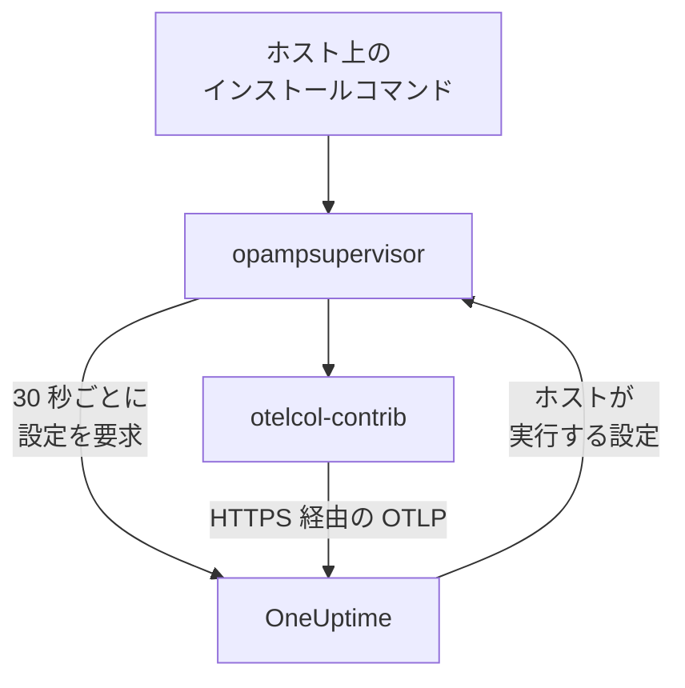

# ホスト

Linux、Windows、macOS のマシンを 1 つのコマンドで OneUptime に追加します。コマンドがホストに OpenTelemetry Collector をインストールし、OneUptime がコレクターに設定を送って最新に保ちます。`config.yaml` を書いたり、各ホストにコピーしたり、そろえたりする必要はありません。ホストが収集する内容を変えるには、コレクター設定を一度編集するだけで、その設定が当てはまるすべてのホストに 1 分以内に反映されます。

:::cards
- [ホストを追加する](#ホストを追加する): Linux、Windows、macOS で 1 つのコマンド。
- [ホストが収集する内容を変える](#ホストが収集する内容を変える): システムとラベルごとのコレクター設定。すべてのバージョンを保存します。
- [ホストのコレクターを確認する](#ホストのコレクターを確認する): 実行中の設定、そのバージョン、設定が起動しなかった理由。
- [設定に許されること](#設定に許されること): ホストを読み取り、この OneUptime にだけ送信します。
:::

## しくみ

コマンドは OpenTelemetry Collector のリリースから 2 つのプログラムをインストールし、それぞれをリリースが公開する SHA-256 で検証します。ホストを読み取るコレクターの `otelcol-contrib` と、コレクターを実行し、OneUptime が OpAMP (OpenTelemetry Agent Management Protocol) で送る設定にコレクターを保つ `opampsupervisor` です。どちらもサービス `oneuptime-collector` として動作します。



スーパーバイザーは約 30 秒ごとに取り込みキーを使って OneUptime にホストの設定を要求し、ホストが実行している設定と、それが起動したかどうかを報告します。ホストはスーパーバイザーが初めて接続したときにマシン名で **ホスト** に登録され、メトリクスとログが届くにつれてページが埋まっていきます。

各ホストは、次の順序で選ばれる 1 つの設定を実行します。

| ホストが実行するもの | 条件 |
| --- | --- |
| ホストの **コレクター** ページでそのホスト用に選択した設定 | 誰かが設定を選択した場合。 |
| **コレクター設定** のうち、そのホストに当てはまる最初の設定 | 設定がホストのシステム向けで、ラベルを指定している場合はホストがそのいずれかを持つときに当てはまります。 |
| そのシステム向けの OneUptime の既定 | 当てはまる設定がない場合。 |

OneUptime の既定は、どのシステムでも CPU、メモリ、ディスク、ファイルシステム、ネットワーク、プロセスを読み取ります。Linux ではホストにあればジャーナルと systemd ユニット、Windows では System、Application、Security のイベントログと Windows サービス、macOS では `/var/log` のインストールと Wi-Fi のログを読み取ります。設計上いっぱいのファイルシステム (snap パッケージや macOS の `/dev` など) は除外されるため、High Filesystem Usage テンプレートが発火し続けることはありません。既定は OneUptime のリリースに合わせて更新されるため、既定を使うホストには OneUptime による改善が届きます。

## 始める前に

- 取り込みキー。**ホストを追加** で作成されるほか、**プロジェクト設定 → テレメトリと APM → 取り込みキー** で作成したキーを選べます。
- ホストの管理者権限。Linux と macOS では `sudo`、Windows では管理者として実行した PowerShell です。
- systemd を使う Linux、Windows 10 または Windows Server 2019 以降、あるいは Apple シリコンまたは Intel の macOS。
- ホストから OneUptime の URL への送信方向の HTTPS (直接またはプロキシ経由)。

## ホストを追加する

:::steps
### ホストを追加を開く

**製品 → インフラストラクチャ → ホスト** を開き、**ホストを追加** を選択します。ホストで動いているものとして Linux、Windows、macOS のいずれかを選びます。Kubernetes クラスターのノードは代わりに [Kubernetes Agent](/docs/telemetry/kubernetes-agent) で監視します。

### 取り込みキーを選ぶ

キーを選ぶか、ダイアログから作成します。下のコマンドにそのキーが入ります。

### ホストでコマンドを実行する

ダイアログからコマンドをコピーし、ホストで実行します。約 1 分かかります。次のコマンドは同じもので、例の部分が OneUptime の URL とキーに置き換わります。

:::tabs
@tab Linux
```bash
curl -fsSL https://oneuptime.com/docs/static/scripts/host-collector/install.sh | sudo sh -s -- --url https://oneuptime.com --key YOUR_INGESTION_KEY
```
@tab macOS
```bash
curl -fsSL https://oneuptime.com/docs/static/scripts/host-collector/install.sh | sudo sh -s -- --url https://oneuptime.com --key YOUR_INGESTION_KEY
```
@tab Windows
```powershell
[Net.ServicePointManager]::SecurityProtocol = [Net.ServicePointManager]::SecurityProtocol -bor [Net.SecurityProtocolType]::Tls12; & ([scriptblock]::Create((Invoke-RestMethod -Uri 'https://oneuptime.com/docs/static/scripts/host-collector/install.ps1'))) -Url 'https://oneuptime.com' -Key 'YOUR_INGESTION_KEY'
```
:::

各 OneUptime は独自のインストーラーを配布するため、セルフホストの OneUptime は自分のリリースのインストーラーを渡します。2 か所の `https://oneuptime.com` を自分の URL に置き換えてください。

### ホストを待つ

ダイアログの最後のステップで、ホストが接続したことがホストへのリンクとともに表示されます。一覧では最初のメトリクスが届くまで (通常 1 分以内) **開始中** と表示され、その後は接続済みとなり、コレクターは **実行中** になります。ホストの **トポロジー** ページは、ホストで動いているもの、ホストを呼び出すもの、ホストが呼び出すものを 1 つのマップに描きます。[トポロジー](/docs/telemetry/topology#リソースごとのマップを開く) を参照してください。
:::

## ホストにラベルを付ける

コマンドにラベルを追加すると、ホストは接続した時点からそのラベルを持ちます。

:::tabs
@tab Linux
```bash
curl -fsSL https://oneuptime.com/docs/static/scripts/host-collector/install.sh | sudo sh -s -- --url https://oneuptime.com --key YOUR_INGESTION_KEY --label env=production --label team=payments
```
@tab macOS
```bash
curl -fsSL https://oneuptime.com/docs/static/scripts/host-collector/install.sh | sudo sh -s -- --url https://oneuptime.com --key YOUR_INGESTION_KEY --label env=production --label team=payments
```
@tab Windows
```powershell
[Net.ServicePointManager]::SecurityProtocol = [Net.ServicePointManager]::SecurityProtocol -bor [Net.SecurityProtocolType]::Tls12; & ([scriptblock]::Create((Invoke-RestMethod -Uri 'https://oneuptime.com/docs/static/scripts/host-collector/install.ps1'))) -Url 'https://oneuptime.com' -Key 'YOUR_INGESTION_KEY' -Label 'env=production','team=payments'
```
:::

`env=production` はラベル `env:production` になります。ラベルは追加されるだけで、外されることはありません。別のラベルを付けてコマンドを再実行すると、ホストは両方を持ちます。**ホスト** の一覧や **ラベルルール** でもホストにラベルを付けられます。ラベルを指定したコレクター設定は、そのいずれかを持つホストだけが対象になるため、同じコマンドでもラベルを変えれば、ホストのグループごとに別の設定を割り当てられます。

## ホストが収集する内容を変える

:::steps
### コレクター設定を作成する

**製品 → インフラストラクチャ → ホスト → コレクター設定** を開き、**コレクター設定を作成** を選択します。名前、対象とするホストのシステム、一部のホストだけを対象にする場合はそのラベルを指定します。設定はそのシステム向けの OneUptime の既定から始まります。

### config.yaml を編集する

設定のページで **設定を編集** を選択し、YAML を変更して保存します。OneUptime はまず内容を確認し、送信できない設定は理由を示して拒否します。[設定に許されること](#設定に許されること) を参照してください。

### ホストに届くのを確認する

保存した変更はそれぞれ新しいバージョンになり、対象のホストに 1 分以内に届きます。設定の **ホスト** 一覧には、各ホスト、そのコレクターの状態、実行中のバージョンが表示されます。
:::

ホストは一覧の中で当てはまる最初の設定を実行します。**コレクター設定** の行をドラッグして順序を変更できます。`env:production` の Web サーバー向けのように範囲の狭い設定を先に、すべての Linux ホスト向けのように範囲の広い設定を後に置きます。一覧の下の **OneUptime の既定** カードには、当てはまる設定がないときにホストが実行する内容が表示されます。

### バージョンと元に戻す

設定の **バージョン** 一覧には、保存したすべての変更が新しい順に、保存した人と日時とともに残ります。**表示** でバージョンを読み、**元に戻す** でホストに再送できます。再送したバージョンは、どれを戻したかを記した新しいバージョンとして保存されるため、一覧を見れば各ホストに何が送られたかが常にわかります。

### 1 台のホスト用に設定を選ぶ

ホストの **コレクター** ページで **設定を変更** を選択し、そのホストだけの設定を選びます。ホストのシステム向けの設定と、任意のシステム向けの設定が表示されます。自動を選ぶとホストは一覧の順序に戻ります。選択した設定が削除されたホストは、自動的に一覧の順序に戻ります。

### 設定が起動しないとき

スーパーバイザーは新しい設定に切り替える前にコレクターでその設定を確認し、起動しない場合は最後に動作した設定に戻ります。その間もホストは送信を続けます。ホストの **コレクター** ページには **設定に失敗** と、コレクターが読み取りを許されていないログファイルなどのコレクターが示す理由が表示され、OneUptime は設定が変わるまでその設定をホストに再送しません。ホスト側で原因を解消したら、**再試行** を選択してもう一度送信します。

## 設定に許されること

OneUptime が送る設定は対象のすべてのホストで実行されるため、OneUptime は保存のたびに設定を確認し、ルールに反する設定を拒否します。

| ルール | 理由 |
| --- | --- |
| OneUptime の一覧にある receivers、processors、exporters、extensions、connectors のみ | ホストとその上のサービスを読み取るためのものです。プログラムを実行したり、クラウドやクラスターの認証情報を読み取ったりするコンポーネントは一覧にありません。 |
| データがホストから出るのは exporter `otlp_http` 経由で、宛先は `${env:ONEUPTIME_URL}/otlp`、ヘッダーは `x-oneuptime-token: ${env:ONEUPTIME_INGESTION_KEY}` のみ | 各ホストは、インストール時のキーを使ってこの OneUptime に送信します。キーを含む設定はありません。 |
| 使える `${...}` は `${env:NAME}` だけ | `${file:...}` や `${https:...}` は各ホストで読み取られ、転送される可能性があります。 |
| journald の `journalctl_path` のような、プログラムを実行したり読み取ったファイルを送信したりする設定は不可 | 設定にできるのはホストの読み取りまでです。 |

それでも、別のシステム向けの receiver や、そのホストに存在しないログファイルのように、ホストで実行できない設定になることはあります。各ホストのコレクターは切り替える前にそれを確認します。詳しくは [設定が起動しないとき](#設定が起動しないとき) を参照してください。

## ホストのコレクターを確認する

ホストを開き、その **コレクター** ページを表示します。コレクターの状態、実行中の設定と **この設定の理由**、実行中のバージョン、**最終レポート**、**コレクターのリリース** が表示されます。**ホスト上で** には、ホスト上のシェルから確認するためのコマンド (サービスが動作しているか、ログ、再起動) があります。

:::tabs
@tab Linux
```bash
sudo systemctl status oneuptime-collector
sudo journalctl -u oneuptime-collector -n 50
sudo systemctl restart oneuptime-collector
```
@tab macOS
```bash
sudo launchctl print system/com.oneuptime.collector
sudo tail -n 50 /usr/local/oneuptime-collector/log/collector.log
sudo launchctl kickstart -k system/com.oneuptime.collector
```
@tab Windows
```powershell
Get-Service oneuptime-collector
Get-WinEvent -FilterHashtable @{ LogName = 'Application'; ProviderName = 'oneuptime-collector' } -MaxEvents 50 | Format-List TimeCreated, Message
Restart-Service oneuptime-collector
```
:::

Linux では、コレクターは権限を持たないユーザー `oneuptime-collector` として動作し、ジャーナルと `/var/log` のログを読めるよう `systemd-journal` と `adm` のグループに属します。macOS では launchd デーモンと同様に root として、Windows ではすべてのイベントログと Windows サービスを読めるよう LocalSystem として動作します。

## 手動でセットアップしたホスト

[ホスト OpenTelemetry Collector](/docs/telemetry/host-otel-collector) のガイドに従って自分でコレクターをインストールしたホストは、これまでどおり送信を続け、OneUptime は設定を送りません。OneUptime に引き渡すには、ホストの **コレクター** ページを開きます。そこにあるコマンドには `--replace-existing` が付いており、手動でインストールしたコレクター (`otelcol-contrib` サービス) を停止して無効にするため、ホストが二重に送信することはありません。ホストの名前、履歴、ラベルはそのまま残ります。

## インストールオプション

これらを変更する場合や新しいリリースに移行する場合は、コマンドを再実行します。インストールしたものを置き換え、OneUptime 上のホストはそのまま保たれます。

| Linux と macOS | Windows | 内容 |
| --- | --- | --- |
| `--url URL` | `-Url URL` | OneUptime の場所。 |
| `--key KEY` | `-Key KEY` | プロジェクトのテレメトリ取り込みキー。 |
| `--label KEY=VALUE` | `-Label KEY=VALUE` | ホストにラベルを付けます。複数のラベルは繰り返して指定し、Windows ではカンマ区切りで列挙します。 |
| `--env NAME=VALUE` | `-EnvVar NAME=VALUE` | `${env:NAME}` を読む設定のために、コレクターに環境変数を渡します。 |
| `--version VERSION` | `-Version VERSION` | インストールするコレクターのリリース。既定は 0.161.0 です。 |
| `--download-url URL` | `-DownloadUrl URL` | GitHub と同じフォルダー構成のミラーからリリースをダウンロードします。 |
| `--proxy URL` | `-Proxy URL` | ダウンロードとコレクターのすべての通信を HTTP プロキシ経由にします。 |
| `--replace-existing` | `-ReplaceExisting` | 手動でインストールしたコレクターを停止して無効にします。 |
| `--uninstall` | `-Uninstall` | コレクターと、コマンドがインストールしたものをすべて削除します。 |

## アンインストール

:::tabs
@tab Linux
```bash
curl -fsSL https://oneuptime.com/docs/static/scripts/host-collector/install.sh | sudo sh -s -- --uninstall
```
@tab macOS
```bash
curl -fsSL https://oneuptime.com/docs/static/scripts/host-collector/install.sh | sudo sh -s -- --uninstall
```
@tab Windows
```powershell
& ([scriptblock]::Create((Invoke-RestMethod -Uri 'https://oneuptime.com/docs/static/scripts/host-collector/install.ps1'))) -Uninstall
```
:::

ホストは履歴とともに OneUptime に残ります。**ホスト** の一覧でアーカイブまたは削除してください。

## トラブルシューティング

:::details OneUptime がキーを拒否したとコマンドに表示される
HTTP `401`: キーが間違っているか、期限切れか、削除されています。HTTP `422`: キーが無効化されているか、ブラウザーキーか、1 つのサービスに固定されています。**ホストを追加** で有効なサーバーキーを選び、コマンドを再実行してください。ホスト上のキーが置き換わります。
:::

:::details ホストが表示されない
ホストから HTTPS で OneUptime の URL に到達できることを確認し、[ホストのコレクターを確認する](#ホストのコレクターを確認する) にあるそのシステム用のコマンドでコレクターのログを確認してください。
:::

:::details ホストが設定の失敗を報告している
ホストの **コレクター** ページに、設定が起動しなかった理由が表示されます。ホストは最後に動作した設定を実行し続け、設定が変わるか **再試行** を選択すると、失敗した設定をもう一度受け取ります。
:::

:::details ホストに「報告なし」と表示される
OneUptime はホストのスーパーバイザーから 15 分以上連絡を受けていません。`oneuptime-collector` サービスが動作していること、ホストが引き続き OneUptime に到達できることを確認してください。
:::

## 次のステップ

:::cards
- [ホスト OpenTelemetry Collector](/docs/telemetry/host-otel-collector): 代わりにコレクターを自分でインストールし、設定を書きます。
- [ホストモニター](/docs/monitor/host-monitor): ホストが報告する内容でアラートを出します。
- [取り込みキー](/docs/telemetry/ingestion-keys): ホストが送信に使うキーを作成、制限、ローテーションします。
- [Kubernetes Agent](/docs/telemetry/kubernetes-agent): クラスターのノードとワークロードを監視します。
:::
