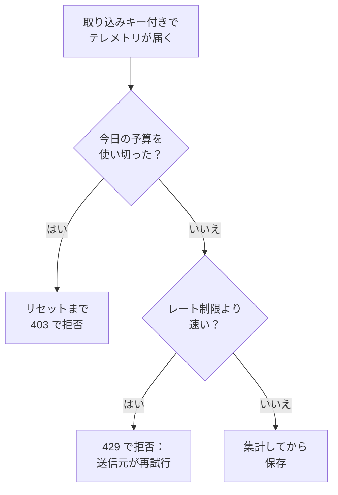

# 取り込み予算

取り込み予算は、プロジェクトが 1 日に送信するテレメトリの量に上限を設け、騒がしいサービスや暴走したログのループが 1 つあるだけでストレージがいっぱいになることを防ぎます。インスタンス管理者は、すべてのプロジェクトまたは 1 つのプロジェクトに対して、シグナルごとに 1 日の予算を設定します。取り込みキーを編集できるユーザーなら誰でも、そのキーにより小さい独自の予算を設定できます。各予算には、1 秒あたりのレート制限も設定できます。

:::cards
- [予算の仕組み](#予算の仕組み): 3 つのレベルで、テレメトリの到着時に集計します。
- [すべてのプロジェクトのデフォルトの予算を設定する](#すべてのプロジェクトのデフォルトの予算を設定する): Admin Dashboard の設定で行います。
- [取り込みキーに独自の予算を設定する](#取り込みキーに独自の予算を設定する): プロジェクトの予算の一部です。
- [予算でアラートを出す](#予算でアラートを出す): 使い切る前と、使い切ったとき。
:::

## 予算の仕組み

テレメトリは到着時に集計されます。そのシグナルについてプロジェクトの予算に計上され、取り込みキーに予算がある場合はキーの予算にも計上されます。1 日の予算を使い切ると、予算がリセットされるまでそのシグナルは拒否されます。



- **3 つのレベル。** インスタンスのデフォルトは、すべてのプロジェクトに適用されます。インスタンス管理者は、代わりに 1 つのプロジェクトに独自の予算を設定することも、上限をまったく設けないこともできます。キーの予算はプロジェクトの予算を分割するだけで、小さくすることはできても、大きくすることはできません。
- **5 つのシグナル。** ログ、トレース、メトリクス、プロファイル、セキュリティイベントには、それぞれ独自の予算があります。セッションリプレイには独自の上限があります。[セッションリプレイ](/docs/telemetry/session-replay) を参照してください。
- **バイト数は展開後に集計されます。** リクエストは本文を展開した後のサイズで集計されるため、圧縮しても集計される量は変わりません。1 GB は 1024³ バイト、1 MB は 1024² バイトです。
- **集計されるのは届いたもので、保存されたものではありません。** 後で [破棄フィルター](/docs/telemetry/drop-filters-and-scrub-rules) が削除するテレメトリも集計されるため、予算の値は、保存された量を集計する [テレメトリ使用量](/docs/telemetry/usage) ページより大きくなることがあります。
- **最後のリクエストは丸ごと保存されます。** 予算にまだ余裕があるうちに届いたリクエストは全体が保存されるため、使い切った予算は 100% を少し超えることがあります。
- **予算を設定するまでは何も制限されません。** どのインストールも予算なしで始まり、予算のないプロジェクトはまったく集計されません。
- **変更は 1 分以内にすべてのサーバーに届きます。**
- **集計できないときもテレメトリは受け入れられます。** 予算は Valkey で集計されます。Valkey に接続できない間、OneUptime はテレメトリを拒否せずに、集計しないまま保存します。予算のページにはその旨が表示されます。

## 始める前に

- **インスタンスとプロジェクトの予算には Admin Dashboard。** セルフホストのインストールでは、これらを設定できるのはインスタンス管理者だけです。プロジェクトの所有者と管理者は予算を確認できますが、変更はできません。
- **キー独自の予算には、取り込みキーを編集できるロール。** Project Owner または Project Admin、あるいは Edit Ingestion Key 権限を持つカスタムロールです。
- **予算を見るには、プロジェクトの使用量を見られるロール。** [テレメトリ使用量](/docs/telemetry/usage) ページを見られるロールは、そのページで予算も確認できます。

## すべてのプロジェクトのデフォルトの予算を設定する

:::steps
### 取り込み予算を開く

Admin Dashboard で **設定 → テレメトリ → 取り込み予算** に移動します。サイドメニューの **テレメトリ** は最初は折りたたまれているので、クリックして開きます。

### 1 日の予算を設定する

**デフォルトの 1 日の予算** カードで **デフォルトの 1 日の予算を編集** をクリックし、**ログ（GB/日）** のように、制限する各シグナルに GB 数を入力して、**変更を保存** をクリックします。制限しないシグナルは空欄のままにします。

### 必要に応じてレート制限を設定する

**デフォルトのレート制限** カードで **デフォルトのレート制限を編集** をクリックし、**ログ（MB/秒）** のように、シグナルに 1 秒あたりの MB 数を入力します。レート制限があれば、1 回のバーストで 1 日の予算が数分のうちに使い切られることはありません。
:::

**警告とリセット** カードでは、警告のしきい値と、予算日がリセットされる時刻を設定します。[警告とリセット](#警告とリセット) を参照してください。

## 1 つのプロジェクトの予算を設定する

:::steps
### プロジェクトを開く

Admin Dashboard で **プロジェクト** に移動し、プロジェクトをクリックして、そのサイドメニューの **取り込み予算** をクリックします。ページの最初に、そのプロジェクトが今日使った予算の量が表示されます。

### プロジェクトの 1 日の予算を設定する

**このプロジェクトの 1 日の予算** カードで **1 日の予算を編集** をクリックします。シグナルごとに、インスタンスのデフォルトの代わりに GB 数を入力するか、まったく制限しない場合は 0 を入力します。インスタンスのデフォルトのままにするシグナルは空欄にします。

### プロジェクトのレート制限を設定する

**このプロジェクトのレート制限** カードで **レート制限を編集** をクリックし、同じ方法で設定します。1 秒あたりの MB 数、制限しない場合は 0、インスタンスのデフォルトにする場合は空欄です。
:::

プロジェクトのメンバーは、これらの予算を [テレメトリ使用量](/docs/telemetry/usage) ページで読み取り専用で確認できます。

## 取り込みキーに独自の予算を設定する

キーの予算は、そのプロジェクトの予算の一部です。自分のキーで大量に送信する送信元はキーの予算で止まり、プロジェクトのほかのキーは送信を続けられます。

:::steps
### キーを開く

**プロジェクト設定 → テレメトリと APM → 取り込みキー** に移動し、キーをクリックします。サイドメニューの **テレメトリと APM** は最初は折りたたまれているので、クリックして開きます。

### キーの予算を設定する

**取り込み予算** カードで **取り込み予算を編集** をクリックします。**1 日の予算** ステップで制限する各シグナルに 1 日あたりの GB 数を、**レート制限** ステップで 1 秒あたりの MB 数を入力します。キー独自の予算を設けないシグナルは空欄のままにします。

### 予算を保存する

**変更を保存** をクリックします。キーの予算はプロジェクトの予算を超えられません。超えている場合、OneUptime はそれを拒否し、設定できる最大値を示します。
:::

- **両方の予算が集計されます。** キーで送信したテレメトリは、キーの予算とプロジェクトの予算の両方に計上され、先に使い切った方の予算によって拒否されます。
- **プロジェクトの予算を下げると、キーにも適用されます。** プロジェクトの予算がキーの予算より低くなると、キーはプロジェクトの予算に制限されます。

## 送信元に見えるもの

| 状況 | HTTP の場合 | OTLP/gRPC の場合 | 送信元の動作 |
| --- | --- | --- | --- |
| 1 日の予算を使い切った | `403` | `RESOURCE_EXHAUSTED` | バッチを破棄します。リセット前に再試行しても意味がありません |
| レート制限を超えた | `Retry-After` 付きの `429` | 再試行の遅延付きの `RESOURCE_EXHAUSTED` | 遅延の後にバッチを再試行します |

拒否には必ず理由が示されます。OTLP/HTTP では本文が `google.rpc.Status` で、リクエストの送信形式に合わせて protobuf または JSON になるため、送信元のログには次のような理由が表示されます。

```text
This project's daily logs ingestion budget of 10 GB is used up, so OneUptime is not storing logs from this project until the budget resets at 2026-11-10 00:00 UTC.
```

- **ほかの HTTP 送信元には JSON が返されます。** Fluent Bit、Fluentd、syslog などの HTTP エンドポイントへの送信元は `error`、`message`、`resetsAt` を受け取り、レート制限の場合は `retryAfterSeconds` も受け取ります。
- **MQTT とクラウドストリームには伝えられません。** MQTT やクラウドプロバイダーのストリームから届くテレメトリは、予算を使い切ると破棄されます。再送できないため、レート制限は適用されません。
- **拒否は集計されます。** 使い切った予算が拒否または破棄したものは破棄済みとして、レート制限が拒否した各リクエストはスロットリングとして集計されます。[今日の使用量と破棄を確認する](#今日の使用量と破棄を確認する) を参照してください。

## 警告とリセット

- **警告。** 1 日の予算が警告のしきい値（インスタンス管理者が変更しない限り 80%）を超えると、プロジェクトの所有者にメールが送られ、エクスプローラーではそのシグナルのデータの上にバナーが表示されます。予算を使い切ったときには、もう 1 通メールが届きます。各予算が各メールを送るのは 1 日 1 回までです。
- **リセット。** 各予算日は、インスタンス管理者が変更しない限り 00:00 UTC に新しく始まります。**警告とリセット** カードでは、**警告のしきい値（%）** を 1 から 99 の範囲で、**リセット時刻** を HH:MM で、**リセットのタイムゾーン** を設定します。**警告とリセットを編集** をクリックしてください。
- **夏時間。** リセットはタイムゾーンの時計に従うため、時計が切り替わる日の予算日は 1 時間短く、または長くなります。時計の切り替えで飛ばされるリセット時刻は、切り替えからその分だけ後に実行されます。
- **リセットを変更すると新しい日が始まります。** リセット時刻またはタイムゾーンを変更すると、まだ何も集計されていない新しい予算日がすぐに始まります。

## 今日の使用量と破棄を確認する

**プロジェクト設定 → テレメトリと APM → 使用量** に移動します。プロジェクトに予算またはレート制限が設定されている間は、ページの最初に **取り込み予算** カードが表示され、独自の予算を持つキーは **取り込みキーの予算** カードに表示されます。

| 列 | 表示される内容 |
| --- | --- |
| **シグナル** | その行のシグナル。 |
| **今日の使用量** | 予算日の開始以降に集計された量と、予算に対する割合。 |
| **1 日の予算** | 適用中の予算と、その設定元。**インスタンスのデフォルト**、**このプロジェクトで設定**、**このキー独自の予算** のいずれかです。 |
| **レート制限** | 適用中のレート制限。 |
| **破棄済み** | 予算を使い切ったために拒否または破棄されたもの。 |
| **スロットリング中** | レート制限が拒否したリクエストの数。 |
| **ステータス** | **予算内**、**警告しきい値超過**、**上限到達**、レート制限だけがあるシグナルでは **1 日の予算なし**、集計を読み取れない間は **不明**。 |

- **キーのページ** では、**今日の予算使用量** カードに、キーが独自の予算をどれだけ使ったかが表示されます。
- **エクスプローラー** では、そのシグナルの予算が警告のしきい値を超えたときや使い切ったときに、ログ、トレース、メトリクス、プロファイル、セキュリティイベントのデータの上にバナーが表示されます。**予算を見る** で使用量ページを開けます。
- **Admin Dashboard** では、プロジェクトの **取り込み予算** ページに同じ数値が表示されます。

## 予算でアラートを出す

OneUptime は 5 分ごとに、各予算のその日の数値をプロジェクトのメトリクスとして書き込みます。[メトリクス モニター](/docs/monitor/metrics-monitor) を使えば、ほかのメトリクスと同じようにこれらでアラートを出せます。

| メトリクス | 単位 | 内容 |
| --- | --- | --- |
| `oneuptime.telemetry.budget.used.bytes` | `By` | 予算日の開始以降に 1 日の予算に計上されたバイト数。 |
| `oneuptime.telemetry.budget.used.percent` | `%` | 同じ値を 1 日の予算に対する割合で表したもの。100 以上になると、リセットまでそのシグナルは拒否されます。 |
| `oneuptime.telemetry.budget.dropped.bytes` | `By` | 予算を使い切ったために、予算日の開始以降に拒否または破棄されたバイト数。 |
| `oneuptime.telemetry.budget.throttled.requests` | `{request}` | 予算日の開始以降にレート制限が拒否したリクエストの数。 |

各ポイントには次の属性が付きます。

| 属性 | 値 |
| --- | --- |
| `projectId` | プロジェクトの ID。 |
| `signal` | `logs`、`traces`、`metrics`、`profiles`、`security-events` のいずれか。 |
| `scope` | `project`、またはキー独自の予算の場合は `ingestion-key`。 |
| `ingestionKeyId` | キーの ID（キー独自の予算の場合）。 |
| `ingestionKeyName` | ポイントを書き込んだ時点のキーの名前（キー独自の予算の場合）。 |

プロジェクトのログの予算が 90% に達したときに通知を受けるには、`oneuptime.telemetry.budget.used.percent` に対して `signal` が `logs`、`scope` が `project` のフィルターをかけ、最大値が 90 を超えたらアラートを出すメトリクス モニターを作成します。

- **最大値で集計します。** 各数値は予算日の間、増える一方です。
- **15 分以上のウィンドウを使います。** ポイントは 5 分ごとに書き込まれ、ポイントが 1 つもないウィンドウではアラートが解決されます。
- **ゼロではなく欠損を想定します。** 値が 0 の数値や、集計を読み取れない間は、何も書き込まれません。
- **料金はかかりません。** これらのメトリクスはどの予算にも計上されず、テレメトリの使用量にもならず、モニターのメトリクスと同じ期間（インスタンス管理者が変更しない限り 30 日）保持されます。`oneuptime.telemetry.budget.` で始まるメトリクス名はこれらのために予約されており、アプリケーションがそのような名前で送信したメトリクスは破棄されます。

## トラブルシューティング

:::details collector のエクスポートで 403 がログに出る
そのシグナルのプロジェクトまたはキーの 1 日の予算を使い切っており、collector は送信できないものを予算がリセットされるまで破棄します。使用量ページの **今日の使用量** を確認してください。インスタンス管理者にプロジェクトの予算を引き上げてもらうか、送信量を減らしてください。破棄フィルターは集計の後にテレメトリを削除するため、ここでは役に立ちません。
:::

:::details collector が 429 をログに出して再試行する
レート制限が許すより速く送信しています。`Retry-After` の遅延の後に再試行するため、キューがいっぱいにならない限り何も失われません。レート制限を引き上げるか、送信をより均等に分散させてください。
:::

:::details 今日の使用量がテレメトリ使用量ページの表示より大きい
予算は、テレメトリを到着時に展開後のサイズで集計し、後で破棄フィルターが削除するものも含めます。使用量ページは、保存された量を翌日に集計します。
:::

:::details 予算に今日の集計を読み取れなかったと表示される
OneUptime が、予算を集計する Valkey に接続できません。接続できるようになるまで、テレメトリは集計されずに保存され、予算は適用されません。
:::

## 次のステップ

:::cards
- [テレメトリ使用量](/docs/telemetry/usage): 各プロジェクトとサービスが送信する量を確認します。
- [破棄フィルターとスクラブルール](/docs/telemetry/drop-filters-and-scrub-rules): 不要なテレメトリを保存しないようにします。
- [取り込みキー](/docs/telemetry/ingestion-keys): 送信元ごとにキーを分け、それぞれに予算を設定できるようにします。
- [メトリクス モニター](/docs/monitor/metrics-monitor): 予算のメトリクスでアラートを出します。
:::
