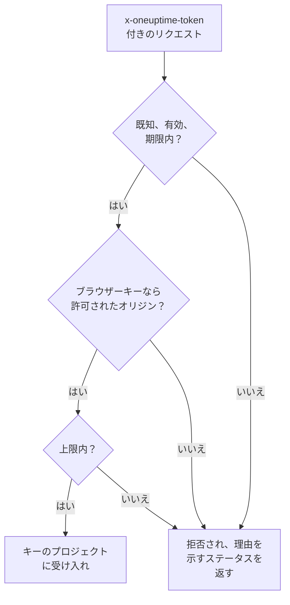

# 取り込みキー

取り込みキーは、テレメトリをプロジェクトに結び付けます。アプリケーション、OpenTelemetry Collector、エージェントはリクエストごとにこのキーを送り、OneUptime はそのログ、トレース、メトリクスをキーが属するプロジェクトに振り分けます。このページでは、キーの作成方法、選ぶべき種類、キーを安全に保つ方法を説明します。

:::cards
- [取り込みキーを作成する](#取り込みキーを作成する): 名前、種類、コピーするシークレット。
- [サーバーかブラウザーか](#サーバーかブラウザーか): 送信元に必要なキーの種類。
- [ブラウザーキーを制限する](#ブラウザーキーを制限する): オリジン、1 つのサービス名、上限。
- [キーを入れ替える、無効にする、削除する](#キーを入れ替える無効にする削除する): キーが漏れたときの対処。
:::

## キーの確認方法

各リクエストはキーのシークレットを、通常は `x-oneuptime-token` ヘッダーで運びます。OneUptime はキーを検索し、まだ送信できるかを確認してから、データをキーのプロジェクトに受け入れます。



- **キーがプロジェクトを決めます。** プロジェクト ID を送ることはありません。キーで送ったデータは、そのキーが属するプロジェクトに届きます。
- **変更は 1 分以内にすべてのサーバーに届きます。** キーの無効化、シークレットのリセット、オリジン、有効期限、上限の変更は、約 1 分で反映されます。
- **サーバーキーはパスワードです。** キーを持っている人は誰でも、プロジェクトにテレメトリを送れます。サーバーのシークレットに保管し、ソース管理やウェブページには置かないでください。

## サーバーかブラウザーか

種類は、キーを置く場所で選びます。キーを作成した後に種類は変更できません。

| | **サーバー** | **ブラウザー** |
| --- | --- | --- |
| 用途 | 運用しているマシン上のアプリケーション、collector、エージェント | ウェブページ、および React Native Session Replay |
| 送れるもの | あらゆるテレメトリを、あらゆるエンドポイントへ | トレース、ログ、メトリクス、Session Replay |
| シークレットか | はい。サーバー上に保管します | いいえ。ページを見た人なら誰でも読めます |
| オリジン | 確認しません | 一覧にあるオリジンだけを受け入れます |
| 毎分のリクエスト数 | 上限なし（設定した場合を除く） | 6,000（別の上限を設定した場合を除く） |

それ以外の場所では、OneUptime はブラウザーキーを拒否します。たとえば gRPC と MQTT、プロファイル、Syslog、Fluent Bit、Fluentd、ソースマップのアップロードです。送信元を別の種類に移すには、その種類のキーを作成し、送信元をそのキーに切り替えてから、古いキーを削除します。

## 始める前に

- **取り込みキーを管理するロール。** Project Owner または Project Admin、あるいは Create Telemetry Ingestion Key 権限を持つカスタムロールです。Telemetry ロールには取り込みキーは含まれません。
- **OneUptime Cloud では、支払い方法。** テレメトリは使用量に応じて課金されるため、Free プランのプロジェクトはキーを作成する前に支払い方法が必要です。その場合、作成ダイアログは料金を示す **請求** ステップで終わります。

## 取り込みキーを作成する

:::steps
### 取り込みキーを開く

**プロジェクト設定 → テレメトリと APM → 取り込みキー** に移動します。サイドメニューの **テレメトリと APM** は最初は折りたたまれているので、クリックして開きます。一覧には各キーの **名前**、**種類**、**最終使用**、**説明** が表示されます。

### キーに名前を付けて種類を選ぶ

**取り込みキーを作成** をクリックします。ダイアログは名前 **サーバーキー** と種類 **サーバー** で始まります。**キーの種類** を選び、`checkout-collector` のように、キーを使うものに合わせて名前を変えます。**説明** は **詳細** にあります。

### ブラウザーキーのオリジンを追加する

**ブラウザー** キーは、次のステップ **ブラウザー設定** で **許可されたオリジン** を求め、**詳細** で **固定されたサービス名** を求めます。[ブラウザーキーを制限する](#ブラウザーキーを制限する) を参照してください。

### キーを作成してシークレットをコピーする

**取り込みキーを作成** をクリックします。キーのページが開くので、**シークレットキー** をコピーして送信元に渡します。
:::

各製品の **セットアップガイド** は **取り込みキーを選択** から始まります。そのガイドで使えるキーが一覧表示され、その場で作成もできます。以降、ガイドのスニペットにはそのキーが入ります。

## キーを使ってテレメトリを送る

送信元はシークレットを `x-oneuptime-token` ヘッダーに入れます。

```text
x-oneuptime-token: YOUR_ONEUPTIME_INGESTION_KEY
```

- OpenTelemetry SDK は `OTEL_EXPORTER_OTLP_HEADERS` から読み取ります。[OpenTelemetry クイックスタート](/docs/telemetry/open-telemetry#クイックスタート) を参照してください。
- OTLP/gRPC では、`x-oneuptime-token` メタデータに入れます。
- MQTT デバイスはパスワードとして送ります。[IoT デバイス](/docs/telemetry/iot-devices) を参照してください。
- OneUptime は、一部の古い構成が送る `x-oneuptime-ingestion-key` ヘッダーまたは `x-oneuptime-service-token` ヘッダーからもキーを読み取ります。

## ブラウザーキーを制限する

ブラウザーキーはページの中にあり、誰でもコピーできます。次の設定で、コピーにできることを制限します。キーのページの **テレメトリ取り込みキーを編集** で変更します。

| 設定 | 働き |
| --- | --- |
| **許可されたオリジン** | キーを受け入れる唯一のオリジンです。ほかのオリジンからのリクエストや、`Origin` ヘッダーのないリクエストは拒否されます。ブラウザーキーには少なくとも一つ必要です。 |
| **固定されたサービス名** | キーが OTLP/HTTP で送るものをすべて、送信元が設定した `service.name` にかかわらず、この一つのサービスに振り分けます。キーのコピーは、そのサービスにしか書き込めなくなります。 |
| **1 分あたりのリクエスト数の上限** | キーを毎分受け入れるリクエスト数の上限で、すべての訪問者で共有されます。空欄のままにすると、ブラウザーキーには 6,000 が適用されます。 |
| **有効期限** | この日付を過ぎるとキーが拒否され、公開されたコピーは機能しなくなります。 |

オリジンはスキーム、ホスト、省略可能なポートです。`https://app.example.com` は `https://app.example.com:8443` を含みません。先頭の `*.` はすべてのサブドメインを含みますが、ドメインそのものは含みません。React Native Session Replay は正確な `app://` の識別子を送り、ワイルドカードは使えません。

```json
[
  "https://app.example.com",
  "https://*.example.com",
  "app://com.example.mobile"
]
```

[サービスカタログ](/docs/telemetry/services#サービスがカタログに入る仕組み) では、固定された名前がどのようにサービスを決めるかを説明しています。Kubernetes エージェントの Runner と AI エージェント、およびインフラストラクチャの AI エージェントは、固定されたキーでは登録されません。名前を固定していないサーバーキーを渡してください。

## キーを入れ替える、無効にする、削除する

キーのページには、**ステータス**、**クリックして表示** の奥にある **シークレットキー**、そして **最終使用日時** が表示されます。最終使用日時は、そのキーで送られたデータを OneUptime が最後に受け入れた時刻です。

| 目的 | 操作 | 送信元に見えるもの |
| --- | --- | --- |
| キーをすぐに止め、後で元に戻せるようにする | **テレメトリ取り込みキーを編集** をクリックし、**アクセスと制限** を開いて **有効** をオフにします。ステータスは **無効 — テレメトリを拒否** になります。 | 再びオンにするまで `422` |
| 漏れたシークレットを置き換える | **シークレットキーをリセット** をクリックして確認します。キーは設定を保ったまま、新しいシークレットを受け取ります。 | 新しいシークレットを送るまで `401` |
| キーを完全に止める | ページの下部にある **テレメトリ取り込みキーを削除** をクリックします。 | `401` |

データを失わずにシークレットを変えるには、2 つ目のキーを作成し、送信元をそちらに移してから、古いキーの **最終使用日時** が動かなくなった時点で削除します。**最終使用日時** はリクエストのたびではなく、数分ごとに更新されます。

## トラブルシューティング

拒否されたリクエストには、ステータスと理由を示す文が返されます。

| 応答 | 意味 |
| --- | --- |
| `401` と `Missing ingestion token` | リクエストにキーがありません。`x-oneuptime-token` で送ってください。 |
| `401` と `Invalid ingestion token` | このシークレットを持つキーはありません。入力ミス、リセット、または削除です。 |
| `401` と `This telemetry ingestion key expired.` | **有効期限** を過ぎています。より後の日付を設定するか、別のキーを使ってください。 |
| `402` と `Add a payment method` | OneUptime Cloud で、プロジェクトが Free プランのまま、まだ支払い方法がありません。 |
| `422` と `This telemetry ingestion key has been disabled.` | 誰かが **有効** をオフにしました。 |
| `422` と `A browser ingestion key cannot be used for` | ブラウザーキーが、サーバーキーしか受け付けないエンドポイントに届きました。 |
| `422` と `did not send an Origin header` | ブラウザーキーがブラウザーの外から送られました。そこではサーバーキーを使ってください。 |
| `422` と `is not allowed for this browser ingestion key` | ページのオリジンが **許可されたオリジン** にありません。 |
| `422` と `is pinned to a single service` | **固定されたサービス名** があるキーでエージェントを登録しようとしました。名前を固定していないサーバーキーを使ってください。 |
| `429` と `Too many telemetry requests for this ingestion key` | キーが **1 分あたりのリクエスト数の上限** に達しました。エクスポーターは `Retry-After` の時間が過ぎてから再試行します。 |

OTLP エクスポーターが受け取るほかの応答については、[応答](/docs/telemetry/open-telemetry#レスポンス) を参照してください。

:::details キーを無効にしてから 1 分後もデータが届く
各 OneUptime サーバーはキーの情報を最大 1 分間保持するため、変更が全サーバーに届くまで約 1 分かかります。それ以降のリクエストは拒否されます。
:::

:::details ブラウザーキーがノート PC では動くが本番環境では動かない
オリジンにはスキームとポートが含まれます。`http://localhost:3000` と `https://app.example.com` は別のオリジンです。ページを配信しているオリジンをそれぞれ一覧に入れてください。
:::

:::details 最終使用日時が「なし」のままになっている
OneUptime がこのキーの使用を記録し始めてから、このキーでデータを送ったものはありません。送信元がこのキーのシークレットを持っていること、そのリクエストが OneUptime に届いていることを確認してください。
:::

## 次のステップ

:::cards
- [OpenTelemetry](/docs/telemetry/open-telemetry): キーを使ってトレース、メトリクス、ログを送ります。
- [サービスカタログ](/docs/telemetry/services): テレメトリが振り分けられるサービスを確認します。
- [データ保持](/docs/telemetry/data-retention): データを保持する期間を決めます。
- [破棄フィルターとスクラブルール](/docs/telemetry/drop-filters-and-scrub-rules): 保存する前にデータを破棄またはマスクします。
:::
