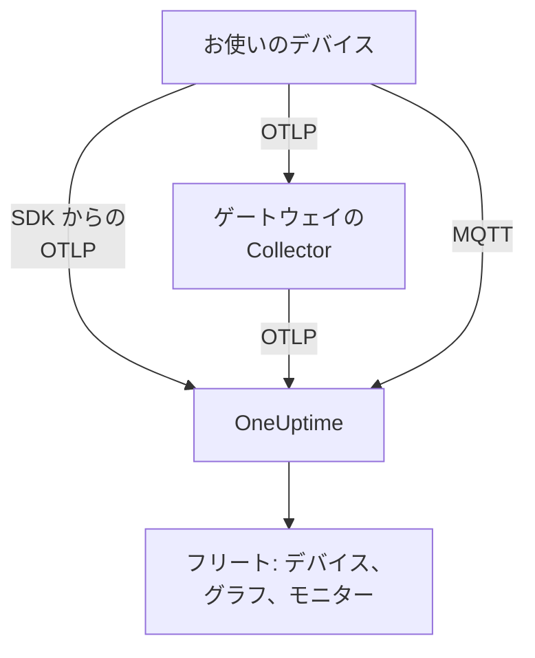

# IoT デバイス

OneUptime は、IoT デバイス (センサー、ゲートウェイ、コントローラー、エッジ機器) のフリートを、デバイスが送信する少数の `iot_*` メトリクスから監視します。デバイスをフリートにまとめ、フリートごとにデバイスのインベントリを保持し、バッテリー、信号、温度、CPU、メモリ、可用性をグラフにします。デバイスにインストールする OneUptime のエージェントはありません。デバイスは標準の OpenTelemetry を送信するか、OneUptime の MQTT エンドポイントにパブリッシュします。[IoT デバイス モニター](/docs/monitor/iot-device-monitor) は、デバイスが送信した内容をもとにアラートを出します。

:::cards
- [送信方法を選ぶ](#送信方法を選ぶ): OpenTelemetry SDK、ゲートウェイの Collector、または MQTT。
- [MQTT 経由でのメトリクス送信](#mqtt-経由でのメトリクス送信): トピック、デバイスごとの認証情報、Last Will。
- [メトリクスの規約](#メトリクスの規約): OneUptime がグラフとアラートに使う `iot_*` の名前。
- [トラブルシューティング](#トラブルシューティング): フリートやデバイスが表示されない、オフラインへの切り替わり。
:::

## 仕組み

すべての測定値は、1 つのフリートと 1 つのデバイスに属します。OneUptime は最初の測定値からフリートを作成し、新しいデバイスをそれぞれフリートのインベントリに追加し、以降は測定値のたびにデバイスの最新値を更新します。OpenTelemetry で送信した測定値も MQTT で送信した測定値も、同じフリート、インベントリ、グラフ、モニターに反映されます。



## OneUptime での IoT のモデル

- **フリート**: `building-a-sensors` や `field-gateways` のような、デバイスのグループです。`iot.fleet.name` リソース属性から決まり、OneUptime ではテレメトリサービス `iot/<fleet>` として表示されます。ログとメトリクスが同じサービスの下にそろうように、`service.name=iot/<fleet>` も設定してください。
- **デバイス**: フリート内の 1 台のデバイスで、各データポイントの `device.id` 属性で名前が付きます。フリートのインベントリは `device.id` をキーにしています。

| 属性 | 設定する場所 | 必須 | 説明 |
| --- | --- | --- | --- |
| `iot.fleet.name` | リソース | はい | デバイスが属するフリート。OneUptime のサービス `iot/<fleet>` になります。 |
| `device.id` | 各データポイント | はい | デバイスの不変の ID で、フリート内で一意です。 |
| `iot.device.kind` | 各データポイント | いいえ | `Device`、`Sensor`、`Gateway` などのデバイスの分類。既定は `Device` です。 |
| `iot.device.type` | 各データポイント | いいえ | モニターの絞り込みに使う、より細かい種類やモデル (`temp-sensor` など)。 |
| `iot.device.firmware` | 各データポイント | いいえ | デバイスが報告するファームウェアのバージョン。 |

MQTT では、トピックがフリートとデバイスを決めます。

## 送信方法を選ぶ

| 方法 | 使う場面 | 必要なもの |
| --- | --- | --- |
| [OpenTelemetry SDK](#opentelemetry-sdk-経由でのメトリクス送信) | デバイスが OpenTelemetry SDK を実行し、自身で OneUptime に到達できる場合。 | デバイス上の取り込みキー。 |
| [OpenTelemetry Collector](#opentelemetry-collector-経由でのメトリクス送信) | 多数のデバイスがゲートウェイを通じて報告する場合。 | Collector を実行するゲートウェイ。 |
| [MQTT](#mqtt-経由でのメトリクス送信) | デバイスがすでに MQTT を使っている場合、または切断した瞬間にオフラインを報告させたい場合。 | WebSocket で接続する任意の MQTT クライアント。 |

## 始める前に

- 取り込みキー。**プロジェクト設定 → テレメトリと APM → 取り込みキー** で作成し、その値をコピーします。デバイスはこれを `x-oneuptime-token` ヘッダーとして、または MQTT のパスワードとして送信します。
- デバイスまたはゲートウェイから OneUptime の URL へのネットワーク接続。
- デバイスのグループごとのフリート名と、デバイスごとの不変の ID。

## OpenTelemetry SDK 経由でのメトリクス送信

:::steps
### SDK の送信先を OneUptime にする

デバイスで標準の OpenTelemetry の環境変数を設定します。キー、フリート名、デバイス ID は自分の値に置き換えてください:

```bash
export OTEL_EXPORTER_OTLP_ENDPOINT=https://oneuptime.com/otlp
export OTEL_EXPORTER_OTLP_PROTOCOL=http/protobuf
export OTEL_EXPORTER_OTLP_HEADERS=x-oneuptime-token=YOUR_TELEMETRY_INGESTION_TOKEN
export OTEL_RESOURCE_ATTRIBUTES=iot.fleet.name=building-a-sensors,device.id=sensor-001,service.name=iot/building-a-sensors
```

`iot.fleet.name` は変えないでください。変更すると新しいフリートとして登録されます。

### 測定値を IoT メトリクスとして記録する

各測定値を [規約の名前](#メトリクスの規約) のいずれかを持つメトリクスとして出力し、すべてのデータポイントに `device.id` 属性を付けます:

| メトリクス | 値 | データポイントの属性 |
| --- | --- | --- |
| `iot_device_up` | `1` | `device.id=sensor-001` |
| `iot_battery_percent` | `87` | `device.id=sensor-001` |
| `iot_temperature_celsius` | `21.5` | `device.id=sensor-001` |

インベントリはリソースではなくデータポイントの `device.id` をキーにしているため、`OTEL_RESOURCE_ATTRIBUTES` だけでなく、各測定値にも設定してください。
:::

その後、[フリートが表示されることを確認](#フリートが表示されることを確認する) します。

## OpenTelemetry Collector 経由でのメトリクス送信

多数のデバイスがゲートウェイを通じて報告する場合は、ゲートウェイで OpenTelemetry Collector を実行します。Collector はデバイスから OTLP を受信し、すべての測定値にフリートを付与して OneUptime に転送します。

:::steps
### ゲートウェイの設定を保存する

これをゲートウェイに `config.yaml` として保存します:

```yaml title="config.yaml"
receivers:
  otlp:
    protocols:
      grpc:
        endpoint: 0.0.0.0:4317
      http:
        endpoint: 0.0.0.0:4318

processors:
  batch:
    send_batch_size: 512
    timeout: 5s
  resource:
    attributes:
      - key: iot.fleet.name
        value: field-gateways
        action: upsert
      - key: service.name
        value: iot/field-gateways
        action: upsert

exporters:
  otlphttp:
    endpoint: "https://oneuptime.com/otlp"
    headers:
      "x-oneuptime-token": "YOUR_TELEMETRY_INGESTION_TOKEN"

service:
  pipelines:
    metrics:
      receivers: [otlp]
      processors: [resource, batch]
      exporters: [otlphttp]
```

- `otlp` は、デバイスから gRPC (`4317`) と HTTP (`4318`) で受信します。Collector がサポートするほかの方法 (MQTT ブリッジ、ファイルのログ) で測定値を受信し、同じパイプラインに通すこともできます。
- `resource` は、すべての測定値にフリートを付与します。各ゲートウェイのデバイスがそれぞれのフリートに入るように、ゲートウェイごとに `iot.fleet.name` と、それに対応する `service.name=iot/<fleet>` を設定します。
- OneUptime がフリート内のデバイスを区別できるように、各データポイントに `device.id` と、必要に応じて `iot.device.kind`、`iot.device.type`、`iot.device.firmware` を残してください。
- `otlphttp` は、取り込みキーを使って HTTPS で OneUptime に送信します。既定の protobuf エンコーディングと `encoding: json` のどちらも受け付けられます。

### ゲートウェイで Collector を実行する

:::tabs
@tab Docker
`config.yaml` があるフォルダーから実行します:

```bash
docker run -d \
  --name otel-collector \
  --restart unless-stopped \
  -p 4317:4317 \
  -p 4318:4318 \
  -v $(pwd)/config.yaml:/etc/otelcol-contrib/config.yaml:ro \
  otel/opentelemetry-collector-contrib:0.161.0 \
  --config /etc/otelcol-contrib/config.yaml
```
@tab otelcol-contrib
ゲートウェイにすでに `otelcol-contrib` がある場合は、このファイルを指定します:

```bash
otelcol-contrib --config config.yaml
```
:::

その後、デバイスはゲートウェイに OTLP を送信します。たとえば、各デバイスの SDK で `OTEL_EXPORTER_OTLP_ENDPOINT=http://<gateway-host>:4318` を設定します。
:::

その後、[フリートが表示されることを確認](#フリートが表示されることを確認する) します。

## MQTT 経由でのメトリクス送信

OneUptime には独自の MQTT エンドポイントがあるため、MQTT を使うデバイスは SDK、Collector、ブリッジなしで、そこに直接測定値をパブリッシュできます。MQTT で届いたものは OTLP と同じパイプラインを通ります。フリートが作成され、インベントリが更新され、すべての IoT モニターとアラートテンプレートが同じように機能します。

### エンドポイント

| トランスポート | アドレス | 備考 |
| --- | --- | --- |
| WebSocket 経由の MQTT | `wss://<your-host>/mqtt` | 通常の HTTPS ポートを通じて、すべてのデプロイで動作します。 |
| TCP 経由の MQTT | `<app-host>:1883` | セルフホストのみ。公開するまでは、クラスターまたは Compose ネットワークの内部に限られます。ポートは `MQTT_INGEST_PORT` です。 |

### 認証

- **取り込みキーを使う**: MQTT のパスワードとして送信します。ユーザー名は無視されます。クライアントにユーザー名の欄しかない場合は、そこにキーを入れてください。多数のデバイスの代わりにパブリッシュするゲートウェイに適しています。
- **デバイスごとの認証情報を使う**: 直接接続するデバイスに推奨します。フリートの **デバイスレジストリ** ページを開き、`device.id` として使う **デバイス ID** でデバイスを登録します。デバイスの **MQTT ユーザー名** がユーザー名、**MQTT パスワード（シークレット）** がパスワードです。

デバイスの認証情報でパブリッシュできるのは、そのデバイス自身の `oneuptime/<fleet>/<device>/` トピックの下だけです。フリートのほかのデバイスに影響を与えずに、1 台のデバイスだけを取り消せます。その **有効** スイッチをオフにするか削除すると、接続中のデバイスは 1 分ほどで切断されます。登録済みのデバイスが沈黙すると、インベントリにはオフラインとして残り、Last Will なしで停止した場合でも Device Offline アラートテンプレートが発火します。

OneUptime は誤った認証情報を CONNECT の時点でリターンコード 4 (bad username or password) で拒否するため、設定を誤ったデバイスははっきりと失敗します。ブラウザーキーは MQTT では拒否されます。

### トピックとペイロード

固定のプレフィックス `oneuptime/` の下にパブリッシュします。フリートとデバイスのセグメントには `/`、`+`、`#` を含めることができず、`$` で始めることもできず、長さは最大 100 文字です。

| トピック | ペイロード |
| --- | --- |
| `oneuptime/<fleet>/<device>/telemetry` | 測定値の JSON オブジェクト: `{"metrics":{"iot_temperature_celsius":21.5}}`、または数値フィールドがメトリクスになるフラットなオブジェクト。 |
| `oneuptime/<fleet>/<device>/metrics/<metricName>` | 単一の値: 素の数値 (`23.4`) または `{"value":23.4}`。 |
| `oneuptime/<fleet>/<device>/status` | `online` または `offline` (`1` か `0`、`true` か `false`、`up` か `down` も可)。`iot_device_up` を設定します。 |

telemetry のペイロードには、すべてのデータポイントに付与される文字列のマップである `"attributes"` (`iot.device.kind`、`iot.device.type`、`iot.device.firmware` や独自のラベルに使います) と、ISO 8601 または Unix 秒かミリ秒で表した `"timestamp"` を含めることもできます。どちらも任意です。`timestamp` がない場合は、OneUptime が測定値を受信した時刻が使われます。

### Last Will によるオフライン検出

`oneuptime/<fleet>/<device>/status` に、ペイロード `offline` で MQTT の Last Will を登録します。デバイスが停止したりネットワークから外れたりすると、OneUptime はセッションが終了した瞬間にそのデバイスの `iot_device_up = 0` をパブリッシュします。これにより、ポーリングなしで標準の Device Offline アラートテンプレートが発火し、インベントリでデバイスが停止としてマークされます。接続後に同じトピックへ `online` をパブリッシュすると、デバイスは再び稼働中と表示されます。

### 例

:::tabs
@tab mosquitto_pub
セルフホストのインスタンスで、素の TCP を使う場合:

```bash
mosquitto_pub -h YOUR-ONEUPTIME-APP-HOST -p 1883 \
  -u oneuptime -P "YOUR_TELEMETRY_INGESTION_TOKEN" \
  -t "oneuptime/building-a-sensors/sensor-001/telemetry" \
  -m '{"metrics":{"iot_device_up":1,"iot_battery_percent":87,"iot_temperature_celsius":21.5},"attributes":{"iot.device.type":"temp-sensor","iot.device.firmware":"1.4.2"}}'
```
@tab Node.js
`mqtt` パッケージで、WebSocket を使い、oneuptime.com または任意のセルフホストのインスタンスに接続する場合:

```javascript
const mqtt = require("mqtt");

const client = mqtt.connect("wss://oneuptime.com/mqtt", {
  username: "oneuptime", // ignored — the token below is what authenticates
  password: "YOUR_TELEMETRY_INGESTION_TOKEN",
  will: {
    topic: "oneuptime/building-a-sensors/sensor-001/status",
    payload: "offline",
  },
});

client.on("connect", () => {
  client.publish("oneuptime/building-a-sensors/sensor-001/status", "online");
  setInterval(() => {
    client.publish(
      "oneuptime/building-a-sensors/sensor-001/telemetry",
      JSON.stringify({
        metrics: {
          iot_device_up: 1,
          iot_battery_percent: readBattery(),
          iot_temperature_celsius: readTemperature(),
        },
      }),
    );
  }, 60 * 1000);
});
```
@tab Python
`paho-mqtt` で、WebSocket を使う場合:

```python
import json
import paho.mqtt.client as mqtt

client = mqtt.Client(transport="websockets")
client.username_pw_set("oneuptime", "YOUR_TELEMETRY_INGESTION_TOKEN")
client.tls_set()
client.will_set("oneuptime/building-a-sensors/sensor-001/status", "offline")
client.ws_set_options(path="/mqtt")
client.connect("oneuptime.com", 443)

client.publish("oneuptime/building-a-sensors/sensor-001/status", "online")
client.publish(
    "oneuptime/building-a-sensors/sensor-001/telemetry",
    json.dumps({"metrics": {"iot_device_up": 1, "iot_temperature_celsius": 21.5}}),
)
```
:::

### 制限と配信

- このエンドポイントは測定値を受け取るだけです。サブスクリプションは拒否され (SUBACK の失敗)、retained メッセージは保持されません。
- 取り込みは at-least-once です。OneUptime に各パブリッシュを確認応答させるには QoS 1 を使います。確認応答が失われたあとの QoS 1 または 2 の再送により、データポイントが重複することがあります。
- 128 KB を超えるパブリッシュや、100 個を超えるメトリクスを含むパブリッシュは破棄され、それを超えるサイズを宣言したパケットは接続を切断します。
- これらのトピック以外へのパブリッシュや、不正な形式のペイロードは、受け付けたうえで破棄されます。MQTT 3.1.1 にはメッセージ単位のエラーがないためです。OneUptime は理由とともに警告をログに出します (`MQTT: dropped publish to …`)。
- WebSocket のエンドポイントでは、MQTT の keepalive を 5 分未満にしてください。イングレスは 300 秒間アイドル状態の WebSocket を閉じ、それにより Last Will と誤った Device Offline アラートが発生します。クライアントライブラリの既定値 (`mqtt` と `paho-mqtt` では 60 秒) で問題なく、TCP のエンドポイントにはこの制限はありません。

## メトリクスの規約

OneUptime は次の `iot_*` メトリクス名を認識します。デバイスに意味のあるものだけを送信してください。送信されないものはグラフに表示されません。各データポイントにはデバイスの `device.id` を付けます (MQTT ではトピックがデバイスを示します)。

| メトリクス名 | 意味 |
| --- | --- |
| `iot_device_up` | 可用性: `1` は稼働中で到達可能、`0` は停止。IoT Device モニターがこれを読み取ります。 |
| `iot_device_info` | 識別情報のみ。`device.id`、分類、種類、ファームウェアを持つため、デバイスは測定値を報告する前からインベントリに表示されます。 |
| `iot_battery_percent` | バッテリー残量。`0` から `100` (%)。 |
| `iot_signal_strength_dbm` | 無線の信号強度 (dBm)。Wi-Fi、LoRa、セルラーの RSSI など。 |
| `iot_temperature_celsius` | デバイスまたはセンサーの温度 (°C)。 |
| `iot_cpu_usage_ratio` | `0` から `1` の比率で表した CPU 使用率。OneUptime はパーセンテージとして保存し、表示します。 |
| `iot_memory_usage_bytes` | 使用中のメモリ (バイト)。 |
| `iot_memory_size_bytes` | デバイスのメモリの総量 (バイト)。 |
| `iot_uptime_seconds` | デバイスが最後に起動してからの秒数。 |

## フリートが表示されることを確認する

1. デバイス、ゲートウェイの Collector、または MQTT クライアントがエラーなしで送信していることを確認します。ログで、エクスポートの失敗、HTTP `401` や `422` の応答、リターンコード 4 による接続拒否を探してください。
2. **製品 → インフラストラクチャ → IoT → すべてのフリート** を開きます。最初の測定値から 1 分ほどで、フリートが `iot/<fleet>` として表示されます。
3. フリートの **デバイス** ページを開きます。送信した各デバイスが、最新のバッテリー、信号、温度、CPU、メモリ、稼働・停止の状態とともに一覧されているはずです。
4. フリートの **メトリクス** ページを開くと、任意の `iot_*` 系列をグラフにできます。

## セルフホストの OneUptime

エンドポイントを自分のインスタンスに向けます:

```bash
export OTEL_EXPORTER_OTLP_ENDPOINT=https://your-oneuptime-host.example.com/otlp
```

または、Collector では:

```yaml
exporters:
  otlphttp:
    endpoint: https://your-oneuptime-host.example.com/otlp
    headers:
      "x-oneuptime-token": "YOUR_TELEMETRY_INGESTION_TOKEN"
```

MQTT では `wss://your-oneuptime-host.example.com/mqtt` に接続するか、WebSocket を使えないデバイスのために、app サービスの素の MQTT TCP ポート (`MQTT_INGEST_PORT`、既定は `1883`) を公開します。両方の MQTT リスナーをオフにするには、app サービスで `MQTT_INGEST_ENABLED=false` を設定します。インスタンスが HTTP のみの場合は、`http://` (MQTT では `ws://`) とそのポートを使います。

## トラブルシューティング

:::details フリートが表示されない
1. `iot.fleet.name` が (データポイントのラベルではなく) リソース属性であり、`service.name` が `iot/<fleet>` であることを確認します。
2. エンドポイントが `https://oneuptime.com/otlp` (またはセルフホストの `…/otlp`) で、`x-oneuptime-token` ヘッダーに有効な取り込みキーが入っていることを確認します。
3. MQTT では、トピックが `oneuptime/<fleet>/<device>/…` に正確に従っていることを確認します。フリートを作成するのはトピックのフリートのセグメントです。
:::

:::details インベントリにデバイスがない
1. すべてのデータポイントに `device.id` ラベルを付けてください。デバイスはこれをキーにしています。MQTT では、トピックのデバイスのセグメントがこれにあたります。
2. まだ測定値を報告していないデバイスについては、`iot_device_info` (MQTT では `status` メッセージ) を送信すると、インベントリに表示されます。
3. `device.id` の値は変えないでください。ID が変わるとデバイスが重複して作成されます。
:::

:::details エクスポーターから HTTP 401 または 422 が返る
`401` は、取り込みキーがない、誤っている、または期限切れであることを意味します。`422` は、キーが無効化されているか、デバイスのテレメトリを送信できないブラウザーキーであることを意味します。**プロジェクト設定 → テレメトリと APM → 取り込みキー** で新しいキーを作成し、`x-oneuptime-token` ヘッダーを更新してください。
:::

:::details MQTT 接続が "bad username or password" で拒否される
OneUptime は誤った認証情報を CONNECT の時点でリターンコード 4 で拒否します。パスワードが、無効化も期限切れもしていない有効な取り込みキーであること、または登録済みのデバイスでは、ユーザー名をその **MQTT ユーザー名** とし、パスワードが認証情報のシークレットであることを確認してください。ブラウザーキーは MQTT では拒否されます。
:::

:::details 稼働中なのにデバイスがオフラインになる
WebSocket のエンドポイントでは、イングレスが 300 秒間アイドル状態の接続を閉じ、それにより Last Will と誤った Device Offline アラートが発生します。MQTT の keepalive は 5 分未満にしてください。クライアントライブラリの既定値である 60 秒で問題ありません。
:::

:::details 測定値がフリートのグラフに表示されない
1. [メトリクスの規約](#メトリクスの規約) にある `iot_*` の名前を正確に使ってください。ほかの名前は一般的なメトリクスとして保存され、IoT のグラフには反映されません。
2. `iot_cpu_usage_ratio` は `0` から `1` の比率で送信してください。OneUptime はパーセンテージとして表示します。
3. デバイスが報告を始めてから最初のデータポイントが表示されるまで、最大 1 分ほどかかります。
:::

## 次のステップ

:::cards
- [IoT デバイス モニター](/docs/monitor/iot-device-monitor): デバイスがオフラインになったとき、バッテリーが少なくなったとき、過熱したときにアラートを出します。
- [OpenTelemetry](/docs/telemetry/open-telemetry): OneUptime が任意の SDK や Collector から OTLP を受け取る仕組み。
- [ホスト OpenTelemetry Collector](/docs/telemetry/host-otel-collector): Linux、macOS、Windows のゲートウェイ自体を監視します。
:::
