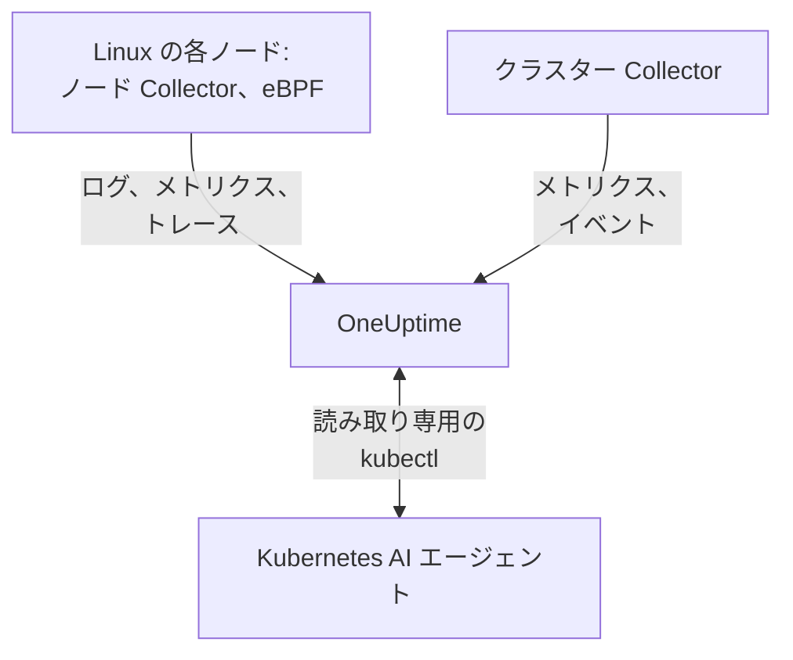

# Kubernetes エージェント

OneUptime の Kubernetes エージェントは Helm チャートで、クラスターのメトリクス、イベント、Pod のログを収集し、eBPF を使ってすべての Pod のトレース、リクエストメトリクス、サービスグラフ、ネットワークフローも収集します。コードの変更も SDK も必要ありません。また、[Kubernetes AI エージェント](#kubernetes-ai-エージェント) も実行し、OneUptime AI がインシデントやアラートを調査する際に読み取り専用の `kubectl` を実行できるようにします。`helm install` 1 回で導入でき、[Kubernetes モニター](/docs/monitor/kubernetes-monitor) が送信された内容をもとにアラートを出します。

:::cards
- [エージェントをインストールする](#エージェントをインストールする): Helm で 4 ステップ。
- [設定オプション](#設定オプション): フィルター、サンプリング、コントロールプレーン、サービスメッシュ、コスト、ラベル。
- [Kubernetes AI エージェント](#kubernetes-ai-エージェント): OneUptime AI 用の読み取り専用の `kubectl` と、許可した場合の修正。
- [送信量を減らす](#収集するデータ量を減らす): 効果の大きい順に並べた調整手段。
:::

## 仕組み

チャートは専用の namespace でいくつかのワークロードを実行します。それぞれが収集した内容を、渡した取り込みキーを使って OTLP で OneUptime の URL に送信し、クラスターは `clusterName` で指定した名前で自身を登録します。



| ワークロード | 種類 | 役割 | 実行条件 |
| --- | --- | --- | --- |
| クラスター Collector | Deployment | Kubernetes API からのクラスターメトリクス、Kubernetes イベント、Pod・ノード・ワークロードの仕様。 | 常に |
| ノード Collector | DaemonSet | `/var/log/pods` からの Pod のログ、kubelet と cAdvisor のメトリクス、ノードの OS メトリクス。 | EKS Fargate 以外のすべて |
| eBPF インストルメンテーション (OBI) | DaemonSet | すべての Pod からの HTTP、gRPC、SQL、Redis のトレースとリクエストメトリクス、およびサービスマップ。 | デフォルトで有効 (GKE Autopilot と EKS Fargate を除く) |
| Kubernetes AI エージェント | Deployment | OneUptime AI がインシデントやアラートを調査する際の読み取り専用の `kubectl`。 | デフォルトで有効 |
| ログテーラー | Deployment | ノード Collector が読めない場合に、Kubernetes API 経由で Pod のログを取得。 | `gke-autopilot` と `eks-fargate` のプリセット |
| コストエンジンとポーラー | Deployments | namespace、ワークロード、Pod ごとの支出。 | `cost.enabled=true` の場合 |

エージェントのイメージはすべて Linux 専用なので、すべてのワークロードは Linux ノードに固定されています。

## 始める前に

- v1.23 以降を実行している Kubernetes クラスターと、それに接続するよう設定された `kubectl`。
- Helm 3。アップグレードでは `--reset-then-reuse-values` を使うため、Helm 3.14 以降が必要です。
- 取り込みキー。**プロジェクト設定 → テレメトリと APM → 取り込みキー** で作成します。エージェントはこれを `x-oneuptime-token` ヘッダーで送信するため、プロジェクトの API キーはここでは使えません。
- クラスターの名前。プロジェクト内で一意で変わらないもの (`prod-us-east-1` など) にします。クラスターはこの名前で OneUptime に表示されます。
- クラスターから OneUptime の URL への送信方向の HTTPS。

## エージェントをインストールする

:::steps
### Helm リポジトリを追加する

```bash
helm repo add oneuptime https://helm-chart.oneuptime.com
helm repo update
```

### チャートをインストールする

`YOUR_ONEUPTIME_URL`、`YOUR_ONEUPTIME_API_KEY` (取り込みキー)、クラスター名を自分の値に置き換え、プラットフォームに合ったタブを選びます ([プリセットを選ぶ](#プリセットを選ぶ) を参照)。

:::tabs
@tab Standard
セルフマネージドのクラスター、EKS on EC2、GKE Standard、AKS、minikube、kind、k3s:

```bash
helm install kubernetes-agent oneuptime/kubernetes-agent \
  --namespace oneuptime-agent \
  --create-namespace \
  --set oneuptime.url="YOUR_ONEUPTIME_URL" \
  --set oneuptime.apiKey="YOUR_ONEUPTIME_API_KEY" \
  --set clusterName="my-cluster" \
  --set aiAgent.enabled=true
```
@tab GKE Autopilot
```bash
helm install kubernetes-agent oneuptime/kubernetes-agent \
  --namespace oneuptime-agent \
  --create-namespace \
  --set oneuptime.url="YOUR_ONEUPTIME_URL" \
  --set oneuptime.apiKey="YOUR_ONEUPTIME_API_KEY" \
  --set clusterName="my-cluster" \
  --set aiAgent.enabled=true \
  --set preset=gke-autopilot
```
@tab EKS Fargate
```bash
helm install kubernetes-agent oneuptime/kubernetes-agent \
  --namespace oneuptime-agent \
  --create-namespace \
  --set oneuptime.url="YOUR_ONEUPTIME_URL" \
  --set oneuptime.apiKey="YOUR_ONEUPTIME_API_KEY" \
  --set clusterName="my-cluster" \
  --set aiAgent.enabled=true \
  --set preset=eks-fargate
```
:::

**AI 調査はデフォルトで有効です。** `aiAgent.enabled=true` は Collector の横で [Kubernetes AI エージェント](#kubernetes-ai-エージェント) を実行します。このクラスターでインシデントやアラートが発生すると、OneUptime AI は読み取り専用の `kubectl` (`get`、`describe`、`logs`、`events`、`top`) で調査し、何も変更しません。修正は許可するまでオフのままです。これなしでインストールするには、代わりに `--set aiAgent.enabled=false` を使います。

### Pod が実行中であることを確認する

```bash
kubectl get pods -n oneuptime-agent
```

すべての Pod が 1、2 分以内に `Running` になるはずです:

:::tabs
@tab Standard
クラスター Collector、AI エージェント、そして各ノードにノード Collector と eBPF Pod:

```text
NAME                                          READY   STATUS    RESTARTS   AGE
kubernetes-agent-xxxxxxxxxx-xxxxx             1/1     Running   0          1m
kubernetes-agent-ai-agent-xxxxxxxxxx-xxxxx    1/1     Running   0          1m
kubernetes-agent-ebpf-xxxxx                   1/1     Running   0          1m
kubernetes-agent-logs-xxxxx                   1/1     Running   0          1m
```
@tab GKE Autopilot
ノード Collector は引き続き実行され、`hostPath` なしで kubelet と cAdvisor のメトリクスを読み取ります。また、ログテーラーの Deployment が Kubernetes API 経由で Pod のログを読み取ります:

```text
NAME                                          READY   STATUS    RESTARTS   AGE
kubernetes-agent-xxxxxxxxxx-xxxxx             1/1     Running   0          1m
kubernetes-agent-ai-agent-xxxxxxxxxx-xxxxx    1/1     Running   0          1m
kubernetes-agent-logs-yyyyyyyyyy-yyyyy        1/1     Running   0          1m
kubernetes-agent-logs-xxxxx                   1/1     Running   0          1m
```
@tab EKS Fargate
Deployment が 3 つで、DaemonSet はありません。Fargate は Pod ごとに専用のマイクロ VM を割り当て、DaemonSet をスケジュールしないため、ノードのメトリクスは利用できません:

```text
NAME                                          READY   STATUS    RESTARTS   AGE
kubernetes-agent-xxxxxxxxxx-xxxxx             1/1     Running   0          1m
kubernetes-agent-ai-agent-xxxxxxxxxx-xxxxx    1/1     Running   0          1m
kubernetes-agent-logs-yyyyyyyyyy-yyyyy        1/1     Running   0          1m
```
:::

### OneUptime でクラスターを見つける

**製品 → インフラストラクチャ → Kubernetes → すべてのクラスター** を開きます。数分以内にクラスターが `clusterName` で表示され、ノード、Pod、ワークロードが埋まります。Kubernetes AI エージェントは、クラスターの **AI** の下にある **エージェント** ページに接続済みとして表示されます。
:::

## プリセットを選ぶ

`preset` は、プラットフォームで動作する既定値を選びます。Pod のログを `hostPath` 経由でノードから読むか Kubernetes API 経由で読むか、そしてどのワークロードに特権での実行を許すかです。

| `preset` | 用途 | Pod のログ | ノードのメトリクス |
| --- | --- | --- | --- |
| `standard` (既定) | セルフマネージドのクラスター、**EKS on EC2**、**GKE Standard**、**AKS**、minikube、kind、k3s | ノード Collector が `hostPath` 経由で `/var/log/pods` を読む (オーバーヘッドが最小) | kubelet、cAdvisor、ノードの OS メトリクス |
| `gke-autopilot` | **GKE Autopilot** | ログテーラーが Kubernetes API 経由で読む (`hostPath` なし、ホストへのアクセスなし) | kubelet と cAdvisor (`hostPath` なし) |
| `eks-fargate` | **EKS Fargate** | ログテーラーが Kubernetes API 経由で読む (`hostPath` なし、ホストへのアクセスなし) | なし: Fargate は DaemonSet を実行しない |

迷ったら `standard` から始めてください。インストールが `hostPath` を挙げた Pod Security エラーで失敗する場合は、`preset=gke-autopilot` (Fargate では `eks-fargate`) で再インストールします。GKE Autopilot と EKS Fargate は、eBPF とプロファイラーが必要とする特権 Pod も拒否するため、この 2 つのプリセットではどちらも除外されます。

## 収集されるもの

| カテゴリ | データ |
| --- | --- |
| ノードのメトリクス | CPU、メモリ、ファイルシステム、ネットワークの使用量 |
| Pod のメトリクス | CPU、メモリ、ネットワーク、再起動 |
| コンテナのメトリクス | コンテナごとの CPU とメモリ |
| クラスターのメトリクス | ノードの状態、割り当て可能なリソース、Pod 数 |
| Kubernetes イベント | 警告、エラー、スケジューリングのイベント |
| Pod のログ | すべてのコンテナの stdout と stderr (標準のクラスターでは `hostPath` 経由、Autopilot と Fargate では Kubernetes API 経由) |
| アプリケーションのトレース (eBPF、デフォルトで有効) | すべての Pod からの HTTP、gRPC、SQL、Redis のスパン (SDK もコードの変更も不要) |
| HTTP の RED メトリクス (eBPF) | サービスごとの `http.server.request.duration`、およびリクエストとレスポンスのボディサイズ |
| サービスグラフ (eBPF) | 呼び出し元から呼び出し先へのリクエストレート、レイテンシ、エラーのエッジ。これがサービスマップを描きます |
| ネットワークフローのメトリクス (eBPF) | Pod 間の TCP と UDP のバイト数とパケット数のカウンター (Kubernetes のメタデータ付き) |
| TCP の統計 (eBPF) | ノード単位のラウンドトリップタイム、接続失敗、再送のカウンター |
| ワークロードのコスト (オプトイン、`cost.enabled=true`) | namespace、ワークロード、Pod ごとの支出 (アイドルと効率を含む)、およびノードとボリュームの時間あたりのコスト: [Kubernetes コストオブザーバビリティ](/docs/telemetry/kubernetes-cost) を参照 |

## 設定オプション

以下のオプションはすべて Helm の値です。インストール時に設定するか、インストール済みのエージェントに `helm upgrade ... --reset-then-reuse-values --set <value>` で設定します。

### namespace によるフィルタリング

`namespaceFilters.rules` は、namespace のパターンを 4 つのスコープにそれぞれ個別に適用します:

| スコープ | フィルタリングする場所 | 影響を受けるもの |
| --- | --- | --- |
| `podLogs` | hostPath の filelog レシーバー、または API のログテーラー | Pod の stdout と stderr のみ。Kubernetes イベントと監査ログは影響を受けません |
| `ebpfDiscovery` | OBI のプロセス検出 | 一致するワークロードからの eBPF のトレースと eBPF のメトリクスの両方 |
| `metrics` | Collector 内で、Kubernetes のメタデータが追加されたあと | namespace を持つメトリクスの系列。namespace のないノードとクラスターの系列は残ります |
| `traces` | Collector 内で、Kubernetes のメタデータが追加されたあと | eBPF のスパンと、アプリケーションが OTLP で送信するスパンの両方 |

パターンは namespace の名前全体と照合され、`*` (`team-*`) を使えます。スコープに `include` ルールが 1 つでもあると、そのスコープでは一致する namespace だけが残り、`exclude` ルールは常に優先されます。既定のルールは、`podLogs` と `ebpfDiscovery` からのみ `kube-system` を除外します。

Pod のログと eBPF の検出を一部の namespace に限定するには:

```bash
helm install kubernetes-agent oneuptime/kubernetes-agent \
  --namespace oneuptime-agent \
  --create-namespace \
  --set oneuptime.url="YOUR_ONEUPTIME_URL" \
  --set oneuptime.apiKey="YOUR_ONEUPTIME_API_KEY" \
  --set clusterName="my-cluster" \
  --set-json 'namespaceFilters.rules=[{"action":"include","namespaces":["default","production","staging"],"scopes":["podLogs","ebpfDiscovery"]}]'
```

騒がしい namespace のログを止めつつ、その eBPF のトレース、サービスマップ、メトリクスを残すには、除外のスコープを `podLogs` に限定します:

```bash
  --set-json 'namespaceFilters.rules=[{"action":"exclude","namespaces":["kube-system"],"scopes":["podLogs","ebpfDiscovery"]},{"action":"exclude","namespaces":["noisy-*"],"scopes":["podLogs"]}]'
```

`podLogs` と `ebpfDiscovery` のルールは発生源でフィルタリングします。除外したログファイルは開かれず、除外したワークロードはインストルメントされません。`metrics` と `traces` のルールは、namespace がデータに付与されたあと、Collector 内で後から適用されます。

#### namespace によるメトリクスとトレースのフィルタリング

namespace を持つメトリクスやスパンもフィルタリングするには、ルールにこれらのスコープを追加します:

```bash
  --set-json 'namespaceFilters.rules=[{"action":"exclude","namespaces":["kube-system","noisy-*"],"scopes":["podLogs","ebpfDiscovery","metrics","traces"]}]'
```

> [!NOTE]
> ノードとクラスターのレベルのメトリクスは常に残ります。namespace は Pod に属し、ノードには属さないため、ノードの CPU、ノードのメモリ、ファイルシステムの使用量のような系列には照合する対象がなく、破棄されることはありません。`metrics` スコープのルールは、問題が起きているノードを隠すことなく、Pod ごとの系列を減らします。

Kubernetes イベントは、エージェントで namespace によってフィルタリングすることはできません。イベントは `k8sobjects` レシーバーから `k8s.namespace.name` 属性なしで届くため (namespace はイベントの本文の中にあります)、フィルターが照合する対象がありません。代わりに、OneUptime の **ログ → 設定 → 破棄フィルター** で破棄してください。

### ログの重大度によるフィルタリング

`filters.logs.minSeverity` は、一定の重大度より低い Pod のログレコードを、送信前にエージェントで破棄します:

```bash
  --set filters.logs.minSeverity=WARN
```

指定できるのは `TRACE`、`DEBUG`、`INFO`、`WARN`、`ERROR`、`FATAL` です。`WARN` は WARN、ERROR、FATAL を残し、INFO、DEBUG、TRACE を破棄します。既定 (`""`) ではすべて残ります。どちらのログモードでも適用されるため (`daemonset` モードでは Collector で、`api` モードではログテーラー内で)、プリセットによって知らないうちにオフになることはありません。

コンテナランタイムは重大度を記録しないため、エージェントはログのテキスト自体から重大度を読み取ります (`[ERROR]`、`WARN:`、`"level":"info"` など…)。認識できるレベルがない行がどう扱われるかは、ログモードによって異なります。2 つのモードが知っている情報が違うためです:

| モード | レベルのない行 | 理由 |
| --- | --- | --- |
| `daemonset` | `stderr` は ERROR として扱われ (残る)、`stdout` は INFO として扱われる (WARN のしきい値で破棄) | コンテナランタイムが、各行がどのストリームから来たかを記録しているため。 |
| `api` | 常に残る | Kubernetes の `pods/log` API は stdout と stderr を行ごとの印なしで単一のストリームにまとめるため、エージェントは推測せずに行を残します。 |

そのため、`api` モードは意図的に `daemonset` モードより破棄する量が少なくなっています。Python のトレースバックや `npm ERR!` には重大度のキーワードがなく、それを黙って削除することこそ、しきい値が防ぐべき失敗です。ハイブリッドモード (`logs.windowsPods.enabled`) では、ノードの OS に応じて両方の行が適用されます。Linux の Pod は `daemonset`、Windows の Pod は `api` に従います。

どちらのモードでも、複数行のイベントはフィルタリングの前に組み立て直されるため、Java のスタックトレースは最初の行で判定され、まとめて残るか破棄されます。

> [!IMPORTANT]
> Kubernetes イベントとリソースの仕様は、これでフィルタリングされることはありません。これらは独自の重大度なしで Kubernetes API から届くため、しきい値を適用するとフィード全体が削除されてしまい、最も欲しい `FailedScheduling`、`BackOff`、`OOMKilling` の警告まで失われます。数が少なく価値が高いため、エージェントは常に送信します。量を減らすには、OneUptime の **ログ → 設定 → 破棄フィルター** を使ってください。

### 名前によるメトリクスの包含と除外

`filters.metrics` は、すべてのレシーバーを通して、どのメトリクスがクラスターから出ていくかを決めます。

いくつかの騒がしいメトリクスを破棄する (拒否リスト。通常はこちらが目的に合います):

```bash
  --set-json 'filters.metrics.exclude=["k8s.volume.available","k8s.volume.capacity"]'
```

固定の集合だけを送信する (許可リスト。それ以外はすべて破棄されます):

```bash
  --set-json 'filters.metrics.include=["k8s.pod.cpu.utilization","k8s.pod.memory.usage"]'
```

正確な名前ではなくパターンで照合する:

```bash
  --set filters.metrics.matchType=regexp \
  --set-json 'filters.metrics.exclude=["^container_network_"]'
```

| キー | 意味 |
| --- | --- |
| `filters.metrics.exclude` | 破棄するメトリクス名。`include` のあとに適用されるため、除外が常に優先されます。 |
| `filters.metrics.include` | 空でない場合、これらのメトリクスだけが送信されます。 |
| `filters.metrics.matchType` | `strict` (正確な名前、既定) または `regexp` (RE2、アンカーなし)。 |

- `regexp` はアンカーなしなので、`system.cpu` は `system.cpu.time` にも一致します。メトリクスを 1 つだけ指したいときはアンカーを付けてください (`^system\.cpu$`)。
- RE2 には先読みがないため、`^(?!container_)` はコンパイルできません。「これ以外のすべて」は否定のパターンではなく `include` で表してください。
- `include` はすべてのレシーバーに一度に適用されます。メトリクスを書き忘れた許可リストは、それに基づくモニターを黙って消してしまうため、閉じた集合が必要な場合を除いて `exclude` を使ってください。
- リストには `--set-json` (または values ファイル) を使ってください。素の `--set` はリストに追加するのではなく置き換えます。

> [!WARNING]
> パターンは展開する前にテストしてください。Collector は起動時にパターンをコンパイルするため、無効なパターンが黙って誤動作することはありません。Collector は起動を拒否してクラッシュループし、その Collector のログもメトリクスと一緒に止まります。Helm は RE2 をコンパイルできないため、`helm upgrade` は不正なパターンをそのまま受け入れます。

### トレースのサンプリング

上のフィルターは、テレメトリのカテゴリ (namespace、重大度、メトリクス名) を取り除きます。サンプリングはすべてのカテゴリを残し、代わりに母集団を間引きます。残すトレースの割合を `sampling.traces.percentage` に設定します:

```bash
helm upgrade kubernetes-agent oneuptime/kubernetes-agent \
  --namespace oneuptime-agent --reset-then-reuse-values \
  --set sampling.traces.percentage=10
```

これで 10 件のトレースのうち 1 件が残り、残りの 9 件はクラスターから出る前にエージェントで破棄されます。

- **断片ではなく、トレース全体が得られます**。判定はスパンごとのコイントスではなくトレース ID のハッシュで行われるため、トレースのスパンはすべてまとめて残るか破棄され、残ったトレースは最初から最後まで読めます。
- **メトリクスベースのモニターは変わりません**。OBI は eBPF の RED メトリクス (リクエストレート、エラーレート、所要時間) をすべてのリクエストから計算し、これらはサンプラーのないメトリクスパイプラインを通ります。10% にすると、トレースは 10 分の 1 になりますが、レート、エラー、レイテンシは正確なままです。
- **スパンベースのモニターは変わります**。OneUptime がスパン自体から数えるものはすべて、レートに応じて小さくなります。下の警告を参照してください。

| キー | 意味 |
| --- | --- |
| `sampling.traces.percentage` | 残すトレースの割合 (0〜100)。既定は `100` (すべて残す)。 |
| `sampling.traces.hashSeed` | トレース ID のハッシュのシード。既定は `22`。 |

- `0` はトレースを 1 件も残しません。これはレートであり、オフスイッチではありません。eBPF の DaemonSet が実行されてコストがかかり続ける一方で、すべてのトレースが削除されます。トレースが不要なら `ebpf.enabled=false` を使ってください。トレースは不要でも RED メトリクスとサービスマップは必要なら、eBPF を有効にしたまま意図的に `0` を設定します。
- これは `ebpf.enabled` が有効な場合にだけ適用されます。そうでなければトレースのパイプラインがなく、値は何もしません。
- サンプリングされるのはトレースだけです。`sampling.logs` や `sampling.metrics` は意図的に用意していません。下の注記を参照してください。
- 小数には `--set-json` が必要で、下限もあります。Helm は `0.5` を文字列として読むため、`--set sampling.traces.percentage=0.5` は失敗します。`--set-json 'sampling.traces.percentage=0.5'` か values ファイルを使ってください。約 `0.0061` 未満ではレートが 0 に丸められ、エラーなしで `0` とまったく同じ動作になります。`0.01` (1 万分の 1) が、書いたとおりに動作する最小の値です。
- 複数のクラスターでも既定のまま動作します。2 つのエージェントが同じトレースを残すのは `hashSeed` と `percentage` の両方が一致する場合だけで、どちらも既定値はどこでも同じなので、2 つのクラスターをまたぐトレースは欠けずに残ります。`hashSeed` は、2 つのサンプリング層を独立させたい場合にだけ変更してください。同じシードなら、低いレートは高いレートのトレースの部分集合を残します。
- Pod のログはサンプリングされないため、`ebpf.logToTraceCorrelation: true` では、残ったトレースが一部だけでも、すべてのログレコードにトレース ID が付きます。そのため、ログレコードの約 (100 − `percentage`)% は存在しないトレースを指します。トレースからそのログをたどる操作には影響しません。

> [!WARNING]
> これを設定したら、スパンベースのモニターを調整し直してください。サンプリングにより OneUptime に届くスパンが減るため、スパンを数えるものはすべて数が減ります。`Span Count` に対する **トレース** モニターや `Exception Count` に対する **例外** モニターは、昨日の量の約 `percentage`% しか見なくなります。サンプリングなしのトラフィックで調整したしきい値は、黙って超えられなくなります。モニターはエラーを出さず、ただ静かになるだけです。それらのしきい値を同じ係数で割ってください。レートはクラスター全体に適用されるため、除外できるサービスはありません。エラーのグループ化は線形以上に悪化します。よくある例外は引き続き表示されますが、まれに一度だけ起きる例外は、10 分の 1 の頻度で現れるというより、消えてしまう可能性のほうが高くなります。

> [!NOTE]
> ログやメトリクスのサンプリングがない理由: Collector のサンプラーはメトリクスをまったくサンプリングできません。ログはサンプリングできますが、乱数をトレース ID から得るため、トレース ID のない Pod のログではすべてのログレコードが同じようにハッシュされ、ログのレートはシード次第ですべてを残すかすべてを削除するかのどちらかになります。ログを黙って削除する設定を提供するよりも、チャートは何も提供しないことを選んでいます。ログを減らすには、削除する対象が明確な [ログの重大度によるフィルタリング](#ログの重大度によるフィルタリング) と [namespace によるフィルタリング](#namespace-によるフィルタリング) を使ってください。

### ログの収集を無効にする

Pod のログが不要な場合:

```bash
helm install kubernetes-agent oneuptime/kubernetes-agent \
  --namespace oneuptime-agent \
  --create-namespace \
  --set oneuptime.url="YOUR_ONEUPTIME_URL" \
  --set oneuptime.apiKey="YOUR_ONEUPTIME_API_KEY" \
  --set clusterName="my-cluster" \
  --set logs.enabled=false
```

メトリクスには影響しません。ノード Collector は kubelet、cAdvisor、ホストのメトリクスのために動き続け、Pod のログの読み取りだけをやめます。止まるのはログベースのアラートだけです。

### 特定のログ収集モードを強制する

`logs.mode` はプリセットの選択を上書きし、常にそれより優先されます:

- `logs.mode=daemonset`: hostPath の DaemonSet (オーバーヘッドが最小。`hostPath` が必要)。
- `logs.mode=api`: Kubernetes API のログテーラーの Deployment (どのクラスターでも動作)。
- `logs.mode=disabled`: Pod のログなし。

モードが決めるのは Pod のログの取得元だけです。ノードのメトリクスはどちらの場合も収集されるため、`api` と `disabled` でも kubelet、cAdvisor、ホストのメトリクスは残ります。例外はプラットフォームです。EKS Fargate は DaemonSet をまったくスケジュールできないため、ノード Collector がなく、ノード、Pod、コンテナのメトリクスもありません。GKE Autopilot はノード Collector を実行しますが `hostPath` をブロックするため、kubelet と cAdvisor のメトリクスは収集しても、ホストの `/proc` と `/sys` を読む `hostmetrics` のメトリクス (ディスク I/O、inode、NIC のエラー) は収集しません。

Windows のノードプールがあるクラスターでは、すべてのエージェントイメージが Linux 専用のため、`daemonset` モードは Linux ノードだけを対象にします。Windows ノード上の Pod だけを対象に API のログテーラーを並行して実行するには、`--set logs.windowsPods.enabled=true` を追加します。Linux の Pod はノード上でのファイル追跡を続け、両者が同じ行を二重に送ることはありません。これには、チャートと同じかそれより新しい `kubernetes-log-tailer` イメージが必要です。古いイメージはこの制限を無視し、Linux のログを二重に送信します。

### コントロールプレーンの監視を有効にする

クラスターの **コントロールプレーン** ページには、etcd、API サーバー、スケジューラー、コントローラーマネージャーのグラフが表示されます。`controlPlane.enabled` が `true` の場合、エージェントは 4 つすべてをスクレイプします:

```bash
helm upgrade kubernetes-agent oneuptime/kubernetes-agent \
  --namespace oneuptime-agent \
  --reset-then-reuse-values \
  --set controlPlane.enabled=true
```

各コンポーネントは、それぞれのリストにあるアドレスでスクレイプされます: `controlPlane.etcd.endpoints`、`controlPlane.apiServer.endpoints`、`controlPlane.scheduler.endpoints`、`controlPlane.controllerManager.endpoints`。スクレイプはホストネットワークを持たないエージェントの Pod で実行されるため、既定値 (`https://localhost:<port>/metrics`) はその Pod 自体を指します。各リストには Pod から到達できるアドレスを設定してください。どのクラスターでも、API サーバーはクラスター内から `https://kubernetes.default.svc:443/metrics` で応答します:

```bash
helm upgrade kubernetes-agent oneuptime/kubernetes-agent \
  --namespace oneuptime-agent \
  --reset-then-reuse-values \
  --set controlPlane.enabled=true \
  --set "controlPlane.apiServer.endpoints={https://kubernetes.default.svc:443/metrics}"
```

`controlPlane.enabled` は 4 つのスクレイプをまとめて有効にします。エンドポイントでコンポーネントに到達できない場合 (マネージドクラスターの etcd、スケジューラー、コントローラーマネージャー、または `localhost` の既定値のまま)、そのスクレイプは毎回失敗します。Collector はスクレイプエラーをログに出してターゲットをダウンと報告しますが、それ以外は何も変わりません。

エージェントは HTTPS だけでスクレイプし、サービスアカウントのトークンを使い、クライアント証明書は使いません。そのため:

- **etcd** には、クライアント証明書を求めない HTTPS のメトリクスアドレスが必要です。etcd の通常のメトリクスポートには到達できません。`2381` の素の HTTP (kubeadm の `--listen-metrics-urls`) は HTTPS としてスクレイプされて失敗し、`2379` はクライアント証明書を必要とします。
- **スケジューラー** (`10259`) と **コントローラーマネージャー** (`10257`) は HTTPS で提供されトークンを受け付けますが、kubeadm はコントロールプレーンのノードでこれらを `127.0.0.1` にバインドします。エージェントの Pod から到達できる `--bind-address` が必要です。

マネージドの Kubernetes サービス (EKS、GKE、AKS) は etcd、スケジューラー、コントローラーマネージャーを公開しないため、そこではこれらのタブは空のままです。タブのメトリクスが届くまで、**コントロールプレーン** ページはグラフの代わりに、設定すべき内容をコピー用のコマンドとともに表示します。

### CoreDNS のメトリクスを有効にする

**コントロールプレーン** ページの **CoreDNS** タブには、DNS クエリ、レイテンシ、キャッシュ、転送のグラフが表示されます。これらの収集は既定ではオフです:

```bash
helm upgrade kubernetes-agent oneuptime/kubernetes-agent \
  --namespace oneuptime-agent \
  --reset-then-reuse-values \
  --set coreDns.enabled=true
```

エージェントは、`kube-system` 内で `k8s-app=kube-dns` のラベルが付いた Pod のポート `9153` をスクレイプします。これは kubeadm のクラスター、EKS、AKS での CoreDNS の動かし方です。別の場所で動かしている場合は、`coreDns.namespace`、`coreDns.service` (`k8s-app` ラベル)、`coreDns.port` も設定してください。GKE は CoreDNS ではなく kube-dns (dnsmasq) または Cloud DNS を使うため、そこではタブは空のままです。

### サービスメッシュのメトリクスを有効にする

クラスターの **サービスメッシュ** ページには、Istio と Linkerd のグラフが表示されます。エージェントは `serviceMesh.provider` が指定する 1 つのメッシュ (`istio` または `linkerd`) をスクレイプします:

```bash
helm upgrade kubernetes-agent oneuptime/kubernetes-agent \
  --namespace oneuptime-agent \
  --reset-then-reuse-values \
  --set serviceMesh.enabled=true \
  --set serviceMesh.provider=istio
```

Istio では各 `istio-proxy` サイドカー (ポート `15090`) の Envoy の統計を、Linkerd では各 `linkerd-proxy` の管理ポートを読み取ります。どちらのメッシュのコントロールプレーンもスクレイプされません。istiod (**Pilot** カード) と Linkerd の identity、destination、proxy-injector の各コンポーネント (**コントロールプレーン** カード) は独自の管理ポートでメトリクスを提供するため、これらのカードはグラフの代わりにそのことを表示します。

### エージェントが収集しないメトリクス

一部のグラフには、エージェントがスクレイプしないメトリクスが表示されます。**コントロールプレーン** ページの **kube-proxy**、**サービスメッシュ** ページの **Cilium** (Hubble を使用)、そして Istio と Linkerd のタブにあるメッシュ自体のコントロールプレーン (**istiod** と、Linkerd の identity、destination、proxy-injector の各コンポーネント) です。これらのグラフは、リソース属性 `k8s.cluster.name` をクラスター名 (エージェントの `clusterName`) に設定したうえで、たとえば自前の [OpenTelemetry Collector](/docs/telemetry/open-telemetry) でスクレイプするなど、別の経路でメトリクスが OneUptime に届くと埋まります。kube-proxy なしで動いているクラスターには、kube-proxy のメトリクスはそもそもありません。

### コストオブザーバビリティを有効にする

クラスターの **コスト** ページで、namespace、ワークロード、Pod ごとのコストを、アイドル容量や各 request の使用率とともに確認できます:

```bash
helm upgrade kubernetes-agent oneuptime/kubernetes-agent \
  --namespace oneuptime-agent \
  --reset-then-reuse-values \
  --set cost.enabled=true
```

これだけで完全なインストールになります。チャートにはオープンソースの [OpenCost](https://opencost.io) エンジン (必要な小さな Prometheus を含む) が同梱されており、クラウドプロバイダーの公開定価を使って、認証情報なしでノードとボリュームの価格を算出します。追加される Pod は小さなものが 2 つで、最初のコストは最初の 1 時間が確定したあとに表示されます。すでに Kubecost や OpenCost を使っている場合は、代わりに `--set cost.engine.url=<its service URL>` を追加すれば、何も同梱されません。オンプレミスのクラスターでは `cost.opencost.customPricing` で料金表を設定できます。オンプレミスの価格設定とトラブルシューティングを含む完全なガイドは、[Kubernetes コストオブザーバビリティ](/docs/telemetry/kubernetes-cost) です。

### プロジェクトラベルで自動的にタグ付けする

`oneuptime.label.` で始まるリソース属性はすべてプロジェクトラベルになり、クラスターと、このエージェントが報告するサービスとホストに付与されます。`oneuptime.label.<dimension>=<value>` はラベル `<dimension>:<value>` です。インストール時に `--set oneuptime.labels.<key>=<value>` でラベルを渡します:

```bash
helm install kubernetes-agent oneuptime/kubernetes-agent \
  --namespace oneuptime-agent \
  --create-namespace \
  --set oneuptime.url="YOUR_ONEUPTIME_URL" \
  --set oneuptime.apiKey="YOUR_ONEUPTIME_API_KEY" \
  --set clusterName="prod" \
  --set oneuptime.labels.team=payments \
  --set oneuptime.labels.env=production \
  --set oneuptime.labels.region=us-east-1
```

または values ファイルに記述します:

```yaml title="values.yaml"
oneuptime:
  url: YOUR_ONEUPTIME_URL
  apiKey: YOUR_ONEUPTIME_API_KEY
  labels:
    team: payments
    env: production
    region: us-east-1
clusterName: prod
```

ラベルは大文字と小文字を区別せずに照合されるため、手動で作成した既存の `Production` ラベルは重複して作られずに再利用されます。また、OneUptime で追加したラベルをエージェントが削除することはありません。

## eBPF によるアプリケーションのトレースと HTTP メトリクス (デフォルトで有効)

チャートは、すべてのノードで [OpenTelemetry eBPF Instrumentation (OBI)](https://opentelemetry.io/docs/zero-code/obi/) の DaemonSet を実行します。これはカーネルに eBPF プログラムを読み込み、サポートされるすべてのランタイム (Go、.NET、Java、Node.js、Python、Ruby、Rust) の HTTP と HTTPS、gRPC、SQL、Redis のトラフィックを、SDK もサイドカーもなしで捕捉します。トレースとリクエストメトリクスは、その後クラスター内の Collector を通って OneUptime に送られます。

BTF 付きの Linux カーネル 5.8 以降が必要で (Debian 11 以降、Ubuntu 20.10 以降、Fedora 34 以降、RHEL と Stream 9 以降では既定)、eBPF プログラムの読み込みに必要なため、その DaemonSet は特権で実行されます。

### eBPF のトレースの見え方

eBPF が見るのはネットワークの呼び出しであり、コードではありません。そのため、トレースはサービスが処理するリクエストと、その処理中に行う呼び出しから組み立てられます:

- **リクエストとその呼び出しが 1 つのトレースになります**。サービスへの受信リクエストが `<METHOD> <route>` という名前のルートスパンになり、その処理中にサービスが行う HTTP、gRPC、SQL、Redis の呼び出しが子スパンになります (Node.js では、チャートが `ebpf.nodejs.enabled` で有効にする OBI の Node.js エージェントに依存します)。Redis クライアントでよくあるように、並行するリクエストが 1 つの共有接続で送る呼び出しは常に区別できるとは限らないため、その一部は元のリクエストのトレースに入りません。
- **別のノードのサービスへの呼び出しは新しいトレースを開始します**。ただし、OpenTelemetry SDK や、後述するオプトインのコンテキスト伝播など、トレースコンテキストを引き継ぐものがある場合は別です。両端が同じノードで動いている場合は、OBI が両方を見て自分でつなぎます。
- **どのリクエストからも始まっていない処理は単独になります**。Redis をポーリングするキューワーカーや cron ジョブには、その呼び出しが属するリクエストがありません。
- **データベースサーバーは通常単独になります**。データベースのワイヤプロトコルはトレースコンテキストを運ばないため、呼び出し元が同じノードで動いていない限り、OBI がデータベースサーバー内でコマンドごとに記録するスパンは、スパンが 1 つだけのトレースになります。

こうした単独のデータベース呼び出しは、素のコマンド名 (`set`、`evalsha`、`SELECT`) が付いたスパン 1 つのトレースとして届き、負荷の高いクラスターでは OBI が捕捉するものの大半を占めることがあります。エージェントは既定で、これらをクラスターから出る前に破棄します。対象は、常に呼び出し元のスパンと重複するデータベースサーバー自身のスパン (`ebpf.dropDatabaseServerSpans=true`) と、どのトレースにも属さないアプリケーションの呼び出し (`ebpf.dropUnlinkedDatabaseCalls=true`) です。リクエストのトレース内にあるアプリケーションのデータベース呼び出しは残り、アプリケーションが自身の SDK から送るスパンには一切手を加えず、データベースのメトリクスは引き続きすべてのコマンドを数えます。

トレードオフが 1 つあります。OneUptime は、データベースのクライアントスパンからデータベースを検出し、サービスマップに描きます。バックグラウンド処理だけがやり取りするデータベース (ワーカーのキュー、cron ジョブのデータウェアハウス) は、その場合トレースから検出されなくなり、サービスマップではリモートエンドポイントとして表示されます。そのメトリクスには影響しません。これらのスパンを残すには `ebpf.dropUnlinkedDatabaseCalls=false` を設定してください。

バックグラウンド処理の HTTP と gRPC の呼び出し (HTTP で ClickHouse にクエリするワーカー、Kubernetes のリースを更新するコントローラー) も、スパン 1 つのトレース (`POST /`、`PUT /apis/*/...`) として届きます。`ebpf.dropUnlinkedClientCalls=true` を設定すると、これらに加えて、OBI がリクエストのトレースに入れられなかった、見た目が同じ呼び出しも破棄します。データベース、メッセージング、GenAI (MCP を含む) の呼び出しは、これで破棄されることはありません。データを失うため、既定ではオフです。呼び出し先のサービスが同じノードで動いている場合、OBI はそのサービスが処理したリクエストを呼び出しの下につなぐため、呼び出しがそのトレースのルートになり、それを破棄するとトレースからルートが失われます。`ebpf.contextPropagation` が有効な場合はどのノードでもこれが起こり、独自の OpenTelemetry SDK を持つサービスに対しても起こります。サービスマップもこれらの呼び出しを読み取ります。バックグラウンド処理だけが呼び出す依存関係は、その場合 OBI のサービスグラフのメトリクスだけから描かれ、リクエスト内でも見られるエッジはそれらの呼び出しだけを数えます。サービスの概要はそのスパンを数えるため、スパンの大半がこうした呼び出しであるワーカーやプローブは、残ったスパンに基づくエラーレートと p95 レイテンシとともに、はるかに少ないリクエスト数を表示します。OBI のクライアントリクエストのメトリクスは、引き続きすべての呼び出しを数えます。

セルフホストの OneUptime では、エージェントより先にサーバーをアップグレードしてください。このチャートが実行する eBPF トレーサー (OBI v0.14) は、呼び出し先のサービスの名前付けやメッセージブローカー自身のスパンの報告を、古い OneUptime サーバーが読み取れない方法で行います。

名前はトラフィックから付けられます。HTTP のスパンは、OBI が読み取れればアプリのルートテンプレートを使い、読み取れなければ ID のようなセグメントを `*` に置き換えた URL のパターンを使います。自分で名前を付けるには `ebpf.routes.patterns` を設定します。OBI がルートテンプレートを読み取れるのは、Go (net/http、Gorilla mux、Gin)、Java (Spring、JAX-RS)、Node.js (Express、Fastify、Koa、NestJS、Next.js)、Python (Django、FastAPI、Flask)、Ruby (Rails)、.NET (ASP.NET Core の属性ルート)、PHP (Symfony、Laravel、Slim) のアプリです。`OrderService.charge` のようなアプリケーションレベルの名前はコードの中にしかなく、OpenTelemetry SDK が必要です。

アプリがすでに OpenTelemetry SDK でトレースをエクスポートしている場合、OBI はそれに気づいてそのアプリの eBPF トレースの送信をやめるため、二重にトレースされることはありません (`ebpf.excludeOtelInstrumentedServices=true`、OBI の既定)。その SDK が別のプロジェクトに報告していて、このプロジェクトでもアプリの eBPF トレースが欲しい場合は、`false` に設定してください。

### eBPF の自動インストルメンテーションを無効にする

次の場合は eBPF を無効にしてください:

- **GKE Autopilot** または **EKS Fargate** にインストールする場合: これらのプラットフォームは特権 Pod を拒否するため、`preset=gke-autopilot` と `preset=eks-fargate` ではすでに eBPF が除外され、プロファイラーも一緒に除外されます。
- ノードが BTF のバックポートのない 5.8 より古いカーネルを実行している場合。
- すでにすべてのアプリで OpenTelemetry SDK からトレースを送信していて、eBPF のメトリクスも不要な場合 (トレースだけの問題なら無効にする必要はありません。上のとおり、OBI は自身でトレースをエクスポートしているとわかったアプリについては eBPF トレースの送信をやめます)。

```bash
helm install kubernetes-agent oneuptime/kubernetes-agent \
  --namespace oneuptime-agent \
  --create-namespace \
  --set oneuptime.url="YOUR_ONEUPTIME_URL" \
  --set oneuptime.apiKey="YOUR_ONEUPTIME_API_KEY" \
  --set clusterName="my-cluster" \
  --set ebpf.enabled=false
```

### シグナルファミリーを個別にオンオフする

1 つを除き、すべて既定で有効です。`--set ebpf.features.<name>=false` で任意のものをオフにできます:

| `ebpf.features.*` | 既定 | 追加されるもの |
| --- | --- | --- |
| `httpMetrics` | オン | サービスごとの HTTP と gRPC の RED メトリクス (リクエストレート、レイテンシ、エラー) |
| `spanMetrics` | オン | スパンの呼び出し回数と所要時間 (`traces.span.metrics.*`) |
| `serviceGraph` | オン | 呼び出し元から呼び出し先へのエッジのメトリクス。これがサービスマップを描きます |
| `networkMetrics` | オン | Pod 間の TCP と UDP のフローカウンター |
| `networkInterZoneMetrics` | オフ | ネットワークメトリクスのゾーン間版 (カーディナリティが倍増します) |
| `tcpStats` | オン | ノード単位の TCP のラウンドトリップタイム、接続失敗、再送のカウンター |

サービス間のトレースコンテキストの伝播は既定でオフです。これは OBI が W3C の `traceparent` を挿入し、Pod A から Pod B に渡るリクエストを、どこにも SDK なしで 1 つのトレースとして表示する機能です。`--set ebpf.contextPropagation=true` でオプトインします。エージェントのほかの部分が必要とする以上のカーネルは不要で、これが無効になるようなカーネルバージョンもありません。

これがオフなのは、ヘッダーの挿入が、すでに流れているトラフィックの書き換えを意味するためです。平文の HTTP リクエストはカーネル内でその場で広げられ、TLS と素の TCP には Traffic Control のフックから TCP オプションが追加されます。接続のバイト数の計算が正確に補正されないとストリームがずれ、報告されている症状は、nginx などの L7 プロキシを通る転送が、レスポンスが約 64KB を超えたところでボディの途中で止まり、小さなリクエストは動き続けるというものです。カーネルの古さを理由にこれを除外しないでください。カーネル 5.17 未満では、OBI は範囲を限定したスキャンのプログラムに切り替え、同じようにトラフィックを書き換えます。トレース、RED メトリクス、サービスマップはこれに依存しません。サービスをつなぐには、カーネルでの書き換えなしにユーザー空間で `traceparent` を伝播する OpenTelemetry SDK のほうが安全な選択です。

## Kubernetes AI エージェント

このクラスターでインシデントやアラートが発生すると、OneUptime AI がそれを調査します。チャートの **Kubernetes AI エージェント** は AI に端末を与えます。オンコールのエンジニアと同じように読み取り専用の `kubectl` を実行し (失敗している Pod を describe し、そのイベントを読み、クラッシュしているコンテナのログを追い、ノードの容量を確認します)、実行したすべてのコマンドをインシデントのページに示します。

エージェントは **デフォルトで有効** で、**読み取り専用** です。小さな Deployment が 1 つ (`kubernetes-agent-ai-agent`、Pod のラベルは `component=ai-agent`、イメージは `oneuptime/kubernetes-ai-agent`) で、その ServiceAccount は読み取りしかできません。Collector と同じ `oneuptime.apiKey` と `clusterName` で自身を登録するため、ダッシュボードで設定することはありません。クラスターの **AI エージェント** ページ (Kubernetes → クラスター → AI → エージェント) に 1 分以内に接続済みと表示され、その状態の横にある **⋯** メニューの **接続をテスト** で、エージェント経由で `kubectl version` と `kubectl auth can-i --list` を実行できます。AI がエージェントで行ったことはすべてクラスターの **AI ログ** ページ (AI → ログ) にあり、クラスターについて知っておくべきこと (繰り返し発生する問題とその理由、その大半の背後にあるノードやワークロード、AI が修正したもの) は **AI インサイト** ページ (AI → インサイト) にあります。エージェントには固定版の kubectl (v1.36.4) が同梱されています。これは Runner ではなく、Runbooks → Runners の下に表示されることもありません。OneUptime がエージェントに認証情報を渡すことも、Runbook を実行させることもなく、自動修復ルールのコマンド用 Runner として受け付けられることもありません。

AI エージェントが登場する前にインストールしたエージェントでは、まずチャートのインデックスを更新してからアップグレードしてください (セルフホストの OneUptime では、先に OneUptime をアップグレードします。[エージェントのアップグレード](#エージェントのアップグレード) を参照):

```bash
helm repo update
helm upgrade kubernetes-agent oneuptime/kubernetes-agent \
  --namespace oneuptime-agent --reset-then-reuse-values \
  --set aiAgent.enabled=true
```

エージェントをインストールしたときのリリース名と namespace が異なる場合は、それを使ってください (`helm list -A | grep kubernetes-agent` で確認できます)。`helm repo update` を実行しないと、Helm はインストール元のチャートを解決することがあり、そのチャートは `aiAgent` を知らないため `Additional property aiAgent is not allowed` で失敗します。公開されるチャートのバージョンは OneUptime のバージョンに従うため、`helm show values oneuptime/kubernetes-agent | grep aiAgent` で何も表示されなければ、インデックスはまだ古いままです。AI エージェントなしでチャートを実行するには、`--set aiAgent.enabled=false` を渡します。

### AI に許可する操作

OneUptime AI がクラスターで行えることはチャートの 2 つの値で設定され、クラスターの AI エージェントのページでは **AI に許可する操作** の下に表示されますが、そこで変更することはできません:

- `aiAgent.investigation` — `true`: AI はクラスターのインシデントやアラートを調査する際に、読み取り専用の `kubectl` を実行します。`false`: OneUptime がすでに持っているデータで調査は続けます。
- `aiAgent.fixes` — `off`、`ask-for-approval`、`automatic`、`bypass-approval` (後述)。`off` 以外のすべてのレベルで AI エージェントに書き込み権限が付与されます。`off` では何も付与されず、エージェント自身がすべての書き込みを拒否します。

AI エージェントは両方の値を OneUptime に報告し、OneUptime はそれをクラスターに適用して、ほかの場所 (AI エージェントのページ、API、Terraform) で行われた変更を拒否します。そのページの **変更** では、選んだオプションに対応するコマンドが表示されます。どちらも `values.yaml` では未設定です。どちらも設定しないリリースではエージェントが自身の既定値 (調査はオン、修正はオフ) を使い、OneUptime はそれを、誰も AI エージェントのページで設定を選んでいないクラスターにだけ適用します。そこで誰かが選んだ設定はそのまま保持され、ページにはそれをチャートに移す方法が表示されます。

### 見つけた問題を AI に修正させる

修正は、`aiAgent.fixes` でオンにするまでオフです。これは AI エージェントに書き込み権限も付与する、独立した任意の手順です。推奨の形では、AI が修正してよい namespace にだけ権限を付与し、ノードの操作はオフにします:

```bash
helm repo update
helm upgrade kubernetes-agent oneuptime/kubernetes-agent \
  --namespace oneuptime-agent --reset-then-reuse-values \
  --set aiAgent.enabled=true \
  --set aiAgent.investigation=true \
  --set aiAgent.fixes=ask-for-approval \
  --set "aiAgent.remediation.namespaces={web,api}" \
  --set aiAgent.remediation.nodeOperations=false
```

またはクラスター全体に付与します:

```bash
helm repo update
helm upgrade kubernetes-agent oneuptime/kubernetes-agent \
  --namespace oneuptime-agent --reset-then-reuse-values \
  --set aiAgent.enabled=true \
  --set aiAgent.investigation=true \
  --set aiAgent.fixes=ask-for-approval \
  --set-json 'aiAgent.remediation.namespaces=[]'
```

列挙する namespace はすべて事前に存在している必要があります。チャートは各 namespace に RoleBinding を 1 つ作成しますが、namespace 自体は作成しないため、存在しない namespace があるとアップグレード全体 (Collector のものも含む) が `namespaces "api" not found` で失敗します。先に作成するかリストから外してください。また、namespace を削除する前にリストから外してください。アップグレードでフラグを省略すると保存済みのリストが維持されます。`--set-json 'aiAgent.remediation.namespaces=[]'` (Helm 3.10 以降) でクラスター全体に戻せます。`={}` は Helm が空の名前 1 つとして読むため使えません。`--reuse-values` では `--set aiAgent.remediation.namespaces=null` で保存済みのリストはリセットされず、Helm は保存済みのリストを維持します。`aiAgent.remediation.nodeOperations=false` は修正をノードに及ばせません。AI にノードの cordon、uncordon、drain、taint を許可するには `true` に設定します。

`aiAgent.fixes` は修正の実行方法を選びます。再びオフにするには `--set aiAgent.fixes=off` でアップグレードします。これで書き込み権限も削除されます:

- **ask-for-approval** — OneUptime AI が正確な `kubectl` の計画を作成し、人がインシデント上でワンクリックで承認します。
- **automatic** — 安全な変更は自動で実行され、よりリスクの高い変更は自動では実行されません。ラウンドでリスクの高い修正しか見つからなかった場合は、それらをワンクリック承認用に提案して終了します。安全な修正も実行した場合は、安全な修正でシグナルが回復しなかったことが検証で示されたときにだけ、リスクの高い修正が提案されます (確認を求めるフォローアップラウンド)。
- **bypass-approval** — AI は確認を求めません。ポリシーで許可された変更はフォローアップラウンドを含めてすべて自動で実行されます。ただし、1 時間ごとのサーキットブレーカーが作動したとき、別の無人の OneUptime AI ラウンドがまだ同じクラスターを変更または検証しているとき、またはロールバックが完了しなかった修正に続くときは、ラウンドは確認を求めます。

どのモードでも、kube-system、kube-public、kube-node-lease への書き込みには常に人の承認が必要です。ノードへの `drain`、`taint`、`patch` も同様です (drain はエージェント自身のものを含むすべての namespace の Pod を退避させ、`NoExecute` の taint も、`kubectl taint` で設定してもノードの `patch` で設定しても同じことをします)。カスタムリソースは、組み込みの種類と同じ名前であっても、その namespace で判定されます。また、AI エージェントは自身の namespace、`aiAgent.remediation.namespaces` の範囲外、`aiAgent.remediation.nodeOperations=false` のノードでは何も変更しません。OneUptime はこの範囲を AI エージェントの報告から読み取り、そうした修正をエージェント内だけでなく、提案時や承認時にも拒否します。どちらの無人モードでも、1 時間ごとのサーキットブレーカーが作動したときや、別の無人ラウンドがすでにクラスターを確保しているときは、ラウンドは計画を実行せずに承認用に提案します。各モードで実行できる内容と、コマンドポリシーが無条件に拒否する内容については、[AI SRE — クラスターへのアクセス](/docs/ai/ai-sre) を参照してください。

**書き込み権限が意味すること**。ある namespace のワークロード、Pod、CronJob に対する patch/update と Job に対する create は、その namespace で任意のイメージを任意の ServiceAccount として実行し、その Secret を読むことに等しくなります。Pod テンプレートでは任意のイメージ、ServiceAccount、Secret のボリュームを指定できるためです。そのため、チャートの RBAC が制限するのは AI エージェントが *どこに* 書き込めるかであり、書き込みで何ができるかではありません。コマンドポリシーは、Pod テンプレートのセキュリティパッチ、Pod の仕様や `containers` リスト全体を置き換えるパッチ、`set serviceaccount`、`create … --image`、`expose --overrides` (Service の代わりに Job やほかの任意の種類のオブジェクトを作成できる)、JSON ではないパッチ本文を拒否します。`set image` やイメージのフィールドへのパッチは拒否しません。これはよりリスクの高い変更で (新しいイメージはワークロード自身の ServiceAccount として、その Secret とともに実行されます)、クラスターが承認をバイパスしているか許可リストにそのコマンドが含まれていない限り、人が承認します。`aiAgent.remediation.namespaces` が空の場合、書き込みロールはクラスター全体にバインドされ、RBAC ではそれを kube-system、kube-public、kube-node-lease、エージェント自身の namespace から締め出せません。そこではポリシーと AI エージェントが一線を守ります。namespace を列挙すると、チャートはそれらの namespace にだけバインドし、それ以外の場所への書き込みは提案時や承認時に拒否され、さらに AI エージェントでも拒否されます。

### AI エージェントの値

`aiAgent.remediation.*` と `aiAgent.extraEnv` は `values.yaml` で設定されていないため、古い `aiAccess` キーの下に保存された値は、これらを設定するまで適用され続けます ([エージェントのアップグレード](#エージェントのアップグレード) を参照)。表に示すこれらの既定値は、`aiAgent` キーも `aiAccess` キーも設定されていない場合にだけ適用されます。`aiAgent.investigation` と `aiAgent.fixes` も設定されていないため、クラスターの AI エージェントのページで選んだ AI の設定は、どちらかを設定するまで維持されます。

| 値 | 既定 | 役割 |
| --- | --- | --- |
| `aiAgent.enabled` | `true` | 読み取り専用の RBAC (クラスター全体) で Kubernetes AI エージェントを実行します。`false` で削除されます。 |
| `aiAgent.investigation` | 未設定 (`true`) | OneUptime AI が調査中に読み取り専用の `kubectl` を実行するかどうか。クラスターの AI エージェントのページには読み取り専用で表示されます。 |
| `aiAgent.fixes` | 未設定 (`off`) | `off`、`ask-for-approval`、`automatic`、`bypass-approval`。`off` 以外のすべてのレベルで以下の書き込み動詞が付与されます。クラスターの AI エージェントのページには読み取り専用で表示されます。 |
| `aiAgent.remediation.enabled` | `false` | `aiAgent.fixes` により非推奨となり、それが未設定の間だけ読み取られます。OneUptime AI の修正が使う書き込み動詞も付与します。Deployments、StatefulSets、DaemonSets、ReplicaSets (とその scale サブリソース)、Jobs、CronJobs、Pods、HPA に対する patch/update、Jobs と HPA に対する create、Pods と Jobs に限った delete です。Secrets、`exec`、`attach`、`port-forward`、CRD、RBAC への書き込みは決して付与しないため、ほかの種類の変更 (Deployment の削除、Service や ConfigMap へのラベル付け) は承認されても `Forbidden` で失敗します。 |
| `aiAgent.remediation.namespaces` | `[]` | 書き込みロールをこれらの namespace にだけ、namespace ごとの RoleBinding でバインドします。それ以外の場所への書き込みは、提案時や承認時、そして AI エージェントで拒否されます。それぞれが事前に存在している必要があり、ないとアップグレードが失敗します。空の場合はクラスター全体にバインドされます。`--set-json 'aiAgent.remediation.namespaces=[]'` で保存済みのリストをリセットできます (`--reuse-values` では `--set aiAgent.remediation.namespaces=null` で保存済みのリストはリセットされません)。エージェント自身の namespace は列挙できません。 |
| `aiAgent.remediation.nodeOperations` | `true` | `remediation.enabled` の場合に、cordon/uncordon/taint (ノードへの patch) と drain (Pod の退避) もクラスター全体に付与します。修正をノードに及ばせないには `false` に設定します。ノードの RBAC は付与されず、ノードの操作は提案時や承認時に拒否され、AI エージェントも拒否します (`ONEUPTIME_KUBECTL_ALLOW_NODE_OPERATIONS=false`)。 |
| `aiAgent.image.repository` | `oneuptime/kubernetes-ai-agent` | エージェントのイメージ。ノードが Docker Hub からプルできない場合は、ミラーを指定してください。 |
| `aiAgent.image.tag` | `release` | `release` は OneUptime のリリースのたびに変わります。固定したい場合はバージョンを指定します。 |
| `aiAgent.image.pullPolicy` | `release` では `Always`、固定したタグでは `IfNotPresent` | この既定値にするには空のままにします。ノードにキャッシュされたエージェントがアップグレード後に残ることはありません。 |
| `aiAgent.imagePullSecrets` | `[]` | プライベートレジストリやミラーのプルシークレット (`[{name: <secret>}]` の形式)。 |
| `aiAgent.resources` | requests は `50m` / `64Mi`、limits は `500m` / `256Mi` | エージェントはコマンドの合間はアイドル状態です。 |
| `aiAgent.extraEnv` | `[]` | エージェントのコンテナに追加する `EnvVar` オブジェクト。たとえば送信プロキシの背後での `HTTPS_PROXY` / `NO_PROXY` で、エージェントはこれに従います。チャート自身が設定する名前 (`ONEUPTIME_KUBECTL_ALLOW_WRITES`、`ONEUPTIME_KUBECTL_WRITE_NAMESPACES`、`ONEUPTIME_KUBECTL_ALLOW_NODE_OPERATIONS`、`ONEUPTIME_KUBERNETES_CLUSTER_NAME` など) は、チャートの値を黙って置き換えるのではなく、レンダリングを失敗させます。 |

### AI エージェントが接続しない場合

数分経っても AI エージェントのページにエージェントが未接続と表示される場合は、そのログを確認してください:

```bash
kubectl logs -n oneuptime-agent -l component=ai-agent --tail=100
```

- **"This OneUptime server does not have the Kubernetes AI agent API"** — チャートが OneUptime サーバーより新しい状態です。OneUptime をアップグレードするか、サーバーに合ったチャートのバージョン (`--version <your OneUptime version>`) をインストールしてください。エージェントは 5 分ごとに再試行します。
- **自然に解消される拒否** — 以前のエージェントの Pod がまだ報告している (正常にシャットダウンせずに置き換えられた Pod)、またはアップグレード中に古いクラスター内 Runner がまだ終了処理中である場合です。エージェントはサーバーが示す待ち時間のあとに再試行します。
- **対応が必要な拒否** — `clusterName` が空または長すぎる、あるいはプロジェクトが AI エージェントの上限に達している場合です。ログに変更すべき内容が示されます。エージェントがまったく接続せず、そのログに `Another Kubernetes AI agent for cluster "<name>" is online` とある場合は、2 つのインストールが同じ `clusterName` を共有しています (AI エージェントのページでも警告されます)。すでに接続しているほうが実行中はそれを保持するため、各クラスターに固有の `clusterName` を付けるか、余分なリリースを削除してください。**固定されたサービス名** が付いた取り込みキーではエージェントを登録できません。チャートにはそれが付いていないキーを渡してください。

AI エージェントのページでエージェントの状態の横にある **⋯** メニューの **エージェントをリセット** は、確認後にサーバーにエージェントのキーを忘れさせます (Project Owner、Project Admin、または **Edit Auto Remediation Rule** の権限で実行できます)。Pod は数分以内に自動で再接続します。エージェントの readiness は OneUptime に依存しないため、設定を誤った AI エージェントが `helm upgrade --wait` を失敗させることはありません。失敗させるのは、イメージをプルできない Pod だけです。

## エージェントのアップグレード

エージェントが OneUptime より古い場合、クラスターの **クラスターの詳細** にある **エージェントバージョン** の横に警告マークが表示されます。マークを選択すると、このコマンドが表示されます。

```bash
helm repo update
helm upgrade kubernetes-agent oneuptime/kubernetes-agent \
  --namespace oneuptime-agent \
  --reset-then-reuse-values
```

`--reset-then-reuse-values` (Helm 3.14 以降) は、設定した値 (プリセット、クラスター名、フィルター) を維持し、それ以外の値はすべて新しいチャートから取ります。新しい `--set` の上書きは、その上に渡してください。Helm 3.13 以前では、代わりに設定した値を指定してアップグレードします:

```bash
helm repo update
helm get values kubernetes-agent --namespace oneuptime-agent -o yaml > values.yaml && \
  helm upgrade kubernetes-agent oneuptime/kubernetes-agent \
  --namespace oneuptime-agent -f values.yaml
```

`--reuse-values` は使わないでください。アップグレード元のチャートの既定値も維持されるため、新しいチャートの既定値 (eBPF のイメージを含む) が適用されなくなります。リリースが古いチャートの既定値で動いている場合、インストールやアップグレードのあとに Helm が表示するノートの最後に、警告とそれを修正するコマンドが表示されます。

アップグレードが `namespaces "<name>" not found` で失敗する場合は、`aiAgent.remediation.namespaces` (または古い `aiAccess.remediation.namespaces`) に存在しない (またはもう存在しない) namespace が含まれています。チャートは列挙された各 namespace に RoleBinding を置きますが、namespace 自体は作成しません。その namespace を作成するか、その namespace を除いたリストでアップグレードするか (`--set "aiAgent.remediation.namespaces={web}"`)、`--set-json 'aiAgent.remediation.namespaces=[]'` でクラスター全体へのバインドに戻してください。`--reuse-values` では `--set aiAgent.remediation.namespaces=null` で保存済みのリストはリセットされないため、同じエラーで失敗します。

> **eBPF のスパンメトリクスの名前が変わりました**。`ebpf.features.spanMetrics` は、`traces_spanmetrics_calls_total` と `traces_spanmetrics_latency` の代わりに `traces.span.metrics.calls` と `traces.span.metrics.duration` (秒) を送信するようになりました。同じ系列で、OBI が維持する名前になっています (古い名前は OBI で非推奨になりました)。古い名前を使うダッシュボード、グラフ、メトリクスモニターは、アップグレード後にエラーなしで新しいデータを受け取らなくなります。新しい名前に移し、古い名前を指定している `filters.metrics` のエントリも更新してください。

### Kubernetes AI エージェントへのアップグレード

チャートは現在、既定で [Kubernetes AI エージェント](#kubernetes-ai-エージェント) を実行します。これは、以前のバージョンで `aiAccess.enabled=true` がインストールしていたクラスター内 Runner (`component=ai-runner`) を置き換えるものです。アップグレードの前に:

- **セルフホストの OneUptime: 先に OneUptime サーバーをアップグレードしてください**。AI エージェントには、古いサーバーにはない API が必要です。そのようなサーバーに対しては "This OneUptime server does not have the Kubernetes AI agent API" とログに出して 5 分ごとに再試行しますが、アップグレードによってすでに古いクラスター内 Runner は削除されているため、サーバーをアップグレードするまで OneUptime AI は kubectl にアクセスできません。まだサーバーをアップグレードできない場合は、サーバーに合ったチャートのバージョン (`--version <your OneUptime version>`) をインストールしてください。
- **アップグレードで `docker.io/oneuptime/kubernetes-ai-agent` をプルする Pod が追加されます**。ノードがミラーやイメージの許可リストを通してプルしていて、`--wait` や `--atomic`、Terraform、Flux (どちらも既定で待機します) でアップグレードする場合は、先にイメージをミラーして `aiAgent.image.repository` (プライベートレジストリでは `aiAgent.imagePullSecrets` も) を設定するか、`--set aiAgent.enabled=false` を渡してください。そうしないと Pod が準備完了にならず、アップグレードがタイムアウトし、`--atomic` が Collector を含むリリース全体をロールバックします。

`aiAccess` の設定は引き継がれます:

- 書き込み権限 (`aiAccess.enabled` と `aiAccess.remediation.enabled`)、`aiAccess.remediation.namespaces`、`aiAccess.remediation.nodeOperations`、`aiAccess.extraEnv` は、対応する `aiAgent.*` の値を設定するまで適用され続け、その値が常に優先されます。書き込み権限は `--set aiAgent.fixes=off` で取り消し、`--set-json 'aiAgent.remediation.namespaces=[]'` でクラスター全体に戻し、保存されたプロキシの設定は `--set-json 'aiAgent.extraEnv=[]'` で消去します。
- `aiAccess.enabled=false` では AI エージェントはオフになりません。オフにするのは `--set aiAgent.enabled=false` です。
- `aiAccess.image` と `aiAccess.resources` は引き継がれません。AI エージェントは別のイメージで、独自の `aiAgent.image` と `aiAgent.resources` を持ちます。
- OneUptime では各クラスターが AI の設定を維持しますが、サーバーのアップグレード時に 2 つの変更が行われます。誰かが Runner (クラスター内 Runner またはほかの Runner) のバインドを解除または削除していたクラスターは、**kubectl で調査** と修正がオフの状態で始まります (AI エージェントのページで再びオンにしてください)。また、プロジェクトで **Enable AI Command Execution** を一度もオンにしていないクラスターでは、**自動** または **承認をバイパス** が **承認を求める** になります。このスイッチは以前それらの修正を抑えていましたが、AI エージェント経由の修正にはもう必要ありません。

元に戻すには、`helm upgrade --version <older version>` ではなく `helm rollback kubernetes-agent <revision> --namespace oneuptime-agent` を使ってください (`helm history` でリビジョンを一覧できます)。古いチャートのスキーマは、リリースに保存された `aiAgent` の値を拒否するためです。アップグレードから 1 週間以内であれば、ロールバックでクラスター内 Runner が戻り、AI エージェントが停止すると自動で再接続します。それを過ぎると、OneUptime が古い Runner を削除している可能性があります (いつ削除されたかはクラスターの **フィード** に表示されます)。その場合、ロールバックした Runner は接続しますが、API や Terraform で再びクラスターにバインドするか (クラスターの **AI アクセスの Runner**。Project Owner、Project Admin、または **Edit Auto Remediation Rule** の権限で実行できます)、チャートを再びアップグレードするまで使われません。

Kubernetes AI エージェントは、OneUptime 12 で廃止された AI Agent とは関係ありません。

## エージェントのアンインストール

```bash
helm uninstall kubernetes-agent --namespace oneuptime-agent
kubectl delete namespace oneuptime-agent
```

クラスターは、送信したデータとともに切断状態で OneUptime に残ります。不要になったら、そのメニューの **クラスターを削除** で削除してください。

## 収集するデータ量を減らす

初期状態のエージェントは網羅性を重視して調整されています。クラスター全体からメトリクス、Pod のログ、eBPF のトレースを送信するため、すべてのダッシュボードとモニターが初日から機能します。大規模なクラスターや負荷の高いクラスターでは必要以上になることがあり、取り込み量の増加 (OneUptime Cloud ではコストの増加) として表れます。ここにあるものは必須ではありませんが、クラスターが想定以上に送信している場合は、これらが変更すべき設定で、おおよそ効果の大きい順に並んでいます。どれも Helm の値です。`helm upgrade --reset-then-reuse-values` で `--set` を使って適用し、同じ方法で元に戻します。

### データ量の発生源

| シグナル | 最大の要因 | 減らす方法 |
| --- | --- | --- |
| Pod のログ | クラスター全体のすべてのコンテナのすべての行 | `namespaceFilters`、`filters.logs.minSeverity`、`logs.enabled`、`logs.mode` |
| eBPF のトレースとスパンメトリクス | インストルメントされたすべてのプロセスからの、リクエストごとのトレース | `sampling.traces.percentage`、`ebpf.enabled`、`ebpf.features.*`、`ebpf.autoTargetExe`、`ebpf.excludeExePaths` |
| メトリクスのデータポイント | エージェントのスクレイプ頻度 × Pod とコンテナの数 | `collectionInterval`、`hostMetrics.collectionInterval`、`cadvisor.scrapeInterval` |
| メトリクスのカーディナリティ | 異なる系列の数 (コンテナごと、PVC ごとなど…) | `filters.metrics.exclude`、`metrics` スコープの `namespaceFilters.rules`、`cadvisor.metricsAllowlist`、`kubeletstats.volumeMetrics` |
| オプトインの追加機能 | プロファイリング、監査ログ、コントロールプレーン、ゾーン間メトリクス | 既定どおりオフのままにする |

データ量を減らす方法は 3 つあり、どれを使っているかを把握しておく価値があります:

- **レシーバーで**: データはそもそも収集されません。Pod のログに対する `namespaceFilters`、`cadvisor.metricsAllowlist`、より長い `collectionInterval` です。実行コストがかからず、CPU、送信トラフィック、取り込みをまとめて節約できるので、要件を満たせるならこれを優先してください。
- **フィルタープロセッサーで**: データは収集されたあと、送信前に破棄されます。`filters.logs.minSeverity`、`filters.metrics.*`、`metrics` または `traces` スコープの `namespaceFilters.rules` です。Collector の CPU は少し増えますが、レシーバーをまたいで機能し、レシーバーでは表現できない条件も書けます。
- **サンプラーで**: データは収集されたあと、代表的な一部が残されます。`sampling.traces.percentage` です。ほかの 2 つはテレメトリのカテゴリをまるごと取り除きますが、サンプリングはすべてのカテゴリを残して間引くため、残ったものは完全で代表的なままです。

3 つとも元には戻せません。破棄したものは OneUptime に届かず、3 つともモニターを沈黙させる可能性があります。最初の 2 つは、モニターが監視している対象を取り除くことでモニターを沈黙させます。サンプリングの影響はより限定的です。eBPF の RED メトリクスはサンプラーの前で計算されるため、メトリクスのモニターは正確なままですが、スパンを数えるモニター (`Span Count` に対する **トレース**、`Exception Count` に対する **例外**) は比例して少なく見えるため、しきい値の調整が必要です。後で判断したい場合は、OneUptime でデータを破棄してください (**ログ → 設定 → 破棄フィルター**、**メトリクス → 設定 → パイプラインルール**)。送信トラフィックのコストはかかりますが、再デプロイなしで変更できます。

### まず Pod のログを減らす

コンテナのログは、ほぼ常に取り込みの最大の割合を占めます。クラスター内のすべてのコンテナから、1 行ごとに 1 レコードです。

- 一部の namespace のログだけが必要ですか? `podLogs` の include ルールを使ってください。照合は発生源で行われるため、フィルタリングされた namespace は読まれず、eBPF のテレメトリには影響しません:

```bash
helm upgrade kubernetes-agent oneuptime/kubernetes-agent \
  --namespace oneuptime-agent --reset-then-reuse-values \
  --set-json 'namespaceFilters.rules=[{"action":"include","namespaces":["default","production"],"scopes":["podLogs"]}]'
```

- 騒がしい一群の namespace を除いてすべての namespace を残すには、`"namespaces":["noisy-*"]` と `"scopes":["podLogs"]` を指定した exclude ルールを使います。
- 警告とエラーだけが必要ですか? `filters.logs.minSeverity` はそれ以外をエージェントで破棄します。アプリケーションが書くものの大半は INFO と DEBUG なので、ログの多いクラスターでは、これが単独で最大の削減になることがよくあります (重大度の読み取り方については [ログの重大度によるフィルタリング](#ログの重大度によるフィルタリング) を参照):

```bash
helm upgrade kubernetes-agent oneuptime/kubernetes-agent \
  --namespace oneuptime-agent --reset-then-reuse-values \
  --set filters.logs.minSeverity=WARN
```

- OneUptime で Pod のログがまったく不要ですか? オフにしてください:

```bash
helm upgrade kubernetes-agent oneuptime/kubernetes-agent \
  --namespace oneuptime-agent --reset-then-reuse-values \
  --set logs.enabled=false
```

これで止まるのは Pod のログだけです。ノード、Pod、コンテナのメトリクスは流れ続け、それに基づくモニター (OOM kill、CPU スロットリング、PVC のディスク不足) も動き続けます。ノード Collector は残り、`/var/log/pods` の読み取りをやめるだけです。`logs.mode: api` と `logs.mode: disabled` も同様です。

### eBPF の自動インストルメンテーションを削る

eBPF はコードを変更せずにトレース、RED メトリクス、サービスマップ、ネットワークフローのメトリクスを提供しますが、2 番目に大きなデータ源でもあります。リクエストごとに 1 つのスパンと、サービスごとに複数のメトリクスファミリーが生じます。

- すでに OpenTelemetry SDK からトレースを送信している、または自動のトレースが不要ですか? eBPF をオフにしてください:

```bash
helm upgrade kubernetes-agent oneuptime/kubernetes-agent \
  --namespace oneuptime-agent --reset-then-reuse-values \
  --set ebpf.enabled=false
```

- トレースは残し、重いメトリクスファミリーを破棄します。[シグナルファミリーの表](#シグナルファミリーを個別にオンオフする) に各 `ebpf.features.*` フラグがあります。最も大きいのはネットワークとスパンのメトリクスで、これらをオフにしてもトレース、HTTP の RED メトリクス、サービスマップは残ります:

```bash
helm upgrade kubernetes-agent oneuptime/kubernetes-agent \
  --namespace oneuptime-agent --reset-then-reuse-values \
  --set ebpf.features.networkMetrics=false \
  --set ebpf.features.tcpStats=false \
  --set ebpf.features.spanMetrics=false
```

- `ebpf.features.networkInterZoneMetrics` は既定どおりオフのままにしてください。ネットワークフローの系列が 2 倍になります。
- 必要なランタイムだけをインストルメントします。OBI は既定で、認識したすべてのプロセスにアタッチします (`ebpf.autoTargetExe: "*"`)。これを絞り込むか、スキップリスト (チャートの値の `ebpf.excludeExePaths`) にバイナリを追加して、エージェントが生成するサービスとトレースを減らします。`--set` はカンマで分割するため、2 つのパターンの間のカンマはエスケープしてください:

```bash
helm upgrade kubernetes-agent oneuptime/kubernetes-agent \
  --namespace oneuptime-agent --reset-then-reuse-values \
  --set 'ebpf.autoTargetExe=*/python\,*/java'
```

### スクレイプ頻度を下げる

メトリクスの量は、エージェントのスクレイプ頻度に比例します。間隔を 2 倍にすると、そのメトリクスのデータポイントはほぼ半分になり、網羅性は同じで解像度が粗くなります。30 秒の解像度が不要なら、60 秒や 120 秒にするのが大きく安全な削減です:

```bash
helm upgrade kubernetes-agent oneuptime/kubernetes-agent \
  --namespace oneuptime-agent --reset-then-reuse-values \
  --set collectionInterval=60s \
  --set hostMetrics.collectionInterval=60s \
  --set cadvisor.scrapeInterval=60s
```

- `collectionInterval` (既定 `30s`) は、ノード、Pod、コンテナのメトリクス (`kubeletstats`) とクラスターの状態のメトリクス (`k8s_cluster`) を決め、メトリクスの量の大半を占めます。
- `hostMetrics.collectionInterval` と `cadvisor.scrapeInterval` は、ノードの OS メトリクスと、スロットリングや OOM のカウンターを対象にします。
- `resourceSpecs.interval` (既定 `300s`) は、リソースの完全な仕様 (ラベル、アノテーション、ステータス) を読み取る頻度を決めます。仕様の変更をすぐに表示する必要がなければ、長くしてください。
- オプションのスクレイパーには独自の間隔があります: `kubeStateMetrics.scrapeInterval`、`serviceMesh.*.scrapeInterval`、`coreDns.scrapeInterval`、`csi.scrapeInterval`。

### メトリクスのカーディナリティを抑える

異なる系列の数であるカーディナリティは、頻度と同じくらい重要です。系列はそれぞれ個別に保存され、課金されるためです。

- cAdvisor は意図的に許可リスト方式にしています。cAdvisor レシーバー (既定で有効) は数百のメトリクスを出力できますが、チャートはモニターが使う少数のメトリクス (`cadvisor.metricsAllowlist`) だけを転送します。リストは短く保ってください。各エントリはコンテナごとに保持されるため、メトリクスを 1 つ増やすと、クラスターのコンテナ数だけ倍になります。kube-state-metrics は既定でオフです。有効にした場合 (`kubeStateMetrics.enabled=true`)、その `kubeStateMetrics.metricsAllowlist` も同じように機能します。
- PVC ごとのボリュームメトリクス (`kubeletstats.volumeMetrics.enabled`、既定で有効) は、Pod ごと・PVC ごとに 1 つの系列を出力します。ほとんどのクラスターでは問題ありませんが、数千の PVC を持つステートフルなワークロード (Kafka、データベース) では大量になります。PVC のディスク容量を監視していない場合は、そこで `--set kubeletstats.volumeMetrics.enabled=false` によりオフにしてください。
- 飽和度のメトリクス (`kubeletstats.utilizationMetrics.enabled`、既定で有効) は、「request または limit に対する %」の派生ファミリーを 8 つ追加します。追加のスクレイプは不要ですが、limit に対する CPU とメモリのモニターを使わない場合は、`--set kubeletstats.utilizationMetrics.enabled=false` で破棄してください。
- レシーバーの許可リストでは表現できないものは、すべてのレシーバーに適用される `filters.metrics.exclude` で、名前によってメトリクスを破棄します ([名前によるメトリクスの包含と除外](#名前によるメトリクスの包含と除外) を参照):

```bash
helm upgrade kubernetes-agent oneuptime/kubernetes-agent \
  --namespace oneuptime-agent --reset-then-reuse-values \
  --set filters.metrics.matchType=regexp \
  --set-json 'filters.metrics.exclude=["^container_network_"]'
```

- `metrics` スコープの exclude ルールで、namespace 全体のメトリクスを破棄します。Pod ごととコンテナごとの系列はフィルタリングされ、namespace のないノードとクラスターの系列は常に残ります:

```bash
helm upgrade kubernetes-agent oneuptime/kubernetes-agent \
  --namespace oneuptime-agent --reset-then-reuse-values \
  --set-json 'namespaceFilters.rules=[{"action":"exclude","namespaces":["noisy-*"],"scopes":["metrics"]}]'
```

### 重いオプトイン機能はオフのままにする

これらは負荷を増やすため、既定でオフになっています。提供される機能を使うときにだけオンにし、試しただけならまたオフにしてください:

| 値 | 追加されるもの |
| --- | --- |
| `profiling.enabled` | 継続的な CPU プロファイリングの DaemonSet (eBPF のトレースより重い) |
| `auditLogs.enabled` | すべての Kubernetes API リクエストをログレコードとして記録 (大量) |
| `controlPlane.enabled` | etcd、API サーバー、スケジューラー、コントローラーマネージャーのメトリクス |
| `kubeStateMetrics.enabled` | CrashLoop、ImagePull、スケジューリングの理由のメトリクス (kube-state-metrics の Deployment とスクレイプが追加される) |
| `ebpf.features.networkInterZoneMetrics` | ネットワークフローの系列が倍増する |
| `serviceMesh.enabled` / `csi.enabled` / `coreDns.enabled` | Prometheus のスクレイプジョブが増える |
| `cost.enabled` | ワークロードのコスト (OpenCost と小さな Prometheus を同梱。時間ごとのコスト行と、厳しく許可リストで絞ったメトリクスのスクレイプ。取り込みは控えめで、Pod が二つ増える) |

### トレースは破棄せずにサンプリングする

上のどの設定も、何かを手放すことでデータ量を減らします。監視をやめる namespace、保持をやめる重大度、収集をやめるメトリクスファミリーです。サンプリングは例外で、負荷の高いクラスターでは、最小の損失で最大の削減になることがよくあります:

```bash
helm upgrade kubernetes-agent oneuptime/kubernetes-agent \
  --namespace oneuptime-agent --reset-then-reuse-values \
  --set sampling.traces.percentage=10
```

これでトレースの量は 90% 減り、残ったトレースは完全なままで、RED メトリクスは正確なままです。手放すのは主にサンプルとなるトレースです。モニターが発火したときに開けるトレースが 10 分の 1 になります。毎秒数千の同じリクエストを処理するクラスターでは通常よい取引ですが、静かなクラスターではそうではありません。壊れたまれなリクエストのサンプルがまったく残らないことがあるためです。まずスパンを数えるモニターを確認し ([トレースのサンプリング](#トレースのサンプリング) を参照)、何かのインストルメントを完全にやめたい場合は、eBPF の機能をオフにするほうを選んでください。

### 最小構成の出発点

すべてのモニターを機能させたまま送信量を減らすために、このプロファイルはメトリクスの網羅性を完全に保ったまま、データ量を押し上げる 2 つのもの、つまりログの行と eBPF のスパンを削減します:

```yaml title="lean-values.yaml"
# lean-values.yaml
oneuptime:
  url: YOUR_ONEUPTIME_URL
  apiKey: YOUR_ONEUPTIME_API_KEY
clusterName: my-cluster

# Halve the metric data points. Coarser resolution, same coverage.
collectionInterval: 60s
hostMetrics:
  collectionInterval: 60s
cadvisor:
  scrapeInterval: 60s

# Keep pod logs, but only ship the ones worth alerting on. (Metrics do
# not depend on this — the node collector runs either way.)
logs:
  enabled: true
  mode: daemonset

filters:
  logs:
    minSeverity: WARN # drop INFO / DEBUG / TRACE at the agent

namespaceFilters:
  rules:
    - action: exclude
      namespaces: [kube-system]
      scopes: [podLogs, ebpfDiscovery]
    - action: exclude
      namespaces: [noisy-*]
      scopes: [podLogs]

ebpf:
  enabled: true
  features:
    networkMetrics: false # the heaviest eBPF families
    tcpStats: false
    spanMetrics: false
```

```bash
helm upgrade --install kubernetes-agent oneuptime/kubernetes-agent \
  --namespace oneuptime-agent --create-namespace \
  -f lean-values.yaml
```

必要に応じてさらに絞り込みます。`minSeverity` を `ERROR` に上げる、namespace ルールのスコープに `metrics` を追加する、すでに OpenTelemetry SDK からトレースを送信しているなら `ebpf.enabled=false` を設定する、といった方法です。

> [!CAUTION]
> 何を削るかに注意してください。一部のモニターは特定のシグナルに依存しています。`cadvisor` をオフにすると OOM kill と CPU スロットリングのモニターがなくなり、`kubeletstats.volumeMetrics` をオフにすると PVC のディスク不足のモニターがなくなり、ログをオフにするとログベースのアラートがなくなります。`sampling.traces.percentage` はモニターをなくしませんが、スパンベースのモニター (`Span Count` に対する **トレース**、`Exception Count` に対する **例外**) の値を小さくするため、しきい値を調整し直してください。削るのは対応に使っていないシグナルにし、モニターが監視しているものは削らないでください。

### 効果を測定する

テレメトリの使用量は日単位で集計されるため、1、2 日かけて **プロジェクト設定 → 使用履歴** で推移を確認してください。変更を適用した瞬間には変わりません。一度に 1 つの設定だけを変更し (ログをオフにし、次に間隔を長くし、次に eBPF を削る)、それぞれの効果がわかるようにしてください。すべてを一度に減らすと、頼りにしていたモニターを失うことがあります。

## トラブルシューティング

まず診断スクリプトを実行してください。Pod の状態を確認し、取り込みキーをデコードして検証し、クラスターが OneUptime に到達できるかを確認し、OneUptime がキーを受け付けるかを問い合わせたうえで、最も可能性の高い原因を示す判定を 1 つ出力します:

```bash
curl -fsSL https://raw.githubusercontent.com/OneUptime/oneuptime/master/HelmChart/Public/kubernetes-agent/troubleshoot.sh \
  | bash -s -- -n oneuptime-agent
```

このスクリプトはクラスターの状態を読み取り、いくつかのプローブを実行するだけで、何も変更しません。送信方向の通信を最も正確にテストするには、先に `--set debug.enabled=true` でインストールしてください。エージェントの Pod に小さなネットワークツールのサイドカーが追加され、スクリプトが Collector 自身の外向きの経路をテストします。

:::details インストールが "hostPath volumes are not allowed" または Pod Security エラーで失敗する
GKE Autopilot や EKS Fargate と同じく、クラスターが `hostPath` を拒否しています。API モードのプリセットに切り替えてください。このプリセットは、これらのプラットフォームが拒否する特権 Pod を必要とする eBPF とプロファイラーも除外します:

```bash
helm repo update
helm upgrade kubernetes-agent oneuptime/kubernetes-agent \
  --namespace oneuptime-agent \
  --reset-then-reuse-values \
  --set preset=gke-autopilot   # or eks-fargate
```
:::

:::details クラスターが切断済みと表示される
クラスターの接続状態は、届くテレメトリに従います。約 15 分間データが届かないと、クラスターは切断済みと表示されます。そのため、「切断済み」と「メトリクスがない」の原因はほぼ常に同じで、OneUptime がエージェントのテレメトリを受け付けていないことです。

最もよくある原因は、特に再インストール後の、誤ったキーや取り消されたキーです。OneUptime はそのようなキーを拒否します。OTLP のエンドポイントは、キーがない、不明、期限切れの場合に HTTP `401` を、無効化されたキーやブラウザーキーの場合に `422` を返します。どちらも再試行されないため、Collector は各バッチを破棄してバッチごとに `Exporting failed. Dropping data.` のエラーを 1 つログに出しますが、Pod は Running かつ Ready のままなので、この行は見落としやすくなっています。

1. エージェントの Pod が実行中であることを確認します: `kubectl get pods -n oneuptime-agent`
2. メトリクス Collector のログを確認します: `kubectl logs -n oneuptime-agent -l component=metrics-collector -c otel-collector` (`HTTP Status Code 401` または `422` を報告する `Exporting failed` の行は、キーが拒否されたことを意味します)
3. キーが受け付けられるかを OneUptime に問い合わせます (`200` は有効、`401` は不明または取り消し済み):

```bash
curl -i -H "x-oneuptime-token: <YOUR_API_KEY>" https://oneuptime.com/otlp/v1/validate
```

4. `401` が返る場合、リリースのキーが誤っているか取り消されています。**プロジェクト設定 → テレメトリと APM → 取り込みキー** から有効なキーをコピーしてデプロイしてください:

```bash
helm upgrade kubernetes-agent oneuptime/kubernetes-agent \
  --namespace oneuptime-agent --reset-then-reuse-values \
  --set oneuptime.apiKey=<LIVE_KEY>
```

5. `oneuptime.url` が正しく、クラスターからネットワーク経由で到達できることを確認します。
6. 再インストール時に `clusterName` を変更した場合、エージェントは新しいクラスターとして表示され、古いクラスターは切断済みのままになります。これは想定どおりで、古いほうは使われなくなったものです。
:::

:::details メトリクスが表示されない
1. まず、取り込みキーが拒否されていないかを確認してください。これが最もよくある原因で、エージェント側からは見えにくいものです。上の *クラスターが切断済みと表示される* を参照するか、診断スクリプトを実行してください。
2. クラスターの **クラスター名 (clusterName)** が渡した `clusterName` と一致していることを確認します。これはクラスターの **設定** ページの **クラスターの詳細** にあります。修正するには、**詳細を編集** を選び、**その他の項目** を開きます。
3. RBAC の権限を確認します: `kubectl get clusterrolebinding | grep kubernetes-agent`
4. Collector のログでエクスポートのエラーを探します。
:::

:::details Pod のログが表示されない (API モード)
1. ログテーラーの Pod が Ready であることを確認します: `kubectl get pods -n oneuptime-agent -l component=log-collector`
2. その `/healthz` を確認します。ログテーラーはポート `13133` で、アクティブなストリームの数と直近のエクスポートのエラーを返します。
3. そのログを確認します: `kubectl logs -n oneuptime-agent deployment/kubernetes-agent-logs`
4. 非常に大規模なクラスターでは、レプリカ 1 つがボトルネックになることがあります。`namespaceFilters.rules` で `podLogs` スコープの include ルールを使い、namespace を複数のリリースに分割してください。
:::

:::details eBPF Pod がクラッシュループする、または起動しない
そのログを確認してください:

```bash
kubectl logs -n oneuptime-agent -l component=ebpf-instrument --tail=200
```

- **カーネルが古すぎるか、BTF がありません**。OBI には BTF 付きの Linux 5.8 以降が必要です。ノードで `uname -r` を実行してください。アップグレードできない場合は、`--set ebpf.enabled=false` で eBPF をオフにします。
- **特権 Pod が拒否されています**。GKE Autopilot と EKS Fargate では、それぞれのプリセットがすでに eBPF を除外しています。そのほかの制限の厳しいクラスターでは、eBPF をオフにしてください。
- **ホストに `debugfs` または `tracefs` がマウントされていません**。`tcpStats` ファミリーは、これらを必要とするカーネルのトレースポイントにアタッチします。チャートは `hostPath` で両方をマウントしますが、ホストにない場合は、`--set ebpf.features.tcpStats=false` でそのファミリーだけをオフにしてください。
:::

:::details アプリケーションのトレースが表示されない
1. eBPF の DaemonSet が正常であることを確認します: `kubectl get pods -n oneuptime-agent -l component=ebpf-instrument`
2. OBI のトレース出力を有効にして、トラフィックを捕捉しているかを確認します: `--set ebpf.printTraces=true --set ebpf.logLevel=debug` を設定し、`kubectl logs -n oneuptime-agent -l component=ebpf-instrument --tail=200` を確認します。
3. OBI がスパンを出力しているのにダッシュボードに表示されない場合、問題は Collector から OneUptime へのエクスポートにあります。メトリクス Collector のログを確認してください。
:::

## 次のステップ

:::cards
- [Kubernetes モニター](/docs/monitor/kubernetes-monitor): クラッシュループ、OOM kill、CPU スロットリング、ディスクの空き不足に対してアラートを出します。
- [Kubernetes コストオブザーバビリティ](/docs/telemetry/kubernetes-cost): 各ワークロードのコストと、縮小すべき request を確認します。
- [データベース](/docs/telemetry/databases): クラスター内のデータベースのワークロードが検出され、専用のページが作られます。
- [ホスト OpenTelemetry Collector](/docs/telemetry/host-otel-collector): Kubernetes の外にある Linux、macOS、Windows のマシンを監視します。
:::
