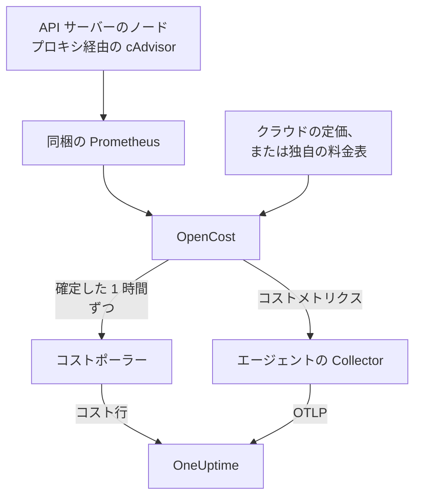

# Kubernetes コストオブザーバビリティ

すべての Kubernetes ワークロードのコスト (namespace、ワークロード、Pod ごとの支出、アイドル容量、各 request のうち実際に使われている割合) を、[Kubernetes エージェント](/docs/telemetry/kubernetes-agent) がすでに収集しているメトリクス、ログ、トレースと並べて確認できます。既定で有効になっており、クラウドの認証情報は不要です。クラスターの概要にはクラスターのコストが表示され、**コスト** ページではどの request を縮小すべきかがわかります。コストメトリクスも、ほかのメトリクスと同じようにグラフにしたり、アラートを設定したりできます。

:::cards
- [有効にする](#コストオブザーバビリティを有効にする): 既定で有効。そうでない場合は `helm upgrade` 1 回。
- [コストに対するアラート](#コストに対するアラート): クラスター、namespace、ワークロードごとのコストを、メトリクスとして。
- [独自のエンジン](#kubecost-や-opencost-をすでに実行している場合): すでに実行している Kubecost や OpenCost を見つけて読み取ります。
- [適正サイズ](#適正サイズ): request の推奨値と、その算出方法。
- [トラブルシューティング](#トラブルシューティング): 空のページ、推奨値が表示されない場合。
:::

## 仕組み

コストの監視が既定どおり有効な場合 (`cost.enabled: auto`)、チャートはエージェントの横で 4 つのものを実行します:



1. **OpenCost**: オープンソースのコストエンジンです (Apache-2.0、CNCF。Kubecost の基盤でもある [cost-model](https://github.com/kubecost/cost-model))。クラスターを監視し、ノード、ボリューム、ロードバランサーの価格を算出して、各ワークロードのコストを計算します。
2. **小さな Prometheus**: OpenCost が使用量と価格の履歴に必要とするものです。レプリカ 1 つで動作し、7 日分の履歴を保持し、スクレイプ対象はちょうど 2 つです。API サーバーのノードプロキシ経由の cAdvisor (OpenCost が読み取る系列だけを残します) と、OpenCost 自体です (OpenCost は自身のリソース request のメトリクスを出力するため、kube-state-metrics は使いません)。クラスターの外に公開されることはなく、そのデータがクラスターから出ることもありません。
3. **コストポーラー** (`cost.agent`)。1 時間が確定するたびに OpenCost の Allocation API を読み取り、ワークロードごとに 1 つのコスト行を OneUptime に送信します。内容は CPU、メモリ、GPU、ボリューム、ネットワーク、ロードバランサー、アイドル、そして効率です。各時間は 1 回だけ送信され、サーバーはすでに持っている時間をスキップするため、再起動で支出が二重に数えられることはありません。OneUptime は、これらの行から [コストメトリクス](#コストに対するアラート) も書き込みます。
4. **コストメトリクスのスクレイプ** (`cost.metrics`)。エージェントの Collector が OpenCost の価格メトリクス (各ノード、ボリューム、ロードバランサーの 1 時間あたりのコスト) をスクレイプし、クラスターのほかのメトリクスと一緒に送信します。

OpenCost は、クラウドプロバイダー (AWS、Google Cloud、Azure) の公開定価から、認証情報なしでノードの価格を算出します。それ以外の環境では OpenCost の既定の料金を使い、独自の [料金表](#オンプレミスとベアメタルの価格設定) を設定するとそれに置き換わります。

3 つの Pod が要求するリソースは、合わせて CPU 約 150m、メモリ約 450Mi です。`gke-autopilot` と `eks-fargate` のプリセットでは、コストの監視は既定で無効です。これらのプラットフォームはすべての Pod をその request に応じて課金するため、コストの Pod が、自らが測定する請求額を増やしてしまいます。また、OpenCost はノード単位で価格を算出しますが、どちらのプラットフォームもそのようには課金しません。

## コストオブザーバビリティを有効にする

新規インストールでは何もする必要はありません。コストの監視は既定で有効です。既定で有効になる前にインストールしたエージェントをアップグレードするか、`gke-autopilot` または `eks-fargate` のプリセットで有効にするには、次のようにします:

:::steps
### エージェントをアップグレードする

```bash
helm upgrade kubernetes-agent oneuptime/kubernetes-agent \
  --namespace oneuptime-agent \
  --reset-then-reuse-values \
  --set cost.enabled=true
```

これだけで完全なインストールです。追加されるのは小さな Pod 3 つ、つまり OpenCost、その Prometheus、コストエージェントです。エージェントを別のリリース名や namespace でインストールした場合は、それを使ってください (`helm list -A | grep kubernetes-agent` で確認できます)。コストの監視を無効にするには、同じ方法で `--set cost.enabled=false` を設定します。

### 最初の 1 時間が確定するのを待つ

最初のコストは、最初の 1 時間がまるごと確定したあとに表示されます。また、OpenCost は起動後、最初の 1 時間の価格を算出するまでに数分かかります。

### コストのページを開く

- **製品 → インフラストラクチャ → Kubernetes → コスト** には、プロジェクト内のすべてのクラスターの支出が表示されます。
- クラスターの概要には、過去 24 時間の支出、月間の見込み額 (ランレート)、アイドルの支出、効率、そして最もコストのかかっている namespace とワークロードが表示されます。
- クラスターの **コスト** には、支出の推移、CPU・メモリ・ストレージの内訳付きの **Namespace 別の支出**、**ワークロード別の支出**、アイドルの支出、効率、**適正サイズ** カードが表示されます。
:::

コストメトリクス (`node_total_hourly_cost`、`pv_hourly_cost` など) は通常のメトリクスなので、メトリクスエクスプローラー、カスタムダッシュボード、メトリクスモニターで使えます。既製のダッシュボードを使うには、**製品 → ダッシュボード** に移動し、**ダッシュボードを作成** を選択して **Kubernetes Cost Dashboard** を選びます。ノードの時間あたりのコストの推移、CPU とメモリの単価、ボリュームとロードバランサーの支出が表示されます。

概要と **コスト** ページには、数値の下に価格の出どころが表示されます。クラウドの定価、独自の料金表、OpenCost の既定の料金のいずれかです。効率は、効率のメトリクスも含め、どこでも同じ 1 つの数値です。request した CPU とメモリのうち実際に使われた割合を表し、各コンテナの 1 時間ごとの値は、その CPU とメモリのコストで加重されます。そのため、何も使わない安価なジョブが、よく使われているクラスターの効率を引き下げることはありません。また、アイドル容量は計算に含めません。

## Kubecost や OpenCost をすでに実行している場合

コストエージェントはそのエンジンを見つけ、同梱の OpenCost の代わりにそれを読み取ります。そのため、クラスターの価格は、独自の料金表や Kubecost と連携したクラウドの請求額など、設定したとおりに算出されます。エージェントは起動時に、その後は 1 時間ごとに、Kubernetes API を通じて、各エンジン自身のチャートが作成する Service をすべての namespace から探します (Kubecost の `cost-analyzer` または `frontend`、OpenCost のチャートが作成する Service、OpenCost のマニフェストが作成する `opencost` Service)。Kubecost を優先します。応答しないエンジン、サインインが必要なエンジン、複数のクラスターについて応答するエンジンは見送り、代わりに同梱のエンジンを読み取ります。

すると、クラスターの概要にそのエンジンの名前が表示され、同梱の OpenCost は不要であることが示されます。次のようにして、同梱の OpenCost の実行を止めてください:

```bash
helm upgrade kubernetes-agent oneuptime/kubernetes-agent \
  --namespace oneuptime-agent \
  --reset-then-reuse-values \
  --set cost.engine.url=auto
```

`cost.engine.url=auto` を指定すると何も同梱されず、エージェントはエンジンがどこで実行されていてもそれを読み取ります。エンジンがインストールされていなければ、何の価格も算出されません。チャート自体がエンジンを探すことはできません。Helm の `lookup` は、`helm template`、Argo CD、ドライランのもとでは何も見えないためです。独自のエンジンと並べて同梱の OpenCost も残すには、`cost.engine.preferExisting=false` を設定します。読み取るエンジンを指定するには、`cost.engine.url` にその Service の URL を設定します:

| エンジン | 一般的なサービス URL |
| --- | --- |
| OpenCost | `http://opencost.opencost.svc.cluster.local:9003` |
| Kubecost 2 | `http://kubecost-cost-analyzer.kubecost.svc.cluster.local:9090` |
| Kubecost 3 | `http://kubecost-frontend.kubecost.svc.cluster.local:9090` |

Allocation API のパスは自動で見つかります (Kubecost では `/model/allocation`、OpenCost では `/allocation/compute` または `/allocation`)。`cost.engine.allocationPath` を設定するのは、一般的でないインストールの場合だけです。`auto` または URL を指定すると何も同梱されないため、メモリの推奨値には `cost.engine.prometheusUrl` も設定してください ([推奨値の基になるデータ](#推奨値の基になるデータ) を参照)。価格メトリクスも同じように見つかるため、エンジンのどの Service を指定してもかまいません。エージェントはまずエンジンの `/metrics` を、次に Kubecost 2 のフロントエンドや OpenCost の UI がエンジンへ渡す `/model/metrics` を、さらに Kubecost 3 の FinOps エージェントを試し、Collector は価格系列を返した最初のアドレスをスクレイプします。自分で指定するには `cost.metrics.endpoint` を設定してください。

## オンプレミスとベアメタルの価格設定

ノードにパブリッククラウドの定価がないクラスターでは、料金表を設定できます。料金表がなければ、OpenCost はそうしたノード (オンプレミス、ベアメタル、kind、k3s) の価格を既定の料金で算出します。これは実際のハードウェアのコストとは大きく異なることがあり、クラスターの概要と **コスト** ページにはその旨が表示されます。OpenCost が認識するクラウドでは、ノードは定価のままで、料金表は定価の一覧にないものの価格だけを決めます。料金表を設定すると、OpenCost はその数値からすべてのリソースの価格を算出します。単位はすべて、リソース 1 時間あたりの USD です:

```yaml title="values.yaml"
cost:
  enabled: true
  opencost:
    customPricing:
      enabled: true
      cpuPerCoreHour: "0.031611"       # ~$23 per core-month
      ramPerGiBHour: "0.004237"        # ~$3 per GiB-month
      storagePerGBHour: "0.00005479452" # ~$0.04 per GB-month
      gpuPerHour: "0.95"
```

これらは OpenCost 自身の既定の料金です。独自の数値を入れてください。そうしないと、**コスト** ページには、クラスターの価格が OpenCost の既定の料金で算出されていると表示されたままになります。

## 知っておきたい設定

すべて任意です。完全な一覧はチャートの `values.yaml` にあります:

```yaml title="values.yaml"
cost:
  enabled: auto           # on, except with the gke-autopilot and eks-fargate presets
  agent:
    windowSeconds: 3600   # allocation window length (hourly = native)
    includeIdle: true     # ship the engine's __idle__ allocation
    currency: USD         # currency code shown in the UI (informational)
  prometheus:
    retention: 7d         # bundled TSDB history; right-sizing reads peaks back over days
    persistence:
      enabled: false      # set true for a small PVC; emptyDir otherwise
  metrics:
    enabled: true         # cost metrics for dashboards / Metric Explorer
    scrapeInterval: 60s
```

## 適正サイズ

クラスターの **コスト** ページにある **適正サイズ** カードは、十分な履歴があるすべてのコンテナについて CPU とメモリの request を推奨し、変更ごとに月あたりいくら節約できるかの順に並べます。

推奨値は、観測された需要に 25% の余裕を加え、マニフェストにそのまま貼り付けられる値 (CPU は 10m、メモリは 16Mi 単位) に丸めたものです:

- CPU は、1 時間ごとの平均使用量の 95 パーセンタイルから算出します。実際の負荷をカバーできるだけ高く、1 回のスパイクで request が 1 か月間膨らまない程度に低い値です。
- メモリは、平均ではなく、ワーキングセットのピークから算出します ([推奨値の基になるデータ](#推奨値の基になるデータ) を参照)。

推奨するのは request だけで、limit は推奨しません。request はスケジューラーが確保する量であり、請求額の計算の基になるため、コストを動かすのはこの数値です。limit は、異常な動作をするコンテナをスロットリングするか強制終了するかの判断であり、使用量のデータがその判断を代わりに行うことはできません。

各コンテナは、現在の request と比較されます:

| 判定 | 意味 |
| --- | --- |
| 過剰プロビジョニング | 使用量より明らかに多く確保しています。節約できるのはここです。 |
| プロビジョニング不足 | 使用量より少なく確保しているため、スロットリングされるか、OOM kill のリスクがあります。修正にはコストがかかり、カードではそれが増加として表示されます。 |
| request 未設定 | 縮小するものはありませんが、スケジューラーはコンテナを安全に配置できず、リソースが逼迫すると最初に退避されます。 |

推奨値との差が 15% 以内のコンテナは適正サイズとみなされ、一覧から除かれます。request を 3% 削るためにマニフェストを編集すべきではないからです。

2 つの安全策が、推奨を正確に保ちます。ワークロードのサイズが算出されるのは、少なくとも 24 時間分のコストウィンドウがそろってからです。4 時間のウィンドウでは、夜間のバッチジョブを休止中にとらえ、ゼロまで縮小するよう勧めてしまうことがあるためです。また、節約額は行数ではなく、表示しているウィンドウの長さから見積もられるため、Deployment の節約額がレプリカ数で掛け算されることはありません。この見積もりは、支出がエンジンの割り当て量、つまり `max(request, usage)` に比例すると仮定しています。過剰プロビジョニングのコンテナではそれが request なので、節約額は正確です。

### 推奨値の基になるデータ

ポーラーは支出に加えて、推奨に必要なもの、つまり各コンテナの CPU とメモリの request、limit、使用量も収集します。

メモリにはもう 1 つのデータ源が必要です。Allocation API が報告するのは各ウィンドウの平均だけで、1 時間の平均はコンテナを OOM kill するバーストを隠してしまうため、それでメモリのサイズを決めるのは危険です。そこでポーラーは、各コンテナのメモリのピークを Prometheus から読み取り、`(namespace, pod, container)` で結合します:

- 同梱のエンジン (既定) では、チャート自身の Prometheus を使います。設定は不要です。
- `cost.engine.url` を設定している場合 (`auto` または独自のエンジンの URL)、`cost.engine.prometheusUrl` を cAdvisor をスクレイプしている Prometheus に向け、そのスクレイプジョブの名前が `kubernetes-nodes-cadvisor` でない場合は `cost.engine.prometheusCadvisorJob` を設定します。
- Prometheus がない場合でも、CPU の推奨は保存された 1 時間ごとの平均から機能し、メモリの推奨は推測せずに省かれます。

Prometheus が停止しても、支出の収集は止まりません。ピークは追加の情報であり、その時間はピークなしで送信されます。CPU では意図的に Prometheus を使いません。CPU の request が大きすぎても起きるのはスロットリングだけですが、メモリの request が小さすぎるとコンテナが強制終了されるため、CPU には 1 時間ごとの平均で十分安全です。また、クラスター全体ですべてのコンテナの CPU レートをクエリするのは、小さな Prometheus を倒してしまうほど重い処理です。

## コストに対するアラート

OneUptime は 1 時間ごとのコスト行から 4 つのメトリクスを書き込みます。金額が算出され、内容どおりの名前が付いているため、コストをグラフにしたり、ダッシュボードに置いたり、[Kubernetes モニター](/docs/monitor/kubernetes-monitor) や [メトリクスモニター](/docs/monitor/metrics-monitor) でアラートを設定したりできます:

| メトリクス | 内容 | 属性 |
| --- | --- | --- |
| `oneuptime.kubernetes.cost.total` | 各時間のクラスターのコスト (アイドル容量を含む) | `k8s.cluster.name` |
| `oneuptime.kubernetes.cost.idle` | そのうち、どのワークロードも使わなかった部分: アイドル容量と未割り当て容量 | `k8s.cluster.name` |
| `oneuptime.kubernetes.cost.workload` | 各時間の各ワークロードのコスト。namespace ごとに合計すると、その namespace のコストになります | `k8s.cluster.name`、`k8s.namespace.name`、およびワークロードの種類ごとの名前 (`k8s.deployment.name` など) |
| `oneuptime.kubernetes.cost.efficiency` | 各ワークロードが、request した CPU とメモリのうちどれだけを使ったか (パーセント、コストで加重) | ワークロードの属性 (上と同じ) |

各ポイントは 1 時間分のコストで、エージェントの通貨 (既定は USD) で表され、その時間の開始時刻がタイムスタンプになり、その時間が終わってから約 1 時間後に書き込まれます。数時間のウィンドウでポイントを合計でき、1 日分を合計するとその日のコストになります。これらはクラスターがすでに送信したデータから作られるため、取り込んだメトリクスとして課金されることはなく、クラスターのほかのメトリクスと同じ期間保持されます。

Kubernetes モニターには、これらのメトリクス用のテンプレートが 3 つあります。Cluster Daily Cost Over Budget、Namespace Daily Cost Over Budget、High Idle Spend で、それぞれ予算を自分の値に設定して使います。OpenCost の価格メトリクスも通常のメトリクスです。メトリクスモニターで、`node_total_hourly_cost` の平均が予算を超えたときや、クラスターに存在すべきでないボリュームクラスの `pv_hourly_cost` が現れたときにアラートを出せます。

## データモデルと保持期間

コスト行は ClickHouse に、クラスター、ウィンドウ、namespace、コントローラー、Pod、コンテナごとに 1 行ずつ保存されます。保持期間はクラスターのテレメトリの保持期間に従います。クラスターの `retainTelemetryDataForDays`、それが設定されていなければプロジェクトのデータ保持期間です。アイドル容量と未割り当て容量は、`__idle__` と `__unallocated__` という namespace の下に通常の行として保存されるため、ワークロードの支出と同じようにグループ化やフィルタリングができます。

## トラブルシューティング

:::details コストのページが空
`gke-autopilot` と `eks-fargate` のプリセットでは、コストの監視は既定で無効です。`--set cost.enabled=true` で有効にしてください。それ以外の場合は、コストポーラーのログを確認してください: `kubectl logs -n oneuptime-agent deploy/kubernetes-agent-cost`。(リリース名に `kubernetes-agent` が含まれない場合、Deployment は `<release>-kubernetes-agent-cost` です。`kubectl get deploy -n oneuptime-agent` で一覧できます。) `HTTP 401` は、OneUptime が取り込みキーを拒否したことを意味します。`did not answer any known allocation path` は、エンジンがまだ起動していない (同梱の OpenCost は最初の数時間の価格を算出するのに数分かかります) か、`cost.engine.url` が誤っていることを意味します。
:::

:::details 同梱の OpenCost が準備完了にならない
そのログを確認してください: `kubectl logs -n oneuptime-agent deploy/kubernetes-agent-opencost`。検出したクラウドプロバイダーと、価格データを読み込めたかどうかが表示されます。
:::

:::details 概要に同梱の OpenCost は不要と表示される
クラスターでは独自の Kubecost または OpenCost が実行されていて、コストエージェントはそれを読み取っています。そのため、チャートが同梱した OpenCost と Prometheus は何の価格も算出していません。それらの実行を止めるには、`--set cost.engine.url=auto` でアップグレードしてください。代わりに同梱のエンジンを読み取るには、`cost.engine.preferExisting=false` を設定します。
:::

:::details コストエージェントが独自のエンジンを読み取らない
どのエンジンを読み取っているか、ほかのエンジンをなぜ見送ったかは、そのログに表示されます: `kubectl logs -n oneuptime-agent deploy/kubernetes-agent-cost`。エージェントは、応答しないエンジン (たとえば namespace 間に NetworkPolicy がある場合)、サインインが必要なエンジン、ほかのクラスターをフェデレーションしている Kubecost のように複数のクラスターについて応答するエンジンを見送ります。読み取るエンジンは `cost.engine.url` で指定してください。
:::

:::details OpenCost のログに mkdir /var/configs: permission denied と出る
古いチャートは、書き込み可能な設定ディレクトリなしで OpenCost を実行していました。そのため `Error downloading default pricing data` によって Allocation API が応答できなくなり、ポーラーは停止していましたが、Pod は `Running` のまま、`/healthz` は正常のまま、ノードのコストメトリクスも公開され続けていました。現在のチャートでは修正されています。`helm repo update` を実行してから、`--reset-then-reuse-values` でアップグレードしてください。次のポーリングでコスト行が表示されます。
:::

:::details Kubernetes Cost Dashboard にデータが表示されない
このテンプレートはスクレイプされたコストメトリクスを読み取ります。`cost.metrics.enabled` が `true` であることを確認してください。`cost.engine.url` を設定している場合は、コストエージェントがエンジンの提供場所を見つけ、そのログに場所か試したアドレスが表示されます: `kubectl logs -n oneuptime-agent deploy/kubernetes-agent-cost`。自分で指定するには `cost.metrics.endpoint` を設定してください。
:::

:::details 適正サイズのカードが空
期間が推奨に必要な 24 時間より短い (期間を広げてください) か、すべてのコンテナがすでに推奨 request の 15% 以内に収まっているかのどちらかです。後者の場合はカードにそう表示されます。
:::

:::details メモリの推奨値は - と表示されるが、CPU の推奨値は表示される
メモリのピークが OneUptime に届かなかったため、平均から推測するのではなく、メモリのサイズを算出しませんでした。独自のエンジンを使っている場合は、`cost.engine.prometheusUrl` を設定してください。影響を受けるコンテナの数はカードに表示されます。
:::

:::details 数値がエンジン自体の UI と異なる
OneUptime はエンジンの調整 (reconciliation) 分を各コスト要素に含め、確定した 1 時間単位で送信します。現在の 1 時間の支出は、その時間が確定したあとに表示されます。
:::

:::details 同梱の Prometheus が再起動した
既定の `emptyDir` ストレージでは、再起動すると数時間分の使用量の履歴が失われるため、その時間のコストが小さく算出されることがあります。それが問題になる場合は、`cost.prometheus.persistence.enabled=true` を設定してください。
:::

## 次のステップ

:::cards
- [Kubernetes エージェント](/docs/telemetry/kubernetes-agent): エージェントのインストールと、それが収集するほかのすべてのもの。
- [メトリクス モニター](/docs/monitor/metrics-monitor): 支出が予算を超えたときにアラートを出します。
- [Kubernetes モニター](/docs/monitor/kubernetes-monitor): クラスターのヘルスについてもアラートを出します。
:::
