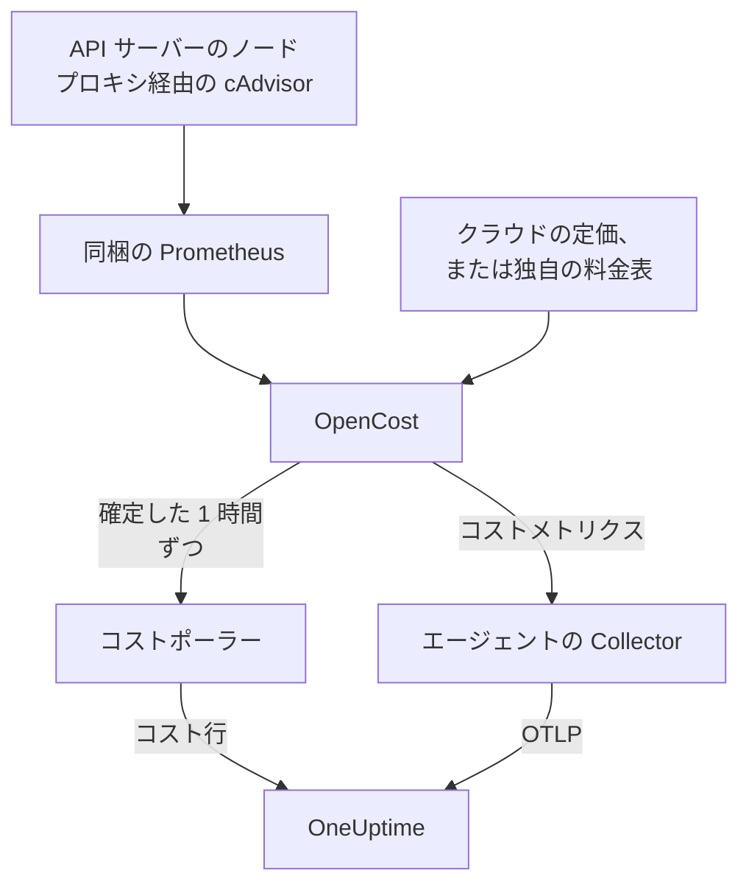

# Kubernetes コストオブザーバビリティ

すべての Kubernetes ワークロードのコスト (namespace、ワークロード、Pod ごとの支出、アイドル容量、各 request のうち実際に使われている割合) を、[Kubernetes エージェント](/docs/telemetry/kubernetes-agent) がすでに収集しているメトリクス、ログ、トレースと並べて確認できます。Helm の値 1 つで有効になり、クラウドの認証情報は不要です。有効にすると、クラスターの **コスト** ページで、どの request を縮小すべきかがわかります。

:::cards
- [有効にする](#コストオブザーバビリティを有効にする): `helm upgrade` 1 回。
- [独自のエンジンを使う](#kubecost-や-opencost-をすでに実行している場合): エージェントの接続先を Kubecost または OpenCost にします。
- [適正サイズ](#適正サイズ): request の推奨値と、その算出方法。
- [トラブルシューティング](#トラブルシューティング): 空のページ、推奨値が表示されない場合。
:::

## 仕組み

`cost.enabled=true` を設定すると、チャートはエージェントの横で 4 つのものを実行します:



1. **OpenCost**: オープンソースのコストエンジンです (Apache-2.0、CNCF。Kubecost の基盤でもある [cost-model](https://github.com/kubecost/cost-model))。クラスターを監視し、ノード、ボリューム、ロードバランサーの価格を算出して、各ワークロードのコストを計算します。
2. **小さな Prometheus**: OpenCost が使用量と価格の履歴に必要とするものです。レプリカ 1 つで動作し、7 日分の履歴を保持し、スクレイプ対象はちょうど 2 つです。API サーバーのノードプロキシ経由の cAdvisor と、OpenCost 自体です (OpenCost は自身のリソース request のメトリクスを出力するため、kube-state-metrics は使いません)。クラスターの外に公開されることはなく、そのデータがクラスターから出ることもありません。
3. **コストポーラー** (`cost.agent`)。1 時間が確定するたびに OpenCost の Allocation API を読み取り、ワークロードごとに 1 つのコスト行を OneUptime に送信します。内容は CPU、メモリ、GPU、ボリューム、ネットワーク、ロードバランサー、アイドル、そして効率です。各時間は 1 回だけ送信され、サーバーはすでに持っている時間をスキップするため、再起動で支出が二重に数えられることはありません。
4. **コストメトリクスのスクレイプ** (`cost.metrics`)。エージェントの Collector が OpenCost のコストメトリクスをスクレイプし、クラスターのほかのメトリクスと一緒に送信します。

OpenCost は、クラウドプロバイダー (AWS、Google Cloud、Azure) の公開定価から、認証情報なしでノードの価格を算出します。クラウドの定価がないクラスターでは、代わりに [料金表](#オンプレミスとベアメタルの価格設定) を設定します。

## コストオブザーバビリティを有効にする

:::steps
### cost.enabled でエージェントをアップグレードする

```bash
helm upgrade kubernetes-agent oneuptime/kubernetes-agent \
  --namespace oneuptime-agent \
  --reset-then-reuse-values \
  --set cost.enabled=true
```

これだけで完全なインストールです。追加されるのは小さな Pod 2 つ、OpenCost とその Prometheus です。エージェントを別のリリース名や namespace でインストールした場合は、それを使ってください (`helm list -A | grep kubernetes-agent` で確認できます)。

### 最初の 1 時間が確定するのを待つ

最初のコストは、最初の 1 時間がまるごと確定したあとに表示されます。また、OpenCost は起動後、最初の 1 時間の価格を算出するまでに数分かかります。

### コストのページを開く

- **製品 → インフラストラクチャ → Kubernetes → コスト** には、プロジェクト内のすべてのクラスターの支出が表示されます。
- クラスターの **コスト** には、支出の推移、CPU・メモリ・ストレージの内訳付きの **Namespace 別の支出**、**ワークロード別の支出**、アイドルの支出、効率、**適正サイズ** カードが表示されます。
:::

コストメトリクス (`node_total_hourly_cost`、`pv_hourly_cost` など) は通常のメトリクスなので、メトリクスエクスプローラー、カスタムダッシュボード、メトリクスモニターで使えます。既製のダッシュボードを使うには、**製品 → ダッシュボード** に移動し、**ダッシュボードを作成** を選択して **Kubernetes Cost Dashboard** を選びます。ノードの時間あたりのコストの推移、CPU とメモリの単価、ボリュームとロードバランサーの支出が表示されます。

## Kubecost や OpenCost をすでに実行している場合

代わりにエージェントの接続先をそのエンジンにすると、何も同梱されません:

```bash
helm upgrade kubernetes-agent oneuptime/kubernetes-agent \
  --namespace oneuptime-agent \
  --reset-then-reuse-values \
  --set cost.enabled=true \
  --set cost.engine.url=http://kubecost-cost-analyzer.kubecost.svc.cluster.local:9090
```

| エンジン | 一般的なサービス URL |
| --- | --- |
| OpenCost | `http://opencost.opencost.svc.cluster.local:9003` |
| Kubecost | `http://kubecost-cost-analyzer.kubecost.svc.cluster.local:9090` |

Allocation API のパスは自動で見つかります (Kubecost では `/model/allocation`、OpenCost では `/allocation/compute` または `/allocation`)。`cost.engine.allocationPath` を設定するのは、一般的でないインストールの場合だけです。メモリの推奨値には、`cost.engine.prometheusUrl` も設定してください ([推奨値の基になるデータ](#推奨値の基になるデータ) を参照)。

## オンプレミスとベアメタルの価格設定

ノードにパブリッククラウドの定価がないクラスターでは、料金表を設定できます。OpenCost はその数値からすべてのリソースの価格を算出します。単位はすべて、リソース 1 時間あたりの USD です:

```yaml title="values.yaml"
cost:
  enabled: true
  opencost:
    customPricing:
      enabled: true
      cpuPerCoreHour: "0.031611"       # ~$23 per core-month
      ramPerGiBHour: "0.004237"        # ~$3 per GiB-month
      storagePerGBHour: "0.00005479452" # ~$0.04 per GB-month
      gpuPerHour: "0.95"
```

## 知っておきたい設定

すべて任意です。完全な一覧はチャートの `values.yaml` にあります:

```yaml title="values.yaml"
cost:
  agent:
    windowSeconds: 3600   # allocation window length (hourly = native)
    includeIdle: true     # ship the engine's __idle__ allocation
    currency: USD         # currency code shown in the UI (informational)
  prometheus:
    retention: 7d         # bundled TSDB history; right-sizing reads peaks back over days
    persistence:
      enabled: false      # set true for a small PVC; emptyDir otherwise
  metrics:
    enabled: true         # cost metrics for dashboards / Metric Explorer
    scrapeInterval: 60s
```

## 適正サイズ

クラスターの **コスト** ページにある **適正サイズ** カードは、十分な履歴があるすべてのコンテナについて CPU とメモリの request を推奨し、変更ごとに月あたりいくら節約できるかの順に並べます。

推奨値は、観測された需要に 25% の余裕を加え、マニフェストにそのまま貼り付けられる値 (CPU は 10m、メモリは 16Mi 単位) に丸めたものです:

- CPU は、1 時間ごとの平均使用量の 95 パーセンタイルから算出します。実際の負荷をカバーできるだけ高く、1 回のスパイクで request が 1 か月間膨らまない程度に低い値です。
- メモリは、平均ではなく、ワーキングセットのピークから算出します ([推奨値の基になるデータ](#推奨値の基になるデータ) を参照)。

推奨するのは request だけで、limit は推奨しません。request はスケジューラーが確保する量であり、請求額の計算の基になるため、コストを動かすのはこの数値です。limit は、異常な動作をするコンテナをスロットリングするか強制終了するかの判断であり、使用量のデータがその判断を代わりに行うことはできません。

各コンテナは、現在の request と比較されます:

| 判定 | 意味 |
| --- | --- |
| 過剰プロビジョニング | 使用量より明らかに多く確保しています。節約できるのはここです。 |
| プロビジョニング不足 | 使用量より少なく確保しているため、スロットリングされるか、OOM kill のリスクがあります。修正にはコストがかかり、カードではそれが増加として表示されます。 |
| request 未設定 | 縮小するものはありませんが、スケジューラーはコンテナを安全に配置できず、リソースが逼迫すると最初に退避されます。 |

推奨値との差が 15% 以内のコンテナは適正サイズとみなされ、一覧から除かれます。request を 3% 削るためにマニフェストを編集すべきではないからです。

2 つの安全策が、推奨を正確に保ちます。ワークロードのサイズが算出されるのは、少なくとも 24 時間分のコストウィンドウがそろってからです。4 時間のウィンドウでは、夜間のバッチジョブを休止中にとらえ、ゼロまで縮小するよう勧めてしまうことがあるためです。また、節約額は行数ではなく、表示しているウィンドウの長さから見積もられるため、Deployment の節約額がレプリカ数で掛け算されることはありません。この見積もりは、支出がエンジンの割り当て量、つまり `max(request, usage)` に比例すると仮定しています。過剰プロビジョニングのコンテナではそれが request なので、節約額は正確です。

### 推奨値の基になるデータ

ポーラーは支出に加えて、推奨に必要なもの、つまり各コンテナの CPU とメモリの request、limit、使用量も収集します。

メモリにはもう 1 つのデータ源が必要です。Allocation API が報告するのは各ウィンドウの平均だけで、1 時間の平均はコンテナを OOM kill するバーストを隠してしまうため、それでメモリのサイズを決めるのは危険です。そこでポーラーは、各コンテナのメモリのピークを Prometheus から読み取り、`(namespace, pod, container)` で結合します:

- 同梱のエンジン (既定) では、チャート自身の Prometheus を使います。設定は不要です。
- 独自のエンジン (`cost.engine.url`) では、`cost.engine.prometheusUrl` を cAdvisor をスクレイプしている Prometheus に向け、そのスクレイプジョブの名前が `kubernetes-nodes-cadvisor` でない場合は `cost.engine.prometheusCadvisorJob` を設定します。
- Prometheus がない場合でも、CPU の推奨は保存された 1 時間ごとの平均から機能し、メモリの推奨は推測せずに省かれます。

Prometheus が停止しても、支出の収集は止まりません。ピークは追加の情報であり、その時間はピークなしで送信されます。CPU では意図的に Prometheus を使いません。CPU の request が大きすぎても起きるのはスロットリングだけですが、メモリの request が小さすぎるとコンテナが強制終了されるため、CPU には 1 時間ごとの平均で十分安全です。また、クラスター全体ですべてのコンテナの CPU レートをクエリするのは、小さな Prometheus を倒してしまうほど重い処理です。

## コストに対するアラート

コストメトリクスは通常のメトリクスなので、[メトリクスモニター](/docs/monitor/metrics-monitor) でほかのものと同じようにアラートを出せます。たとえば、`node_total_hourly_cost` の平均が予算を超えたときや、クラスターに存在すべきでないボリュームクラスの `pv_hourly_cost` が現れたときです。

## データモデルと保持期間

コスト行は ClickHouse に、クラスター、ウィンドウ、namespace、コントローラー、Pod、コンテナごとに 1 行ずつ保存されます。保持期間はクラスターのテレメトリの保持期間に従います。クラスターの `retainTelemetryDataForDays`、それが設定されていなければプロジェクトのデータ保持期間です。アイドル容量と未割り当て容量は、`__idle__` と `__unallocated__` という namespace の下に通常の行として保存されるため、ワークロードの支出と同じようにグループ化やフィルタリングができます。

## トラブルシューティング

:::details コストのページが空
コストポーラーのログを確認してください: `kubectl logs -n oneuptime-agent deploy/kubernetes-agent-cost`。(リリース名に `kubernetes-agent` が含まれない場合、Deployment は `<release>-kubernetes-agent-cost` です。`kubectl get deploy -n oneuptime-agent` で一覧できます。) `HTTP 401` は、OneUptime が取り込みキーを拒否したことを意味します。`did not answer any known allocation path` は、エンジンがまだ起動していない (同梱の OpenCost は最初の数時間の価格を算出するのに数分かかります) か、`cost.engine.url` が誤っていることを意味します。
:::

:::details 同梱の OpenCost が準備完了にならない
そのログを確認してください: `kubectl logs -n oneuptime-agent deploy/kubernetes-agent-opencost`。検出したクラウドプロバイダーと、価格データを読み込めたかどうかが表示されます。
:::

:::details OpenCost のログに mkdir /var/configs: permission denied と出る
古いチャートは、書き込み可能な設定ディレクトリなしで OpenCost を実行していました。そのため `Error downloading default pricing data` によって Allocation API が応答できなくなり、ポーラーは停止していましたが、Pod は `Running` のまま、`/healthz` は正常のまま、ノードのコストメトリクスも公開され続けていました。現在のチャートでは修正されています。`helm repo update` を実行してから、`--reset-then-reuse-values` でアップグレードしてください。次のポーリングでコスト行が表示されます。
:::

:::details Kubernetes Cost Dashboard にデータが表示されない
このテンプレートはスクレイプされたコストメトリクスを読み取ります。`cost.metrics.enabled` が `true` であることを確認してください。
:::

:::details 適正サイズのカードが空
期間が推奨に必要な 24 時間より短い (期間を広げてください) か、すべてのコンテナがすでに推奨 request の 15% 以内に収まっているかのどちらかです。後者の場合はカードにそう表示されます。
:::

:::details メモリの推奨値は - と表示されるが、CPU の推奨値は表示される
メモリのピークが OneUptime に届かなかったため、平均から推測するのではなく、メモリのサイズを算出しませんでした。独自のエンジンを使っている場合は、`cost.engine.prometheusUrl` を設定してください。影響を受けるコンテナの数はカードに表示されます。
:::

:::details 数値がエンジン自体の UI と異なる
OneUptime はエンジンの調整 (reconciliation) 分を各コスト要素に含め、確定した 1 時間単位で送信します。現在の 1 時間の支出は、その時間が確定したあとに表示されます。
:::

:::details 同梱の Prometheus が再起動した
既定の `emptyDir` ストレージでは、再起動すると数時間分の使用量の履歴が失われるため、その時間のコストが小さく算出されることがあります。それが問題になる場合は、`cost.prometheus.persistence.enabled=true` を設定してください。
:::

## 次のステップ

:::cards
- [Kubernetes エージェント](/docs/telemetry/kubernetes-agent): エージェントのインストールと、それが収集するほかのすべてのもの。
- [メトリクス モニター](/docs/monitor/metrics-monitor): 支出が予算を超えたときにアラートを出します。
- [Kubernetes モニター](/docs/monitor/kubernetes-monitor): クラスターの健全性についてもアラートを出します。
:::
