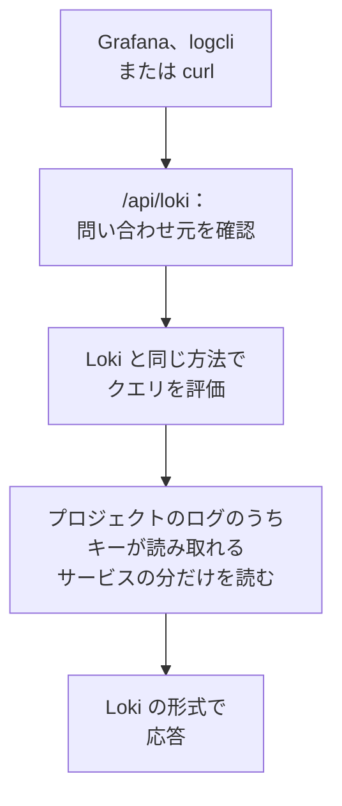

# LogQL でログを検索する

LogQL は Grafana Loki のクエリ言語です。OneUptime はプロジェクトのログに対して Loki のクエリ API に応答するので、Grafana の Loki データソース、logcli、そのほかの Loki クライアントがログを読み取れます。Loki 用に作ったダッシュボードや保存したクエリも、そのまま使えます。

:::cards
- [Grafana を接続する](#grafana-を接続する): OneUptime を Loki データソースとして追加します。
- [ログのラベル](#ログのラベル): ストリームセレクターが何に一致するか。
- [対応している LogQL の機能](#対応している-logql-の機能): ログクエリ、パーサー、メトリクスクエリ。
- [制限](#制限): クエリが読み取れる量と頻度。
:::

## 仕組み

Grafana は Loki に問い合わせるのと同じように OneUptime に問い合わせます。OneUptime は、API キーがプロジェクトのログを読み取れるかを確認し、読み取れるサービスだけを読み、Loki と同じ方法でクエリを評価します。



## 始める前に

- **ログが届いていること。** [OpenTelemetry](/docs/telemetry/open-telemetry) で送るか、Promtail、Grafana Alloy、Fluent Bit、Vector から [Loki のプッシュ API](/docs/telemetry/compatible-endpoints) で送ります。
- **ログを読み取れるプロジェクトの API キー。** プロジェクト所有者、プロジェクト管理者、プロジェクトメンバー、閲覧者、テレメトリ管理者、テレメトリメンバー、テレメトリ閲覧者のいずれかのロール、または Read Logs 権限を持つキーが必要です。一部のサービスに限定されたキーは、それらのサービスのログだけを読み取ります。[API キーを作成する](/docs/api-reference/api-reference#api-キーを作成する) を参照してください。OneUptime Cloud では、API キーには **Growth** プランが必要です。
- **取り込みキーは使えません。** 取り込みキーはテレメトリを送るためのもので、何も読み取らないため、Grafana はこれでサインインできません。

## Grafana を接続する

:::steps
### API キーを作成する

OneUptime で **プロジェクト設定 → 詳細 → API キー** を開き、**API キーを作成** をクリックします。キーには、テレメトリを読み取れるロールか、Read Logs 権限を与えます。

### Loki データソースを追加する

Grafana で **Connections → Data sources → Add data source** を開き、**Loki** を選びます。

### URL を入力する

**URL** に、OneUptime のアドレスの後ろに `/api/loki` を付けたものを設定します。OneUptime Cloud では `https://oneuptime.com/api/loki` です。

### API キーを送る

**HTTP headers** でヘッダー `Authorization` を追加し、値には `Bearer`、スペース 1 つ、API キーを続けて入力します。Basic 認証も使えます。ユーザー名は何でもよく、パスワードに API キーを指定します。

### 保存してテストする

**Save & test** をクリックします。Grafana がクエリを実行し、データソースが動作していることを知らせます。
:::

これで Explore、行の上に表示されるログの量、ラベルブラウザー、ダッシュボードが、Loki と同じように OneUptime を読み取ります。logcli やほかの Loki クライアントも同じように使えます。curl の場合は次のとおりです。

```bash title="Query OneUptime's Loki API"
curl -G -H "Authorization: Bearer $ONEUPTIME_API_KEY" \
  "https://oneuptime.com/api/loki/loki/api/v1/query_range" \
  --data-urlencode 'query={service_name="checkout"} |= "error"'
```

## ログのラベル

ストリームセレクターはログの属性に一致します。名前は Loki 3 が OpenTelemetry のログに付けるものと同じです。

| OneUptime では | LogQL では |
| --- | --- |
| リソース属性 `service.name` | ラベル `service_name` |
| リソース属性 `k8s.pod.name` | ラベル `k8s_pod_name` |
| 属性 `http.method` | ラベル `http_method` |
| Loki クライアントが送ったラベル（`job` など） | ラベル `job` |
| ログの重大度 | ラベル `detected_level`：`trace`、`debug`、`info`、`warn`、`error`、`fatal`、`unknown` のいずれか |

- **すべての属性がラベルです。** ログクエリはラベルの組み合わせごとに 1 つのストリームで応答するので、属性が異なるログは別のストリームになります。構造化メタデータを持つログに Loki 3 が応答するのと同じです。
- **ログ自身の属性が優先されます。** リソースに同じ名前の属性がある場合です。
- **セレクターは値を指定します。** Loki と同じく、そのラベルを持たないログが満たさないマッチャーが少なくとも 1 つ必要です。たとえば `{service_name="checkout"}` や `{service_name=~"check.+"}` です。

まずは次のようなクエリから始めてください。

```text title="LogQL"
# The checkout service's lines that say error
{service_name="checkout"} |= "error"

# Requests slower than 250ms, read from JSON lines
{service_name="checkout"} | json | duration > 250ms

# Error logs per second, by service
sum by (service_name) (rate({detected_level="error"} [5m]))
```

## 対応している LogQL の機能

- **ログクエリ**：`=`、`!=`、`=~`、`!~` を使うストリームセレクター。`or` を使える行フィルター `|=`、`!=`、`|~`、`!~`。パーサー `json` と `logfmt`。テキスト、数値、期間、サイズに対するラベルフィルター（`and`、`or`、`__error__` 付き）。`{{.label}}` を使う `line_format`。`drop`、`keep`、`decolorize`。
- **メトリクスクエリ**：`count_over_time`、`rate`、`bytes_over_time`、`bytes_rate`、`absent_over_time`。`unwrap`（`duration()` または `bytes()` 付き）で取り出したラベルに対する `rate`、`sum_over_time`、`avg_over_time`、`min_over_time`、`max_over_time`、`first_over_time`、`last_over_time`、`stddev_over_time`、`stdvar_over_time`、`quantile_over_time`。そして `offset`。
- **その周り**：`by` または `without` を付けた `sum`、`avg`、`min`、`max`、`count`、`stddev`、`stdvar`、`topk`、`bottomk`。算術演算、比較（`bool` 付き）、`and`、`or`、`unless` と、`on`、`ignoring`、`group_left`、`group_right`。`sort`、`sort_desc`、`label_replace`、`vector()`。

パーサー `pattern`、`regexp`、`unpack`、`label_format`、名前付きフィールドを使う `json`、`ip()` フィルター、`{{.label}}` を超える `line_format` のテンプレートには、まだ対応していません。これらを使うクエリは、その名前を示すメッセージとともに拒否されます。

## API

API は `/api/loki` の下で、Loki の HTTP API のルートに `GET` または `POST` で応答します。

| ルート | 応答する内容 |
| --- | --- |
| `/loki/api/v1/query_range` | `start` から `end` までのログクエリの行、または `step` ごとのメトリクスクエリ。 |
| `/loki/api/v1/query` | ある時刻（`time`、既定は現在）のメトリクスクエリ。 |
| `/loki/api/v1/labels` | `query` が選ぶログ、またはすべてのログのラベル名。 |
| `/loki/api/v1/label/<name>/values` | 1 つのラベルの値。 |
| `/loki/api/v1/series` | `match[]` が選ぶログのラベルの組み合わせ。 |

時刻は 1970 年からのナノ秒、Unix 秒、RFC 3339 のいずれかで、範囲は指定がなければ `end` の前の 1 時間です。ログクエリは `limit` 行（既定は 100）で応答し、`direction=forward` でなければ新しいものから返します。応答は Loki の形式で、エラーは Loki と同じくプレーンテキストです。`/loki/api/v1/status/buildinfo` は Loki 3 のサーバーとして応答します。

## 制限

どのクエリにも上限があるため、多くのパネルを持つダッシュボードでも OneUptime に過負荷をかけることはありません。

| 制限 | 値 |
| --- | --- |
| ログクエリが応答する行 | 5,000 |
| パーサーの後のフィルターで一部が除かれるときに、ログクエリが読むログ | 20,000 |
| ClickHouse で数えられないときに、メトリクスクエリが自ら読むログ | 100,000 |
| メトリクスクエリが応答する系列 | 500 |
| 範囲クエリの 1 つの系列に含まれる点 | 11,000 |
| 1 回の読み取りが返すログ | 64 MB |
| 1 回の読み取りにかけられる時間 | 30 秒 |
| 1 つのプロジェクトが 1 分間に送れるクエリ | 1,200 |

`sum(count_over_time({service_name="checkout"} |= "error" [5m]))` のように、パイプラインが行フィルターだけのメトリクスクエリは、ログのある場所で数えられるため、行をまったく読みません。

## トラブルシューティング

:::details Grafana でデータソースが動作しないと表示される
URL が `/api/loki` で終わっていること、`Authorization` ヘッダーに `Bearer`、スペース、API キーが入っていることを確認してください。取り込みキーや、ログを読み取れるロールを持たない API キーは拒否されます。**プロジェクト設定 → 詳細 → API キー** でキーにそのようなロールを与えてください。
:::

:::details "queries require at least one regexp or equality matcher that does not have an empty-compatible value"
セレクターが値を指定せずにログに一致しています（`{service_name=~".*"}` など）。`{service_name="checkout"}` のように、値を指定するマッチャーを追加してください。
:::

:::details "This project sent more queries this minute than OneUptime answers."
このプロジェクトのダッシュボードとクライアントが、この 1 分間に 1,200 件を超えるクエリを API に送りました。パネルは次の 1 分で再び読み込まれます。上限を超えないよう、ダッシュボードの更新間隔を長くしてください。
:::

## 次のステップ

:::cards
- [ログエクスプローラー](/docs/telemetry/logs-explorer): クエリを書かずにログを検索し、絞り込みます。
- [PromQL](/docs/telemetry/promql): PromQL でメトリクスを検索します。Grafana の Prometheus データソースからも使えます。
- [ログ モニター](/docs/monitor/logs-monitor): ログの量と内容でアラートを出します。
:::
