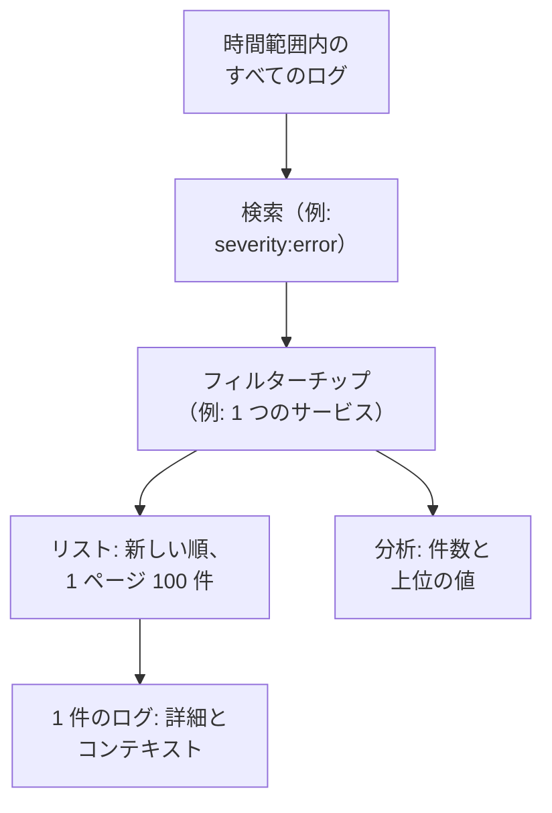

# ログエクスプローラー

ログエクスプローラーでは、サービス、ホスト、エージェントが OneUptime に送るログを検索して読みます。何百万行ものログを重要な数行まで絞り込み、新しいログを届いたそばから追い、チャートにし、チームが何度も使うビューを保存できます。

:::cards
- [ログの行を探す](#ログの行を探す): 時間範囲、検索、いくつかのフィルター。
- [ログを読む](#ログを読む): 属性、トレース、前後の行。
- [ログをライブで追う](#ログをライブで追う): 10 秒ごとに新しい行。
- [ビューを保存する](#ビューを保存する): 検索、フィルター、列を全員のために残します。
- [ログのインサイト](#ログのインサイト): 上位のエラー、重大度、誰が何をログに書いているか。
- [AI でエラーログ、ログの不足、ノイズの多いログを見つけて修正する](#ai-でエラーログログの不足ノイズの多いログを見つけて修正する): エラーを修正し、記録されていないものをログに出し、ノイズの多い行を減らすプルリクエスト。
:::

## エクスプローラーがログを絞り込む仕組み

**閲覧者** タブのすべては、1 つのログの集合を対象にします。時間範囲内にあり、検索とすべてのフィルターチップに一致するログです。どれかを変えると、リスト、ボリュームチャート、サイドバーの件数が一緒に変わります。

エクスプローラーには 5 つのタブがあります。

| タブ | 用途 |
| --- | --- |
| **閲覧者** | ログを検索し、絞り込み、読みます。直近一時間を新しい順に、100 件ずつ表示して開きます。 |
| **インサイト** | ある時間範囲にサービスが何をログに書いたか、何がうまくいかなかったか。 |
| **AI** | OneUptime がログで見つけたエラーログ、ログ出力の不足、ノイズの多いログと、それに対して OneUptime AI が行ったこと。[AI でエラーログ、ログの不足、ノイズの多いログを見つけて修正する](#ai-でエラーログログの不足ノイズの多いログを見つけて修正する) を参照してください。 |
| **セットアップガイド** | [取り込みキー](/docs/telemetry/ingestion-keys) のいずれかを使って、OpenTelemetry、Fluent Bit、Fluentd でログを送る方法。 |
| **設定** | 届いたログに何が起きるか: **パイプライン**、**破棄フィルター**、**スクラブルール**、**記録ルール**。 |

## 始める前に

- **届いているログ。** [OpenTelemetry](/docs/telemetry/open-telemetry)、[Fluent Bit](/docs/telemetry/fluentbit)、[Fluentd](/docs/telemetry/fluentd)、[Syslog](/docs/telemetry/syslog) のいずれかで送ります。**セットアップガイド** タブに、使っている言語やコレクター向けの設定が表示されます。
- **テレメトリを読み取れるロール。** Project Owner、Project Admin、Project Member、Viewer、Telemetry Admin、Telemetry Member、Telemetry Viewer のいずれか、または Read Telemetry Service Log 権限を持つカスタムロール。ロールのスコープによって、誰のログが見えるかが決まります。[テレメトリー](/docs/permissions/index#テレメトリー) を参照してください。

## ログの行を探す

:::steps
### 閲覧者を開く

**製品 → オブザーバビリティ → ログ** に移動します。**閲覧者** に直近 1 時間のログが新しい順に、**時間**、**サービス**、**重大度**、**メッセージ** とともに表示されます。

### 時間範囲を選ぶ

タイムピッカーで範囲を選ぶか、リストの上のボリュームチャートをドラッグして急増した部分にズームインします。チャートをダブルクリックすると元に戻ります。[時間範囲にズームインする](/docs/telemetry/charts-and-time-ranges) を参照してください。

### 検索する

検索ボックスにクエリを入力して Enter を押します。たとえば `severity:error service:checkout timeout` です。単語だけを書くとメッセージを検索し、`@key:value` は属性を検索します。[検索構文](/docs/telemetry/search-syntax#ログ) を参照してください。

### フィルターで絞り込む

**フィルター** サイドバーの値をクリックすると、チップとして追加されます。重大度、サービス、またはログを送ったホスト、クラスターなどのリソースです。各値には、その値を持つログの件数が表示されます。スマートフォンでは **フィルター** をタップしてサイドバーを開きます。

### ログを開く

行をクリックします。リストの横に詳細が開きます。
:::

検索、チップ、時間範囲はページのアドレスに保存されるため、再読み込み、ブックマーク、共有したリンクで同じログが開きます。

## ログを読む

詳細パネルには 2 つのタブがあります。

| タブ | 表示内容 |
| --- | --- |
| **詳細** | **ログ本文**、あれば **トレース ID**、**スパン ID**、**セッション**、そして **属性**（リストまたは JSON）。 |
| **コンテキスト** | 前後のログの中でのこのログ。**近傍（サービス + 時刻）** は、同じサービスのこのログの前後五行ずつを表示し、**このトレース** は、そのトレースのログを最大 100 件表示します。 |

- トレース ID をクリックすると、[トレースエクスプローラー](/docs/telemetry/traces-explorer) でリクエスト全体が開きます。
- 属性にポインターを合わせてフィルターアイコンをクリックすると、その値で検索できます。値をコピーすることもできます。すべての属性を JSON としてまとめてコピーできます。
- **このトレース** は、トレース内で書かれたログにだけ表示されます。

## ログをライブで追う

リストの上の **ライブ** をクリックします。エクスプローラーは新しい順に並べた最初のページに移動し、10 秒ごとに新しいログを確認するので、サービスが書いたそばから行が表示されます。

検索、フィルター、時間範囲を変えたり、結果の別のページに移動したりすると、ライブモードは自動的にオフになります。ライブモードは最新のログだけを表示するためです。再開するには、もう一度 **ライブ** をクリックします。

## 列を選んでエクスポートする

- **列** で、リストに表示する内容を選びます。**時間**、**サービス**、**重大度**、**メッセージ** が先頭に来ます。**トレース ID**、**スパン ID**、任意の属性を追加したり、列を上下に移動したり、**リセット** でデフォルトに戻したりできます。
- **エクスポート** は、表示しているページのログをダウンロードします。**CSV としてエクスポート** は表示している列を書き出し、**JSON としてエクスポート** は各ログのすべてのフィールドをすべての属性とともに書き出します。
- 見出し行にポインターを合わせ、列名の端にある線をドラッグすると、列を広げたり狭めたりできます。線をダブルクリックすると、列を内容に合わせます。リストはこのブラウザーで列の幅を記憶します。見出し行の端にある **列の幅をリセット** で、すべての列を元の幅に戻せます。

## ビューを保存する

保存済みビューは、検索、フィルターチップ、時間範囲、列、並び順、ページサイズを名前を付けて残します。

:::steps
### ビューを整える

検索し、絞り込み、残したい列を選びます。

### 保存する

**保存済みビュー** を開き、 **+ 現在のビューを保存** をクリックします。**名前** を入力し、誰かがログを開いたときに必ずこのビューを開く場合は **デフォルトに設定** にチェックを入れて、**ビューを保存** をクリックします。

### 使う

**保存済みビュー** からビューを選ぶと適用され、**ビューをクリア** を選ぶとフィルターのない直近 1 時間に戻ります。一覧のビューにポインターを合わせると、**編集** や **削除** ができます。適用中のビューは、変更を加えて **更新** できます。
:::

保存済みビューはプロジェクトに属するため、プロジェクトの全員に同じ一覧が表示されます。直近 1 時間のような相対的な範囲は相対的なままです。ビューは、保存した時点の 1 時間ではなく、開いた時点の直前 1 時間を表示します。プロジェクトにデフォルトのビューがない間は、次に保存したビューがデフォルトになります。プロジェクトのデフォルトは常に 1 つだけです。

## ログをチャートにする

リストを **分析** に切り替えると、ログを読む代わりに数えられます。時系列、トップリスト、テーブルのいずれかを選び、すべてのログを数えるか 1 つのフィールドの一意な値を数え、重大度、サービス、トレース、スパン、任意の属性でグループ化し、さらに 2 つ目のフィールドでグループ化します。トップリストとテーブルには、上位 5、10、25、50 のいずれかのグループが表示されます。

**リスト** をクリックすると、ログの行そのものに戻ります。

## 関連するトレースとメトリクスを開く

**保存済みビュー** の横にある **トレース** と **メトリクス** のボタンは、同じ時間枠で [トレースエクスプローラー](/docs/telemetry/traces-explorer) または [メトリクスエクスプローラー](/docs/telemetry/metrics-explorer) を開き、そのエクスプローラーが使える範囲で絞り込みを引き継ぎます。ボタンにポインターを合わせると、引き継げないものが表示されます。

## ログのインサイト

**インサイト** タブには、ある時間範囲にサービスが何をログに書いたか、何がうまくいかなかったかが表示されます。タイムピッカーの横のドロップダウンで、一部のサービス、ホスト、クラスターに絞り込めます。

| パネル | 表示内容 |
| --- | --- |
| 概要カード | **ログの総数**、**エラー**、**固有のエラー**、**報告しているソース**。 |
| **重大度の分布** | ログが重大度ごとにどう分かれているか。 |
| **上位のエラー** | 重大度 Error または Fatal で書かれた異なるメッセージを、多い順に並べたもの。 |
| **ログを報告しているソース** | サービス、ホスト、その他のソースごとのボリュームとエラーの兆候。 |

上位のエラーを選ぶと、その周辺で何が起きていたかを確認できます。いつ起きたか、発生に共通する点、どこで起きているか、それを含むトレース、最近の行です。**一致するログを開く** は、それらのログを **閲覧者** で開きます。**AI で説明** は、エラーとその根拠を編集できるプロンプトとして [AI に質問](/docs/ai/ask-ai) を開きます。

## AI でエラーログ、ログの不足、ノイズの多いログを見つけて修正する

OneUptime は 1 時間ごとに各サービスの直近 1 時間のログから、繰り返し記録されるエラー、ログに記録されない失敗、ログを埋め尽くす行を探し、見つかったものを根拠とともに AI インサイトとして記録します。続いて OneUptime AI がそれぞれを調べ、修正するプルリクエストを開きます。マージは一切されません。各プルリクエストはチームがレビューします。

OneUptime が記録する検出結果は 3 種類です。

| 検出結果 | OneUptime が記録する条件 | プルリクエスト |
| --- | --- | --- |
| **エラーログ** | サービスが同じメッセージを Error または Fatal でその一時間に 20 回以上記録した場合で、そのメッセージに固有の語句があり、例外がないもの。例外付きで、またはスタックトレースを含んで記録されたメッセージは、代わりに [例外トラッキング](/docs/telemetry/exceptions) で追跡されます。 | エラーが記録される原因を修正するか、ふさわしいレベルで記録するようにします。 |
| **ログ出力の不足** | ある操作のスパンがその一時間に 20 件以上失敗し、その割合が 5% 以上で、サービスのログのうち少なくとも 100 件がトレース ID を持っているのに、その操作の直近の失敗したリクエスト 20 件のどれもログ行を書いていない場合。または、サービスがその一時間に 500 件以上のログと 100 件以上のスパンを送り、トレース ID を持つログが 1% 未満の場合。 | 失敗が起きる場所でそれをログに記録するか、サービスのログがトレース ID を持つようにします。 |
| **ノイズの多いログ** | Error 未満で記録されるあるメッセージが、その一時間のサービスの行の 25% 以上、約 10,000 行以上を占める場合。 | その行のログ出力を減らします。Debug にする、バッチごとに一回にする、またはまったく記録しないようにします。 |

検出結果はメッセージをパターンとして保持します。数値や ID など、行ごとに変わる部分はマスクされます。プルリクエストはこのパターンで依頼され、記録されたままの行が使われることはありません。また OneUptime AI には、シークレットや個人データを決してログに記録せず、ログ行をプルリクエストにコピーしないよう指示しています。

エラーログのプルリクエストを OneUptime AI が自動で開くのは、原因のコードを見つけた場合だけです。依存先の停止など、ほかの場所から来るエラーには、誰かが **AI で修正** で依頼しない限りプルリクエストは開かれません。

### オンにする

**ログ → AI → 設定** に **エラーログ、ログの不足、ノイズの多いログを見つけて修正する** スイッチがあり、新しいプロジェクトではオンになっています。**AI を有効化** がオフの場合、エラーログ、ログの不足、ノイズの多いログは引き続き見つかりますが、OneUptime AI は何もしません。プルリクエストを開くには、[コード](/docs/ai/ai-agent) で接続したリポジトリが必要です。足りないものはページが最初に示します。各リポジトリのコードは、そのリポジトリがコードで選んだ Runner 上で変更されます。

OneUptime AI が自動で開くプルリクエストは、修正するすべてのテレメトリを合わせて 1 日 (UTC) 最大 5 件で、検出結果ごとに 1 件です。リポジトリの開いている AI プルリクエストの上限を超えることはありません。

### AI ルール

ルールがない場合、OneUptime AI はログで見つけた問題をすべてすぐに調査し、修正できるものにはプルリクエストを開きます。**その他の設定** の **AI ルール** で、これを 3 つのステップで絞り込みます。

| ステップ | 決めること |
| --- | --- |
| **一致** | 対象のサービス: 選んだもの、特定のラベルを持つもの、または名前がパターンに一致するもの。 |
| **調査** | **すぐに**、または **待機後もまだ見つかる場合のみ**。待機中に解消した問題は調査されません。 |
| **修正** | **修正しない**、**修正前に確認する**、または **確認せずに修正する**。先に確認する場合、プルリクエストは人に任されます。検出結果に **AI で修正** が表示されます。 |

**その他の項目** では、ルールごとに OneUptime AI が使えるコードリポジトリ、MCP サーバー、LLM プロバイダーを選びます。何も選ばない場合はすべてを使え、プロジェクトの既定の LLM プロバイダーを使います。

### 実行内容を確認する

- **ログ → AI → インサイト** には OneUptime が見つけたものが一覧され、各検出結果に根拠と **ログで開く** があります。これは、見つかった時間帯の対象の行を **閲覧者** で開きます。ログ行を書かない失敗には開く行がないため、代わりに **トレースで開く** がその失敗したスパンを開きます。エラーログでは、**モニターを作成** で、そのメッセージの行を数えるログモニターを作成できます。
- **ログ → AI → アクティビティ** にはすべての調査とプルリクエストが新しい順に、それぞれの状態とともに一覧されます。完了した調査には、OneUptime AI が見つけたことも表示されます。たとえばエラーの原因がコードの外にあったことで、そのエラーログに自動でプルリクエストが開かれなかったのはそのためです。
- コードでは、タスクに OneUptime が開始したことが検出結果へのリンクとともに示され、プルリクエストにはそれを開いた理由が書かれます。

## 届いたログに何が起きるか

**設定** タブには、OneUptime がすべてのログを保存する前に適用するルールがあります。ルールはその後に届くログに作用し、保存済みのログには作用しません。各ログをどれだけの期間保持するかも、届いた時点で決まります。[データ保持](/docs/telemetry/data-retention) を参照してください。

| ルール | 動作 |
| --- | --- |
| **破棄フィルター** | 残したくないログを破棄するか、そのサンプルだけを残します。[レコードを破棄またはサンプリングする](/docs/telemetry/drop-filters-and-scrub-rules#レコードを破棄またはサンプリングする) を参照してください。 |
| **スクラブルール** | メールアドレスやカード番号などの機密データをマスクします。[機密データをスクラブする](/docs/telemetry/drop-filters-and-scrub-rules#機密データをスクラブする) を参照してください。 |
| **パイプライン** | メッセージからフィールドを取り出し、重大度を直し、属性の名前を変えます。[ログパイプライン](/docs/telemetry/log-pipelines) を参照してください。 |
| **記録ルール** | 一致するログをメトリクスに変えます。[ログの記録ルール](/docs/telemetry/log-recording-rules) を参照してください。 |

## キーボードショートカット

閲覧者で `?` を押すと、これらが表示されます。

| キー | 動作 |
| --- | --- |
| `j` / `k` | 次または前のログに移動します。 |
| Enter | 選択したログを開くか閉じます。 |
| Esc | 詳細パネルを閉じます。 |
| `/` | 検索ボックスに移動します。 |
| ⌘ + Enter または Ctrl + Enter | 検索を適用します。 |
| `?` | ショートカットを表示または非表示にします。 |

## トラブルシューティング

:::details ログが表示されない
まず時間範囲を広げてください。閲覧者は直近 1 時間で開きます。それでもリストが空の場合は、設定を **セットアップガイド** と比べ、ロールのスコープにログを送るサービスが含まれているか確認してください。
:::

:::details 検索が時間切れになったと表示される
45 秒を超えて実行される検索は停止されます。時間範囲を短くするか、サービスなどの正確な値を追加して、OneUptime がインデックスを使えるようにしてください。[検索構文](/docs/telemetry/search-syntax#知っておくと便利なこと) を参照してください。
:::

:::details ライブが何度もオフになる
ライブモードは最新のログだけを追うため、検索、フィルター、時間範囲、ページを変えるとオフになります。フィルターを決めてから、もう一度 **ライブ** をクリックしてください。
:::

## 次のステップ

:::cards
- [検索構文](/docs/telemetry/search-syntax): 検索ボックスが理解するすべてのフィルター。
- [ログ モニター](/docs/monitor/logs-monitor): 探しているログが現れたらアラートを受け取ります。
- [ログパイプライン](/docs/telemetry/log-pipelines): ログの行の一部を、絞り込みに使える属性に変えます。
- [トレースエクスプローラー](/docs/telemetry/traces-explorer): ログのリクエストをサービス間で追跡します。
:::
